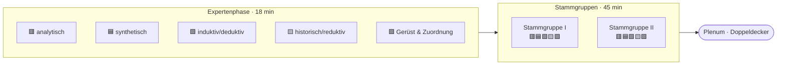

<!--
author:   Hannes Tegelbeckers
email:    hannes.tegelbeckers@ovgu.de
version:  0.1.0-test
language: de
narrator: Deutsch Female
mode:     Presentation
classroom: enable
comment:  Fachdidaktik technischer Allgemeinbildung II – Übung zu S06: Gruppenpuzzle mit Micro-Teaching am Leitgegenstand Fahrrad. Die Studierenden erleben das Gruppenpuzzle, unterrichten je eine Großform und trainieren die mündliche Prüfung.
import:   https://raw.githubusercontent.com/LiaTemplates/mermaid_template/0.1.4/README.md
-->

# Übung S06 – Gruppenpuzzle mit Micro-Teaching (Testversion)

Fachdidaktik technischer Allgemeinbildung II · OVGU Magdeburg · Übung zu S06 Methodische Großformen · ca. 10 Teilnehmende · 90 min

<!-- didaktik="Planungsraster Übung A · 10 TN = 5 Expertenpaare, 2 Stammgruppen à 5 · 0–7 Einstieg (Vote, Einteilung) · 7–25 Expertenphase (Großform reaktivieren, Micro-Teaching planen, Prüfungsantwort vorbereiten) · 25–70 Stammgruppen: 5 Runden à 9 min (5 Micro-Teaching · 3 Prüfungsrunde · 1 Notiz/Wechsel) · 70–80 Plenum Inhalt (Akzent-Matrix, These) · 80–88 Doppeldecker-Reflexion · 88–90 Abschluss · Voraussetzung: Inhalte S01–S11 bekannt" -->

> [!WARNING] 🧪 Testversion
> Diese Übung wird erprobt. Inhalte, Zeiten und Simulationen können sich noch ändern – Rückmeldungen sind willkommen.

> [!IMPORTANT] 🧭 Leitfrage
> Wie unterrichte ich **mit** einer Großform – und wie erkläre ich sie in der **mündlichen Prüfung**?

> [!TIP] 💻 Heute digital
> Sie brauchen ein Gerät pro Person. Alle Simulationen laufen im Browser: [Fahrrad-Werkzeugkasten](https://ovgu-vet-teched.github.io/Fachdidaktik_technischer_Allgemeinbildung_II/Methodenszenarien_Grossformen/A_Gruppenpuzzle_MicroTeaching/fahrrad_werkzeugkasten.html) · [Prüfungskarten](https://ovgu-vet-teched.github.io/Fachdidaktik_technischer_Allgemeinbildung_II/Methodenszenarien_Grossformen/shared/pruefungskarten.html?pool=A)

## Einstieg: Ein Fahrrad – wie viele Technikstunden?

    --{{0}}--
Ein Fahrrad. Wie viele verschiedene Technikstunden stecken darin? Und eine These zum Start, über die wir am Ende noch einmal abstimmen.

**Wie viele verschiedene Technikstunden stecken in einem Fahrrad?** Nennen Sie in einem Stichwort eine Stunde, die Sie dazu halten würden.

[[___]]

    --{{1}}--
Und die These aus S06 – stimmen Sie ab.

      {{1}}
****************************************

> **„Der Gegenstand legt fest, welche Großform ich im Unterricht verwende.“**

**Vote (vorher):**

[(a)] Ja, ich stimme zu
[(b)] Nein, ich stimme nicht zu
[(c)] Teils, teils

****************************************

## Ziele der Übung

    --{{0}}--
Heute arbeiten Sie auf zwei Ebenen. Inhaltlich wiederholen Sie die Großformen und trainieren die mündliche Prüfung. Methodisch erleben Sie ein Gruppenpuzzle mit Micro-Teaching und reflektieren es als Lehrkraft.

<!-- data-type="none" -->
| Ebene | Sie können am Ende … |
| --- | --- |
| **Inhalt** | eine Großform mit Akzent, typischen Schritten und Beispiel **erläutern** und an einem Gegenstand **unterrichten** |
| **Prüfung** | eine Prüfungsfrage nach dem Muster Begriff – Erläutern – Beispiel – Verbinden in 2 Minuten **beantworten** |
| **Methode** | das Gruppenpuzzle aus Lernenden- und Lehrendensicht **beurteilen** und seinen Einsatz im eigenen Unterricht **begründen** |

    --{{1}}--
Das ist ein pädagogischer Doppeldecker: Die Methode, mit der Sie lernen, ist selbst Gegenstand.

      {{1}}
> [!NOTE] 🪞 Doppeldecker
> Die Methode, mit der Sie heute lernen, ist selbst Lerngegenstand. Achten Sie darauf, was die Lehrperson **tut** – und was sie **weglässt**.

## Ablauf: Gruppenpuzzle mit fünf Expertenpaaren

    --{{0}}--
So läuft die Übung: Fünf Expertenpaare erarbeiten je einen Bereich. Dann verteilen sich die Paare auf zwei Stammgruppen, sodass in jeder Stammgruppe aus jedem Bereich eine Person sitzt.

    --{{1}}--
Pro Runde in der Stammgruppe: fünf Minuten Micro-Teaching, drei Minuten Prüfungsrunde, eine Minute Notiz und Wechsel.

      {{1}}
<!-- data-type="none" -->
| Zeit | Phase | Sozialform |
| --- | --- | --- |
| 0–7 | Einstieg, Einteilung | Plenum |
| 7–25 | Expertenphase: Großform reaktivieren · Micro-Teaching planen · Prüfungsantwort vorbereiten | Paar |
| 25–70 | 5 Runden à 9 min: **5 min Micro-Teaching · 3 min Prüfungsrunde · 1 min Notiz** | Stammgruppe |
| 70–80 | Akzent-Matrix und These | Plenum |
| 80–88 | Doppeldecker-Reflexion | Plenum |
| 88–90 | Abschluss | einzeln |

<!-- didaktik="Einteilung: 10 Karten (2× je Farbe, Nummer I oder II). Bei 9 TN: Lila entfällt als Paar – eine Person übernimmt Lila allein und unterrichtet in beiden Stammgruppen nacheinander (Runde 5 in Gruppe I, dann Gruppe II mit 5 min Versatz) oder Lila wird ins Plenum verlegt. Bei 11–12 TN: ein Paar wird Trio, Trios teilen sich auf beide Stammgruppen + 1 Prozessbeobachter/in." -->

## Ihre Expertenkarte

    --{{0}}--
Ziehen Sie eine Karte. Die Farbe ist Ihr Expertenbereich, die römische Zahl Ihre Stammgruppe.

<!-- data-type="none" -->
| Farbe | Bereich | Großformen (Pahl) | Ihre Fahrrad-Sequenz | Reiter im Werkzeugkasten |
| --- | --- | --- | --- | --- |
| 🟥 | analytisch | Diagnoseaufgabe, Fallstudie, Instandsetzungsanalyse, Konstruktionsanalyse (R103–R110) | „Das Rücklicht leuchtet nicht.“ | `#rot` |
| 🟦 | synthetisch | Fertigungs-, Inspektions-, Konstruktions-, Instandsetzungsaufgabe, Szenariomethode (R111–R120) | „Ist dieses Fahrrad verkehrssicher?“ | `#blau` |
| 🟩 | induktiv · deduktiv | Technisches Experiment; Konstruktionsaufgabe deduktiv (R121–R123) | Übersetzung – einmal gefunden, einmal angewendet | `#gruen` |
| 🟨 | historisch · reduktiv | Historisch-genetisches Verfahren; Naturstudie (R124–R127) | Hochrad → Niederrad · Grashalm → Rahmenrohr | `#gelb` |
| 🟪 | Gerüst & Zuordnung | gemeinsames Gerüst, intuitive Phase, „mit Vorsicht zu genießen“ (R101) | Zuordnungs-Challenge: zehn Fahrrad-Stunden | `#lila` |

    --{{1}}--
Die Lila-Gruppe hat eine besondere Rolle: Sie unterrichtet zuletzt und bündelt, was die anderen gezeigt haben.

      {{1}}
> [!NOTE] 🟪 Sonderrolle Lila
> Lila unterrichtet in Runde 5 und knüpft an die vier Sequenzen davor an: *Welcher Akzent war wo – und wo nicht eindeutig?*

## Expertenphase (18 min)

    --{{0}}--
In der Expertenphase haben Sie drei Aufträge. Sie kennen die Inhalte aus der Vorlesung – jetzt geht es darum, sie zu unterrichten und frei zu erklären.

<!-- didaktik="Lehrperson geht von Paar zu Paar · zwei typische Fehler: (1) Referat ÜBER die Großform statt Unterricht MIT ihr → 'Was tun Ihre Lernenden in Minute 2?' (2) ganze Großform in 5 min → '2–3 Schritte live, Rest auf dem Ablaufplakat (digital: Pahl-Leiste im Werkzeugkasten)'" -->

**① Reaktivieren (5 min):** Klären Sie zu zweit: Merkmale, typische Schritte nach Pahl, Folienbeispiel. Ein Satz: *Was haben die Großformen Ihres Bereichs gemeinsam?*

[[___ ___]]

    --{{1}}--
Dann planen Sie Ihre Sequenz mit dem Werkzeugkasten.

      {{1}}
****************************************

**② Micro-Teaching planen (10 min):** 5 Minuten, Ihre Mitlernenden sind Schülerinnen und Schüler der Klasse 9.

- Problemstellung in einem Satz – womit steigen Sie ein?
- Welche **2–3 Schritte** nach Pahl zeigen Sie **live** (die Lernenden bedienen die Simulation)?
- Wie machen Sie in der letzten Minute den **Akzent** sichtbar?
- Prüffrage: Sind die Lernenden in mindestens **3 von 5 Minuten** selbst aktiv?

**Mein Minutenplan:**

[[___ ___ ___ ___]]

****************************************

    --{{2}}--
Und schließlich bereiten Sie sich auf die Prüfungsrunde vor.

      {{2}}
****************************************

**③ Prüfungsantwort vorbereiten (3 min):** Öffnen Sie die Prüfungskarten mit Ihrem Farbpool und gehen Sie die Fragen durch. Jede Person muss **jede** Frage ihres Pools beantworten können – in der Stammgruppe sind Sie allein.

****************************************

## Werkzeugkasten

    --{{0}}--
Hier ist der Werkzeugkasten. Wählen Sie Ihren Reiter. In der Stammgruppe zeigen Sie ihn auf Ihrem Gerät oder teilen den Bildschirm.

<iframe src="https://ovgu-vet-teched.github.io/Fachdidaktik_technischer_Allgemeinbildung_II/Methodenszenarien_Grossformen/A_Gruppenpuzzle_MicroTeaching/fahrrad_werkzeugkasten.html" style="width:100%;height:760px;border:1px solid #cfd3d6;border-radius:8px" title="Fahrrad-Werkzeugkasten"></iframe>

[Werkzeugkasten in neuem Tab öffnen](https://ovgu-vet-teched.github.io/Fachdidaktik_technischer_Allgemeinbildung_II/Methodenszenarien_Grossformen/A_Gruppenpuzzle_MicroTeaching/fahrrad_werkzeugkasten.html)

## Stammgruppe: so läuft eine Runde (9 min)

    --{{0}}--
In der Stammgruppe gibt es fünf Runden zu je neun Minuten. Die Reihenfolge ist Rot, Blau, Grün, Gelb, Lila. Die Rollen wechseln jede Runde.

<!-- didaktik="Timer am Beamer: 5:00 – 3:00 – 1:00 · Lehrperson greift inhaltlich nicht ein, nur Zeit · Rollen pro Runde: 1 Expertin/Experte unterrichtet und wird geprüft, 1 Prüfer/in, 1 Beisitz, 2 Lernende (nur im Micro-Teaching aktiv, in der Prüfungsrunde beobachtend)" -->

<!-- data-type="none" -->
| Minute | Was passiert | Rollen |
| --- | --- | --- |
| 0–5 | **Micro-Teaching:** Die Expertin bzw. der Experte unterrichtet, die anderen sind Lernende der Klasse 9. | alle |
| 5–8 | **Prüfungsrunde:** Prüfer/in zieht eine Karte aus dem Pool der Farbe, 2 min Antwort, 1 min Rückmeldung nach dem Antwortmuster | Prüfling = Expert/in · Prüfer/in · Beisitz |
| 8–9 | **Notiz** im Beobachtungsbogen (nächste Folie), Wechsel | alle |

    --{{1}}--
Die Rollen Prüfer und Beisitz rotieren, damit jede Person einmal prüft und einmal bewertet.

      {{1}}
<!-- data-type="none" -->
| Runde | Unterrichtet + Prüfling | Prüfer/in | Beisitz |
| --- | --- | --- | --- |
| 1 | 🟥 | 🟪 | 🟦 |
| 2 | 🟦 | 🟥 | 🟩 |
| 3 | 🟩 | 🟦 | 🟨 |
| 4 | 🟨 | 🟩 | 🟪 |
| 5 | 🟪 | 🟨 | 🟥 |

## Prüfungskarten

    --{{0}}--
Die Prüfungskarten: Die prüfende Person zieht eine Frage und wählt die Ansicht Prüfer. Der Prüfling öffnet dieselbe Karte über die Kartennummer in der Ansicht Prüfling. Der Beisitz bewertet die vier Schritte des Antwortmusters.

> [!TIP] 🎙️ Antwortmuster
> **1 Begriff** (mit Autor) → **2 Erläutern** (Merkmale, Schritte) → **3 Beispiel** (Folie + eigenes) → **4 Verbinden** (Grenze, andere Sitzung). Sagen Sie die Struktur an: *„Ich erkläre zuerst …“*

<iframe src="https://ovgu-vet-teched.github.io/Fachdidaktik_technischer_Allgemeinbildung_II/Methodenszenarien_Grossformen/shared/pruefungskarten.html?pool=A" style="width:100%;height:720px;border:1px solid #cfd3d6;border-radius:8px" title="Prüfungskarten"></iframe>

[Prüfungskarten in neuem Tab öffnen](https://ovgu-vet-teched.github.io/Fachdidaktik_technischer_Allgemeinbildung_II/Methodenszenarien_Grossformen/shared/pruefungskarten.html?pool=A)

## Beobachtungsbogen

    --{{0}}--
Nach jeder Runde notieren Sie kurz, was Sie als Lernende erlebt haben. Das brauchen wir gleich im Plenum.

**Nach jeder Runde (1 min):** Großform · was ich getan habe (ein Verb) · Hauptakzent · Nebenakzent, den ich auch bemerkt habe.

🟥 Rot:

[[___ ___]]

🟦 Blau:

[[___ ___]]

🟩 Grün:

[[___ ___]]

🟨 Gelb:

[[___ ___]]

🟪 Lila:

[[___ ___]]

**Prüfungsrunde – mein Ergebnis als Prüfling (Punkte laut Beisitz, 0–8):**

[[___]]

## Plenum: Akzent-Matrix

    --{{0}}--
Zurück im Plenum. Tragen Sie für jede Sequenz alle Akzente ein, die Sie erlebt haben – Haupt- und Nebenakzente. Die Ergebnisse aller erscheinen gemeinsam.

<!-- didaktik="Klassenraum-Modus (classroom: enable): Ergebnisse werden live aggregiert · Leitfrage: Wo stehen die Häkchen nicht nur in einer Spalte?" -->

**Welche Akzente haben Sie in welcher Sequenz erlebt?** (mehrere möglich)

[[analytisch] [synthetisch] [induktiv] [deduktiv] [historisch] [reduktiv]]
[                                                                         ] 🟥 Diagnose Rücklicht
[                                                                         ] 🟦 Inspektion Verkehrssicherheit
[                                                                         ] 🟩 Übersetzung (Experiment / Konstruktion)
[                                                                         ] 🟨 Hochrad → Niederrad / Grashalm
[                                                                         ] 🟪 Zuordnungs-Challenge

    --{{1}}--
Und nun die These vom Anfang noch einmal.

      {{1}}
****************************************

> **„Der Gegenstand legt fest, welche Großform ich im Unterricht verwende.“**

**Vote (nachher):**

[(a)] Ja, ich stimme zu
[(b)] Nein, ich stimme nicht zu
[(c)] Teils, teils

****************************************

    --{{2}}--
Was hat das Fahrrad gezeigt?

      {{2}}
> [!NOTE] Key message
> Derselbe Gegenstand trug fünf verschiedene Großformen. Über den Akzent entscheidet die **Denk- und Vorgehensrichtung**, nicht der Gegenstand – und der Akzent ist ein **Schwerpunkt, keine Ausschließlichkeit** (R101).

## Doppeldecker-Reflexion (8 min)

    --{{0}}--
Wechseln Sie die Perspektive. Sie sind jetzt wieder Lehrkräfte und schauen auf die Methode, die Sie gerade erlebt haben.

<!-- didaktik="8 min · 3 Fragen à ca. 2,5 min · Erwartungshorizont unten im details-Block, nicht vorlesen" -->

**1 · Erleben:** Wie hat sich die Verantwortung als einzige Expertin bzw. einziger Experte in der Stammgruppe angefühlt? Was passierte, wenn eine Sequenz schwach war?

**2 · Analysieren:** Welche Bedingungen hat die Lehrperson gesetzt, damit das Puzzle funktioniert?

**3 · Übertragen:** Für welches Thema in Ihrer Fachrichtung würden Sie ein Gruppenpuzzle einsetzen – und wann **nicht**?

[[___ ___ ___]]

✅ Erwartungshorizont

- **Bedingungen:** klare Rollen per Karte, gemeinsamer Gegenstand, enger Zeittakt, Vorgaben für die Sequenz (3 von 5 Minuten aktiv), Pflicht „jede Person kann allein“, Sicherung durch Plenum.
- **Einordnung (S08):** Expertenphase aufgabenverschieden, Stammgruppe arbeitsteilig – das Gruppenpuzzle ist eine Organisationsform der Gruppenarbeit, **keine** Großform. Die Großformen steckten **in** den Sequenzen.
- **Grenzen:** Lücken, wenn eine Expertengruppe Fehler weitergibt; geeignet nur bei teilbaren, etwa gleichwertigen Teilthemen; ohne Sicherung bleibt Wissen ungleich verteilt.

## Abschluss

    --{{0}}--
Zum Schluss: Wie sicher fühlen Sie sich jetzt für die Prüfung? Üben Sie mit den Prüfungskarten und dem Prüfungstrainer weiter.

**Einschätzen:** Wie sicher beantworten Sie eine Frage zu …

[(sicher)(teilweise)(noch unsicher)]
[                                    ] analytisch akzentuierten Großformen
[                                    ] synthetisch akzentuierten Großformen
[                                    ] induktiv / deduktiv akzentuierten Großformen
[                                    ] historisch / reduktiv akzentuierten Großformen
[                                    ] Gerüst und „mit Vorsicht zu genießen“

> [!TIP] 📚 Weiterüben
> [Prüfungskarten – alle Fragen](https://ovgu-vet-teched.github.io/Fachdidaktik_technischer_Allgemeinbildung_II/Methodenszenarien_Grossformen/shared/pruefungskarten.html?pool=alle) · [Prüfungstrainer](https://liascript.github.io/course/?https://raw.githubusercontent.com/OVGU-VET-TechEd/Fachdidaktik_technischer_Allgemeinbildung_II/main/Selflearn/Pruefungstrainer.md) · [Selbstlerneinheit S06](https://liascript.github.io/course/?https://raw.githubusercontent.com/OVGU-VET-TechEd/Fachdidaktik_technischer_Allgemeinbildung_II/main/Selflearn/S06_Grossformen.md)

<small>Großformen nach Pahl (Folien R101–R127); Antwortmuster wie im Prüfungstrainer (S11); Gruppenarbeitsvarianten nach S08 (R150–R151). Die Prüfungsfragen sind Übungsfragen – es ist nicht garantiert, dass sie in dieser Form gestellt werden.</small>
