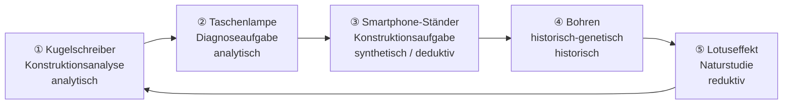

<!--
author:   Hannes Tegelbeckers
email:    hannes.tegelbeckers@ovgu.de
version:  0.1.0-test
language: de
narrator: Deutsch Female
mode:     Presentation
classroom: enable
comment:  Fachdidaktik technischer Allgemeinbildung II – Übung zu S06: Digitale Methodenwerkstatt mit fünf Simulationsstationen. Die Studierenden erleben Stationenlernen, bearbeiten je eine Großform als Lernende und trainieren die mündliche Prüfung.
import:   https://raw.githubusercontent.com/LiaTemplates/mermaid_template/0.1.4/README.md
-->

# Übung S06 – Digitale Methodenwerkstatt (Testversion)

Fachdidaktik technischer Allgemeinbildung II · OVGU Magdeburg · Übung zu S06 Methodische Großformen · ca. 10 Teilnehmende · 90 min

<!-- didaktik="Planungsraster Übung B · 10 TN = 5 Paare, 5 Stationen · 0–6 Einstieg · 6–56 Werkstatt: 5 Rotationen à 10 min (7 Aufgabe als Lernende · 3 Laufzettel + Mini-Prüfung im Paar) · 56–64 Akzent-Wand (Klassenraum-Umfrage) · 64–80 Prüfungssimulation (Paare, dann 2 Freiwillige im Plenum) · 80–88 Doppeldecker-Reflexion · 88–90 Abschluss · Voraussetzung: Inhalte S01–S11 bekannt · alles digital, keine realen Werkzeuge" -->

> [!WARNING] 🧪 Testversion
> Diese Übung wird erprobt. Inhalte, Zeiten und Simulationen können sich noch ändern – Rückmeldungen sind willkommen.

> [!IMPORTANT] 🧭 Leitfrage
> Wie fühlt sich eine Großform **von innen** an – und wie erkläre ich sie in der **mündlichen Prüfung**?

> [!TIP] 💻 Heute digital
> Ein Gerät pro Person. Jede Station ist eine Simulation im Browser; die Links stehen auf den Stationsfolien.

## Einstieg: Eindeutig zuzuordnen?

    --{{0}}--
Sie kennen die These aus S06. Heute prüfen Sie sie nicht an Folien, sondern an Ihrer eigenen Erfahrung. Stimmen Sie ab.

> **„Jede Großform lässt sich eindeutig einer logischen Methode zuordnen.“**

**Vote (vorher):**

[(a)] Ja, ich stimme zu
[(b)] Nein, ich stimme nicht zu
[(c)] Teils, teils

    --{{1}}--
Sie haben dazu eine Meinung aus der Vorlesung. Heute sammeln Sie eigene Belege.

      {{1}}
> [!NOTE] 🪞 Doppeldecker
> Sie arbeiten heute an jeder Station **als Lernende** – und notieren danach **als Lehrkraft**, welche Schritte und Akzente Sie tatsächlich erlebt haben.

## Ziele der Übung

    --{{0}}--
Drei Ebenen: Inhalt, Prüfung, Methode.

<!-- data-type="none" -->
| Ebene | Sie können am Ende … |
| --- | --- |
| **Inhalt** | Großformen an einer selbst bearbeiteten Aufgabe **wiedererkennen**, ihre typischen Schritte **identifizieren** und Nebenakzente **begründen** |
| **Prüfung** | eine Prüfungsfrage nach dem Muster Begriff – Erläutern – Beispiel – Verbinden **beantworten** und mit eigenen Beispielen aus der Werkstatt **belegen** |
| **Methode** | die Methodenwerkstatt als Organisationsform **beurteilen** und von einer Großform **unterscheiden** |

## Ablauf und Stationen

    --{{0}}--
Fünf Stationen, fünf Paare. Jedes Paar beginnt an einer anderen Station und wechselt alle zehn Minuten.

    --{{1}}--
Pro Station: sieben Minuten arbeiten Sie als Lernende, drei Minuten füllen Sie den Laufzettel aus und prüfen sich gegenseitig mit einer Frage.

      {{1}}
<!-- data-type="none" -->
| Zeit | Phase | Sozialform |
| --- | --- | --- |
| 0–6 | Einstieg | Plenum |
| 6–56 | 5 × 10 min: **7 min Station als Lernende · 3 min Laufzettel + Mini-Prüfung** | Paar |
| 56–64 | Akzent-Wand | Plenum |
| 64–80 | Prüfungssimulation | Paar, dann Plenum |
| 80–88 | Doppeldecker-Reflexion | Plenum |
| 88–90 | Abschluss | einzeln |

    --{{2}}--
Wichtig: Sie müssen eine Station nicht vollständig schaffen. Ziel ist, die Schritte zu erleben, nicht fertig zu werden.

      {{2}}
> [!WARNING] Nicht fertig werden müssen
> Sieben Minuten reichen nicht für eine vollständige Großform – im Unterricht wäre es eine Doppelstunde. Die **Pahl-Leiste** oben in jeder Simulation zeigt, wie weit Sie gekommen sind. Genau das notieren Sie.

<!-- didaktik="Startstationen: Paar 1→①, 2→②, 3→③, 4→④, 5→⑤ · Gong/Timer bei 7:00 und 10:00 · Mini-Prüfung: Person A fragt bei ungeraden, Person B bei geraden Rotationen · Lehrperson geht herum, fragt 'Welchen Schritt machen Sie gerade?', verrät keine Lösungen" -->

## Laufzettel und Mini-Prüfung

    --{{0}}--
So funktionieren die drei Minuten nach jeder Station.

**Laufzettel (2 min, einzeln, auf der jeweiligen Stationsfolie):** Was habe ich getan? · Bis zu welchem Schritt nach Pahl kam ich? · Hauptakzent · Nebenakzent und **wo** er vorkam.

**Mini-Prüfung (1 min, im Paar):** Eine Person stellt die Prüfungskarte der Station, die andere antwortet in **einer Minute** nur mit **1 Begriff** und **3 Beispiel aus der Station**. Rollen wechseln bei jeder Station.

> [!TIP] 🎙️ Antwortmuster
> **1 Begriff** (mit Autor) → **2 Erläutern** → **3 Beispiel** → **4 Verbinden**. In der Mini-Prüfung üben Sie die Schritte 1 und 3, in der Prüfungssimulation später alle vier.

## Station ① – Konstruktionsanalyse: Druckkugelschreiber

    --{{0}}--
Station eins: Warum bleibt die Mine drin? Sie analysieren eine fertige Konstruktion.

<iframe src="https://ovgu-vet-teched.github.io/Fachdidaktik_technischer_Allgemeinbildung_II/Methodenszenarien_Grossformen/B_Methodenwerkstatt/station1_kugelschreiber.html" style="width:100%;height:760px;border:1px solid #cfd3d6;border-radius:8px" title="Station 1"></iframe>

[Station ① in neuem Tab öffnen](https://ovgu-vet-teched.github.io/Fachdidaktik_technischer_Allgemeinbildung_II/Methodenszenarien_Grossformen/B_Methodenwerkstatt/station1_kugelschreiber.html) · [Prüfungskarte ①](https://ovgu-vet-teched.github.io/Fachdidaktik_technischer_Allgemeinbildung_II/Methodenszenarien_Grossformen/shared/pruefungskarten.html?pool=st1)

**Laufzettel ①:** getan · erreichter Schritt · Hauptakzent · Nebenakzent (wo?)

[[___ ___ ___ ___]]

<!-- didaktik="Erwartet: analytisch; Nebenakzente induktiv (mehrmals drücken und daraus schließen), synthetisch (Zusammenbau) · Grenze der Simulation: kein haptisches Zerlegen" -->

## Station ② – Diagnoseaufgabe: Taschenlampe

    --{{0}}--
Station zwei: Die Taschenlampe bleibt dunkel. Sie diagnostizieren einen Fehler – erst planen, dann messen.

<iframe src="https://ovgu-vet-teched.github.io/Fachdidaktik_technischer_Allgemeinbildung_II/Methodenszenarien_Grossformen/B_Methodenwerkstatt/station2_taschenlampe.html" style="width:100%;height:760px;border:1px solid #cfd3d6;border-radius:8px" title="Station 2"></iframe>

[Station ② in neuem Tab öffnen](https://ovgu-vet-teched.github.io/Fachdidaktik_technischer_Allgemeinbildung_II/Methodenszenarien_Grossformen/B_Methodenwerkstatt/station2_taschenlampe.html) · [Prüfungskarte ②](https://ovgu-vet-teched.github.io/Fachdidaktik_technischer_Allgemeinbildung_II/Methodenszenarien_Grossformen/shared/pruefungskarten.html?pool=st2)

**Laufzettel ②:** getan · erreichter Schritt · Hauptakzent · Nebenakzent (wo?)

[[___ ___ ___ ___]]

<!-- didaktik="Erwartet: analytisch; Nebenakzente induktiv (Hypothesen), deduktiv (vom Stromkreismodell auf die Messung), synthetisch (Instandsetzen im Kontrollschritt) · Lampen A–D haben feste Fehler, Zufall zieht einen von fünf" -->

## Station ③ – Konstruktionsaufgabe: Smartphone-Ständer

    --{{0}}--
Station drei: Ein Ständer aus einem Stück Pappe. Wählen Sie zuerst den Modus – synthetisch oder deduktiv. Wer früh fertig ist, probiert den anderen Modus.

<iframe src="https://ovgu-vet-teched.github.io/Fachdidaktik_technischer_Allgemeinbildung_II/Methodenszenarien_Grossformen/B_Methodenwerkstatt/station3_smartphone_staender.html" style="width:100%;height:760px;border:1px solid #cfd3d6;border-radius:8px" title="Station 3"></iframe>

[Station ③ in neuem Tab öffnen](https://ovgu-vet-teched.github.io/Fachdidaktik_technischer_Allgemeinbildung_II/Methodenszenarien_Grossformen/B_Methodenwerkstatt/station3_smartphone_staender.html) · [Prüfungskarte ③](https://ovgu-vet-teched.github.io/Fachdidaktik_technischer_Allgemeinbildung_II/Methodenszenarien_Grossformen/shared/pruefungskarten.html?pool=st3)

**Laufzettel ③:** gewählter Modus · erreichter Schritt · Hauptakzent · Nebenakzent (wo?)

[[___ ___ ___ ___]]

<!-- didaktik="Kernstation für die These: Paare im Modus 'synthetisch' probieren (induktiv), Paare im Modus 'deduktiv' rechnen zuerst · in der Akzent-Wand Streuung synthetisch/deduktiv erwartet → R117 vs. R123 · Startwerte bewusst instabil (Fuß zu kurz)" -->

## Station ④ – Historisch-genetisch: Bohren

    --{{0}}--
Station vier: Wie kommt das Loch ins Holz? Sie verfolgen die Entwicklung vom Fiedelbohrer bis zum Akkubohrschrauber.

<iframe src="https://ovgu-vet-teched.github.io/Fachdidaktik_technischer_Allgemeinbildung_II/Methodenszenarien_Grossformen/B_Methodenwerkstatt/station4_bohren.html" style="width:100%;height:760px;border:1px solid #cfd3d6;border-radius:8px" title="Station 4"></iframe>

[Station ④ in neuem Tab öffnen](https://ovgu-vet-teched.github.io/Fachdidaktik_technischer_Allgemeinbildung_II/Methodenszenarien_Grossformen/B_Methodenwerkstatt/station4_bohren.html) · [Prüfungskarte ④](https://ovgu-vet-teched.github.io/Fachdidaktik_technischer_Allgemeinbildung_II/Methodenszenarien_Grossformen/shared/pruefungskarten.html?pool=st4)

**Laufzettel ④:** getan · erreichter Schritt · Hauptakzent · Nebenakzent (wo?)

[[___ ___ ___ ___]]

<!-- didaktik="Erwartet: historisch; Nebenakzente analytisch (vergleichende Untersuchung), induktiv (aus dem Prüfstand gefolgert) · Diskussionsanlass: R124 'Technologie vergangener Zeiten einfacher' – stimmt das immer?" -->

## Station ⑤ – Naturstudie: Lotuseffekt

    --{{0}}--
Station fünf: Warum bleibt das Blatt sauber? Sie übertragen eine Lösung aus der Natur auf eine Fassadenfarbe – das Folienbeispiel aus S06.

<iframe src="https://ovgu-vet-teched.github.io/Fachdidaktik_technischer_Allgemeinbildung_II/Methodenszenarien_Grossformen/B_Methodenwerkstatt/station5_lotuseffekt.html" style="width:100%;height:760px;border:1px solid #cfd3d6;border-radius:8px" title="Station 5"></iframe>

[Station ⑤ in neuem Tab öffnen](https://ovgu-vet-teched.github.io/Fachdidaktik_technischer_Allgemeinbildung_II/Methodenszenarien_Grossformen/B_Methodenwerkstatt/station5_lotuseffekt.html) · [Prüfungskarte ⑤](https://ovgu-vet-teched.github.io/Fachdidaktik_technischer_Allgemeinbildung_II/Methodenszenarien_Grossformen/shared/pruefungskarten.html?pool=st5)

**Laufzettel ⑤:** getan · erreichter Schritt · Hauptakzent · Nebenakzent (wo?)

[[___ ___ ___ ___]]

<!-- didaktik="Erwartet: reduktiv; Nebenakzente analytisch (Pahl Schritt 4 'Analyse eines biologischen Systems'), induktiv (Versuchsreihe) · Diskussionsanlass: R126 'Verlässlichkeit … sehr hoch' kritisch einordnen" -->

## Akzent-Wand

    --{{0}}--
Zurück im Plenum. Erst der Hauptakzent je Station, dann alle Nebenakzente. Die Ergebnisse aller erscheinen gemeinsam – das ist unsere Akzent-Wand.

<!-- didaktik="Klassenraum-Modus: Ergebnisse live · Leitfragen: Wo ist der Hauptakzent eindeutig gebündelt, wo gestreut (erwartet: ③)? Welche Nebenakzente kommen überall vor (erwartet: analytisch, induktiv)?" -->

**Hauptakzent je Station:**

[(analytisch)(synthetisch)(induktiv)(deduktiv)(historisch)(reduktiv)]
[                                                                    ] ① Kugelschreiber
[                                                                    ] ② Taschenlampe
[                                                                    ] ③ Smartphone-Ständer
[                                                                    ] ④ Bohren
[                                                                    ] ⑤ Lotuseffekt

    --{{1}}--
Und jetzt alle Nebenakzente, die Sie bemerkt haben.

      {{1}}
****************************************

**Nebenakzente je Station** (mehrere möglich):

[[analytisch] [synthetisch] [induktiv] [deduktiv] [historisch] [reduktiv]]
[                                                                         ] ① Kugelschreiber
[                                                                         ] ② Taschenlampe
[                                                                         ] ③ Smartphone-Ständer
[                                                                         ] ④ Bohren
[                                                                         ] ⑤ Lotuseffekt

****************************************

    --{{2}}--
Stimmen Sie noch einmal über die These ab.

      {{2}}
****************************************

> **„Jede Großform lässt sich eindeutig einer logischen Methode zuordnen.“**

**Vote (nachher):**

[(a)] Ja, ich stimme zu
[(b)] Nein, ich stimme nicht zu
[(c)] Teils, teils

> [!NOTE] Key message
> Der Akzent ist ein **Schwerpunkt, keine Ausschließlichkeit** (R101). Gemeinsam war allen Stationen das **Gerüst**: Aufgabe → (intuitive Phase) → Planung/Information → Durchführung → Kontrolle/Bewertung → Transfer.

****************************************

## Prüfungssimulation (16 min)

    --{{0}}--
Jetzt die volle Prüfungssituation. Im Paar beantwortet jede Person eine Querschnittsfrage – alle vier Schritte, drei Minuten. Danach antworten zwei Freiwillige im Plenum.

<!-- didaktik="64–74 Paare: je 3 min Antwort + 2 min Rückmeldung, Rollen tauschen · 74–80 zwei Freiwillige im Plenum (je 3 min), Plenum = Beisitz · Pool 'Querschnitt' + 'B' · Hinweis: Beispiele aus der Werkstatt als Belege nutzen" -->

**Im Paar (10 min):** Pool *Querschnittsfragen* oder *Szenario B*. Antwortzeit **3:00**. Belegen Sie Ihre Antwort mit **einem Beispiel aus der Werkstatt**.

**Im Plenum (6 min):** Zwei Freiwillige, das Plenum bewertet als Beisitz.

<iframe src="https://ovgu-vet-teched.github.io/Fachdidaktik_technischer_Allgemeinbildung_II/Methodenszenarien_Grossformen/shared/pruefungskarten.html?pool=quer" style="width:100%;height:720px;border:1px solid #cfd3d6;border-radius:8px" title="Prüfungskarten"></iframe>

[Prüfungskarten in neuem Tab öffnen](https://ovgu-vet-teched.github.io/Fachdidaktik_technischer_Allgemeinbildung_II/Methodenszenarien_Grossformen/shared/pruefungskarten.html?pool=quer)

## Doppeldecker-Reflexion (8 min)

    --{{0}}--
Perspektivwechsel: Sie waren Lernende in einer Methodenwerkstatt. Jetzt schauen Sie als Lehrkräfte darauf.

**1 · Was hat die Werkstatt möglich gemacht**, was ein Vortrag über Großformen nicht kann?

**2 · Was hat gefehlt?** Was verlieren Simulationen gegenüber echten Werkzeugen – und was gewinnen sie?

**3 · Einordnen:** Ist die Methodenwerkstatt selbst eine Großform?

[[___ ___ ___]]

✅ Erwartungshorizont

- **Möglich gemacht:** Großformen von innen erlebt; Nebenakzente selbst entdeckt statt von der Folie übernommen; hohe Aktivität; individuelles Tempo.
- **Gefehlt:** Jede Großform nur angerissen (7 min statt Doppelstunde); keine Haptik, keine Sicherheitsunterweisung, kein Erleben von Kraft und Material. **Gewonnen:** Blick ins Innere (Mechanik, Stromkreis), gefahrloses Probieren, sofortige Rückmeldung, kein Materialaufwand.
- **Einordnung:** Nein – die Werkstatt ist eine Organisationsform (Stationenlernen, vgl. Sozial- und Aktionsformen in S08). Die Großformen steckten **in** den Stationen. Gute Planung entscheidet beides getrennt: den Erkenntnisweg (Großform) und die Organisation (Sozial-/Aktionsform).

## Abschluss

    --{{0}}--
Zum Schluss: Wie sicher sind Sie jetzt? Üben Sie weiter – mit den Prüfungskarten und dem Prüfungstrainer.

**Einschätzen:** Wie sicher beantworten Sie eine Frage zu …

[(sicher)(teilweise)(noch unsicher)]
[                                    ] Konstruktionsanalyse und Konstruktionsaufgabe
[                                    ] Diagnoseaufgabe
[                                    ] historisch-genetischem Verfahren
[                                    ] Naturstudie
[                                    ] Gerüst und „mit Vorsicht zu genießen“

> [!TIP] 📚 Weiterüben
> [Prüfungskarten – alle Fragen](https://ovgu-vet-teched.github.io/Fachdidaktik_technischer_Allgemeinbildung_II/Methodenszenarien_Grossformen/shared/pruefungskarten.html?pool=alle) · [Prüfungstrainer](https://liascript.github.io/course/?https://raw.githubusercontent.com/OVGU-VET-TechEd/Fachdidaktik_technischer_Allgemeinbildung_II/main/Selflearn/Pruefungstrainer.md) · [Selbstlerneinheit S06](https://liascript.github.io/course/?https://raw.githubusercontent.com/OVGU-VET-TechEd/Fachdidaktik_technischer_Allgemeinbildung_II/main/Selflearn/S06_Grossformen.md)

<small>Großformen nach Pahl (Folien R101–R127); Antwortmuster wie im Prüfungstrainer (S11). Simulationen mit vereinfachten Modellen. Die Prüfungsfragen sind Übungsfragen – es ist nicht garantiert, dass sie in dieser Form gestellt werden.</small>
