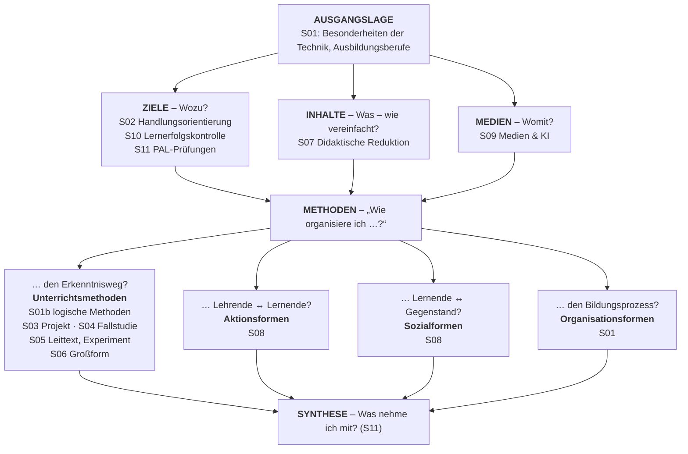
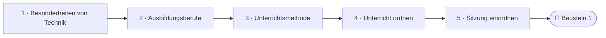
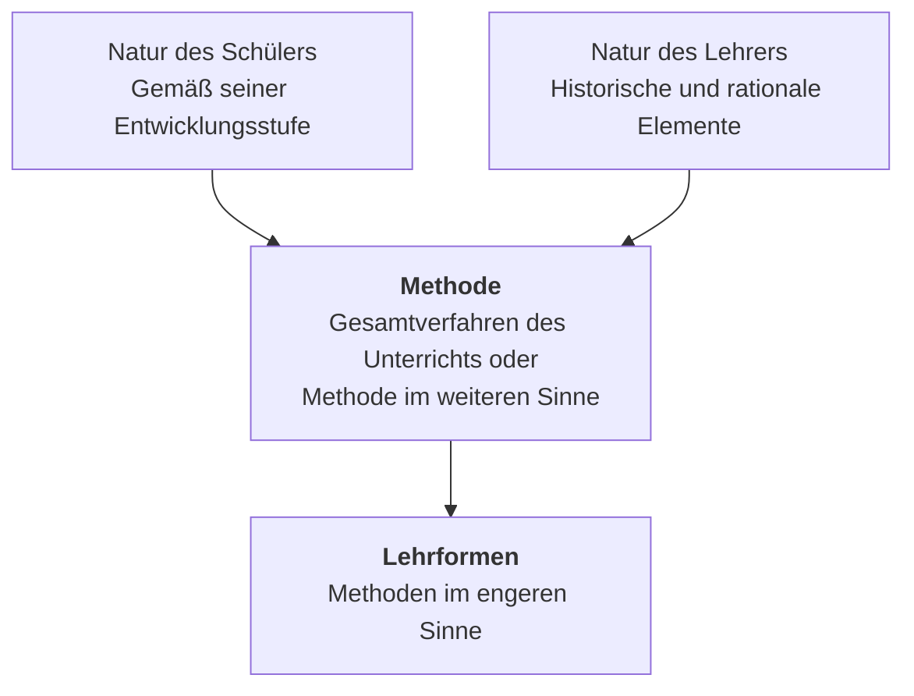

<!--
author:   Hannes Tegelbeckers
email:    hannes.tegelbeckers@ovgu.de
version:  0.2.0
language: de
narrator: Deutsch Female
mode:     Presentation
classroom: enable
comment:  Fachdidaktik technischer Allgemeinbildung II / Fachdidaktik gewerblich-technischer Fachrichtungen – Sitzung S01. Was ist das Besondere an Technik? Was ist eine Unterrichtsmethode? Wie ordne ich Unterricht?

import:   https://raw.githubusercontent.com/LiaTemplates/mermaid_template/0.1.4/README.md
-->

# S01 – Orientierung: Technik · Methodenbegriff · Ordnungsrahmen

**Fachdidaktik technischer Allgemeinbildung II / Fachdidaktik gewerblich-technischer Fachrichtungen** · OVGU Magdeburg · Montag, 12.10.2026, 07:00–09:00 Uhr

<small>Quelle: Folie R001 – „gewerblich-Technischer“ zu „gewerblich-technischer“ korrigiert.</small>

<!-- didaktik="Planungsraster S01 · E-02, E-03, E-04, E-12, E-13 · 0–5 Einstieg These · 5–10 Drei Blicke auf denselben Gegenstand · 10–15 Kurskarte · 15–30 Station 1 Besonderheiten von Technik · 30–40 Aktivierung Vergleichstabelle, Beuteblatt-Stopp · 40–50 Krümel und Lulatsch · 50–60 Definitionen, Methode i. w. S./i. e. S. · 60–70 Strukturlegetechnik · 70–75 Auflösung vier Leitfragen · 75–85 Sitzung einordnen, Baustein 1 · 85–90 Abschluss" -->
> [!IMPORTANT] 🧭 Leitfrage des Moduls
> Wie plane ich technischen Unterricht so, dass Lernende handelnd lernen – und wie begründe ich jede Entscheidung?

> [!TIP] 📚 Vor der Sitzung (optional, 10 min)
> Wählen Sie einen technischen Gegenstand aus Ihrer Fachrichtung (z. B. Dachstuhl, Elektromotor, Pumpe, Netzwerk-Switch) und notieren Sie, *wozu* er da ist und *womit* dieser Zweck erreicht wird. Sie brauchen das Beispiel gleich zu Beginn der Sitzung.

📝 **Beuteblatt:** Gehen Sie heute auf Beutezug – halten Sie auf dem Beuteblatt fest, was Sie für die Prüfung mitnehmen. Wir halten mehrmals an.

## Einstieg: Eine steile These

    --{{0}}--
Wir beginnen mit einer steilen These. Stimmen Sie spontan ab – das Ergebnis bleibt stehen, am Ende der Sitzung stimmen wir noch einmal ab.

> **„Technikunterricht ist im Grunde angewandte Physik.“**

**Vote (before):** Stimmen Sie zu?

[(a)] Ja, ich stimme zu
[(b)] Nein, ich stimme nicht zu
[(c)] Teils, teils
[(undecided)] Undecided

    --{{1}}--
Nehmen Sie Ihren Gegenstand aus der Vorbereitung und schauen Sie mit drei Blicken darauf.

      {{1}}
****************************************

> [!TIP] 🧠 Drei Blicke auf denselben Gegenstand · allein, 3 min
> Wählen Sie einen Gegenstand aus Ihrer Fachrichtung (z. B. Dachstuhl, Elektromotor, Pumpe, Netzwerk-Switch). Was will eine **Physikerin** darüber wissen? Was will ein **Techniker** darüber wissen? Was will eine **Kauffrau** darüber wissen? Notieren Sie je eine Frage.

[[___ ___ ___]]

****************************************

    --{{2}}--
Ihre drei Fragen brauchen Sie gleich wieder.

      {{2}}
> [!TIP] 📌 Merken
> In Station 1 prüfen Sie Ihre drei Fragen gegen eine Vergleichstabelle. Am Ende der Sitzung stimmen Sie noch einmal über die These ab.

## Kurskarte: Wo stehen wir?

    --{{0}}--
Bevor wir einsteigen, ein Blick auf die Landkarte des ganzen Moduls. Jede Sitzung beantwortet eine Planungsfrage: unter welchen Bedingungen ich unterrichte, wozu, was und womit – und vor allem, wie ich den Unterricht organisiere. Diese Karte begegnet Ihnen in jeder Sitzung wieder; heute legen wir die Grundlage für den Bereich Methodik.

    --{{1}}--
Das ganze Modul lässt sich als Folge von Planungsentscheidungen lesen.

      {{1}}
**① Planungsfragen:** Ausgangslage, Ziele, Inhalte, Medien – jede Sitzung beantwortet eine Planungsfrage

    --{{2}}--
Die Methoden ordnen wir mit vier Leitfragen, die Sie heute in Station 3 kennenlernen.

      {{2}}
**② Methoden:** vier Leitfragen „Wie organisiere ich …?“ – den Erkenntnisweg, Lehrende ↔ Lernende, Lernende ↔ Gegenstand, den Bildungsprozess (Station 3)

    --{{3}}--
Am Ende des Semesters steht Ihr eigener Unterrichtsentwurf, für den jede Sitzung einen Baustein liefert.

      {{3}}
**③ Synthese:** Was nehme ich mit? – in S11, mit Ihrem optionalen Unterrichtsentwurf

    --{{4}}--
Die Bausteine sind freiwillig.

      {{4}}
> [!NOTE] Key message
> **Optional: „Mein Unterrichtsentwurf“** – Viele Sitzungen enden mit einem *Baustein* für einen eigenen Unterrichtsentwurf. Die Bausteine sind freiwillig und bereiten die Selbstlernsitzung am 11.01.2027 vor. Prüfungsleistung des Moduls ist ausschließlich die mündliche Prüfung; ein eigenes Beispiel hilft Ihnen dort beim Argumentieren.

<small>Kurskarte als Lesehilfe (vgl. Kursüberblick), keine Originalfolie.</small>

## Ihr Weg durch die Sitzung

    --{{0}}--
Heute in drei Stationen: Was ist das Besondere an Technik? Was ist eine Unterrichtsmethode? Wie ordne ich Unterricht? Zum Schluss ordnen Sie die heutige Sitzung selbst ein.

    --{{1}}--
Auf diesem Weg erreichen Sie sechs Ziele.

      {{1}}

<!-- data-type="none" -->
| Know | Can do | Value |
|------|--------|-------|
| die vier Leitfragen der Unterrichtsorganisation mit den Begriffen *Unterrichtsmethode, Aktionsform, Sozialform, Organisationsform* **nennen** | für einen Gegenstand Ihrer Fachrichtung die Zweck-Mittel-Relation **beschreiben** | **erläutern**, warum technische Lösungen nach *Richtigkeit und Zweckmäßigkeit* bewertet werden |
| Natur-, Technik- und Wirtschaftswissenschaften **unterscheiden** | Unterrichtsbegriffe den Kategorien **zuordnen** und die heutige Sitzung damit beschreiben | den Begriff Unterrichtsmethode **erläutern** und Methode im weiteren Sinne von Methoden im engeren Sinne **abgrenzen** |

    --{{2}}--
Prüfen Sie kurz, ob Sie den Weg lesen können.

      {{2}}
****************************************

**Decide:** Was kommt direkt nach der Station zur Unterrichtsmethode?

<!-- data-hint-button="1" data-solution-button="2" -->
- [(X)] Unterricht ordnen
- [( )] Ausbildungsberufe
- [( )] Besonderheiten von Technik
[[?]] Folgen Sie den Pfeilen von links nach rechts.
***
Richtig: Station 3 ordnet Methoden, Sozial-, Aktions- und Organisationsformen.
***

****************************************

## Station 1: Besonderheiten von Technik

    --{{0}}--
Unsere erste Station stellt eine scheinbar einfache Frage. Die Antwort ist für Sie als künftige Techniklehrkraft zentral, denn sie entscheidet darüber, ob Technikunterricht ein eigenes Fach ist oder nur angewandte Physik – genau die These, über die Sie eben abgestimmt haben.

**Wodurch unterscheidet sich Technik von den Naturwissenschaften und Wirtschaftswissenschaften? (Folie R002)**

    --{{1}}--
Zuerst Gegenstand und Ziel.

      {{1}}
- Gegenstandsbereich und Zielstellung (R003)

    --{{2}}--
Dann die Aussagen und wie sie bewertet werden.

      {{2}}
- Aussagensysteme und Bewertung der Aussagen (R004–R005)

    --{{3}}--
Danach die Erkenntnismethoden.

      {{3}}
- Ursache–Wirkung, Zweck–Mittel, Aufwand–Nutzen (R006)

    --{{4}}--
Und wen Sie unterrichten werden.

      {{4}}
- Ausbildungsberufe in Zahlen (R007, [NEU] 2025)

    --{{5}}--
Warum ist das für Sie wichtig?

      {{5}}
> [!TIP] Why this matters
> Wer Technik als eigene Denkweise versteht, unterrichtet sie nicht als angewandte Physik.

    --{{6}}--
Markieren Sie, was Sie schon kennen.

      {{6}}
****************************************

**Mark:** Which of these do you already know? (several possible)

[[a1]] Gegenstandsbereich und Zielstellung (R003)
[[a2]] Aussagensysteme und Bewertung der Aussagen (R004–R005)
[[a3]] Ursache–Wirkung, Zweck–Mittel, Aufwand–Nutzen (R006)
[[a4]] Ausbildungsberufe in Zahlen (R007, [NEU] 2025)

****************************************

## 1.1 Vergleich der Gegenstandsbereiche der Natur-, Technik- und Wirtschaftswissenschaften

    --{{0}}--
Die Tabelle vergleicht die drei Wissenschaftsbereiche Zeile für Zeile. Auf dem Original wird sie über vier Folien schrittweise aufgebaut. Zuerst Gegenstand, Ziel und Aussagensysteme.

<!-- data-type="none" -->
| | Naturwissenschaften | Technikwissenschaften | Wirtschaftswissenschaften |
| --- | --- | --- | --- |
| **Gegenstandsbereich** | Natürliche Systeme | Vom Menschen geschaffene technische Systeme | Vom Menschen geschaffene ökonomische Systeme |
| **Zielstellung** | Gewinnen von Erkenntnissen über Objekte der Natur mit vorrangiger Explanationsfunktion | Gewinnen von Erkenntnissen zur Konstruktion und Bewertung von technischen Systemen mit vorrangiger strategischer Funktion | Gewinnen von Erkenntnissen zur Funktionen ökonomischer Systeme zur Gestaltung wirtschaftswissenschaftlicher Prozesse |
| **Aussagensysteme** | Aussagensysteme in Form von Gesetzesaussagen, Begriffen und Theorien, die zum Beschreiben von Erscheinungen und Objekten der Natur dienen | Aussagensysteme in Form von Gesetzesaussagen, Begriffen und Theorien, die zum Regulieren von Tätigkeiten mittels der aus Gesetzesaussagen hergeleiteten Strategien in Form von Vorschriften, Programmen u. a. dienen | Aussagen zur Optimierung von wirtschaftlichen Prozessen mit Hilfe von Strategien, Prognosen zur wirtschaftlichen Entwicklung und zweckmäßigen wirtschaftlichen Gestaltung von Prozessen |

    --{{1}}--
Achten Sie besonders auf die nächsten zwei Zeilen. Erstens die Bewertung der Aussagen: Die Naturwissenschaften fragen nach Wahrheit, die Technikwissenschaften nach Richtigkeit, also ob das Ziel realisierbar ist, und nach der Zweckmäßigkeit des Weges, die Wirtschaftswissenschaften nach Wirtschaftlichkeit. Zweitens die Erkenntnismethode: Ursache-Wirkung, Zweck-Mittel, Aufwand-Nutzen.

      {{1}}
****************************************

<!-- data-type="none" -->
| | Naturwissenschaften | Technikwissenschaften | Wirtschaftswissenschaften |
| --- | --- | --- | --- |
| **Bewertung der Aussagen** | Bewerten der Aussagen nach dem Kriterium der Wahrheit | Bewerten der Strategien nach dem Kriterium der Richtigkeit (Realisierbarkeit des Ziels) und der Zweckmäßigkeit des Weges zum Ziel | Bewerten von Strategien nach dem Kriterium der Wirtschaftlichkeit |
| **Erkenntnismethoden** | Eigenständigkeit, abbildungsorientiert, Ursache-Wirkungs-Relation | Integrierend, anwendungsorientiert, Zweck-Mittel-Relation | Integrierend, anwendungsorientiert, Aufwand-Nutzen-Relation |

(In Anlehnung an Bernhard, Ebert & Schröder 1995, S. 19)

****************************************

    --{{2}}--
Prüfen Sie jetzt Ihre drei Fragen vom Einstieg gegen diese Zeilen.

      {{2}}
> [!NOTE] Key message
> 💭 Denkanstoß: Sehen Sie sich Ihre drei Fragen vom Einstieg an. Welche zielt auf *Wahrheit*, welche auf *Richtigkeit und Zweckmäßigkeit*, welche auf *Wirtschaftlichkeit*?

<small>Quelle: Folien R003–R006 „1.1 Vergleich der Gegenstandsbereiche der Natur-, Technik- und Wirtschaftswissenschaften“ (auf dem Original über vier Folien schrittweise aufgebaut; Silbentrennungen der Tabellenzellen aufgelöst).</small>

## 1.2 Quantitäten einiger ausgewählter Ausbildungsberufe

    --{{0}}--
Wen werden Sie später unterrichten? Die Grafik zeigt einige ausgewählte Ausbildungsberufe für das Referenzjahr 2002. Ganz vorn stehen gewerblich-technische Berufe wie Kraftfahrzeugmechaniker, Maler und Lackierer oder Elektroinstallateur.

<!--
data-type="BarChart"
data-title="Quantitäten einiger ausgewählter Ausbildungsberufe (Referenzjahr 2002)"
data-xlabel="Ausbildungsberuf"
data-ylabel="Anzahl"
data-show
-->
| Ausbildungsberuf | Anzahl |
| --- | ---: |
| Kraftfahrzeugmechaniker | 22980 |
| Maler und Lackierer | 15818 |
| Elektroinstallateur | 13694 |
| Tischler | 13648 |
| Kaufmann im Einzelhandel | 13337 |
| Koch | 11522 |
| Kaufmann im Groß- und Außenhandel | 10241 |
| Metallbauer | 9400 |
| Maurer (IH/Hw) | 9291 |
| Fachinformatiker (IH) | 8365 |
| Gas- und Wasserinstallateur | 8342 |

Referenzjahr 2002 (Bertram & Bärbel 2002)

    --{{1}}--
Lesen Sie die Zahlen als Hinweis auf das Bedingungsfeld: Wer sitzt vor Ihnen, und was bringen diese Lernenden mit?

      {{1}}
> [!NOTE] Key message
> 🧩 Bedingungsfeld „anthropogene Voraussetzungen“: Für welche dieser Berufe bilden *Sie* künftig aus – und was bringen diese Lernenden mit?

<small>Quelle: Folie R007 „1.2 Quantitäten einiger ausgewählter Ausbildungsberufe“ – Diagramm aus den Werten der Originalgrafik neu gezeichnet (dort mit Tausenderpunkt, z. B. 22.980). Was genau gezählt wurde, ist auf der Folie nicht angegeben.</small>

## [NEU] Und heute? Neuabschlüsse 2025

    --{{0}}--
Und heute? Eine Ergänzung, als NEU markiert: dieselben Berufe mit den neu abgeschlossenen Ausbildungsverträgen 2025, unter ihrer heutigen Bezeichnung.

<!-- neu="BIBB-Erhebung zum 30.09.2025, Tabelle 67 (Datenstand 05.12.2025); Pressemitteilung 09/2026 vom 03.03.2026" -->

<!--
data-type="BarChart"
data-title="Neu abgeschlossene Ausbildungsverträge 2025 – dieselben Berufe (heutige Bezeichnung)"
data-xlabel="Ausbildungsberuf"
data-ylabel="Neuabschlüsse 2025"
data-show
-->
| Ausbildungsberuf 2025 | Neuabschlüsse |
| --- | ---: |
| Kfz-Mechatroniker/-in | 24531 |
| Fachinformatiker/-in | 15072 |
| Kaufmann/-frau Einzelhandel | 14658 |
| Elektroniker/-in | 14550 |
| Anlagenmechaniker/-in SHK | 14523 |
| Groß-/Außenhandelsmanagement | 9294 |
| Koch/Köchin | 7464 |
| Tischler/-in | 7062 |
| Maler/-in und Lackierer/-in | 6567 |
| Metallbauer/-in | 3651 |
| Maurer/-in | 2721 |

Rund 94 % der neuen Kfz-Mechatroniker-Auszubildenden sind männlich, bei Elektroniker/-in und Anlagenmechaniker/-in SHK über 95 % (BIBB, Tabelle 67). Insgesamt 475.950 Neuabschlüsse, 2,1 % weniger als 2024 (BIBB-Pressemitteilung 09/2026).

    --{{1}}--
Vorsicht beim Vergleich.

      {{1}}
> [!NOTE] Key message
> ⚠️ Auf Folie R007 ist nicht angegeben, was 2002 gezählt wurde (Neuabschlüsse oder alle Auszubildenden). Ein direkter Vergleich der Zahlen ist deshalb nicht belegt – vergleichen Sie die **Reihenfolge**, nicht die absoluten Werte.

<small>[NEU] Bundesinstitut für Berufsbildung (BIBB), Erhebung „Neu abgeschlossene Ausbildungsverträge zum 30. September 2025“, Tabelle 67 „Rangliste 2025 der Ausbildungsberufe nach Neuabschlüssen“ (Stand der Daten: 05.12.2025); Werte vom BIBB auf ein Vielfaches von 3 gerundet. Zuordnung zu den Berufen von 2002 ergänzt (Nachfolgeberufe nach Neuordnung): Kraftfahrzeugmechaniker → Kfz-Mechatroniker/-in, Elektroinstallateur → Elektroniker/-in, Gas- und Wasserinstallateur → Anlagenmechaniker/-in für Sanitär-, Heizungs- und Klimatechnik, Kaufmann im Groß- und Außenhandel → Kaufmann/-frau für Groß- und Außenhandelsmanagement.</small>

## Aktivierung: 2002 und 2025

    --{{0}}--
Drei kurze Fragen zu den beiden Diagrammen.

**1 · Choose one:** Welcher dieser Berufe lag 2025 bundesweit auf **Platz 1** aller dualen Ausbildungsberufe?

<!-- data-hint-button="1" data-solution-button="2" -->
- [( )] Kaufmann/-frau für Büromanagement
- [(X)] Kfz-Mechatroniker/-in
- [( )] Fachinformatiker/-in
[[?]] Schauen Sie auf den ersten Balken – Büromanagement steht nicht in der Auswahl.
***
Kfz-Mechatroniker/-in mit 24.531 Neuabschlüssen – wie schon 2002 (als Kfz-Mechaniker) an der Spitze dieser Auswahl. Dahinter folgen 2025 Kaufmann/-frau für Büromanagement (21.732) und Verkäufer/-in (21.585); Fachinformatiker/-in steht auf Platz 6, Elektroniker/-in auf Platz 8 (BIBB, Tabelle 67).
***

    --{{1}}--
Jetzt können mehrere Antworten richtig sein.

      {{1}}
****************************************

**2 · Choose all that apply:** Welche Berufe sind in dieser Auswahl seit 2002 in der Reihenfolge **aufgestiegen**?

<!-- data-hint-button="1" data-solution-button="2" -->
- [[X]] Fachinformatiker/-in
- [[ ]] Maler/-in und Lackierer/-in
- [[X]] Anlagenmechaniker/-in SHK (früher Gas- und Wasserinstallateur)
- [[ ]] Tischler/-in
[[?]] Vergleichen Sie die Plätze, nicht die Zahlen.
***
Fachinformatiker/-in: 2002 Platz 10 dieser Auswahl, 2025 Platz 2. Anlagenmechaniker/-in SHK: 2002 Platz 11, 2025 Platz 5. Maler/-in und Lackierer/-in (Platz 2 → 9) und Tischler/-in (Platz 4 → 8) sind abgestiegen.
***

****************************************

    --{{2}}--
Zum Schluss eine Zahl.

      {{2}}
****************************************

**3 · Type:** Auf welchem Platz dieser Auswahl stand Fachinformatiker/-in 2025? (Zahl)

<!-- data-hint-button="1" data-solution-button="2" -->
[[2]]
[[?]] Zweiter Balken …

***
Platz 2 – 2002 noch Platz 10 dieser Auswahl.
***

****************************************

## Aktivierung: Vergleichstabelle sichern

    --{{0}}--
Ergänzen Sie den Text. Wählen, tippen oder ziehen Sie die fehlenden Wörter.

**Complete:**

<!-- data-hint-button="1" data-solution-button="2" data-show-partial-solution -->
Naturwissenschaften bewerten ihre Aussagen nach dem Kriterium der [[ (Wahrheit) | Richtigkeit | Wirtschaftlichkeit ]] (Folie R005). Technikwissenschaften bewerten ihre Strategien nach der Richtigkeit (Realisierbarkeit des Ziels) und der [[Zweckmäßigkeit]], Wirtschaftswissenschaften nach der [->[ (Wirtschaftlichkeit) | Wahrheit ]].
[[?]] Schauen Sie in die Zeile „Bewertung der Aussagen“.

    --{{1}}--
Entscheiden Sie jetzt: richtig oder falsch?

      {{1}}
****************************************

**Decide:** True or false?

<!-- data-hint-button="1" data-solution-button="2" data-show-partial-solution -->
[(true) (false)]
[  (X)    ( )  ] Technikwissenschaften arbeiten integrierend und anwendungsorientiert mit der Zweck-Mittel-Relation.
[  ( )    (X)  ] Naturwissenschaften arbeiten mit der Aufwand-Nutzen-Relation.
[  (X)    ( )  ] Gegenstand der Technikwissenschaften sind vom Menschen geschaffene technische Systeme.
[  ( )    (X)  ] Technikwissenschaften bewerten ihre Strategien nach dem Kriterium der Wahrheit.
[[?]] Schauen Sie in die Zeilen „Gegenstandsbereich“ und „Erkenntnismethoden“.
***
Naturwissenschaften: eigenständig, abbildungsorientiert, Ursache-Wirkungs-Relation · Technikwissenschaften: integrierend, anwendungsorientiert, Zweck-Mittel-Relation · Wirtschaftswissenschaften: integrierend, anwendungsorientiert, Aufwand-Nutzen-Relation (R006). Technikwissenschaften bewerten nach Richtigkeit und Zweckmäßigkeit, nicht nach Wahrheit (R005).
***

****************************************

## Ihr Beispiel: Welcher Zweck – welches Mittel?

    --{{0}}--
Prüfen Sie jetzt Ihr Beispiel vom Einstieg.

**Allein (3 min):** Prüfen Sie Ihr Beispiel vom Einstieg: *Welcher Zweck – welches Mittel?* Woran würden Sie die **Richtigkeit** und die **Zweckmäßigkeit** der Lösung prüfen? 📝 **Beuteblatt-Stopp:** Ergänzen Sie danach Abschnitt 1 (Tabelle + Ihr Beispiel).

[[___ ___ ___ ___]]

💡 Hint 1

Zweck = wozu ist der Gegenstand da? Mittel = womit wird dieser Zweck erreicht?

✅ Solution

Beispiel Umwälzpumpe einer Heizung: **Zweck** – Heizungswasser durch die Heizkörper fördern; **Mittel** – Kreiselpumpe mit Laufrad und Elektromotor. **Richtigkeit:** Erreicht die Pumpe den nötigen Volumenstrom? **Zweckmäßigkeit:** Ist dieser Pumpentyp für die Anlage der sinnvolle Weg – oder wäre eine geregelte Pumpe besser? Die Physikerin fragt dagegen nach dem Strömungsgesetz (Wahrheit), die Kauffrau nach Anschaffungs- und Stromkosten (Wirtschaftlichkeit).

## Station 2: Was ist eine Unterrichtsmethode?

    --{{0}}--
Station zwei wechselt die Perspektive: von der Technik als Gegenstand zur Methode, mit der wir sie unterrichten. Der Abschnitt heißt auf der Folie Methodenkonzeption.

**Methodenkonzeption: Was ist eine Unterrichtsmethode? (Folie R008)**

    --{{1}}--
Zuerst ein Filmausschnitt.

      {{1}}
- Krümel und Lulatsch: wenn Erklären nicht gelingt (R010)

    --{{2}}--
Dann zwei Definitionen.

      {{2}}
- Definitionen nach Meyer und Hilbert (R009)

    --{{3}}--
Danach ein Schema.

      {{3}}
- Methode im weiteren und im engeren Sinne (R011)

    --{{4}}--
Und zwei Aspekte der Klassifikation.

      {{4}}
- Äußere Gestaltung und logischer Aspekt (R012)

    --{{5}}--
Warum ist das für Sie wichtig?

      {{5}}
> [!TIP] Why this matters
> Methode ist der Weg, den Lehrende **und** Lernende gemeinsam gehen – nicht nur, was die Lehrkraft tut.

    --{{6}}--
Markieren Sie, was Sie schon kennen.

      {{6}}
****************************************

**Mark:** Which of these do you already know? (several possible)

[[a1]] Krümel und Lulatsch: wenn Erklären nicht gelingt (R010)
[[a2]] Definitionen nach Meyer und Hilbert (R009)
[[a3]] Methode im weiteren und im engeren Sinne (R011)
[[a4]] Äußere Gestaltung und logischer Aspekt (R012)

****************************************

## Beispiel: Krümel und Lulatsch

    --{{0}}--
Ein kurzer Filmausschnitt aus der Sesamstraße. Schauen Sie ihn an und beantworten Sie die drei Fragen von der Folie.

<!-- didaktik="zweiter Zyklus provozieren / Vorwissen aktivieren · 40–50 min · Einzelarbeit · Auswertung über Classroom" -->
!?[Krümel und Lulatsch erklären „Hier und Da“ (Sesamstraße)](https://www.youtube.com/watch?v=Z-MRqTJMapY)

**Allein (4 min):**

1. Welches Problem haben Krümel und Lulatsch konkret?
2. Welches Problem liegt „abstrakt“ vor?
3. Welche Implikationen hat das Problem von Krümel und Lulatsch für die pädagogische Praxis?

<small>Quelle: Folie R010 „Beispiel: Krümel und Lulatsch“</small>

[[___ ___ ___ ___]]

💡 Hint 1

Achten Sie darauf, von welchem Standpunkt aus die beiden „hier“ und „da“ verwenden.

✅ Solution

Konkret: Sie erklären „hier“ und „da“, ohne zu bemerken, dass sich die Bedeutung mit dem Standpunkt ändert. Abstrakt: Wer erklärt, geht von seiner eigenen Sicht aus – die Lernenden haben eine andere. Für den Unterricht folgt daraus, dass eine Methode zur Ausgangslage der Lernenden passen muss; gut gemeint ist noch nicht gut erklärt.

## 4.1 Definition Unterrichtsmethoden

    --{{0}}--
Hier sehen Sie zwei Definitionen von Meyer und Hilbert. Die erste betont das Aneignen der Wirklichkeit unter institutionellen Rahmenbedingungen – Unterricht findet immer in Schule oder Betrieb statt. Die zweite ist knapper: Methode ist der prinzipielle Weg, den Lehrer und Schüler gehen, um die Ziele des Unterrichts zu erreichen.

> „Unterrichtsmethoden sind Formen und Verfahren, in und mit denen sich Lehrer und Schüler die sie umgebene natürliche und gesellschaftliche Wirklichkeit unter institutionellen Rahmenbedingungen aneignen“
> (Meyer & Hilbert 1994, S. 45)

> „Unterrichtsmethode ist der prinzipielle Weg, den Lehrer und Schüler beschreiten, um die Ziele des Unterrichts zu erreichen.“
> (Meyer & Hilbert 1994)

    --{{1}}--
Beachten Sie: In beiden Definitionen handeln Lehrende und Lernende gemeinsam.

      {{1}}
> [!NOTE] Key message
> In beiden Definitionen handeln **Lehrer und Schüler gemeinsam** – eine Methode ist nicht nur das, was die Lehrkraft tut.

<small>Quelle: Folie R009 „4.1 Definition Unterrichtsmethoden“ – Anführungszeichen im zweiten Zitat vereinheitlicht; „umgebene“ wie im Original.</small>

## 4.1 Methode im weiteren und im engeren Sinne

    --{{0}}--
Das Schema ordnet die Begriffe. Die Methode richtet sich nach der Natur des Schülers, gemäß seiner Entwicklungsstufe, und nach der Natur des Lehrers.

    --{{1}}--
Die Methode richtet sich zuerst nach den Lernenden.

      {{1}}
**① Natur des Schülers:** Gemäß seiner Entwicklungsstufe

    --{{2}}--
Und nach der Lehrkraft.

      {{2}}
**② Natur des Lehrers:** Historische und rationale Elemente

    --{{3}}--
Daraus ergibt sich die Methode im weiteren Sinne, das Gesamtverfahren des Unterrichts. Die Lehrformen darunter sind die Methoden im engeren Sinne.

      {{3}}
**③ Methode und Lehrformen:** Methode = Gesamtverfahren des Unterrichts oder Methode im weiteren Sinne · Lehrformen = Methoden im engeren Sinne

    --{{4}}--
Merken Sie sich die Unterscheidung.

      {{4}}
> [!NOTE] Key message
> **Methode im weiteren Sinne** = Gesamtverfahren des Unterrichts · **Lehrformen** = Methoden im engeren Sinne.

<small>Quelle: Folie R011 „4.1 Definition Unterrichtsmethoden“ – Pfeile als Lesehilfe ergänzt; auf dem Original stehen die Begriffe untereinander.</small>

## 4.1 Zwei Aspekte der Klassifikation

    --{{0}}--
Methoden lassen sich unter zwei Aspekten ordnen. Nach der äußeren Gestaltung unterscheiden wir mitteilende und entwickelnde, heuristische Methoden, jeweils vortragend oder fragend. Nach dem logischen Aspekt unterscheiden wir analytisch und synthetisch sowie induktiv und deduktiv.

<!-- data-type="none" -->
| Aspekt der äußeren Gestaltung | Logischer Aspekt |
| --- | --- |
| 1) Mitteilende | 1) Analytische und synthetische Methode |
| &nbsp;&nbsp;a. Vortragend | 2) Induktive und deduktive Methode |
| &nbsp;&nbsp;b. Fragend | |
| 2) Entwickelnde, heuristische | |
| &nbsp;&nbsp;a. Vortragend | |
| &nbsp;&nbsp;b. Fragend | |

    --{{1}}--
Dem logischen Aspekt widmen wir die gesamte nächste Sitzung.

      {{1}}
> [!NOTE] Key message
> 🔗 Der **logische Aspekt** – analytisch, synthetisch, induktiv, deduktiv – ist das Thema von **S01b**.

<small>Quelle: Folie R012 „4.1 Definition Unterrichtsmethoden“ – Nummerierung ergänzt.</small>

## Kurzcheck: Methode und Lehrformen

    --{{0}}--
Drei kurze Fragen zu Station 2.

**1 · Choose one:** Welche Aussage trifft zu?

<!-- data-hint-button="1" data-solution-button="2" -->
- [( )] „Lehrformen“ ist ein anderes Wort für das Gesamtverfahren des Unterrichts.
- [(X)] Lehrformen sind Methoden im engeren Sinne; die Methode im weiteren Sinne ist das Gesamtverfahren des Unterrichts.
- [( )] Die Methode richtet sich nur nach dem Fach, nicht nach den Lernenden.
[[?]] Schauen Sie auf das Schema R011.
***
Methode = Gesamtverfahren des Unterrichts oder Methode im weiteren Sinne; Lehrformen = Methoden im engeren Sinne. Die Methode richtet sich nach der Natur des Schülers (gemäß seiner Entwicklungsstufe) und der Natur des Lehrers (historische und rationale Elemente) – Folie R011.
***

    --{{1}}--
Jetzt können mehrere Antworten richtig sein.

      {{1}}
****************************************

**2 · Choose all that apply:** Was ordnet R012 dem Aspekt der **äußeren Gestaltung** zu?

<!-- data-hint-button="1" data-solution-button="2" -->
- [[X]] Mitteilende Methoden (vortragend, fragend)
- [[ ]] Analytische und synthetische Methode
- [[X]] Entwickelnde, heuristische Methoden (vortragend, fragend)
- [[ ]] Induktive und deduktive Methode
[[?]] Der logische Aspekt ist das Thema von S01b.
***
Äußere Gestaltung: mitteilend oder entwickelnd/heuristisch, jeweils vortragend oder fragend. Analytisch/synthetisch und induktiv/deduktiv gehören zum logischen Aspekt.
***

****************************************

    --{{2}}--
Zum Schluss ein Begriff.

      {{2}}
****************************************

**3 · Type:** Die Methode richtet sich nach der Natur des Lehrers und nach der Natur des … (ein Wort)

<!-- data-hint-button="1" data-solution-button="2" -->
[[Schülers]]
[[?]] … gemäß seiner Entwicklungsstufe.

***
Natur des Schülers – gemäß seiner Entwicklungsstufe (R011).
***

****************************************

## Station 3: Wie ordne ich Unterricht?

    --{{0}}--
In der dritten Station ordnen wir die vielen Begriffe, die beim Planen von Unterricht durcheinandergehen. Sie sortieren zunächst selbst – erst danach löse ich auf.

**Methoden versus Sozialformen und Aktionsformen (Folie R034)**

    --{{1}}--
Zuerst sortieren Sie.

      {{1}}
- Strukturlegetechnik: Gestaltung von Unterricht (R035)

    --{{2}}--
Dann kontrollieren Sie.

      {{2}}
- Kontrolle Ihrer Sortierung

    --{{3}}--
Danach die Auflösung.

      {{3}}
- Vier Leitfragen „Wie organisiere ich …?“ (R036–R039)

    --{{4}}--
Und die Kategorie, die quer liegt.

      {{4}}
- Didaktische Funktionen: orientieren, erarbeiten, festigen, kontrollieren

    --{{5}}--
Warum ist das für Sie wichtig?

      {{5}}
> [!TIP] Why this matters
> Diese vier Fragen sind die Kurskarte für das ganze Semester.

    --{{6}}--
Markieren Sie, was Sie schon kennen.

      {{6}}
****************************************

**Mark:** Which of these do you already know? (several possible)

[[a1]] Strukturlegetechnik: Gestaltung von Unterricht (R035)
[[a2]] Kontrolle Ihrer Sortierung
[[a3]] Vier Leitfragen „Wie organisiere ich …?“ (R036–R039)
[[a4]] Didaktische Funktionen: orientieren, erarbeiten, festigen, kontrollieren

****************************************

## Strukturlegetechnik: Gestaltung von Unterricht

    --{{0}}--
Auf der Originalfolie stehen diese Begriffe bunt durcheinander. Sortieren Sie allein, sieben Minuten, in fünf Kategorien. Markieren Sie Begriffe, bei denen Sie unsicher sind.

<!-- didaktik="Lehrschritt unterstützen/üben · 60–70 min · Einzelarbeit · Doppeldecker E-04" -->
**Allein (7 min):** Sortieren Sie die Begriffe in die fünf Kategorien **didaktische Funktionen · Aktionsformen · Sozialformen · Organisationsformen · Unterrichtsmethoden**. Markieren Sie Begriffe, bei denen Sie unsicher sind.

> Lernen in Abteilungen · deduktiv I · deduktiv II · Prüfung · analytisch · Diskussion · Hausaufgaben · Erarbeiten · Schülervortrag · kontrollieren · festigen · Frontalunterricht · genetisch · Einzelarbeit · Gruppenarbeit · orientieren · Exkursion · induktiv · Lehrervortrag · Unterrichtsgespräch · Partnerarbeit · Demonstration · Unterrichtsstunde

<small>Quelle: Folie R035 „Gestaltung von Unterricht“ – Begriffe in der Reihenfolge der Folie; „indukiv“ zu „induktiv“ korrigiert. Die Originalfolie enthält keine Auflösung.</small>

[[___ ___ ___ ___]]

💡 Hint 1

Fragen Sie bei jedem Begriff: Organisiert er den Erkenntnisweg, die Beziehung Lehrende ↔ Lernende, die Beziehung Lernende ↔ Gegenstand, den Bildungsprozess – oder beschreibt er die Aufgabe einer Unterrichtsphase?

✅ Solution

**Unterrichtsmethoden:** deduktiv I, deduktiv II, analytisch, genetisch, induktiv · **Aktionsformen:** Lehrervortrag, Schülervortrag, Unterrichtsgespräch, Diskussion, Demonstration · **Sozialformen:** Frontalunterricht, Einzelarbeit, Partnerarbeit, Gruppenarbeit, Lernen in Abteilungen · **Organisationsformen:** Unterrichtsstunde, Hausaufgaben, Exkursion, Prüfung · **didaktische Funktionen:** orientieren, Erarbeiten, festigen, kontrollieren. Die Zuordnungen folgen den Folien R036–R039; die Auflösung der didaktischen Funktionen ist ergänzt.

## Kontrolle: Ihre Sortierung

    --{{0}}--
Kontrollieren Sie Ihre Sortierung – das Ergebnis sehen wir gemeinsam über die Classroom-Funktion an.

**1 · Choose one:** Zu welcher Kategorie gehört „induktiv“?

<!-- data-hint-button="1" data-solution-button="2" -->
- [( )] Aktionsform
- [(X)] Unterrichtsmethode
- [( )] Organisationsform
[[?]] Wie organisiere ich den Erkenntnisweg?
***
induktiv, deduktiv, analytisch, genetisch, synthetisch: Unterrichtsmethoden im engeren Sinn (R039).
***

    --{{1}}--
Jetzt können mehrere Antworten richtig sein.

      {{1}}
****************************************

**2 · Choose all that apply:** Welche Begriffe sind **Sozialformen**?

<!-- data-hint-button="1" data-solution-button="2" -->
- [[X]] Partnerarbeit
- [[ ]] Lehrervortrag
- [[X]] Frontalunterricht
- [[ ]] Exkursion
[[?]] Wie organisiere ich die Beziehung zwischen Lehrendem/Lernenden und Lerngegenstand?
***
Sozialformen: Partnerarbeit, Frontalunterricht (R036) · Aktionsformen: Lehrervortrag (R038) · Organisationsformen des Unterrichts: Exkursion (R037).
***

****************************************

    --{{2}}--
Zum Schluss ein Begriff.

      {{2}}
****************************************

**3 · Type:** Lehrervortrag, Unterrichtsgespräch und Demonstration sind … (ein Wort, Mehrzahl)

<!-- data-hint-button="1" data-solution-button="2" -->
[[Aktionsformen]]
[[?]] Wie organisiere ich die Beziehung zwischen Lehrendem und Lernenden?

***
Aktionsformen oder Organisationsformen des Lehrens (R038).
***

****************************************

## Auflösung: Vier Leitfragen

    --{{0}}--
Die Auflösung folgt vier Leitfragen, alle beginnen mit: Wie organisiere ich …? Die Beziehung zwischen Lehrenden, Lernenden und Gegenstand organisieren die Sozialformen. Den Bildungsprozess organisieren die Organisationsformen des Unterrichts.

<!-- didaktik="Lehrschritt informieren · 70–75 min" -->

<!-- data-type="none" -->
| Organisationsformen des Unterrichts – Wie organisiere ich … | Begriffe | → |
| --- | --- | --- |
| … die Beziehung zwischen Lehrendem/Lernenden und Lerngegenstand? (R036) | Gruppenarbeit · Einzelarbeit · Partnerarbeit · Lernen in Abteilungen · Frontalunterricht | **Sozialformen** oder Organisationsformen des Lernens |
| … den Bildungsprozess? (R037) | Unterrichtsstunde · Exkursion · Prüfung · Hausaufgaben · Praktika | **Organisationsformen des Unterrichts** |

    --{{1}}--
Die Beziehung zwischen Lehrendem und Lernenden organisieren die Aktionsformen. Und den Erkenntnisweg organisieren die Unterrichtsmethoden im engeren Sinn – auf der Folie unter der Überschrift innere Strukturierung des Unterrichts.

      {{1}}
****************************************

<!-- data-type="none" -->
| Wie organisiere ich … | Begriffe | → |
| --- | --- | --- |
| *Organisationsformen des Unterrichts* – … die Beziehung zwischen Lehrendem und Lernenden? (R038) | Lehrervortrag · Schülervortrag · Unterrichtsgespräch · Diskussion · Demonstration | **Aktionsformen** oder Organisationsformen des Lehrens |
| *Innere Strukturierung des Unterrichts* – … den Erkenntnisweg? (R039) | deduktiv · induktiv · analytisch · genetisch · synthetisch | **Unterrichtsmethoden im engeren Sinn** |

****************************************

    --{{2}}--
Und die didaktischen Funktionen? Sie liegen quer zu Methode, Sozial- und Aktionsform.

      {{2}}
> [!NOTE] Key message
> **Didaktische Funktionen** (ergänzt) beschreiben, welche Aufgabe eine Unterrichtsphase im Lernprozess erfüllt: **orientieren** (Ziel und Überblick geben) → **erarbeiten** (Neues aneignen) → **festigen** (üben, sichern) → **kontrollieren** (Lernerfolg prüfen). Eine Erarbeitungsphase kann z. B. als Gruppenarbeit oder als Lehrervortrag gestaltet sein.

<small>Quelle: Folien R036–R039 (als Tabelle zusammengefasst); die Erläuterung der didaktischen Funktionen ist ergänzt, keine Originalfolie.</small>

## Wo stehen wir? Die heutige Sitzung einordnen

    --{{0}}--
Wenden Sie die Begriffe auf die heutige Sitzung an.

**1 · Choose one:** Welche Sozialform hatte der Vortrag in Station 1?

<!-- data-hint-button="1" data-solution-button="2" -->
- [( )] Einzelarbeit
- [(X)] Frontalunterricht
- [( )] Gruppenarbeit
[[?]] Wer arbeitet mit wem am Gegenstand?
***
Vortrag = Frontalunterricht (Sozialform); die Aktionsform war der Lehrervortrag.
***

    --{{1}}--
Jetzt können mehrere Antworten richtig sein.

      {{1}}
****************************************

**2 · Choose all that apply:** Welche Phasen der heutigen Sitzung waren **Einzelarbeit**?

<!-- data-hint-button="1" data-solution-button="2" -->
- [[X]] die Blitzumfrage zur These
- [[ ]] der Vortrag in Station 1
- [[X]] die Strukturlegetechnik, so wie Sie sie heute gemacht haben
- [[ ]] die Strukturlegetechnik, wenn Sie zu zweit sortiert hätten
[[?]] Wer hat gearbeitet – Sie allein, zu zweit oder die Lehrkraft vorn?
***
Blitzumfrage und Strukturlegetechnik allein = Einzelarbeit · Vortrag = Frontalunterricht · zu zweit = Partnerarbeit · zu dritt = Gruppenarbeit. In dieser Vorlesung arbeiten Sie bewusst allein, damit jede Antwort über die Classroom-Funktion ausgewertet werden kann – eine Entscheidung zur Sozialform, die Sie begründen können.
***

****************************************

    --{{2}}--
Und die didaktische Funktion?

      {{2}}
****************************************

**3 · Type:** Welche didaktische Funktion hatte der Kurzcheck zu den Lehrformen? (ein Wort)

<!-- data-hint-button="1" data-solution-button="2" -->
[[kontrollieren]]
[[?]] orientieren – erarbeiten – festigen – …

***
Kurzcheck = kontrollieren · Lernziele und Kurskarte = orientieren · Vortrag = erarbeiten · Lückentext zur Vergleichstabelle = festigen.
***

****************************************

## Aktionsformen und Methode der heutigen Sitzung

    --{{0}}--
Und welche Aktionsformen und welche Unterrichtsmethode hatte die Sitzung?

**Allein (3 min):** Welche *Aktionsformen* haben Sie heute erlebt? Und welche Unterrichtsmethode im engeren Sinn – eher induktiv oder deduktiv – hatte Station 3 (erst sortieren, dann auflösen)?

[[___ ___ ___ ___]]

💡 Hint 1

Aktionsformen nach R038: Lehrervortrag, Schülervortrag, Unterrichtsgespräch, Diskussion, Demonstration.

✅ Solution

Aktionsformen: vor allem **Lehrervortrag** (Stationen 1 und 2) und **Demonstration** (Filmausschnitt), dazu kurze **Unterrichtsgespräche** bei der Auswertung. Station 3 war eher **induktiv**: Sie haben zuerst einzelne Begriffe sortiert, die allgemeine Ordnung (vier Leitfragen) kam danach. Mehr zu induktiv und deduktiv in S01b.

## Baustein 1 für Ihren Unterrichtsentwurf (optional)

    --{{0}}--
Wählen Sie ein Thema für Ihren eigenen Unterrichtsentwurf, das Sie durch das Semester begleitet.

Wählen Sie ein Thema für Ihren eigenen Unterrichtsentwurf: **Ausbildungsberuf** bzw. Schulform/Klassenstufe und **Thema** · **Technischer Gegenstand** – **Zweck** und **Mittel**.

[[___ ___ ___ ___]]

💡 Hint 1

Ein Gegenstand, den Sie gut kennen und an dem sich etwas messen, bauen oder prüfen lässt, trägt durch viele Bausteine.

✅ Solution

Beispiel: Elektroniker/-in für Energie- und Gebäudetechnik, 1. Ausbildungsjahr – Thema Leitungsschutz. Gegenstand: Leitungsschutzschalter. **Zweck:** Leitungen vor Überlast und Kurzschluss schützen. **Mittel:** thermische Auslösung (Bimetall) und magnetische Auslösung (Spule).

## Zum Mitnehmen: Ist Technikunterricht angewandte Physik?

    --{{0}}--
Noch einmal die These vom Anfang. Stimmen Sie jetzt ab.

**Vote (after):** „Technikunterricht ist im Grunde angewandte Physik.“ – Stimmen Sie jetzt zu?

[(a)] Ja, ich stimme zu
[(b)] Nein, ich stimme nicht zu
[(c)] Teils, teils
[(undecided)] Undecided

    --{{1}}--
Was ist Ihnen heute am unklarsten geblieben?

      {{1}}
****************************************

**Reflect:** Muddiest point: Was ist Ihnen heute am unklarsten geblieben?

[[___ ___]]

****************************************

    --{{2}}--
Eine Einordnung:

      {{2}}
> [!NOTE] Key message
> Technikwissenschaften nutzen Gesetzesaussagen der Naturwissenschaften, bewerten ihre Lösungen aber nach **Richtigkeit und Zweckmäßigkeit** (Zweck-Mittel-Relation), nicht nach Wahrheit (R005–R006). Technikunterricht hat deshalb eine eigene Denkweise – er ist mehr als angewandte Physik.

## Das Wichtigste aus S01

    --{{0}}--
Fassen wir zusammen.

    --{{1}}--
Erstens: die Besonderheit der Technik.

      {{1}}
- Technikwissenschaften bewerten nach Richtigkeit und Zweckmäßigkeit – Zweck-Mittel-Relation (R003–R006).

    --{{2}}--
Zweitens: was eine Unterrichtsmethode ist.

      {{2}}
- Unterrichtsmethode = prinzipieller Weg, den Lehrer und Schüler gemeinsam gehen (Meyer & Hilbert, R009).

    --{{3}}--
Drittens: weiter und eng.

      {{3}}
- Methode im weiteren Sinne = Gesamtverfahren; Lehrformen = Methoden im engeren Sinne (R011).

    --{{4}}--
Und viertens: die vier Leitfragen.

      {{4}}
****************************************

- Erkenntnisweg → Unterrichtsmethoden · Lehrende ↔ Lernende → Aktionsformen · Lernende ↔ Gegenstand → Sozialformen · Bildungsprozess → Organisationsformen (R036–R039).

> [!NOTE] Remember
> Wie organisiere ich …? – vier Fragen, vier Begriffe: Ihre Kurskarte für das Semester.

****************************************

    --{{5}}--
Eine letzte Frage.

      {{5}}
****************************************

**Recap:** Was organisieren die Aktionsformen?

<!-- data-hint-button="1" data-solution-button="2" -->
- [( )] den Erkenntnisweg
- [( )] den Bildungsprozess
- [(X)] die Beziehung zwischen Lehrendem und Lernenden
[[?]] Lehrervortrag, Unterrichtsgespräch, Demonstration …
***
Richtig: Aktionsformen oder Organisationsformen des Lehrens organisieren die Beziehung zwischen Lehrendem und Lernenden (R038).
***

****************************************

    --{{6}}--
Als Nächstes geht es um den logischen Aspekt der Unterrichtsmethoden.

      {{6}}
**➡️ Next:** S01b: Unterrichtsmethoden unter dem logischen Aspekt · 📝 Beuteblatt-Stopp: Ergänzen Sie Abschnitte 2 und 3 und notieren Sie Ihre wichtigste Beute.

## Prüfungsfragen zum Üben

    --{{0}}--
Mit diesen drei Fragen können Sie sich auf die mündliche Prüfung vorbereiten.

<!-- didaktik="E-12 mündliche Prüfung" -->
1. Worin unterscheiden sich Technikwissenschaften von Natur- und Wirtschaftswissenschaften? Leiten Sie daraus eine Konsequenz für technischen Unterricht ab.
2. Was ist eine Unterrichtsmethode? Grenzen Sie Methode im weiteren Sinne und Methoden im engeren Sinne ab.
3. Ordnen Sie *Frontalunterricht*, *Lehrervortrag*, *Exkursion* und *induktives Vorgehen* den vier Leitfragen der Unterrichtsorganisation zu und begründen Sie.

<small>Die Prüfungsfragen sind experimentell: Sie dienen der Vorbereitung, es ist nicht garantiert, dass Fragen in dieser Form gestellt werden.</small>

## Rückblick auf S01

    --{{0}}--
Nehmen Sie sich zwei Minuten für einen Rückblick. Was ist das Wichtigste – und was ist noch unklar?

**Reflect:** What is the most important thing you learned today – and what is still unclear?

[[___ ___ ___]]

    --{{1}}--
Haken Sie ab, was Sie jetzt können.

      {{1}}
****************************************

**Tick:** What can you do now?

- [ ] Ich kann Natur-, Technik- und Wirtschaftswissenschaften unterscheiden.
- [ ] Ich kann erklären, was eine Unterrichtsmethode ist.
- [ ] Ich kann Unterrichtsbegriffe den vier Leitfragen zuordnen.

****************************************

    --{{2}}--
Und zum Schluss: Wie hat die Sitzung für Sie funktioniert?

      {{2}}
****************************************

**Feedback:** How did this session work for you?

[(1 agree)(2 rather agree)(3 neutral)(4 rather disagree)(5 disagree)]
[                                                                   ] The pace was appropriate.
[                                                                   ] The explanations were clear.
[                                                                   ] The examples helped me understand.
[                                                                   ] The interactive parts were useful.

****************************************

## Vorbereitung auf S01b

    --{{0}}--
Auf Folie R012 tauchte der logische Aspekt auf: analytisch, synthetisch, induktiv, deduktiv. In S01b lernen Sie diese Methoden an Beispielen aus Bau- und Werkstofftechnik kennen – Dachkonstruktionen, Beton, HOOKE'sches Gesetz, Spannbeton. Planen Sie etwa 15 Minuten Vorbereitung ein.

<!-- style="max-width:100%;width:60%;display:block;margin:0 auto;" -->

> [!IMPORTANT] Think about it until next time
> Sie sollen Auszubildenden das HOOKE'sche Gesetz (elastisches Verhalten von Stahl) vermitteln. Womit würden Sie beginnen – mit dem Gesetz und dann Beispielen, mit Messwerten aus einem Zugversuch, mit der Geschichte der Entdeckung oder anders? Begründen Sie Ihre Wahl in zwei Sätzen.

*S01b · Unterrichtsmethoden unter dem logischen Aspekt*

## Literatur

    --{{0}}--
Hier finden Sie die Quellen dieser Sitzung.

**Zitiert auf den Originalfolien dieser Sitzung**

- Bernhard, Ebert & Schröder (1995), S. 19 – Folie R006 („In Anlehnung an“); vollständige Angabe auf der Originalfolie nicht vorhanden. ᴼ
- Bertram & Bärbel (2002) – Folie R007; vollständige Angabe auf der Originalfolie nicht vorhanden. ᴼ
- Meyer & Hilbert (1994), S. 45 – Folie R009; vollständige Angabe auf der Originalfolie nicht vorhanden.

**Ergänzt [NEU]**

- Bundesinstitut für Berufsbildung (BIBB). (2025). *Rangliste 2025 der Ausbildungsberufe nach Neuabschlüssen* (Tabelle 67, Erhebung zum 30. September 2025, Stand der Daten 05.12.2025). https://www.bibb.de/dokumente/xls/naa309/naa309_2025_tab067_0bund.xlsx
- Bundesinstitut für Berufsbildung (BIBB). (2026, 3. März). *Rangliste der Neuabschlüsse bei Ausbildungsberufen: Wenig Neues an der Spitze, Bewegung im Mittelfeld* (Pressemitteilung 09/2026). https://www.bibb.de/dokumente/pdf/pmranglistederneuabschluessebeiausbildungsberufenwenigneuesanderspitzebewegungimmittelfeld2026.pdf

<small>ᴼ Namensschreibweise unverändert von der Originalfolie übernommen.</small>

**Medien**

- Krümel und Lulatsch erklären „Hier und Da“ (Sesamstraße), YouTube: https://www.youtube.com/watch?v=Z-MRqTJMapY – Folie R010.

<small>Gesamtverzeichnis: 00_Literatur.md</small>
