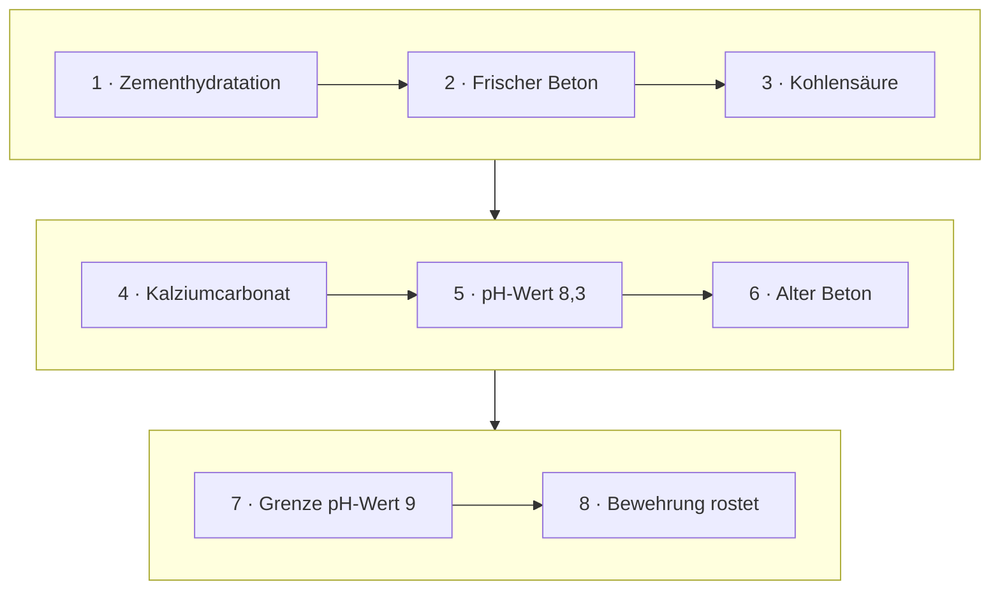

<!--
author:   Hannes Tegelbeckers
email:    hannes.tegelbeckers@ovgu.de
version:  0.2.0
language: de
narrator: Deutsch Female
mode:     Presentation
classroom: enable
comment:  Fachdidaktik technischer Allgemeinbildung II / Fachdidaktik gewerblich-technischer Fachrichtungen – Sitzung S01b. Analytisch, synthetisch, deduktiv, induktiv, genetisch, historisch, reduktiv – an Beispielen aus Bau- und Werkstofftechnik.

import:   https://raw.githubusercontent.com/LiaTemplates/mermaid_template/0.1.4/README.md
-->

# S01b – Unterrichtsmethoden unter dem logischen Aspekt

Fachdidaktik technischer Allgemeinbildung II · OVGU Magdeburg · Montag, 12.10.2026 (gemeinsam mit S01)

<!-- didaktik="Planungsraster S01b · E-03, E-04, E-12, E-17, E-19, E-22 · 0–5 Einstieg These (Vorbereitungsumfrage zeigen) · 5–10 Ihre Lernerfahrung · 10–15 Kurskarte · 15–30 Station 1 Teil und Ganzes, Dächer zusammensetzen · 30–55 Station 2 Allgemeines und Besonderes (Zugversuch zuerst – Regel NICHT vorher nennen), Beuteblatt-Stopp · 55–65 Station 3 Entwicklung · 65–75 Station 4 Rückschluss · 75–85 Beispiel und Methode, Baustein 2 · 85–90 Abschluss" -->
> [!IMPORTANT] 🧭 Leitfrage
> Wie organisiere ich den **Erkenntnisweg**? – In S01 haben Sie gesehen: Unterrichtsmethoden im engeren Sinn lassen sich unter dem *logischen Aspekt* ordnen (Folie R012). Heute lernen Sie diese Methoden kennen – und erleben einige davon selbst.

> [!TIP] 📚 Vor der Sitzung
> Haben Sie die Vorbereitungsaufgabe aus S01 bearbeitet („HOOKE'sches Gesetz: mit der Regel oder mit Messwerten beginnen?“)? Wir starten mit Ihren Antworten.

📝 **Beuteblatt S01b:** Füllen Sie die Überblickstabelle im Lauf der Sitzung.

## Einstieg: Regel zuerst?

    --{{0}}--
Wir beginnen mit einer These. Stimmen Sie spontan ab – am Ende der Sitzung stimmen wir noch einmal ab.

> **„Regel zuerst ist effizienter – Selbst-Entdecken kostet im Unterricht nur Zeit.“**

**Vote (before):** Stimmen Sie zu?

[(a)] Ja, ich stimme zu
[(b)] Nein, ich stimme nicht zu
[(c)] Teils, teils
[(undecided)] Undecided

    --{{1}}--
Erinnern Sie sich an Ihre eigene Lernerfahrung.

      {{1}}
****************************************

> [!TIP] 🧠 Ihre eigene Lernerfahrung · allein, 3 min
> Erinnern Sie sich an eine Stunde aus Schule oder Ausbildung: Wurde Ihnen eine Regel **vorgegeben** – oder haben Sie sie **selbst gefunden**? Was ist davon hängen geblieben?

[[___ ___ ___]]

****************************************

    --{{2}}--
Heute erleben Sie beides.

      {{2}}
> [!TIP] 📌 Merken
> In Station 2 finden Sie eine Regel zuerst selbst – danach bekommen Sie eine Regel vorgegeben. Achten Sie darauf, wie sich beides anfühlt.

## 4.2 Klassifikation von Methoden unter dem logischen Aspekt

    --{{0}}--
In der letzten Sitzung haben wir Methoden unter zwei Aspekten geordnet. Heute nehmen wir den logischen Aspekt genau unter die Lupe: sieben Methoden, in Anlehnung an Diesterweg.

- Analytisch
- Synthetisch
- Deduktiv
- Induktiv
- Genetisch
- Historisch
- Reduktiv

(vgl. Diesterweg)

    --{{1}}--
Damit Sie den Überblick behalten, fassen wir sie in vier Denkrichtungen zusammen. Zu jeder Richtung gibt es ein technisches Beispiel von den Folien.

      {{1}}
> [!NOTE] Key message
> 🔎 Lesehilfe für heute – vier Denkrichtungen: **Teil ↔ Ganzes** (analytisch, synthetisch – Dachkonstruktionen) · **Allgemeines ↔ Besonderes** (induktiv, deduktiv – HOOKE, Beton) · **Entwicklung** (genetisch, historisch – Spannbeton) · **Rückschluss** (reduktiv – Radio).

<small>Quelle: Folie R013 „4.2 Klassifikation von Methoden unter dem logischen Aspekt“ – die Gruppierung in vier Denkrichtungen ist eine Lesehilfe für diese Sitzung, nicht Teil der Originalfolien.</small>

## Kurskarte: sieben Wege zur Erkenntnis

    --{{0}}--
Ihr Weg durch die Sitzung: vier Stationen, eine je Denkrichtung, dann ordnen Sie die Beispiele den Methoden zu. Auf der Kurskarte sind wir bei den Methoden, Leitfrage: Wie organisiere ich den Erkenntnisweg?

    --{{1}}--
Auf diesem Weg erreichen Sie sechs Ziele.

      {{1}}

<!-- data-type="none" -->
| Know | Can do | Value |
|------|--------|-------|
| die sieben Methoden unter dem logischen Aspekt **nennen** | aus Messwerten selbst induktiv eine Regel **aufstellen** und eine deduktive Schlusskette **ordnen** | Vor- und Nachteile deduktiven und induktiven Vorgehens **abwägen** |
| jede Methode an einem technischen Beispiel **erläutern** | Unterrichtsbeispiele einer Methode **zuordnen** und genetische von historischer Methode **unterscheiden** | für Ihr Entwurfsthema eine logische Methode **auswählen** und einen Unterrichtsgang **skizzieren** *(optional)* |

    --{{2}}--
Prüfen Sie kurz, ob Sie den Weg lesen können.

      {{2}}
****************************************

**Decide:** In welcher Station geht es um induktiv und deduktiv?

<!-- data-hint-button="1" data-solution-button="2" -->
- [(X)] Allgemeines und Besonderes
- [( )] Teil und Ganzes
- [( )] Rückschluss
[[?]] Vom Allgemeinen zum Besonderen – oder umgekehrt.
***
Richtig: Station 2 – Allgemeines und Besonderes.
***

****************************************

## Station 1: Teil und Ganzes

    --{{0}}--
Die erste Denkrichtung fragt nach dem Verhältnis von Teil und Ganzem. Die analytische Methode zerlegt, die synthetische fügt zusammen. Unser durchgehendes Beispiel sind zwei Dachkonstruktionen.

**Wie erkenne ich das Wesen eines Ganzen – und wie setze ich es aus Teilen zusammen?**

    --{{1}}--
Zuerst die Analyse.

      {{1}}
- Analytische Methode (R014)

    --{{2}}--
Am Beispiel zweier Dächer.

      {{2}}
- Sparren- und Kehlbalkendach und Pfettendach (R015–R016)

    --{{3}}--
Dann die Synthese.

      {{3}}
- Synthetische Methode (R017)

    --{{4}}--
Wieder an den Dächern.

      {{4}}
- Merkmale und Lastabtragung (R018–R019)

    --{{5}}--
Warum ist das für Sie wichtig?

      {{5}}
> [!TIP] Why this matters
> Aufbau und Wirkungsweise von Maschinen, Anlagen und Konstruktionen erschließen Sie im Technikunterricht ständig über Analyse und Synthese.

    --{{6}}--
Markieren Sie, was Sie schon kennen.

      {{6}}
****************************************

**Mark:** Which of these do you already know? (several possible)

[[a1]] Analytische Methode (R014)
[[a2]] Sparren- und Kehlbalkendach und Pfettendach (R015–R016)
[[a3]] Synthetische Methode (R017)
[[a4]] Merkmale und Lastabtragung (R018–R019)

****************************************

## 4.3 Analytische Methode

    --{{0}}--
Analytisch vorgehen heißt: Ich nehme eine Gesamterscheinung und zerlege sie nach einem Ordnungsprinzip, um aus den herausgelösten Teilen das Wesen des Ganzen zu erkennen. Typische Anwendung ist der Aufbau und die Wirkungsweise von Maschinen.

- Analysieren (anhand eines Ordnungsprinzips) der Gesamterscheinung
- Erkennen des Wesens aus dem Ganzen durch heraus gelöste Teile
- Anwendung: Erkennen von Aufbau, Wirkungsweisen von Maschinen
- Beispiel:
  - Merkmale von Dachkonstruktionen
  - Ordnung nach Elementen, Verbindungen

    --{{1}}--
Die Tabelle zeigt das am Sparren- und Kehlbalkendach und am Pfettendach: geordnet nach tragenden Gliedern, Dachneigung, Fußpunkt, First und Verbänden.

      {{1}}
****************************************

<!-- data-type="none" -->
| | Sparren- und Kehlbalkendach | Pfettendach |
| --- | --- | --- |
| **Tragende Glieder** | Sparren | „Stuhl“ |
| **Dachneigung** | Steiler (>45°) | Flacher (<45°) |
| **Fußpunkt** | Stahlbetonwiderlager; Schrägzapfen, Versatz | Lagerung des Sparrens auf der Fußpfette (Schwelle) |
| **First** | Verbindungen der Sparren durch Laschen, verkämmte Firstbohle; Scherzapfen | Lagerung des Sparrens auf der Firstpfette, Sicherung durch Lasche |
| **Konstruktionselemente/ Verbindungen** | Sparren- und Kehlbalkendach | Pfettendach |
| **Längsverband; Längsstreifigkeit** | Windrispen | Pfettenstränge; Anordnung von Pfosten, Bügen, Sparren |
| **Querverband** | Unverschiebliches Dreieck aus dem Sparrenpaar und der Decke | Dreieck aus Pfosten, Sparren und Decke |

****************************************

    --{{2}}--
Das Ordnungsprinzip ist entscheidend.

      {{2}}
> [!NOTE] Key message
> Analyse = Zerlegen **nach einem Ordnungsprinzip** – hier nach Elementen und Verbindungen der Dachkonstruktion.

<small>Quelle: Folien R014–R016 „4.3 Analytische Methode“ – R015 und R016 zu einer Tabelle zusammengeführt; „Dreieick“ auf R016 zu „Dreieck“ korrigiert.</small>

## 4.4 Synthetische Methode

    --{{0}}--
Die Synthese ist die Gegenbewegung: Teile werden zu einem Ganzen zusammengefügt. Die Folie betont, dass die Analyse dafür Voraussetzung ist – ohne Zerlegung keine Zusammensetzung.

<!-- data-type="none" -->
| Grundoperation 1: Analyse (ist Voraussetzung) | Grundoperation: Synthese |
| --- | --- |
| Zergliederung eines Ganzen in einzelne Bestandteile nach einem bestimmten Ordnungsprinzip | Zusammenfügen einer Anzahl von Teilen zu einem Ganzen |

- Gesamterscheinung wird thematisch beschrieben
- Arbeitsablauf wird in Einzelteile zerlegt
- Einzelteile wiederum einzeln erörtert
- Einzelteile werden wieder zu einem Ganzen zusammengefügt

    --{{1}}--
Im Beispiel entnehmen die Schüler der Zusammenstellung Merkmale und untersuchen dann, wie Wind-, Schnee- und Eigenlast durch die Konstruktion abgeleitet werden.

      {{1}}
****************************************

**Beispiel:** Schüler werden angeregt, aus Zusammenstellung Merkmale entnehmen, die Unterschiede der Konstruktionen erkennbarer machen

<!-- data-type="none" -->
| Tragende Glieder | Sparren- und Kehlbalkendach: **Sparren** | Pfettendach: **Stuhl** |
| --- | --- | --- |
| Querverband | Unverschiebbares Dreieck von **Sparrenpaar** und **Decke** | Dreieck aus **Pfosten**, **Sparren** und **Decke** |

Untersuchen, wie Wind-, Schnee- und Eigenlast durch Dachkonstruktion aufgenommen und abgeleitet wird:

<!-- data-type="none" -->
| Sparren- und Kehlbalkendächer | Pfettendächer |
| --- | --- |
| Belastungen nur über Sparren abgeleitet | Auf Sparren wirkende Belastungen auf die Pfetten übertragen und über Pfosten und Streben in das Gebäude abgeleitet |

****************************************

    --{{2}}--
Deshalb werden beide Methoden oft zusammen diskutiert.

      {{2}}
> [!NOTE] Key message
> Hinweis: z. T. analytische und synthetische Methode zusammenhängend diskutiert, da sie einander bedingen

<small>Quelle: Folien R017–R019 „4.4 Synthetische Methode“</small>

## Aktivierung: Dächer zusammensetzen

    --{{0}}--
Setzen Sie aus den Merkmalen die beiden Dachkonstruktionen zusammen. Vergleichen Sie zuerst.

<!-- data-type="none" -->
| Criterion | Sparren- und Kehlbalkendach | Pfettendach |
|-----------|---------------|---------------|
| Tragende Glieder | Sparren | „Stuhl“ |
| Dachneigung | steiler (>45°) | flacher (<45°) |
| Längsverband | Windrispen | Pfettenstränge |
| Lastabtragung | Belastungen nur über Sparren abgeleitet | über Pfetten, Pfosten und Streben in das Gebäude abgeleitet |

    --{{1}}--
Je ein Merkmal aus dem Querverband:

      {{1}}
- **Sparren- und Kehlbalkendach:** Unverschiebliches Dreieck aus dem Sparrenpaar und der Decke
- **Pfettendach:** Dreieck aus Pfosten, Sparren und Decke

    --{{2}}--
Ein typischer Fehlschluss:

      {{2}}
> [!WARNING] Common misconception
> „Beide Dächer haben Sparren – also tragen beide über die Sparren.“ Beim Pfettendach tragen die Pfetten mit Pfosten und Streben („Stuhl“); die Sparren geben die Lasten nur an die Pfetten weiter.

    --{{3}}--
Ordnen Sie jetzt zu – und überlegen Sie, welche Methode Sie dabei anwenden.

      {{3}}
****************************************

**Decide:** Which concept does each statement describe?

<!-- data-hint-button="1" data-solution-button="2" data-show-partial-solution -->
[(Sparren- und Kehlbalkendach) (Pfettendach)]
[       (X)             ( )      ] Querverband aus Sparrenpaar und Decke
[       ( )             (X)      ] Lasten über Pfetten, Pfosten und Streben abgeleitet
[       (X)             ( )      ] Windrispen im Längsverband
[       ( )             (X)      ] „Stuhl“ als tragende Glieder
[[?]] Wo tragen die Sparren selbst – und wo der Stuhl?
***
Sie haben Teile zu einem Ganzen zusammengefügt – **synthetisch** (R017). Die Zerlegung in Merkmale hatten die Folien R015–R016 schon geleistet: Sie ist Voraussetzung der Synthese; beide Methoden bedingen einander (R019).
***

****************************************

## Station 2: Allgemeines und Besonderes

    --{{0}}--
Die zweite Denkrichtung ist die bekannteste: Gehe ich vom Allgemeinen zum Besonderen oder umgekehrt? Sie erleben zuerst selbst das induktive Vorgehen, danach sehen Sie das deduktive.

**Finde ich die Regel – oder bekomme ich sie?**

    --{{1}}--
Zuerst arbeiten Sie selbst mit Messwerten.

      {{1}}
- Selbst entdecken: der Zugversuch (R025)

    --{{2}}--
Dann benennen wir, was Sie getan haben.

      {{2}}
- Induktive Methode: Fall → Lösung → Regel (R024, R026)

    --{{3}}--
Danach der umgekehrte Weg.

      {{3}}
- Deduktive Methode: Beispiel Beton (R020–R022)

    --{{4}}--
Und ein Vergleich – mit einer Ergänzung, als NEU markiert.

      {{4}}
- Vor- und Nachteile (R023, R027), [NEU] Wie sicher ist ein Schluss?

    --{{5}}--
Warum ist das für Sie wichtig?

      {{5}}
> [!TIP] Why this matters
> Bei jedem neuen Gesetz entscheiden Sie: Regel zuerst oder Messwerte zuerst?

    --{{6}}--
Markieren Sie, was Sie schon kennen.

      {{6}}
****************************************

**Mark:** Which of these do you already know? (several possible)

[[a1]] Selbst entdecken: der Zugversuch (R025)
[[a2]] Induktive Methode: Fall → Lösung → Regel (R024, R026)
[[a3]] Deduktive Methode: Beispiel Beton (R020–R022)
[[a4]] Vor- und Nachteile (R023, R027), [NEU] Wie sicher ist ein Schluss?

****************************************

## Selbst entdecken: der Zugversuch

    --{{0}}--
Hier sehen Sie Messwerte aus dem Zugversuch zweier Stähle, C 45W und C 60W: die Kraft und die zugehörige Längenänderung. Bevor ich etwas erkläre, sind Sie dran.

<!-- didaktik="Lehrschritt unterstützen/üben · 30–40 min · Einzelarbeit · Classroom-Auswertung · Doppeldecker: induktiv – Regel NICHT vorher nennen" -->
**Beispiel:** HOOKE'sches Gesetz für das elastische Verhalten von Stahl

1. Analyse von Ergebnissen des Zugversuches der Stähle

<!-- data-type="none" -->
| C 45W: F in N | C 45W: / in mm | C 60W: F in N | C 60W: / in mm |
| ---: | ---: | ---: | ---: |
| 7,2 | 0,25 | 7,3 | 0,045 |
| 15,1 | 0,52 | 15,3 | 0,09 |
| 24,0 | 0,75 | 19,3 | 0,11 |
| 30,1 | 0,98 | 21,5 | 0,13 |

    --{{1}}--
Dieselben Werte als Diagramm. Schauen Sie auf Tabelle und Diagramm: Was bleibt in jeder Messreihe ungefähr gleich?

      {{1}}
****************************************

<!--
data-type="ScatterPlot"
data-title="Zugversuch: Kraft und Längenänderung"
data-xlabel="F in N"
data-ylabel="Längenänderung in mm (Spalte „/ in mm“)"
data-show
-->
| F | C 45W | C 60W |
| ---: | ---: | ---: |
| 7.2 | 0.25 | |
| 15.1 | 0.52 | |
| 24.0 | 0.75 | |
| 30.1 | 0.98 | |
| 7.3 | | 0.045 |
| 15.3 | | 0.09 |
| 19.3 | | 0.11 |
| 21.5 | | 0.13 |

****************************************

    --{{2}}--
Formulieren Sie gleich auf der nächsten Seite eine Regel.

      {{2}}
> [!NOTE] Key message
> Was bleibt in jeder Messreihe ungefähr gleich? Formulieren Sie daraus eine Regel in **einem** Satz.

<small>Quelle: Folie R025 „4.6 Induktive Methode“ (Titel hier zurückgehalten: Die Methode wird erst nach der Übung benannt). Die Spaltenüberschrift „/ in mm“ steht so auf der Originalfolie (gemeint ist vermutlich die Längenänderung; das Zeichen ist im Original nicht darstellbar). Diagramm aus den Tabellenwerten ergänzt.</small>

## Ihre Regel

    --{{0}}--
Formulieren Sie Ihre Regel – erst danach sehen Sie, was dahintersteckt.

**Allein (5 min):** Was bleibt in jeder Messreihe ungefähr gleich? Formulieren Sie eine **Regel in einem Satz**.

[[___ ___ ___ ___]]

💡 Hint 1

Teilen Sie in jeder Zeile die Längenänderung durch die Kraft.

✅ Solution

Das Verhältnis von Längenänderung zu Kraft ist innerhalb einer Messreihe annähernd konstant – Längenänderung und Kraft sind **proportional**. Rechnen Sie nach: 0,25 : 7,2 ≈ 0,035 · 0,52 : 15,1 ≈ 0,034 · 0,75 : 24,0 ≈ 0,031 · 0,98 : 30,1 ≈ 0,033 (C 45W, rund 0,03 mm/N) und 0,045 : 7,3 ≈ 0,006 · 0,09 : 15,3 ≈ 0,006 · 0,11 : 19,3 ≈ 0,006 · 0,13 : 21,5 ≈ 0,006 (C 60W). Beide Stähle verlängern sich bei gleicher Kraft also **nicht** gleich stark. 💭 Denkanstoß: Was müssten Sie über die Proben wissen, um im nächsten Schritt *Spannung und Dehnung* zu berechnen (R026, Schritt 2)? Die Folie nennt dazu keine Angaben.

## 4.6 Induktive Methode

    --{{0}}--
Was Sie eben gemacht haben, ist induktives Vorgehen: vom Besonderen zum Allgemeinen, vom einzelnen Fall über die Lösung zur Regel. Im Beispiel folgen auf die Analyse der Messwerte die Berechnung von Spannung und Dehnung, die Hypothese der Proportionalität, das HOOKE'sche Gesetz durch Induktionsschluss und die Überprüfung an weiteren Stahlarten.

<!-- didaktik="Lehrschritt informieren · 40–50 min · Rückbezug auf die eben gefundene Regel" -->
- Vom Besonderen zum Allgemeinen
- Vom Konkreten zum Abstrakten
- Von einzelnen Tatsächlichen zum übergreifenden Gültigen
- Schrittfolge: **Fall → Lösung → Regel**

So geht das Beispiel weiter (Schritt 1 haben Sie eben selbst gemacht):

2. Synthese der Ergebnisse durch Berechnung der Spannung und Dehnung sowie der grafischen Darstellung (Kurven im Spannungs-Dehnungs-Diagramm für den elastischen Bereich)
3. Aufstellen Hypothese zur Proportionalität zwischen Spannung und Dehnung im elastischen Bereich. Aufstellen des HOOKE'schen Gesetzes durch Induktionsschluss.
4. Überprüfung dieser Erkenntnis durch Versuchsergebnisse weiterer Stahlarten

    --{{1}}--
Genau so arbeitet die induktive Methode.

      {{1}}
> [!NOTE] Key message
> Vom einzelnen **Fall** (Messwerte) über die **Lösung** (Proportionalität) zur **Regel** (HOOKE'sches Gesetz).

<small>Quelle: Folien R024 und R026 „4.6 Induktive Methode“ – Nummerierung der Schritte ergänzt.</small>

## 4.5 Deduktive Methode

    --{{0}}--
Die deduktive Methode stellt die Regel an den Anfang: allgemeine Aussage, Interpretation, Anwendung. Achten Sie darauf: Dieser Abschnitt ist selbst deduktiv aufgebaut – erst die Regel, dann das Beispiel.

<!-- didaktik="Doppeldecker – dieser Abschnitt ist selbst deduktiv aufgebaut: erst Regel, dann Interpretation, dann Anwendung" -->
- Vom Allgemeinen zum Besonderen des Lerngegenstandes
- Vom Abstrakten zum Konkreten
- Von der Regel zu deren Anwendung
- Schrittfolge: **Allgemeine Aussage → Interpretation → Anwendung**
- Lernziel: Befähigung in der konkreten Anwendung
- Setzt größere Fähigkeit im abstrakten Denken beim Lernenden voraus

    --{{1}}--
Die Folie nennt eine wichtige Voraussetzung.

      {{1}}
> [!NOTE] Key message
> Deduktion **setzt größere Fähigkeit im abstrakten Denken** beim Lernenden voraus.

<small>Quelle: Folie R020 „4.5 Deduktive Methode“</small>

## 4.5 Deduktive Methode – Beispiel Beton

    --{{0}}--
Das Beispiel Beton zeigt eine Schlusskette: Frischer Beton ist durch Kalziumhydroxid stark basisch, Kohlensäure aus der Luft wandelt es in Kalziumcarbonat um, der pH-Wert sinkt, und unterhalb von 9 ist der Korrosionsschutz nicht mehr gewährleistet – die Bewehrung kann rosten.

    --{{1}}--
Die allgemeine Aussage: Kalziumhydroxid macht frischen Beton stark basisch, und Kohlensäure entsteht aus dem Kohlendioxid der Luft.

      {{1}}
****************************************

1. **Zementhydratation:** Zementhydratation im Beton bildet Ca(OH)2 – Kalziumhydroxid hat einen pH-Wert von 12,6
2. **Frischer Beton:** Frischer Beton hat einen pH-Wert von 12,6
3. **Kohlensäure:** CO2 in der Luft bildet mit Wasser Kohlensäure. $\ce{CO2 + H2O -> H2CO3}$

****************************************

    --{{2}}--
Die Interpretation: Kalziumhydroxid reagiert zu Kalziumcarbonat, und der pH-Wert sinkt an der Oberfläche.

      {{2}}
****************************************

4. **Kalziumcarbonat:** Kalziumhydroxid reagiert mit Kohlensäure zu Kalziumcarbonat. $\ce{Ca(OH)2 + H2CO3 -> CaCO3 + 2 H2O}$
5. **pH-Wert 8,3:** Kalziumcarbonat hat einen pH-Wert von 8,3
6. **Alter Beton:** Alter Beton hat an der Oberfläche einen pH-Wert von 8,3

****************************************

    --{{3}}--
Und die Anwendung: Unterhalb von pH 9 ist der Korrosionsschutz nicht mehr gewährleistet.

      {{3}}
****************************************

7. **Grenze pH-Wert 9:** Korrosionsschutz ist nur bei einem pH-Wert über 9 gewährleistet.
8. **Bewehrung rostet:** Bewehrung in Oberflächennähe kann rosten

****************************************

<small>Quelle: Folien R021–R022 „4.5 Deduktive Methode“ (Kette über zwei Folien; Kurzbezeichnungen der Schritte und Formeln in chemischer Schreibweise ergänzt).</small>

## Aktivierung: die Schlusskette ordnen

    --{{0}}--
Bringen Sie die Schritte der deduktiven Kette in die richtige Reihenfolge. Danach Beuteblatt-Stopp: Ergänzen Sie Abschnitt 2 – Ihre Regel, Vor- und Nachteile beider Methoden.

**Order:** Drag each card into the right gap.

<!-- data-randomize data-show-partial-solution data-solution-button="2" -->
Step 1: [->[ Zementhydratation ]] → Step 2: [->[ Frischer Beton ]] → Step 3: [->[ Kohlensäure ]] → Step 4: [->[ Kalziumcarbonat ]] → Step 5: [->[ pH-Wert 8,3 ]] → Step 6: [->[ Alter Beton ]] → Step 7: [->[ Grenze pH-Wert 9 ]] → Step 8: [->[ Bewehrung rostet ]]

## Induktiv oder deduktiv? Vor- und Nachteile

    --{{0}}--
Beide Wege haben Vor- und Nachteile. Die Folien stellen sie zusammen.

<!-- data-type="none" -->
| Criterion | Induktive Methode | Deduktive Methode |
|-----------|---------------|---------------|
| Richtung | Vom Besonderen zum Allgemeinen; vom Konkreten zum Abstrakten | Vom Allgemeinen zum Besonderen; vom Abstrakten zum Konkreten |
| Schrittfolge | Fall → Lösung → Regel | Allgemeine Aussage → Interpretation → Anwendung |
| Vorteile | Natürlichen Lernprozess angepasst; Schüler mit Geschehen konfrontiert | Schulung des klaren, logischen Denkens; Schulung des Abstraktionsvermögens |
| Nachteile | Unterstellung, Bearbeitung eines Falles ausreichend zum Erkennen des Allgemeinen; Fallkonstruktionen oft realitäts- bzw. praxisfern | Hoher Abstraktionsgrad; Geringe Anschaulichkeit; Geringes Motivationspotential |

    --{{1}}--
Je ein Beispiel von den Folien:

      {{1}}
- **Induktive Methode:** HOOKE'sches Gesetz aus Messwerten des Zugversuchs
- **Deduktive Methode:** Vom pH-Wert des Betons auf das Rosten der Bewehrung schließen

    --{{2}}--
Ein typischer Fehlschluss:

      {{2}}
> [!WARNING] Common misconception
> „Induktiv ist immer besser, weil die Lernenden selbst entdecken.“ – Die Folie nennt auch Nachteile: Ein bearbeiteter Fall reicht nicht, um das Allgemeine sicher zu erkennen (R027).

    --{{3}}--
Ordnen Sie jetzt Unterrichtsbeispiele zu.

      {{3}}
****************************************

**Decide:** Which concept does each statement describe?

<!-- data-hint-button="1" data-solution-button="2" data-show-partial-solution -->
[(Induktive Methode) (Deduktive Methode)]
[       (X)             ( )      ] Die Lernenden messen den Strom bei verschiedenen Spannungen und formulieren daraus das Ohm'sche Gesetz.
[       ( )             (X)      ] Die Lehrkraft nennt das Ohm'sche Gesetz und lässt es an drei Schaltungen anwenden.
[       (X)             ( )      ] Die Lernenden vergleichen mehrere defekte Lager und formulieren eine gemeinsame Ursache als Regel.
[       ( )             (X)      ] Aus der Regel „Korrosionsschutz nur über pH 9“ folgern die Lernenden, dass oberflächennahe Bewehrung in altem Beton rosten kann.
[[?]] Steht die Regel am Anfang oder am Ende?
***
Induktiv: Die Regel steht am Ende (Fall → Lösung → Regel, R024). Deduktiv: Die Regel steht am Anfang (Allgemeine Aussage → Interpretation → Anwendung, R020). Vergleichstabelle nach Folien R020, R023, R024, R027 – „logisches Denkens“ (R023) zu „logischen Denkens“ und „Fallkontruktionen“ (R027) zu „Fallkonstruktionen“ korrigiert; Unterrichtsbeispiele: eigene Darstellung.
***

****************************************

## [NEU] Wie sicher ist ein Schluss?

    --{{0}}--
Eine Ergänzung aus der Forschungsliteratur, deshalb als NEU markiert. Dilling unterscheidet die beiden Schlussweisen nach ihrer Sicherheit: Der deduktive Schluss führt sicher zum Resultat, der induktive nicht.

<!-- neu="Dilling 2024, S. 38–39, 43–44" -->
- **Deduktiver Schluss:** Regel + Fall → Resultat. „Mit einem deduktiven Schluss kann sicher auf das Resultat geschlossen werden“ (Dilling 2024, S. 38).
- **Induktiver Schluss:** Fall + Resultat → Regel. „Der induktive Schluss überträgt die Gültigkeit der Prämissen anders als die Deduktion nicht mit Sicherheit auf die Konklusion“ (Dilling 2024, S. 39).

Für das Entdecken und Begründen beschreibt Dilling drei Phasen: **Exploration** (Hypothesen entwickeln), **Wissenserklärung** (die Hypothese deduktiv auf bekanntes Wissen zurückführen) und **Wissenssicherung** (die Hypothese experimentell prüfen und induktiv absichern) (Dilling 2024, S. 43–44).

    --{{1}}--
Verbinden Sie das mit dem HOOKE-Beispiel.

      {{1}}
> [!NOTE] Key message
> 🔗 Welcher Schritt des HOOKE-Beispiels (R026) entspricht der *Wissenssicherung*? Prüfen Sie es auf der nächsten Seite.

<small>[NEU] Ergänzung, keine Originalfolie: Dilling (2024), S. 38–39, 43–44.</small>

## Aktivierung: Schlüsse prüfen

    --{{0}}--
Drei kurze Fragen zu induktiv, deduktiv und Dilling.

**1 · Choose one:** Welcher Schritt des HOOKE-Beispiels (R026) entspricht der **Wissenssicherung**?

<!-- data-hint-button="1" data-solution-button="2" -->
- [( )] Schritt 2: Berechnung von Spannung und Dehnung
- [(X)] Schritt 4: Überprüfung durch Versuchsergebnisse weiterer Stahlarten
- [( )] Schritt 3: Aufstellen der Hypothese
[[?]] Wissenssicherung = die Hypothese experimentell prüfen.
***
Schritt 4 prüft die induktiv gewonnene Regel an weiteren Fällen. Genau hier setzt auch der Nachteil der induktiven Methode an (R027): Ein bearbeiteter Fall reicht nicht, um das Allgemeine sicher zu erkennen.
***

    --{{1}}--
Jetzt können mehrere Antworten richtig sein.

      {{1}}
****************************************

**2 · Choose all that apply:** Welche Aussagen stimmen nach Dilling (2024)?

<!-- data-hint-button="1" data-solution-button="2" -->
- [[X]] Mit einem deduktiven Schluss kann sicher auf das Resultat geschlossen werden.
- [[ ]] Der induktive Schluss ist sicherer als der deduktive.
- [[X]] Der induktive Schluss überträgt die Gültigkeit der Prämissen nicht mit Sicherheit auf die Konklusion.
- [[ ]] Exploration bedeutet, die Hypothese experimentell abzusichern.
[[?]] Regel + Fall → Resultat ist sicher; Fall + Resultat → Regel nicht.
***
Exploration = Hypothesen entwickeln; experimentell abgesichert wird in der Wissenssicherung (Dilling 2024, S. 43–44).
***

****************************************

    --{{2}}--
Zum Schluss ein Begriff.

      {{2}}
****************************************

**3 · Type:** Induktive Schrittfolge: Fall → Lösung → … (ein Wort)

<!-- data-hint-button="1" data-solution-button="2" -->
[[Regel]]
[[?]] Am Ende steht das Allgemeine.

***
Fall → Lösung → Regel (R024).
***

****************************************

## Station 3: Entwicklung

    --{{0}}--
Die dritte Denkrichtung erklärt einen Gegenstand aus seiner Entwicklung. Wir unterscheiden zwei Methoden, beide am Beispiel Spannbeton.

**Erkläre ich einen Gegenstand aus seinem Werden – oder aus seiner Geschichte?**

    --{{1}}--
Zuerst die genetische Methode.

      {{1}}
- Genetische Methode (R028)

    --{{2}}--
Am Spannbeton.

      {{2}}
- Spannbeton über seine Fertigung (R029)

    --{{3}}--
Dann die historische Methode.

      {{3}}
- Historische Methode (R030)

    --{{4}}--
Wieder am Spannbeton.

      {{4}}
- Spannbeton aus dem Bedarf des 19. Jahrhunderts (R031)

    --{{5}}--
Warum ist das für Sie wichtig?

      {{5}}
> [!TIP] Why this matters
> Achten Sie auf den Unterschied – Sie brauchen ihn in S06 bei den Großformen wieder.

    --{{6}}--
Markieren Sie, was Sie schon kennen.

      {{6}}
****************************************

**Mark:** Which of these do you already know? (several possible)

[[a1]] Genetische Methode (R028)
[[a2]] Spannbeton über seine Fertigung (R029)
[[a3]] Historische Methode (R030)
[[a4]] Spannbeton aus dem Bedarf des 19. Jahrhunderts (R031)

****************************************

## 4.7 Genetische Methode

    --{{0}}--
Die genetische Methode erklärt das Wesen eines Gegenstandes aus seinem Werden – vom Einfachen zum Komplizierten, entlang eines Leitgedankens.

<!-- didaktik="Lehrschritt informieren · 55–62 min" -->
- Wesen in Entwicklung von Lernobjekten zu bestimmten Themen
- Vom Einfachen zum Komplizierten auf Basis eines Leitgedanken
- Anwendung u. a. Themen, die aus ihrer Entwicklung dargestellt werden

    --{{1}}--
Statt den fertigen Spannbeton zu zeigen, bei dem der Betonkörper erhärtet und die Vorspannung schon aufgebracht ist, erklärt sie ihn über die Fertigung.

      {{1}}
****************************************

**Beispiel:**

- Wesen Spannbetons mittels „fertigen“ Konstruktion erklärt
  - Betonkörper war abgebunden und erhärtet
  - Vorspannung war aufgebracht
- Genetische Methode – erklärt über die Fertigung
  - Erfasst das „Sein vor dem Hintergrund des Werdens“
- Fertigung des Spannbetons:
  - Verbund Spannstahl und Beton und nachträglichen Verbund über Verankerung in der Hülse bildet Zugang, der die Art des Aufbringens der Vorspannung für den Unterricht nutzt

****************************************

    --{{2}}--
Die Folie fasst das in einem Satz.

      {{2}}
> [!NOTE] Key message
> Genetisch = das **„Sein vor dem Hintergrund des Werdens“** erfassen.

<small>Quelle: Folien R028–R029 „4.7 Genetische Methode“</small>

## 4.8 Historische Methode

    --{{0}}--
Bei der historischen Methode bestimmt die gesellschaftliche Entwicklung den Gang. Die Folie gibt vier Schritte vor.

- Entwicklungsgedanke wird durch gesellschaftliche Entwicklung bestimmt
- Methodische Folge:
  1. Analysieren des Lernobjektes in konkreten historischen Erscheinungsformen
  2. Aufdecken von Einflussgrößen in der jeweiligen historischen Situation
  3. Vergleich und Bewerten des jeweiligen Entwicklungsstandes
  4. Zusammenfassen der gewonnenen Erkenntnisse

    --{{1}}--
Beim Spannbeton heißt das: Die Erfindung ist fast so alt wie der Stahlbeton, realisiert wurde sie aber erst, als Stahl- und Betonqualität ausreichten und große Spannweiten für Industrie- und Verkehrsbauten gefragt waren.

      {{1}}
****************************************

**Beispiel:**

- Erfindung Spannbeton fast so alt wie Stahlbeton
- Ungenügende Stahl- und Betonqualität erst spätere technische Realisierung
- Entwicklung Stahl- und Spannbetons durch enormen Bedarf an Industrie- und Verkehrsbauten im 19. Jahrhundert gefördert
- Verlangten großen Spannweiten waren Stahlbetonkonstruktionen nicht gewachsen
- Gleiche Belastung, Betonquerschnitt minimiert, Weite → Spannbeton
- Wirkungsprinzip historisch schwer erklärbar

****************************************

    --{{2}}--
Die Folie nennt auch eine Grenze.

      {{2}}
> [!NOTE] Key message
> Grenze der historischen Methode: Das **Wirkungsprinzip** ist historisch schwer erklärbar (R031).

<small>Quelle: Folien R030–R031 „4.8 Historische Methode“ – Nummerierung der methodischen Folge ergänzt.</small>

## Aktivierung: gleicher Gegenstand, zwei Methoden

    --{{0}}--
Beide Methoden folgen einer Entwicklung – aber einer anderen. Vergleichen Sie zuerst.

<!-- data-type="none" -->
| Criterion | genetisch | historisch |
|-----------|---------------|---------------|
| Entwicklungsgedanke | Werden des Gegenstandes selbst | durch gesellschaftliche Entwicklung bestimmt |
| Gang | vom Einfachen zum Komplizierten auf Basis eines Leitgedankens | Erscheinungsformen analysieren, Einflussgrößen aufdecken, Entwicklungsstände vergleichen und bewerten, zusammenfassen |
| Spannbeton | über die Fertigung erklärt | aus dem Bedarf an Industrie- und Verkehrsbauten erklärt |
| Wirkungsprinzip | über die Art des Aufbringens der Vorspannung zugänglich | historisch schwer erklärbar |

    --{{1}}--
Je ein Beispiel:

      {{1}}
- **genetisch:** Spannbeton wird über das Aufbringen der Vorspannung bei der Fertigung erklärt.
- **historisch:** Spannbeton wird aus den großen Spannweiten erklärt, denen Stahlbeton nicht gewachsen war.

    --{{2}}--
Ein typischer Fehlschluss:

      {{2}}
> [!WARNING] Common misconception
> „Genetisch heißt geschichtlich.“ – Genetisch folgt dem Werden des Gegenstandes (z. B. der Fertigung), historisch der gesellschaftlichen Entwicklung.

    --{{3}}--
Ordnen Sie jetzt zu.

      {{3}}
****************************************

**Decide:** Which concept does each statement describe?

<!-- data-hint-button="1" data-solution-button="2" data-show-partial-solution -->
[(genetisch) (historisch)]
[       (X)             ( )      ] Spannbeton wird über seine Fertigung erklärt – vom Aufbringen der Vorspannung her.
[       ( )             (X)      ] Spannbeton wird aus dem Bedarf an Industrie- und Verkehrsbauten im 19. Jahrhundert erklärt.
[       (X)             ( )      ] Erfasst das „Sein vor dem Hintergrund des Werdens“.
[       ( )             (X)      ] Der Entwicklungsgedanke wird durch die gesellschaftliche Entwicklung bestimmt.
[[?]] Folgt die Erklärung dem Gegenstand oder der Gesellschaft?
***
Die **genetische** Methode folgt dem Werden des Gegenstandes selbst (Fertigung, vom Einfachen zum Komplizierten). Die **historische** Methode folgt der gesellschaftlichen Entwicklung (Bedarf, Einflussgrößen, Entwicklungsstand) – und hat eine Grenze: Das Wirkungsprinzip ist historisch schwer erklärbar (R031).
***

****************************************

## Station 4: Rückschluss – ein Fall zum Einstieg

    --{{0}}--
Die vierte Denkrichtung ist der Rückschluss. Sie kennen ihn aus jeder Fehlersuche: Etwas funktioniert nicht – und Sie schließen auf die Ursache zurück.

<!-- didaktik="Lehrschritt provozieren (Mikro-Zyklus) · 65–68 min · Einzelarbeit · Classroom-Auswertung" -->
> **Das Radio hört auf zu spielen.**

**Allein (3 min):** Was könnte die Ursache sein – und wie würden Sie Ihre Vermutung prüfen?

[[___ ___ ___ ___]]

💡 Hint 1

Sammeln Sie zuerst mögliche Ursachen. Überlegen Sie dann: Was müsste außerdem zutreffen, wenn Ihre Vermutung stimmt?

✅ Solution

Mögliche Ursachen: Radio defekt, Wohnungssicherung durchgebrannt, Stecker gezogen … Prüfen: Wenn die Wohnungssicherung durchgebrannt ist, brennt auch die Stehlampe im selben Stromkreis nicht – also die Stehlampe einschalten. Wie das methodisch heißt, zeigt die nächste Seite.

## 4.9 Reduktive Methode

    --{{0}}--
Die reduktive Methode ist nicht wahrheitserblich: Wir schließen auf eine vorhandene oder zu schaffende Struktur zurück. Die Folie unterscheidet zwei Reaktionen.

<!-- didaktik="Lehrschritt informieren · 68–73 min" -->
- Nicht wahrheitserblich
- Es soll auf vorhandene oder zu schaffende Struktur geschlossen werden
- Zurückgreifen auf bereits bekannte Vorgänge (beispielsweise aus der Natur)
- Unterteilung der reduktiven Schlüsse
  - **Regressive Reaktion:** geht von bekannten Sachverhalten aus, die in Form von Aussagen widergespiegelt werden und führt zu einer Erklärung dieser Sachverhalte
  - **Progressive Reaktion:** Hier sind keine von vornherein wahrheitsgemäßen Antworten und es müssen Hypothesen aufgestellt werden

    --{{1}}--
Die regressive Reaktion geht von bekannten Sachverhalten aus und erklärt sie, etwa: Das Radio spielt nicht, weil es defekt ist oder die Wohnungssicherung durchgebrannt ist. Die progressive stellt eine Hypothese auf und leitet daraus prüfbare Aussagen ab: Wenn die Sicherung durchgebrannt ist, brennt auch die Stehlampe nicht.

      {{1}}
****************************************

**Beispiel: Das Radio hört auf zu spielen**

<!-- data-type="none" -->
| Regressive Reaktion | Progressive Reaktion |
| --- | --- |
| Auf Erklärung des Sachverhalts geschlossen, d.h. Aussage über Voraussetzungen, Bedingungen und Ursachen | Aus Hypothese abgeleitete Aussagen wahr → gilt Hypothese bestätigt |
| Vorrangig gesetzmäßige Zusammenhänge untersucht → daher oft keine einfache Aussage, sondern ein Gefüge von Aussagen bzw. eine ganze Theorie | Daher möglichst viele Aussagen ableiten |
| Gründe Bsp.: Radio defekt, Wohnungssicherung durchgebrannt, … | Bsp.: Wohnungssicherung durchgebrannt → Stehlampe brennt auch nicht |

****************************************

    --{{2}}--
Je mehr solcher Aussagen sich bestätigen, desto besser ist die Hypothese gestützt.

      {{2}}
> [!NOTE] Key message
> Das ist die Logik jeder **Fehlersuche**: Hypothese aufstellen, prüfbare Aussagen ableiten, prüfen.

<small>Quelle: Folien R032–R033 „4.9 Reduktive Methode“ – „führt u einer Erklärung“ zu „führt zu einer Erklärung“ korrigiert.</small>

## Wo stehen wir? Beispiel und Methode

    --{{0}}--
Welche Methode steckt in welchem Beispiel der Folien?

**1 · Choose one:** „Spannbeton aus dem Bedarf des 19. Jahrhunderts“ – welche Methode?

<!-- data-hint-button="1" data-solution-button="2" -->
- [( )] genetisch
- [(X)] historisch
- [( )] reduktiv
[[?]] Gesellschaftliche Entwicklung …
***
Historisch: Der Entwicklungsgedanke wird durch die gesellschaftliche Entwicklung bestimmt (R030–R031).
***

    --{{1}}--
Jetzt können mehrere Antworten richtig sein.

      {{1}}
****************************************

**2 · Choose all that apply:** Welche Zuordnungen stimmen?

<!-- data-hint-button="1" data-solution-button="2" -->
- [[X]] Merkmale von Dachkonstruktionen ordnen – analytisch
- [[ ]] pH-Wert von Beton und Rosten der Bewehrung – induktiv
- [[X]] Das Radio hört auf zu spielen – reduktiv
- [[ ]] HOOKE'sches Gesetz aus dem Zugversuch – deduktiv
[[?]] Beton: Regel zuerst. HOOKE: Messwerte zuerst.
***
Dach – analytisch (R014) · Beton – deduktiv (R021–R022) · HOOKE – induktiv (R025–R026) · Spannbeton über Fertigung – genetisch (R029) · Spannbeton aus gesellschaftlichem Bedarf – historisch (R031) · Radio – reduktiv (R033).
***

****************************************

    --{{2}}--
Zum Schluss ein Begriff.

      {{2}}
****************************************

**3 · Type:** „Spannbeton über seine Fertigung“ – welche Methode? (ein Wort)

<!-- data-hint-button="1" data-solution-button="2" -->
[[genetisch]]
[[?]] Das Sein vor dem Hintergrund des Werdens …

***
Genetisch: Spannbeton wird über die Fertigung erklärt (R029).
***

****************************************

## Kurzcheck: Rückschluss und die heutige Sitzung

    --{{0}}--
Und welche Methoden hatte die heutige Sitzung selbst?

**1 · Choose one:** „Wenn die Wohnungssicherung durchgebrannt ist, brennt auch die Stehlampe nicht – also prüfe ich die Stehlampe.“ Welche Reaktion ist das?

<!-- data-hint-button="1" data-solution-button="2" -->
- [( )] regressive Reaktion
- [(X)] progressive Reaktion
- [( )] deduktive Anwendung einer Regel
[[?]] Wird eine Hypothese aufgestellt und daraus eine prüfbare Aussage abgeleitet?
***
Aus der Hypothese („Wohnungssicherung durchgebrannt“) wird eine prüfbare Aussage abgeleitet („Stehlampe brennt auch nicht“). Ist sie wahr, gilt die Hypothese als bestätigt – deshalb möglichst viele Aussagen ableiten (R033).
***

    --{{1}}--
Jetzt können mehrere Antworten richtig sein.

      {{1}}
****************************************

**2 · Choose all that apply:** Welche Teile von S01 und S01b waren **induktiv** aufgebaut?

<!-- data-hint-button="1" data-solution-button="2" -->
- [[X]] Zugversuch – erst Daten, dann Regel
- [[ ]] Deduktive Methode – erst Regel, dann Beton-Beispiel
- [[X]] Strukturlegetechnik in S01 – erst sortieren, dann auflösen
- [[ ]] Dächer aus Merkmalen zusammensetzen
[[?]] Steht die Regel am Ende?
***
Zugversuch und Strukturlegetechnik: erst die Einzelfälle, dann die Regel – induktiv. Der Abschnitt zur deduktiven Methode begann mit der Regel – deduktiv. Dächer zusammensetzen: synthetisch.
***

****************************************

    --{{2}}--
Zum Schluss ein Begriff.

      {{2}}
****************************************

**3 · Type:** „Dächer aus Merkmalen zusammensetzen“ – welche Methode? (ein Wort)

<!-- data-hint-button="1" data-solution-button="2" -->
[[synthetisch]]
[[?]] Teile → Ganzes …

***
Synthese = Zusammenfügen einer Anzahl von Teilen zu einem Ganzen (R017).
***

****************************************

## Baustein 2 für Ihren Unterrichtsentwurf (optional)

    --{{0}}--
Wählen Sie für Ihr Entwurfsthema aus S01 eine logische Methode.

**Allein (6 min):** Wählen Sie für Ihr Entwurfsthema aus S01 eine logische Methode. Skizzieren Sie den Unterrichtsgang in **drei Schritten** (z. B. *Fall → Lösung → Regel* oder *allgemeine Aussage → Interpretation → Anwendung*) und begründen Sie Ihre Wahl in einem Satz.

[[___ ___ ___ ___]]

💡 Hint 1

Fragen Sie: Können die Lernenden die Regel aus wenigen, eindeutigen Fällen selbst finden – oder ist sie zu abstrakt dafür?

✅ Solution

Thema Leitungsschutzschalter, **induktiv**: ① Fall – Die Lernenden belasten eine Leitung im Versuchsaufbau mit steigendem Strom und beobachten Erwärmung und Auslösezeit. ② Lösung – Je größer der Überstrom, desto schneller löst der Schalter aus. ③ Regel – Auslösekennlinie formulieren und an der Herstellerkennlinie prüfen. Begründung: Der Zusammenhang ist messbar und anschaulich; die Prüfung an der Kennlinie sichert die Regel ab (Wissenssicherung, Dilling).

## Zum Mitnehmen: Regel zuerst?

    --{{0}}--
Noch einmal die These vom Anfang. Stimmen Sie jetzt ab.

**Vote (after):** „Regel zuerst ist effizienter – Selbst-Entdecken kostet im Unterricht nur Zeit.“ – Stimmen Sie jetzt zu?

[(a)] Ja, ich stimme zu
[(b)] Nein, ich stimme nicht zu
[(c)] Teils, teils
[(undecided)] Undecided

    --{{1}}--
Was ist Ihnen heute am unklarsten geblieben?

      {{1}}
****************************************

**Reflect:** Muddiest point: Was ist Ihnen heute am unklarsten geblieben?

[[___ ___]]

****************************************

    --{{2}}--
Eine Einordnung:

      {{2}}
> [!NOTE] Key message
> Beide Wege haben Vor- und Nachteile (R023, R027): Deduktiv schult das logische Denken, ist aber abstrakt und wenig motivierend; induktiv ist dem natürlichen Lernprozess angepasst, braucht aber mehr als einen Fall. Wählen Sie nach Lernziel und Lernenden – und sichern Sie induktiv gefundene Regeln ab.

## Das Wichtigste aus S01b

    --{{0}}--
Fassen wir zusammen.

    --{{1}}--
Erstens: Teil und Ganzes.

      {{1}}
- Analytisch zerlegen, synthetisch zusammenfügen – beide bedingen einander (R014–R019).

    --{{2}}--
Zweitens: Allgemeines und Besonderes.

      {{2}}
- Induktiv: Fall → Lösung → Regel · Deduktiv: Allgemeine Aussage → Interpretation → Anwendung (R020, R024).

    --{{3}}--
Drittens: Entwicklung.

      {{3}}
- Genetisch folgt dem Werden des Gegenstandes, historisch der gesellschaftlichen Entwicklung (R028–R031).

    --{{4}}--
Und viertens: Rückschluss.

      {{4}}
****************************************

- Reduktiv: nicht wahrheitserblich – regressiv erklären, progressiv Hypothesen prüfen (R032–R033).

> [!NOTE] Remember
> Der logische Aspekt fragt: Auf welchem Denkweg entsteht die Erkenntnis?

****************************************

    --{{5}}--
Eine letzte Frage.

      {{5}}
****************************************

**Recap:** Welcher Nachteil der induktiven Methode steht auf Folie R027?

<!-- data-hint-button="1" data-solution-button="2" -->
- [( )] Hoher Abstraktionsgrad
- [( )] Geringes Motivationspotential
- [(X)] Unterstellung, Bearbeitung eines Falles ausreichend zum Erkennen des Allgemeinen
[[?]] Die beiden falschen Antworten stehen bei der deduktiven Methode.
***
Richtig (R027). Hoher Abstraktionsgrad und geringes Motivationspotential sind Nachteile der deduktiven Methode (R023).
***

****************************************

    --{{6}}--
Als Nächstes geht es um Handlungsorientierung.

      {{6}}
**➡️ Next:** S02: Handlungsorientierung · 📝 Beuteblatt-Stopp: Ergänzen Sie die Abschnitte 3 und 4 und Ihre wichtigste Beute.

## Prüfungsfragen zum Üben

    --{{0}}--
Mit diesen vier Fragen können Sie sich auf die mündliche Prüfung vorbereiten.

<!-- didaktik="E-12 mündliche Prüfung" -->
1. Nennen Sie die Methoden unter dem logischen Aspekt und erläutern Sie zwei davon an einem technischen Beispiel.
2. Vergleichen Sie deduktives und induktives Vorgehen: Schrittfolge, Vor- und Nachteile – und wann würden Sie welches wählen?
3. Worin unterscheiden sich genetische und historische Methode? Erläutern Sie am Beispiel Spannbeton.
4. Erklären Sie regressive und progressive Reaktion der reduktiven Methode an einem Fehlerfall aus Ihrer Fachrichtung.

<small>Die Prüfungsfragen sind experimentell: Sie dienen der Vorbereitung, es ist nicht garantiert, dass Fragen in dieser Form gestellt werden.</small>

## Rückblick auf S01b

    --{{0}}--
Nehmen Sie sich zwei Minuten für einen Rückblick. Was ist das Wichtigste – und was ist noch unklar?

**Reflect:** What is the most important thing you learned today – and what is still unclear?

[[___ ___ ___]]

    --{{1}}--
Haken Sie ab, was Sie jetzt können.

      {{1}}
****************************************

**Tick:** What can you do now?

- [ ] Ich kann die sieben Methoden unter dem logischen Aspekt nennen und an Beispielen erläutern.
- [ ] Ich kann induktives und deduktives Vorgehen mit Vor- und Nachteilen vergleichen.
- [ ] Ich kann genetische und historische Methode am Beispiel Spannbeton unterscheiden.

****************************************

    --{{2}}--
Und zum Schluss: Wie hat die Sitzung für Sie funktioniert?

      {{2}}
****************************************

**Feedback:** How did this session work for you?

[(1 agree)(2 rather agree)(3 neutral)(4 rather disagree)(5 disagree)]
[                                                                   ] The pace was appropriate.
[                                                                   ] The explanations were clear.
[                                                                   ] The examples helped me understand.
[                                                                   ] The interactive parts were useful.

****************************************

## Vorbereitung auf S02

    --{{0}}--
In S02 geht es um Handlungsorientierung – warum Lernende im technischen Unterricht handeln sollen. Planen Sie etwa 15 Minuten Vorbereitung ein.

<!-- style="max-width:100%;width:60%;display:block;margin:0 auto;" -->

> [!IMPORTANT] Think about it until next time
> Beschreiben Sie eine typische berufliche Tätigkeit Ihrer Fachrichtung (z. B. eine Steckdose installieren, eine Welle drehen, einen Dachstuhl abbinden) in Schritten: Was passiert vor, während und nach der Ausführung? Und wer entscheidet in Ihrer Erfahrung meist, wie eine Aufgabe ausgeführt wird – die Lehrkraft, die Lernenden, beide gemeinsam oder eine Vorschrift?

*S02 · Montag, 19.10.2026 · Selbstlernsitzung*

## Literatur

    --{{0}}--
Hier finden Sie die Quellen dieser Sitzung.

**Zitiert auf den Originalfolien dieser Sitzung**

- Diesterweg – Folie R013 („vgl. Diesterweg“); vollständige Angabe auf der Originalfolie nicht vorhanden.

**[NEU] Ergänzende Literatur**

- Dilling, F. (2024). Naturwissenschaftliche Erkenntniswege – Was können wir aus diesen über Begründungen im Mathematikunterricht lernen? In F. Dilling et al. (Hrsg.), *Interdisziplinäres Forschen und Lehren in den MINT-Didaktiken* (MINTUS – Beiträge zur mathematisch-naturwissenschaftlichen Bildung, S. 35–54). Wiesbaden: Springer Fachmedien. https://doi.org/10.1007/978-3-658-43873-9_3

<small>Gesamtverzeichnis: 00_Literatur.md</small>
