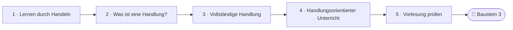
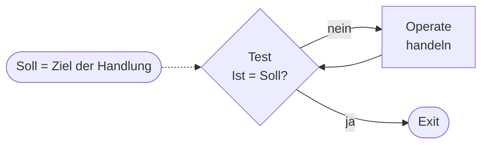
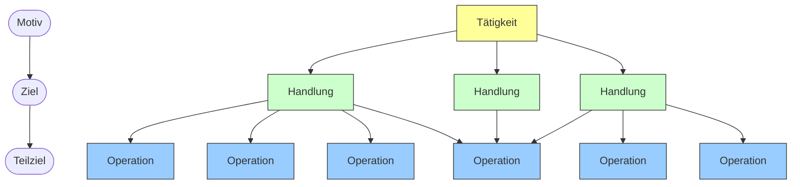
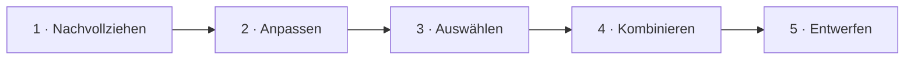
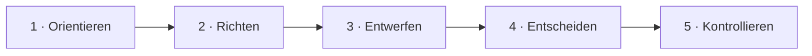

<!--
author:   Hannes Tegelbeckers
email:    hannes.tegelbeckers@ovgu.de
version:  0.2.0
language: de
narrator: Deutsch Female
mode:     Presentation
classroom: enable
comment:  Fachdidaktik technischer Allgemeinbildung II / Fachdidaktik gewerblich-technischer Fachrichtungen – Sitzung S02. Warum lernt man durch Handeln? Was ist eine Handlung? Wie sieht handlungsorientierter Unterricht aus?

import:   https://raw.githubusercontent.com/LiaTemplates/mermaid_template/0.1.4/README.md
-->

# S02 – Handlungsorientierung

**Das Konzept der Handlungsorientierung** · Fachdidaktik technischer Allgemeinbildung II · OVGU Magdeburg · Montag, 19.10.2026 (🔵 Selbstlernsitzung)

<small>Quelle: Folie R040 „Das Konzept der Handlungsorientierung“ (Teil-Deck 02: „02_Das Konzept der Handlungsorientierung“)</small>

<!-- didaktik="Planungsraster S02 · E-03, E-04, E-12, E-17, E-19, E-24 · 0–5 Einstieg (Vorbereitungsumfrage „Wer entscheidet?“ zeigen) · 5–10 Ihre berufliche Tätigkeit · 10–15 Kurskarte · 15–30 Station 1 Begründung, Wer sagt was? · 30–52 Station 2 Handlung, TOTE/VVR, vollständige Handlung, Aktivierungen, Beuteblatt-Stopp · 52–67 Station 3 Frieling, Hortsch, Bünning, [NEU] Zinn, Thesen-Check · 67–77 Vorlesung auf dem Prüfstand · 77–85 Baustein 3 · 85–90 Abschluss" -->
> [!IMPORTANT] 🧭 Leitfrage
> Warum sollen Lernende im technischen Unterricht **handeln**? – Auf der Kurskarte sind wir bei den **Zielen: Wozu?**

> [!TIP] 📚 Vor der Sitzung
> Haben Sie eine berufliche Tätigkeit Ihrer Fachrichtung in Schritten beschrieben (vor – während – nach der Ausführung)? Sie brauchen sie gleich.

📝 **Beuteblatt S02:** drei Abschnitte – einer pro Station.

## Einstieg: Ist diese Vorlesung handlungsorientiert?

    --{{0}}--
Ein Zitat von Roth zum Start. Sie sitzen gerade in einer Vorlesung. Ist sie handlungsorientiert? Das Ergebnis bleibt stehen – am Ende beurteilen Sie die Sitzung mit Kriterien.

> „Alle methodische Kunst liegt darin beschlossen, tote Sachverhalte in lebendige Handlungen rückzuverwandeln, aus denen sie entsprungen sind …“ (Roth, 1976, S. 123)

**Vote (before):** Sie sitzen gerade in einer Vorlesung. Ist sie handlungsorientiert?

[(a)] Ja
[(b)] Nein
[(c)] Teilweise
[(undecided)] Undecided

    --{{1}}--
Nehmen Sie Ihre Schrittfolge aus der Vorbereitung.

      {{1}}
****************************************

> [!TIP] 🧠 Ihre berufliche Tätigkeit · allein, 3 min
> Sehen Sie sich Ihre Schrittfolge aus der Vorbereitung an. Welche Schritte **planen**, welche **führen aus**, welche **prüfen**? Wo hatten Sie selbst etwas zu **entscheiden**?

[[___ ___ ___]]

****************************************

    --{{2}}--
Ihre Schritte brauchen Sie in Station 2 wieder.

      {{2}}
> [!TIP] 📌 Merken
> In Station 2 vergleichen Sie Ihre Schritte mit der vollständigen Handlung nach Hacker. Am Ende beurteilen Sie die Vorlesung mit den fünf Merkmalen nach Bünning.

## Kurskarte: drei Begründungsebenen

    --{{0}}--
Heute begründen wir, warum technischer Unterricht handlungsorientiert sein soll – und zwar auf drei Ebenen. Lernpsychologisch: Warum lernt man durch Handeln? Handlungstheoretisch: Was ist überhaupt eine Handlung? Und gesellschaftlich-didaktisch: Wie sieht handlungsorientierter Unterricht aus, und was verlangt die Arbeitswelt? Die Gliederung in drei Ebenen ist eine Lesehilfe, nicht Teil der Originalfolien.

    --{{1}}--
Auf diesem Weg erreichen Sie sechs Ziele.

      {{1}}

<!-- data-type="none" -->
| Know | Can do | Value |
|------|--------|-------|
| Tätigkeit, Handlung und Operation, die Schritte der vollständigen Handlung und die Stufen der Selbständigkeit **nennen** | eine eigene berufliche Tätigkeit nach der vollständigen Handlung **beschreiben** | eine Unterrichtssituation anhand der Merkmale handlungsorientierter Unterrichtsgestaltung **beurteilen** |
| Handlungsorientierung lernpsychologisch, handlungstheoretisch und von modernen Produktionsstrukturen her **begründen** | eine Tätigkeit in Handlungen und Operationen **gliedern** und Aussagen zum handlungsorientierten Unterricht **prüfen** | für Ihr Entwurfsthema eine Lernhandlung **entwerfen** *(optional)* |

    --{{2}}--
Prüfen Sie kurz, ob Sie den Weg lesen können.

      {{2}}
****************************************

**Decide:** Wo beurteilen Sie die Vorlesung selbst?

<!-- data-hint-button="1" data-solution-button="2" -->
- [(X)] Vorlesung prüfen
- [( )] Vollständige Handlung
- [( )] Lernen durch Handeln
[[?]] Ganz am Ende des Weges.
***
Richtig: Zum Schluss prüfen Sie die Vorlesung mit den Merkmalen nach Bünning.
***

****************************************

## Station 1: Warum lernt man durch Handeln?

    --{{0}}--
Fünf Autoren, eine gemeinsame Idee. Lesen Sie die Zitate mit Blick auf Ihren eigenen Unterricht.

**Warum ist Erkenntnis an Handeln gebunden? (lernpsychologische Begründung)**

    --{{1}}--
Zuerst Leontjew und Galperin.

      {{1}}
- Kenntnisse als Produkt angeeigneter Handlungen (Leontjew/Galperin)

    --{{2}}--
Dann Piaget.

      {{2}}
- Erkenntnis ist mit Handlungen und Transformationen verknüpft (Piaget)

    --{{3}}--
Dann Hering und Aebli.

      {{3}}
- Lernen als Funktion der Tätigkeit; Stoffsammlungen in Tätigkeiten zurückwandeln (Hering, Aebli)

    --{{4}}--
Und Roth.

      {{4}}
- Tote Sachverhalte in lebendige Handlungen rückverwandeln (Roth)

    --{{5}}--
Warum ist das für Sie wichtig?

      {{5}}
> [!TIP] Why this matters
> Wer weiß, *warum* Handeln Lernen trägt, kann jede handlungsorientierte Entscheidung begründen.

    --{{6}}--
Markieren Sie, was Sie schon kennen.

      {{6}}
****************************************

**Mark:** Which of these do you already know? (several possible)

[[a1]] Kenntnisse als Produkt angeeigneter Handlungen (Leontjew/Galperin)
[[a2]] Erkenntnis ist mit Handlungen und Transformationen verknüpft (Piaget)
[[a3]] Lernen als Funktion der Tätigkeit; Stoffsammlungen in Tätigkeiten zurückwandeln (Hering, Aebli)
[[a4]] Tote Sachverhalte in lebendige Handlungen rückverwandeln (Roth)

****************************************

## Begründung der Handlungsorientierung

    --{{0}}--
Leontjew und Galperin sehen Kenntnisse als Produkt angeeigneter Handlungen und Operationen. Piaget verknüpft Erkenntnis von den elementarsten sensomotorischen Handlungen bis zu verinnerlichten Operationen mit Handeln.

> „Der eigentliche Kenntniserwerb setzt in erster Linie die Aneignung entsprechender Handlungen und Operationen voraus, deren Produkt die Kenntnisse sind. […] Ein Schüler eignet sich einen Begriff an, indem er Handlungen mit den wesentlichen Merkmalen von Objekten vollzieht, indem er zum Beispiel Vergleiche anstellt und auf dieser Grundlage gegebene Gegenstände dem betreffenden Begriff zuordnet.“
> (Leontjew/Galperin, 1966, S. 55)

> „Von den elementarsten sensomotorischen Handlungen (wie Stoßen und Ziehen) bis hin zu den kompliziertesten intellektuellen Operationen, welche verinnerlichte, gedanklich ausgeführte Handlungen sind (z.B. Vereinigen, Reihenbilden, Zuordnen) ist Erkenntnis ständig verknüpft mit Handlungen oder Operationen, d.h. mit Transformationen.“
> (Piaget, 1983, S. 25)

    --{{1}}--
Hering formuliert: Lernen ist stets eine Funktion der Tätigkeit. Aebli warnt vor Stoffsammlungen, die nicht in Tätigkeiten zurückverwandelt werden. Und Roth fasst zusammen: Alle methodische Kunst liegt darin, tote Sachverhalte in lebendige Handlungen rückzuverwandeln.

      {{1}}
****************************************

> „Lernen, Erziehung und Bildung ist stets eine Funktion der Tätigkeit. Überlege stets, wie Du Deinen Schüler in Tätigkeit (Aktivität) in einem Erkenntnisgebiet oder in eine menschliche Bewährungssituation versetzen kannst.“
> (Hering, 1969, S. 7)

> „Stoffsammlungen, also Beschreibungen von Wissen, Zusammenfassungen von Unterrichtsergebnissen, sind dann gefährlich, wenn sie im Unterricht nicht in Tätigkeiten zurückgewandelt werden, die von lebendigen Problemen ausgehen und vom Schüler eigenes Handeln, Beobachten und Nachdenken erfordern.“
> (Aebli, 1987, S. 30 f.)

> „Alle methodische Kunst liegt darin beschlossen, tote Sachverhalte in lebendige Handlungen rückzuverwandeln, aus denen sie entsprungen sind: Gegenstände in Erfindungen und Entdeckungen, Pläne in Sorgen, Verträge in Beschlüsse, Lösungen in Aufgaben …“
> (Roth, 1976, S. 123)

****************************************

    --{{2}}--
Fünf Autoren, eine Idee.

      {{2}}
> [!NOTE] Key message
> Erkenntnis entsteht durch **Handeln** – Unterricht muss Wissen in Tätigkeiten zurückverwandeln.

<small>Quelle: Folien R041–R042 „Begründung der Handlungsorientierung“ – Autorennamen im Original in Großbuchstaben (z. B. LEONTJEW/GALPERIN); Trennstrich in „Zusammen-fassungen“ entfernt.</small>

## Aktivierung: Wer sagt was?

    --{{0}}--
Ordnen Sie die Kernaussagen den Autoren zu.

**1 · Choose one:** „Lernen, Erziehung und Bildung ist stets eine Funktion der Tätigkeit.“ – Wer sagt das?

<!-- data-hint-button="1" data-solution-button="2" -->
- [( )] Aebli (1987)
- [(X)] Hering (1969)
- [( )] Piaget (1983)
[[?]] „Überlege stets, wie Du Deinen Schüler in Tätigkeit … versetzen kannst.“
***
Hering, 1969, S. 7.
***

    --{{1}}--
Jetzt können mehrere Antworten richtig sein.

      {{1}}
****************************************

**2 · Choose all that apply:** Welche Zuordnungen stimmen?

<!-- data-hint-button="1" data-solution-button="2" -->
- [[X]] Roth 1976 – tote Sachverhalte in lebendige Handlungen rückverwandeln
- [[ ]] Aebli 1987 – Erkenntnis ist ständig mit Handlungen und Transformationen verknüpft
- [[X]] Leontjew/Galperin 1966 – Kenntnisse sind das Produkt angeeigneter Handlungen
- [[ ]] Piaget 1983 – Stoffsammlungen sind gefährlich ohne Rückwandlung in Tätigkeiten
[[?]] Piaget spricht von Transformationen, Aebli von Stoffsammlungen.
***
Piaget 1983: Erkenntnis ist ständig mit Handlungen und Transformationen verknüpft · Aebli 1987: Stoffsammlungen sind gefährlich ohne Rückwandlung in Tätigkeiten (R041–R042).
***

****************************************

    --{{2}}--
Zum Schluss ein Name.

      {{2}}
****************************************

**3 · Type:** Wer warnt vor Stoffsammlungen, die nicht in Tätigkeiten zurückgewandelt werden? (Nachname)

<!-- data-hint-button="1" data-solution-button="2" -->
[[Aebli]]
[[?]] 1987, S. 30 f.

***
Aebli, 1987, S. 30 f. (R042).
***

****************************************

## Station 2: Was ist eine Handlung?

    --{{0}}--
Station 1 hat gezeigt, dass Lernen an Handeln gebunden ist. Station 2 klärt, was eine Handlung ist. Am Ende zerlegen Sie selbst eine Tätigkeit.

**Was ist eine Handlung – und wann ist sie vollständig? (handlungstheoretische Begründung)**

    --{{1}}--
Zuerst die Merkmale.

      {{1}}
- Zielgerichtetheit und Bewusstheit (R043)

    --{{2}}--
Dann die Ebenen und der Regelkreis.

      {{2}}
- Tätigkeit – Handlung – Operation; TOTE und VVR (R044, R046)

    --{{3}}--
Danach die Selbständigkeit.

      {{3}}
- Fünf Stufen der Selbständigkeit im Handeln (R045)

    --{{4}}--
Und die vollständige Handlung.

      {{4}}
- Orientieren, Richten, Entwerfen, Entscheiden, Kontrollieren (R047–R048)

    --{{5}}--
Warum ist das für Sie wichtig?

      {{5}}
> [!TIP] Why this matters
> Die vollständige Handlung begegnet Ihnen in Projektmethode, Leittext und Experiment wieder (S03, S05).

    --{{6}}--
Markieren Sie, was Sie schon kennen.

      {{6}}
****************************************

**Mark:** Which of these do you already know? (several possible)

[[a1]] Zielgerichtetheit und Bewusstheit (R043)
[[a2]] Tätigkeit – Handlung – Operation; TOTE und VVR (R044, R046)
[[a3]] Fünf Stufen der Selbständigkeit im Handeln (R045)
[[a4]] Orientieren, Richten, Entwerfen, Entscheiden, Kontrollieren (R047–R048)

****************************************

## Psychologische Grundlagen

    --{{0}}--
Was ist eine Handlung? Nach Leontjew eine Aktivität mit zwei Merkmalen: Zielgerichtetheit und Bewusstheit. Menschliche Tätigkeit vollzieht sich immer in Handlungen – und ebenso die Entwicklung der Persönlichkeit.

**Handlung**

= eine Aktivität mit den Merkmalen der **Zielgerichtetheit** und der **Bewusstheit**

- Menschliche Tätigkeit vollzieht sich immer in Handlungen
- Persönlichkeitsentwicklung vollzieht sich immer in und durch Handlungen

(vgl. Leontjew, 1979, S. 103)

    --{{1}}--
Zwei Merkmale machen eine Aktivität zur Handlung.

      {{1}}
> [!NOTE] Key message
> Handlung = **zielgerichtet** und **bewusst**.

<small>Quelle: Folie R043 „Psychologische Grundlagen“</small>

## Hierarchisch-sequentielles Modell der Handlungsregulation

    --{{0}}--
Hacker und Volpert ordnen menschliches Tun in drei Ebenen: Tätigkeit als komplexes Handlungsgefüge, Handeln als bewusstes, zielgerichtetes Verhalten und Operationen als unselbständige Bestandteile von Handlungen. Analyse-Einheit ist die Handlung – nicht einzelne Bewegungselemente wie bei Taylor und Gilbreth, sondern die kleinste abgrenzbare, zielbewusste Verhaltenseinheit.

(Hacker 1978, 1998; Volpert 1980)

<!-- data-type="none" -->
| Ebene | Bedeutung |
| --- | --- |
| **Tätigkeit:** | komplexere Handlungsgefüge |
| **Handeln:** | bewusstes, zielgerichtetes Verhalten |
| **Operationen:** | unselbständige Bestandteile von Handlungen |

**„Handlung“ als Analyse-Einheit**

- nicht Bewegungselemente (Taylor, Gilbreth)
- kleinste abgrenzbare zielbewusste Verhaltenseinheit
- basiert auf zyklischen Einheiten (TOTE- / VVR-)

    --{{1}}--
Was heißt: basiert auf zyklischen Einheiten? Die nächste Seite erklärt es.

      {{1}}
> [!NOTE] Key message
> Analyse-Einheit ist die **Handlung** – die kleinste abgrenzbare zielbewusste Verhaltenseinheit.

<small>Quelle: Folie R044 „Hierarchisch-sequentielles Modell der Handlungsregulation (Hacker 1978, 1998; Volpert 1980)“</small>

## Zyklische Einheiten: TOTE und VVR

    --{{0}}--
Innen ist eine Handlung kein gerader Ablauf, sondern ein Regelkreis. TOTE, nach Miller, Galanter und Pribram 1960, steht für Test – Operate – Test – Exit. Zuerst prüft man, ob der Ist-Zustand dem Soll entspricht. Wenn nicht, handelt man. Dann prüft man erneut. Erst wenn Ist und Soll übereinstimmen, steigt man aus.

    --{{1}}--
Erstens: Test und Operate wechseln sich ab.

      {{1}}
**① TOTE:** Test – Operate – Test – Exit (Miller, Galanter und Pribram, 1960): prüfen, ob der Ist-Zustand dem Soll entspricht; wenn nicht, handeln; erneut prüfen; erst wenn Ist und Soll übereinstimmen, aussteigen

    --{{2}}--
Das klassische Beispiel ist ein Nagel.

      {{2}}
**② Beispiel:** einen Nagel einschlagen: Man schlägt so lange, bis der Nagel bündig sitzt

    --{{3}}--
Hacker beschreibt dasselbe als VVR-Einheit.

      {{3}}
**③ VVR (Hacker):** Vergleichs-Veränderungs-Rückkopplungs-Einheit – das deutsche Gegenstück zu TOTE: Soll und Ist vergleichen, eingreifen und verändern, das Ergebnis zurückmelden

    --{{4}}--
Entscheidend ist der Sollwert.

      {{4}}
> [!NOTE] Key message
> Der **Sollwert** ist das Ziel der Handlung. 🔗 Vertieft in **S04**: VVR- und TOTE-Einheit als Grundlage der Bewertung (R077–R078).

<small>Erläuterung nach den Sprechernotizen der Originalfolie R044 (Teil-Deck 02, Stand 26.10.2026); Regelkreis als Diagramm ergänzt, keine Originalgrafik.</small>

## Beziehung der Begriffe Tätigkeit, Handlung und Operation

    --{{0}}--
Das Schema zeigt die Hierarchie als Baum: Eine Tätigkeit besteht aus mehreren Handlungen, jede Handlung aus Operationen. Dieselbe Operation kann in mehreren Handlungen vorkommen.

    --{{1}}--
Der Tätigkeit entspricht ein Motiv.

      {{1}}
**① Tätigkeit – Motiv:** Die Tätigkeit wird durch ein Motiv reguliert.

    --{{2}}--
Der Handlung ein Ziel.

      {{2}}
**② Handlung – Ziel:** Jede Handlung wird durch ein Ziel reguliert; eine Tätigkeit gliedert sich in mehrere Handlungen.

    --{{3}}--
Und der Operation ein Teilziel.

      {{3}}
**③ Operation – Teilziel:** Operationen werden durch Teilziele reguliert; dieselbe Operation kann in mehreren Handlungen vorkommen.

    --{{4}}--
Merken Sie sich die linke Spalte.

      {{4}}
> [!NOTE] Key message
> **Motiv → Ziel → Teilziel** regulieren **Tätigkeit → Handlung → Operation**.

<small>Quelle: Folie R046 „Beziehung der Begriffe Tätigkeit, Handlung und Operation in der Theorie der Handlungsregulation (nach Hacker und Leontjew)“ – Grafik als Diagramm nachgezeichnet (Farben wie im Original; im Original von links nach rechts – hier von oben nach unten –, die Zeile Motiv → Ziel → Teilziel steht dort unter Tätigkeit, Handlung und Operation, verbunden durch senkrechte Pfeile).</small>

## Taxonomie von Selbständigkeit im Handeln

    --{{0}}--
Wie selbstständig handeln Lernende? Die Taxonomie unterscheidet fünf Stufen. Von Stufe zu Stufe nimmt die Selbständigkeit der Handlungsausführung zu. Merken Sie sich die Stufen – Sie brauchen sie für Ihren Baustein am Ende.

    --{{1}}--
Stufe eins.

      {{1}}
1. **Nachvollziehen:** Stufe 1 – Handlungsmuster nachvollziehen

    --{{2}}--
Stufe zwei.

      {{2}}
2. **Anpassen:** Stufe 2 – Handlungsmuster anpassen

    --{{3}}--
Stufe drei.

      {{3}}
3. **Auswählen:** Stufe 3 – Handlungsmuster auswählen

    --{{4}}--
Stufe vier.

      {{4}}
4. **Kombinieren:** Stufe 4 – Handlungsmuster kombinieren

    --{{5}}--
Und Stufe fünf.

      {{5}}
5. **Entwerfen:** Stufe 5 – eigene Handlungsmuster entwerfen · ↓ Zunahme der Selbständigkeit der Handlungsausführung

<small>Quelle: Folie R045 „Taxonomie von Selbständigkeit im Handeln“ – Stufen als Ablauf dargestellt; der Pfeil „Zunahme der Selbständigkeit der Handlungsausführung“ steht im Original neben der Liste.</small>

## Aktivierung: Stufen der Selbständigkeit ordnen

    --{{0}}--
Ordnen Sie die Stufen – von wenig zu viel Selbständigkeit.

**Order:** Drag each card into the right gap.

<!-- data-randomize data-show-partial-solution data-solution-button="2" -->
Step 1: [->[ Nachvollziehen ]] → Step 2: [->[ Anpassen ]] → Step 3: [->[ Auswählen ]] → Step 4: [->[ Kombinieren ]] → Step 5: [->[ Entwerfen ]]

## Eine vollständige Handlung besteht aus:

    --{{0}}--
Eine vollständige Handlung besteht aus Orientieren, Durchführen und Kontrollieren. Hacker differenziert das weiter – auf der nächsten Seite.

1. Orientieren
2. Durchführen
3. Kontrollieren

    --{{1}}--
Dieses Schema begegnet Ihnen in anderen Sitzungen wieder.

      {{1}}
> [!NOTE] Key message
> 🔗 Die Phasen der vollständigen Handlung begegnen Ihnen wieder in der **Projektmethode (S03)**, der **Leittextmethode** und dem **technischen Experiment (S05)**.

<small>Quelle: Folie R047 „Eine vollständige Handlung besteht aus:“ – Nummerierung ergänzt.</small>

## Vollständige Handlung nach Hacker

    --{{0}}--
Hacker differenziert die vollständige Handlung in fünf Schritte.

    --{{1}}--
Orientieren: Die Handelnden machen sich mit der Situation vertraut.

      {{1}}
1. **Orientieren:** Handelnde macht sich mit der Handlungssituation vertraut

    --{{2}}--
Richten: Handlungsziel und Teilziele bilden.

      {{2}}
2. **Richten:** Bildung des Handlungszieles und der Teilzielhierarchie

    --{{3}}--
Entwerfen: Handlungswege erarbeiten.

      {{3}}
3. **Entwerfen:** Erarbeitung von Handlungswegen

    --{{4}}--
Entscheiden über Wege und Mittel.

      {{4}}
4. **Entscheiden:** Urteils- und Entscheidungsfindung bzgl. Wege und Mittel

    --{{5}}--
Und Kontrollieren von Ablauf und Ergebnis.

      {{5}}
5. **Kontrollieren:** Kontrolle von Ablauf und Ergebnis der Handlung

<small>Quelle: Folie R048 „Vollständige Handlung nach HACKER:“</small>

## Aktivierung: Die vollständige Handlung ordnen

    --{{0}}--
Bringen Sie die Schritte der vollständigen Handlung nach Hacker in die richtige Reihenfolge.

**Order:** Drag each card into the right gap.

<!-- data-randomize data-show-partial-solution data-solution-button="2" -->
Step 1: [->[ Orientieren ]] → Step 2: [->[ Richten ]] → Step 3: [->[ Entwerfen ]] → Step 4: [->[ Entscheiden ]] → Step 5: [->[ Kontrollieren ]]

## Aktivierung: Handlungen zerlegen

    --{{0}}--
Gliedern Sie das Übungsbeispiel Elektroinstallation einer Küche – ein Beispiel für diese Aufgabe, nicht von den Originalfolien.

**1 · Choose one:** „Elektroinstallation einer Küche“ – welche Ebene ist das?

<!-- data-hint-button="1" data-solution-button="2" -->
- [( )] Handlung
- [(X)] Tätigkeit
- [( )] Operation
[[?]] Ein komplexeres Handlungsgefüge …
***
Tätigkeit: Elektroinstallation einer Küche · Handlungen: Steckdosenstromkreis verlegen, Herdanschluss herstellen · Operationen: Leitung abisolieren, Klemme anziehen, Spannungsfreiheit messen.
***

    --{{1}}--
Jetzt können mehrere Antworten richtig sein.

      {{1}}
****************************************

**2 · Choose all that apply:** Welche davon sind **Operationen**?

<!-- data-hint-button="1" data-solution-button="2" -->
- [[X]] Leitung abisolieren
- [[ ]] Herdanschluss herstellen
- [[X]] Spannungsfreiheit messen
- [[ ]] Steckdosenstromkreis verlegen
[[?]] Operationen sind unselbständige Bestandteile von Handlungen.
***
Abisolieren und Spannungsfreiheit messen sind Operationen – sie kommen in mehreren Handlungen vor (R046). Herdanschluss und Steckdosenstromkreis sind Handlungen mit eigenem Ziel.
***

****************************************

    --{{2}}--
Zum Schluss ein Begriff.

      {{2}}
****************************************

**3 · Type:** Der Tätigkeit entspricht ein Motiv, der Handlung ein Ziel, der Operation ein … (ein Wort)

<!-- data-hint-button="1" data-solution-button="2" -->
[[Teilziel]]
[[?]] Linke Spalte im Schema zu R046.

***
Motiv → Ziel → Teilziel (R046).
***

****************************************

## Aktivierung: Selbständigkeit und vollständige Handlung

    --{{0}}--
Lernende arbeiten nur nach einer fertigen Anleitung. Was heißt das für die vollständige Handlung?

**1 · Choose one:** Auf welcher Stufe der Selbständigkeit arbeiten Lernende, die nur einer fertigen Anleitung folgen?

<!-- data-hint-button="1" data-solution-button="2" -->
- [( )] Stufe 3 – Handlungsmuster auswählen
- [(X)] Stufe 1 – Handlungsmuster nachvollziehen
- [( )] Stufe 5 – eigene Handlungsmuster entwerfen
[[?]] Wer hat das Handlungsmuster festgelegt?
***
Stufe 1: Handlungsmuster nachvollziehen (R045).
***

    --{{1}}--
Jetzt können mehrere Antworten richtig sein.

      {{1}}
****************************************

**2 · Choose all that apply:** Bei einer fertigen Anleitung übernimmt jemand anderes das Richten, Entwerfen und Entscheiden. Was bleibt den Lernenden?

<!-- data-hint-button="1" data-solution-button="2" -->
- [[X]] die Handlung durchführen
- [[ ]] Handlungsziel und Teilziele bilden
- [[X]] das vorgegebene Handlungsmuster nachvollziehen
- [[ ]] über Wege und Mittel entscheiden
[[?]] Was ist in der Anleitung schon festgelegt?
***
Bei einer fertigen Anleitung sind Ziel und Teilziele gesetzt (Richten), der Handlungsweg ist erarbeitet (Entwerfen) und über Wege und Mittel ist entschieden (Entscheiden). Die Lernenden führen nur noch durch.
***

****************************************

    --{{2}}--
Zum Schluss eine Zahl. Danach Beuteblatt-Stopp: Ergänzen Sie Abschnitt 2.

      {{2}}
****************************************

**3 · Type:** Welche Stufe (Zahl) ist „eigene Handlungsmuster entwerfen“?

<!-- data-hint-button="1" data-solution-button="2" -->
[[5]]
[[?]] Die höchste Stufe.

***
Stufe 5 – die größte Selbständigkeit der Handlungsausführung (R045).
***

****************************************

## Station 3: Wie sieht handlungsorientierter Unterricht aus?

    --{{0}}--
Die dritte Begründung kommt von außen, aus der Arbeitswelt, und führt zu konkreten Merkmalen für den Unterricht. Eine Ergänzung aus Zinn, als NEU markiert, zeigt, wo Handlungsorientierung in aktuellen Didaktiken steht.

**Was verlangt die Arbeitswelt – und woran erkennt man handlungsorientierten Unterricht? (gesellschaftlich-didaktische Begründung)**

    --{{1}}--
Zuerst Frieling.

      {{1}}
- Moderne Produktionsstrukturen (Frieling, R049)

    --{{2}}--
Dann Hortsch.

      {{2}}
- Zwölf Thesen zum handlungsorientierten Unterricht (R050–R052)

    --{{3}}--
Dann Bünning.

      {{3}}
- Fünf Merkmale handlungsorientierter Unterrichtsgestaltung (R053)

    --{{4}}--
Und Zinn.

      {{4}}
- [NEU] Handlungsorientierung in aktuellen Didaktiken

    --{{5}}--
Warum ist das für Sie wichtig?

      {{5}}
> [!TIP] Why this matters
> Mit den fünf Merkmalen beurteilen Sie am Ende die Vorlesung selbst.

    --{{6}}--
Markieren Sie, was Sie schon kennen.

      {{6}}
****************************************

**Mark:** Which of these do you already know? (several possible)

[[a1]] Moderne Produktionsstrukturen (Frieling, R049)
[[a2]] Zwölf Thesen zum handlungsorientierten Unterricht (R050–R052)
[[a3]] Fünf Merkmale handlungsorientierter Unterrichtsgestaltung (R053)
[[a4]] [NEU] Handlungsorientierung in aktuellen Didaktiken

****************************************

## Bildungsrelevante Charakteristika moderner Produktionsstrukturen

    --{{0}}--
Frieling beschreibt, wie sich Produktion verändert hat: prozesskettenorientierte Organisation statt funktionaler Hierarchien, Team- und Gruppenarbeit statt Einzelarbeit, vollständige Tätigkeiten statt Verrichtungen, Selbststeuerung statt standardisierter Vorgaben, Beteiligung statt Fremdbestimmung.

- Prozesskettenorientierte Organisation statt funktionaler Hierarchien
- Kunden- statt Produktorientierung
- Projekt- und Budgetverantwortung statt hierarchisch strukturiertem Aufgabenmanagement
- Team- bzw. Gruppenarbeit statt Einzelarbeit
- Vollständige Tätigkeiten statt Verrichtungen
- Selbststeuerung statt standardisierte Vorgaben
- Beteiligung statt Fremdbestimmung
- Kontinuierliche Verbesserung statt Hoffnung auf Innovation

(vgl. Frieling, E., 1993, S. 32)

    --{{1}}--
Was folgt daraus für die Ausbildung?

      {{1}}
> [!NOTE] Key message
> Wenn Betriebe **vollständige Tätigkeiten** und **Selbststeuerung** verlangen, muss die Ausbildung darauf vorbereiten.

<small>Quelle: Folie R049 – Frieling, E.: Personalentwicklung und Qualifizierung – Neue Ansätze und Probleme – In: Das lernende Unternehmen. – Hochheim, 1993 (Autorname im Original in Großbuchstaben).</small>

## Thesen zur Kennzeichnung handlungstheoretisch begründeten Unterrichts

    --{{0}}--
Hortsch fasst handlungsorientierten Unterricht in zwölf Thesen. Vier Kernaussagen genügen für den Überblick: Handlungsorientierter Unterricht ist keine Methode, sondern ein Konzept. Im Mittelpunkt steht der Lernende als handelndes Individuum, die Lehrkraft tritt als Partner zurück. Lernprozesse gestalten heißt vor allem, Lernbedingungen zu schaffen. Und die Grundstruktur ist Orientierung, Ausführung, Kontrolle und Bewertung. Den vollen Wortlaut finden Sie zum Aufklappen.

Handlungstheoretisch begründeten Unterricht wollen wir in Anlehnung an den in der einschlägigen Literatur üblichen Sprachgebrauch im folgenden als handlungsorientierten Unterricht (HoU) bezeichnen.

**Kernaussagen** (vollständiger Wortlaut unten):

- HoU ist **keine Methode, sondern ein Konzept** für die Gestaltung des Lernprozesses.
- Der **Lernende als handelndes Individuum** steht im Mittelpunkt; der Lehrende tritt zurück und gewährt als Partner Lernhilfe.
- Lernprozesse gestalten heißt in erster Linie **Lernbedingungen schaffen**.
- Grundstruktur: **Orientierung – Ausführung – Kontrolle und Bewertung**.

<b>Alle Thesen im Wortlaut (Folien R050–R052)</b>

1. HoU ist keine Methode, sondern ein Konzept für die Gestaltung des Lernprozesses. Er ist offen für alle Gestaltungsmöglichkeiten im Rahmen der individuellen und institutionellen Bedingungen für den organisierten Lernprozess.
2. HoU stellt in den Mittelpunkt des Unterrichts den Lernenden als handelndes Individuum, das weitgehend selbstbestimmt, aktiv und reflektiv seinen Lernprozess mitgestaltet und eigenständig Entscheidungen zu Alternativen in den Handlungszielen, -wegen und -mitteln treffen kann.
3. HoU ist überwiegend selbstbestimmtes Lernen, bei dem der Lehrende mehr und mehr aus seiner dominierenden Rolle zurücktritt und als Partner des Lernenden Lernhilfe gewährt.
4. HoU ist überwiegend selbstgesteuertes Lernen.
5. Gestalten von Lernprozessen bedeutet im handlungstheoretisch begründeten Unterricht in erster Linie Schaffen von Lernbedingungen.
6. HoU zielt auf die Herausbildung der fachlichen, methodischen und sozialen Komponente beruflicher Handlungskompetenz, d.h. auf die ganzheitliche Entwicklung der Persönlichkeit des Lernenden in der beruflichen Aus- und Weiterbildung, auf umfassende berufliche Handlungsfähigkeit, d.h. auf aktive Bewältigung beruflicher Lebenssituationen unter Abwägung eigener Interessen mit denen im sozialen Umfeld.
7. HoU ist auf zwei Handlungsebenen gleichermaßen gerichtet, auf das Handeln des Lernenden im organisierten Lernprozess und auf Handeln außerhalb dieses Prozesses im beruflichen und privaten Leben.
8. HoU ist auf ganzheitliches Lernen als Einheit von kognitiven, emotional-volitiven und psychomotorischen Lernprozessen gerichtet, wobei sich darin individuelle und kollektive Lernaktivität ergänzen, wobei deskriptive, regulative und normative Aneignungsgegenstände angeboten und möglichst viele Sinne angesprochen werden.
9. HoU erfordert für das Gestalten des Lernprozesses das Beachten der Grundstruktur menschlichen Handelns:
   - Orientierung für die vollziehende Lernhandlung – Problemanalyse, Zielbestimmung, Informationsbeschaffung, Planung des Vorgehens, Entscheidungsfindung
   - Ausführung der Handlung
   - Kontrolle und Bewertung des Handlungsergebnisses und Reflexion der Vorgehensweise
10. HoU folgt in erster Linie der inneren Logik des Lernens und in zweiter Linie den Strukturen der zugrunde liegenden Fachdisziplin oder der institutionell festgelegten Fächerung - er ist fachübergreifend.
11. HoU setzt an Stelle breitangelegten, aber oberflächlichen Lernens die vertiefende Auseinandersetzung mit exemplarischen, für das Handeln des Lernenden grundlegenden Lerngegenständen. Die so gewonnenen Erkenntnisse sollen auf ähnliche Situationen übertragen werden können.
12. HoU verlangt institutionelle und organisatorische Rahmenbedingungen, die für die Lernenden Handlungsspielräume und Flexibilität in der unterrichtlichen Arbeitsweise und in der Fächerzuordnung ermöglichen.

Hortsch, Hanno: Didaktik der Berufsbildung – Merkblätter zur Vorlesung, Dresden 1999

    --{{1}}--
Die wichtigste These steht an erster Stelle.

      {{1}}
> [!NOTE] Key message
> HoU ist **keine Methode, sondern ein Konzept** – offen für alle Gestaltungsmöglichkeiten (These 1).

<small>Quelle: Folien R050–R052 „Thesen zur Kennzeichnung handlungstheoretisch begründeten Unterrichts“ – Nummerierung ergänzt; Autorname im Original in Großbuchstaben (HORTSCH).</small>

## Merkmale handlungsorientierter Unterrichtsgestaltung (verkürzt Bünning)

    --{{0}}--
Bünning verdichtet das auf fünf Merkmale: der Lernende als handelnde Person im Mittelpunkt, selbstbestimmtes Lernen, ganzheitliche Persönlichkeitsentwicklung, die Einheit kognitiver, emotionaler und psychomotorischer Lernprozesse und die Orientierung am Ablauf vollständiger Handlungen.

1. Der Lernende als handelnde Person steht im Mittelpunkt des Unterrichts.
2. Handlungsorientierter Unterricht ist selbstbestimmtes Lernen. Der Lehrer tritt von seiner dominierenden Rolle zurück.
3. Handlungsorientierter Unterricht zielt auf die ganzheitliche Entwicklung der Persönlichkeit (fachliche, methodische und soziale Komponente).
4. Handlungsorientierter Unterricht zielt auf die Einheit kognitiver, emotionaler und psychomotorischer Lernprozesse.
5. Die Gestaltung handlungsorientierten Unterrichts orientiert sich am Ablauf vollständiger Handlungen.

    --{{1}}--
Mit genau diesen fünf Merkmalen beurteilen Sie gleich die heutige Vorlesung.

      {{1}}
> [!NOTE] Key message
> Fünf Merkmale – Ihr Prüfraster für jede Unterrichtsstunde.

<small>Quelle: Folie R053 „Merkmale handlungsorientierter Unterrichtsgestaltung (verkürzt Bünning)“ – Nummerierung ergänzt.</small>

## [NEU] Handlungsorientierung in aktuellen Didaktiken

    --{{0}}--
Zum Schluss der Station eine Ergänzung aus Zinn 2026, als NEU markiert. Handlungsorientierung findet sich sowohl in der kritisch-konstruktiven als auch in der konstruktivistischen Didaktik. Unterschiedlich ist das Bild der Lehrperson.

<!-- neu="Zinn 2026, S. 32" -->
Zinn (2026, S. 32) stellt die kritisch-konstruktive und die konstruktivistische Didaktik gegenüber. **Handlungsorientierung** erscheint in **beiden** – zusammen mit Schülerorientierung und Methodenoffenheit; die konstruktivistische Didaktik ergänzt die **kognitive Aktivierung**.

Die Rolle der Lehrperson wird unterschiedlich beschrieben: als *Moderator:in kritischer Reflexion* (kritisch-konstruktiv) bzw. als *Strukturierer:in von Lernprozessen* mit unterstützender und kognitiv aktivierender Haltung (konstruktivistisch).

    --{{1}}--
Vergleichen Sie mit Hortsch.

      {{1}}
> [!NOTE] Key message
> **Vergleichen Sie:** Welche dieser beiden Lehrerrollen passt besser zu These 3 nach Hortsch („Partner des Lernenden“)?

<small>[NEU] Ergänzung, keine Originalfolie: Zinn (2026), S. 32.</small>

## Aktivierung: Thesen-Check

    --{{0}}--
Ergänzen Sie den Text. Wählen, tippen oder ziehen Sie die fehlenden Wörter.

**Complete:**

<!-- data-hint-button="1" data-solution-button="2" data-show-partial-solution -->
HoU ist keine Methode, sondern ein [[ (Konzept) | Lehrplan | Medium ]] für die Gestaltung des Lernprozesses. Die Grundstruktur menschlichen Handelns lautet: Orientierung, Ausführung, Kontrolle und [[Bewertung]]. HoU folgt in erster Linie der inneren Logik des [->[ (Lernens) | Faches ]].
[[?]] Thesen 1, 9 und 10 nach Hortsch.

    --{{1}}--
Entscheiden Sie jetzt: richtig oder falsch?

      {{1}}
****************************************

**Decide:** True or false?

<!-- data-hint-button="1" data-solution-button="2" data-show-partial-solution -->
[(true) (false)]
[  (X)    ( )  ] Der Lehrende tritt aus seiner dominierenden Rolle zurück und gewährt als Partner Lernhilfe.
[  ( )    (X)  ] Handlungsorientierter Unterricht ist eine Unterrichtsmethode.
[  (X)    ( )  ] Handlungsorientierter Unterricht zielt auf die Einheit kognitiver, emotionaler und psychomotorischer Lernprozesse.
[  ( )    (X)  ] Handlungsorientierter Unterricht zielt nur auf das Handeln im Lernprozess, nicht auf das berufliche und private Leben.
[[?]] Thesen 1, 3, 7 und Merkmal 4 nach Bünning.
***
Falsch sind: „eine Methode“ (HoU ist keine Methode, sondern ein Konzept – These 1) und „nur Lernprozess“ (HoU ist auf zwei Handlungsebenen gleichermaßen gerichtet – These 7). Ebenfalls falsch wäre: „HoU folgt in erster Linie der Systematik der Fachdisziplin“ – er folgt in erster Linie der inneren Logik des Lernens (These 10).
***

****************************************

## Wo stehen wir? Die Vorlesung auf dem Prüfstand

    --{{0}}--
Beurteilen Sie die heutige Vorlesung mit den fünf Merkmalen nach Bünning. Wo war sie handlungsorientiert, wo nicht?

<!-- didaktik="Lehrschritt üben lassen (Bewerten) · 67–77 min · Einzelarbeit · Classroom-Auswertung · kritischer Doppeldecker" -->
**Allein (7 min):** Beurteilen Sie die heutige Vorlesung mit den fünf Merkmalen nach Bünning.

[[erfüllt] [teilweise] [nicht erfüllt]]
[  ( )        ( )          ( )       ] 1 Lernende als handelnde Personen im Mittelpunkt
[  ( )        ( )          ( )       ] 2 Selbstbestimmtes Lernen – Lehrer tritt zurück
[  ( )        ( )          ( )       ] 3 Ganzheitliche Entwicklung der Persönlichkeit
[  ( )        ( )          ( )       ] 4 Einheit kognitiver, emotionaler, psychomotorischer Lernprozesse
[  ( )        ( )          ( )       ] 5 Orientierung am Ablauf vollständiger Handlungen

Was müsste sich ändern – und wäre das in einer Vorlesung überhaupt möglich?

[[___ ___ ___ ___]]

💡 Hint 1

🔗 Verbinden Sie mit S01: Welche *Organisationsform* (Unterrichtsstunde, Exkursion, Praktika …) ließe mehr Handlungsorientierung zu? Und welche *logische Methode* aus S01b passt am besten zum Orientieren in einer vollständigen Handlung?

✅ Solution

Eine mögliche Einschätzung: 1 teilweise (Einzelaufgaben mit Classroom-Auswertung), 2 kaum (die Lehrkraft gibt Ziel und Weg vor), 3 teilweise (fachlich und methodisch, sozial wenig), 4 kaum (psychomotorisch fehlt), 5 teilweise (Baustein 3: Sie planen eine vollständige Lernhandlung). Ändern ließe sich das in Organisationsformen wie Praktika oder Werkstatt- und Laborübungen (S03–S05). In einer Vorlesung bleibt der Doppeldecker: Sie planen die Handlungen, die Ihre Lernenden ausführen.

## Baustein 3 für Ihren Unterrichtsentwurf (optional)

    --{{0}}--
Entwerfen Sie für Ihr Entwurfsthema eine Lernhandlung nach der Grundstruktur menschlichen Handelns, These 9.

<!-- didaktik="Lehrschritt üben lassen (Transfer) · 77–85 min · Einzelarbeit · Classroom-Auswertung" -->
**Allein (8 min):** Entwerfen Sie für Ihr Entwurfsthema eine **Lernhandlung** nach der Grundstruktur menschlichen Handelns (These 9):

- **Orientierung:** Problemanalyse, Zielbestimmung, Informationsbeschaffung, Planung, Entscheidung
- **Ausführung:**
- **Kontrolle und Bewertung:** Ergebnis prüfen, Vorgehen reflektieren

Welche **Selbständigkeitsstufe** (1–5) streben Sie an – und warum?

[[___ ___ ___ ___]]

💡 Hint 1

Je mehr Schritte der vollständigen Handlung die Lernenden selbst übernehmen, desto höher die Selbständigkeitsstufe.

✅ Solution

Thema Leitungsschutz. **Orientierung:** Problem „Der Leitungsschutzschalter in der Werkstatt löst immer wieder aus“ analysieren, Ziel festlegen, Informationen aus Tabellenbuch und Herstellerangaben beschaffen, Prüfschritte planen, über Messgeräte und Reihenfolge entscheiden. **Ausführung:** Messungen am Übungsboard durchführen, Ursache eingrenzen. **Kontrolle und Bewertung:** Ergebnis mit den Vorgaben vergleichen, Vorgehen reflektieren. Angestrebt: Stufe 3 (Handlungsmuster auswählen) – die Lernenden wählen zwischen bekannten Prüfverfahren, entwerfen aber noch keine eigenen.

## Zum Mitnehmen: Ist diese Vorlesung handlungsorientiert?

    --{{0}}--
Noch einmal die Frage vom Anfang. Stimmen Sie jetzt ab – mit den Kriterien im Kopf.

**Vote (after):** Ist diese Vorlesung handlungsorientiert?

[(a)] Ja
[(b)] Nein
[(c)] Teilweise
[(undecided)] Undecided

    --{{1}}--
Was ist Ihnen heute am unklarsten geblieben?

      {{1}}
****************************************

**Reflect:** Muddiest point: Was ist Ihnen heute am unklarsten geblieben?

[[___ ___]]

****************************************

    --{{2}}--
Eine Einordnung:

      {{2}}
> [!NOTE] Key message
> Eine Vorlesung erfüllt einzelne Merkmale nach Bünning, aber kaum die vollständige Handlung. Handlungsorientierung ist ein Konzept, keine Methode (These 1): Entscheidend ist, ob die Lernenden selbst orientieren, entscheiden, ausführen und kontrollieren.

## Das Wichtigste aus S02

    --{{0}}--
Fassen wir zusammen.

    --{{1}}--
Erstens: die lernpsychologische Begründung.

      {{1}}
- Erkenntnis entsteht durch Handeln – Leontjew/Galperin, Piaget, Hering, Aebli, Roth (R041–R042).

    --{{2}}--
Zweitens: was eine Handlung ist.

      {{2}}
- Handlung = zielgerichtet und bewusst; Tätigkeit – Handlung – Operation, reguliert durch Motiv – Ziel – Teilziel; innen ein Regelkreis (TOTE/VVR) (R043–R046).

    --{{3}}--
Drittens: die vollständige Handlung.

      {{3}}
- Orientieren – Richten – Entwerfen – Entscheiden – Kontrollieren (Hacker, R048); fünf Stufen der Selbständigkeit (R045).

    --{{4}}--
Und viertens: der Unterricht.

      {{4}}
****************************************

- HoU ist ein Konzept, keine Methode (Hortsch); fünf Merkmale nach Bünning als Prüfraster (R050–R053).

> [!NOTE] Remember
> Lassen Sie Lernende selbst orientieren, entscheiden, ausführen und kontrollieren.

****************************************

    --{{5}}--
Eine letzte Frage.

      {{5}}
****************************************

**Recap:** Was steht nach Hacker zwischen Richten und Entscheiden?

<!-- data-hint-button="1" data-solution-button="2" -->
- [( )] Orientieren
- [( )] Kontrollieren
- [(X)] Entwerfen – Erarbeitung von Handlungswegen
[[?]] Erst das Ziel, dann die Wege, dann die Wahl.
***
Richtig: Orientieren – Richten – Entwerfen – Entscheiden – Kontrollieren (R048).
***

****************************************

    --{{6}}--
Als Nächstes geht es um tradierte methodische Konzepte und die Projektmethode.

      {{6}}
**➡️ Next:** S03: Tradierte Konzepte & Projektmethode · 📝 Beuteblatt-Stopp: Ergänzen Sie Abschnitt 3 und Ihre wichtigste Beute.

## Prüfungsfragen zum Üben

    --{{0}}--
Mit diesen fünf Fragen können Sie sich auf die mündliche Prüfung vorbereiten. Die Querverweise zeigen, wo die Themen wieder auftauchen.

<!-- didaktik="E-12 mündliche Prüfung" -->
1. Begründen Sie Handlungsorientierung lernpsychologisch – mit mindestens zwei Positionen von den Folien.
2. Erläutern Sie den Zusammenhang von Tätigkeit, Handlung und Operation sowie von Motiv, Ziel und Teilziel.
3. Beschreiben Sie die vollständige Handlung nach Hacker an einer Tätigkeit Ihrer Fachrichtung.
4. „Handlungsorientierter Unterricht ist eine Methode.“ – Nehmen Sie Stellung.
5. Welche Veränderungen in der Arbeitswelt begründen handlungsorientierten Unterricht (Frieling)?

> [!NOTE] 🔗 Querverweise
> TOTE- und VVR-Einheiten (R044) → **S04** · vollständige Handlung → **S03** Projektmethode, **S05** Leittext und Experiment · Kontrolle und Bewertung → **S04**, **S10**

<small>Die Prüfungsfragen sind experimentell: Sie dienen der Vorbereitung, es ist nicht garantiert, dass Fragen in dieser Form gestellt werden.</small>

## Rückblick auf S02

    --{{0}}--
Nehmen Sie sich zwei Minuten für einen Rückblick. Was ist das Wichtigste – und was ist noch unklar?

**Reflect:** What is the most important thing you learned today – and what is still unclear?

[[___ ___ ___]]

    --{{1}}--
Haken Sie ab, was Sie jetzt können.

      {{1}}
****************************************

**Tick:** What can you do now?

- [ ] Ich kann Handlungsorientierung lernpsychologisch und handlungstheoretisch begründen.
- [ ] Ich kann eine Tätigkeit in Handlungen und Operationen gliedern.
- [ ] Ich kann eine Stunde mit den Merkmalen nach Bünning beurteilen.

****************************************

    --{{2}}--
Und zum Schluss: Wie hat die Sitzung für Sie funktioniert?

      {{2}}
****************************************

**Feedback:** How did this session work for you?

[(1 agree)(2 rather agree)(3 neutral)(4 rather disagree)(5 disagree)]
[                                                                   ] The pace was appropriate.
[                                                                   ] The explanations were clear.
[                                                                   ] The examples helped me understand.
[                                                                   ] The interactive parts were useful.

****************************************

## Vorbereitung auf S03

    --{{0}}--
In S03 geht es um tradierte methodische Konzepte und die Projektmethode. Planen Sie etwa 15 Minuten Vorbereitung ein.

<!-- style="max-width:100%;width:60%;display:block;margin:0 auto;" -->

> [!IMPORTANT] Think about it until next time
> Erinnern Sie sich an ein „Projekt“ aus Schule, Ausbildung oder Studium: Wer hatte die Idee? Wer hat geplant? Was kam am Ende heraus? Und: Ist eine Projektwoche an einer Schule ein Projekt?

*S03 · Montag, 26.10.2026 · 07:00 Uhr*

## Literatur

    --{{0}}--
Hier finden Sie die Quellen dieser Sitzung.

**Zitiert auf den Originalfolien dieser Sitzung**

- Aebli (1987), S. 30 f. – Folie R042; vollständige Angabe auf der Originalfolie nicht vorhanden.
- Bünning („verkürzt Bünning“) – Folie R053; vollständige Angabe auf der Originalfolie nicht vorhanden.
- Frieling, E.: Personalentwicklung und Qualifizierung – Neue Ansätze und Probleme – In: Das lernende Unternehmen. – Hochheim, 1993 (zitiert: vgl. Frieling, E., 1993, S. 32) – Folie R049.
- Hacker (1978, 1998) – Folie R044; „nach Hacker und Leontjew“ – Folie R046; „Vollständige Handlung nach Hacker“ – Folie R048; vollständige Angaben auf den Originalfolien nicht vorhanden.
- Hering (1969), S. 7 – Folie R042; vollständige Angabe auf der Originalfolie nicht vorhanden.
- Hortsch, Hanno: Didaktik der Berufsbildung – Merkblätter zur Vorlesung, Dresden 1999 – Folie R052.
- Leontjew/Galperin (1966), S. 55 – Folie R041; vollständige Angabe auf der Originalfolie nicht vorhanden.
- Leontjew (1979), S. 103 – Folie R043; vollständige Angabe auf der Originalfolie nicht vorhanden.
- Miller, Galanter & Pribram (1960) – Sprechernotizen zu Folie R044 (TOTE-Einheit); vollständige Angabe dort nicht vorhanden.
- Piaget (1983), S. 25 – Folie R041; vollständige Angabe auf der Originalfolie nicht vorhanden.
- Roth (1976), S. 123 – Folie R042; vollständige Angabe auf der Originalfolie nicht vorhanden.
- Taylor, Gilbreth – Folie R044 (Namen ohne Jahr).
- Volpert (1980) – Folie R044; vollständige Angabe auf der Originalfolie nicht vorhanden.

**[NEU] Ergänzende Literatur**

- Zinn, B. (2026). *Didaktik des naturwissenschaftlichen, informatischen und technikwissenschaftlichen Unterrichts. Grundlagen und Denk- und Arbeitsweisen in interdisziplinären Fächern in Schule und Hochschule.* Springer Spektrum. https://doi.org/10.1007/978-3-662-72499-6

<small>Gesamtverzeichnis: 00_Literatur.md</small>
