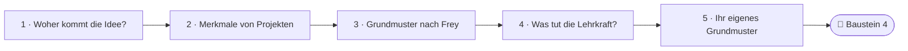
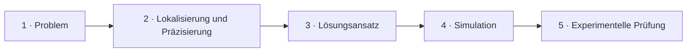
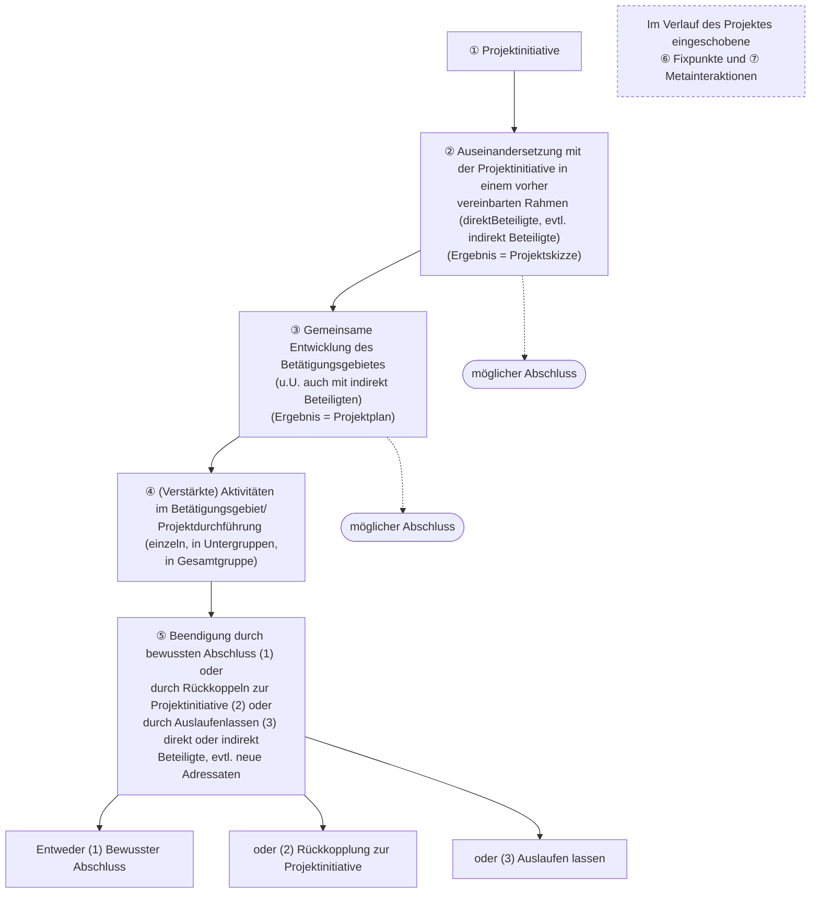
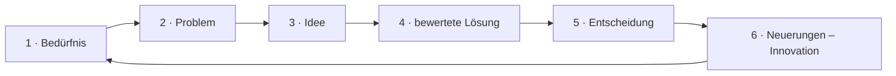

<!--
author:   Hannes Tegelbeckers
email:    hannes.tegelbeckers@ovgu.de
version:  0.2.0
language: de
narrator: Deutsch Female
mode:     Presentation
classroom: enable
comment:  Fachdidaktik technischer Allgemeinbildung II / Fachdidaktik gewerblich-technischer Fachrichtungen – Sitzung S03. Von der Arbeitsschule zur Projektmethode: Merkmale, Grundmuster nach Frey, Rolle der Lehrkraft, Beispielprojekt.

import:   https://raw.githubusercontent.com/LiaTemplates/mermaid_template/0.1.4/README.md
-->

# S03 – Tradierte methodische Konzepte & Projektmethode

**Tradierte Methodische Konzepte** · Fachdidaktik technischer Allgemeinbildung II · OVGU Magdeburg · Montag, 26.10.2026, 07:00–09:00 Uhr

<small>Quelle: Folie R054 „Tradierte Methodische Konzepte“ (Teil-Deck 03: „03_Tradierte Methodische Konzepte“)</small>

<!-- didaktik="Planungsraster S03 · E-03, E-04, E-12, E-17, E-19, E-25 · 0–5 Einstieg These (Vorbereitungsumfrage zeigen) · 5–10 Ihre Projekte · 10–15 Kurskarte · 15–30 Station 1 Woher kommt die Idee?, Aktivierungen · 30–50 Station 2 Merkmale, Grundmuster, Kreislauf, Problemarten, Fixpunkt · 50–67 Station 3 Lehrkraft, Beispiel Abriss, am Grundmuster prüfen · 67–82 Baustein 4 · 82–87 Metainteraktion · 87–90 Abschluss" -->
> [!IMPORTANT] 🧭 Leitfrage
> Wie lernen Lernende in **Projekten** – und was tut die **Lehrkraft** dabei? – Auf der Kurskarte: **Methoden → Erkenntnisweg**. Aus S02 kennen Sie die vollständige Handlung – heute sehen Sie, wie Projekte sie umsetzen.

> [!TIP] 📚 Vor der Sitzung
> Haben Sie sich an ein „Projekt“ aus Schule, Ausbildung oder Studium erinnert (Idee – Planung – Ergebnis)? Sie prüfen es heute.

📝 **Beuteblatt S03** – ergänzen Sie es während der Sitzung.

## Einstieg: Projektwoche = Projekt?

    --{{0}}--
Eine These zum Start. Stimmen Sie spontan ab – am Ende der Sitzung stimmen wir noch einmal ab.

> **„Wenn die Lehrkraft das Thema vorgibt, ist es kein Projekt.“**

**Vote (before):** Stimmen Sie zu?

[(a)] Ja, ich stimme zu
[(b)] Nein, ich stimme nicht zu
[(c)] Teils, teils
[(undecided)] Undecided

    --{{1}}--
Sehen Sie sich Ihr Projekt aus der Vorbereitung an.

      {{1}}
****************************************

> [!TIP] 🧠 Ihre Projekte · allein, 3 min
> Wer hatte bei Ihrem Projekt aus der Vorbereitung die Idee, wer plante, was kam heraus? Was davon würden Sie ein „echtes“ Projekt nennen?

[[___ ___ ___]]

****************************************

    --{{2}}--
Heute erleben Sie selbst ein Grundmuster.

      {{2}}
> [!TIP] 📌 Heute erleben Sie selbst ein Grundmuster
> Sie entwickeln für Ihr Entwurfsthema eine Projektinitiative, eine Projektskizze und einen Projektplan. Die Beuteblatt-Stopps sind unsere **Fixpunkte**, die Schlussrunde ist eine **Metainteraktion** – beides Komponenten des Grundmusters nach Frey (Station 2).

## Kurskarte: drei Fragen an die Projektmethode

    --{{0}}--
Heute stellen wir drei Fragen an die Projektmethode: Woher kommt die Idee? Was macht ein Projekt aus? Und was tut die Lehrkraft dabei? Gleichzeitig durchlaufen Sie selbst die ersten Schritte eines Projekts für Ihr Entwurfsthema. Die Gliederung in drei Fragen ist eine Lesehilfe, nicht Teil der Originalfolien.

    --{{1}}--
Auf diesem Weg erreichen Sie sechs Ziele.

      {{1}}

<!-- data-type="none" -->
| Know | Can do | Value |
|------|--------|-------|
| die Kerngedanken der Arbeitsschule, der Reformpädagogen und des Projektunterrichts sowie die Schritte nach Kilpatrick/Dewey **nennen** | für ein eigenes Vorhaben Projektinitiative, Projektskizze und Projektplan **formulieren** | **beurteilen**, ob ein Vorhaben ein Projekt im didaktischen Sinn ist |
| das Grundmuster der Projektmethode nach Frey **erläutern** | Projekte anhand der Merkmale der Arbeit an Projekten **prüfen** und Problemarten ihrem Prüfkriterium **zuordnen** | Ihre Handlungsstruktur als Lehrkraft in einem Projekt **skizzieren** |

    --{{2}}--
Prüfen Sie kurz, ob Sie den Weg lesen können.

      {{2}}
****************************************

**Decide:** Was kommt direkt nach den Merkmalen von Projekten?

<!-- data-hint-button="1" data-solution-button="2" -->
- [(X)] Grundmuster nach Frey
- [( )] Was tut die Lehrkraft?
- [( )] Woher kommt die Idee?
[[?]] Folgen Sie den Pfeilen von links nach rechts.
***
Richtig: Nach den Merkmalen nach Hortsch folgt das Grundmuster nach Frey.
***

****************************************

## Station 1: Woher kommt die Idee?

    --{{0}}--
Die Projektmethode ist keine Erfindung der letzten Jahre. Wir gehen vier Stationen ihrer Geschichte durch und achten darauf, welche Gedanken immer wiederkehren.

**Welche Gedanken kehren in der Geschichte der Projektmethode immer wieder?**

    --{{1}}--
Zuerst Russland.

      {{1}}
- Arbeitsschulkonzepte in Russland (R055)

    --{{2}}--
Dann die Reformpädagogen.

      {{2}}
- Forderungen der Reformpädagogen zu Beginn des 20. Jh. (R056)

    --{{3}}--
Dann die 60er und 70er Jahre.

      {{3}}
- Kerngedanken zum Projektunterricht (R057)

    --{{4}}--
Und Kilpatrick und Dewey.

      {{4}}
- Projektunterricht in fünf Schritten (R058)

    --{{5}}--
Warum ist das für Sie wichtig?

      {{5}}
> [!TIP] Why this matters
> Drei Gedanken kehren immer wieder: produktive, selbsttätige Arbeit, die Annäherung von Kopf- und Handarbeit und die Mitbestimmung der Lernenden.

    --{{6}}--
Markieren Sie, was Sie schon kennen.

      {{6}}
****************************************

**Mark:** Which of these do you already know? (several possible)

[[a1]] Arbeitsschulkonzepte in Russland (R055)
[[a2]] Forderungen der Reformpädagogen zu Beginn des 20. Jh. (R056)
[[a3]] Kerngedanken zum Projektunterricht (R057)
[[a4]] Projektunterricht in fünf Schritten (R058)

****************************************

## Arbeitsschule, Reformpädagogen und Projektunterricht

    --{{0}}--
Die Arbeitsschulkonzepte in Russland betonen drei Dinge: produktive Betätigung als bildendes Element, Bildung an den Realitäten der Gegenwart und Versuche, Kopf- und Handarbeit einander anzunähern. Die Reformpädagogen fordern zu Beginn des zwanzigsten Jahrhunderts Selbsttätigkeit, konstruktive Betätigung, die Teilnahme der Schüler an der Unterrichtsplanung und produktorientierte Arbeit. Achten Sie auf die Teilnahme an der Planung – sie wird für die Frage wichtig, wer ein Projekt initiiert.

**Charakteristische Merkmale der Arbeitsschulkonzepte in Russland** (R055)

- produktive Betätigung als bildendes Element
- Bildung an Realitäten der Gegenwart
- Versuche zur Annäherung von Kopf- und Handarbeit

**Forderungen der Reformpädagogen zu Beginn des 20. Jh.** (R056)

- Selbsttätigkeit des Schülers
- Konstruktive Betätigung
- Teilnahme an der Unterrichtsplanung
- Produktorientierte Arbeit
- Umsetzung der Ideen einer praxisbezogenen Ausbildung am Beispiel der Arbeitsschule

    --{{1}}--
In den sechziger und siebziger Jahren geht es darum, das Alltagsleben stärker in die Bildung zu integrieren, Kopf- und Handarbeit wieder zu vereinigen, die Lernenden mitbestimmen und mitgestalten zu lassen und kollektiv zu lernen.

      {{1}}
****************************************

**Kerngedanken zum Projektunterricht in den 60er und 70er Jahren** (R057)

- Das Alltagsleben wieder stärker in die Bildung zu integrieren
- Kopf- und Handarbeit wieder zu vereinigen
- Mitbestimmung und –gestaltung des Bildungsprozesses durch die Lernenden
- Kollektives Lernen

****************************************

    --{{2}}--
Ein roter Faden zieht sich durch.

      {{2}}
> [!NOTE] Key message
> 🧵 „Kopf- und Handarbeit“ taucht in Russland (Annäherung) und in den 60er/70er Jahren (wieder vereinigen) auf – vergleichen Sie mit der *Einheit kognitiver, emotionaler und psychomotorischer Lernprozesse* aus S02 (R053).

<small>Quelle: Folien R055 „Charakteristische Merkmale der Arbeitsschulkonzepte in Russland“, R056 „Forderungen der Reformpädagogen zu Beginn des 20. Jh.“, R057 „Kerngedanken zum Projektunterricht in den 60er und 70er Jahren“ (drei Folien auf einer Seite; fehlende Leerzeichen in den Folientiteln ergänzt).</small>

## Projektunterricht nach Kilpatrick / Dewey

    --{{0}}--
Kilpatrick und Dewey beschreiben den Ablauf in fünf Schritten. Am Anfang steht ein offensichtliches Problem aus dem Lebensraum der Teilnehmer, etwa: Woher kommt Typhus?

    --{{1}}--
Am Anfang das Problem.

      {{1}}
1. **Problem:** Beginn durch gestelltes offensichtliches Problem aus dem Lebensraum der Teilnehmer (z.B. Woher kommt Typhus?)

    --{{2}}--
Dann Lokalisierung und Präzisierung.

      {{2}}
2. **Lokalisierung und Präzisierung:** Lokalisierung, Präzisierung – Allgemeines Bildungsziel durch Problem gegeben · Bildungsrelevanz des Tuns zum Teil durch Problem, Planerstellung und Experiment gegeben

    --{{3}}--
Dann ein Lösungsansatz als Plan.

      {{3}}
3. **Lösungsansatz:** Lösungsansatz – Erstellen eines Plans zur Problemlösung, dadurch Präzisieren der Zielrichtung

    --{{4}}--
Dann die gedankliche Simulation der Lösungsmöglichkeiten.

      {{4}}
4. **Simulation:** Simulation der Lösungsmöglichkeiten – Gedankliche Ausführung des Planes

    --{{5}}--
Und schließlich die experimentelle Prüfung – die praktische Ausführung und Nutzung der Ergebnisse.

      {{5}}
5. **Experimentelle Prüfung:** Experimentelle Prüfung – Ausführung des Planes als Problemlösung oder Erstellung des Produktes bei Bedarf abgestimmte arbeitsteilige Ausführung · Praktische Umsetzung und Nutzung der Ergebnisse

<small>Quelle: Folie R058 „Projektunterricht nach Kilpatrick / Dewey“ – vgl. Frey, Karl: Die Projektmethode. Weinheim, Basel 1991 (Autorname im Original in Großbuchstaben); Nummerierung und Kurzbezeichnungen ergänzt.</small>

## Aktivierung: Die Schritte nach Kilpatrick/Dewey ordnen

    --{{0}}--
Bringen Sie die Schritte des Projektunterrichts nach Kilpatrick und Dewey in die richtige Reihenfolge.

**Order:** Drag each card into the right gap.

<!-- data-randomize data-show-partial-solution data-solution-button="2" -->
Step 1: [->[ Problem ]] → Step 2: [->[ Lokalisierung und Präzisierung ]] → Step 3: [->[ Lösungsansatz ]] → Step 4: [->[ Simulation ]] → Step 5: [->[ Experimentelle Prüfung ]]

## Aktivierung: Wer wollte was?

    --{{0}}--
Welcher Kerngedanke gehört zu welchem Konzept?

**1 · Choose one:** „Teilnahme an der Unterrichtsplanung“ – wer forderte das?

<!-- data-hint-button="1" data-solution-button="2" -->
- [( )] die Arbeitsschulkonzepte in Russland
- [(X)] die Reformpädagogen zu Beginn des 20. Jh.
- [( )] der Projektunterricht der 60er und 70er Jahre
[[?]] Selbsttätigkeit, konstruktive Betätigung, Teilnahme an der Planung …
***
Reformpädagogen (R056) – wichtig für die Frage, wer ein Projekt initiiert.
***

    --{{1}}--
Jetzt können mehrere Antworten richtig sein.

      {{1}}
****************************************

**2 · Choose all that apply:** Welche Kerngedanken stammen aus den **Arbeitsschulkonzepten in Russland**?

<!-- data-hint-button="1" data-solution-button="2" -->
- [[X]] produktive Betätigung als bildendes Element
- [[ ]] Kollektives Lernen
- [[X]] Bildung an Realitäten der Gegenwart
- [[ ]] Produktorientierte Arbeit
[[?]] Drei Merkmale auf R055.
***
Kollektives Lernen: Projektunterricht der 60er/70er Jahre (R057) · Produktorientierte Arbeit: Reformpädagogen (R056).
***

****************************************

    --{{2}}--
Zum Schluss eine Zahl.

      {{2}}
****************************************

**3 · Type:** In wie vielen Schritten beschreibt R058 den Projektunterricht nach Kilpatrick/Dewey? (Zahl)

<!-- data-hint-button="1" data-solution-button="2" -->
[[5]]
[[?]] Vom Problem bis zur experimentellen Prüfung …

***
Fünf: Problem – Lokalisierung, Präzisierung – Lösungsansatz – Simulation – experimentelle Prüfung.
***

****************************************

## Station 2: Was macht ein Projekt aus?

    --{{0}}--
Nicht alles, was Projekt heißt, ist eines im didaktischen Sinn. In dieser Station sammeln wir Prüfkriterien und ein Ablaufmodell.

**Woran erkenne ich ein Projekt im didaktischen Sinn – und wie läuft es ab?**

    --{{1}}--
Zuerst die Merkmale.

      {{1}}
- Zehn Merkmale der Arbeit an Projekten nach Hortsch (R059–R060)

    --{{2}}--
Dann das Ablaufmodell.

      {{2}}
- Grundmuster der Projektmethode nach Frey (R061)

    --{{3}}--
Danach ein Kreislauf.

      {{3}}
- Kreislauf der Innovation (R063)

    --{{4}}--
Und wie Lösungen geprüft werden.

      {{4}}
- Problemarten und Prüfkriterien (R064)

    --{{5}}--
Warum ist das für Sie wichtig?

      {{5}}
> [!TIP] Why this matters
> Mit den Merkmalen prüfen Sie Ihr eigenes Projekt – und jede Projektwoche.

    --{{6}}--
Markieren Sie, was Sie schon kennen.

      {{6}}
****************************************

**Mark:** Which of these do you already know? (several possible)

[[a1]] Zehn Merkmale der Arbeit an Projekten nach Hortsch (R059–R060)
[[a2]] Grundmuster der Projektmethode nach Frey (R061)
[[a3]] Kreislauf der Innovation (R063)
[[a4]] Problemarten und Prüfkriterien (R064)

****************************************

## Merkmale der Arbeit an Projekten aus didaktischer Sicht

    --{{0}}--
Hortsch nennt zehn Merkmale. Drei sind besonders trennscharf: Die Arbeit weist Problemlösungsstrukturen auf, das Problem lässt mindestens zwei Lösungen zu, und die Arbeit orientiert sich an den Erfahrungen und Interessen der Lernenden.

1. **Es ist ein Projekt vorhanden**
   - Existenzbedingung
2. **Die Arbeit am Projekt weist Problemlösungsstrukturen auf.**
   - das bedeutet ein Projekt hat oder generiert Probleme
3. **Das Problem lässt mindestens zwei Lösungen zu.**
   - eine Lösung wäre Projekt im erziehungswissenschaftlichen Sinne
4. **Die Arbeit an Projekten orientiert sich an den Erfahrungen und Interessen der Lernenden**
   - Da aus dem Projekt die Aneignungsgegenstände entstehen, d.h. durch den Lernenden erarbeitet werden, müssen auch seine Bedürfnisse im Mittelpunkt stehen.
5. **Die Arbeit an Projekten ist durch vollständige Lernhandlungen gekennzeichnet.**

    --{{1}}--
Dazu kommen Gruppen- oder Einzelarbeit, Fach- und Berufsfeldübergreifendes, Methodenvielfalt, Selbstorganisation und Selbstverantwortung und ein objektiver oder subjektiver Gebrauchswert des Produkts.

      {{1}}
****************************************

6. **Die Arbeit an Projekten erfolgt in größeren oder kleineren Gruppen aber auch einzeln.**
7. **Die Arbeit an Projekten ist fach- und berufsfeldübergreifend.**
   - Eine Integration von Wissen, Können und Wollen wird angestrebt. Außerdem die Dreiheit von Fach-, Sozial- und Methodenkompetenz angezielt werden.
8. **Die Arbeit an Projekten ist polyinstrumental und methodenpluralistisch.**
9. **Die Arbeit an Projekten ist vorrangig durch Selbstorganisation und -verantwortung geprägt**
10. **Das vergegenständlichte Projekt hat einen objektiven oder subjektiven Gebrauchswert.**
    - Wichtig ist, dass etwas subjektiv Bedeutsames hergestellt wird.

Vgl. Hortsch, Hanno: Didaktik der Berufsbildung – Merkblätter zur Vorlesung Dresden 1999

****************************************

    --{{2}}--
Mit dieser Liste prüfen Sie gleich Ihr eigenes Projekt.

      {{2}}
> [!NOTE] Key message
> Besonders trennscharf: **Problemlösungsstrukturen** (2), **mindestens zwei Lösungen** (3), **Erfahrungen und Interessen der Lernenden** (4).

<small>Quelle: Folien R059–R060 „Merkmale der Arbeit an Projekten aus didaktischer Sicht“ – Nummerierung ergänzt; Wortlaut von Merkmal 7 nach der überarbeiteten Folie (Stand 26.10.2026); „das etwas“ zu „dass etwas“ korrigiert; Autorname im Original in Großbuchstaben.</small>

## „Grundmuster der Projektmethode“

    --{{0}}--
Frey beschreibt das Grundmuster der Projektmethode in sieben Komponenten. Aus einer Projektinitiative entsteht in einem vereinbarten Rahmen eine Projektskizze, daraus gemeinsam der Projektplan, dann folgt die Durchführung.

    --{{1}}--
Von der Initiative über die Skizze zum Plan – nach Skizze und Plan ist bereits ein Abschluss möglich.

      {{1}}
**① Von der Initiative zum Plan:** ① Projektinitiative → ② Auseinandersetzung im vereinbarten Rahmen (Ergebnis = Projektskizze) → ③ gemeinsame Entwicklung des Betätigungsgebietes (Ergebnis = Projektplan); möglicher Abschluss nach ② und ③

    --{{2}}--
Es folgen die verstärkten Aktivitäten im Betätigungsgebiet, also die Projektdurchführung, und die Beendigung.

      {{2}}
**② Durchführung und Beendigung:** ④ Projektdurchführung einzeln, in Untergruppen oder in der Gesamtgruppe; ⑤ Beendigung durch bewussten Abschluss (1), Rückkopplung zur Projektinitiative (2) oder Auslaufenlassen (3)

    --{{3}}--
Quer zu allen Komponenten liegen die im Verlauf eingeschobenen Fixpunkte und Metainteraktionen – Haltepunkte, an denen die Gruppe sich abstimmt und über ihr Vorgehen nachdenkt.

      {{3}}
**③ Quer dazu:** im Verlauf des Projektes eingeschobene ⑥ Fixpunkte und ⑦ Metainteraktionen

    --{{4}}--
Und heute?

      {{4}}
> [!NOTE] Key message
> 🔗 Heute: Ihre Beuteblatt-Stopps sind **Fixpunkte** ⑥, die Schlussrunde ist eine **Metainteraktion** ⑦.

<small>Quelle: Folie R061 „„Grundmuster der Projektmethode““ – Frey, Karl: Die Projektmethode, 1991 (Autorname im Original in Großbuchstaben); Grafik als Diagramm nachgezeichnet (gestrichelt: möglicher Abschluss nach ② und ③); Schreibweisen wie im Original („direktBeteiligte“).</small>

## Kurz geprüft: das Grundmuster

    --{{0}}--
Drei kurze Fragen zum Grundmuster nach Frey.

**1 · Choose one:** Was ist das Ergebnis von Komponente ②?

<!-- data-hint-button="1" data-solution-button="2" -->
- [( )] der Projektplan
- [(X)] die Projektskizze
- [( )] die Projektinitiative
[[?]] Auseinandersetzung mit der Projektinitiative in einem vorher vereinbarten Rahmen …
***
② → Projektskizze · ③ → Projektplan (R061).
***

    --{{1}}--
Jetzt können mehrere Antworten richtig sein.

      {{1}}
****************************************

**2 · Choose all that apply:** Auf welchen Wegen kann ein Projekt nach Frey beendet werden?

<!-- data-hint-button="1" data-solution-button="2" -->
- [[X]] durch Rückkoppeln zur Projektinitiative
- [[ ]] erst durch die Bewertung des Produkts durch die Lehrkraft
- [[X]] durch Auslaufenlassen
- [[ ]] ausschließlich nach der Projektdurchführung ④
[[?]] Frey nennt bei ⑤ drei Wege – und gestrichelte Abschlüsse vorher.
***
Frey nennt drei Wege der Beendigung ⑤: bewusster Abschluss (1), Rückkopplung zur Projektinitiative (2) oder Auslaufenlassen (3). Ein Abschluss ist außerdem schon nach ② und ③ möglich (R061).
***

****************************************

    --{{2}}--
Zum Schluss ein Begriff.

      {{2}}
****************************************

**3 · Type:** Wie heißen die im Verlauf eingeschobenen Haltepunkte neben den Metainteraktionen? (ein Wort)

<!-- data-hint-button="1" data-solution-button="2" -->
[[Fixpunkte]]
[[?]] Komponente ⑥ …

***
⑥ Fixpunkte und ⑦ Metainteraktionen – im Verlauf des Projektes eingeschoben.
***

****************************************

## Kreislauf der Innovation

    --{{0}}--
Der Kreislauf der Innovation zeigt, dass eine Problemlösung nie ganz abgeschlossen ist: Die Innovation ist nur das vorläufige Ende der erfolgreichen Problemlösung. In unserem fortlaufenden Bemühen um die Verbesserung der Gesamtsituation durchlaufen wir immer wieder einen Kreislauf.

    --{{1}}--
Aus einem Bedürfnis …

      {{1}}
1. **Bedürfnis:** Es entsteht in Schule, Haushalt, Arbeitsplatz: Unternehmen, Behörde, Staat.

    --{{2}}--
… wird ein Problem …

      {{2}}
2. **Problem:** Aus dem Bedürfnis wird ein Problem.

    --{{3}}--
… daraus eine Idee …

      {{3}}
3. **Idee:** Zum Problem entsteht eine Idee.

    --{{4}}--
… eine bewertete Lösung …

      {{4}}
4. **bewertete Lösung:** Aus der Idee wird eine Lösung, die bewertet wird.

    --{{5}}--
… eine Entscheidung …

      {{5}}
5. **Entscheidung:** Für eine Lösung wird entschieden.

    --{{6}}--
… und schließlich eine Neuerung – die wieder in Schule, Haushalt, Unternehmen oder Staat zurückwirkt. Dann beginnt der Kreislauf neu.

      {{6}}
6. **Neuerungen – Innovation:** Neuerungen (Innovation) wirken zurück in Schule, Haushalt, Arbeitsplatz: Unternehmen, Behörde, Staat.

<small>Quelle: Folie R063 „Kreislauf der Innovation“ – Text der Folie im Wortlaut: „Die Innovation ist nur das vorläufige Ende der erfolgreichen Problemlösung. In unserem fortlaufenden Bemühen um die Verbesserung der Gesamtsituation durchlaufen wir immer wieder einen Kreislauf.“ Gescannte Abbildung als Kreislauf nachgezeichnet, Sätze zu den Stationen als Lesehilfe ergänzt; auf der Originalfolie ist keine Quelle der Abbildung angegeben.</small>

## Kurz geordnet: der Kreislauf der Innovation

    --{{0}}--
Bringen Sie die Stationen des Kreislaufs in die richtige Reihenfolge – beginnend in Schule, Haushalt, Unternehmen oder Staat.

**Order:** Drag each card into the right gap.

<!-- data-randomize data-show-partial-solution data-solution-button="2" -->
Step 1: [->[ Bedürfnis ]] → Step 2: [->[ Problem ]] → Step 3: [->[ Idee ]] → Step 4: [->[ bewertete Lösung ]] → Step 5: [->[ Entscheidung ]] → Step 6: [->[ Neuerungen – Innovation ]]

## Problemarten und Bezug der Prüfung der Lösung

    --{{0}}--
Projekte enthalten unterschiedliche Probleme, und jede Problemart hat ihr eigenes Prüfkriterium: Ein Erkenntnisproblem wird auf Wahrheit geprüft, ein Gestaltungsproblem auf Tauglichkeit, ein Wertungsproblem auf Zweckmäßigkeit und ein Ausdrucksproblem auf Verständlichkeit.

<!-- data-type="none" -->
| Problemart | Lösung des Problems wird geprüft hinsichtlich: |
| --- | --- |
| Erkenntnisproblem | Wahrheit |
| Gestaltungsproblem | Tauglichkeit |
| Wertungsproblem | Zweckmäßigkeit |
| Ausdruckproblem | Verständlichkeit |

    --{{1}}--
Erinnern Sie sich an S01.

      {{1}}
> [!NOTE] Key message
> 🔗 Naturwissenschaften bewerten nach *Wahrheit*, Technikwissenschaften nach *Richtigkeit und Zweckmäßigkeit* (R005). Welche Problemarten stecken typischerweise in einem technischen Projekt?

<small>Quelle: Folie R064 „Problemarten und Bezug der Prüfung der Lösung“ – „Ausdruckproblem“ wie im Original.</small>

## Aktivierung: Ist mein Projekt ein Projekt? (Fixpunkt)

    --{{0}}--
Prüfen Sie Ihr Projekt aus der Vorbereitung mit den zehn Merkmalen. Das ist unser erster Fixpunkt.

<!-- didaktik="Lehrschritt unterstützen/üben · 42–50 min · Einzelarbeit · Classroom-Auswertung · Fixpunkt ⑥" -->
**Allein (6 min):** Prüfen Sie Ihr Projekt aus der Vorbereitung. Welche Merkmale sind erfüllt?

- [ ] 1 Es ist ein Projekt vorhanden
- [ ] 2 Problemlösungsstrukturen
- [ ] 3 Mindestens zwei Lösungen möglich
- [ ] 4 Orientierung an Erfahrungen und Interessen der Lernenden
- [ ] 5 Vollständige Lernhandlungen
- [ ] 6 Gruppen oder einzeln
- [ ] 7 Fach- und berufsfeldübergreifend (Integration von Wissen, Können und Wollen)
- [ ] 8 Polyinstrumental und methodenpluralistisch
- [ ] 9 Selbstorganisation und -verantwortung
- [ ] 10 Gebrauchswert

**Ihr Urteil** – ein Projekt im didaktischen Sinn?

[[___ ___ ___ ___]]

💡 Hint 1

Achten Sie besonders auf die Merkmale 2, 3, 4 und 9: Gab es ein echtes Problem mit mehreren Lösungen – und wer hat geplant?

✅ Solution

Beispiel Projektwoche „Wir bauen ein Insektenhotel“: erfüllt sind 1, 6 und 10; kaum erfüllt 2 und 3 (Bauplan vorgegeben, eine Lösung), 4 teilweise, 9 nicht (die Lehrkraft plant alles). Urteil: eher ein Vorhaben nach Anleitung als ein Projekt im didaktischen Sinn – es würde eines, wenn die Lernenden Problem, Lösungsweg und Plan selbst entwickeln. 📝 Danach Beuteblatt-Stopp: Ergänzen Sie Abschnitt 2.

## Aktivierung: Problemarten zuordnen

    --{{0}}--
Ordnen Sie die Problemarten ihrem Prüfkriterium zu.

**1 · Choose one:** Ein Gestaltungsproblem wird geprüft hinsichtlich …

<!-- data-hint-button="1" data-solution-button="2" -->
- [( )] Wahrheit
- [(X)] Tauglichkeit
- [( )] Verständlichkeit
[[?]] Taugt die gestaltete Lösung?
***
Gestaltungsproblem – Tauglichkeit (R064).
***

    --{{1}}--
Jetzt können mehrere Antworten richtig sein.

      {{1}}
****************************************

**2 · Choose all that apply:** Welche Zuordnungen stimmen?

<!-- data-hint-button="1" data-solution-button="2" -->
- [[X]] Erkenntnisproblem – Wahrheit
- [[ ]] Ausdruckproblem – Tauglichkeit
- [[X]] Wertungsproblem – Zweckmäßigkeit
- [[ ]] Gestaltungsproblem – Verständlichkeit
[[?]] Schauen Sie in die Tabelle R064.
***
Erkenntnisproblem – Wahrheit · Gestaltungsproblem – Tauglichkeit · Wertungsproblem – Zweckmäßigkeit · Ausdruckproblem – Verständlichkeit (R064).
***

****************************************

    --{{2}}--
Zum Schluss ein Kriterium.

      {{2}}
****************************************

**3 · Type:** Ein Ausdruckproblem wird geprüft hinsichtlich … (ein Wort)

<!-- data-hint-button="1" data-solution-button="2" -->
[[Verständlichkeit]]
[[?]] Versteht man die Darstellung?

***
Ausdruckproblem – Verständlichkeit (R064).
***

****************************************

## Station 3: Was tut die Lehrkraft?

    --{{0}}--
Wenn die Lernenden selbst planen, was bleibt dann für die Lehrkraft? Mehr als man denkt – das zeigt diese Station.

**Was tut die Lehrkraft, bevor und während die Lernenden ein Projekt bearbeiten?**

    --{{1}}--
Zuerst die Handlungsstruktur.

      {{1}}
- Zwölf Schritte der Lehrkraft nach Hortsch (R062)

    --{{2}}--
Dann ein Beispiel aus der Bautechnik.

      {{2}}
- Ziele des Projektes „Abriss eines alten Hauses“ (R065)

    --{{3}}--
Mit Projektskizze …

      {{3}}
- Projektskizze (R066)

    --{{4}}--
… und Projektplan.

      {{4}}
- Projektplan (R067–R068)

    --{{5}}--
Warum ist das für Sie wichtig?

      {{5}}
> [!TIP] Why this matters
> Vieles geschieht, bevor die Lernenden beginnen: Projekte bestimmen, Realisierbarkeit prüfen, Lösungen selbst durchdenken.

    --{{6}}--
Markieren Sie, was Sie schon kennen.

      {{6}}
****************************************

**Mark:** Which of these do you already know? (several possible)

[[a1]] Zwölf Schritte der Lehrkraft nach Hortsch (R062)
[[a2]] Ziele des Projektes „Abriss eines alten Hauses“ (R065)
[[a3]] Projektskizze (R066)
[[a4]] Projektplan (R067–R068)

****************************************

## Mögliche Handlungsstruktur des Lehrers beim Arbeiten mit Projekten

    --{{0}}--
Hortsch beschreibt zwölf Schritte für die Lehrkraft. Vieles geschieht vor dem Projekt: geeignete Projekte bestimmen, prüfen, ob sie realisierbar sind, Lösungsmöglichkeiten selbst durchdenken und Varianten vergleichen. Erst dann lässt die Lehrkraft die Lernenden planen, moderiert den Plan und die Realisierung, schafft die Bedingungen dafür und entscheidet am Ende über eine mögliche Fortführung.

<!-- data-type="none" -->
| Schritte | Hinweis |
| --- | --- |
| 1. Bestimmen von geeigneten Projekten 2. Prüfen, ob sich diese Projekte realisieren lassen. 3. Erarbeitung verschiedener Lösungsmöglichkeiten. | Voraussetzung ist die Erkundung der Interessensstruktur der Lernenden durch den Lehrer |
| 4. Variantenvergleich ggf. Optimierung vornehmen. 5. Planung durch Lernende erarbeiten lassen. (Projektplan) | Es sollten die vermutlich typischen Vorschläge der Lernenden bereits vorher vom Lehrer diskutiert werden. |
| 6. Moderieren des Planes. 7. Entwickeln der Organisationsformen der AaP. 8. Schaffen von Bedingungen für die Realisierung. 9. Realisierung moderieren. 10. Bericht o.ä. über AaP erstellen lassen. 11. Bewertung bzw. Beurteilung vornehmen lassen. | Die Ausführung geht auf den Lernenden über. Der Lehrer initiiert, indem er orientiert, phasenweise reguliert und evtl. kontrolliert. |
| 12. Entscheidung treffen über evtl. Fortführung des Projektes | |

Vgl. Hortsch, Hanno: Didaktik der Berufsbildung. Dresden 2001

    --{{1}}--
Was heißt das für Ihre Rolle?

      {{1}}
> [!NOTE] Key message
> Die Ausführung geht auf die Lernenden über – die Lehrkraft **orientiert, reguliert phasenweise und kontrolliert evtl.** und hat vorher die Lösungen selbst durchdacht.

<small>Quelle: Folie R062 „Mögliche Handlungsstruktur des Lehrers beim Arbeiten mit Projekten:“ – Tabelle aus dem Bild übertragen und gegen das Original geprüft; „AaP“ = Arbeit an Projekten (vgl. Titel R059; Lesehilfe); Autorname im Original in Großbuchstaben.</small>

## Beispiel: Projekt „Abriss eines alten Hauses“

    --{{0}}--
Ein Beispiel aus der Bautechnik. Hauptziel: Die Auszubildenden lernen am Abriss eines nicht sanierungswürdigen Hauses, wie alte Baustoffe wiederverwendet werden können.

**Ziele des Projektes „Abriss eines alten Hauses“**

**– Hauptziel –** Die Auszubildenden lernen am Beispiel des Abrisses eines nicht sanierungswürdigen alten Hauses die Möglichkeiten der Wiederverwendung alter Baustoffe kennen.

**– Teilziele –**

- die Notwendigkeit der Wiederverwendung alter Baustoffe begreifen
- Möglichkeiten des Abrisses eines Hauses erfahren
- die Einteilung alter Baustoffe und die Möglichkeit ihrer Wiederverwendung kennen lernen
- den Aufbau einer Aufbereitungsanlage kennen lernen
- den Ablauf der Aufbereitung kennen lernen
- Fähigkeiten kooperativer Zusammenarbeit entwickeln
- kommunikativer Fähigkeiten zum Präsentieren der Arbeitsergebnisse entwickeln

    --{{1}}--
Die Projektskizze nennt als Produkt eine Präsentation, dazu Fragestellungen und Arbeitsmethoden wie Literaturstudium und Befragungen.

      {{1}}
****************************************

**Projektskizze**

- **Produkt:** Eine Präsentation über den technologischen Ablauf der Baustoffwiederverwertung, vom Abriss über die Aufbereitung bis zur Wiederverwendung.
- **Fragestellungen:**
  - Wie entsteht Baumüll?
  - Welche Baustoffe sind in einem alten Haus enthalten?
  - Wie erfolgt die Aufbereitung der Baustoffe?
  - Wo lassen sich die aufbereiteten Baustoffe einsetzen?
- **Arbeitsmethoden:**
  - Literaturstudium
  - Befragungen im Bauamt und in Baufirmen
  - Darstellung der Ergebnisse in einer Schautafel

****************************************

    --{{2}}--
Prüfen Sie gleich am Grundmuster nach Frey.

      {{2}}
> [!NOTE] Key message
> Wo finden sich hier die Komponenten nach Frey – und wer hatte die **Initiative**?

<small>Quelle: Folien R065 „Ziele des Projektes „Abriss eines alten Hauses““ („Notwenigkeit“ zu „Notwendigkeit“ korrigiert) und R066 „Projektskizze“.</small>

## Projektplan

    --{{0}}--
Der Projektplan verteilt die Arbeit auf fünf Gruppen und vier Tage.

**Arbeitstätigkeiten:** Es werden 5 Arbeitsgruppen gebildet, denen verschiedene Aufgaben zugeteilt werden.

<!-- data-type="none" -->
| Gruppe | Aufgabe | Vorgehen |
| --- | --- | --- |
| Gruppe 1 | Gründe für den Abriss eines Hauses | Befragung im Bauamt |
| Gruppe 2 | Mögliche Abrissverfahren | Literaturstudium; Befragung in Bauunternehmen |
| Gruppe 3 | Baustoffe im Abrisshaus | Untersuchung auf der Baustelle |
| Gruppe 4 | Möglichkeiten der Aufbereitung alter Baustoffe | Untersuchung in einer Aufbereitungsanlage |
| Gruppe 5 | Einsatz aufbereiteter Baustoffe | Befragung in Bauunternehmen |

**Zeitplan:**

<!-- data-type="none" -->
| Tag | Inhalte |
| --- | --- |
| 1. Tag | Projektskizze und Projektplan · Feinplanung in den Gruppen · organisatorische Absprachen für die Untersuchungen außerhalb der Schule |
| 2. Tag | Literaturstudium · Vorbereitung der Befragungen bzw. Untersuchungen · Präsentation der Fragebögen bzw. Untersuchungsabläufe vor der Klasse · erste Befragungen / Untersuchungen |
| 3. Tag | Befragungen / Untersuchungen · erste Auswertung der Ergebnisse |
| 4. Tag | Auswertung der Ergebnisse · Präsentation der Ergebnisse in einer Schautafel |

    --{{1}}--
Achten Sie auf Tag 1.

      {{1}}
> [!NOTE] Key message
> Skizze und Plan stehen im Zeitplan am **ersten Tag**, danach folgt die Feinplanung in den Gruppen.

<small>Quelle: Folien R067–R068 „Projektplan“ (als Tabellen zusammengefasst).</small>

## Aktivierung: Das Beispiel am Grundmuster prüfen

    --{{0}}--
Ordnen Sie die Bestandteile des Beispiels den Komponenten des Grundmusters nach Frey zu.

**1 · Choose one:** „Fünf Arbeitsgruppen, Zeitplan Tag 1 bis 4“ – welche Komponente?

<!-- data-hint-button="1" data-solution-button="2" -->
- [( )] ② Projektskizze
- [(X)] ③ Projektplan
- [( )] ④ Projektdurchführung
[[?]] Gemeinsame Entwicklung des Betätigungsgebietes …
***
Projektplan ③: fünf Arbeitsgruppen, Zeitplan Tag 1 bis 4.
***

    --{{1}}--
Jetzt können mehrere Antworten richtig sein.

      {{1}}
****************************************

**2 · Choose all that apply:** Was gehört zur **Projektskizze ②**?

<!-- data-hint-button="1" data-solution-button="2" -->
- [[X]] Produkt: eine Präsentation
- [[ ]] Befragungen und Untersuchungen
- [[X]] Fragestellungen und Arbeitsmethoden
- [[ ]] Auswertung der Ergebnisse
[[?]] Die Skizze legt fest, *was* entstehen soll und *wie* gearbeitet wird.
***
Projektskizze ②: Produkt, Fragestellungen, Arbeitsmethoden · Projektdurchführung ④: Befragungen und Untersuchungen, Auswertung · Beendigung ⑤: Präsentation in einer Schautafel.
***

****************************************

    --{{2}}--
Zum Schluss: Was fehlt?

      {{2}}
****************************************

**3 · Type:** Welche Komponente des Grundmusters fehlt im Beispiel? Projekt… (ein Wort)

<!-- data-hint-button="1" data-solution-button="2" -->
[[Projektinitiative]]
[[?]] Komponente ① …

***
Die **Projektinitiative ①** fehlt: Die Ziele sind von der Lehrkraft gesetzt. Auch Fixpunkte ⑥ und Metainteraktionen ⑦ sind nicht geplant.
***

****************************************

## Baustein 4: Ihr eigenes Grundmuster (optional)

    --{{0}}--
Durchlaufen Sie für Ihr Entwurfsthema die ersten Komponenten des Grundmusters.

<!-- didaktik="Lehrschritt üben lassen (Transfer) · 67–82 min · Einzelarbeit · Classroom-Auswertung · Doppeldecker" -->
**Allein (10 min):** Durchlaufen Sie für Ihr Entwurfsthema die ersten Komponenten des Grundmusters.

- **① Projektinitiative:** Welches Problem, welcher Anlass – aus dem Lebensraum der Lernenden?
- **② Projektskizze:** Produkt · Fragestellungen · Arbeitsmethoden
- **③ Projektplan:** Gruppen und Aufgaben · grober Zeitplan

[[___ ___ ___ ___]]

💡 Hint 1

Prüfen Sie selbst: Welche Merkmale nach Hortsch erfüllt Ihr Vorhaben? Und welche Schritte der Lehrer-Handlungsstruktur (R062) übernehmen *Sie* vorab?

✅ Solution

**① Initiative:** Der Hausmeister klagt, dass die Beete im Schulgarten im Sommer vertrocknen. **② Skizze:** Produkt – eine automatische Bewässerung mit Feuchtesensor; Fragestellungen – Wie viel Wasser brauchen die Beete? Wie misst man Bodenfeuchte? Wie wird die Pumpe geschaltet?; Methoden – Messungen, Datenblätter, Erprobung. **③ Plan:** Gruppe Sensor, Gruppe Steuerung, Gruppe Hydraulik; Tag 1 Planung, Tag 2–3 Aufbau und Test, Tag 4 Übergabe an den Hausmeister. Vorab übernehme ich: Realisierbarkeit prüfen (2), Lösungsmöglichkeiten durchdenken (3), Varianten vergleichen (4).

## Wo stehen wir? Metainteraktion

    --{{0}}--
Sie haben heute die Komponenten eins bis drei selbst durchlaufen, zwischendurch Fixpunkte eingelegt – und jetzt reflektieren Sie. Das ist eine Metainteraktion. Noch einmal die These vom Anfang.

**Vote (after):** „Wenn die Lehrkraft das Thema vorgibt, ist es kein Projekt.“ – Stimmen Sie jetzt zu?

[(a)] Ja, ich stimme zu
[(b)] Nein, ich stimme nicht zu
[(c)] Teils, teils
[(undecided)] Undecided

    --{{1}}--
Welche Schritte hat die Lehrkraft heute für Sie übernommen?

      {{1}}
****************************************

**Reflect:** Metainteraktion: Welche der zwölf Schritte der Lehrer-Handlungsstruktur hat die Lehrkraft heute für Sie übernommen – und was ist Ihnen am unklarsten geblieben?

[[___ ___]]

****************************************

    --{{2}}--
Eine Einordnung:

      {{2}}
> [!NOTE] Key message
> Auch wenn die Lehrkraft das Thema vorgibt, kann ein Projekt entstehen – wenn die Lernenden Problem, Lösungsweg und Plan mitbestimmen (Merkmale 2–4 und 9, R059–R060; Teilnahme an der Unterrichtsplanung, R056). Entscheidend ist nicht, wer das Thema nennt, sondern wer plant und entscheidet.

## Das Wichtigste aus S03

    --{{0}}--
Fassen wir zusammen.

    --{{1}}--
Erstens: die Wurzeln.

      {{1}}
- Arbeitsschule, Reformpädagogik, 60er/70er Jahre: produktive Arbeit, Kopf- und Handarbeit, Mitbestimmung (R055–R057); Kilpatrick/Dewey in fünf Schritten (R058).

    --{{2}}--
Zweitens: die Merkmale.

      {{2}}
- Ein Projekt hat Problemlösungsstrukturen, mindestens zwei Lösungen und orientiert sich an den Lernenden (Hortsch, R059–R060).

    --{{3}}--
Drittens: das Grundmuster.

      {{3}}
- Initiative → Skizze → Plan → Durchführung → Beendigung, mit Fixpunkten und Metainteraktionen (Frey, R061).

    --{{4}}--
Und viertens: die Lehrkraft.

      {{4}}
****************************************

- Die Lehrkraft bestimmt, prüft und durchdenkt vorab – dann moderiert sie und schafft Bedingungen (R062).

> [!NOTE] Remember
> Ein Projekt beginnt mit einem echten Problem – und die Lernenden planen mit.

****************************************

    --{{5}}--
Eine letzte Frage.

      {{5}}
****************************************

**Recap:** Woran scheitert eine Projektwoche mit fertigem Bauplan am ehesten als Projekt im didaktischen Sinn?

<!-- data-hint-button="1" data-solution-button="2" -->
- [( )] am fehlenden Gebrauchswert
- [( )] an der Gruppenarbeit
- [(X)] daran, dass das Problem nur eine Lösung zulässt und die Lernenden nicht selbst planen
[[?]] Merkmale 3 und 9 …
***
Richtig: Ein Projekt braucht mindestens zwei Lösungen (Merkmal 3) und Selbstorganisation (Merkmal 9).
***

****************************************

    --{{6}}--
Als Nächstes geht es um Kontrolle und Bewertung in Projekten, die Fallstudie und das Rollenspiel.

      {{6}}
**➡️ Next:** S04: Kontrolle & Bewertung · Fallstudie · Rollenspiel · 📝 Beuteblatt-Stopp: Ergänzen Sie Abschnitt 3, Baustein 4 und Ihre wichtigste Beute.

## Prüfungsfragen zum Üben

    --{{0}}--
Mit diesen fünf Fragen können Sie sich auf die mündliche Prüfung vorbereiten. Die Querverweise zeigen, wo die Themen wieder auftauchen.

<!-- didaktik="E-12 mündliche Prüfung" -->
1. Welche Kerngedanken verbinden Arbeitsschule, Reformpädagogik und den Projektunterricht der 60er/70er Jahre?
2. Erläutern Sie das Grundmuster der Projektmethode nach Frey. Welche Rolle spielen Fixpunkte und Metainteraktionen?
3. Woran erkennen Sie, ob eine Projektwoche ein Projekt im didaktischen Sinn ist?
4. Beschreiben Sie die Rolle der Lehrkraft bei der Arbeit an Projekten.
5. Ordnen Sie Problemarten ihrem Prüfkriterium zu und erläutern Sie den Bezug zur Besonderheit der Technikwissenschaften (S01).

> [!NOTE] 🔗 Querverweise
> vollständige Lernhandlungen (Merkmal 5) → **S02** · Kontrolle und Bewertung in Projekten → **S04** · Problem und Hypothese → reduktive Methode **S01b** · Experimentelle Prüfung → technisches Experiment **S05**

<small>Die Prüfungsfragen sind experimentell: Sie dienen der Vorbereitung, es ist nicht garantiert, dass Fragen in dieser Form gestellt werden.</small>

## Rückblick auf S03

    --{{0}}--
Nehmen Sie sich zwei Minuten für einen Rückblick. Was ist das Wichtigste – und was ist noch unklar?

**Reflect:** What is the most important thing you learned today – and what is still unclear?

[[___ ___ ___]]

    --{{1}}--
Haken Sie ab, was Sie jetzt können.

      {{1}}
****************************************

**Tick:** What can you do now?

- [ ] Ich kann das Grundmuster der Projektmethode nach Frey erläutern.
- [ ] Ich kann prüfen, ob ein Vorhaben ein Projekt im didaktischen Sinn ist.
- [ ] Ich kann meine Rolle als Lehrkraft in einem Projekt beschreiben.

****************************************

    --{{2}}--
Und zum Schluss: Wie hat die Sitzung für Sie funktioniert?

      {{2}}
****************************************

**Feedback:** How did this session work for you?

[(1 agree)(2 rather agree)(3 neutral)(4 rather disagree)(5 disagree)]
[                                                                   ] The pace was appropriate.
[                                                                   ] The explanations were clear.
[                                                                   ] The examples helped me understand.
[                                                                   ] The interactive parts were useful.

****************************************

## Vorbereitung auf S04

    --{{0}}--
In S04 geht es um Kontrolle und Bewertung in Projekten, die Fallstudie und das Rollenspiel – mit einem Fall zu einer gentechnisch veränderten Kartoffel. Planen Sie etwa 15 Minuten Vorbereitung ein.

<!-- style="max-width:100%;width:60%;display:block;margin:0 auto;" -->

> [!IMPORTANT] Think about it until next time
> Erinnern Sie sich an eine Note für eine Gruppenarbeit oder ein Projekt: Wie kam sie zustande – und fanden Sie sie gerecht? Sollte bei Projekten jede Person eine eigene Note bekommen, eine Gruppennote oder beides?

*S04 · Montag, 02.11.2026 · 07:00 Uhr*

## Literatur

    --{{0}}--
Hier finden Sie die Quellen dieser Sitzung.

**Zitiert auf den Originalfolien dieser Sitzung**

- Frey, Karl: Die Projektmethode. Weinheim, Basel 1991 – Folien R058 („vgl.“), R061 („Frey, Karl: Die Projektmethode, 1991“).
- Hortsch, Hanno: Didaktik der Berufsbildung – Merkblätter zur Vorlesung Dresden 1999 – Folie R060 („Vgl.“).
- Hortsch, Hanno: Didaktik der Berufsbildung. Dresden 2001 – Folie R062 („Vgl.“); eigenständige Quelle, nicht mit Hortsch 1999 gleichgesetzt. ᴼ
- Kilpatrick / Dewey – Folie R058 (Namen ohne Jahr).

<small>ᴼ Angabe unverändert von der Originalfolie übernommen; jeder Name bzw. jede Angabe gilt als eigenständige Quelle.</small>

<small>Gesamtverzeichnis: 00_Literatur.md</small>
