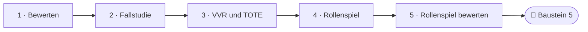
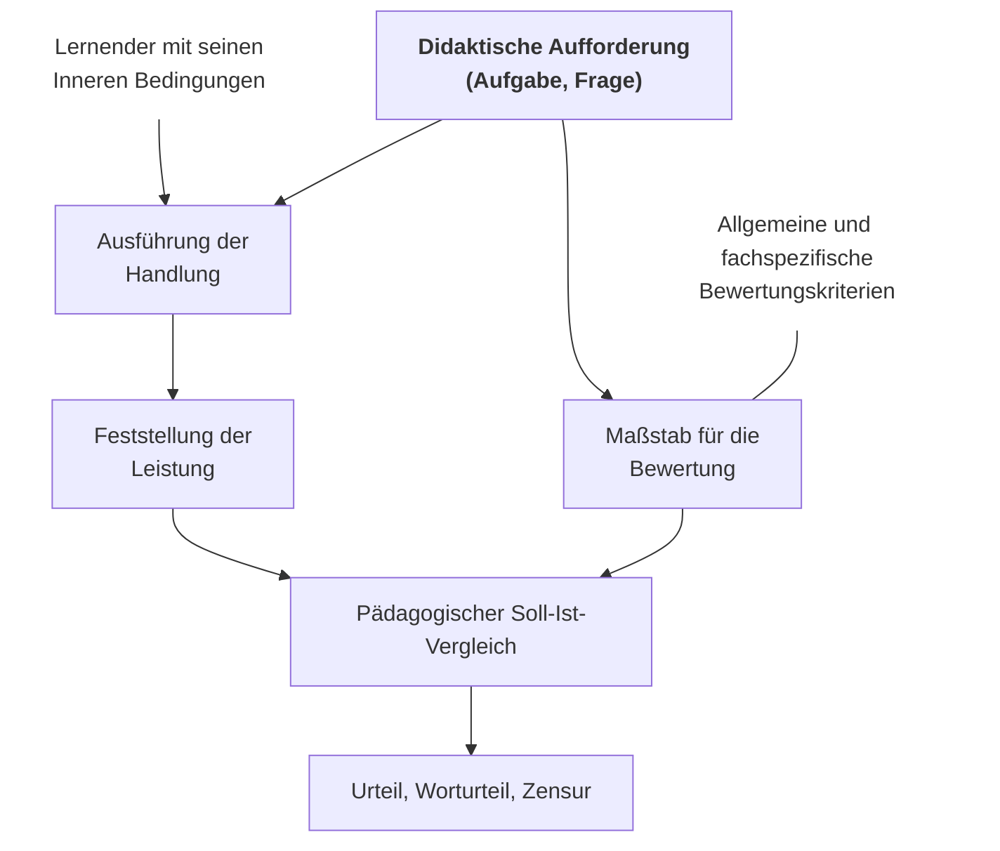
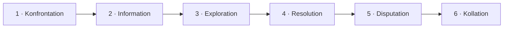
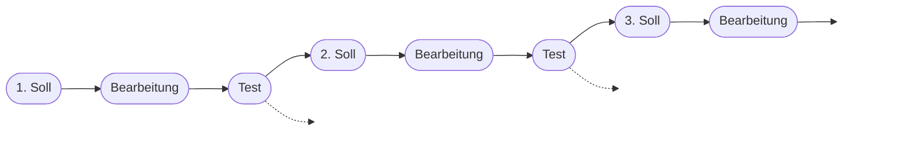
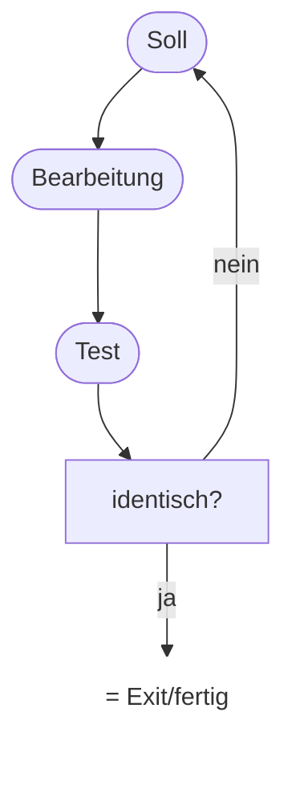
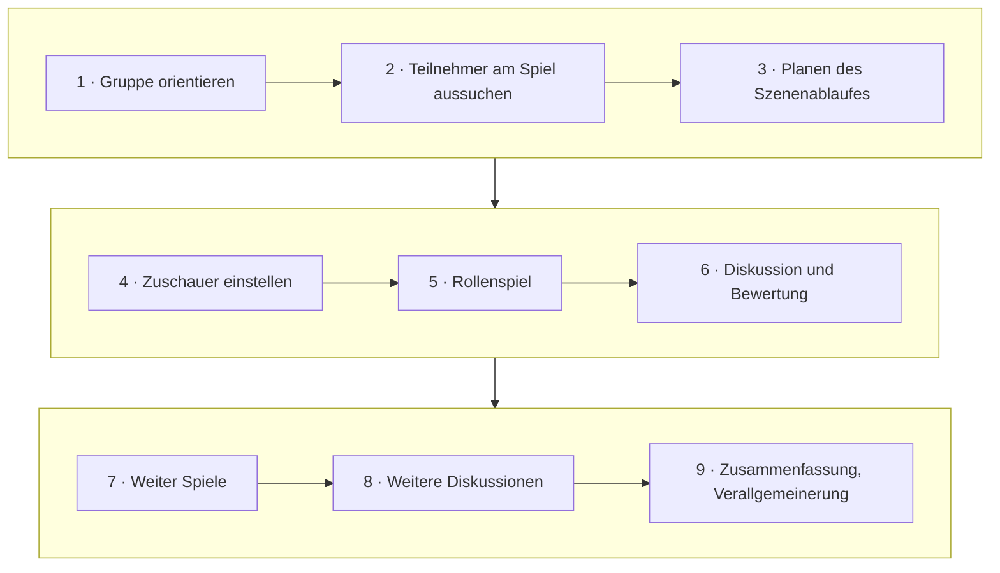
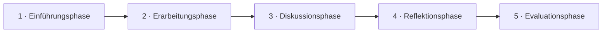

<!--
author:   Hannes Tegelbeckers
email:    hannes.tegelbeckers@ovgu.de
version:  0.2.0
language: de
narrator: Deutsch Female
mode:     Presentation
classroom: enable
comment:  Fachdidaktik technischer Allgemeinbildung II – Sitzung S04. Bewerten als Soll-Ist-Vergleich, Fallstudie nach Kaiser, VVR- und TOTE-Einheit, Rollenspiel Transgene Kartoffel.

import:   https://raw.githubusercontent.com/LiaTemplates/mermaid_template/0.1.4/README.md
-->

# S04 – Kontrolle & Bewertung · Fallstudie · Rollenspiel

Fachdidaktik technischer Allgemeinbildung II · OVGU Magdeburg · Montag, 02.11.2026, 07:00–09:00 Uhr

<!-- didaktik="Planungsraster S04 · E-03, E-04, E-12, E-16, E-17, E-19, E-26 · 0–10 Einstieg (provozieren, Vorwissen) · 10–13 Kurskarte und Ziele · 13–30 Station 1 Bewerten · 30–45 Station 2 Fallstudie, VVR/TOTE · 45–70 Station 3 Rollenspiel (Einführung, Erarbeitung, Diskussion, Reflexion, Evaluation) · 70–78 Rollenspiel bewerten (Selbst, gegenseitig, Lehrende) · 78–85 Baustein 5 · 85–90 Abschluss" -->
> [!IMPORTANT] 🧭 Leitfrage
> Wie vergleiche ich, was erreicht werden **sollte**, mit dem, was erreicht **wurde**? – Auf der Kurskarte: **Intentionalität / Kontrolle** und **Methodik → Erkenntnisweg**.

> [!TIP] 📚 Vor der Sitzung
> Haben Sie Ihre Erfahrung mit einer Note für eine Gruppenarbeit notiert? Optional: Lesen Sie schon eine der sechs Rollenkarten in Station 3.

📝 **Beuteblatt S04** – ergänzen Sie es während der Sitzung.

## Einstieg: Gerecht benoten?

    --{{0}}--
Wir beginnen mit einer steilen These: Gruppenarbeit kann man nicht gerecht benoten. Stimmen Sie ab, ohne lange nachzudenken. Am Ende der Sitzung stimmen wir noch einmal ab.

> **„Gruppenarbeit kann man nicht gerecht benoten.“**

**Vote (before):** Stimmen Sie dieser These zu?

[(a)] Ja, ich stimme zu
[(b)] Nein, ich stimme nicht zu
[(c)] Teils, teils
[(undecided)] Undecided

    --{{1}}--
Notieren Sie nun allein Ihre Erfahrung aus der Vorbereitung. Was war gerecht, was nicht – und woran wurde gemessen?

      {{1}}
****************************************

> [!TIP] 🧠 Allein · 3 min
> Notieren Sie Ihre Noten-Erfahrung aus der Vorbereitung: Was war gerecht, was nicht – und **woran** wurde gemessen?

[[___ ___ ___]]

****************************************

    --{{2}}--
Zwei oder drei von Ihnen lesen ihre Erfahrung vor. Achten Sie darauf, woran jeweils gemessen wurde – genau darum geht es heute.

      {{2}}
> [!TIP] 📣 Plenum · 2 min
> Zwei bis drei Freiwillige lesen ihre Erfahrung vor. Alle achten auf den **Maßstab**: Woran wurde die Leistung gemessen?

## Kurskarte: der Soll-Ist-Vergleich als roter Faden

    --{{0}}--
Ein Begriff zieht sich heute durch alle Stationen: der Soll-Ist-Vergleich. Beim Bewerten vergleichen wir einen Maßstab mit der Leistung. In der Fallstudie vergleichen wir die eigene Lösung mit der Entscheidung in der Wirklichkeit. Und im Rollenspiel vergleichen Sie das Meinungsbild vorher und nachher. Der Begriff selbst stammt von Folie R070.

    --{{1}}--
Auf diesem Weg erreichen Sie sechs Ziele – zwei zum Wissen, zwei zum Können und zwei zur Haltung.

      {{1}}

<!-- data-type="none" -->
| Know | Can do | Value |
|------|--------|-------|
| Funktionen von Kontrolle und Bewertung sowie die Phasen von Fallstudie und Rollenspiel **nennen** | Varianten der Fallstudie **unterscheiden** und Bewertungsprobleme in Projekten **zuordnen** | eine Rolle im Rollenspiel mit Argumenten **ausgestalten** und **vertreten** |
| Bewertung als pädagogischen Soll-Ist-Vergleich **erläutern** und mit TOTE und VVR **verbinden** | für Ihr Projektvorhaben ein Bewertungskonzept **entwerfen** | die eigene Leistung **beurteilen** – Selbst → gegenseitig → Lehrende |

    --{{2}}--
Prüfen Sie kurz, ob Sie die Kurskarte lesen können.

      {{2}}
****************************************

**Decide:** In welcher Station vergleichen Sie die eigene Lösung mit der Entscheidung in der Wirklichkeit?

<!-- data-hint-button="1" data-solution-button="2" -->
- [(X)] Fallstudie
- [( )] Bewerten
- [( )] Rollenspiel
[[?]] Kaiser nennt diesen Vergleich Kollation.
***
Richtig: In der Fallstudie wird die eigene Lösung mit der real getroffenen Entscheidung verglichen – ein Soll-Ist-Vergleich.
***

****************************************

## Station 1: Bewerten

    --{{0}}--
Wir beginnen mit der Bewertung – erst allgemein im Unterricht, dann mit den besonderen Problemen bei Projekten aus der letzten Sitzung.

**Wie entsteht ein Urteil über eine Leistung – und warum ist das bei Projekten so schwierig?**

    --{{1}}--
Zuerst klären wir, wozu Kontrolle und Bewertung überhaupt dienen.

      {{1}}
- Vier Funktionen von Kontrolle und Bewertung (R069)

    --{{2}}--
Dann sehen wir, nach welchem Schema ein Urteil entsteht: im pädagogischen Soll-Ist-Vergleich.

      {{2}}
- Das Schema des pädagogischen Soll-Ist-Vergleichs (R070)

    --{{3}}--
Heckhausen beschreibt, was eine Bewertungssituation ausmacht.

      {{3}}
- Fünf Merkmale einer Bewertungssituation nach Heckhausen (R071)

    --{{4}}--
Und schließlich drei Widersprüche bei Projekten nach Kersten – und was daraus folgt.

      {{4}}
- Widersprüche und Besonderheiten der Bewertung in Projekten (R072–R073)

    --{{5}}--
Warum ist das für Sie wichtig?

      {{5}}
> [!TIP] Why this matters
> Als Lehrkraft benoten Sie Projektarbeit – auch wenn Sie die Ziele nicht allein gesetzt haben und viele am Ergebnis mitgewirkt haben.

    --{{6}}--
Markieren Sie, was Sie schon kennen.

      {{6}}
****************************************

**Mark:** Which of these do you already know? (several possible)

[[a1]] Vier Funktionen von Kontrolle und Bewertung (R069)
[[a2]] Das Schema des pädagogischen Soll-Ist-Vergleichs (R070)
[[a3]] Fünf Merkmale einer Bewertungssituation nach Heckhausen (R071)
[[a4]] Widersprüche und Besonderheiten der Bewertung in Projekten (R072–R073)

****************************************

## Funktion von Kontrolle und Bewertung im Unterricht

    --{{0}}--
Kontrolle und Bewertung haben vier Funktionen. Sie geben der Lehrkraft Rückmeldung, ob sie ihre Ziele erreicht hat und ob die Gestaltung zweckmäßig war. Sie geben den Schülern Rückmeldung über ihre Lernfortschritte. Sie bewerten Ausbildungsgänge und Ausbildungsunterlagen. Und sie liefern Zeugnisse und Beurteilungen als Grundlage für Laufbahnentscheidungen.

- **Rückkopplung für den Lehrer**
  - Hat er seine pädagogischen Ziele erreicht?
  - War die didaktisch-methodische Gestaltung zweckmäßig?
- **Rückkopplung für den Schüler**
  - Welche Lernfortschritte wurden erzielt?
- **Bewertung von Ausbildungsgängen und Ausbildungsunterlagen**
  - Ist der Lehrplan geeignet um bestimmte Qualifikationen zu entwickeln?
- **Ermittlung von Zeugnissen und Beurteilungen als Grundlage für weitere Laufbahnentscheidungen**

    --{{1}}--
Allen vier Funktionen ist eines gemeinsam: Sie brauchen einen Maßstab, mit dem verglichen wird.

      {{1}}
> [!NOTE] Key message
> Kontrolle und Bewertung sind Rückkopplung – für Lehrende, für Lernende und für die Ausbildung selbst. Jede dieser Funktionen braucht einen Maßstab.

<small>Quelle: Folie R069 „Funktion von Kontrolle und Bewertung im Unterricht“</small>

## Kontrolle und Bewertung von Lernleistungen im Unterricht

    --{{0}}--
Das Schema zeigt, wie eine Bewertung entsteht. Am Anfang steht eine didaktische Aufforderung, also eine Aufgabe oder eine Frage. Sie wirkt auf zwei Seiten.

    --{{1}}--
Auf der einen Seite führt der Lernende mit seinen inneren Bedingungen die Handlung aus, und die Leistung wird festgestellt.

      {{1}}
**① Ist:** Der Lernende führt mit seinen inneren Bedingungen die Handlung aus; die Leistung wird festgestellt.

    --{{2}}--
Auf der anderen Seite ergeben allgemeine und fachspezifische Bewertungskriterien den Maßstab für die Bewertung.

      {{2}}
**② Soll:** Allgemeine und fachspezifische Bewertungskriterien ergeben den Maßstab für die Bewertung.

    --{{3}}--
Beide treffen sich im pädagogischen Soll-Ist-Vergleich. Daraus folgt das Urteil – als Worturteil oder als Zensur.

      {{3}}
**③ Pädagogischer Soll-Ist-Vergleich:** Leistung und Maßstab werden verglichen; daraus folgt das Urteil, Worturteil, Zensur.

    --{{4}}--
Merken Sie sich diesen Vergleich. Er begleitet uns durch die ganze Sitzung.

      {{4}}
> [!NOTE] Key message
> Ein Urteil entsteht aus dem Vergleich der festgestellten Leistung (Ist) mit dem Maßstab (Soll).

<small>Quelle: Folie R070 „Kontrolle und Bewertung von Lernleistungen im Unterricht“ – Grafik (nur Bild) als Diagramm nachgezeichnet; die Bezeichnungen „Ist“ und „Soll“ sind eine Lesehilfe.</small>

## Merkmale einer Bewertungssituation im Unterricht

    --{{0}}--
Heckhausen nennt fünf Merkmale einer Bewertungssituation: Das Handlungsergebnis ist objektivierbar und hat Aufgabencharakter, es gibt einen Schwierigkeitsmaßstab, die Handlung kann gelingen oder misslingen, es gibt verbindliche Maßstäbe, und die Leistung hängt vom Handelnden ab.

1. Objektivierbarkeit und Aufgabencharakter des Handlungsergebnisses
2. Bezug auf einen Schwierigkeitsmaßstab bzw. „Kraftaufwand“
3. Möglichkeit des Gelingens oder Misslingens einer Handlung
4. Subjektive verbindliche „Maßstäbe“ für die Bewertung
5. Abhängigkeit (Urheberschaft) der Leistung vom Handelnden

(vgl. Heckhausen, 1974)

    --{{1}}--
Warum heißt es beim vierten Merkmal subjektiv verbindlich und nicht objektiv? Heckhausen beschreibt die Bewertungssituation aus Sicht der Leistungsmotivation, also psychologisch. Eine Situation wird nur dann als Leistungssituation erlebt, wenn die Person den Maßstab für sich übernimmt.

      {{1}}
****************************************

**Zu Merkmal 4: Warum „subjektiv verbindlich“ und nicht „objektiv“?**

Gemeint ist ein Gütemaßstab, den der Handelnde als für sich verbindlich ansieht.

- Der Maßstab kann durchaus objektiv sein, zum Beispiel eine Toleranz von ±0,1 mm nach Zeichnung. Akzeptiert der Lernende ihn aber nicht als seinen Anspruch, entsteht kein Leistungshandeln. Die Arbeit wird dann nur von außen beurteilt.
- Erst wenn jemand sagt „Das will ich schaffen“, gibt es Stolz bei Erfolg und Ärger bei Misserfolg. Erst dann wirkt die Bewertung motivierend.

****************************************

    --{{2}}--
Fragen Sie sich: Sind diese Merkmale bei einer Gruppenarbeit immer gegeben?

      {{2}}
> [!NOTE] Key message
> Bewertung wirkt erst, wenn der Lernende den Maßstab als eigenen Anspruch übernimmt. – Sind diese Merkmale bei einer Gruppenarbeit immer gegeben?

<small>Quelle: Folie R071 „Merkmale einer Bewertungssituation im Unterricht“ (im Original: HECKHAUSEN); Erläuterung zu Merkmal 4 aus den Sprechernotizen dieser Folie.</small>

## Probleme der Kontrolle und Bewertung in Projekten

    --{{0}}--
Genau hier liegen die Probleme bei Projekten. Kersten beschreibt drei Widersprüche: zwischen Selbstorganisation und Fremdkontrolle – wenn der Lehrer die Ziele nicht setzt, hat er kein Antwortbild; zwischen kooperativer Lernorganisation und individueller Bewertung; und zwischen den pädagogischen Zwecken des Projekts und der Bewertung des Produkts, das ja nur Mittel zum Zweck war.

- **Widerspruch zwischen Selbstorganisation / Selbstverantwortung und Fremdkontrolle**
  - Lehrer setzt die Ziele nicht und kann daher auch über kein Antwortbild verfügen: Wie kann er daher die Leistung bewerten?
- **Widerspruch zwischen kooperativer Lernorganisation und individueller Leistungsbewertung**
- **Widerspruch zwischen pädagogischen Zwecken der Arbeit an und mit Projekten und der Kontrolle und Bewertung des Projektprodukts**
  - gemeint ist das Projektprodukt war letztlich auch nur Mittel zum Zweck: Persönlichkeitseigenschaften sollten am Produkt entwickelt werden …

(vgl. Kersten, 1997)

    --{{1}}--
Alle drei Widersprüche stellen dieselbe Frage: Woher kommt bei Projekten der Maßstab – und wessen Leistung wird gemessen?

      {{1}}
> [!NOTE] Key message
> Bei Projekten fehlen der Lehrkraft das Antwortbild, die klar abgrenzbare Einzelleistung und ein Produkt, das selbst der Zweck ist.

<small>Quelle: Folie R072 „Probleme der Kontrolle und Bewertung in Projekten“ (im Original: KERSTEN)</small>

## Besonderheiten von Kontrolle und Bewertung bei der Arbeit an und mit Projekten

    --{{0}}--
Was folgt daraus? Eine ausschließliche Fremdbewertung durch die Lehrkraft ist nicht möglich. Bewertung entsteht in Zusammenarbeit: Ausgangspunkt ist die Selbstkontrolle der Lernenden, dann folgt die gegenseitige Einschätzung, und zuletzt legt die Lehrkraft ihre Einschätzung begründet dar. Und der Schwerpunkt liegt im Prozess, nicht in den Qualitätsmerkmalen des Produkts.

- Eine ausschließliche Fremdkontrolle und –bewertung der Lernleistungen durch den Lehrenden ist nicht möglich.
- Kontrolle und Bewertung von Lernleistungen muss in Zusammenarbeit zwischen den Lernenden und dem Lehrenden erfolgen. Ausgangspunkt dafür bildet die Selbstkontrolle und –bewertung der Lernenden, gefolgt von der gegenseitigen Einschätzung der erbrachten Leistungen durch die Lernenden. Auf dieser Grundlage kann dann der Lehrende seine Leistungseinschätzung begründet darlegen.
- Trotz der Produktorientiertheit beim Lernen durch die Arbeit an und mit Projekten sollte der Schwerpunkt der Kontrolle und Bewertung nicht auf den Qualitätsmerkmalen des Produktes sondern im Prozess der Problemlösung liegen.

    --{{1}}--
Diese Reihenfolge – selbst, gegenseitig, Lehrende – wenden Sie heute beim Rollenspiel selbst an.

      {{1}}
> [!NOTE] Key message
> Selbstkontrolle und -bewertung → gegenseitige Einschätzung → begründete Einschätzung der Lehrenden. Der Schwerpunkt liegt im Prozess der Problemlösung, nicht im Produkt.

<small>Quelle: Folie R073 „Besonderheiten von Kontrolle und Bewertung bei der Arbeit an und mit Projekten“ (Reihenfolge im Kasten als Lesehilfe hervorgehoben)</small>

## Aktivierung: Welcher Widerspruch?

    --{{0}}--
Drei kurze Fragen zu Kersten und zu den Besonderheiten bei Projekten. Sie können es so oft versuchen, wie Sie möchten.

**1 · Choose one:** Die Gruppe hat ihr Ziel selbst gewählt – die Lehrkraft hat keine Musterlösung. Welcher Widerspruch nach Kersten liegt vor?

<!-- data-hint-button="1" data-solution-button="2" -->
- [( )] Kooperative Lernorganisation vs. individuelle Leistungsbewertung
- [(X)] Selbstorganisation / Selbstverantwortung vs. Fremdkontrolle
- [( )] Pädagogische Zwecke vs. Bewertung des Projektprodukts
[[?]] Wer setzt die Ziele – und wer hat dann ein Antwortbild?
***
Richtig: Der Lehrer setzt die Ziele nicht und verfügt daher über kein Antwortbild (R072).
***

    --{{1}}--
Jetzt können mehrere Antworten richtig sein.

      {{1}}
****************************************

**2 · Choose all that apply:** Was folgt nach R073 für Kontrolle und Bewertung in Projekten?

<!-- data-hint-button="1" data-solution-button="2" -->
- [[X]] Ausgangspunkt ist die Selbstkontrolle und -bewertung der Lernenden.
- [[ ]] Die Lehrkraft bewertet ausschließlich selbst.
- [[X]] Der Schwerpunkt liegt im Prozess der Problemlösung.
- [[ ]] Der Schwerpunkt liegt auf den Qualitätsmerkmalen des Produkts.
[[?]] Lesen Sie die drei Aussagen von R073 noch einmal.
***
Eine ausschließliche Fremdbewertung ist nicht möglich; der Schwerpunkt liegt im Prozess, nicht auf dem Produkt (R073).
***

****************************************

    --{{2}}--
Zum Schluss tippen Sie einen Begriff.

      {{2}}
****************************************

**3 · Type:** Worüber kann die Lehrkraft nicht verfügen, wenn sie die Ziele des Projekts nicht setzt? (ein Wort)

<!-- data-hint-button="1" data-solution-button="2" -->
[[Antwortbild]]
[[?]] Gemeint ist das Bild der erwarteten Antwort, ähnlich einer Musterlösung.

***
Ohne Antwortbild fehlt der Maßstab für den Soll-Ist-Vergleich (R072).
***

****************************************

## Station 2: Fallstudie

    --{{0}}--
In der zweiten Station lernen Sie die Fallstudie kennen – eine Methode, in der der Vergleich mit der Wirklichkeit fest eingebaut ist.

**Wie lernen Lernende an einem Fall aus der Praxis – und womit vergleichen sie ihre Lösung?**

    --{{1}}--
Zuerst: Was ist eine Fallstudie, und in welchen Phasen wird ein Fall bearbeitet?

      {{1}}
- Merkmale der Fallstudie und Phasen der Fallbearbeitung (R074)

    --{{2}}--
Kaiser unterscheidet vier Varianten nach ihrem Schwerpunkt.

      {{2}}
- Vier Varianten der Fallstudie nach Kaiser (R075)

    --{{3}}--
Sein Phasenmodell endet mit der Kollation, dem Vergleich mit der real getroffenen Entscheidung.

      {{3}}
- Phasenmodell von der Konfrontation bis zur Kollation (R076)

    --{{4}}--
Und die VVR- und die TOTE-Einheit zeigen: Auch jede einzelne Handlung beruht auf einem Soll-Ist-Vergleich.

      {{4}}
- Regelkreise unter jeder Handlung: VVR- und TOTE-Einheit (R077–R078)

    --{{5}}--
Warum ist das für Sie wichtig?

      {{5}}
> [!TIP] Why this matters
> Fallstudien holen die betriebliche Praxis in den Unterricht – und der Vergleich mit der realen Entscheidung zeigt, ob eine Lösung trägt.

    --{{6}}--
Markieren Sie, was Sie schon kennen.

      {{6}}
****************************************

**Mark:** Which of these do you already know? (several possible)

[[a1]] Merkmale der Fallstudie und Phasen der Fallbearbeitung (R074)
[[a2]] Vier Varianten der Fallstudie nach Kaiser (R075)
[[a3]] Phasenmodell von der Konfrontation bis zur Kollation (R076)
[[a4]] Regelkreise unter jeder Handlung: VVR- und TOTE-Einheit (R077–R078)

****************************************

## Fallstudie

    --{{0}}--
Die Fallstudie ist ein komplexes Unterrichtsverfahren, bei dem das Lösen eines Problems aus der Praxis im Vordergrund steht. Die Lernenden analysieren die Situation selbstständig, erarbeiten in Gruppen Lösungen und vergleichen sie kritisch.

- Komplexes Unterrichtsverfahren
- Problemlösungskonzept steht im Vordergrund
- Problemsituation meist aus der Praxis
- Die Lernenden müssen die Problemsituation selbstständig analysieren und in Gruppenarbeit Problemlösungen erarbeiten
- Die unterschiedlichen Problemlösungen sollten einem kritischen Vergleich unterzogen werden

    --{{1}}--
Die Fallbearbeitung hat vier Phasen: Problemerkennung, Informationsgewinnung, Problemlösung und Lösungskritik – einschließlich des Vergleichs mit der realen Problemlösung.

      {{1}}
****************************************

**Phasen der Fallbearbeitung**

1. Problemerkennung
2. Informationsgewinnung
3. Problemlösung
   - Suche nach unterschiedlichen Lösungsalternativen
   - Begründete Entscheidung für eine Lösungsvariante
4. Lösungskritik
   - Diskussion der Gruppenergebnisse
   - Vergleich mit der realen Problemlösung

****************************************

    --{{2}}--
Am Ende steht wieder ein Vergleich – mit der Lösung, die in der Praxis gefunden wurde.

      {{2}}
> [!NOTE] Key message
> Die Lösungskritik endet mit dem Vergleich mit der realen Problemlösung – einem Soll-Ist-Vergleich.

<small>Quelle: Folie R074 „Fallstudie“</small>

## Varianten der Arbeit mit Fallstudien nach Kaiser

    --{{0}}--
Kaiser unterscheidet vier Varianten danach, wo der Schwerpunkt liegt. Bei der Case-Study-Method müssen verborgene Probleme erst analysiert werden. Bei der Case-Problem-Method ist das Problem genannt, der Schwerpunkt liegt auf Lösung und Entscheidung. Bei der Case-Incident-Method müssen die Informationen selbst beschafft werden. Und bei der Stated-Problem-Method sind die Lösungen vorgegeben, der Schwerpunkt liegt auf ihrer Kritik.

<!-- data-type="none" -->
| Methode | Problemerkennung | Informationsgewinnung | Problemlösung | Lösungskritik |
| --- | --- | --- | --- | --- |
| **Case-Study-Method** | **Schwerpunkt:** Verborgene Probleme müssen analysiert werden | Informationen werden gegeben | Lösungsvarianten des Problems werden ermittelt und Entscheidungen gefällt | Vergleich der Lösung mit der Entscheidung in der Wirklichkeit |
| **Case-Problem-Method** | Probleme sind ausdrücklich genannt | Informationen werden gegeben | **Schwerpunkt:** Lösungsvarianten des Problems werden ermittelt und Entscheidungen gefällt | Vergleich der Lösung mit der Entscheidung in der Wirklichkeit |
| **Case-Incident-Method** | Der Fall wird lückenhaft dargestellt | **Schwerpunkt:** Informationen müssen selbstständig beschafft werden | Lösungsvarianten werden ermittelt. Der Fall wird gelöst. | |
| **Stated-Problem-Method** | Probleme sind vorgegeben | Informationen werden gegeben | Die fertigen Lösungen werden gegeben. Es wird nach alternativen Lösungen gesucht. | **Schwerpunkt:** Kritik der vorgegebenen Lösungen |

    --{{1}}--
Lesen Sie die Tabelle diagonal: Der Schwerpunkt wandert von Variante zu Variante in eine andere Phase.

      {{1}}
> [!NOTE] Key message
> Schwerpunkte: Problemerkennung (Case-Study) · Problemlösung (Case-Problem) · Informationsgewinnung (Case-Incident) · Lösungskritik (Stated-Problem).

<small>Quelle: Folie R075 „Varianten der Arbeit mit Fallstudien nach KAISER“</small>

## Phasenmodell der Fallstudie nach Kaiser

    --{{0}}--
Kaisers Phasenmodell hat sechs Schritte: Konfrontation, Information, Exploration, Resolution, Disputation und Kollation.

    --{{1}}--
In der Konfrontation werden die Lernenden mit dem Fall konfrontiert und erfassen die Situation.

      {{1}}
1. **Konfrontation:** Die Lernenden werden mit dem Fall konfrontiert und erfassen die Situation.

    --{{2}}--
In der Information beschaffen oder erschließen sie die nötigen Informationen.

      {{2}}
2. **Information:** Sie beschaffen bzw. erschließen die nötigen Informationen.

    --{{3}}--
In der Exploration erkunden sie Lösungsmöglichkeiten.

      {{3}}
3. **Exploration:** Sie erkunden Lösungsmöglichkeiten.

    --{{4}}--
In der Resolution treffen sie eine Entscheidung.

      {{4}}
4. **Resolution:** Sie treffen eine Entscheidung.

    --{{5}}--
In der Disputation verteidigen sie ihre Entscheidung gegenüber den anderen Gruppen.

      {{5}}
5. **Disputation:** Sie verteidigen ihre Entscheidung gegenüber den anderen Gruppen.

    --{{6}}--
Und in der Kollation wird die eigene Lösung mit der Entscheidung verglichen, die in der Wirklichkeit getroffen wurde – ein Soll-Ist-Vergleich.

      {{6}}
6. **Kollation:** Sie vergleichen ihre Lösung mit der Entscheidung in der Wirklichkeit – ein Soll-Ist-Vergleich.

<small>Quelle: Folie R076 „Phasenmodell der Fallstudie nach KAISER¹“ – ¹ Kaiser, F.-J.: Entscheidungstraining – Methoden der Entscheidungsfindung (2.Auflage). Bad Heilbrunn 1976 · Erläuterungen der Phasen: Lesehilfe (wie in der Selbstlerneinheit), auf der Originalfolie stehen nur die Namen.</small>

## Phasen nach Kaiser ordnen

    --{{0}}--
Ziehen Sie die sechs Phasen in die richtige Reihenfolge.

**Order:** Drag each card into the right gap.

<!-- data-randomize data-show-partial-solution data-solution-button="2" -->
Step 1: [->[ Konfrontation ]] → Step 2: [->[ Information ]] → Step 3: [->[ Exploration ]] → Step 4: [->[ Resolution ]] → Step 5: [->[ Disputation ]] → Step 6: [->[ Kollation ]]

## Aktivierung: Varianten und Phasen

    --{{0}}--
Ergänzen Sie den Text. Wählen, tippen oder ziehen Sie die fehlenden Wörter.

**Complete:**

<!-- data-hint-button="1" data-solution-button="2" data-show-partial-solution -->
Bei der [[ (Case-Incident-Method) | Case-Study-Method | Stated-Problem-Method ]] müssen die Informationen selbstständig beschafft werden. Kaisers Phasenmodell umfasst so viele Phasen: [[6]]. Die letzte Phase, die Kollation, vergleicht die eigene Lösung mit der Entscheidung in der Wirklichkeit – ein [->[ (Soll-Ist-Vergleich) | Meinungsbild ]].
[[?]] Schauen Sie in die Tabelle zu R075 und in das Phasenmodell R076.

    --{{1}}--
Entscheiden Sie jetzt: richtig oder falsch?

      {{1}}
****************************************

**Decide:** True or false?

<!-- data-hint-button="1" data-solution-button="2" data-show-partial-solution -->
[(true) (false)]
[  (X)    ( )  ] Bei der Case-Study-Method müssen verborgene Probleme analysiert werden.
[  ( )    (X)  ] Bei der Case-Problem-Method liegt der Schwerpunkt auf der Problemerkennung.
[  (X)    ( )  ] Bei der Stated-Problem-Method liegt der Schwerpunkt auf der Kritik der vorgegebenen Lösungen.
[  ( )    (X)  ] Bei der Case-Incident-Method werden alle Informationen gegeben.
[[?]] Jede Variante hat genau einen Schwerpunkt – suchen Sie ihn in der Tabelle.
***
Case-Study: verborgene Probleme analysieren · Case-Problem: Lösungsvarianten ermitteln und entscheiden · Case-Incident: Informationen selbstständig beschaffen · Stated-Problem: Kritik der vorgegebenen Lösungen (R075).
***

****************************************

## Vergleichs-Veränderungs-Rückkoppelungs-Einheit (VVR-Einheit)

    --{{0}}--
In S02 haben Sie gehört, dass Handlungen auf zyklischen Einheiten beruhen. Hier ist die erste: die VVR-Einheit – Vergleich, Veränderung, Rückkopplung.

    --{{1}}--
Am Anfang steht ein erstes Soll – das, was erreicht werden soll.

      {{1}}
**① Soll:** Das angestrebte Ergebnis eines Handlungsschritts: 1., 2., 3. Soll.

    --{{2}}--
Dann wird bearbeitet und getestet: Ist das Soll erreicht?

      {{2}}
**② Bearbeitung und Test:** Die Handlung wird ausgeführt und ihr Ergebnis mit dem Soll verglichen.

    --{{3}}--
Jeder Test führt zu einem neuen Soll. So entsteht eine Folge von Regelkreisen – im Original als Spirale gezeichnet.

      {{3}}
**③ Neues Soll:** Jeder Test führt zum nächsten Soll; die Handlung schreitet in Schleifen voran.

    --{{4}}--
Vergleich, Veränderung, Rückkopplung – das ist der Kern dieser Einheit.

      {{4}}
> [!NOTE] Key message
> VVR: vergleichen, verändern, rückkoppeln – Handeln als Folge von Soll-Ist-Vergleichen.

<small>Quelle: Folie R077 „Vergleichs-Veränderungs-Rückkoppelungs-Einheit (VVR-Einheit)“ – Grafik (nur Bild) nachgezeichnet: im Original eine Spirale, in der jeder Test zum nächsten Soll führt; gestrichelte Pfeile nach dem 1. und 2. Test wie im Original.</small>

## Test-Operation-Test-Exit (TOTE-Einheit)

    --{{0}}--
Die TOTE-Einheit – Test, Operation, Test, Exit – zeigt den Regelkreis einer einzelnen Handlung.

    --{{1}}--
Ein Soll wird vorgegeben.

      {{1}}
**① Soll:** Das Ziel der Handlung.

    --{{2}}--
Es wird bearbeitet, und das Ergebnis wird getestet.

      {{2}}
**② Bearbeitung und Test:** Die Operation wird ausgeführt, dann wird das Ergebnis geprüft.

    --{{3}}--
Solange Soll und Ist nicht identisch sind, geht es zurück in die Bearbeitung. Erst dann ist man fertig.

      {{3}}
**③ identisch?:** nein → zurück zum Soll und weiter bearbeiten · ja = Exit/fertig.

    --{{4}}--
Auch das ist ein Soll-Ist-Vergleich, diesmal im Kopf jedes Handelnden.

      {{4}}
> [!NOTE] Key message
> In S02 hieß es: Die Handlung „basiert auf zyklischen Einheiten (TOTE- / VVR-)“ (R044). Jede Handlung enthält einen Soll-Ist-Vergleich.

<small>Quelle: Folie R078 „Test-Operation-Test-Exit (TOTE-Einheit)“ – Grafik (nur Bild) als Diagramm nachgezeichnet.</small>

## Station 3: Rollenspiel

    --{{0}}--
In der dritten Station spielen wir. Das Rollenspiel ist zugleich Inhalt und Methode dieser Sitzung.

**Wie läuft ein Rollenspiel ab – und wie verändert es ein Meinungsbild?**

    --{{1}}--
Zuerst der Ablauf in neun Schritten.

      {{1}}
- Ablauf des Rollenspiels in neun Schritten (R079)

    --{{2}}--
Dann der Phasenaufbau in fünf Phasen.

      {{2}}
- Phasenaufbau von der Einführung bis zur Evaluation (R080)

    --{{3}}--
Das Beispiel: die transgene Kartoffel.

      {{3}}
- Beispiel „Transgene Kartoffel – Umweltkiller oder Schlankmacher“ (R081–R082)

    --{{4}}--
Und schließlich spielen Sie selbst – mit sechs Rollenkarten.

      {{4}}
- Sechs Rollenkarten, Pressekonferenz und Runder Tisch (R083–R088)

    --{{5}}--
Warum ist das für Sie wichtig?

      {{5}}
> [!TIP] Why this matters
> Technik wird gesellschaftlich verhandelt. Im Rollenspiel üben Lernende, Positionen zu vertreten und die Argumente anderer zu prüfen.

    --{{6}}--
Markieren Sie, was Sie schon kennen.

      {{6}}
****************************************

**Mark:** Which of these do you already know? (several possible)

[[a1]] Ablauf des Rollenspiels in neun Schritten (R079)
[[a2]] Phasenaufbau von der Einführung bis zur Evaluation (R080)
[[a3]] Beispiel „Transgene Kartoffel – Umweltkiller oder Schlankmacher“ (R081–R082)
[[a4]] Sechs Rollenkarten, Pressekonferenz und Runder Tisch (R083–R088)

****************************************

## Ablauf des Rollenspiels

    --{{0}}--
Der Ablauf hat neun Schritte – von der Orientierung der Gruppe bis zur Zusammenfassung.

    --{{1}}--
Zuerst wird die Gruppe mit dem Problem konfrontiert, die Spieler werden ausgesucht, und der Szenenablauf wird geplant.

      {{1}}
****************************************

1. **Gruppe orientieren:** (Konfrontation mit dem Problem)
2. **Teilnehmer am Spiel aussuchen:** Wer spielt welche Rolle?
3. **Planen des Szenenablaufes:** Welche Szenen folgen aufeinander?

****************************************

    --{{2}}--
Dann werden die Zuschauer auf ihre Rolle als teilnehmende Beobachter eingestellt. Es wird gespielt, diskutiert und bewertet.

      {{2}}
****************************************

4. **Zuschauer einstellen:** auf ihre Rolle als teilnehmende Beobachter
5. **Rollenspiel:** Die geplanten Szenen werden gespielt.
6. **Diskussion und Bewertung:** Was ist geschehen, wie hat es gewirkt?

****************************************

    --{{3}}--
Gegebenenfalls wird mit getauschten Rollen oder alternativen Szenen weitergespielt und weiter diskutiert – bis zur Zusammenfassung und Verallgemeinerung.

      {{3}}
****************************************

7. **Weiter Spiele:** (getauschte Rollen, alternative Szenen)
8. **Weitere Diskussionen:** zu den weiteren Spielen
9. **Zusammenfassung, Verallgemeinerung:** Was lässt sich über den Fall hinaus festhalten?

****************************************

<small>Quelle: Folie R079 „Ablauf des Rollenspiels“ – Wortlaut der Schritte unverändert (Schritt 4 im Original: „Zuschauer auf ihre Rolle als teilnehmende Beobachter einstellen“, Schritt 7 „Weiter Spiele“ ᴼ); Erläuterungen zu den Schritten 2, 3, 5, 6, 8 und 9: Lesehilfe.</small>

## Ablauf ordnen

    --{{0}}--
Ziehen Sie die neun Schritte in die richtige Reihenfolge.

**Order:** Drag each card into the right gap.

<!-- data-randomize data-show-partial-solution data-solution-button="2" -->
Step 1: [->[ Gruppe orientieren ]] → Step 2: [->[ Teilnehmer am Spiel aussuchen ]] → Step 3: [->[ Planen des Szenenablaufes ]] → Step 4: [->[ Zuschauer einstellen ]] → Step 5: [->[ Rollenspiel ]] → Step 6: [->[ Diskussion und Bewertung ]] → Step 7: [->[ Weiter Spiele ]] → Step 8: [->[ Weitere Diskussionen ]] → Step 9: [->[ Zusammenfassung, Verallgemeinerung ]]

## Phasenaufbau des Rollenspiels

    --{{0}}--
Kürzer gefasst hat das Rollenspiel fünf Phasen: Einführung, Erarbeitung, Diskussion, Reflexion und Evaluation. Daran orientieren wir uns heute.

    --{{1}}--
In der Einführungsphase wird die Gruppe mit dem Problem konfrontiert.

      {{1}}
1. **Einführungsphase:** Die Gruppe wird mit dem Problem konfrontiert (vgl. R079).

    --{{2}}--
In der Erarbeitungsphase werden die Rollen mit Argumenten gefüllt.

      {{2}}
2. **Erarbeitungsphase:** Rollen werden entsprechend der Standpunkte mit Argumenten gefüllt (R082).

    --{{3}}--
In der Diskussionsphase werden Statements verlesen und am runden Tisch wird ein Konsens gesucht.

      {{3}}
3. **Diskussionsphase:** Pressekonferenz und Diskussion am „Runden Tisch“ (R082).

    --{{4}}--
In der Reflexionsphase fragen wir: Warum hat jemand so gehandelt?

      {{4}}
4. **Reflektionsphase:** Warum hat X so gehandelt? (R082)

    --{{5}}--
Und in der Evaluationsphase: Wie wurde das Meinungsbild beeinflusst?

      {{5}}
5. **Evaluationsphase:** Wie wurde das Meinungsbild beeinflusst? (R082)

<small>Quelle: Folie R080 „Phasenaufbau des Rollenspiels“ (Schreibweise „Reflektionsphase“ wie im Original); Erläuterungen aus R079 und R082.</small>

## Phasen des Rollenspiels ordnen

    --{{0}}--
Ziehen Sie die fünf Phasen in die richtige Reihenfolge.

**Order:** Drag each card into the right gap.

<!-- data-randomize data-show-partial-solution data-solution-button="2" -->
Step 1: [->[ Einführungsphase ]] → Step 2: [->[ Erarbeitungsphase ]] → Step 3: [->[ Diskussionsphase ]] → Step 4: [->[ Reflektionsphase ]] → Step 5: [->[ Evaluationsphase ]]

## Bsp.: „Transgene Kartoffel – Umweltkiller oder Schlankmacher“

    --{{0}}--
Unser Fall: Die fiktive Firma FloraTec hat eine gentechnisch veränderte Kartoffel mit höherem Stärkeanteil entwickelt, die beim Frittieren weniger Fett aufnimmt. Zum Nachweis trägt sie ein Markergen.

**Ausgangsszenario:**

- Die fiktive Firma FloraTec GmbH hat eine gentechnisch veränderte Kartoffelsorte entwickelt, die über einen höheren Stärkeanteil verfügt
- Durch den geringeren Wassergehalt der transgenen Kartoffel wird bei der Weiterverarbeitung durch Frittieren oder Braten weniger Fett aufgenommen. Die so hergestellten Nahrungsmittel enthalten demzufolge auch wenige Kalorien als Produkte aus herkömmlichen Kartoffeln.
- Zum Nachweis wurde die Kartoffelsorte mit einem Markergen versehen. Markergene werden zusammen mit dem veränderten Gen in die Pflanzen eingebracht und lassen sich im Verlaufe der Züchtung meist leichter nachweisen als die eigentliche genetische Veränderung. In diesem Falle wurde als Markergen ein Antibiotikaresistenzgen (Resistenz gegen das Antibiotikum Amikacin) in die Kartoffelpflanzen implementiert.

<small>Quelle: Folie R081 „Bsp.: „Transgene Kartoffel – Umweltkiller oder Schlankmacher““ (Wortlaut unverändert)</small>

    --{{1}}--
Behalten Sie den Kern des Konflikts im Blick.

      {{1}}
> [!NOTE] Key message
> Ein Produkt, viele Interessen: Gesundheit, Umwelt, Wirtschaft und Politik treffen aufeinander – ein Stoff für ein Rollenspiel.

    --{{2}}--
Eine kurze Leseprobe.

      {{2}}
****************************************

**Type:** Gegen welches Antibiotikum ist das Markergen der transgenen Kartoffel resistent?

<!-- data-hint-button="1" data-solution-button="2" -->
[[Amikacin]]
[[?]] Es steht im letzten Punkt des Ausgangsszenarios.

***
Richtig: Als Markergen wurde ein Antibiotikaresistenzgen gegen Amikacin eingebracht.
***

****************************************

## Bsp.: „Transgene Kartoffel“ – die Phasen im Beispiel

    --{{0}}--
In der Erarbeitungsphase füllen Sie Rollen mit Argumenten. In der Diskussionsphase gibt es eine Pressekonferenz und einen runden Tisch mit dem Ziel eines Konsenses. Danach reflektieren und evaluieren wir.

- **Erarbeitungsphase**
- Rollen müssen entsprechend der Standpunkte mit Argumenten gefüllt werden
  - Materialsammlung wird bereitgestellt
- **Diskussionsphase**
- Pressekonferenz – Statements der am Spiel beteiligten Parteien werden verlesen
  - Diskussion am „Runden Tisch“ – es ist ein Konsens zu finden
- **Reflektionsphase**
  - Warum hat X so gehandelt?
- **Evaluationsphase**
  - Wie wurde das Meinungsbild beeinflusst?

<small>Quelle: Folie R082 „Bsp.: „Transgene Kartoffel – Umweltkiller oder Schlankmacher““ (Gliederungsebenen wie im Original)</small>

## Rollenspiel: Meinungsbild vorher

    --{{0}}--
Bevor wir spielen: Wie stehen Sie selbst zur Zulassung der transgenen Kartoffel? Stimmen Sie ab. Nach dem Spiel vergleichen wir mit dem Meinungsbild nachher.

Sechs Parteien treffen sich zur Pressekonferenz und am „Runden Tisch“ – es ist ein Konsens zu finden (R082). Ihre Rollenkarten folgen auf den nächsten Folien.

**Vote (before):** Sollte die transgene Kartoffel zugelassen werden?

[(a)] Ja
[(b)] Unter Auflagen
[(c)] Nein
[(undecided)] Undecided

    --{{1}}--
Erarbeitungsphase. Ihre Rolle richtet sich nach Ihrem Geburtsmonat. Lesen Sie Ihre Rollenkarte auf den folgenden Folien und formulieren Sie ein Statement von höchstens einer Minute.

      {{1}}
****************************************

> [!TIP] 🧠 Erarbeitungsphase · allein · 6 min
> Ihre Rolle nach Geburtsmonat: **Jan/Feb** Ökohof Morgenrot · **Mär/Apr** FloraTec GmbH · **Mai/Jun** VDAgrar · **Jul/Aug** Minister Erdapfel · **Sep/Okt** Prof. Frosch · **Nov/Dez** Familie Normalo. Lesen Sie Ihre Rollenkarte und notieren Sie ein Statement (max. 1 min): Was ist Ihre Position, was fordern Sie?

[[___ ___ ___]]

****************************************

    --{{2}}--
Diskussionsphase. Für jede Rolle liest eine freiwillige Person ihr Statement vor. Danach suchen die sechs Sprecherinnen und Sprecher am runden Tisch einen Konsens. Alle anderen beobachten.

      {{2}}
> [!TIP] 📣 Diskussionsphase · Plenum · 10 min
> **Pressekonferenz (6 min):** Je Rolle verliest eine freiwillige Person ihr Statement. **Runder Tisch (4 min):** Die sechs Sprecher:innen suchen einen Konsens. Alle anderen sind *teilnehmende Beobachter:innen* und notieren: Wer überzeugt womit?

## Rollenkarte: Ökologischer Landwirt „Ökohof Morgenrot“

    --{{0}}--
Der Ökohof Morgenrot betreibt seit acht Jahren ökologischen Landbau. Er fürchtet, dass das veränderte Gen vom Nachbarfeld in die eigene Sorte gelangt und das Ökolabel verloren geht, dass es langfristig nur noch gentechnisch verändertes Saatgut gibt und dass für die anfällige Kartoffel Pestizide nötig werden.

- Auf dem „Ökohof Morgenrot“ wird seit 8 Jahren ökologischer Landbau betrieben.
- Aus Sicht des Ökohofes stellt die transgene Kartoffel gleich mehrere Probleme dar. Zum einen kann es passieren, dass sich durch unsachgemäßen Umgang auf dem Nachbarsfeld das veränderte Gen in der hofeigenen Sorte wiederfindet – der Verlust des Ökolabels wäre zu erwarten (wirtschaftliche Katastrophe für den Hof)
- Zum anderen ist zu erwarten, dass langfristig nur noch gentechnisch verändertes Saatgut auf dem Markt zu finden ist. Aber auch ein weiteres Problem entsteht aus Sicht des Ökohofes. Da die transgene Kartoffel nicht besonders resistent gegen Krankheiten ist, müssen zum Pflanzenschutz Pestizide verwendet werden. Als ökologischer Landbau könnte man diese Arbeitsweise nicht mehr bezeichnen.

<small>Quelle: Folie R083 „Bsp.: „Transgene Kartoffel – Umweltkiller oder Schlankmacher““ · Rolle für Geburtsmonat Jan/Feb</small>

## Rollenkarte: Züchtungsbetrieb „FloraTEc GmbH“ ᴼ

    --{{0}}--
Die FloraTec GmbH hat viel Zeit und Geld in gentechnische Methoden investiert, gefördert von Bund, EU und einem privaten Geldanleger. Sie sieht keine nachweisbaren Gesundheitsrisiken und will die Kartoffel mit der Botschaft „Iss dich schlank“ vermarkten.

- Die Firma beschäftigt sich mit Pflanzenzüchtung. Sie hat in den letzten Jahren viel Zeit und Geld investiert, um mit gentechnischen Methoden arbeiten zu können
- Finanzielle Hilfe bekam die Firma dabei im Rahmen eines „Regiotechnologie – Programms“ von Bund und der EU sowie von einem privaten Geldanleger
- Aus Sicht des Züchtungsbetriebes FloraTec GmbH bergen die gentechnisch entwickelten Kartoffeln keine nachweisbaren Gesundheitsrisiken
- Mit der neuen Eigenschaft des erhöhten Stärkeanteils und der damit verbundenen geringen Fettaufnahme bei der Weiterverarbeitung wird die neue Kartoffelsorte als ernährungsphysiologisch günstig angesehen.
- Mit der Botschaft „Iss dich schlank“ lassen sich diese Produkte vermarkten und mit einem positiven Image versehen. Nach Meinung der Firma wird so eine Sorte produziert, die dem gewachsenen Gesundheitsdenken der Kunden entspricht.

<small>Quelle: Folie R084 „Bsp.: „Transgene Kartoffel – Umweltkiller oder Schlankmacher““ (Schreibweisen „FloraTEc“ im Titel und „FloraTec“ im Text wie im Original) · Rolle für Geburtsmonat Mär/Apr</small>

## Rollenkarte: Bauernverband „VDAgrar“ ᴼ

    --{{0}}--
Der Bauernverband vertritt die Landwirte der Region. Er sieht gute Absatzchancen und mehr Stärke auf gleicher Fläche, fürchtet aber Negativschlagzeilen über Genfood und hängt deshalb stark von der öffentlichen Meinung ab.

- Der Bauernverband VDArgar ist eine Interessenvereinigung Landwirte aus der Region.
- Die Eigenschaften der transgenen Kartoffel (kalorienarme Verarbeitung) versprechen im Hinblick auf das gesteigerte Gesundheitsbewusstsein der Bevölkerung gute Chancen auf eine starke Nachfrage und somit guten Absatz. Außerdem lässt sich mit dieser Sorte auf der gleichen Anbaufläche und mit dem gleichen Aufwand mehr Stärke produzieren. Auf der anderen Seite steht natürlich die Befürchtung, durch Negativschlagzeilen über „Genfood“ Umsatzbußen zu erleiden und einen schweren Imageverlust davonzutragen.
- Der VDArgar sieht sich daher in hohem Maße abhängig von der öffentlichen Meinung über die transgene Kartoffel.

<small>Quelle: Folie R085 „Bsp.: „Transgene Kartoffel – Umweltkiller oder Schlankmacher““ (Schreibweisen „VDAgrar“ im Titel und „VDArgar“ im Text wie im Original) · Rolle für Geburtsmonat Mai/Jun</small>

## Rollenkarte: Politiker „Minister Erdapfel“

    --{{0}}--
Minister Erdapfel ist für Forschung und Landwirtschaft verantwortlich und muss die Interessen von Verbrauchern, Firmen und Wissenschaft abwägen – mit dem laufenden Wahlkampf im Hinterkopf.

- Minister Erdapfel ist verantwortlich für Forschung und Landwirtschaft. In dieser Tätigkeit hat er Interessen verschiedener Gruppen (Verbraucher, Firmen, Wissenschaftler usw.) zu berücksichtigen.
- Er pflegt gleichzeitig Kontakt mit Vertretern der Forschung und der Bauernverbände und hat nebenbei den laufenden Wahlkampf im Hinterkopf.
- Allein beim Thema „Transgene Kartoffel“ ergeben sich für die Minister große Probleme, da jede Gruppe eine andere Meinung vertritt und schwerwiegende Argumente anführt. Die Bauernverbände verweisen auf die schwierige Lage der Landwirte und die Sorge um die Sicherheit der landwirtschaftlichen Produkte.
- Forscher hoffen auf Fördergelder für weitere Forschung und verweisen auf ihre Erfolge bei der Entwicklung neuer Technologien und damit verbundenen Arbeitsplätzen.
- Die öffentliche Meinung zum Thema Gentechnologie ist angespannt, das die Verbraucher (wählende Bürger) um die Sicherheit ihrer Nahrungsmittel bangen.

<small>Quelle: Folie R086 „Bsp.: „Transgene Kartoffel – Umweltkiller oder Schlankmacher““ · Rolle für Geburtsmonat Jul/Aug</small>

## Rollenkarte: Wissenschaftler „Prof. Frosch“

    --{{0}}--
Professor Frosch erforscht seit Jahren die ökologischen Folgen transgener Pflanzen und plant Freisetzungsversuche über den Rahmen des Gentechnikgesetzes hinaus. Er hängt zunehmend von Geld aus Wirtschaft und Politik ab – und von seinem Ruf als Wissenschaftler.

- Professor Frosch beschäftigt sich seit vielen Jahren mit transgenen Pflanzen. Er beteiligt sich insbesondere an der Erforschung ökologischer Folgen des Anbaus der transgenen Kartoffel. Dazu hat er Freisetzungsversuche geplant, die den Rahmen des Gentechnikgesetzes überschreiten würden. Er empfindet die Versuche als notwendig, um positive oder negative ökologische Folgen der transgenen Kartoffel besser abschätzen zu kommen und die Übertragbarkeit der Laborerfahrungen ins Freiland zu untersuchen
- Professor Frosch ist zunehmend von Finanzspritzen durch die Wirtschaft und die Politik abhängig. Diese wirtschaftlichen Überlegungen spielen z.B. bei Patentanmeldungen eine große Rolle. Aber auch sein wissenschaftlicher Stellenwert und Ruf als guter Wissenschaftler ist von der Aktualität und Bedeutung seiner Arbeit abhängig.

<small>Quelle: Folie R087 „Bsp.: „Transgene Kartoffel – Umweltkiller oder Schlankmacher““ · Rolle für Geburtsmonat Sep/Okt</small>

## Rollenkarte: Verbraucher „Familie Normalo“

    --{{0}}--
Familie Normalo fand die Informationen zur Gentechnik sehr komplex und hat Bedenken. Sie fragt sich, ob die Nahrungsmittel durch schlechte Verträglichkeit oder unbekannte Inhaltsstoffe Stoffwechselstörungen verursachen können.

- Die Informationen zum Thema Gentechnik waren sehr komplex und Familie Normalo hat nun Bedenken, auch gegenüber gentechnisch veränderten Nahrungsmitteln.
- Niemand konnte ihnen bisher genaueres sagen und so quälen sie nun eine ganze Menge Fragen. Können diese Nahrungsmittel durch schlechte Verträglichkeit, Verdaulichkeit oder durch die Bildung unbekannter Inhaltsstoffe Stoffwechselstörungen verursachen?

<small>Quelle: Folie R088 „Bsp.: „Transgene Kartoffel – Umweltkiller oder Schlankmacher““ · Rolle für Geburtsmonat Nov/Dez · Alle Rollenkarten im Wortlaut der Originalfolien R083–R088.</small>

## Reflexion und Evaluation: Meinungsbild nachher

    --{{0}}--
Evaluationsphase. Stimmen Sie noch einmal ab: Hat das Rollenspiel Ihr Meinungsbild verändert?

**Vote (after):** Sollte die transgene Kartoffel zugelassen werden?

[(a)] Ja
[(b)] Unter Auflagen
[(c)] Nein
[(undecided)] Undecided

    --{{1}}--
Reflexionsphase. Warum hat eine Rolle so gehandelt, wie sie gehandelt hat?

      {{1}}
****************************************

**Reflect:** Reflexionsphase: Warum hat X so gehandelt? Wählen Sie eine Rolle und begründen Sie.

[[___ ___]]

****************************************

    --{{2}}--
Vergleichen Sie vorher und nachher: Wie wurde das Meinungsbild beeinflusst?

      {{2}}
> [!NOTE] Key message
> Evaluationsphase: Wie wurde das Meinungsbild beeinflusst? Der Vergleich vorher – nachher ist ein Soll-Ist-Vergleich anderer Art.

## Wo stehen wir? Das Rollenspiel bewerten

    --{{0}}--
Jetzt bewerten Sie das Rollenspiel so, wie es Folie R073 für Projekte fordert: zuerst Sie selbst, dann gegenseitig, und zuletzt legt die Lehrperson ihre Einschätzung begründet dar.

Sie haben eine Rolle vertreten – allein vorbereitet, im Plenum gespielt. Wie bewertet man diese Leistung gerecht? R073 gibt die Reihenfolge vor: Selbstkontrolle und -bewertung, gegenseitige Einschätzung, begründete Einschätzung der Lehrenden.

<!-- data-type="none" -->
| Figure | Value |
|--------|-------|
| 1 · Selbsteinschätzung | allein · 2 min |
| 2 · Gegenseitige Einschätzung | allein, Ergebnis im Classroom · 3 min |
| 3 · Einschätzung der Lehrperson | begründet · 3 min |

## Selbst → gegenseitig → Lehrende

    --{{0}}--
Erstens: Schätzen Sie sich selbst ein.

**1 · Answer:** Selbsteinschätzung: Wie gut haben Sie Ihre Rolle argumentativ vertreten – und woran machen Sie das fest?

[[___ ___]]

✅ Model answer

Stützen Sie Ihr Urteil auf einen Maßstab, den Sie für sich verbindlich finden (Heckhausen, R071), zum Beispiel: Position klar benannt, Forderung begründet, auf andere Rollen eingegangen.

    --{{1}}--
Zweitens: Schätzen Sie die Sprecherinnen und Sprecher ein.

      {{1}}
****************************************

**2 · Answer:** Gegenseitige Einschätzung: Nennen Sie eine Stärke und einen Tipp für die Sprecher:innen.

[[___ ___]]

✅ Model answer

Hilfreiche Rückmeldungen beziehen sich auf den Prozess, nicht nur auf das Produkt (R073), zum Beispiel: „Sie haben das Argument der Familie Normalo aufgegriffen.“ – Tipp: „Nennen Sie Ihre Forderung gleich zu Beginn.“

****************************************

    --{{2}}--
Drittens: Worauf haben Sie Ihr Urteil gestützt? Danach lege ich meine Einschätzung begründet dar.

      {{2}}
****************************************

**3 · Answer:** Worauf haben Sie Ihre Selbsteinschätzung vor allem gestützt – auf das Statement (Produkt), auf Argumentation und Konsensfindung (Prozess) oder auf beides? Welcher Widerspruch aus R072 ist Ihnen dabei begegnet?

[[___ ___]]

✅ Model answer

Nach R073 soll der Schwerpunkt im Prozess der Problemlösung liegen, nicht in den Qualitätsmerkmalen des Produkts. Typisch ist der Widerspruch zwischen kooperativer Lernorganisation (Runder Tisch) und individueller Leistungsbewertung (R072). Anschließend legt die Lehrperson ihre Einschätzung begründet dar.

****************************************

## Baustein 5 für Ihren Unterrichtsentwurf (optional)

    --{{0}}--
Übertragen Sie das jetzt auf Ihr Projektvorhaben aus Baustein 4 und entwerfen Sie ein Konzept für Kontrolle und Bewertung.

**Allein (7 min):** Entwerfen Sie für Ihr Projektvorhaben aus Baustein 4 ein Konzept für Kontrolle und Bewertung. Die drei Leitfragen stehen auf der nächsten Folie.

<!-- data-type="none" -->
| Figure | Value |
|--------|-------|
| Wer bewertet? | Selbst → gegenseitig → Lehrende (R073) |
| Schwerpunkt | Prozess der Problemlösung (R073) |
| Stolperstein | Gruppenarbeit vs. Einzelnote (R072) |

## Baustein 5: Ihr Bewertungskonzept

    --{{0}}--
Erstens: Wer bewertet was?

**1 · Answer:** Wer bewertet was – Selbst, Gruppe, Lehrkraft (Reihenfolge nach R073)?

[[___ ___]]

✅ Model answer

Beispiel: Die Lernenden führen ein Projekttagebuch und schätzen sich nach jeder Phase selbst ein; in der Gruppe geben sie sich mit einem kurzen Kriterienbogen Rückmeldung; die Lehrkraft begründet ihre Note im Gespräch.

    --{{1}}--
Zweitens: Welche Prozess-Kriterien nutzen Sie?

      {{1}}
****************************************

**2 · Answer:** Welche **Prozess**-Kriterien nutzen Sie?

[[___ ___]]

✅ Model answer

Beispiele: Planung eingehalten oder begründet angepasst · Arbeitsteilung abgestimmt · Probleme erkannt und Lösungswege verglichen · Ergebnisse dokumentiert und reflektiert.

****************************************

    --{{2}}--
Drittens: Wie gehen Sie mit Gruppenarbeit und Einzelnote um?

      {{2}}
****************************************

**3 · Answer:** Wie gehen Sie mit dem Widerspruch zwischen Gruppenarbeit und Einzelnote um?

[[___ ___]]

✅ Model answer

Beispiel: eine Gruppennote für Produkt und Präsentation plus individuelle Anteile aus Projekttagebuch, Selbst- und gegenseitiger Einschätzung und einem kurzen Fachgespräch – so wird die Zusammenarbeit gewürdigt und die Einzelleistung sichtbar (R072).

****************************************

## Zum Mitnehmen: Noch einmal gerecht benoten?

    --{{0}}--
Kommen wir zurück zur These vom Anfang. Stimmen Sie noch einmal ab.

**Vote (after):** Stimmen Sie der These „Gruppenarbeit kann man nicht gerecht benoten.“ zu?

[(a)] Ja, ich stimme zu
[(b)] Nein, ich stimme nicht zu
[(c)] Teils, teils
[(undecided)] Undecided

    --{{1}}--
Was hat Ihre Einschätzung verändert – oder bestätigt?

      {{1}}
****************************************

**Reflect:** Was hat Ihre Einschätzung seit dem Einstieg verändert – oder bestätigt?

[[___ ___]]

****************************************

    --{{2}}--
Vergleichen Sie Ihr Votum mit dem vom Anfang.

      {{2}}
> [!NOTE] Key message
> Gerechter wird eine Note durch einen offengelegten Maßstab, die Reihenfolge Selbst → gegenseitig → Lehrende und den Blick auf den Prozess (R070, R073).

## Das Wichtigste aus S04

    --{{0}}--
Fassen wir zusammen.

    --{{1}}--
Erstens: Bewerten ist ein Vergleich.

      {{1}}
- Bewerten ist ein pädagogischer Soll-Ist-Vergleich: festgestellte Leistung gegen Maßstab (R070).

    --{{2}}--
Zweitens: In Projekten wird gemeinsam bewertet.

      {{2}}
- In Projekten gilt: Selbst → gegenseitig → Lehrende, Prozess vor Produkt (R072–R073).

    --{{3}}--
Drittens: Die Fallstudie endet mit dem Vergleich mit der Wirklichkeit.

      {{3}}
- Fallstudie nach Kaiser: von der Konfrontation bis zur Kollation, dem Vergleich mit der realen Entscheidung (R074–R076).

    --{{4}}--
Und viertens: Auch jede Handlung und jedes Rollenspiel enthält einen Vergleich.

      {{4}}
****************************************

- TOTE und VVR: Handeln als Regelkreis · Rollenspiel: Meinungsbild vorher – nachher (R077–R082).

> [!NOTE] Remember
> Bewerten heißt vergleichen: Soll ↔ Ist – mit einem offengelegten Maßstab.

****************************************

    --{{5}}--
Eine letzte Frage.

      {{5}}
****************************************

**Recap:** In welcher Reihenfolge sollen Kontrolle und Bewertung in Projekten nach R073 erfolgen?

<!-- data-hint-button="1" data-solution-button="2" -->
- [( )] Lehrende → gegenseitige Einschätzung → Selbstbewertung
- [( )] Nur die Lehrenden, anhand der Qualität des Produkts
- [(X)] Selbstbewertung → gegenseitige Einschätzung → Lehrende
[[?]] Ausgangspunkt ist das, was die Lernenden selbst einschätzen.
***
Richtig: Auf der Grundlage von Selbst- und gegenseitiger Einschätzung legt die Lehrkraft ihre Einschätzung begründet dar.
***

****************************************

    --{{6}}--
Nächste Woche geht es um die Leittextmethode und das technische Experiment.

      {{6}}
**➡️ Next:** S05 (09.11.2026): Leittextmethode & technisches Experiment · 📝 Ergänzen Sie jetzt alle Abschnitte Ihres Beuteblatts S04.

## Prüfungsfragen zum Üben

    --{{0}}--
Mit diesen fünf Fragen können Sie sich auf die mündliche Prüfung vorbereiten. Die Querverweise zeigen, wo die Themen in anderen Sitzungen wieder auftauchen.

<!-- didaktik="E-12 mündliche Prüfung" -->
1. Welche Funktionen haben Kontrolle und Bewertung im Unterricht? Erläutern Sie den pädagogischen Soll-Ist-Vergleich.
2. Welche Widersprüche treten bei der Bewertung von Projektarbeit auf – und wie sollte man ihnen begegnen?
3. Vergleichen Sie zwei Varianten der Fallstudie nach Kaiser.
4. Erklären Sie die TOTE-Einheit an einer Tätigkeit aus Ihrer Fachrichtung.
5. Beschreiben Sie Ablauf und Phasen eines Rollenspiels – und wie Sie es im technischen Unterricht einsetzen würden.

> [!NOTE] 🔗 Querverweise
> TOTE/VVR → Handlungsregulation **S02** (R044) · Bewertung und Gütekriterien → **S10** · Problemlösung, mehrere Lösungen → Projektmerkmale **S03** · Kollation (Vergleich mit der Wirklichkeit) → Wahrheit vs. Zweckmäßigkeit **S01/S03**

<small>Die Prüfungsfragen sind experimentell: Sie dienen der Vorbereitung, es ist nicht garantiert, dass Fragen in dieser Form gestellt werden.</small>

## Rückblick auf S04

    --{{0}}--
Nehmen Sie sich zwei Minuten für einen Rückblick. Was ist das Wichtigste – und was ist noch unklar?

**Reflect:** What is the most important thing you learned today – and what is still unclear?

[[___ ___ ___]]

    --{{1}}--
Haken Sie ab, was Sie jetzt können.

      {{1}}
****************************************

**Tick:** What can you do now?

- [ ] Ich kann Bewertung als pädagogischen Soll-Ist-Vergleich erläutern.
- [ ] Ich kann die Varianten und Phasen der Fallstudie nach Kaiser unterscheiden.
- [ ] Ich kann ein Bewertungskonzept für ein Projekt entwerfen (Selbst → gegenseitig → Lehrende).

****************************************

    --{{2}}--
Und zum Schluss: Wie hat die Sitzung für Sie funktioniert?

      {{2}}
****************************************

**Feedback:** How did this session work for you?

[(1 agree)(2 rather agree)(3 neutral)(4 rather disagree)(5 disagree)]
[                                                                   ] The pace was appropriate.
[                                                                   ] The explanations were clear.
[                                                                   ] The examples helped me understand.
[                                                                   ] The interactive parts were useful.

****************************************

## Vorbereitung auf S05

    --{{0}}--
In S05 geht es um die Leittextmethode und das technische Experiment. Suchen Sie bis dahin eine Arbeits- oder Bedienungsanleitung aus Ihrer Fachrichtung; planen Sie dafür etwa 15 Minuten ein.

<!-- style="max-width:100%;width:60%;display:block;margin:0 auto;" -->

> [!IMPORTANT] Think about it until next time
> Welche Fragen beantwortet eine Arbeits- oder Bedienungsanleitung aus Ihrer Fachrichtung – und welche müssten Lernende sich selbst stellen, um die Aufgabe selbstständig zu planen? Und: Haben Sie selbst schon einmal ein Experiment geplant, nicht nur nachgemacht?

*S05 · Montag, 09.11.2026 · 07:00 Uhr*

## Literatur

    --{{0}}--
Hier finden Sie die Quellen, die auf den Originalfolien dieser Sitzung zitiert werden.

**Zitiert auf den Originalfolien dieser Sitzung**

- Heckhausen (1974) – Folie R071 („vgl.“); vollständige Angabe auf der Originalfolie nicht vorhanden.
- Kaiser, F.-J.: Entscheidungstraining – Methoden der Entscheidungsfindung (2.Auflage). Bad Heilbrunn 1976 – Folie R076 (Fußnote); „nach Kaiser“ auch R075.
- Kersten (1997) – Folie R072 („vgl.“); vollständige Angabe auf der Originalfolie nicht vorhanden.

ᴼ Schreibweise unverändert von der Originalfolie übernommen (fiktive Namen im Rollenspiel: „FloraTEc“/„FloraTec“, „VDAgrar“/„VDArgar“).

<small>Gesamtverzeichnis: 00_Literatur.md</small>
