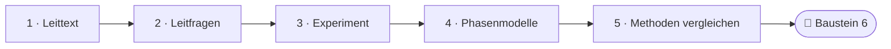
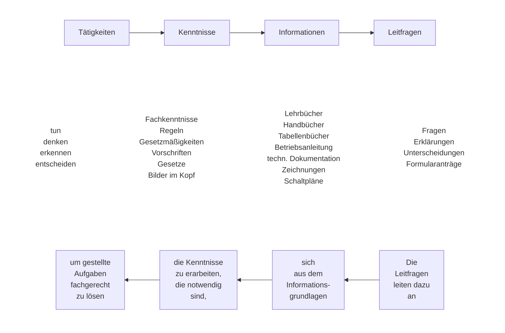
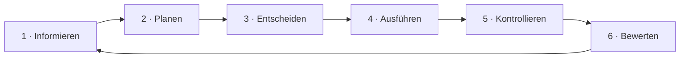
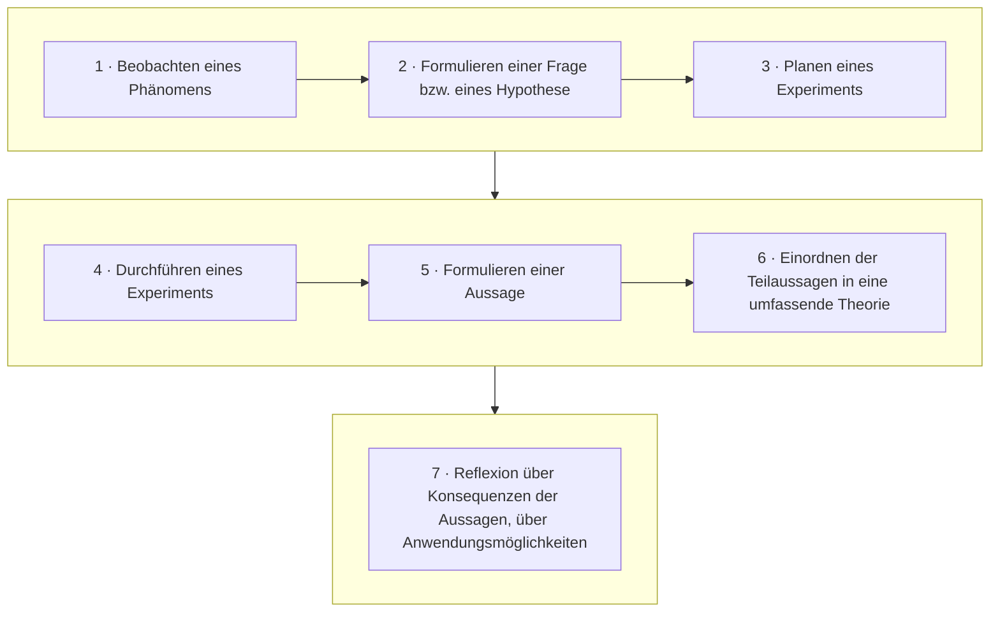

<!--
author:   Hannes Tegelbeckers
email:    hannes.tegelbeckers@ovgu.de
version:  0.2.0
language: de
narrator: Deutsch Female
mode:     Presentation
classroom: enable
comment:  Fachdidaktik technischer Allgemeinbildung II – Sitzung S05. Selbstständig lernen mit Leittexten, experimentell lernen mit dem technischen Experiment, Methoden nach Effizienzkriterien vergleichen.

import:   https://raw.githubusercontent.com/LiaTemplates/mermaid_template/0.1.4/README.md
-->

# S05 – Leittextmethode & technisches Experiment

Fachdidaktik technischer Allgemeinbildung II · OVGU Magdeburg · Montag, 09.11.2026, 07:00–09:00 Uhr

<!-- didaktik="Planungsraster S05 · E-03, E-04, E-12, E-17, E-19, E-27, E-28 · 0–10 Einstieg (provozieren, Vorwissen) · 10–15 Kurskarte und Ziele · 15–37 Station 1 Leittext (Doppeldecker 1) · 37–62 Station 2 Experiment · 62–75 Baustein 6 (Doppeldecker 2) · 75–85 Station 3 Methoden nach Effizienzkriterien · 85–90 Abschluss" -->
> [!IMPORTANT] 🧭 Leitfrage
> Wie lernen Lernende **selbstständig** – und **experimentell**? – Auf der Kurskarte: **Methodik → Erkenntnisweg**.

> [!TIP] 📚 Vor der Sitzung
> Haben Sie eine Arbeits- oder Bedienungsanleitung aus Ihrer Fachrichtung dabei? Sie wird heute zum Leittext umgebaut.

📝 **Beuteblatt S05** – ergänzen Sie es während der Sitzung.

## Einstieg: Macht eine gute Anleitung selbstständig?

    --{{0}}--
Eine These zum Start: Eine gute Anleitung macht Lernende selbstständig. Stimmen Sie ab. Am Ende der Sitzung stimmen wir noch einmal ab.

> **„Eine gute Anleitung macht Lernende selbstständig.“**

**Vote (before):** Stimmen Sie dieser These zu?

[(a)] Ja, ich stimme zu
[(b)] Nein, ich stimme nicht zu
[(c)] Teils, teils
[(undecided)] Undecided

    --{{1}}--
Sehen Sie sich allein Ihre mitgebrachte Anleitung an. Welche Fragen beantwortet sie – und welche müssten Lernende sich selbst stellen?

      {{1}}
****************************************

> [!TIP] 🧠 Allein · 3 min
> Welche Fragen **beantwortet** Ihre Anleitung – welche müssten Lernende sich **selbst stellen**? Welche Schritte der vollständigen Handlung (S02: Orientieren – Richten – Entwerfen – Entscheiden – Kontrollieren) nimmt sie vorweg?

[[___ ___ ___]]

****************************************

    --{{2}}--
Zwei oder drei von Ihnen stellen ihre Anleitung kurz vor.

      {{2}}
> [!TIP] 📣 Plenum · 2 min
> Zwei bis drei Freiwillige nennen eine Frage, die ihre Anleitung den Lernenden **abnimmt**. Alle achten darauf: Wer plant hier eigentlich – die Anleitung oder die Lernenden?

## Kurskarte: selbstständig und experimentell lernen

    --{{0}}--
Heute geht es um zwei Methoden, mit denen Lernende selbstständig und experimentell lernen: den Leittext und das technische Experiment. Zum Schluss vergleichen wir die Methoden der letzten Sitzungen miteinander. Und ein roter Faden kehrt zurück: das Hooke'sche Gesetz aus S01b.

    --{{1}}--
Auf diesem Weg erreichen Sie sechs Ziele.

      {{1}}

<!-- data-type="none" -->
| Know | Can do | Value |
|------|--------|-------|
| Funktionen der Leittexte, Schritte der Leittextmethode und Arten von Experimenten **nennen** | für eine Arbeitsaufgabe Ihrer Fachrichtung **Leitfragen formulieren** | begründet **auswählen**, welche Methode zu einem Lernziel passt |
| das Experiment als induktiven Erkenntnisweg **erläutern** und die Phasen nach Bernard und Bader **vergleichen** | Experimentbeispiele **klassifizieren** und ein technisches Experiment **planen** *(optional)* | Selbstständigkeit der Lernenden als Ziel der Methodenwahl **vertreten** |

    --{{2}}--
Prüfen Sie kurz, ob Sie die Kurskarte lesen können.

      {{2}}
****************************************

**Decide:** In welcher Station kehrt das Hooke'sche Gesetz aus S01b zurück?

<!-- data-hint-button="1" data-solution-button="2" -->
- [(X)] Phasenmodelle
- [( )] Leittext
- [( )] Methoden vergleichen
[[?]] Bernard und Bader zeigen ihre Phasen am Zugversuch.
***
Richtig: Bernard und Bader zeigen die Phasen des Experiments am Zugversuch und am Hooke'schen Gesetz.
***

****************************************

## Station 1: Leittext

    --{{0}}--
Die Leittextmethode stammt aus der betrieblichen Ausbildung. Sie soll Lernende dazu bringen, eine Aufgabe selbstständig zu planen und auszuführen – ohne dass die Ausbilderin jeden Schritt vorgibt.

**Wie bringt ein Text Lernende dazu, selbst zu planen, zu entscheiden und zu kontrollieren?**

    --{{1}}--
Zuerst: sechs Funktionen von Leittexten.

      {{1}}
- Funktionen der Leittexte (R089)

    --{{2}}--
Dann: die Merkmale leittextgestützten Lernens, vor allem die Selbstständigkeit.

      {{2}}
- Merkmale leittextgestützten Lernens (R090)

    --{{3}}--
Wie gute Leitfragen entstehen, zeigt eine Kette von der Tätigkeit bis zur Frage.

      {{3}}
- Leitfragen erstellen (R091)

    --{{4}}--
Und der Ablauf in sechs Schritten entspricht der vollständigen Handlung aus S02.

      {{4}}
- Ablauf der Leittextmethode in sechs Schritten (R092)

    --{{5}}--
Warum ist das für Sie wichtig? Eine Ergänzung nach Stettler, als NEU markiert, gibt die Antwort.

      {{5}}
> [!TIP] Why this matters
> [NEU] Ein Leittext kann eine offene Aufgabe strukturieren: Die Aufgabe bleibt offen, die Leitfragen geben Struktur (Stettler 2025).

    --{{6}}--
Markieren Sie, was Sie schon kennen.

      {{6}}
****************************************

**Mark:** Which of these do you already know? (several possible)

[[a1]] Funktionen der Leittexte (R089)
[[a2]] Merkmale leittextgestützten Lernens (R090)
[[a3]] Leitfragen erstellen (R091)
[[a4]] Ablauf der Leittextmethode in sechs Schritten (R092)

****************************************

## Funktionen der Leittexte

    --{{0}}--
Leittexte erfüllen sechs Funktionen. Sie führen in den Ausbildungsabschnitt ein, erklären die Spielregeln und stellen die praktische Aufgabe vor. Vor allem aber leiten sie mit Leitfragen und Impulsen den Kenntniserwerb und die Arbeitsplanung an, verweisen auf Medien und geben Anleitung zur Selbst- und Fremdeinschätzung.

- Sie führen in den Ausbildungsabschnitt ein.
- Sie erläutern die „Spielregeln“ für den folgenden Lern- und Arbeitsprozess.
- Sie stellen die anstehende praktische Aufgabe vor.
- Sie leiten mit Leitfragen und Impulsen den Kenntniserwerb und die Arbeitsplanung an.
- Sie geben Hinweise, anhand welcher Medien die Kenntnisse erarbeitet werden können und stellen ggf. auch Informationen bereit.
- Sie geben Anleitung zur Selbst- und Fremdeinschätzung der geleisteten Arbeit.

    --{{1}}--
Der Unterschied zur Arbeitsanleitung liegt in der vierten Funktion.

      {{1}}
> [!NOTE] Key message
> Eine Arbeitsanleitung sagt, **was** zu tun ist. Ein Leittext **leitet an**, sich Kenntnisse und Arbeitsplanung selbst zu erarbeiten.

<small>Quelle: Folie R089 „Funktionen der Leittexte“</small>

## Merkmale leittextgestützten Lernens

    --{{0}}--
Kennzeichnend ist die Selbstständigkeit: Die Lernenden bearbeiten komplexe Aufgaben selbst, erarbeiten sich die Kenntnisse aus bereitstehenden Medien, planen die Durchführung, üben an Übungshilfen und entscheiden dabei selbst über den Umfang. Nach jeder Teilaufgabe werten sie zuerst selbst aus und besprechen die Auswertung dann mit dem Ausbilder.

- Die Lernenden bearbeiten komplexe Aufgabenstellungen selbstständig.
- Die für die Aufgabenbewältigung erforderlichen Kenntnisse erarbeiten sich die Lernenden selbstständig aus bereitstehenden Medien, angeleitet durch Leitfragen.
- Die Lernenden planen selbst, teilweise gestützt aus Planungsraster oder andere Hilfsmittel, die Durchführung der Arbeiten.
- Die Lernenden üben neue Fertigkeiten an sogenannten Übungshilfen, wobei sie weitgehend selbst über das Ausmaß der Übungen entscheiden.
- Nach Abschluss angemessener Teilaufgaben werten die Lernenden den Verlauf und die Ergebnisse ihrer Arbeit zunächst selbst aus und besprechen ihre Auswertung schließlich mit dem Ausbilder.

    --{{1}}--
Erkennen Sie die Reihenfolge aus S04 wieder?

      {{1}}
> [!NOTE] Key message
> Erst selbst auswerten, dann mit dem Ausbilder besprechen – dieselbe Reihenfolge wie beim Bewerten in Projekten (S04, R073).

<small>Quelle: Folie R090 „Merkmale leittextgestützten Lernens“</small>

## Leitfragen erstellen

    --{{0}}--
Wie entstehen Leitfragen? Die Kette liest man zuerst von links nach rechts: Aus den Tätigkeiten ergeben sich die nötigen Kenntnisse, aus den Kenntnissen die Informationsquellen, und daraus formuliert man die Leitfragen.

    --{{1}}--
Die obere Reihe ist die Kette, mit der die Lehrkraft plant.

      {{1}}
**① Kette:** Tätigkeiten → Kenntnisse → Informationen → Leitfragen.

    --{{2}}--
Unter jedem Kasten stehen Beispiele: was man tut, welche Kenntnisse man braucht, wo sie stehen und welche Art von Fragen entsteht.

      {{2}}
**② Beispiele:** tun, denken … · Fachkenntnisse, Regeln … · Lehrbücher, Tabellenbücher, Schaltpläne … · Fragen, Erklärungen …

    --{{3}}--
Von rechts nach links gelesen beschreibt die untere Reihe die Wirkung: Die Leitfragen leiten an, sich aus den Informationsgrundlagen die Kenntnisse zu erarbeiten, die nötig sind, um die Aufgabe fachgerecht zu lösen.

      {{3}}
**③ Rückweg:** Die Leitfragen leiten dazu an, sich aus dem Informationsgrundlagen die Kenntnisse zu erarbeiten, die notwendig sind, um gestellte Aufgaben fachgerecht zu lösen.

    --{{4}}--
Daraus folgt eine einfache Planungsregel.

      {{4}}
> [!NOTE] Key message
> Leitfragen plant man rückwärts von der Tätigkeit her – und sie führen die Lernenden vorwärts zu den Informationen.

<small>Quelle: Folie R091 „Leitfragen erstellen“ – Grafik (nur Bild) als Diagramm nachgezeichnet; Satz der unteren Reihe wie im Original („aus dem Informationsgrundlagen“).</small>

## Ablauf der Leittextmethode

    --{{0}}--
Die Leittextmethode läuft in sechs Schritten im Kreis. Vergleichen Sie das mit der vollständigen Handlung aus S02.

    --{{1}}--
Informieren: Was soll getan werden? Dafür gibt es die Leitfragen.

      {{1}}
1. **Informieren:** Was soll getan werden? → Leitfragen

    --{{2}}--
Planen: Wie geht man vor? Ergebnis ist ein Arbeitsplan.

      {{2}}
2. **Planen:** Wie geht man vor? → Arbeitsplan

    --{{3}}--
Entscheiden: Fertigungsweg und Betriebsmittel werden festgelegt – im Fachgespräch mit dem Ausbilder.

      {{3}}
3. **Entscheiden:** Fertigungsweg und Betriebsmittel festlegen → Fachgespräch mit dem Ausbilder

    --{{4}}--
Ausführen: Das Werkstück wird gefertigt.

      {{4}}
4. **Ausführen:** Fertigen des Werkstückes → Auftragsbearbeitung

    --{{5}}--
Kontrollieren: Ist der Auftrag fachgerecht gefertigt? Dafür gibt es einen Kontrollbogen.

      {{5}}
5. **Kontrollieren:** Ist der Auftrag fachgerecht gefertigt? → Kontrollbogen

    --{{6}}--
Bewerten: Was muss beim nächsten Mal besser gemacht werden? Wieder im Fachgespräch mit dem Ausbilder – und dann beginnt der Kreis von vorn.

      {{6}}
6. **Bewerten:** Was muss beim nächsten Mal besser gemacht werden? → Fachgespräch mit dem Ausbilder

<small>Quelle: Folie R092 „Ablauf“ – gescannte Abbildung „Leittextmethode“ nachgezeichnet; auf der Originalfolie ist keine Quelle der Abbildung angegeben.</small>

## Schritte der Leittextmethode ordnen

    --{{0}}--
Bringen Sie die sechs Schritte der Leittextmethode in die richtige Reihenfolge.

**Order:** Drag each card into the right gap.

<!-- data-randomize data-show-partial-solution data-solution-button="2" -->
Step 1: [->[ Informieren ]] → Step 2: [->[ Planen ]] → Step 3: [->[ Entscheiden ]] → Step 4: [->[ Ausführen ]] → Step 5: [->[ Kontrollieren ]] → Step 6: [->[ Bewerten ]]

## [NEU] Offene Aufgabe – strukturierter Unterricht

    --{{0}}--
Eine Ergänzung aus der neueren Literatur, als NEU markiert. Stettler unterscheidet, wie offen eine Aufgabe ist und wie strukturiert der Unterricht ist. Beides lässt sich kombinieren: offene Aufgaben in einem stark strukturierten Unterricht.

<!-- neu="Stettler 2025, S. 76, 85–86" -->
> [!NOTE] 🆕 [NEU]
> Stettler (2025) unterscheidet im Technischen Gestalten den **Offenheitsgrad der Aufgabenstellung** und die **Strukturiertheit des Unterrichts**. Den Offenheitsgrad kann man u. a. im Prozess anpassen: Ein Prozess kann kleinschrittig vorgegeben werden – oder einzelne Schritte werden bewusst nicht vorgegeben (S. 76).
>
> Ein Unterricht mit offenen Aufgabenstellungen muss nicht unstrukturiert sein: Der „Unterrichtstyp 3“ verbindet offene Aufgaben mit hoher Strukturiertheit; die Lehrpersonen sehen sich als Coach bei Prozessen und als Förderer selbständigen Arbeitens (S. 85). Für diesen Typ berichtet Stettler u. a. mehr Motivation im Fach, kognitive Aktivierung, Selbstbestimmungserleben und Selbstwirksamkeitsüberzeugung (S. 86).

    --{{1}}--
Genau das kann ein Leittext leisten. Wie offen ist die Anleitung, die Sie mitgebracht haben?

      {{1}}
> [!NOTE] Key message
> **Denkanstoß:** Ein Leittext kann diese Kombination leisten – die **Aufgabe** bleibt offen, die **Leitfragen** geben Struktur. Wie offen ist die Anleitung, die Sie mitgebracht haben?

<small>[NEU] Ergänzung, keine Originalfolie: Stettler (2025), S. 76, 85–86 – siehe Literatur.</small>

## Aktivierung: Aus der Anleitung wird ein Leittext

    --{{0}}--
Jetzt bauen Sie Ihre Anleitung um. Wählen Sie eine Arbeitsaufgabe, gehen Sie die Kette durch und formulieren Sie drei Leitfragen, die Lernende selbst zum Planen bringen.

<!-- didaktik="Lehrschritt unterstützen/üben · 27–37 min · Einzelarbeit · Classroom-Auswertung · Doppeldecker 1" -->
**Allein (8 min):** Wählen Sie eine Arbeitsaufgabe aus Ihrer Anleitung. Gehen Sie die Kette durch und formulieren Sie **drei Leitfragen**, die Lernende selbst zum Planen bringen.

<!-- data-type="none" -->
| Tätigkeit | erforderliche Kenntnis | Information (Medium) | Leitfrage |
| --- | --- | --- | --- |
| … | … | … | … |

📝 Ergänzen Sie danach Abschnitt 1 Ihres Beuteblatts mit Ihren drei Leitfragen.

[[___ ___ ___ ___]]

💡 Hint 1

Beginnen Sie bei der Tätigkeit: Was müssen die Lernenden tun oder entscheiden? Fragen Sie dann, wo die nötige Kenntnis steht.

✅ Solution

Beispiel Elektrotechnik, Aufgabe „Außenleuchte mit Bewegungsmelder installieren“: **Tätigkeit** Leuchte auswählen → **Kenntnis** Schutzarten → **Medium** Tabellenbuch → **Leitfrage** „Welche Schutzart muss eine Leuchte im Außenbereich mindestens haben? Schlagen Sie im Tabellenbuch nach.“ · **Tätigkeit** Montageort festlegen → **Kenntnis** Erfassungsbereich → **Medium** Betriebsanleitung → „Welche Montagehöhe empfiehlt die Betriebsanleitung, und was bedeutet das für den Montageort?“ · **Tätigkeit** Arbeitsschritte planen → „Welche Arbeitsschritte legen Sie fest, und in welcher Reihenfolge? Begründen Sie im Fachgespräch.“

## Leitfragen prüfen

    --{{0}}--
Prüfen Sie Ihre Leitfragen an drei kurzen Fragen.

**1 · Choose one:** Aufgabe: Ein M8-Gewinde schneiden. Welche Frage ist eine Leitfrage im Sinne von R091?

<!-- data-hint-button="1" data-solution-button="2" -->
- [( )] Bohren Sie das Kernloch mit 6,8 mm vor.
- [(X)] Welchen Kernlochdurchmesser brauchen Sie für M8? Schlagen Sie im Tabellenbuch nach.
- [( )] Ist es richtig, dass das Kernloch für M8 6,8 mm groß sein muss?
[[?]] Eine Leitfrage ist keine Anweisung und verrät die Lösung nicht.
***
Richtig: Die Frage verweist auf ein Medium und verlangt eine eigene Erarbeitung. „Bohren Sie …“ ist eine Anweisung, „Ist es richtig, dass …?“ enthält die Antwort schon.
***

    --{{1}}--
Jetzt können mehrere Antworten richtig sein.

      {{1}}
****************************************

**2 · Choose all that apply:** Woran erkennen Sie eine gute Leitfrage?

<!-- data-hint-button="1" data-solution-button="2" -->
- [[X]] Sie fragt nach etwas, das die Lernenden selbst herausfinden müssen.
- [[ ]] Sie verrät die Lösung, damit niemand Fehler macht.
- [[X]] Sie verweist auf ein Medium, in dem die Information zu finden ist.
- [[ ]] Sie gibt jeden Arbeitsschritt genau vor.
[[?]] Leitfragen leiten den Kenntniserwerb und die Arbeitsplanung an (R089, R091).
***
Leitfragen „leiten dazu an, sich aus dem Informationsgrundlagen die Kenntnisse zu erarbeiten“ (R091) – sie verraten aber nicht die Lösung.
***

****************************************

    --{{2}}--
Zum Schluss ein Begriff aus dem Ablauf.

      {{2}}
****************************************

**3 · Type:** Was findet beim Entscheiden und beim Bewerten mit dem Ausbilder statt? (ein Wort)

<!-- data-hint-button="1" data-solution-button="2" -->
[[Fachgespräch]]
[[?]] Es steht zweimal im Ablauf der Leittextmethode (R092).

***
Die beiden Fachgespräche stehen vor der Ausführung und nach der Kontrolle – dort, wo Fehler am teuersten wären oder am meisten zu lernen ist.
***

****************************************

## Station 2: Experiment

    --{{0}}--
In der zweiten Station wechseln wir vom selbstständigen Arbeiten zum experimentellen Erkennen.

**Wann ist ein Versuch im Unterricht ein Experiment – und wie plant man es?**

    --{{1}}--
Zuerst die Definition: das Experiment als Unterrichtskonzeption mit induktivem Erkenntnisweg.

      {{1}}
- Definition des Experiments (R093)

    --{{2}}--
Dann vier Gesichtspunkte, nach denen man Experimente klassifiziert.

      {{2}}
- Arten von Experimenten (R094)

    --{{3}}--
Zwei Phasenmodelle – nach Bernard mit vier und nach Bader mit sieben Phasen – am Zugversuch.

      {{3}}
- Phasen nach Bernard und Bader (R095–R096)

    --{{4}}--
Und schließlich Fragen zur Vorbereitung und Hinweise zu Handreichung und Arbeitsblatt.

      {{4}}
- Vorbereitung und Handreichungen (R097–R099)

    --{{5}}--
Warum ist das für Sie wichtig?

      {{5}}
> [!TIP] Why this matters
> Im technischen Unterricht entsteht Wissen oft im Versuch – wenn die Lernenden das Ergebnis vorher nicht kennen.

    --{{6}}--
Markieren Sie, was Sie schon kennen.

      {{6}}
****************************************

**Mark:** Which of these do you already know? (several possible)

[[a1]] Definition des Experiments (R093)
[[a2]] Arten von Experimenten (R094)
[[a3]] Phasen nach Bernard und Bader (R095–R096)
[[a4]] Vorbereitung und Handreichungen (R097–R099)

****************************************

## Definition Experiment

    --{{0}}--
Die Folie definiert das Experiment als Unterrichtskonzeption mit induktivem Erkenntnisweg. Ausgangspunkt ist ein technisches oder naturwissenschaftliches Phänomen, das unter kontrollierten Bedingungen untersucht wird.

> Ein Experiment ist eine Unterrichtskonzeption mit **induktivem Erkenntnisweg**. Ausgangspunkt ist ein technisches oder naturwissenschaftlich Phänomen, welches unter kontrollierten/eingeschränkten Bedingungen nachgestellt/simuliert und analysiert wird.

    --{{1}}--
Induktiv – Sie erinnern sich an S01b: vom einzelnen Fall zur Regel.

      {{1}}
> [!NOTE] Key message
> *Induktiv* heißt (S01b): vom Einzelfall zur Regel. Kennen die Lernenden das Ergebnis schon, ist es eine Vorführung – kein Experiment in diesem Sinn.

<small>Quelle: Folie R093 „Definition Experiment“</small>

## Arten von Experimenten klassifiziert …

    --{{0}}--
Experimente lassen sich auf vier Weisen ordnen: nach dem Erkenntnisziel, nach der didaktischen Funktion, nach Sozial- und Organisationsform und nach dem Wirklichkeitsbezug.

- **…nach dem Erkenntnisziel:**
  - Naturwissenschaftliches Experiment
  - Technisches Experiment
- **…nach ihrer didaktischen Funktion:**
  - Experimente zum Einstieg in eine bestimmte Thematik
  - Experimente für die Erarbeitung von Erkenntnissen
  - Experimente zur Übung, Festigung, Falsifikation und Verifikation
  - Experimente zur Leistungskontrolle
- **…nach ihrer Sozial- und Organisationsform:**
  - Lehrerexperiment (Demonstration)
  - Schülerexperiment in Einzelarbeit, in Partnerarbeit oder in Gruppenarbeit
- **…nach ihrem Wirklichkeitsbezug:**
  - Experimente mit Modellen
  - Experimente mit Realgegenständen
  - Gedankenexperiment

    --{{1}}--
Vergleichen Sie die didaktischen Funktionen mit S01.

      {{1}}
> [!NOTE] Key message
> Jedes Experiment hat eine Ausprägung in **allen vier** Gesichtspunkten. Die didaktischen Funktionen entsprechen denen aus S01: orientieren, erarbeiten, festigen, kontrollieren.

<small>Quelle: Folie R094 „Arten von Experimenten klassifiziert…“</small>

## Methodische Phasen von Experimenten nach Bernard

    --{{0}}--
Bernard beschreibt vier Phasen: Hypothesen aufstellen, experimentelle Fragestellungen herausarbeiten, das Experiment vorbereiten und durchführen und die Ergebnisse auswerten.

1. Aufstellen von Hypothesen
2. Herausarbeiten experimenteller Fragestellungen
3. Vorbereiten und Durchführen des Experiments
4. Auswerten der Ergebnisse des Experiments

    --{{1}}--
Am Hooke'schen Gesetz heißt das zum Beispiel: Erfolgt die Dehnung proportional zur Spannung? Ergibt die grafische Auswertung eine Gerade? Die Auswertung im Spannungs-Dehnungs-Diagramm beantwortet die Fragen und bestätigt die Hypothese.

      {{1}}
****************************************

**Beispiel: Hooke‘sches Gesetz für das elastische Verhalten von Werkstoffen**

- Analyse der Problemstellung
  - Verhältnis von Dehnung bei vorliegender Belastung
- Hypothesenbildung und experimentelle Fragestellung
  - Erfolgt die Dehnung proportional zur Spannung?
  - Ergibt die graphische Auswertung eine Gerade?
  - Wo liegt die Proportionalitätsgrenze?
- Durchführung des Experiments
- Auswertung der Ergebnisse des Experiments
  - Kurven im Spannungs-Dehnungs-Diagramm
  - Beantwortung der Fragen
  - Bestätigung der Hypothese

(BERNARD 1995)

****************************************

    --{{2}}--
Bernard beginnt bei den Hypothesen und endet mit ihrer Bestätigung.

      {{2}}
> [!NOTE] Key message
> Bernard: von der Hypothese zur Auswertung – das Experiment prüft eine Vermutung.

<small>Quelle: Folie R095 „Methodische Phasen von Experimenten nach BERNARD“ – Bernard, F.; Ebert, D.; Schröder, B.: Unterricht Metalltechnik – Fachdidaktische Handlungsanleitung. Handwerk und Technik. Hamburg 1995.</small>

## Methodische Phasen von Experimenten nach Bader

    --{{0}}--
Bader beschreibt sieben Phasen, wieder am Zugversuch. Er beginnt früher als Bernard und hört später auf.

    --{{1}}--
Bader beginnt mit dem Beobachten eines Phänomens – Bauteile verformen sich unter Belastung – und mit der Frage nach dem Zusammenhang zwischen Kraft und Formänderung. Dann wird das Experiment geplant.

      {{1}}
****************************************

1. **Beobachten eines Phänomens:** (z.B. Bauteile verformen sich unter Belastung)
2. **Formulieren einer Frage bzw. eines Hypothese:** (z.B. Welcher Zusammenhang besteht zwischen wirkender Kraft und der Formänderung eines Bauteils)
3. **Planen eines Experiments:** d.h. Schaffen einer künstlichen, technischen Wirklichkeit unter Beachtung bestimmter Randbedingungen (z.B. Planen eines Zug-Versuchs: Festlegen von Variablen und Konstanten; Einspannvorrichtung; Aufbringen der Last; Abmessungen der Probe; Laststeigerung in der Zeiteinheit; Abschätzen vom Messfehlern)

****************************************

    --{{2}}--
Es folgen Durchführen und das Formulieren einer Aussage, die die Hypothese stützt oder falsifiziert. Dann werden die Teilaussagen in eine umfassende Theorie eingeordnet.

      {{2}}
****************************************

4. **Durchführen eines Experiments:** (Beobachten, Messen, Protokollieren, Auswerten …)
5. **Formulieren einer Aussage:** (eines Ergebnisses) bzw. Stützen, Falsifizieren der Ausgangshypothese unter Berücksichtigung der Randbedingungen und der Messgenauigkeit (z.B. Gültigkeit des Hooke‘schen Gesetzes für einen bestimmten Werkstoff, für einen bestimmten Lastbereich)
6. **Einordnen der Teilaussagen in eine umfassende Theorie:** (z.B. Annahme eines einachsigen Spannungszustandes; Spannungshypothesen)

****************************************

    --{{3}}--
Am Ende wird über Konsequenzen und Anwendungen nachgedacht. In S01b haben Sie aus Messwerten des Zugversuchs selbst eine Regel gefunden; Bader beginnt früher und endet später.

      {{3}}
7. **Reflexion über Konsequenzen der Aussagen, über Anwendungsmöglichkeiten:** (z.B. Übereinstimmung der experimentellen Ergebnisse mit dem Verhalten eines Bauteils im Gebrauchszustand; Möglichkeiten der rechnerischen Dimensionierung von Bauteilen)

<small>Quelle: Folie R096 „Methodische Phasen von Experimenten nach BADER“ (Nummerierung ergänzt, Wortlaut unverändert; Phasenname und Erläuterung im Original in einem Satz) – (BADER 1990) Bader, R.: Entwicklung beruflicher Handlungskompetenz in der Berufsschule / Zum Begriff der „beruflichen Handlungskompetenz“ und zur didaktischen Strukturierung handlungsorientierten Unterrichts. Hochschuldidaktisches Zentrum Universität Dortmund. Dortmund 1990. · 🧵 Roter Faden HOOKE [NEU]: Phase 5 entspricht der *Wissenssicherung*, Phase 6 der *Wissenserklärung* nach Dilling (2024), siehe S01b.</small>

## Phasen nach Bader ordnen

    --{{0}}--
Ordnen Sie die sieben Phasen nach Bader.

**Order:** Drag each card into the right gap.

<!-- data-randomize data-show-partial-solution data-solution-button="2" -->
Step 1: [->[ Beobachten eines Phänomens ]] → Step 2: [->[ Formulieren einer Frage bzw. eines Hypothese ]] → Step 3: [->[ Planen eines Experiments ]] → Step 4: [->[ Durchführen eines Experiments ]] → Step 5: [->[ Formulieren einer Aussage ]] → Step 6: [->[ Einordnen der Teilaussagen in eine umfassende Theorie ]] → Step 7: [->[ Reflexion über Konsequenzen der Aussagen, über Anwendungsmöglichkeiten ]]

## Aktivierung: Experimente einordnen

    --{{0}}--
Drei kurze Fragen zu den Arten und Phasen von Experimenten.

**1 · Choose one:** Die Lehrkraft zeigt den Zugversuch an der Prüfmaschine. Welche Sozial- und Organisationsform ist das?

<!-- data-hint-button="1" data-solution-button="2" -->
- [( )] Schülerexperiment
- [(X)] Lehrerexperiment (Demonstration)
- [( )] Gedankenexperiment
[[?]] Wer führt den Versuch durch?
***
Lehrerexperiment = Demonstration. Zu zweit Drähte unter Gewichten messen wäre ein Schülerexperiment; „Was passiert, wenn wir die Probe doppelt so lang machen?“ ohne Versuch wäre ein Gedankenexperiment (R094).
***

    --{{1}}--
Jetzt können mehrere Antworten richtig sein.

      {{1}}
****************************************

**2 · Choose all that apply:** Welche Phasen gibt es nur bei Bader, nicht bei Bernard?

<!-- data-hint-button="1" data-solution-button="2" -->
- [[X]] Beobachten eines Phänomens
- [[ ]] Aufstellen bzw. Formulieren einer Hypothese
- [[X]] Einordnen der Teilaussagen in eine umfassende Theorie
- [[ ]] Durchführen des Experiments
[[?]] Beide Modelle enthalten Hypothese, Durchführung und Auswertung.
***
Nur Bader beginnt mit dem Beobachten eines Phänomens und endet mit Einordnen in eine umfassende Theorie und Reflexion über Konsequenzen und Anwendungsmöglichkeiten (R095, R096).
***

****************************************

    --{{2}}--
Zum Schluss tippen Sie einen Begriff.

      {{2}}
****************************************

**3 · Type:** Wie heißt der Erkenntnisweg des Experiments – vom Einzelfall zur Regel? (ein Wort)

<!-- data-hint-button="1" data-solution-button="2" -->
[[induktiv]]
[[?]] Das Gegenteil heißt deduktiv (S01b).

***
Das Experiment ist eine Unterrichtskonzeption mit induktivem Erkenntnisweg (R093).
***

****************************************

## Hinweise zur Vorbereitung von technischen Experimenten

    --{{0}}--
Wer ein Experiment für den Unterricht vorbereitet, kann sich an Fragenblöcken orientieren. Die ersten drei: fachliche Grundlagen und Regelwerke, Einordnung in einen Bildungsgang und theoretische Konzeption.

<!-- didaktik="Lehrschritt informieren · 55–62 min" -->
- **Abriss der fachlichen Grundlagen**
  - Zusammenfassung des fachlichen Kontextes
  - Welche Aussagen werden in technischen Regelwerken zum betreffenden fachlichen Kontext getroffen? (z.B. DIN, Richtl. des DAfStb, VOB)
  - In welchem Umfang sind die Aussagen der technischen Regelwerke für Arbeitskräfte der mittleren Qualifikationsebene (Facharbeiter, Meister, Techniker) relevant?
- **Einordnung in einen Bildungsgang**
  - Für welche Aus- und/oder Fortbildungsberufe ist Experiment X relevant?
  - In welchem Lernfeld/Unterrichtsfach kann Experiment X sinnvoll eingesetzt werden?
  - Welcher zeitliche Umfang würde für Experiment X im Bildungsgang Z zur Verfügung stehen?
- **Theoretische Konzeption des Experiments**
  - Welche Vorkenntnisse können von den Lernenden erwartet werden?
  - In welchem Umfang muss der fachwissenschaftliche Kontext vereinfacht werden?
  - Welche fachwissenschaftlichen Aussagen sollen im Experiment erarbeitet, verdeutlicht oder wiederholt werden?
  - Welcher didaktischen Funktion soll das Experiment dienen? (Erarbeitung, Wiederholung, Leistungskontrolle)
  - Welche Organisationsform soll zum Einsatz kommen? (Lehrerexperiment, Schülerexperiment)

<small>Quelle: Folie R097 „Hinweise zur Vorbereitung von technischen Experimenten“ – „In welchem Umfang muss der fachwissenschaftliche Kontext vereinfacht werden?“ → Didaktische Reduktion in S07.</small>

## Hinweise zur Vorbereitung von (bau-)technischen Experimenten

    --{{0}}--
Die weiteren drei Fragenblöcke: praktische Konzeption mit Geräten, Verbrauchsmitteln und Arbeitsschutz, die Durchführung und schließlich Auswertung und Einbettung in weitere Lerneinheiten. Sie brauchen sie gleich für Ihren eigenen Baustein.

- **Praktische Konzeption des Experiments**
  - Welche technischen Geräte sind erforderlich?
  - Welche Verbrauchsmittel sind zu planen?
  - Welche Arbeitsschutzmaßnahmen sind vorzusehen?
- **Durchführung des Experiments**
  - Welche Hypothesen (Vermutungen) werden von den Lernenden aufgestellt?
  - Welche Versuchsanordnung ist zweckmäßig? (Skizze des Versuchsaufbaus)
  - Wie wird der Versuch ablaufen? (Ablaufbeschreibung)
  - Welche Form der Protokollführung ist sinnvoll?
- **Auswertung und Einbettung in weitere Lerneinheiten**
  - Wie soll die Auswertung des/der Protokolle erfolgen?
  - Ist eine Bewertung der Protokolle vorgesehen?
  - Verfügt das Experiment über exemplarischen Charakter für andere Inhalte? Wenn ja, wie kann dieser Bezug hergestellt werden?

<small>Quelle: Folie R098 „Hinweise zur Vorbereitung von (bau-)technischen Experimenten“</small>

## Handreichungen zur Versuchsdurchführung

    --{{0}}--
Zu einem Experiment gehören zwei Dokumente: eine Handreichung für die Lehrkraft mit Grundlagen, Hinweisen zu Fehlerquellen und Beispielergebnissen und ein Arbeitsblatt für die Lernenden mit den Arbeitsaufgaben. Für die Lehrkraft gibt es zusätzlich ein Arbeitsblatt mit Beispiellösungen.

**Handreichungen für den Lehrer**

- **Ingenieurwissenschaftliche Grundlagen**
  - Zusammenfassung der relevanten Gesetzmäßigkeiten
  - Zusammenfassung der wichtigsten Aussagen in Normen ( z.B. DIN, Eurocode)
- **Hinweise für die Versuchsdurchführung**
  - Hinweise auf mögliche Fehlerquellen
  - Praktische Hinweise zur Durchführung
- **Beispielergebnisse der durchgeführten Versuchs**
  - Orientierungsfunktion für den Lehrer
- **Arbeitsblatt mit Beispiellösungen**

**Arbeitsblatt für den Lernenden**

- **Ingenieurwissenschaftliche Grundlagen**
  - Zusammenfassung der für die mittlere Qualifikationsebene relevanten und verständlichen Gesetzmäßigkeiten
  - Zusammenfassung der für die mittlere Qualifikationsebene relevanten Aussagen in Normen
- **Hinweise zur Versuchsdurchführung**
- **Arbeitsaufgaben für den Lernenden**

<small>Quelle: Folie R099 „Handreichungen zur Versuchsdurchführung“ (zwei Spalten nach dem Folienaufbau, Gliederungsebenen wie im Original)</small>

## Baustein 6: Ihr Experiment planen (optional)

    --{{0}}--
Planen Sie jetzt mit den Vorbereitungsfragen ein technisches Experiment für Ihr Entwurfsthema. Prüfen Sie am Ende: Ist es ein Experiment mit induktivem Erkenntnisweg – oder eher eine Vorführung, deren Ergebnis die Lernenden schon kennen?

<!-- didaktik="Lehrschritt üben lassen (Transfer) · 62–75 min · Einzelarbeit · Classroom-Auswertung · Doppeldecker 2" -->
**Allein (10 min):** Planen Sie mit den Vorbereitungsfragen (R097–R098) ein technisches Experiment für Ihr Entwurfsthema.

- [ ] Didaktische Funktion (Einstieg, Erarbeitung, Übung/Festigung, Leistungskontrolle)?
- [ ] Organisationsform (Lehrer- oder Schülerexperiment)?
- [ ] Welche Hypothese stellen die Lernenden auf?
- [ ] Versuchsanordnung (Skizze) und Ablauf?
- [ ] Geräte, Verbrauchsmittel, **Arbeitsschutzmaßnahmen**?
- [ ] Form der Protokollführung und Auswertung?
- [ ] Wie viel muss fachlich vereinfacht werden?

[[___ ___ ___ ___]]

💡 Hint 1

Prüfen Sie Ihre Planung mit R093: Kennen die Lernenden das Ergebnis schon vorher? Dann ist es eher eine Vorführung als ein Experiment mit induktivem Erkenntnisweg.

✅ Solution

Beispiel Metalltechnik: **Funktion** Erarbeitung · **Organisationsform** Schülerexperiment in Partnerarbeit · **Hypothese** „Je größer die Last, desto länger der Draht – im gleichen Verhältnis.“ · **Aufbau** Stativ, Draht, Gewichte, Maßstab (Skizze) · **Arbeitsschutz** Schutzbrille, Gewichte sichern · **Protokoll** Messwerttabelle und Diagramm Last–Verlängerung · **Vereinfachung** nur elastischer Bereich, keine Spannungsberechnung.

## Wo stehen wir? Effizienzkriterien verschiedener Methoden

    --{{0}}--
Die Originalfolie zeigt eine gescannte Abbildung. Senkrecht stehen sieben Kriterien – Beobachten, relevante Daten auswählen, Probleme diagnostizieren, Lösungen formulieren, Entscheiden, Kommunizieren und Motivieren. Jede Methode ist als Kurve eingezeichnet; die Beschriftung steht an ihrem stärksten Ausschlag nach rechts.

<!-- didaktik="integrierendes Verbinden / Bewerten · 75–85 min · Synthese S03–S05" -->
> Abb. 4: Effizienzkriterien verschiedener Methoden (entnommen aus: Papaloizos/Stiefel 1971, 180)

<!-- data-type="none" -->
| Methode (Abbildung) | stärkster Ausschlag bei | Lesehilfe |
| --- | --- | --- |
| Field Studies | Observing | Beobachten |
| Incident Method | Selecting Pertinent Data | relevante Daten auswählen |
| Case Method | Diagnosing Problems / Formulating Solutions | Probleme diagnostizieren / Lösungen formulieren |
| Decision Simulations | Deciding | Entscheiden |
| Role Playing | Communicating | Kommunizieren |
| Group Projects | Motivating | Motivieren |

    --{{1}}--
Verbinden Sie das mit den letzten Sitzungen.

      {{1}}
> [!NOTE] Key message
> *Incident Method* und *Case Method* kennen Sie als Case-Incident- und Case-Study-Method nach Kaiser (S04), *Role Playing* als Rollenspiel (S04), *Group Projects* als Arbeit an Projekten (S03).

<small>Quelle: Folie R100 „Effizienzkriterien verschiedener Methoden“ – Tabelle aus der Abbildung abgelesen (Kurvenverlauf qualitativ, keine Messwerte); Silbentrennung „Papa-loizos“ des Originals aufgehoben. Die Abbildung ist ein Buchscan und wird wegen der Bildrechte nicht eingebettet.</small>

## Methoden nach Lernzielen wählen

    --{{0}}--
Welche Methode wählen Sie für welches Lernziel – nach der Abbildung?

**1 · Choose one:** Auszubildende sollen ein Kundengespräch sicher führen. Welche Methode hat dafür nach der Abbildung den stärksten Ausschlag?

<!-- data-hint-button="1" data-solution-button="2" -->
- [( )] Case-Incident-Method
- [(X)] Rollenspiel (Role Playing – Communicating)
- [( )] Gruppenprojekt
[[?]] Welches Kriterium steckt in „ein Gespräch führen“?
***
Role Playing hat seinen stärksten Ausschlag bei Communicating.
***

    --{{1}}--
Jetzt können mehrere Antworten richtig sein.

      {{1}}
****************************************

**2 · Choose all that apply:** Welche Zuordnungen stimmen nach der Abbildung?

<!-- data-hint-button="1" data-solution-button="2" -->
- [[X]] Group Projects – Motivating
- [[ ]] Field Studies – Deciding
- [[X]] Incident Method – Selecting Pertinent Data
- [[ ]] Role Playing – Diagnosing Problems
[[?]] Jede Methode ist an ihrem stärksten Ausschlag beschriftet.
***
Field Studies – Observing · Incident Method – Selecting Pertinent Data (bei Kaiser: der Fall wird lückenhaft dargestellt, Schwerpunkt Informationsgewinnung) · Decision Simulations – Deciding · Role Playing – Communicating · Group Projects – Motivating.
***

****************************************

    --{{2}}--
Und ein Begriff aus der Abbildung.

      {{2}}
****************************************

**3 · Type:** Bei welchem Kriterium hat die Decision Simulation ihren stärksten Ausschlag? (englischer Begriff)

<!-- data-hint-button="1" data-solution-button="2" -->
[[Deciding]]
[[?]] Decision heißt Entscheidung.

***
Decision Simulations – Deciding: Lernende sollen unter Zeitdruck zwischen Varianten entscheiden.
***

****************************************

## Und Experiment und Leittext?

    --{{0}}--
Das technische Experiment und der Leittext kommen in der Abbildung nicht vor. Wo würden Sie sie einzeichnen?

**Allein (4 min):** Bei welchen Kriterien der Abbildung hätten das **technische Experiment** und der **Leittext** Ihrer Meinung nach ihren stärksten Ausschlag? Begründen Sie kurz.

[[___ ___ ___ ___]]

💡 Hint 1

Denken Sie an die Phasen nach Bader (Beobachten, Hypothese, Aussage) und an die Funktionen der Leittexte (Informationen aus Medien, Arbeitsplanung, Fachgespräch).

✅ Solution

Ein möglicher Vorschlag, keine Angabe der Originalfolie: Das **technische Experiment** wäre stark bei *Observing* (Phänomen beobachten) und *Formulating Solutions* (Aussage formulieren, Hypothese stützen oder falsifizieren). Der **Leittext** wäre stark bei *Selecting Pertinent Data* (Kenntnisse aus Medien erarbeiten) und *Deciding* (Fertigungsweg und Betriebsmittel festlegen).

## Zum Mitnehmen: Macht eine gute Anleitung selbstständig?

    --{{0}}--
Zurück zur These vom Anfang. Stimmen Sie noch einmal ab.

**Vote (after):** Stimmen Sie der These „Eine gute Anleitung macht Lernende selbstständig.“ zu?

[(a)] Ja, ich stimme zu
[(b)] Nein, ich stimme nicht zu
[(c)] Teils, teils
[(undecided)] Undecided

    --{{1}}--
Was hat Ihre Einschätzung verändert – oder bestätigt?

      {{1}}
****************************************

**Reflect:** Was hat Ihre Einschätzung seit dem Einstieg verändert – oder bestätigt?

[[___ ___]]

****************************************

    --{{2}}--
Vergleichen Sie Ihr Votum mit dem vom Anfang.

      {{2}}
> [!NOTE] Key message
> Selbstständig macht nicht die Anleitung, die alles vorgibt, sondern ein Leittext, der mit Leitfragen zum eigenen Erarbeiten, Planen und Entscheiden anleitet (R089–R092).

## Das Wichtigste aus S05

    --{{0}}--
Fassen wir zusammen.

    --{{1}}--
Erstens: der Leittext.

      {{1}}
- Leittexte leiten mit Leitfragen an, Kenntnisse und Arbeitsplanung selbst zu erarbeiten (R089–R091).

    --{{2}}--
Zweitens: der Ablauf.

      {{2}}
- Ablauf: Informieren → Planen → Entscheiden → Ausführen → Kontrollieren → Bewerten, mit zwei Fachgesprächen (R092).

    --{{3}}--
Drittens: das Experiment.

      {{3}}
- Das Experiment ist eine Unterrichtskonzeption mit induktivem Erkenntnisweg; Bader ergänzt Beobachten, Einordnen und Reflexion (R093–R096).

    --{{4}}--
Und viertens: die Methodenwahl.

      {{4}}
****************************************

- Erst das Lernziel klären, dann die Methode wählen, die dafür am stärksten ist (R100).

> [!NOTE] Remember
> Selbstständigkeit entsteht, wenn Lernende selbst informieren, planen, entscheiden und kontrollieren – der Leittext gibt Struktur, nicht die Lösung.

****************************************

    --{{5}}--
Eine letzte Frage.

      {{5}}
****************************************

**Recap:** Wo stehen in der Leittextmethode die beiden Fachgespräche mit dem Ausbilder?

<!-- data-hint-button="1" data-solution-button="2" -->
- [( )] Beim Informieren und beim Ausführen
- [( )] Beim Planen und beim Kontrollieren
- [(X)] Beim Entscheiden und beim Bewerten
[[?]] Eines steht vor der Ausführung, eines nach der Kontrolle.
***
Richtig: vor der Ausführung (Entscheiden) und nach der Kontrolle (Bewerten) – R092.
***

****************************************

    --{{6}}--
Nächste Woche geht es um methodische Großformen.

      {{6}}
**➡️ Next:** S06 (16.11.2026, Selbstlerntermin): Methodische Großformen · 📝 Ergänzen Sie die Abschnitte 2 und 3, Baustein 6 und Ihre wichtigste Beute im Beuteblatt S05.

## Prüfungsfragen zum Üben

    --{{0}}--
Mit diesen fünf Fragen können Sie sich auf die mündliche Prüfung vorbereiten. Die Querverweise zeigen, wo die Themen in anderen Sitzungen wieder auftauchen.

<!-- didaktik="E-12 mündliche Prüfung" -->
1. Welche Funktionen haben Leittexte, und wie unterscheidet sich ein Leittext von einer Arbeitsanleitung?
2. Wie erstellt man Leitfragen? Erläutern Sie die Kette an einem Beispiel aus Ihrer Fachrichtung.
3. Definieren Sie das Experiment als Unterrichtskonzeption und klassifizieren Sie Experimente nach vier Gesichtspunkten.
4. Vergleichen Sie die Phasen des Experiments nach Bernard und nach Bader am Beispiel Zugversuch.
5. Begründen Sie mit den Effizienzkriterien, welche Methode Sie für ein bestimmtes Lernziel wählen würden.

> [!NOTE] 🔗 Querverweise
> induktiver Erkenntnisweg, HOOKE → **S01b** · vollständige Handlung, Selbständigkeit → **S02** · Fallstudie, Rollenspiel → **S04** · Projekt → **S03** · fachlichen Kontext vereinfachen → **S07** · Experiment, Exkursion → Wirklichkeitserfahrung **S09**

<small>Die Prüfungsfragen sind experimentell: Sie dienen der Vorbereitung, es ist nicht garantiert, dass Fragen in dieser Form gestellt werden.</small>

## Rückblick auf S05

    --{{0}}--
Nehmen Sie sich zwei Minuten für einen Rückblick. Was ist das Wichtigste – und was ist noch unklar?

**Reflect:** What is the most important thing you learned today – and what is still unclear?

[[___ ___ ___]]

    --{{1}}--
Haken Sie ab, was Sie jetzt können.

      {{1}}
****************************************

**Tick:** What can you do now?

- [ ] Ich kann für eine Arbeitsaufgabe meiner Fachrichtung Leitfragen formulieren.
- [ ] Ich kann die Phasen des Experiments nach Bernard und Bader vergleichen.
- [ ] Ich kann mit den Effizienzkriterien begründen, welche Methode zu einem Lernziel passt.

****************************************

    --{{2}}--
Und zum Schluss: Wie hat die Sitzung für Sie funktioniert?

      {{2}}
****************************************

**Feedback:** How did this session work for you?

[(1 agree)(2 rather agree)(3 neutral)(4 rather disagree)(5 disagree)]
[                                                                   ] The pace was appropriate.
[                                                                   ] The explanations were clear.
[                                                                   ] The examples helped me understand.
[                                                                   ] The interactive parts were useful.

****************************************

## Vorbereitung auf S06

    --{{0}}--
In S06 geht es um methodische Großformen – Aufgabenarten wie Diagnose-, Fertigungs-, Konstruktions- oder Instandsetzungsaufgabe. Sammeln Sie bis dahin typische Aufgabenarten aus Ihrem Beruf; planen Sie dafür etwa 15 Minuten ein.

<!-- style="max-width:100%;width:60%;display:block;margin:0 auto;" -->

> [!IMPORTANT] Think about it until next time
> Welche Aufgabenarten kommen in Ihrem Beruf bzw. Ihrem Technikunterricht vor – Fehler suchen, fertigen, konstruieren, instand setzen, prüfen? Welche kommt am häufigsten vor?

*S06 · Montag, 16.11.2026 · Selbstlerntermin*

## Literatur

    --{{0}}--
Hier finden Sie die Quellen dieser Sitzung.

**Zitiert auf den Originalfolien dieser Sitzung**

- Bader, R.: Entwicklung beruflicher Handlungskompetenz in der Berufsschule / Zum Begriff der „beruflichen Handlungskompetenz“ und zur didaktischen Strukturierung handlungsorientierten Unterrichts. Hochschuldidaktisches Zentrum Universität Dortmund. Dortmund 1990 – Folie R096.
- Bernard, F.; Ebert, D.; Schröder, B.: Unterricht Metalltechnik – Fachdidaktische Handlungsanleitung. Handwerk und Technik. Hamburg 1995 – Folie R095.
- Papaloizos/Stiefel 1971, S. 180 – Folie R100 (Bildunterschrift „entnommen aus“; Herkunftswerk der Abb. 4 auf der Folie nicht angegeben).

**[NEU] Ergänzende Literatur**

- Stettler, A. (2025). Offenheit der Aufgabenstellung und Strukturiertheit des Unterrichtes im Technischen Gestalten. In A. Steinmann, M. Seidler-Proffe & K. Lange-Schubert (Hrsg.), *Mitwelt im Wandel wahrnehmen, verstehen und gestalten. Bildungspotentiale des technischen Gestaltens in Lehrer:innenbildung, Forschung und Schulpraxis* (S. 73 ff.). Bad Heilbrunn: Klinkhardt. https://doi.org/10.35468/6199-07
- Dilling, F. (2024) – siehe S01b (Wissenssicherung, Wissenserklärung).

<small>Gesamtverzeichnis: 00_Literatur.md</small>
