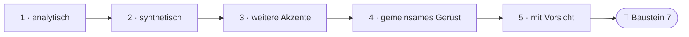
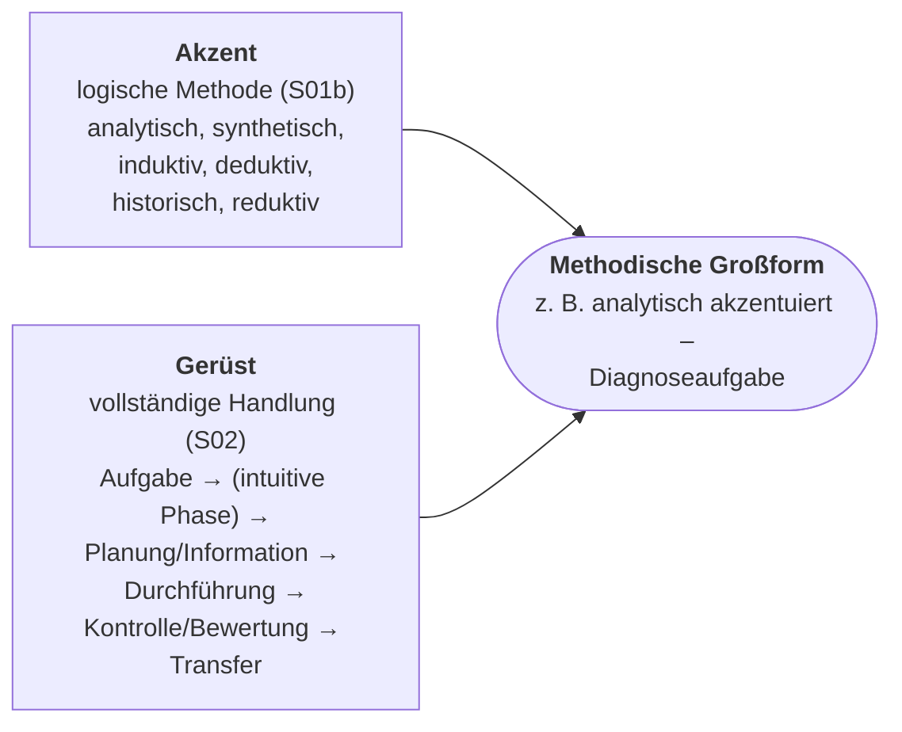

<!--
author:   Hannes Tegelbeckers
email:    hannes.tegelbeckers@ovgu.de
version:  0.2.0
language: de
narrator: Deutsch Female
mode:     Presentation
classroom: enable
comment:  Fachdidaktik technischer Allgemeinbildung II – Sitzung S06. Methodische Großformen nach Pahl – analytisch, synthetisch, induktiv, deduktiv, historisch und reduktiv akzentuiert.

import:   https://raw.githubusercontent.com/LiaTemplates/mermaid_template/0.1.4/README.md
-->

# S06 – Methodische Großformen

Fachdidaktik technischer Allgemeinbildung II · OVGU Magdeburg · Montag, 16.11.2026 (Selbstlerntermin – siehe Selbstlerneinheit S06)

<!-- didaktik="Planungsraster S06 · E-03, E-04, E-12, E-17, E-19, E-27, E-29 · 0–10 Einstieg (provozieren, Vorwissen) · 10–15 Kurskarte · 15–30 Station 1 analytisch · 30–48 Station 2 synthetisch (Expertenphase allein, Pitches im Plenum) · 48–60 Station 3 weitere Akzente · 60–75 gemeinsames Gerüst, These · 75–85 Baustein 7 · 85–90 Abschluss" -->
> [!IMPORTANT] 🧭 Leitfrage
> Wie hängen **Großformen** und **logische Methoden** zusammen? – Auf der Kurskarte: **Methodik → Erkenntnisweg**.

> [!TIP] 📚 Vor der Sitzung
> Haben Sie typische Aufgabenarten aus Ihrem Beruf gesammelt? Sie finden sie heute als Großformen wieder.

📝 **Beuteblatt S06** – ergänzen Sie es während der Sitzung.

## Einstieg: Eindeutig zuzuordnen?

    --{{0}}--
Eine These zum Start: Jede Großform lässt sich eindeutig einer logischen Methode zuordnen. Stimmen Sie ab. Am Ende prüfen wir die These mit den Belegen von den Folien.

> **„Jede Großform lässt sich eindeutig einer logischen Methode zuordnen.“**

**Vote (before):** Stimmen Sie dieser These zu?

[(a)] Ja, ich stimme zu
[(b)] Nein, ich stimme nicht zu
[(c)] Teils, teils
[(undecided)] Undecided

    --{{1}}--
Nehmen Sie allein zwei Aufgabenarten aus Ihrer Vorbereitung. Welche logische Methode aus S01b steckt jeweils darin?

      {{1}}
****************************************

> [!TIP] 🧠 Allein · 3 min
> Nehmen Sie zwei Aufgabenarten aus Ihrer Vorbereitung. Welche logische Methode aus S01b steckt jeweils darin – analytisch, synthetisch, deduktiv, induktiv, genetisch, historisch, reduktiv?

[[___ ___ ___]]

****************************************

    --{{2}}--
Zwei oder drei von Ihnen nennen ihre Zuordnung.

      {{2}}
> [!TIP] 📣 Plenum · 2 min
> Zwei bis drei Freiwillige nennen eine Aufgabenart und ihre logische Methode. Alle achten darauf: War die Zuordnung eindeutig – oder passten mehrere Methoden?

## Kurskarte: Akzent und Gerüst

    --{{0}}--
Heute lernen Sie die methodischen Großformen nach Pahl kennen. Wir gehen von den analytisch akzentuierten Formen über die synthetisch akzentuierten bis zu den übrigen Akzenten. Dann suchen wir das gemeinsame Gerüst und prüfen, warum eine eindeutige Zuordnung mit Vorsicht zu genießen ist.

    --{{1}}--
Auf diesem Weg erreichen Sie sechs Ziele.

      {{1}}

<!-- data-type="none" -->
| Know | Can do | Value |
|------|--------|-------|
| die methodischen Großformen mit ihrer Akzentuierung **nennen** | eine Aufgabenart aus Ihrem Beruf als Großform **formulieren** | **beurteilen**, warum eine eindeutige Zuordnung „mit Vorsicht zu genießen“ ist |
| Merkmale, Schritte und Beispiel einer Großform **erläutern** | die gemeinsame Schrittstruktur **herausarbeiten** und Großformen den logischen Methoden **zuordnen** | für Ihr Entwurfsthema eine Großform **auswählen** und den Unterrichtsgang **skizzieren** *(optional)* |

    --{{2}}--
Prüfen Sie kurz, ob Sie die Kurskarte lesen können.

      {{2}}
****************************************

**Decide:** Welche Station folgt direkt auf die synthetisch akzentuierten Großformen?

<!-- data-hint-button="1" data-solution-button="2" -->
- [(X)] weitere Akzente
- [( )] analytisch
- [( )] mit Vorsicht
[[?]] Folgen Sie den Pfeilen von links nach rechts.
***
Richtig: Nach analytisch und synthetisch folgen die induktiv, deduktiv, historisch und reduktiv akzentuierten Großformen.
***

****************************************

## Methodische Großform

    --{{0}}--
Die Folien betrachten die Großformen vorrangig nach ihrer analytischen oder synthetischen Akzentuierung – und warnen zugleich: Eine Methode im engeren Sinne nur einer Großform zuzuordnen, ist mit Vorsicht zu genießen. Die Großformen stammen aus einem Kompendium von Jörg-Peter Pahl.

**Methodische Großform**

- Vorrangig unter dem Aspekt der analytischen und synthetischen Akzentuierung betrachtet
- **Hinweis:**
  - Zuordnung einer Methode im engeren Sinne nur zu einer methodischen Großform „mit Vorsicht zu genießen“

**Quelle der folgenden Großformen** – auf der Originalfolie als Buchcover abgebildet:

> Jörg-Peter Pahl: *Ausbildungs- und Unterrichtsverfahren. Ein Kompendium für den Lernbereich Arbeit und Technik.* Reihe „Berufsbildung, Arbeit und Innovation – Studientexte“, Band 6. wbv.

    --{{1}}--
Merken Sie sich den Hinweis – wir prüfen ihn am Ende der Sitzung.

      {{1}}
> [!NOTE] Key message
> Die Akzentuierung beschreibt einen **Schwerpunkt**, keine Ausschließlichkeit.

<small>Quelle: Folie R101 „Methodische Großform“ und Folie R102 (Abbildung des Buchcovers, Text aus dem Bild übertragen; Erscheinungsjahr auf der Folie nicht angegeben)</small>

## Lesehilfe: Großform = Akzent + Gerüst

    --{{0}}--
Als Lesehilfe für heute: Jede Großform hat einen Akzent – eine logische Methode aus S01b – und ein Gerüst – die vollständige Handlung aus S02.

    --{{1}}--
Der Akzent sagt, welcher Denkweg überwiegt.

      {{1}}
**① Akzent:** Eine logische Methode aus S01b bildet den Schwerpunkt: analytisch, synthetisch, induktiv, deduktiv, historisch oder reduktiv.

    --{{2}}--
Das Gerüst sind die typischen Schritte – fast immer die vollständige Handlung.

      {{2}}
**② Gerüst:** Die typischen Schritte folgen der vollständigen Handlung aus S02, oft mit intuitiver Phase und Transfer.

    --{{3}}--
Zusammen ergeben sie eine Großform, zum Beispiel die analytisch akzentuierte Diagnoseaufgabe.

      {{3}}
**③ Großform:** Ein vollständiges Ausbildungs- und Unterrichtsverfahren, benannt nach einer beruflichen Aufgabenart.

    --{{4}}--
Mit dieser Lesehilfe gehen wir durch die Stationen.

      {{4}}
> [!NOTE] Key message
> Großform = Akzent (logische Methode) + Gerüst (vollständige Handlung).

<small>Lesehilfe für diese Sitzung, nicht Teil der Originalfolien.</small>

## Station 1: analytisch akzentuiert

    --{{0}}--
Die erste Gruppe von Großformen ist analytisch akzentuiert. Zu jeder nennen die Folien Merkmale, typische Schritte und ein Beispiel. Achten Sie darauf, was alle vier gemeinsam haben.

**Was haben Großformen gemeinsam, die etwas Vorhandenes untersuchen?**

    --{{1}}--
Die Diagnoseaufgabe untersucht ein Fehlverhalten.

      {{1}}
- Diagnoseaufgabe (R103–R104)

    --{{2}}--
Die Fallstudie kennen Sie aus S04.

      {{2}}
- Fallstudie (R105–R106)

    --{{3}}--
Die Instandsetzungsanalyse untersucht eine bereits durchgeführte Instandsetzung.

      {{3}}
- Instandsetzungsanalyse (R107–R108)

    --{{4}}--
Und die Konstruktionsanalyse vollzieht eine fertige Konstruktion nach.

      {{4}}
- Konstruktionsanalyse (R109–R110)

    --{{5}}--
Warum ist das für Sie wichtig?

      {{5}}
> [!TIP] Why this matters
> Das ist die analytische Methode aus S01b, ausgebaut zu einem ganzen Unterrichtsverfahren.

    --{{6}}--
Markieren Sie, was Sie schon kennen.

      {{6}}
****************************************

**Mark:** Which of these do you already know? (several possible)

[[a1]] Diagnoseaufgabe (R103–R104)
[[a2]] Fallstudie (R105–R106)
[[a3]] Instandsetzungsanalyse (R107–R108)
[[a4]] Konstruktionsanalyse (R109–R110)

****************************************

## Diagnoseaufgabe

    --{{0}}--
Die Diagnoseaufgabe befähigt zur Diagnose von Geräten, Maschinen und Anlagen. Die Lernenden erfassen typische Abläufe und werden zu künftigen Systemdiagnosen befähigt.

**Merkmale:**

- grundlegenden Aspekten der Diagnose technischer Systeme
- Ermittlung Kenntnisse und Fähigkeiten Diagnose Geräte, Maschinen, Anlagen
- Erfassen typischer Abläufe
- Befähigung künftiger Systemdiagnosen

    --{{1}}--
Typische Schritte sind Aufgabenstellung, Planung und Durchführung der Diagnose – Zustand identifizieren, Signale verfolgen, Fehlerquellen eingrenzen, Fehler bestimmen –, dann Kontrolle und Auswertung. Das Beispiel: das Fehlverhalten einer Titrations- und Neutralisationsanlage.

      {{1}}
****************************************

**Typische Schritte:**

1. Aufgaben- und Problemstellung
2. Planung der Diagnose
3. Durchführung der Diagnose
   - Zustand identifizieren
   - Verfolgen von Signalen bzw. Werten
   - Fehlerquellen eingrenzen
   - Fehlerbestimmung
4. Kontrolle der Durchführung
5. Auswertung, Bewertung, Reflexion und Transfer

**Beispiel:** Untersuchung des Fehlverhaltens einer Titrations- und Neutralisationsanlage

****************************************

    --{{2}}--
Der Akzent:

      {{2}}
> [!NOTE] Key message
> analytisch: Ein vorhandenes Fehlverhalten wird zerlegt und untersucht.

<small>Quelle: Folien R103–R104 „5.1 analytische akzentuiert – Diagnoseaufgabe“ (Wortlaut unverändert)</small>

## Fallstudie

    --{{0}}--
Die Fallstudie kennen Sie aus S04. Als Großform ist sie ein Entscheidungstraining: Entscheidungen sollen getroffen und bewertet werden.

**Merkmale:**

- Entscheidungstraining
- Entscheidungen sollen getroffen und bewertet werden
- Merkmale differenzieren sich nach der jeweiligen Fallstudienart

    --{{1}}--
Ihre Schritte entsprechen Kaisers Phasen von der Konfrontation bis zur Kollation. Das Beispiel heißt: Wasser in den Wänden.

      {{1}}
****************************************

**Typische Schritte:**

1. Erfassen bzw. Ausgestalten der Fallsituation (Konfrontation)
2. Beschaffen der notwendigen Informationen (Information)
3. Ermitteln der Lösungsvarianten (Exploration)
4. Treffen der Entscheidung (Resolution)
5. Verteidigen der Entscheidung (Disputation)
6. Überprüfen und Bewerten der Entscheidung mit Lösungen in der Realität (Kollation)

**Beispiel:** Wasser in den Wänden

****************************************

    --{{2}}--
Der Akzent:

      {{2}}
> [!NOTE] Key message
> analytisch: Ein vorhandener Fall wird untersucht – Phasen wie bei Kaiser (S04, R076); die Fallstudienarten finden Sie in S04 (R075).

<small>Quelle: Folien R105–R106 „5.1 analytische akzentuiert – Fallstudie“</small>

## Instandsetzungsanalyse

    --{{0}}--
Bei der Instandsetzungsanalyse wird eine bereits durchgeführte Instandsetzung aus der betrieblichen Praxis analysiert. Motorische Aktivitäten treten zurück, analytisches und schlussfolgerndes Denken dominieren.

**Merkmale:**

- Förderung des analytischen und schlussfolgernden Denken
- Motorische Aktivitäten treten zurück, kognitive dominieren
- Prozessbezogene Methoden vermittelt
- Bereits durchgeführte Instandsetzungen analysiert
- Fachspezifische Inhalte vermittelt
- Konfrontation aus betriebliche Praxis gelösten Instandsetzungsfall

    --{{1}}--
Der Weg führt von der Schadensbeschreibung über die Analyse bis zum Schadensbericht mit Lösungsvorschlägen. Beispiel: die Instandsetzung von Stahlbeton im Iran.

      {{1}}
****************************************

**Typische Schritte:**

1. Einstieg mit Schadenbeschreibung und Problemstellung
2. Problemerklärung und intuitive Problemlösungsversuche
3. Sachgerechte Planung des Problemlösungs- und Analyseweges
4. Information über das technische Objekt und die durchgeführte Arbeit
5. Analyse der durchgeführten Instandsetzung
6. Auswertung des Analyseergebnisses
7. Schadensbericht mit Lösungsvorschlägen
8. Auswertung

**Beispiel:** Instandsetzung von Stahlbeton im Iran

****************************************

    --{{2}}--
Der Akzent:

      {{2}}
> [!NOTE] Key message
> analytisch: Eine Instandsetzung, die andere durchgeführt haben, wird untersucht – die Lernenden setzen nicht selbst instand.

<small>Quelle: Folien R107–R108 „5.1 analytische akzentuiert – Instandsetzungsanalyse“</small>

## Konstruktionsanalyse

    --{{0}}--
Die Konstruktionsanalyse vollzieht eine fertige Konstruktion nach, um die Konstruktionsschritte zu erkennen und den Konstruktionsprozess verständlich zu machen. Sie fördert Systemdenken und Kritikfähigkeit.

**Merkmale:**

- Systemdenken, Analyse und die Kritikfähigkeit
- Nachvollziehendes Analysieren einer durchgeführten Konstruktion
- Methodische Möglichkeit zum Erkennen von Konstruktionsschritten sowie Verständlichmachen eines Konstruktionsprozesses
- Einblick in die Voraussetzungen einer Konstruktion, aber auch Zusammenhänge und Ergebnis eines Prozesses

    --{{1}}--
Die Schritte reichen vom Erfassen der Aufgabe über die Untersuchung und Bewertung der Konstruktion bis zum Transfer. Beispiel: einen Leitungskanal analysieren.

      {{1}}
****************************************

**Typische Schritte:**

1. Erfassen und Analysieren der Aufgabe
2. Setzung von Prioritäten des Vorgehens, Festlegen der Untersuchungsbereiche und Planes des Analyseweges
3. Konstruktionsanalyse im engeren Sinne, Untersuchung der Konstruktion
4. Bewerten der Konstruktion, Analyseergebnis
5. Anwendung der Erkenntnisse und Transfer

**Beispiel:** Leitungskanal analysieren

****************************************

    --{{2}}--
Der Akzent:

      {{2}}
> [!NOTE] Key message
> analytisch: Eine fertige Konstruktion wird nachvollzogen und untersucht.

<small>Quelle: Folien R109–R110 „5.1 analytische akzentuiert – Konstruktionsanalyse“</small>

## Aktivierung: Welches Beispiel – welche Großform?

    --{{0}}--
Drei kurze Fragen zu den analytisch akzentuierten Großformen.

**1 · Choose one:** Zu welcher Großform gehört das Folienbeispiel „Untersuchung des Fehlverhaltens einer Titrations- und Neutralisationsanlage“?

<!-- data-hint-button="1" data-solution-button="2" -->
- [( )] Konstruktionsanalyse
- [(X)] Diagnoseaufgabe
- [( )] Fallstudie
[[?]] Ein Fehlverhalten wird untersucht.
***
Richtig: Diagnoseaufgabe (R104).
***

    --{{1}}--
Jetzt können mehrere Antworten richtig sein.

      {{1}}
****************************************

**2 · Choose all that apply:** Welche Folienbeispiele gehören zu analytisch akzentuierten Großformen?

<!-- data-hint-button="1" data-solution-button="2" -->
- [[X]] Wasser in den Wänden
- [[ ]] Herstellung von Betonprobekörpern
- [[X]] Leitungskanal analysieren
- [[ ]] TÜV-Kontrolle eines Autos
[[?]] Wird etwas Vorhandenes untersucht – oder etwas hergestellt bzw. geprüft?
***
Gemeinsam ist allen vier analytischen Großformen: Etwas *Vorhandenes* wird zerlegt und untersucht. Vergleichen Sie mit der analytischen Methode in S01b: „Erkennen des Wesens aus dem Ganzen durch heraus gelöste Teile“ (R014).
***

****************************************

    --{{2}}--
Zum Schluss tippen Sie einen Begriff.

      {{2}}
****************************************

**3 · Type:** Zu welcher Großform gehört das Beispiel „Instandsetzung von Stahlbeton im Iran“? (ein Wort)

<!-- data-hint-button="1" data-solution-button="2" -->
[[Instandsetzungsanalyse]]
[[?]] Eine bereits durchgeführte Instandsetzung wird analysiert.

***
Instandsetzungsanalyse (R108): Die Lernenden untersuchen eine Instandsetzung, die andere durchgeführt haben.
***

****************************************

## Station 2: synthetisch akzentuiert – Expertenphase

    --{{0}}--
In der zweiten Station erarbeiten Sie die fünf synthetisch akzentuierten Großformen selbst. Jede Person übernimmt eine Expertenkarte – nach ihrem Geburtsmonat – und bereitet allein einen Pitch von einer Minute vor. Danach stellt für jede Großform eine freiwillige Person ihren Pitch im Plenum vor; die Lehrkraft ergänzt.

<!-- didaktik="Lehrschritt unterstützen (Erarbeiten durch Lernende) · 30–38 min Expertenphase in Einzelarbeit, 38–45 min Pitches im Plenum (je Großform eine freiwillige Person)" -->
**Ihre Expertenkarte nach Geburtsmonat:** **Jan/Feb** Fertigungsaufgabe · **Mär/Apr** Inspektionsaufgabe · **Mai/Jun** Szenariomethode · **Jul–Sep** Konstruktionsaufgabe · **Okt–Dez** Instandsetzungsaufgabe – die Karten folgen auf den nächsten Folien.

**Expertenphase (allein, 8 min):** Bereiten Sie einen **Pitch von einer Minute** vor:

1. Merkmale (in eigenen Worten)
2. typische Schritte (die drei wichtigsten)
3. Beispiel von der Folie
4. ein Beispiel aus **Ihrer** Fachrichtung

Notieren Sie Ihre Pitch-Notizen auch für Ihr Beuteblatt.

[[___ ___ ___ ___]]

💡 Hint 1

Beginnen Sie mit der Frage: Was entsteht am Ende – ein Produkt, eine Dokumentation, ein Szenario, eine Konstruktion, ein instand gesetztes Objekt?

✅ Solution

Beispiel-Pitch Fertigungsaufgabe: „Im Mittelpunkt steht die Herstellung von Bauteilen bis Anlagen. Die Lernenden analysieren den Auftrag selbst, planen fachgerecht, fertigen mit gleichzeitiger Kontrolle und bewerten ihr Produkt. Folienbeispiel: Betonprobekörper. In der Metalltechnik: eine Vorrichtung nach Kundenauftrag fertigen.“

## Expertenkarte 1: Fertigungsaufgabe

    --{{0}}--
Im Mittelpunkt der Fertigungsaufgabe steht die Herstellung von technischen Bauteilen, Baugruppen, Geräten und Anlagen. Die Aufgabe muss analysiert und erkannt werden; Durchführung und Bewertung sind Teil des Auftrages.

**Merkmale:**

- Im Mittelpunkt steht die Herstellung von technischen Bauteilen, Baugruppen, Geräten und Anlagen
- Aufgabe muss analysiert und erkannt werden
- Anschließende Durchführung und Bewertung sind Teil des Auftrages

    --{{1}}--
Die Schritte reichen von der Bekanntgabe des Fertigungsauftrages über intuitive Lösungsansätze und fachgerechte Planung bis zur Bewertung des Produktes und zur Optimierung. Beispiel: die Herstellung von Betonprobekörpern.

      {{1}}
****************************************

**Typische Schritte:**

1. Bekanntgabe der Fertigungsauftrages/Entwicklung der Fertigungsaufgabe
2. Analyse des Fertigungsauftrages/Klärung der Aufgabenstellung
3. Intuitive Lösungsansätze zur Ermittlung des Fertigungsauftrages
4. Fachgerechte Planung der Fertigung
5. Durchführung der Fertigung bei gleichzeitiger Kontrolle
6. Bewertung des Produktes
7. Optimierung des Fertigungsablaufes
8. Anwendung und Transfer

**Beispiel:** Herstellung von Betonprobekörpern

****************************************

    --{{2}}--
Der Akzent:

      {{2}}
> [!NOTE] Key message
> synthetisch: Ein Produkt wird hergestellt und bewertet.

<small>Quelle: Folien R111–R112 „5.2 synthetisch akzentuiert – Fertigungsaufgabe“ („FErtigungsauftrages“ zu „Fertigungsauftrages“ korrigiert) · Expertenkarte für Geburtsmonat Jan/Feb</small>

## Expertenkarte 2: Inspektionsaufgabe

    --{{0}}--
Die Inspektionsaufgabe richtet sich auf die Planung und Durchführung einer Inspektion. Sie endet mit einer Dokumentation, aus der Maßnahmeempfehlungen entstehen.

**Merkmale:**

- Richtet sich auf die Planung und Durchführung einer Inspektion
- Endet mit einer Dokumentation
- Maßnahmeempfehlungen sollen entstehen
- Wirkprinzipien können besprochen werden

    --{{1}}--
Die Folien nennen vier Schritte. Beispiel: die TÜV-Kontrolle eines Autos.

      {{1}}
****************************************

**Typische Schritte:**

1. Aufgaben- und Problemstellung
2. Intuitive Problemlösungsphase und Vorbereitung
3. Planung der Inspektionsaufgabe
4. Auswertung, Bewertung und Reflexion

**Beispiel:** TÜV-Kontrolle eines Autos

****************************************

    --{{2}}--
Der Akzent:

      {{2}}
> [!NOTE] Key message
> synthetisch: Es entsteht eine Dokumentation mit Maßnahmeempfehlungen.

<small>Quelle: Folien R113–R114 „5.2 synthetisch akzentuiert – Inspektionsaufgabe“ (Schritte vollständig wie auf den Folien) · Expertenkarte für Geburtsmonat Mär/Apr</small>

## Expertenkarte 3: Szenariomethode

    --{{0}}--
Die Szenariomethode beschreibt die hypothetische Abfolge mehrerer, aufeinander aufbauender Ereignisse. Sie dient als Planungsinstrument und verlangt Kreativität, Neugier und Phantasie.

**Merkmale:**

- Beschreibt die hypothetische Abfolge von mehreren, aufeinander aufbauenden Ereignissen
- In wissenschaftliche, politischen, militärischen und industriellen Bereichen angewandt, geeignet Entwicklungsprozesse zu erarbeiten
- Dient als Planungsinstrument
- Verlangt Kreativität, Neugier, Phantasie für Veränderungen
- Fördert Strukturierungs-, Analyse-, Problemlöse- und Entscheidungsfähigkeiten
- Mehrdimensionalität

    --{{1}}--
Mögliche Szenarien werden ermittelt, verglichen und diskutiert; am Ende stehen Meinungsbildung und persönliche Stellungnahme.

      {{1}}
****************************************

**Typische Schritte:**

1. Problemstellung
2. Ermittlung möglicher Szenarien und Szenarioentwurf
3. Vergleich der Szenarien und Diskussion
4. Meinungsbildung und persönliche Stellungnahme
5. Bewertung des Verfahrens und Transfer

**Beispiel:**

- Geiseln wurden in ein bekanntes Haus verschleppt
- Wasserknappheit in der Truppe in Afghanistan

****************************************

    --{{2}}--
Der Akzent – und ein Expertenauftrag:

      {{2}}
> [!NOTE] Key message
> synthetisch: Ein Szenario wird entworfen. Expertenauftrag: Finden Sie ein Szenario aus Ihrer technischen Fachrichtung.

<small>Quelle: Folien R115–R116 „5.2 synthetisch akzentuiert – Szenariomethode“ · Expertenkarte für Geburtsmonat Mai/Jun</small>

## Expertenkarte 4: Konstruktionsaufgabe

    --{{0}}--
Die Konstruktionsaufgabe regt zum schöpferischen Denken und Konstruieren an und motiviert stark. Ideen werden umgesetzt und so in der Praxis geprüft.

**Merkmale:**

- Zum schöpferischen Denken und Konstruieren angeregt
- Hoher Grad an Motivation
- Ideen werden Umgesetzt und so in der Praxis geprüft

    --{{1}}--
Die zehn Schritte reichen vom Stellen der Aufgabe über intuitive Vorschläge, Informationen und Lösungsvarianten bis zur konstruktiven Gestaltung, Optimierung und Auswertung. Beispiel: das Erstellen von Blumenbänken.

      {{1}}
****************************************

**Typische Schritte:**

1. Stellen der Konstruktionsaufgabe
2. Klären der Problemstellung und Analyse der Aufgabenstellung
3. Intuitive Problemlösungsvorschläge
4. Wahl der Bewertungsmaßstäbe und Klärung der Arbeitsschritte
5. Sammeln von Informationen
6. Feststellen möglicher Lösungsvarianten
7. Entwerfen des Grundprinzips der bevorzugten Lösungsvariante
8. Konstruktive Gestaltung des technischen Gebildes
9. Beurteilung der Konstruktion, Optimierung und Vergleich mit anderen Lösungen
10. Auswertung der Vorgehensweise und gegebenenfalls Transfer

**Beispiel:** Erstellen von Blumenbänken

****************************************

    --{{2}}--
Der Akzent:

      {{2}}
> [!NOTE] Key message
> synthetisch: Ein technisches Gebilde wird selbst konstruiert.

<small>Quelle: Folien R117–R118 „5.2 synthetisch akzentuiert – Konstruktionsaufgabe“ · Expertenkarte für Geburtsmonat Jul–Sep</small>

## Expertenkarte 5: Instandsetzungsaufgabe

    --{{0}}--
Bei der Instandsetzungsaufgabe sind die Handlungsabläufe besonders gut überschaubar. Die Lernenden können den jeweils nächsten Handlungsschritt selbst festlegen.

**Merkmale:**

- Handlungsabläufe besonders gut überschaubar
- Lernenden in der Lage den jeweils nächsten Handlungsschritt selbst festzulegen
- Hoher Grad der Motivation
- Entwickeln hohen Grad an Problemlösungsstrategien
- Inhalte sind Teil der Methode

    --{{1}}--
Die Schritte führen vom Einstieg mit Problemstellung über Planung und Durchführung bis zu Kontrolle, Funktionsprüfung und Abnahme. Beispiel: die Instandsetzung einer Wand.

      {{1}}
****************************************

**Typische Schritte:**

1. Einstieg durch Instandsetzung mit Problemstellung
2. Intuitive Phase
3. Klärung der im Auftrag enthaltenen Probleme und Ziele sowie Planung des Problemlösungsweges
4. Sammeln von Informationen
5. Erstellen eines Arbeits- und Instandsetzungsplanes
6. Durchführung der Instandsetzung
7. Kontrolle, Funktionsprüfung und Abnahme
8. Auswertung

**Beispiel:** Instandsetzung einer Wand, Herrichten des ursprünglichen Zustandes

****************************************

    --{{2}}--
Der Akzent:

      {{2}}
> [!NOTE] Key message
> synthetisch: Die Lernenden setzen selbst instand und stellen den ursprünglichen Zustand wieder her.

<small>Quelle: Folien R119–R120 „5.2 synthetisch akzentuiert – Instandsetzungsaufgabe“ · Expertenkarte für Geburtsmonat Okt–Dez</small>

## Pitch-Check: analytisch oder synthetisch?

    --{{0}}--
Nach den Pitches vergleichen wir die beiden großen Gruppen. Analytisch akzentuierte Großformen untersuchen etwas Vorhandenes, synthetisch akzentuierte stellen etwas Neues her.

<!-- data-type="none" -->
| Criterion | analytisch | synthetisch |
|-----------|---------------|---------------|
| Ausgangspunkt | etwas Vorhandenes | eine Aufgabe, ein Auftrag |
| Tätigkeit | zerlegen und untersuchen | herstellen oder wiederherstellen |
| logische Methode (S01b) | „Erkennen des Wesens aus dem Ganzen durch heraus gelöste Teile“ (R014) | „Zusammenfügen einer Anzahl von Teilen zu einem Ganzen“ (R017) |
| Ergebnis | Analyseergebnis, Schadensbericht, Entscheidung | Produkt, Dokumentation, Szenario, Konstruktion, instand gesetztes Objekt |

    --{{1}}--
Derselbe Gegenstand kann in beiden Gruppen vorkommen.

      {{1}}
- **analytisch:** Instandsetzungsanalyse – eine *durchgeführte* Instandsetzung untersuchen
- **synthetisch:** Instandsetzungsaufgabe – selbst instand setzen

    --{{2}}--
Achtung vor einem typischen Fehlschluss.

      {{2}}
> [!WARNING] Common misconception
> Gleicher Gegenstand heißt nicht gleiche Großform: Instandsetzung und Konstruktion kommen analytisch **und** synthetisch vor.

    --{{3}}--
Ordnen Sie jetzt zu: Untersucht die Großform etwas Vorhandenes – oder stellt sie etwas Neues her?

      {{3}}
****************************************

**Decide:** Which concept does each statement describe?

<!-- data-hint-button="1" data-solution-button="2" data-show-partial-solution -->
[(analytisch) (synthetisch)]
[       (X)             ( )      ] Instandsetzungsanalyse
[       ( )             (X)      ] Instandsetzungsaufgabe
[       (X)             ( )      ] Konstruktionsanalyse
[       ( )             (X)      ] Konstruktionsaufgabe
[[?]] Analyse = eine durchgeführte Arbeit untersuchen; Aufgabe = selbst herstellen.
***
Instandsetzungsanalyse: „Bereits durchgeführte Instandsetzungen analysiert“ (R107) · Instandsetzungsaufgabe: „Durchführung der Instandsetzung“ (R120) · Konstruktionsanalyse: „Nachvollziehendes Analysieren einer durchgeführten Konstruktion“ (R109) · Konstruktionsaufgabe: „Konstruktive Gestaltung des technischen Gebildes“ (R118).
***

****************************************

## Station 3: induktiv · deduktiv · historisch · reduktiv akzentuiert

    --{{0}}--
In der dritten Station folgen die Großformen mit den übrigen Akzenten aus S01b. Sie werden sehen: Mehrere davon kennen Sie schon unter anderem Namen.

**Welche Großformen nutzen die übrigen logischen Methoden – und was kennen Sie schon?**

    --{{1}}--
Induktiv: das technische Experiment, wie in S05.

      {{1}}
- Technisches Experiment – induktiv (R121–R122)

    --{{2}}--
Deduktiv: die Konstruktionsaufgabe – die kennen Sie schon aus Station 2.

      {{2}}
- Konstruktionsaufgabe – deduktiv (R123)

    --{{3}}--
Historisch: das historisch-genetische Verfahren.

      {{3}}
- Historisch-genetisches Ausbildungs- und Unterrichtsverfahren (R124–R125)

    --{{4}}--
Und reduktiv: die Naturstudie.

      {{4}}
- Naturstudie – reduktiv (R126–R127)

    --{{5}}--
Warum ist das für Sie wichtig?

      {{5}}
> [!TIP] Why this matters
> Die Konstruktionsaufgabe erscheint hier ein zweites Mal – einer der Belege, warum die Folien eine eindeutige Zuordnung „mit Vorsicht zu genießen“ nennen.

    --{{6}}--
Markieren Sie, was Sie schon kennen.

      {{6}}
****************************************

**Mark:** Which of these do you already know? (several possible)

[[a1]] Technisches Experiment – induktiv (R121–R122)
[[a2]] Konstruktionsaufgabe – deduktiv (R123)
[[a3]] Historisch-genetisches Ausbildungs- und Unterrichtsverfahren (R124–R125)
[[a4]] Naturstudie – reduktiv (R126–R127)

****************************************

## Technisches Experiment (induktiv akzentuiert)

    --{{0}}--
Das technische Experiment ist induktiv akzentuiert – wie in S05. Es verbindet die Erarbeitung technologischer Sachverhalte mit den Verfahren der Erkenntnisgewinnung und kann Theorie und Praxis zusammenführen.

**Merkmale:**

- Kenntnisse, Fähigkeiten und Fertigkeiten, die für die spätere Facharbeit wichtig sind, können vermittelt und in der Praxis geübt werden
- Erarbeitung technologischer Sachverhalte und gleichzeitige Vermittlung der Verfahren zur Informationsbeschaffung und Erkenntnisgewinnung
- Kann Theorie und Praxis zu einem harmonischen Gesamtbild zusammensetzen

    --{{1}}--
Die Schritte reichen vom Erfassen und Präzisieren des Problems über Planung, Durchführung und Auswertung bis zum Transfer. Beispiel: Entwurf und Bau einer stabilen Brücke im Modell.

      {{1}}
****************************************

**Typische Schritte:**

1. Problem erfassen
2. Problem präzisieren (Hypothesenbildung)
3. Technisches Experiment planen
4. Technisches Experiment durchführen
5. Versuch auswerten
6. Zusammenfassung/Transfer/Ausblick

**Beispiel:** Entwurf und Bau einer stabilen Brücke im Modell

****************************************

    --{{2}}--
Der Akzent:

      {{2}}
> [!NOTE] Key message
> induktiv: Aus Versuchen wird eine Erkenntnis gewonnen – vgl. S05 (Phasen nach Bernard und Bader).

<small>Quelle: Folien R121–R122 „5.3 induktiv akzentuiert – Technisches Experiment“</small>

## Konstruktionsaufgabe (deduktiv akzentuiert)

    --{{0}}--
Dieselbe Großform kann verschieden akzentuiert sein. Deduktiv wird die Konstruktionsaufgabe, wenn Gesetzmäßigkeiten vorgegeben sind, auf deren Grundlage konstruiert wird – etwa ein Auto mit möglichst geringem cw-Wert.

Konstruktionsaufgabe unter Vorgabe von Gesetzmäßigkeiten auf deren Grundlage ein technisches System konstruiert werden soll

**Beispiel:** Konstruktion eines Autos mit einem möglichst geringen cw-Wert

    --{{1}}--
Genau deshalb ist eine eindeutige Zuordnung mit Vorsicht zu genießen.

      {{1}}
> [!NOTE] Key message
> deduktiv: von der vorgegebenen Gesetzmäßigkeit zum konkreten Gebilde. Dieselbe Großform war in Station 2 synthetisch akzentuiert.

<small>Quelle: Folie R123 „5.4 deduktiv akzentuiert – Konstruktionsaufgabe“</small>

## Historisch-genetisches Ausbildungs- und Unterrichtsverfahren (historisch akzentuiert)

    --{{0}}--
Das historisch-genetische Verfahren nutzt, dass die Technik vergangener Zeiten einfacher war und damit eher im Horizont der Lernenden liegt. Darauf lässt sich das Verständnis heutiger Prozesse aufbauen, und Bezüge zu Gegenwart und Zukunft entstehen schnell.

**Merkmale:**

- Durch historischen Unterricht lassen sich schnell Bezüge zur Gegenwart und Zukunft herstellen
- Hilft umfassend reflektierte Verständnisse des Gegenstandsbereiches „Technik“ zu erhalte
- Gegenstandsbereiche werden aufgeschlüsselt und so leichter fassbar
- Da Technologie vergangener Zeiten einfacher war, liegt das Verständnis eher im Horizont des Lerners
- Auf diesem Wissen kann anschließend aufgebaut und so die heutigen Prozesse besser verstanden werden

    --{{1}}--
Die Schritte: Aufgabenstellung, intuitive Phase, Planung und Information, Durchführung, Bewertung und Transfer. Beispiel: die Funktionsweise einer Dampflok überprüfen.

      {{1}}
****************************************

**Typische Schritte:**

1. Aufgabenstellung
2. Intuitive Phase
3. Planungs- und Informationsphase
4. Durchführungsphase
5. Bewertungs- und Transferphase

**Beispiel:** Überprüfung der Funktionsweise einer Dampflok

****************************************

    --{{2}}--
Der Akzent:

      {{2}}
> [!NOTE] Key message
> historisch: Die Entwicklung der Technik wird nachvollzogen – vgl. genetische und historische Methode in S01b (Spannbeton).

<small>Quelle: Folien R124–R125 „5.5 historisch akzentuiert – historisch-genetisches Ausbildungs- und Unterrichtsverfahren“</small>

## Naturstudie (reduktiv akzentuiert)

    --{{0}}--
Die Naturstudie löst technische Probleme mit Hilfe von Lösungen aus der Natur. Die Folie betont Kreativität und Transfervermögen und die hohe Verlässlichkeit solcher Lösungen, weil sie in der Evolution meist perfektioniert wurden.

**Merkmale:**

- Selbstständige Erarbeitung eines technische Problems mit Hilfe von Lösungen, wie sie in der Natur vorkommen
- Gefordert und gefördert werden Kreativität, Ideenreichtum, Transfervermögen
- Scheinbar nicht lösbare technische Probleme werden mit Hilfe der Natur gelöst
- Präsenz der Natur hilft die Lösungen von Problemen verständlicher zu gestalten
- Verlässlichkeit der Richtigkeit der Lösungen ist sehr hoch, da sie während der Evolution meist Perfektioniert wurden

    --{{1}}--
Ein biologisches System wird analysiert und auf das technische Problem übertragen. Beispiel: der Verschmutzungs- und Abnutzungsgrad von Lacken und Farben.

      {{1}}
****************************************

**Typische Schritte:**

1. Problemsituation im technischen Bereich
2. Intuitive Phase
3. Problemanalyse und Zuordnung biologischer Systeme
4. Analyse eines biologisches Systems
5. Übertragung auf ein technisches Problem – technische Problemlösung
6. Präsentation der Ergebnisse
7. Anwendung, Transfer und Auswertung

**Beispiel:** Verschmutzungs- und Abnutzungsgrad von Lacken und Farben

****************************************

    --{{2}}--
Der Akzent:

      {{2}}
> [!NOTE] Key message
> reduktiv: Eine Lösung aus der Natur wird übertragen – vgl. reduktive Methode in S01b: „Zurückgreifen auf bereits bekannte Vorgänge (beispielsweise aus der Natur)“ (R032).

<small>Quelle: Folien R126–R127 „5.6 reduktiv akzentuiert – Naturstudie“</small>

## Aktivierung: Großform und Akzent

    --{{0}}--
Ergänzen Sie den Text. Wählen, tippen oder ziehen Sie die fehlenden Wörter.

**Complete:**

<!-- data-hint-button="1" data-solution-button="2" data-show-partial-solution -->
Die Diagnoseaufgabe ist [[ (analytisch) | synthetisch | induktiv ]] akzentuiert. Insgesamt nennen die Folien so viele Einträge für Großformen: [[13]]. Reduktiv akzentuiert ist die [->[ (Naturstudie) | Fertigungsaufgabe ]].
[[?]] Zählen Sie: vier analytische, fünf synthetische und vier weitere Einträge.

    --{{1}}--
Entscheiden Sie jetzt: richtig oder falsch?

      {{1}}
****************************************

**Decide:** True or false?

<!-- data-hint-button="1" data-solution-button="2" data-show-partial-solution -->
[(true) (false)]
[  (X)    ( )  ] Das technische Experiment ist induktiv akzentuiert.
[  ( )    (X)  ] Die Szenariomethode ist analytisch akzentuiert.
[  (X)    ( )  ] Die Konstruktionsaufgabe erscheint synthetisch und deduktiv akzentuiert.
[  ( )    (X)  ] Das historisch-genetische Verfahren ist reduktiv akzentuiert.
[[?]] Schauen Sie in die Kapitelnummern der Folien: 5.1 analytisch, 5.2 synthetisch, 5.3 induktiv, 5.4 deduktiv, 5.5 historisch, 5.6 reduktiv.
***
Die Szenariomethode ist synthetisch akzentuiert (5.2), das historisch-genetische Verfahren historisch (5.5). Die Konstruktionsaufgabe steht unter 5.2 und 5.4.
***

****************************************

## Wo stehen wir? Das gemeinsame Gerüst

    --{{0}}--
Legen Sie die Schritte der Großformen neben Hackers vollständige Handlung aus S02. Die Zuordnung ist eine Deutungsübung, kein Fakt der Folien.

**1 · Choose one:** Welchem Schritt der vollständigen Handlung entspricht „Kontrolle, Funktionsprüfung und Abnahme“ (Instandsetzungsaufgabe)?

<!-- data-hint-button="1" data-solution-button="2" -->
- [( )] Orientieren
- [(X)] Kontrollieren
- [( )] Richten/Entwerfen
[[?]] Am Ende der Handlung wird geprüft.
***
Die typischen Schritte folgen dem Gerüst der vollständigen Handlung: orientieren, richten/entwerfen, ausführen, kontrollieren – ergänzt um Auswertung und Transfer.
***

    --{{1}}--
Jetzt können mehrere Antworten richtig sein.

      {{1}}
****************************************

**2 · Choose all that apply:** Welche Schritte entsprechen am ehesten dem Richten/Entwerfen?

<!-- data-hint-button="1" data-solution-button="2" -->
- [[X]] Fachgerechte Planung der Fertigung
- [[ ]] Durchführung der Instandsetzung
- [[X]] Übertragung auf ein technisches Problem – technische Problemlösung (Naturstudie)
- [[ ]] Analyse des Fertigungsauftrages/Klärung der Aufgabenstellung
[[?]] Richten/Entwerfen = planen, Lösungen entwerfen.
***
Analyse des Fertigungsauftrages entspricht dem Orientieren, Durchführung dem Ausführen. „Entscheiden“ steckt oft implizit in der Planung.
***

****************************************

    --{{2}}--
Und ein Schritt, der bei Hacker fehlt.

      {{2}}
****************************************

**3 · Type:** Welche Phase steht in sieben der dreizehn Großformen, aber nicht bei Hacker? Die … Phase (ein Wort)

<!-- data-hint-button="1" data-solution-button="2" -->
[[intuitive]]
[[?]] „… Lösungsansätze“, „… Problemlösungsvorschläge“.

***
Die intuitive Phase steht bei Instandsetzungsanalyse, Fertigungs-, Inspektions-, Konstruktions- und Instandsetzungsaufgabe, historisch-genetischem Verfahren und Naturstudie. Hackers vollständige Handlung (R048) beginnt dagegen mit dem Orientieren.
***

****************************************

## Warum zuerst intuitiv?

    --{{0}}--
Eine Frage an Sie: Warum lassen die Großformen die Lernenden zuerst intuitiv lösen, bevor systematisch geplant wird? Ein Hinweis: Die heutige Sitzung hatte selbst dieses Gerüst.

**Allein (3 min):** Warum lassen viele Großformen die Lernenden **zuerst intuitiv lösen**, bevor systematisch geplant wird? Nennen Sie zwei Gründe.

[[___ ___ ___ ___]]

💡 Hint 1

Denken Sie an Vorwissen, Beteiligung und an den Moment, in dem man am Ende zurückblickt.

✅ Solution

(1) Vorwissen wird aktiviert, Fehlvorstellungen werden sichtbar, bevor sie sich festsetzen. (2) Alle können sich beteiligen, denn zunächst zählt jede Idee. (3) Am Ende gibt es einen Vergleichspunkt für die Reflexion. 🪞 **Methodenspiegel:** Die heutige Sitzung hatte selbst dieses Gerüst – *Aufgabe* (Vorbereitung: Ihre Aufgabenarten) → *intuitive Phase* (Einstieg: welche logische Methode steckt darin?) → *Information* (Stationen 1–3, Expertenphase) → *Kontrolle* (Zuordnungen, Pitch-Check) → *Transfer* (Baustein 7).

## Zurück zur These: „mit Vorsicht zu genießen“

    --{{0}}--
Zurück zur These vom Anfang: Jede Großform lässt sich eindeutig einer logischen Methode zuordnen. Stimmen Sie noch einmal ab.

**Vote (after):** Stimmen Sie der These „Jede Großform lässt sich eindeutig einer logischen Methode zuordnen.“ zu?

[(a)] Ja, ich stimme zu
[(b)] Nein, ich stimme nicht zu
[(c)] Teils, teils
[(undecided)] Undecided

    --{{1}}--
Welche Belege von den Folien sprechen gegen eine eindeutige Zuordnung?

      {{1}}
****************************************

**Reflect:** Nennen Sie zwei Belege von den Folien, die gegen eine eindeutige Zuordnung sprechen.

[[___ ___]]

****************************************

    --{{2}}--
Die Folie R101 hat es von Anfang an gesagt.

      {{2}}
> [!NOTE] Key message
> R101: Zuordnung einer Methode im engeren Sinne nur zu einer Großform „mit Vorsicht zu genießen“. Belege: Konstruktionsaufgabe synthetisch **und** deduktiv · Fallstudie als Großform und eigene Methode (S04) · Instandsetzung analytisch und synthetisch.

## Baustein 7 für Ihren Unterrichtsentwurf (optional)

    --{{0}}--
Übertragen Sie das jetzt auf Ihr Entwurfsthema. Welche Großform passt – und wie sieht der Unterrichtsgang mit ihren typischen Schritten aus?

<!-- didaktik="Lehrschritt üben lassen (Transfer) · 75–85 min · Einzelarbeit · Classroom-Auswertung" -->
**Allein (10 min):** Welche Großform passt zu Ihrem Entwurfsthema? Skizzieren Sie den Unterrichtsgang mit ihren typischen Schritten. Wo liegt die **intuitive Phase**, wo die **Kontrolle**?

[[___ ___ ___ ___]]

💡 Hint 1

Wählen Sie zuerst den Akzent: Untersuchen die Lernenden etwas Vorhandenes (analytisch) oder stellen sie etwas her (synthetisch)?

✅ Solution

Beispiel Diagnoseaufgabe „Licht im Flur geht nicht“ (Elektrotechnik, 1. Ausbildungsjahr): Aufgaben- und Problemstellung (Kundenanruf) → intuitive Phase (erste Vermutungen sammeln) → Planung der Diagnose (Reihenfolge: Leuchtmittel, Schalter, Sicherung, Verbindungen) → Durchführung am Übungsboard (Zustand identifizieren, Signale verfolgen, eingrenzen, bestimmen) → **Kontrolle** der Funktion → Auswertung und Transfer auf andere Stromkreise.

## Das Wichtigste aus S06

    --{{0}}--
Fassen wir zusammen.

    --{{1}}--
Erstens: was eine Großform ist.

      {{1}}
- Eine methodische Großform ist ein vollständiges Unterrichtsverfahren, benannt nach einer beruflichen Aufgabenart (Pahl).

    --{{2}}--
Zweitens: die beiden großen Gruppen.

      {{2}}
- analytisch akzentuiert: Vorhandenes untersuchen · synthetisch akzentuiert: Neues herstellen (R103–R120).

    --{{3}}--
Drittens: die übrigen Akzente.

      {{3}}
- induktiv, deduktiv, historisch, reduktiv: Experiment, Konstruktionsaufgabe, historisch-genetisches Verfahren, Naturstudie (R121–R127).

    --{{4}}--
Und viertens: das gemeinsame Gerüst.

      {{4}}
****************************************

- Die Schritte folgen der vollständigen Handlung – oft mit intuitiver Phase und Transfer.

> [!NOTE] Remember
> Großform = Akzent + Gerüst – und der Akzent ist ein Schwerpunkt, keine Ausschließlichkeit (R101).

****************************************

    --{{5}}--
Eine letzte Frage.

      {{5}}
****************************************

**Recap:** Welcher Beleg von den Folien spricht gegen eine eindeutige Zuordnung von Großformen zu logischen Methoden?

<!-- data-hint-button="1" data-solution-button="2" -->
- [( )] Jede Großform hat genau einen typischen Schritt.
- [( )] Die Diagnoseaufgabe ist analytisch akzentuiert.
- [(X)] Die Konstruktionsaufgabe erscheint synthetisch und deduktiv akzentuiert.
[[?]] Welche Großform taucht auf zwei Folien mit verschiedenen Kapitelnummern auf?
***
Richtig: R117–R118 (5.2 synthetisch) und R123 (5.4 deduktiv).
***

****************************************

    --{{6}}--
Nächstes Mal geht es um didaktische Reduktion.

      {{6}}
**➡️ Next:** S07 (23.11.2026): Didaktische Reduktion · 📝 Ergänzen Sie die Tabelle, Ihre Expertenform und Ihre wichtigste Beute im Beuteblatt S06.

## Prüfungsfragen zum Üben

    --{{0}}--
Mit diesen fünf Fragen können Sie sich auf die mündliche Prüfung vorbereiten. Die Querverweise zeigen, wo die Themen in anderen Sitzungen wieder auftauchen.

<!-- didaktik="E-12 mündliche Prüfung" -->
1. Was ist eine methodische Großform? Erläutern Sie den Zusammenhang mit den logischen Methoden.
2. Vergleichen Sie Instandsetzungsanalyse und Instandsetzungsaufgabe.
3. Beschreiben Sie Merkmale und typische Schritte einer synthetisch akzentuierten Großform an einem Beispiel aus Ihrer Fachrichtung.
4. Warum ist die Zuordnung einer Methode zu nur einer Großform „mit Vorsicht zu genießen“?
5. Welche Rolle spielt die intuitive Phase in den Großformen?

> [!NOTE] 🔗 Querverweise
> logische Methoden → **S01b** · vollständige Handlung → **S02** · Fallstudie → **S04** · technisches Experiment → **S05** · „Konstruktionsaufgabe, Fertigungsaufgabe, Werkaufgabe“ als Methoden des Technikunterrichts → Modulbeschreibung Gymnasium

<small>Die Prüfungsfragen sind experimentell: Sie dienen der Vorbereitung, es ist nicht garantiert, dass Fragen in dieser Form gestellt werden.</small>

## Rückblick auf S06

    --{{0}}--
Nehmen Sie sich zwei Minuten für einen Rückblick. Was ist das Wichtigste – und was ist noch unklar?

**Reflect:** What is the most important thing you learned today – and what is still unclear?

[[___ ___ ___]]

    --{{1}}--
Haken Sie ab, was Sie jetzt können.

      {{1}}
****************************************

**Tick:** What can you do now?

- [ ] Ich kann die methodischen Großformen mit ihrer Akzentuierung nennen.
- [ ] Ich kann Instandsetzungsanalyse und Instandsetzungsaufgabe unterscheiden.
- [ ] Ich kann für mein Entwurfsthema eine Großform auswählen und den Unterrichtsgang skizzieren.

****************************************

    --{{2}}--
Und zum Schluss: Wie hat die Sitzung für Sie funktioniert?

      {{2}}
****************************************

**Feedback:** How did this session work for you?

[(1 agree)(2 rather agree)(3 neutral)(4 rather disagree)(5 disagree)]
[                                                                   ] The pace was appropriate.
[                                                                   ] The explanations were clear.
[                                                                   ] The examples helped me understand.
[                                                                   ] The interactive parts were useful.

****************************************

## Vorbereitung auf S07

    --{{0}}--
In S07 geht es um didaktische Reduktion – wie man fachliche Aussagen vereinfacht, ohne sie falsch zu machen. Bringen Sie eine Fachaussage mit, die für Lernende zu schwer ist; planen Sie dafür etwa 15 Minuten ein.

<!-- style="max-width:100%;width:60%;display:block;margin:0 auto;" -->

> [!IMPORTANT] Think about it until next time
> Bringen Sie eine Fachaussage aus Ihrer Fachrichtung mit, die für Auszubildende bzw. Schüler:innen „zu schwer“ ist (Formel, Norm, Gesetz). Wie würden Sie sie bisher erklären – und darf man im Unterricht etwas so vereinfachen, dass es fachlich nicht mehr ganz stimmt?

*S07 · Montag, 23.11.2026 · 07:00 Uhr*

## Literatur

    --{{0}}--
Hier finden Sie die Quelle dieser Sitzung.

**Zitiert auf den Originalfolien dieser Sitzung**

- Pahl, Jörg-Peter: Ausbildungs- und Unterrichtsverfahren. Ein Kompendium für den Lernbereich Arbeit und Technik. Berufsbildung, Arbeit und Innovation – Studientexte, Bd. 6. wbv – Folie R102 (Buchcover); Erscheinungsjahr auf der Folie nicht angegeben.

<small>Gesamtverzeichnis: 00_Literatur.md</small>
