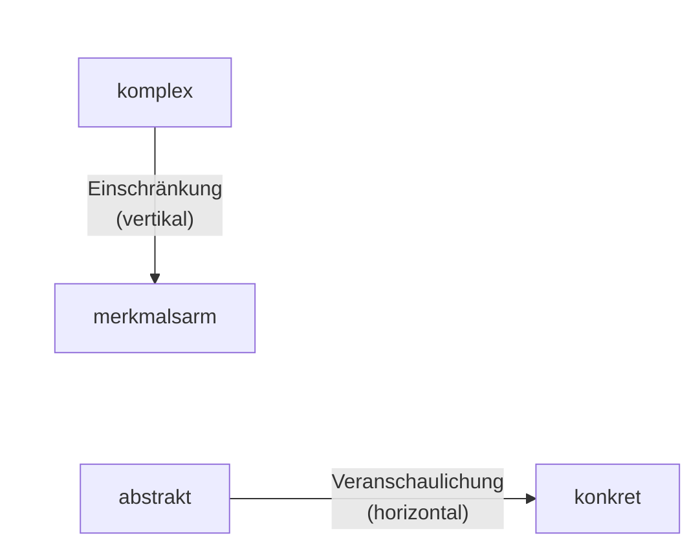

<!--
author:   Hannes Tegelbeckers
email:    hannes.tegelbeckers@ovgu.de
version:  0.2.0
language: de
narrator: Deutsch Female
mode:     Presentation
classroom: enable
comment:  Fachdidaktik technischer Allgemeinbildung II – Sitzung S07. Vereinfachen ohne falsch zu werden, didaktische Reduktion nach Grüner, Arnold und Hering mit Beispielen aus Elektro- und Bautechnik.

import:   https://raw.githubusercontent.com/LiaTemplates/mermaid_template/0.1.4/README.md
-->

# S07 – Didaktische Reduktion

Fachdidaktik technischer Allgemeinbildung II · OVGU Magdeburg · Montag, 23.11.2026, 07:00–09:00 Uhr

<!-- didaktik="Planungsraster S07 · E-03, E-04, E-12, E-17, E-19, E-27, E-30 · 0–10 Einstieg (provozieren, Vorwissen) · 10–15 Kurskarte · 15–32 Station 1 Grüner · 32–50 Station 2 Beispiele (Treppe der Einschränkungen) · 50–58 Station 3 Reduktionsfeld nach Arnold · 58–72 Station 4 Hering, [NEU] Zinn · 72–85 Baustein 8 (Doppeldecker) · 85–90 Abschluss" -->
> [!IMPORTANT] 🧭 Leitfrage
> Wie vereinfache ich – **ohne falsch zu werden**? – Auf der Kurskarte: **Thematik: Was – und wie vereinfacht?**

> [!TIP] 📚 Vor der Sitzung
> Haben Sie eine Fachaussage aus Ihrer Fachrichtung mitgebracht, die für Ihre Lernenden „zu schwer“ ist? Heute reduzieren Sie sie.

📝 **Beuteblatt S07** – ergänzen Sie es während der Sitzung.

## Einstieg: Darf man Falsches sagen?

    --{{0}}--
Eine These zum Start: Im Unterricht darf man auch mal etwas Falsches sagen – Hauptsache, es wird verstanden. Stimmen Sie ab. Am Ende der Sitzung stimmen wir noch einmal ab.

> **„Im Unterricht darf man auch mal etwas Falsches sagen – Hauptsache, es wird verstanden.“**

**Vote (before):** Stimmen Sie dieser These zu?

[(a)] Ja, ich stimme zu
[(b)] Nein, ich stimme nicht zu
[(c)] Teils, teils
[(undecided)] Undecided

    --{{1}}--
Schreiben Sie allein Ihre mitgebrachte Fachaussage so auf, wie Sie sie im Unterricht erklären würden.

      {{1}}
****************************************

> [!TIP] 🧠 Allein · 3 min
> Schreiben Sie Ihre mitgebrachte Fachaussage so auf, wie Sie sie im Unterricht erklären würden. **Was haben Sie weggelassen – und stimmt es dann noch?**

[[___ ___ ___]]

****************************************

    --{{2}}--
Zwei oder drei von Ihnen lesen ihre vereinfachte Aussage vor.

      {{2}}
> [!TIP] 📣 Plenum · 2 min
> Zwei bis drei Freiwillige lesen ihre vereinfachte Aussage vor. Alle prüfen: Stimmt sie noch – und unter welcher Einschränkung?

## Kurskarte: Es kommt auf den Gültigkeitsumfang an

    --{{0}}--
Heute geht es um die Frage, wie man vereinfacht, ohne falsch zu werden – in vier Stationen. Eine Prüffrage begleitet uns durch alle Stationen: Bleibt die Aussage unter Nennung der Einschränkungen korrekt? Erinnern Sie sich: Technikwissenschaften bewerten nach Richtigkeit und Zweckmäßigkeit, S01. Und in S05 stand in der Vorbereitung eines Experiments die Frage, in welchem Umfang der fachwissenschaftliche Kontext vereinfacht werden muss. Heute die Antwort.

    --{{1}}--
Auf diesem Weg erreichen Sie sechs Ziele.

      {{1}}

<!-- data-type="none" -->
| Know | Can do | Value |
|------|--------|-------|
| Definition, Reduktionsmethoden, Entscheidungsschritte nach Arnold und Vereinfachungen nach Hering **nennen** | eine eigene Fachaussage vertikal und horizontal **reduzieren** | **beurteilen**, ob eine vereinfachte Aussage noch korrekt ist |
| vertikale und horizontale Reduktion am Gültigkeitsumfang **unterscheiden** und an Beispielen **erläutern** | Vereinfachungen den Arten und Verfahren **zuordnen** | für Ihr Entwurfsthema eine Reduktionsentscheidung **planen** *(optional)* |

    --{{2}}--
Prüfen Sie kurz, ob Sie die Kurskarte lesen können.

      {{2}}
****************************************

**Decide:** In welcher Station lernen Sie, wie man entscheidet, was man reduziert?

<!-- data-hint-button="1" data-solution-button="2" -->
- [(X)] Reduktionsfeld
- [( )] Beispiele
- [( )] Hering und Zinn
[[?]] Arnold gibt dafür sechs Entscheidungsschritte vor.
***
Richtig: Das didaktische Reduktionsfeld nach Arnold beschreibt sechs Entscheidungsschritte.
***

****************************************

## Station 1: Was ist didaktische Reduktion?

    --{{0}}--
Wir beginnen mit der didaktischen Reduktion nach Grüner, Folie R128. Seine Begriffe strukturieren die ganze Sitzung.

**Wann ist eine vereinfachte Aussage noch korrekt?**

    --{{1}}--
Zuerst die Definition.

      {{1}}
- Definition: widerspruchsfreier Übergang (R129)

    --{{2}}--
Dann das Kernproblem, die Fasslichkeit, und fünf Reduktionsmethoden.

      {{2}}
- Reduktionsmethoden (R130)

    --{{3}}--
Danach zwei Arten nach dem Gültigkeitsumfang.

      {{3}}
- Vertikale und horizontale Reduktion (R131)

    --{{4}}--
Und schließlich vier Beispiele aus Elektro- und Bautechnik.

      {{4}}
- Die Beispiele dieser Sitzung (R132)

    --{{5}}--
Warum ist das für Sie wichtig?

      {{5}}
> [!TIP] Why this matters
> Jede Unterrichtsstunde vereinfacht. Die Frage ist nur, ob die vereinfachte Aussage noch stimmt.

    --{{6}}--
Markieren Sie, was Sie schon kennen.

      {{6}}
****************************************

**Mark:** Which of these do you already know? (several possible)

[[a1]] Definition: widerspruchsfreier Übergang (R129)
[[a2]] Reduktionsmethoden (R130)
[[a3]] Vertikale und horizontale Reduktion (R131)
[[a4]] Die Beispiele dieser Sitzung (R132)

****************************************

## 6.1 Definition Didaktische Reduktion

    --{{0}}--
Didaktische Reduktion ist der widerspruchsfreie Übergang von einer wissenschaftlichen Aussage zu einer verständlicheren, vereinfachten Aussage. Der entscheidende Satz steht darunter.

- Widerspruchsfreien Übergang von wissenschaftlicher Aussage zu einer verständlicheren vereinfachten Aussage
- **Abgeleitete Aussage muss unter Nennung der Einschränkungen immer korrekt bleiben**

    --{{1}}--
Vereinfachen heißt also nicht, etwas Falsches zu sagen.

      {{1}}
> [!NOTE] Key message
> **Prüffrage für die ganze Sitzung:** Bleibt die Aussage *unter Nennung der Einschränkungen* korrekt?

<small>Quelle: Folie R129 „6.1 Definition Didaktische Reduktion“ (Abschnitt „Didaktische Reduktion nach GRÜNER“, Folie R128)</small>

## 6.2 Reduktionsmethoden

    --{{0}}--
Das Kernproblem ist die Fasslichkeit: Eine Ausgangsaussage ist entweder zu abstrakt oder zu komplex. Fasslicher wird sie durch die Einschränkung auf wichtige Sonderfälle, durch Beispiele, durch Veranschaulichung mit Prinzipskizzen, Kennlinien, Experimenten oder Analogien, durch verbale Erläuterungen und Merkregeln statt Gleichungen und durch das Vernachlässigen von Randeffekten.

- **Kernproblem ist Fasslichkeit**
  - Ausgangsaussage zu abstrakt
  - Ausgangsaussage zu komplex
- **Durch Reduktionsmethoden fasslicher machen**
  - Einschränkung auf wichtige Sonderfälle
  - Verdeutlichung durch Beispiele
  - Veranschaulichung durch Prinzipskizzen, Kennlinie, Experiment, Computeranimationen, Analogien, …
  - Verbale Erläuterungen oder Merkregeln, statt mathematischer Gleichungen
  - Vernachlässigung von „Randeffekten“

    --{{1}}--
Achten Sie darauf, welche Methoden etwas weglassen und welche etwas hinzufügen.

      {{1}}
> [!NOTE] Key message
> Zu abstrakt → veranschaulichen · zu komplex → einschränken. Beides macht eine Aussage fasslicher.

<small>Quelle: Folie R130 „6.2 Reduktionsmethoden“</small>

## 6.3 Arten Didaktischer Reduktion

    --{{0}}--
Grüner unterscheidet zwei Arten, und der Schlüssel ist der Gültigkeitsumfang. Das Achsenkreuz zeigt zwei Richtungen: von komplex nach merkmalsarm und von abstrakt nach konkret.

    --{{1}}--
Bei der vertikalen Reduktion wird der Gültigkeitsumfang kleiner: Man betrachtet einen Sonderfall, einen Ausschnitt der Ausgangsaussage.

      {{1}}
**① Vertikale Reduktion:** Gültigkeitsumfang wird reduziert · Erfolgt Ausschnittsbildung aus der Ausgangsaussage durch Betrachtung von Sonderfällen

    --{{2}}--
Bei der horizontalen Reduktion bleibt er erhalten: Die konkretere Aussage steht gleichberechtigt neben der Ausgangsaussage.

      {{2}}
**② Horizontale Reduktion:** Gültigkeitsumfang bleibt erhalten · Konkretere Aussage ist Ausgangsaussage nebengeordnet

    --{{3}}--
Daraus folgt eine einfache Prüffrage.

      {{3}}
**③ Prüffrage:** Gilt die neue Aussage für *weniger* Fälle als die alte? Dann vertikal. Gilt sie für dieselben Fälle? Dann horizontal.

    --{{4}}--
Diese Unterscheidung brauchen Sie für alle Beispiele der Sitzung.

      {{4}}
> [!NOTE] Key message
> Vertikal = Einschränkung (komplex → merkmalsarm) · horizontal = Veranschaulichung (abstrakt → konkret).

<small>Quelle: Folie R131 „6.3 Arten Didaktischer Reduktion“ – Achsenkreuz (nur Bild) als zwei Pfeile nachgezeichnet: *Einschränkung* von „komplex“ nach „merkmalsarm“ (vertikal), *Veranschaulichung* von „abstrakt“ nach „konkret“ (horizontal).</small>

## Aktivierung: Vertikal oder horizontal?

    --{{0}}--
Bevor wir zu den Beispielen gehen: Vergleichen Sie die beiden Arten noch einmal auf einen Blick.

<!-- data-type="none" -->
| Criterion | vertikal | horizontal |
|-----------|---------------|---------------|
| Gültigkeitsumfang | wird reduziert | bleibt erhalten |
| Vorgehen | Sonderfall betrachten, Randeffekte vernachlässigen | Beispiel, Kennlinie, Merkregel, Analogie |
| Richtung | komplex → merkmalsarm | abstrakt → konkret |
| Prüffrage | gilt für weniger Fälle | gilt für dieselben Fälle |

    --{{1}}--
Je ein Beispiel:

      {{1}}
- **vertikal:** nur Gleichstrom in einem homogenen Leiter betrachten
- **horizontal:** das Ohm'sche Gesetz zusätzlich als Kennlinie zeichnen

    --{{2}}--
Ein typischer Fehlschluss:

      {{2}}
> [!WARNING] Common misconception
> Einfacher heißt nicht automatisch vertikal: Eine Merkregel mit gleichem Gültigkeitsumfang ist horizontal.

    --{{3}}--
Ordnen Sie jetzt zu.

      {{3}}
****************************************

**Decide:** Which concept does each statement describe?

<!-- data-hint-button="1" data-solution-button="2" data-show-partial-solution -->
[(vertikal) (horizontal)]
[       (X)             ( )      ] Der Luftwiderstand wird beim Fall eines schweren Körpers weggelassen.
[       ( )             (X)      ] Das Ohm'sche Gesetz wird zusätzlich als Kennlinie gezeichnet.
[       (X)             ( )      ] Eine Streckenlast wird als Punktlast in der Mitte angesetzt.
[       ( )             (X)      ] Statt einer Gleichung wird eine Merkregel angeboten – mit gleichem Gültigkeitsumfang.
[[?]] Gilt die neue Aussage für weniger Fälle als die alte?
***
**Vertikal** = Gültigkeitsumfang wird reduziert (Sonderfall, Randeffekte vernachlässigt). **Horizontal** = Gültigkeitsumfang bleibt erhalten, die konkretere Aussage ist nebengeordnet (Kennlinie, Merkregel, Beispiel).
***

****************************************

## Station 2: Beispiele aus Elektro- und Bautechnik

    --{{0}}--
Jetzt wird es konkret. Vier Beispiele, je zwei vertikal und horizontal. Achten Sie bei jedem Beispiel auf die Frage: Wird der Gültigkeitsumfang eingeschränkt oder nicht?

**Wie sieht Reduktion an echten Fachaussagen aus?**

    --{{1}}--
Vertikal in der Elektrotechnik: die Treppe von den Maxwell-Gleichungen zum Ohm'schen Gesetz.

      {{1}}
- 6.4 Beispiel für vertikale didaktische Reduktion (Elektrotechnik)

    --{{2}}--
Vertikal in der Bautechnik: von der Streckenlast zur Punktlast.

      {{2}}
- 6.5 Beispiel für vertikale didaktische Reduktion (Bautechnik)

    --{{3}}--
Horizontal in der Elektrotechnik: das Ohm'sche Gesetz in vier Darstellungen.

      {{3}}
- 6.6 Beispiel für horizontale didaktische Reduktion (Elektrotechnik)

    --{{4}}--
Horizontal in der Bautechnik: die Lastformeln in Worten.

      {{4}}
- 6.7 Beispiel für horizontale didaktische Reduktion (Bautechnik)

    --{{5}}--
Warum ist das für Sie wichtig?

      {{5}}
> [!TIP] Why this matters
> Das letzte Beispiel zeigt, dass beide Reduktionsarten zugleich auftreten können – wie oft im echten Unterricht. (Gliederung nach Folie R132 „6. Didaktische Reduktion nach GRÜNER“)

    --{{6}}--
Markieren Sie, was Sie schon kennen.

      {{6}}
****************************************

**Mark:** Which of these do you already know? (several possible)

[[a1]] 6.4 Beispiel für vertikale didaktische Reduktion (Elektrotechnik)
[[a2]] 6.5 Beispiel für vertikale didaktische Reduktion (Bautechnik)
[[a3]] 6.6 Beispiel für horizontale didaktische Reduktion (Elektrotechnik)
[[a4]] 6.7 Beispiel für horizontale didaktische Reduktion (Bautechnik)

****************************************

## 6.4 Vertikal, Elektrotechnik: von Maxwell zu Ohm

    --{{0}}--
Das erste Beispiel ist eine Treppe. Oben stehen die Maxwell'schen Gleichungen ohne jede Einschränkung. Im ersten Schritt nehmen wir an, dass zeitliche Änderungen des elektrischen Feldes vernachlässigbar sind, und gelangen zu Strom, Spannung und Stromdichte. Sie müssen die Gleichungen nicht rechnen; verstehen Sie die Logik der Stufen.

<!-- data-type="none" -->
| Gültigkeit | Aussage |
| --- | --- |
| **wissenschaftliche Ausgangsaussage (keine Einschränkung)** – vgl. Moeller 1986 | **Maxwellsche Gleichungen** · Durchflutungssatz: $\oint \vec{H}\cdot d\vec{l} = \Theta = \int \left(\vec{S} + \frac{d\vec{D}}{dt}\right)\cdot d\vec{A}$ (1) · Induktionsgesetz: $\oint \vec{E}\cdot d\vec{l} = -\int \left(\frac{d\vec{B}}{dt}\right)\cdot d\vec{A}$ (2) |
| ⬇ **1. Schritt** | |
| 1. magnetische Wirkung infolge zeitlicher Änderung des elektrischen Feldes im Nichtleiter nur bei schnellen Änderungen von Bedeutung: $\frac{dD}{dt} \approx 0$ · 2. Beschränkung auf elektrisches Feld in Leitern ergibt Strom und Spannung | $I = \int \vec{S}\cdot d\vec{A}$ (3) aus (1) · $U = \oint \vec{E}\cdot d\vec{l}$ (4) aus (2) · Es gilt für das elektrische Strömungsfeld bei konstanter elektrischer Leitfähigkeit: $S = \gamma\cdot\vec{E}$ (5) |

    --{{1}}--
Im zweiten Schritt setzen wir homogene und konstante Größen voraus. Am Ende steht das Ohm'sche Gesetz – gültig, aber nur unter genau diesen Einschränkungen.

      {{1}}
****************************************

<!-- data-type="none" -->
| Gültigkeit | Aussage |
| --- | --- |
| ⬇ **2. Schritt** | |
| 3. wenn gilt: $\vec{S}$ senkrecht auf $\vec{A}$, dann ist $\vec{S}$ homogen und konstant · 4. wenn gilt: $\vec{E}$ parallel zu $\vec{l}$, dann ist $\vec{E}$ homogen und konstant · 5. außerdem soll gelten: $\vec{E}$ parallel zu $\vec{S}$ · **Aussage gilt für homogene Felder in homogenen Gebieten der Länge l und des konstanten Querschnitts A bei konstanter elektrischer Leitfähigkeit.** | $I = S\cdot A$ (6) aus (3) · $U = E\cdot l$ (7) aus (4) · $S = \gamma\cdot E$ (8) aus (5) · $U = \frac{S\cdot l}{\gamma}$ (9) aus (8/7) · $S = \frac{U\cdot\gamma}{l}$ (10) aus (9) · $S = \frac{I}{A}$ (11) aus (6) · $\frac{I}{A} = \frac{U\cdot\gamma}{l}$ (12) aus (10) u. (11) · **Es folgt das Ohmsche Gesetz:** $\frac{U}{I} = \frac{l}{A\cdot\gamma} = konst. = R$ |

<!-- data-type="none" -->
| Symbol | Bedeutung | Symbol | Bedeutung |
| --- | --- | --- | --- |
| E | elektrische Feldstärke | H | magnetische Feldstärke |
| D | Verschiebungsdichte | S | Stromdichte |
| A | Querschnittsfläche im Raum | B | Flussdichte |
| Θ | Durchflutung | l | Länge |
| γ | elektrische Leitfähigkeit | | |

(Wagner, 2006)

****************************************

    --{{2}}--
Die Treppe in einem Satz:

      {{2}}
> [!NOTE] Key message
> Jede Stufe nennt eine Einschränkung – am Ende steht das Ohm'sche Gesetz, das *nur* für homogene Felder in homogenen Gebieten bei konstanter Leitfähigkeit gilt. Korrekt bleibt es, weil die Einschränkungen genannt werden (R129).

<small>Quelle: Folien R133–R134 „6.4 Beispiel für vertikale didaktische Reduktion Elektrotechnik“ (Wagner, 2006; im Original WAGNER) – Formeln aus dem Folienbild übertragen und gegen das Original geprüft.</small>

## 6.5 Vertikal, Bautechnik: von der Streckenlast zur Punktlast

    --{{0}}--
Dasselbe Prinzip in der Bautechnik: Aus der unregelmäßigen Streckenlast wird eine gleichmäßige Flächenlast und schließlich eine Punktlast.

<!-- data-type="none" -->
| Lastfall | Formel | Skizze (nachgezeichnet) |
| --- | --- | --- |
| **1. Streckenlast z.B. Schüttlast** | $g = \frac{dF}{dl}$ · $F = \int g\,dl = [N]$ | Träger auf zwei Auflagern, unregelmäßige Last |
| **2. Flächenlast** | $g = \frac{\Delta F}{\Delta l}$ · $\Delta F = g\,\Delta l$ | Träger auf zwei Auflagern, gleichmäßige Last |
| **3. Punktlast** | $g = \frac{F}{l}$ · $F = g\,l$ | Einzellast in der Mitte, Spannweite $\frac{l}{2}$ + $\frac{l}{2}$ |

    --{{1}}--
Die Folie nennt die Einschränkungen: Die Einzellast wirkt in derselben Richtung, ihre Größe entspricht der Fläche der Belastungsfigur, und ihre Wirkungslinie verläuft durch deren Schwerpunkt.

      {{1}}
****************************************

**Einschränkung:**

- Richtung der Einzellast stimmt mit der Wirkungsrichtung der Streckenlast überein.
- Die Größe der Einzellast entspricht der Fläche der Belastungsfigur.
- Die Wirkungslinie der Einzellast verläuft durch den Schwerpunkt der Belastungsfigur.

****************************************

    --{{2}}--
Auch hier gilt die Prüffrage.

      {{2}}
> [!NOTE] Key message
> Die Punktlast ist korrekt – *unter Nennung* dieser drei Einschränkungen. Ohne sie wäre sie falsch.

<small>Quelle: Folie R135 „6.5 Beispiel für vertikale didaktische Reduktion Bautechnik“ – Formeln und Skizzen aus dem Folienbild übertragen.</small>

## 6.6 Horizontal, Elektrotechnik: Ohm in vier Darstellungen

    --{{0}}--
Jetzt horizontal. Das Ohm'sche Gesetz erscheint viermal: als Formel, als Kennlinie, als verbale Erläuterung und als Merkregel. Keine Darstellung schränkt die Gültigkeit ein, jede ist nur konkreter oder anschaulicher.

<!-- data-type="none" -->
| Mathematische Formel | graphische Darstellung | verbale Erläuterung | Merkregel |
| --- | --- | --- | --- |
| U=R\*I | Kennlinie: Gerade *R* im U-I-Diagramm | Das Verhältnis von Spannung zu Strom in einem elektrischen Leiter ist konstant und stellt den Widerstand dar. | Dreieck: U oben, R und I unten |

**Der Gültigkeitsumfang bleibt erhalten, die konkretere Aussage ist der Ausgangsaussage nur nebengeordnet.** (Arnold, 1990)

    --{{1}}--
Ebenso beim elektrostatischen Feld: Formel, Feldlinienbild und das Experiment mit den Watteflocken zwischen zwei geladenen Kugeln. Das Schema zeigt beide Richtungen zusammen: nach rechts horizontal, nach unten vertikal.

      {{1}}
****************************************

<!-- data-type="none" -->
| Formelzusammenhang (abstrakt) | Feldlinienbild zur graphischen Deutung | Experimenteller Nachweis, durch Flug von Watte zwischen zwei elektrisch geladenen Kugeln |
| --- | --- | --- |
| $\vec{E} = -grad\,\varphi$ – Die Feldstärke ist der (negative) Gradient des Potentials. | Feldlinien von + nach − | Watteflocken fliegen zwischen den Kugeln hin und her |

Elektrostatisches Feld zwischen zwei Kugeln gleicher Ladung unterschiedlicher Vorzeichen (Arnold, 1990)

**Schema (Arnold, 1990):**

<!-- data-type="none" -->
| | gleicher Gültigkeitsumfang → | |
| --- | --- | --- |
| **AA** wissenschaftliche Ausgangsaussage | → **A1** | → **A2** |
| ↓ **AI** | → **AI-1** | |
| ↓ **AII** | | |
| ↓ reduzierter Gültigkeitsumfang | | |

****************************************

    --{{2}}--
Was heißt das für Sie?

      {{2}}
> [!NOTE] Key message
> Horizontal: neue Darstellungen *neben* der Ausgangsaussage (A1, A2) · vertikal: Einschränkung *unter* ihr (AI, AII).

<small>Quelle: Folien R136–R137 „6.6 Beispiel für Horizontal didaktische Reduktion Elektrotechnik“ (Arnold, 1990; im Original ARNOLD) – Abbildungen beschrieben bzw. als Tabelle nachgezeichnet: nach rechts horizontal (gleicher Gültigkeitsumfang), nach unten vertikal (reduzierter Gültigkeitsumfang).</small>

## 6.7 Horizontal, Bautechnik: Lasten verbal

    --{{0}}--
Das letzte Beispiel übersetzt die Lastformeln in Worte. Diese Verbalformulierungen sind horizontal zu ihrer Formel.

<!-- data-type="none" -->
| Formel | Skizze | Verbalformulierung | Einschränkungen |
| --- | --- | --- | --- |
| $F = \int g\,dl = [N]$ | unregelmäßige Streckenlast | Die auftretende Kraft ergibt sich aus der Berechnung der Fläche unter der Funktion, die die Streckenlast beschreibt. | gilt immer |
| $\Delta F = g\,\Delta l$ | gleichmäßige Last | Die auftretende Kraft ergibt sich aus der Streckenlast multipliziert mit dem Abstand der Auflage (l). | Gilt nur wenn angenommen werden kann, dass die Kraftverteilung über das Bauteil nahezu symmetrisch ist. |
| $F = g\,l$ | Einzellast in der Mitte ($\frac{l}{2}$ + $\frac{l}{2}$) | Die auftretende Kraft aus einer Streckenlast wirkt im Mittelpunkt des Bauteils. Sie ergibt sich aus der Länge multipliziert mit der Streckenlast. | Gilt nur für denn Fall, dass sie Annahme der wirkenden Kraft als Punktlast für das Berechnungsverfahren hinreichen ist. |

    --{{1}}--
Schauen Sie aber genau auf die Spalte Einschränkungen: Die zweite und dritte Zeile sind gegenüber der ersten vertikal reduziert. In der Praxis treten beide Arten oft gemeinsam auf.

      {{1}}
> [!NOTE] Key message
> 👀 Genau hinsehen: Die Verbalformulierungen sind *horizontal* zur jeweiligen Formel – aber Zeile 2 und 3 sind gegenüber Zeile 1 *vertikal* reduziert. Ein Beispiel kann beide Reduktionsarten zugleich enthalten.

<small>Quelle: Folie R138 „6.7 Beispiel für Horizontal didaktische Reduktion bautechnik“ – Formelspalte aus den Miniaturen der Folie übertragen; Wortlaut der Einschränkungen unverändert.</small>

## Aktivierung: die Maxwell-Treppe

    --{{0}}--
Welche Annahme gehört zu welchem Schritt der Maxwell-Treppe? Vergleichen Sie zuerst die beiden Schritte.

<!-- data-type="none" -->
| Criterion | 1. Schritt | 2. Schritt |
|-----------|---------------|---------------|
| Einschränkungen | 1–2 | 3–5 |
| Ergebnis | I, U und S = γ·E (Gleichungen 3–5) | Gleichungen 6–12, Ohm'sches Gesetz |
| gilt für | elektrisches Strömungsfeld bei konstanter Leitfähigkeit | homogene Felder in homogenen Gebieten |
| Art | vertikal | vertikal |

    --{{1}}--
Je eine Einschränkung als Beispiel:

      {{1}}
- **1. Schritt:** dD/dt ≈ 0 – zeitliche Änderung des elektrischen Feldes vernachlässigt
- **2. Schritt:** E parallel zu S

    --{{2}}--
Ein Missverständnis zum Schluss:

      {{2}}
> [!WARNING] Common misconception
> Das Ohm'sche Gesetz ist nicht „falsch vereinfacht“ – es ist korrekt, solange die Einschränkungen genannt werden.

    --{{3}}--
Ordnen Sie jetzt zu.

      {{3}}
****************************************

**Decide:** Which concept does each statement describe?

<!-- data-hint-button="1" data-solution-button="2" data-show-partial-solution -->
[(1. Schritt) (2. Schritt)]
[       (X)             ( )      ] Zeitliche Änderung des elektrischen Feldes im Nichtleiter vernachlässigt (dD/dt ≈ 0)
[       ( )             (X)      ] Stromdichte senkrecht auf der Fläche – homogen und konstant
[       (X)             ( )      ] Beschränkung auf das elektrische Feld in Leitern
[       ( )             (X)      ] Feldstärke parallel zur Länge – homogen und konstant
[[?]] Im 1. Schritt geht es um Strom und Spannung, im 2. Schritt um homogene und konstante Größen.
***
1. Schritt: Einschränkungen 1–2 führen zu I, U und S = γ·E (Gleichungen 3–5). 2. Schritt: Einschränkungen 3–5 führen über die Gleichungen 6–12 zum Ohm'schen Gesetz (R133–R134).
***

****************************************

## Aktivierung: Ohm'sches Gesetz in vier Darstellungen

    --{{0}}--
Drei kurze Fragen zum horizontalen Beispiel. Danach ergänzen Sie die Abschnitte 1 und 2 Ihres Beuteblatts.

**1 · Choose one:** Welche Darstellung ist „Das Verhältnis von Spannung zu Strom in einem elektrischen Leiter ist konstant und stellt den Widerstand dar“?

<!-- data-hint-button="1" data-solution-button="2" -->
- [( )] Merkregel
- [(X)] verbale Erläuterung
- [( )] graphische Darstellung
[[?]] Die Aussage ist ein ganzer Satz.
***
Formel U=R*I · Kennlinie im U-I-Diagramm · verbale Erläuterung · Merkregel-Dreieck (R136).
***

    --{{1}}--
Jetzt können mehrere Antworten richtig sein.

      {{1}}
****************************************

**2 · Choose all that apply:** Welche Aussagen über die vier Darstellungen stimmen?

<!-- data-hint-button="1" data-solution-button="2" -->
- [[X]] Alle vier haben denselben Gültigkeitsumfang.
- [[ ]] Die Merkregel schränkt den Gültigkeitsumfang ein.
- [[X]] Die Kennlinie ist der Formel nebengeordnet.
- [[ ]] Nur die Formel ist fachlich korrekt.
[[?]] „Der Gültigkeitsumfang bleibt erhalten, die konkretere Aussage ist der Ausgangsaussage nur nebengeordnet.“
***
Horizontale Reduktion: Keine der vier Darstellungen schränkt die Gültigkeit ein (R136).
***

****************************************

    --{{2}}--
Zum Schluss tippen Sie einen Begriff.

      {{2}}
****************************************

**3 · Type:** Wie heißt die Reduktionsart, bei der der Gültigkeitsumfang erhalten bleibt? (ein Wort)

<!-- data-hint-button="1" data-solution-button="2" -->
[[horizontal]]
[[?]] Die konkretere Aussage steht neben der Ausgangsaussage.

***
Horizontale Reduktion: Gültigkeitsumfang bleibt erhalten (R131). 📝 Beuteblatt-Stopp: Ergänzen Sie die Abschnitte 1 und 2.
***

****************************************

## Station 3 · 6.8 Didaktisches Reduktionsfeld: Entscheidungsschritte nach Arnold

    --{{0}}--
Wie entscheide ich, ob und wie ich reduziere? Arnold gibt sechs Schritte vor. Die Reihenfolge ist Programm: Zuerst wird anschaulicher gemacht, erst zuletzt wird eingeschränkt.

    --{{1}}--
Sachanalyse: Durch welche Begriffe und Elemente ist die Komplexität bestimmt?

      {{1}}
1. **Sachanalyse:** Durch welche Begriffe, Elemente ist die Komplexität des Unterrichts bestimmt

    --{{2}}--
Didaktische Strukturierung: Was ist zentral, um den Gegenstand zu verstehen?

      {{2}}
2. **Didaktische Strukturierung:** Welche Bestandteile sind von zentraler Bedeutung, um den Gegenstand zu verstehen

    --{{3}}--
Restriktionsanalyse: Welche Lernschwierigkeiten sind zu erwarten?

      {{3}}
3. **Restriktionsanalyse:** Erwartete Lernschwierigkeiten der Adressaten in die Planung einbeziehen

    --{{4}}--
Dann zuerst horizontal reduzieren – mit Beispielen und Analogien.

      {{4}}
4. **Horizontale didaktische Reduktion:** Förderung des Verständnisses durch Beispiele, Analogien, usw.

    --{{5}}--
Danach vertikal, aber ohne Verlust an Gültigkeit.

      {{5}}
5. **Vertikale didaktische Reduktion I:** Auf welche Bestandteile kann verzichtet werden, ohne die Gültigkeit einzuschränken

    --{{6}}--
Und erst zuletzt vertikal mit Einschränkung des Gültigkeitsumfangs – nur so weit, wie es sich verantworten lässt.

      {{6}}
6. **Vertikale didaktische Reduktion II:** Welche Einschränkungen des Gültigkeitsumfanges können verantwortet werden, um das Verständnis zu fördern

<small>Quelle: Folien R139–R140 „6.8 Didaktisches Reduktionsfeld“ – „Entscheidungsschritte zur didaktische Reduktion nach ARNOLD“ (Nummerierung ergänzt). 👀 Reihenfolge beachten: zuerst horizontal (Gültigkeit bleibt), dann vertikal ohne Gültigkeitsverlust (I) – erst zuletzt mit Einschränkung (II).</small>

## Entscheidungsschritte ordnen

    --{{0}}--
Ordnen Sie die sechs Entscheidungsschritte nach Arnold.

**Order:** Drag each card into the right gap.

<!-- data-randomize data-show-partial-solution data-solution-button="2" -->
Step 1: [->[ Sachanalyse ]] → Step 2: [->[ Didaktische Strukturierung ]] → Step 3: [->[ Restriktionsanalyse ]] → Step 4: [->[ Horizontale didaktische Reduktion ]] → Step 5: [->[ Vertikale didaktische Reduktion I ]] → Step 6: [->[ Vertikale didaktische Reduktion II ]]

## Station 4: Vereinfachen nach Hering

    --{{0}}--
In der letzten Station kommt eine zweite Tradition hinzu: Hering und seine Verfahren der didaktischen Vereinfachung.

**Wie vereinfacht man, ohne Merkmale stillschweigend zu verlieren?**

    --{{1}}--
Herings Hauptsatz von 1959.

      {{1}}
- Hauptsatz der didaktischen Vereinfachung (R141)

    --{{2}}--
Das Beispiel: die Bilanzgleichung der Photosynthese.

      {{2}}
- Bilanzgleichung der Photosynthese (R142)

    --{{3}}--
Drei Verfahren – „indiziert“ heißt, dass die Vereinfachung auf das Weggelassene hinweist.

      {{3}}
- Drei Verfahren der didaktischen Vereinfachung (R143–R145)

    --{{4}}--
Und eine Ergänzung aus Zinn, als NEU markiert.

      {{4}}
- [NEU] Weitere Arten der Reduktion und die Elementarisierung (Zinn 2026)

    --{{5}}--
Warum ist das für Sie wichtig?

      {{5}}
> [!TIP] Why this matters
> „Indiziert“ ist die praktische Umsetzung der Definition: korrekt *unter Nennung der Einschränkungen* (R129).

    --{{6}}--
Markieren Sie, was Sie schon kennen.

      {{6}}
****************************************

**Mark:** Which of these do you already know? (several possible)

[[a1]] Hauptsatz der didaktischen Vereinfachung (R141)
[[a2]] Bilanzgleichung der Photosynthese (R142)
[[a3]] Drei Verfahren der didaktischen Vereinfachung (R143–R145)
[[a4]] [NEU] Weitere Arten der Reduktion und die Elementarisierung (Zinn 2026)

****************************************

## Hauptsatz der didaktischen Vereinfachung nach Hering

    --{{0}}--
Herings Hauptsatz von 1959 beschreibt Vereinfachung als Übergang von einer differenzierten Aussage zu einer allgemeineren, die weniger Merkmale enthält.

> „Didaktische Vereinfachung einer wissenschaftlichen Aussage ist der Übergang von einer (in die besonderen Merkmale des Gegenstandes) *differenzierten* Aussage zu einer *allgemeinen* Aussage (gleichen Gültigkeitsumfangs über den gleichen Gegenstand unter gleichem Aspekt)“.
>
> Hering: Zur Faßlichkeit naturwissenschaftlicher und technischer Aussagen. – Berlin, 1959, S.92

    --{{1}}--
Achten Sie auf die Richtung.

      {{1}}
> [!NOTE] Key message
> Vereinfachen heißt hier, vom Besonderen zum Allgemeineren zu gehen – also Merkmale wegzulassen, nicht Fehler einzubauen.

<small>Quelle: Folie R141 „Hauptsatz der didaktischen Vereinfachung nach HERING“</small>

## Beispiel: Bilanzgleichung der Photosynthese

    --{{0}}--
Ein Beispiel ist die Bilanzgleichung der Photosynthese: Sechs Moleküle Kohlenstoffdioxid und sechs Moleküle Wasser ergeben unter Lichteinwirkung ein Molekül Glucose und sechs Moleküle Sauerstoff.

$$\ce{6 CO2 + 6 H2O ->[\text{Lichtenergie, Chlorophyll}][\text{2827 kJ}] C6H12O6 + 6 O2}$$

<!-- data-type="none" -->
| Kohlenstoffdioxid | Wasser | Glucose | Sauerstoff |
| --- | --- | --- | --- |
| 6 CO2 | 6 H2O | C6H12O6 | 6O2 |

    --{{1}}--
Die Sprechernotizen der Originalfolie ergänzen, was die Gleichung nicht zeigt.

      {{1}}
****************************************

**Erläuterung (Sprechernotizen der Originalfolie):** 6 Moleküle Wasser und 6 Moleküle Kohlenstoffdioxid ergeben unter Einwirkung von Sonnenlicht 1 Molekül Glucose und 6 Moleküle Sauerstoff. Mithilfe von Experimenten konnte schließlich nachgewiesen werden, dass der Sauerstoff der Glucose aus dem Kohlenstoffdioxid stammt (und entsprechend der freigesetzte Sauerstoff aus dem Wasser stammt).

****************************************

    --{{2}}--
Fragen Sie sich: Was geht dabei verloren – und was gewinnen Lernende?

      {{2}}
> [!NOTE] Key message
> 💭 Die Bilanzgleichung ist eine *allgemeine* Aussage über einen in Wirklichkeit vielstufigen Prozess. Welche Information geht dabei verloren – und welche bringt erst die Sprechernotiz zurück?

<small>Quelle: Folie R142 „Bsp.: Bilanzgleichung der Photosynthese“ inkl. Sprechernotizen</small>

## Didaktische Vereinfachung nach Hering: drei Verfahren

    --{{0}}--
Hering nennt drei Verfahren. Bei der Tilgung untergeordneter Aussagen wird ein Oberbegriff gebildet. Bei der indizierten Tilgung nebengeordneter Aussagen werden Teilaussagen weggelassen, die zunächst unwesentlich sind – mit einem Hinweis darauf. Und bei der indizierten Verallgemeinerung wird allgemeiner formuliert, und die Einschränkungen werden genannt.

<!-- data-type="none" -->
| Verfahren | Vorgehen | Beispiel – Ausgangsaussage | Vereinfacht |
| --- | --- | --- | --- |
| **1) Tilgung untergeordneter Aussagen** | Es wird ein Oberbegriff gebildet, der die Teilaussagen mit einschließt. | Die elektrische Leitfähigkeit in Werkstoffen wird durch Elektronen, Defektelektronen und/oder Ionen ermöglicht. | Die elektrische Leitfähigkeit in Werkstoffen wird durch frei bewegliche Ladungsträger ermöglicht. |
| **2) Indizierte Tilgung nebengeordneter Aussagen** | Ausgewählte Tilgung von Aussagen – es werden diejenigen Teilaussagen getilgt, die zunächst unwesentlich für die Zielstellung erscheinen. Anwendung erfolgt vorrangig, wenn kein Oberbegriff gefunden werden kann, der die Merkmale aller Teilaussagen vereint. | Als Zuschläge im Hochofenprozess kommen Quarz, Feldspat, Schiefer, Kalkstein und Dolomit in Betracht. | Als Zuschlag im Hochofenprozess kommt vorwiegend Kalkstein in Betracht. Bestimmte andere Zuschläge sind möglich. |
| **3) Indizierte Verallgemeinerung** | Es wird eine allgemeinere Aussage getroffen und Einschränkungen zum Gültigkeitsumfang werden genannt. | Als Zuschläge im Hochofenprozess kommen Quarz, Feldspat, Schiefer, Kalkstein und Dolomit in Betracht. | Als Zuschlag im Hochofenprozess werden bestimmte Stoffe benutzt, meist Kalk. |

    --{{1}}--
Indiziert heißt immer: Die Vereinfachung verrät, dass etwas weggelassen wurde.

      {{1}}
> [!NOTE] Key message
> **„Indiziert“ heißt:** Die Vereinfachung trägt einen Hinweis, dass etwas weggelassen wurde („Bestimmte andere Zuschläge sind möglich“, „meist“). Genau das verlangt die Definition: korrekt *unter Nennung der Einschränkungen* (R129).

<small>Quelle: Folien R143–R145 „Didaktische Vereinfachung nach HERING“ (Nummerierung 1)–3) nach der Bildkonvertierung)</small>

## [NEU] Weitere Arten der Reduktion und die Elementarisierung

    --{{0}}--
Eine Ergänzung aus Zinn 2026, als NEU markiert. Zinn bestätigt die Unterscheidung von horizontal und vertikal und nennt weitere Arten. Für die Elementarisierung empfiehlt er unter anderem das EIS-Prinzip nach Bruner – handelnd, ikonisch, symbolisch – und Analogien, deren Grenzen man mit den Lernenden bespricht.

<!-- neu="Zinn 2026, S. 302–306" -->
Zinn (2026) ordnet die didaktische Reduktion (Hering 1959; Grüner 1967) neben die **Elementarisierung** (Kircher 2009) und bestätigt die Unterscheidung der Folien: horizontal bleibt der „wissenschaftliche Gültigkeitsumfang … vollständig erhalten“, vertikal wird er „bewusst eingeschränkt“ (S. 302–303). Weitere Arten mit technischen Beispielen (S. 303–305):

<!-- data-type="none" -->
| Art | Beispiel nach Zinn |
| --- | --- |
| Reduktion auf das Qualitative | Belastungstest eines Einfeldträgers mit qualitativer Beschreibung |
| Reduktion durch Vernachlässigung | Luftwiderstand bei Fall- und Wurfbewegungen weglassen |
| Reduktion mittels Blackbox | Messsensor oder Batterie nur über Input und Output betrachten |
| Reduktion durch Generalisierung | „Flüssigkeiten und Festkörper dehnen sich bei Erwärmung aus“ – gilt nicht für Wasser in bestimmten Temperaturbereichen |
| Reduktion durch mangelnde begriffliche Differenzierung | nur Leiter und Nichtleiter, Halbleiter erst später |
| Reduktion durch Partikularisierung | Kraft zunächst nur als Ursache für Verformung |

Für die **Elementarisierung** empfiehlt er u. a. das EIS-Prinzip nach Bruner (handelnd – ikonisch – symbolisch) und Analogien, deren Grenzen mit den Lernenden zu reflektieren sind; Leitlinie: **fachgerecht – schülergerecht – zielgerecht** (S. 305–306).

    --{{1}}--
Verbinden Sie das mit S01b.

      {{1}}
> [!NOTE] Key message
> **Verbinden Sie:** „Reduktion durch Generalisierung“ ist der *induktive* Schluss aus S01b – und das Wasser-Beispiel zeigt, warum er nicht sicher ist (Dilling 2024).

<small>[NEU] Ergänzung, keine Originalfolie: Zinn (2026), S. 302–306 – siehe Literatur.</small>

## Aktivierung: Welches Verfahren?

    --{{0}}--
Ordnen Sie Vereinfachungen den Verfahren nach Hering zu. Die Beispiele sind Übungsbeispiele, nicht von den Originalfolien.

**1 · Choose one:** „Schrauben, Nieten und Bolzen“ wird zu „lösbare und unlösbare Verbindungselemente“. Welches Verfahren ist das?

<!-- data-hint-button="1" data-solution-button="2" -->
- [( )] Indizierte Verallgemeinerung
- [(X)] Tilgung untergeordneter Aussagen
- [( )] Indizierte Tilgung nebengeordneter Aussagen
[[?]] Wird ein Oberbegriff gebildet?
***
Oberbegriff bilden = Tilgung untergeordneter Aussagen (R143).
***

    --{{1}}--
Jetzt können mehrere Antworten richtig sein.

      {{1}}
****************************************

**2 · Choose all that apply:** Welche Vereinfachungen sind „indiziert“?

<!-- data-hint-button="1" data-solution-button="2" -->
- [[X]] „Als Schutzmaßnahmen kommen vor allem Fehlerstromschutzschalter in Betracht; weitere sind möglich.“
- [[ ]] „Die elektrische Leitfähigkeit wird durch frei bewegliche Ladungsträger ermöglicht.“
- [[X]] „Für Fundamente werden bestimmte Betone verwendet, meist C25/30.“
- [[ ]] „Schrauben, Nieten und Bolzen sind Verbindungselemente.“
[[?]] Indiziert = mit Hinweis, dass etwas weggelassen wurde.
***
Eine Teilaussage auswählen und auf weitere hinweisen = indizierte Tilgung nebengeordneter Aussagen (R144) · allgemeinere Aussage mit Hinweis auf den Gültigkeitsumfang („meist“) = indizierte Verallgemeinerung (R145).
***

****************************************

    --{{2}}--
Zum Schluss tippen Sie einen Begriff.

      {{2}}
****************************************

**3 · Type:** Wie nennt Hering eine Vereinfachung, die auf das Weggelassene hinweist? (ein Wort)

<!-- data-hint-button="1" data-solution-button="2" -->
[[indiziert]]
[[?]] Es steht in zwei der drei Verfahrensnamen.

***
Indizierte Tilgung nebengeordneter Aussagen und indizierte Verallgemeinerung (R144–R145).
***

****************************************

## Wo stehen wir? Baustein 8: Ihre Fachaussage reduzieren (optional)

    --{{0}}--
Gehen Sie mit Ihrer mitgebrachten Fachaussage Arnolds Schritte durch und prüfen Sie dann Ihre reduzierte Aussage selbst. Verbinden Sie mit S06: Bei welcher Großform Ihres Entwurfs braucht es diese Reduktion – in der intuitiven Phase, bei der Information oder bei der Kontrolle?

<!-- didaktik="Lehrschritt üben lassen (Transfer) / Bewerten · 72–85 min · Einzelarbeit · Classroom-Auswertung · Doppeldecker" -->
**Allein (6 min):** Gehen Sie mit Ihrer Fachaussage Arnolds Schritte durch.

1. **Sachanalyse:** Welche Begriffe, Elemente machen sie komplex?
2. **Didaktische Strukturierung:** Was ist zentral?
3. **Restriktionsanalyse:** Welche Lernschwierigkeiten erwarten Sie?
4. **Horizontal:** ein Beispiel, eine Analogie, eine Skizze?
5. **Vertikal I:** Worauf können Sie ohne Gültigkeitsverlust verzichten?
6. **Vertikal II:** Welche Einschränkung verantworten Sie – und wie **nennen** Sie sie?

**Allein (4 min):** Prüfen Sie Ihre reduzierte Aussage selbst:

- [ ] Ist sie unter Nennung der Einschränkungen noch korrekt?
- [ ] Ist klar, ob vertikal oder horizontal reduziert wurde?
- [ ] Lässt sie sich später erweitern (fachgerecht im Sinne von Zinn)?

[[___ ___ ___ ___]]

💡 Hint 1

Formulieren Sie die Einschränkung als Halbsatz, der in Ihrer Aussage stehen bleibt: „… gilt, solange …“, „… meist …“, „… im Bereich von … bis …“.

✅ Solution

Beispiel Elektrotechnik, „Der Leitungsquerschnitt richtet sich nach Strom, Verlegeart und Häufung (DIN VDE 0298-4)“: **Sachanalyse** Belastbarkeit, Verlegeart, Häufung, Umgebungstemperatur · **zentral** Strom bestimmt Erwärmung · **Restriktion** Tabellen wirken abschreckend · **horizontal** Analogie Wasserschlauch, Kennlinie Erwärmung · **vertikal I** Häufung zunächst weglassen, wenn nur ein Stromkreis verlegt wird · **vertikal II** „Bei Umgebungstemperatur bis 30 °C und Verlegeart C gilt: 16 A → 1,5 mm² Cu“ – Einschränkung genannt, also korrekt.

## Zum Mitnehmen: Darf man Falsches sagen?

    --{{0}}--
Zurück zur These vom Anfang. Stimmen Sie noch einmal ab.

**Vote (after):** Stimmen Sie der These „Im Unterricht darf man auch mal etwas Falsches sagen – Hauptsache, es wird verstanden.“ zu?

[(a)] Ja, ich stimme zu
[(b)] Nein, ich stimme nicht zu
[(c)] Teils, teils
[(undecided)] Undecided

    --{{1}}--
Was hat Ihre Einschätzung verändert – oder bestätigt?

      {{1}}
****************************************

**Reflect:** Was hat Ihre Einschätzung seit dem Einstieg verändert – oder bestätigt?

[[___ ___]]

****************************************

    --{{2}}--
Vergleichen Sie Ihr Votum mit dem vom Anfang.

      {{2}}
> [!NOTE] Key message
> Vereinfachen ja – Falsches sagen nein: Die abgeleitete Aussage muss unter Nennung der Einschränkungen immer korrekt bleiben (R129).

## Das Wichtigste aus S07

    --{{0}}--
Fassen wir zusammen.

    --{{1}}--
Erstens: die Definition.

      {{1}}
- Didaktische Reduktion: widerspruchsfreier Übergang – unter Nennung der Einschränkungen immer korrekt (R129).

    --{{2}}--
Zweitens: die beiden Arten.

      {{2}}
- Vertikal schränkt den Gültigkeitsumfang ein, horizontal erhält ihn (R131).

    --{{3}}--
Drittens: die Reihenfolge nach Arnold.

      {{3}}
- Arnold: erst Sachanalyse, Strukturierung, Restriktionen – dann horizontal, erst zuletzt vertikal mit Einschränkung (R139–R140).

    --{{4}}--
Und viertens: Hering.

      {{4}}
****************************************

- Hering: Tilgung untergeordneter Aussagen, indizierte Tilgung, indizierte Verallgemeinerung (R141–R145).

> [!NOTE] Remember
> Vereinfachen ja, Falsches sagen nein – nennen Sie die Einschränkung.

****************************************

    --{{5}}--
Eine letzte Frage.

      {{5}}
****************************************

**Recap:** Was gilt bei der horizontalen didaktischen Reduktion?

<!-- data-hint-button="1" data-solution-button="2" -->
- [( )] Der Gültigkeitsumfang wird reduziert.
- [( )] Es werden Randeffekte vernachlässigt.
- [(X)] Der Gültigkeitsumfang bleibt erhalten.
[[?]] Denken Sie an das Ohm'sche Gesetz in vier Darstellungen.
***
Richtig: Die konkretere Aussage ist der Ausgangsaussage nebengeordnet (R131).
***

****************************************

    --{{6}}--
Nächstes Mal geht es um Sozialformen und Aktionsformen.

      {{6}}
**➡️ Next:** S08 (30.11.2026): Sozialformen & Aktionsformen · 📝 Ergänzen Sie die Abschnitte 3 und 4, Baustein 8 und Ihre wichtigste Beute im Beuteblatt S07.

## Prüfungsfragen zum Üben

    --{{0}}--
Mit diesen fünf Fragen können Sie sich auf die mündliche Prüfung vorbereiten. Die Querverweise zeigen, wo die Themen in anderen Sitzungen wieder auftauchen.

<!-- didaktik="E-12 mündliche Prüfung" -->
1. Definieren Sie didaktische Reduktion. Welche Bedingung muss jede vereinfachte Aussage erfüllen?
2. Unterscheiden Sie vertikale und horizontale Reduktion an einem Beispiel aus Ihrer Fachrichtung.
3. Erläutern Sie am Weg von den Maxwell-Gleichungen zum Ohm'schen Gesetz, was „Einschränkung des Gültigkeitsumfangs“ bedeutet.
4. Beschreiben Sie die Entscheidungsschritte nach Arnold.
5. Vergleichen Sie die drei Verfahren der didaktischen Vereinfachung nach Hering.

> [!NOTE] 🔗 Querverweise
> Richtigkeit und Zweckmäßigkeit → **S01** · induktiver Schluss, Generalisierung → **S01b** · Vereinfachung im Experiment → **S05** (R097) · Medien als Veranschaulichung → **S09**

<small>Die Prüfungsfragen sind experimentell: Sie dienen der Vorbereitung, es ist nicht garantiert, dass Fragen in dieser Form gestellt werden.</small>

## Rückblick auf S07

    --{{0}}--
Nehmen Sie sich zwei Minuten für einen Rückblick. Was ist das Wichtigste – und was ist noch unklar?

**Reflect:** What is the most important thing you learned today – and what is still unclear?

[[___ ___ ___]]

    --{{1}}--
Haken Sie ab, was Sie jetzt können.

      {{1}}
****************************************

**Tick:** What can you do now?

- [ ] Ich kann vertikale und horizontale Reduktion am Gültigkeitsumfang unterscheiden.
- [ ] Ich kann eine eigene Fachaussage nach Arnolds Schritten reduzieren.
- [ ] Ich kann prüfen, ob eine vereinfachte Aussage unter Nennung der Einschränkungen korrekt bleibt.

****************************************

    --{{2}}--
Und zum Schluss: Wie hat die Sitzung für Sie funktioniert?

      {{2}}
****************************************

**Feedback:** How did this session work for you?

[(1 agree)(2 rather agree)(3 neutral)(4 rather disagree)(5 disagree)]
[                                                                   ] The pace was appropriate.
[                                                                   ] The explanations were clear.
[                                                                   ] The examples helped me understand.
[                                                                   ] The interactive parts were useful.

****************************************

## Vorbereitung auf S08

    --{{0}}--
In S08 geht es um Sozialformen und Aktionsformen – wer arbeitet mit wem, und wer tut was? Planen Sie für die Vorbereitung etwa 15 Minuten ein.

<!-- style="max-width:100%;width:60%;display:block;margin:0 auto;" -->

> [!IMPORTANT] Think about it until next time
> Schätzen Sie: Wie viel Prozent der Unterrichtszeit an Schulen ist Frontalunterricht? Und beobachten Sie eine Ihrer Lehrveranstaltungen dieser Woche: Welche Sozialformen kamen vor, und wie lange?

*S08 · Montag, 30.11.2026 · 07:00 Uhr*

## Literatur

    --{{0}}--
Hier finden Sie die Quellen dieser Sitzung.

**Zitiert auf den Originalfolien dieser Sitzung**

- Arnold (1990) – Folien R136, R137 („Arnold, 1990“), R139–R140 („nach ARNOLD“); vollständige Angabe auf der Originalfolie nicht vorhanden.
- Grüner – Folien R128, R132 („nach GRÜNER“); auf der Folie ohne Jahr. **[NEU]** vollständige Angabe laut Zinn (2026): Grüner, G. (1967). Die didaktische Reduktion als Kernstück der Didaktik. *Die Deutsche Schule (DDS), 7/8*, 414–430.
- Hering: Zur Faßlichkeit naturwissenschaftlicher und technischer Aussagen. – Berlin, 1959, S.92 – Folie R141 (auch „nach HERING“ R143–R145).
- Moeller 1986 – Folie R133 („vgl.“); vollständige Angabe auf der Originalfolie nicht vorhanden.
- Wagner (2006) – Folien R133–R134; vollständige Angabe auf der Originalfolie nicht vorhanden.

**[NEU] Ergänzende Literatur**

- Zinn, B. (2026). *Didaktik des naturwissenschaftlichen, informatischen und technikwissenschaftlichen Unterrichts. Grundlagen und Denk- und Arbeitsweisen in interdisziplinären Fächern in Schule und Hochschule.* Springer Spektrum, Abschn. 12.3.10, S. 302–306. https://doi.org/10.1007/978-3-662-72499-6
- Dilling, F. (2024) – siehe S01b.

<small>Gesamtverzeichnis: 00_Literatur.md</small>
