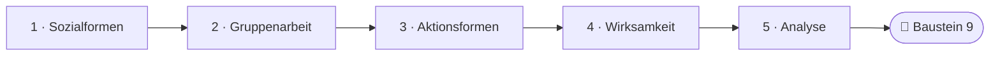
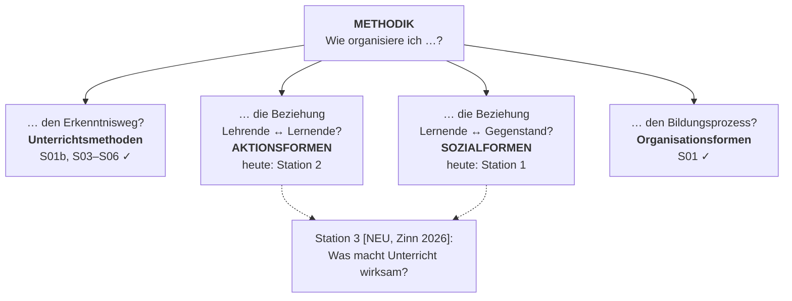
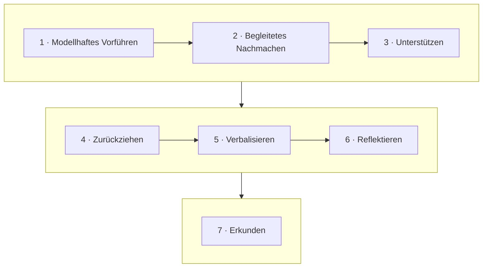

<!--
author:   Hannes Tegelbeckers
email:    hannes.tegelbeckers@ovgu.de
version:  0.2.0
language: de
narrator: Deutsch Female
mode:     Presentation
classroom: enable
comment:  Fachdidaktik technischer Allgemeinbildung II – Sitzung S08. Wer arbeitet mit wem – und wer tut was? Sozialformen, Aktionsformen und die Frage, was Unterricht wirksam macht.

import:   https://raw.githubusercontent.com/LiaTemplates/mermaid_template/0.1.4/README.md
-->

# S08 – Sozialformen & Aktionsformen

Fachdidaktik technischer Allgemeinbildung II · OVGU Magdeburg · Montag, 30.11.2026, 07:00–09:00 Uhr

<!-- didaktik="Planungsraster S08 · E-03, E-04, E-12, E-17, E-19, E-27, E-32, E-33 · 0–10 Einstieg (Schätzungen, These, Beobachtungen) · 10–15 Kurskarte · 15–35 Station 1 Sozialformen · 35–55 Station 2 Aktionsformen · 55–65 Station 3 [NEU] Wirksamkeit (mit Werkstattbeispiel einleiten) · 65–78 Analyse der Sitzung (Doppeldecker) · 78–85 Baustein 9 · 85–90 Abschluss" -->
> [!IMPORTANT] 🧭 Leitfrage
> Wer arbeitet mit wem – und wer tut was? – Auf der Kurskarte schließen wir heute die zwei noch offenen Leitfragen aus S01.

> [!TIP] 📚 Vor der Sitzung
> Haben Sie geschätzt, wie viel Unterrichtszeit Frontalunterricht ist, und eine Lehrveranstaltung beobachtet? Wir starten mit Ihren Zahlen.

📝 **Beuteblatt S08** – ergänzen Sie es während der Sitzung.

## Einstieg: Wie viel ist frontal?

    --{{0}}--
Ihre Schätzungen aus der Vorbereitung liegen vor. Die Zahl von den Folien sehen Sie gleich in Station 1. Vorher eine These. Stimmen Sie ab – am Ende stimmen wir noch einmal ab.

> **„Wer zu 77 % frontal unterrichtet, unterrichtet schlecht.“**

**Vote (before):** Stimmen Sie dieser These zu?

[(a)] Ja, ich stimme zu
[(b)] Nein, ich stimme nicht zu
[(c)] Teils, teils
[(undecided)] Undecided

    --{{1}}--
Notieren Sie allein, was Sie in dieser Woche beobachtet haben.

      {{1}}
****************************************

> [!TIP] 🧠 Allein · 3 min
> Welche Sozialformen haben Sie diese Woche in einer Lehrveranstaltung beobachtet – und wie lange? Warum hat die Lehrperson wohl so entschieden?

[[___ ___ ___]]

****************************************

    --{{2}}--
Zwei oder drei von Ihnen nennen ihre Beobachtung.

      {{2}}
> [!TIP] 📣 Plenum · 2 min
> Zwei bis drei Freiwillige nennen ihre Beobachtung und die vermutete Begründung der Lehrperson.

## Ihr Weg durch die Sitzung

    --{{0}}--
Wir gehen von den Sozialformen und den Varianten der Gruppenarbeit zu den Aktionsformen. Dann fragen wir mit Zinn, was Unterricht wirksam macht, und analysieren zum Schluss die heutige Sitzung selbst.

    --{{1}}--
Auf diesem Weg erreichen Sie sechs Ziele.

      {{1}}

<!-- data-type="none" -->
| Know | Can do | Value |
|------|--------|-------|
| Sozialformen und Aktionsformen mit ihren Merkmalen **nennen** | für eine Situation die passende Gruppenarbeitsvariante und Gesprächsform **bestimmen** | die These zum Frontalunterricht begründet **beurteilen** |
| die Varianten der Gruppenarbeit und die Merkmale selbstständiger Schülerarbeit **erläutern** | eine Unterrichtsstunde nach Sozial- und Aktionsform **analysieren** und Oberflächen- von Tiefenstrukturen **unterscheiden** | eine Abfolge von Sozial- und Aktionsformen für Ihren Entwurf **planen** *(optional)* |

    --{{2}}--
Prüfen Sie kurz, ob Sie den Weg lesen können.

      {{2}}
****************************************

**Decide:** Welche Station folgt direkt auf die Aktionsformen?

<!-- data-hint-button="1" data-solution-button="2" -->
- [(X)] Wirksamkeit
- [( )] Gruppenarbeit
- [( )] Analyse
[[?]] Folgen Sie den Pfeilen von links nach rechts.
***
Richtig: Nach den Aktionsformen fragen wir mit Zinn (2026), was Unterricht wirksam macht.
***

****************************************

## Kurskarte: die zwei offenen Leitfragen aus S01

    --{{0}}--
Erinnern Sie sich an die vier Leitfragen aus S01. Den Erkenntnisweg haben wir mit den Unterrichtsmethoden in S01b und S03 bis S06 bearbeitet, die Organisationsformen in S01. Heute schließen wir die beiden offenen.

    --{{1}}--
Wie organisiere ich die Beziehung zwischen Lernenden und Gegenstand? Das sind die Sozialformen – Station 1.

      {{1}}
**① Sozialformen:** Beziehung Lernende ↔ Gegenstand: Frontalunterricht, Einzelarbeit, Gruppenarbeit …

    --{{2}}--
Und wie die Beziehung zwischen Lehrenden und Lernenden? Das sind die Aktionsformen – Station 2.

      {{2}}
**② Aktionsformen:** Beziehung Lehrende ↔ Lernende: darbietend, selbstständig, erarbeitend

    --{{3}}--
Zum Schluss fragen wir mit Zinn, was Unterricht eigentlich wirksam macht.

      {{3}}
**③ Wirksamkeit [NEU]:** Oberflächen- und Tiefenstrukturen von Unterricht (Zinn 2026)

    --{{4}}--
Erinnern Sie sich an die Beispiele aus S01.

      {{4}}
> [!NOTE] Key message
> 🔗 S01: Lehrervortrag, Schülervortrag, Unterrichtsgespräch, Diskussion, Demonstration waren *Aktionsformen*; Frontalunterricht, Einzel-, Partner-, Gruppenarbeit, Lernen in Abteilungen waren *Sozialformen*. Heute lernen Sie, was dahintersteckt.

<small>Kurskarte als Lesehilfe (vgl. S01, Folien R036–R039), keine Originalfolie dieser Sitzung.</small>

## Station 1: Sozialformen

    --{{0}}--
Wir beginnen mit den Sozialformen, Folie R146 – und mit Ihrer Schätzung aus der Vorbereitung.

**Wer arbeitet mit wem – und was folgt daraus?**

    --{{1}}--
Zuerst: was Sozialformen sind und wie oft sie vorkommen.

      {{1}}
- Was Sozialformen sind – und wie oft sie vorkommen (R147)

    --{{2}}--
Dann der Frontalunterricht.

      {{2}}
- Frontalunterricht (R148)

    --{{3}}--
Dann die Einzelarbeit.

      {{3}}
- Einzelarbeit (R149)

    --{{4}}--
Und die Gruppenarbeit mit vier Varianten.

      {{4}}
- Gruppenarbeit und ihre vier Varianten (R150–R151)

    --{{5}}--
Warum ist das für Sie wichtig?

      {{5}}
> [!TIP] Why this matters
> Jede Phase Ihres Unterrichts braucht eine Sozialform – die Wahl sollte vom Lernziel abhängen, nicht von der Gewohnheit.

    --{{6}}--
Markieren Sie, was Sie schon kennen.

      {{6}}
****************************************

**Mark:** Which of these do you already know? (several possible)

[[a1]] Was Sozialformen sind – und wie oft sie vorkommen (R147)
[[a2]] Frontalunterricht (R148)
[[a3]] Einzelarbeit (R149)
[[a4]] Gruppenarbeit und ihre vier Varianten (R150–R151)

****************************************

## 7. Sozialformen: was sie sind und wie oft sie vorkommen

    --{{0}}--
Sozialformen sind Organisationsformen, die durch die Möglichkeiten der Lehrer-Schüler-Interaktion definiert sind. Wie häufig kommen sie vor? Nach Meyer entfallen knapp 77 Prozent der Unterrichtszeit auf Frontalunterricht, etwa 10 Prozent auf Einzelarbeit, rund 7 Prozent auf Gruppenunterricht und jeweils unter 3 Prozent auf Partnerarbeit und Klassenkooperation.

- Sind Organisationsformen, durch unterschiedliche Möglichkeiten der Lehrer-Schüler-Interaktion definiert
- Bestimmen die organisatorische Seite der Interaktionsmöglichkeiten im Unterricht

<!-- data-type="BarChart" data-title="Sozialformen – Häufigkeit (nach Meyer)" data-ylabel="Anteil in %" data-show -->
| Sozialformen | Häufigkeit (nach MEYER) |
| ------------ | ----------------------: |
| Gruppenunterricht | 7.4 |
| Klassenkooperation | 2.6 |
| Frontalunterricht | 76.86 |
| Partnerarbeit | 2.88 |
| Einzelarbeit | 10.24 |

    --{{1}}--
Vergleichen Sie mit Ihrer Schätzung.

      {{1}}
> [!NOTE] Key message
> 💬 Lagen Sie mit Ihrer Schätzung darüber oder darunter? Gut drei Viertel der Unterrichtszeit ist Frontalunterricht.

<small>Quelle: Folie R147 „7. Sozialformen“ (Abschnitt „Sozialformen“, Folie R146) – Werte wie im Original (dort mit Komma: 7,4 %, 2,6 %, 76,86 %, 2,88 %, 10,24 %); Jahr der Erhebung auf der Folie nicht angegeben; „Klassenkooperation“ ist auf der Folie nicht definiert.</small>

## 7.1 Frontalunterricht

    --{{0}}--
Im Frontalunterricht geht die Klasse gemeinsam unter unmittelbarer Führung des Lehrers vor: Er richtet seine Impulse an alle und vereinigt alle Reaktionen wieder auf sich. Typisch sind Lehrervortrag, Demonstration und Unterrichtsgespräch.

- Gemeinsames Vorgehen unter unmittelbarer Führung des Lehrers
- Lehrer richtet seine Impulse an die gesamte Klasse und vereinigt alle Reaktionen der Schüler wieder auf sich
- Typisch dafür sind: Lehrervortrag, Demonstration, Unterrichtsgespräch
- Eine rationelle Organisationsform
  - Nicht immer rationellste, da die Selbstständigkeit der Schüler missachtet wird
- Schnell auf den direkten Weg der Erkenntnis geführt
- Individualität wird für die Klasse aufgegeben
- Überprüfung der Lernergebnisse ist unbedingt erforderlich, besonders bei den schwächeren Schülern

    --{{1}}--
Die Folie nennt ihn rationell, aber nicht immer am rationellsten.

      {{1}}
> [!NOTE] Key message
> Frontalunterricht führt schnell zur Erkenntnis – aber die Lernergebnisse müssen überprüft werden, besonders bei den schwächeren Schülern.

<small>Quelle: Folie R148 „7.1 Frontalunterricht“</small>

## 7.2 Einzelarbeit

    --{{0}}--
In der Einzelarbeit löst jede Schülerin, jeder Schüler die gestellte Aufgabe selbstständig, ohne Austausch mit anderen; der Lehrer führt nur mittelbar.

- Selbstständiges individuelles Lösen von Aufgaben ohne Informationsaustausch zwischen Schülern
- Während des Arbeitsaktes mittelbare Führung durch den Lehrer
- Jeder Schüler muss die vom Lehrer gestellte Aufgabe lösen
- Kann während einer Durchführung einer Übung oder zur Erarbeitung, Erweiterung und Vertiefung des Wissens eingesetzt werden
- Vom Schüler wird Selbstständigkeit, Energie, Beharrlichkeit verlangt und Selbstvertrauen gestärkt
- Tatsächliche Leistung des Schülers kann besser eingeschätzt werden
- Gibt Anleitung, Hilfe und Unterstützung durch den Lehrer und die Mitschüler
- Um Schüler zum selbstständigen Lösen zu befähigen

    --{{1}}--
Einzelarbeit verlangt Selbstständigkeit und Beharrlichkeit und stärkt das Selbstvertrauen.

      {{1}}
> [!NOTE] Key message
> In der Einzelarbeit lässt sich die tatsächliche Leistung besser einschätzen – deshalb nutzt diese Vorlesung sie für die Classroom-Auswertung.

<small>Quelle: Folie R149 „7.2 Einzelarbeit“ („wir“ zu „wird“ korrigiert)</small>

## 7.3 Gruppenarbeit

    --{{0}}--
In der Gruppenarbeit wechseln kooperatives und individuelles Lernen, und die Schüler tauschen Informationen aus. Die unmittelbare Führung des Lehrers tritt nach der Aufgabenstellung zurück, bis das Ergebnis kontrolliert wird.

- Selbstständiges Arbeiten in der Gruppe
- Arbeitsphasen durch Zusammenspiel von kooperativem und individuellen Lernen gekennzeichnet
- Zwischen den Schülern erfolgt ein Informationsaustausch
- Unmittelbare Führung des Lehrers tritt nach der Aufgabenstellung bis zur Kontrolle des Ergebnisses zurück
- Sozialfähigkeit wird geübt
- Spaltung von Klassen in aktive und passive Schüler kann vermindert werden
- Es gibt mehrere Varianten der Gruppenarbeit

    --{{1}}--
Die Tabelle zeigt vier Varianten aus zwei Unterscheidungen: Bekommen die Gruppen dieselbe Aufgabe oder verschiedene? Und arbeiten die Mitglieder einer Gruppe alle am Gleichen oder arbeitsteilig?

      {{1}}
****************************************

<!-- data-type="none" -->
| | **aufgabengleich** (Gruppen gleiche Aufgaben) | **aufgabenverschieden** (Gruppen unterschiedliche Aufgaben) |
| --- | --- | --- |
| **arbeitsgleich** | Gruppe A1: a1, b1 · Gruppe B1: c1, d1 | Gruppe A1: a1, b1 · Gruppe B2: c2, d2 |
| **arbeitsteilig** | Gruppe A1: a1,1, b1,2 · Gruppe B1: c1,1, d1,2 | Gruppe A1: a1,1, b1,2 · Gruppe B2: c2,1, d2,2 |

**Lesehilfe:** Großbuchstabe = Gruppe, Ziffer = Gruppenaufgabe (A1 und B1: gleiche Aufgabe 1; A1 und B2: verschiedene Aufgaben); Kleinbuchstabe = Gruppenmitglied, zweite Ziffer = Teilaufgabe (a1,1 und b1,2: Aufgabe 1 in zwei Teilaufgaben aufgeteilt).

****************************************

    --{{2}}--
Zwei Fragen genügen, um jede Gruppenarbeit einzuordnen.

      {{2}}
> [!NOTE] Key message
> aufgabengleich/-verschieden fragt nach den **Gruppen**, arbeitsgleich/-teilig nach den **Mitgliedern** einer Gruppe.

<small>Quelle: Folien R150 und R151 „7.3 Gruppenarbeit“ – Grafik (Kreise) als Tabelle übertragen und gegen das Original geprüft; die Deutung der Kennzeichnung ist aus der Abbildung abgeleitet.</small>

## Aktivierung: Welche Variante der Gruppenarbeit?

    --{{0}}--
Ordnen Sie Situationen den Varianten der Gruppenarbeit zu. Die Beispiele sind Übungsbeispiele, nicht von den Originalfolien. Danach ergänzen Sie Abschnitt 1 Ihres Beuteblatts.

**1 · Choose one:** Alle Gruppen dimensionieren dieselbe Leitung; in jeder Gruppe rechnen alle alles. Welche Variante ist das?

<!-- data-hint-button="1" data-solution-button="2" -->
- [( )] aufgabengleich + arbeitsteilig
- [(X)] aufgabengleich + arbeitsgleich
- [( )] aufgabenverschieden + arbeitsgleich
[[?]] Gleiche Aufgabe für alle Gruppen – und innerhalb der Gruppe?
***
Gruppen mit derselben Aufgabe (A1, B1), Mitglieder an derselben Aufgabe (a1, b1).
***

    --{{1}}--
Jetzt können mehrere Antworten richtig sein.

      {{1}}
****************************************

**2 · Choose all that apply:** Welche Situationen sind arbeitsteilig?

<!-- data-hint-button="1" data-solution-button="2" -->
- [[X]] Alle Gruppen planen dieselbe Küche; in jeder Gruppe übernimmt eine Person die Beleuchtung, eine die Steckdosen.
- [[ ]] Gruppe A testet ein Brückenmodell aus Holz, Gruppe B eines aus Pappe; in der Gruppe arbeiten alle gemeinsam an allem.
- [[X]] Gruppe A plant den Rohbau, Gruppe B die Haustechnik; jede Gruppe teilt ihre Aufgabe in Teilaufgaben auf.
- [[ ]] Alle Gruppen dimensionieren dieselbe Leitung; in jeder Gruppe rechnen alle alles.
[[?]] Arbeitsteilig = die Mitglieder einer Gruppe bearbeiten Teilaufgaben.
***
Arbeiten die Mitglieder einer Gruppe an derselben Aufgabe (a1, b1) oder an Teilaufgaben (a1,1, b1,2)? (R151)
***

****************************************

    --{{2}}--
Zum Schluss tippen Sie einen Begriff.

      {{2}}
****************************************

**3 · Type:** Wie heißt die Variante, bei der die Gruppen unterschiedliche Aufgaben bekommen? (ein Wort)

<!-- data-hint-button="1" data-solution-button="2" -->
[[aufgabenverschieden]]
[[?]] aufgaben…

***
aufgabenverschieden: Gruppen unterschiedliche Aufgaben (A1, B2). 📝 Beuteblatt-Stopp: Ergänzen Sie Abschnitt 1.
***

****************************************

## Station 2: Aktionsformen

    --{{0}}--
In der zweiten Station wechseln wir von der Frage, wer mit wem arbeitet, zur Frage, wer was tut – Lehrkraft oder Lernende. Folie R152: Aktionsformen.

**Bei wem liegt die Aktivität – und wie führt die Lehrkraft?**

    --{{1}}--
Zuerst drei Aktionsformen im Überblick.

      {{1}}
- Darbietend, selbstständig, erarbeitend (R153)

    --{{2}}--
Dann die vier Verfahren der darbietenden Form.

      {{2}}
- Darbietend: Vormachen, Vorzeigen, Vorführen, Vortragen (R154)

    --{{3}}--
Dann zwei Merkmale selbstständiger Schülerarbeit nach Jessipow.

      {{3}}
- Selbstständig: zwei Merkmale nach Jessipow (R155–R156)

    --{{4}}--
Und das Unterrichtsgespräch als Grundform der erarbeitenden Aktionsform.

      {{4}}
- Erarbeitend: Unterrichtsgespräch (R157)

    --{{5}}--
Warum ist das für Sie wichtig?

      {{5}}
> [!TIP] Why this matters
> Dieselbe Sozialform kann mit ganz verschiedenen Aktionsformen gefüllt werden – ein Vortrag vor der Klasse ist etwas anderes als ein Unterrichtsgespräch.

    --{{6}}--
Markieren Sie, was Sie schon kennen.

      {{6}}
****************************************

**Mark:** Which of these do you already know? (several possible)

[[a1]] Darbietend, selbstständig, erarbeitend (R153)
[[a2]] Darbietend: Vormachen, Vorzeigen, Vorführen, Vortragen (R154)
[[a3]] Selbstständig: zwei Merkmale nach Jessipow (R155–R156)
[[a4]] Erarbeitend: Unterrichtsgespräch (R157)

****************************************

## 8. Aktionsformen im Überblick

    --{{0}}--
Die Folie unterscheidet drei Aktionsformen. Darbietend: Der Akzent liegt beim Lehrer, es überwiegt rezeptives Lernen, und er führt unmittelbar. Selbstständig: Der Lehrer tritt in den Hintergrund, die Schüler lösen eine gestellte Aufgabe, es überwiegt produktives Lernen, und er führt nur mittelbar. Erarbeitend: meist als Unterrichtsgespräch, mit rezeptiven, reproduktiven und produktiven Anteilen.

<!-- data-type="none" -->
| Darbietend | Selbstständig | Erarbeitend |
| --- | --- | --- |
| Aktivitätsakzent liegt bei Lehrer | Lehrer tritt in den Hintergrund | Meist in Form des Unterrichts-gesprächs |
| Er zeigt, demonstriert, berichtet, erzählt, … | Schüler treten stärker in Erscheinung | Die Lernsituation ist durch rezeptive, reproduktive und produktive Leistungen charakterisiert |
| Es überwiegt das rezeptive Lernen | Schüler lösen relativ selbstständig eine vom Lehrer gestellte Aufgabe | |
| Der Lehrer führt unmittelbar | Es überwiegt das produktive Lernen | |
| | Lehrer führt nur mittelbar | |

    --{{1}}--
Was heißt unmittelbar und mittelbar führen?

      {{1}}
> [!NOTE] Key message
> 🔎 *Unmittelbar* führt die Lehrkraft, wenn sie jeden Schritt selbst steuert (z. B. im Lehrervortrag). *Mittelbar* führt sie über die gestellte Aufgabe und das Material, während die Lernenden arbeiten (vgl. Einzelarbeit, R149). *Lesehilfe, abgeleitet aus R148–R153.*

<small>Quelle: Folie R153 „8. Aktionsformen“ (Abschnitt „Aktionsformen“, Folie R152)</small>

## 8.1 Darbietend

    --{{0}}--
Die darbietende Aktionsform ermöglicht eine rationelle Stoffvermittlung. Sie kennt vier Verfahren: Vormachen, Vorzeigen an statischen Lernmitteln, Vorführen von Prozessen – etwa bei Exkursion oder Experiment – und Vortragen, bei dem die Sprache das vorherrschende Mittel ist.

Bietet rationelle Stoffvermittlung, hat erziehende Wirkung durch den Lehrervortrag, bietet Möglichkeit zur Ausbildung der Fähigkeit zur rationellen Aneignung von Wissen

**Verfahren:**

- **Vormachen** (Vorlesen, Vormachen, Vormachen, Werkunterricht, Sport)
- **Vorzeigen** (an statischen Lernmitteln wird etwas repräsentativ gezeigt)
- **Vorführen** (Veranschaulichung von Prozessen, Exkursion, Experiment)
- **Vortragen** (die Sprache ist hier das vorherrschende Mittel)

    --{{1}}--
Vorführen kennen Sie aus S05: das Lehrerexperiment als Demonstration.

      {{1}}
> [!NOTE] Key message
> Vorführen = Lehrerexperiment als Demonstration (S05, R094) – darbietend, auch wenn ein Experiment im Spiel ist.

<small>Quelle: Folie R154 „8.1 Darbietend“ (Wortlaut unverändert, auch die Doppelung „Vormachen, Vormachen“)</small>

## 8.2 Selbstständig

    --{{0}}--
Selbstständige Schülerarbeit ist nicht ganz ohne Hilfe des Lehrers möglich – und nicht jede Arbeit allein ist schon selbstständige Schülerarbeit. Jessipow nennt zwei Merkmale.

- Nicht ganz ohne Hilfe des Lehrers durchführbar
- Andererseits kann nicht jede selbstständige Arbeit des Schülers als selbstständige Schülerarbeit angesehen werden

**Zwei Merkmale nach Jessipow**

1. Eine Aufgabenstellung durch den Lehrer und angemessene Zeit für die Lösung dieser Aufgabe durch die Schüler
2. Die sich aus der Aufgabe ergebene Notwendigkeit für die Schüler, unter Anspannung ihrer Kräfte die besten Lösungswege zu suchen und zu beschreiten

> Selbstständige Schülerarbeit, wenn der Schüler Aufgabenstellung und Lösungsansätze richtig zuordnet, sein vorhandenes Wissen und Können anzuwenden und die gestellte Aufgabe ohne unmittelbare, jedoch Einzelheit regulierende Anleitung durch den Lehrer zu lösen vermag

    --{{1}}--
Richtig gesteuert führt sie zu tieferer Aneignung, einer positiven Lerneinstellung und mehr Fähigkeit zum selbstständigen Denken und Arbeiten.

      {{1}}
****************************************

**Positive Auswirkungen**

- Die methodisch richtig gesteuerte selbstständige Schülerarbeit erhöht die Effektivität des Aneignungsprozesses – es führt zu einer tieferen und bewussteren Aneignung
- Lerneinstellung wird positiv beeinflusst
- Während hauptsächlich rezeptiver Aktionsformen kommt es in der Klasse zu Leistungsdifferenzen – durch produktive Aktionsformen werden diese deutlich verdichtet, er kommt zu einer Leistungskonglobation
- Es erfolgt eine Fähigkeitssteigerung im selbstständigen Denken, Arbeiten und Organisieren

🔎 *Lesehilfe zu „Leistungskonglobation“:* Gemeint ist laut dem Satz selbst, dass die Leistungsunterschiede in der Klasse „deutlich verdichtet“ werden – die Leistungen rücken enger zusammen (lat. *conglobare* = zusammenballen).

****************************************

    --{{2}}--
Verbinden Sie das mit S02.

      {{2}}
> [!NOTE] Key message
> 🔗 S02: Die Selbständigkeitsstufen (R045: nachvollziehen → anpassen → auswählen → kombinieren → entwerfen) beschreiben, *wie* selbstständig – Jessipows Merkmale, *wann* eine Arbeit überhaupt als selbstständige Schülerarbeit gilt.

<small>Quelle: Folien R155–R156 „8.2 Selbstständig“ (im Original: JESSIPOW; Wortlaut unverändert; Lesehilfe ergänzt)</small>

## 8.3 Erarbeitend

    --{{0}}--
Die Grundform der erarbeitenden Aktionsform ist das Unterrichtsgespräch. Die Folie ordnet Gespräche auf zwei Weisen: nach der didaktischen Aufgabe – Erarbeitung, Wiederholung, Prüfung – und nach dem Charakter der Führung, vom stark gelenkten Lehrergespräch über das locker gehaltene Gespräch bis zu Diskussion und Debatte als Vorformen des wissenschaftlichen Gesprächs.

- Grundform ist das Unterrichtsgespräch
- Ist erfolgreich, wenn eine neue Erkenntnis erworben werden soll

<!-- data-type="none" -->
| Charakter zunächst von der didaktischen Aufgabe bestimmt | Charakter der didaktischen Führung |
| --- | --- |
| Das Unterrichtsgespräch zur Erarbeitung von neuem Wissen, zur Herausbildung von Überzeugungen und zur Entwicklung von Fähigkeiten | Das Lehrergespräch mit starker Betonung des Belehrens und der direkten Führung durch den Lehrer |
| Das Wiederholungsgespräch | Das locker gehaltene Gespräch, bei dem der Lehrer zwar führt, jedoch stärker in den Hintergrund tritt |
| Das Prüfungsgespräch | Diskussion und Debatte als Vorformen des wissenschaftlichen Gesprächs |

    --{{1}}--
Zwei Fragen helfen bei der Wahl der Gesprächsform.

      {{1}}
> [!NOTE] Key message
> Wozu dient das Gespräch (erarbeiten, wiederholen, prüfen)? Und wie stark führt die Lehrkraft (Lehrergespräch → lockeres Gespräch → Diskussion und Debatte)?

<small>Quelle: Folie R157 „8.3 Erarbeitend“</small>

## Aktivierung: Verfahren und Gespräche zuordnen

    --{{0}}--
Drei kurze Fragen zu den Aktionsformen.

**1 · Choose one:** Lernende bearbeiten ein Arbeitsblatt, dessen Lösungsweg Schritt für Schritt vorgegeben ist. Ist das selbstständige Schülerarbeit im Sinne der Folien?

<!-- data-hint-button="1" data-solution-button="2" -->
- [( )] Ja – sie arbeiten ja allein.
- [(X)] Nein – es fehlt die Notwendigkeit, unter Anspannung der Kräfte die besten Lösungswege selbst zu suchen.
- [( )] Ja – solange genug Zeit gegeben wird.
[[?]] Jessipow nennt zwei Merkmale – beide müssen erfüllt sein.
***
„Nicht jede selbstständige Arbeit des Schülers [kann] als selbstständige Schülerarbeit angesehen werden“ (R155). Vgl. S05: Eine Anleitung nimmt Planen und Entscheiden vorweg.
***

    --{{1}}--
Jetzt können mehrere Antworten richtig sein.

      {{1}}
****************************************

**2 · Choose all that apply:** Welche Verfahren gehören zur darbietenden Aktionsform?

<!-- data-hint-button="1" data-solution-button="2" -->
- [[X]] Vorführen
- [[ ]] Prüfungsgespräch
- [[X]] Vortragen
- [[ ]] Diskussion und Debatte
[[?]] Darbietend: Vormachen, Vorzeigen, Vorführen, Vortragen.
***
Prüfungsgespräch sowie Diskussion und Debatte sind Gesprächsformen der erarbeitenden Aktionsform (R157).
***

****************************************

    --{{2}}--
Zum Schluss tippen Sie einen Begriff.

      {{2}}
****************************************

**3 · Type:** Wie heißt die Grundform der erarbeitenden Aktionsform? (ein Wort)

<!-- data-hint-button="1" data-solution-button="2" -->
[[Unterrichtsgespräch]]
[[?]] Es steht auf Folie R157 ganz oben.

***
Grundform ist das Unterrichtsgespräch (R157).
***

****************************************

## Station 3: [NEU] Was macht Unterricht wirksam?

    --{{0}}--
Die letzte Station ist eine Ergänzung aus Zinn 2026, deshalb als NEU markiert. Denken Sie an eine Werkstattstunde: Zwei Lehrkräfte lassen in Gruppen arbeiten – und trotzdem kann der Unterricht sehr verschieden wirken.

<!-- neu="Zinn 2026, S. 270–271" -->
**Sozialformen und Handlungsformen:** Zinn (2026, S. 270) nennt als typische Sozialformen Plenumsunterricht, Gruppenunterricht, Tandemarbeit, Einzelarbeit und den hybriden Sozialformenmix (vgl. Meyer & Junghans 2021). Die Wahl soll „insbesondere in Abhängigkeit der intendierten Lernziele, dem Vorwissen, dem Lerninhalt, den personalen und sozialen Kompetenzen“ erfolgen. Als **Handlungsformen** bezeichnet er die kleinsten Interaktionseinheiten – z. B. eine Frage stellen, Loben und Tadeln, Hinweisen, Vorführen (S. 270–271).

    --{{1}}--
Zinn unterscheidet Oberflächenstrukturen – leicht beobachtbare Merkmale wie Sozialform und Organisationsform – von Tiefenstrukturen, also der Qualität der Lehr-Lern-Prozesse.

      {{1}}
****************************************

<!-- neu="Zinn 2026, S. 272–273" -->
**Oberflächen- und Tiefenstrukturen:** Zinn (2026, S. 272) unterscheidet die **Oberflächenstrukturen** (Sichtstrukturen) – leicht beobachtbare Merkmale wie Unterrichtsformen, Sozialformen und Organisationsformen – von den **Tiefenstrukturen**, der Qualität der Interaktion mit dem Lernstoff und zwischen Lehrenden und Lernenden.

<!-- data-type="none" -->
| Dimension der Tiefenstruktur | Leitfrage (gekürzt nach Zinn 2026, S. 273) |
| --- | --- |
| **Klassenführung** | Verstehen die Lernenden die Ziele, gibt es wenige Störungen, sind alle beteiligt, wird die Zeit effektiv genutzt? |
| **Potenzial zur kognitiven Aktivierung** | Setzen sich die Lernenden aktiv und vertieft mit dem Lernstoff auseinander? |
| **Konstruktive Unterstützung** | Wie hilft die Lehrkraft bei Verständnisproblemen – wertschätzend und respektvoll? |

****************************************

    --{{2}}--
Die Pointe:

      {{2}}
> [!NOTE] Key message
> „Innerhalb einer gleichen Oberflächenstruktur (z. B. Projektarbeit mit Gruppenarbeit) können unterschiedliche Lehr-Lern-Prozesse erfolgen.“ (Zinn 2026, S. 272)

<small>[NEU] Ergänzung, keine Originalfolie: Zinn (2026), S. 270–273 – siehe Literatur.</small>

## [NEU] Cognitive Apprenticeship

    --{{0}}--
Ein strukturierter Übergang von angeleitetem zu selbstständigem Lernen ist das Modell der Cognitive Apprenticeship – sieben Schritte nach Zinn.

    --{{1}}--
Zuerst führt die Lehrkraft modellhaft vor, dann machen die Lernenden begleitet nach, und die Lehrkraft unterstützt gezielt.

      {{1}}
****************************************

1. **Modellhaftes Vorführen:** Modeling
2. **Begleitetes Nachmachen:** Coaching
3. **Unterstützen:** Scaffolding

****************************************

    --{{2}}--
Dann zieht sie sich zurück; die Lernenden verbalisieren und reflektieren ihr Vorgehen.

      {{2}}
****************************************

4. **Zurückziehen:** Fading
5. **Verbalisieren:** Articulation
6. **Reflektieren:** Reflection

****************************************

    --{{3}}--
Am Ende erkunden die Lernenden selbstständig.

      {{3}}
7. **Erkunden:** Exploration

<small>[NEU] Zinn (2026), S. 271, Tab. 11.3 – keine Originalfolie. 🔗 Modeling ist *darbietend* (Vorführen, R154); Fading und Exploration führen zur *selbstständigen* Schülerarbeit (R155).</small>

## Cognitive Apprenticeship ordnen

    --{{0}}--
Ordnen Sie die sieben Schritte vom Vorführen bis zum Erkunden.

**Order:** Drag each card into the right gap.

<!-- data-randomize data-show-partial-solution data-solution-button="2" -->
Step 1: [->[ Modellhaftes Vorführen ]] → Step 2: [->[ Begleitetes Nachmachen ]] → Step 3: [->[ Unterstützen ]] → Step 4: [->[ Zurückziehen ]] → Step 5: [->[ Verbalisieren ]] → Step 6: [->[ Reflektieren ]] → Step 7: [->[ Erkunden ]]

## Kurzcheck: Oberflächen- oder Tiefenstruktur?

    --{{0}}--
Was ist Oberflächenstruktur, was Tiefenstruktur? Zuerst der Vergleich.

<!-- data-type="none" -->
| Criterion | Oberflächenstruktur | Tiefenstruktur |
|-----------|---------------|---------------|
| beobachtbar | leicht, auf einen Blick | nur über die Qualität der Prozesse |
| Beispiele | Sozialform, Organisationsform, Unterrichtsform | Klassenführung, kognitive Aktivierung, konstruktive Unterstützung |
| Leitfrage | Wie ist der Unterricht organisiert? | Wie intensiv und gut wird gelernt? |
| Gleiche Oberfläche … | sieht gleich aus | kann ganz unterschiedlich sein |

    --{{1}}--
Je ein Beispiel:

      {{1}}
- **Oberflächenstruktur:** Die Klasse arbeitet in Dreiergruppen.
- **Tiefenstruktur:** Die Lehrkraft gibt formatives Feedback und geht konstruktiv mit Fehlern um.

    --{{2}}--
Ein typischer Fehlschluss:

      {{2}}
> [!WARNING] Common misconception
> Abwechslungsreiche Sozialformen sind noch kein guter Unterricht – entscheidend ist, was in der Tiefenstruktur passiert.

    --{{3}}--
Ordnen Sie jetzt zu.

      {{3}}
****************************************

**Decide:** Which concept does each statement describe?

<!-- data-hint-button="1" data-solution-button="2" data-show-partial-solution -->
[(Oberflächenstruktur) (Tiefenstruktur)]
[       (X)             ( )      ] Die Klasse arbeitet in Dreiergruppen.
[       ( )             (X)      ] Die Aufgabe knüpft an Vorwissen an und löst einen kognitiven Konflikt aus.
[       (X)             ( )      ] Es ist eine Projektwoche.
[       ( )             (X)      ] Die Lehrkraft gibt formatives Feedback und geht konstruktiv mit Fehlern um.
[[?]] Sieht man es auf einen Blick – oder nur, wenn man auf die Qualität achtet?
***
Oberflächenstrukturen sind leicht beobachtbar (Sozialform, Organisationsform). Tiefenstrukturen betreffen die Qualität der Lehr-Lern-Prozesse: Klassenführung, kognitive Aktivierung, konstruktive Unterstützung (Zinn 2026, S. 272–273).
***

****************************************

## Wo stehen wir? Die heutige Sitzung analysieren

    --{{0}}--
Bestimmen Sie für Phasen der heutigen Sitzung die Sozialform – und für eine Phase, welche Sozialform sie gehabt hätte, wenn wir sie anders organisiert hätten.

**1 · Choose one:** Welche Sozialform hatte der Vortrag in Station 1 und 2?

<!-- data-hint-button="1" data-solution-button="2" -->
- [( )] Einzelarbeit
- [(X)] Frontalunterricht
- [( )] Gruppenarbeit
[[?]] Wer richtet die Impulse an alle?
***
Frontalunterricht – Aktionsform: darbietend, Vortragen (R148, R154).
***

    --{{1}}--
Jetzt können mehrere Antworten richtig sein.

      {{1}}
****************************************

**2 · Choose all that apply:** Welche Phasen der heutigen Sitzung waren Einzelarbeit?

<!-- data-hint-button="1" data-solution-button="2" -->
- [[X]] Blitzumfrage zur These
- [[ ]] Vortrag in Station 1 und 2
- [[X]] Zuordnungsaufgaben
- [[ ]] diese Analyse, wenn Sie sie zu dritt gemacht hätten
[[?]] Jede und jeder hat für sich gearbeitet.
***
Diese Vorlesung wechselt bewusst nur zwischen Frontalunterricht und Einzelarbeit, damit jede Antwort über die Classroom-Funktion ausgewertet werden kann. An der Oberfläche ist das wenig abwechslungsreich – entscheidend ist die Tiefenstruktur.
***

****************************************

    --{{2}}--
Und eine Phase, wie sie hätte sein können.

      {{2}}
****************************************

**3 · Type:** Welche Sozialform wäre der Einstieg gewesen, wenn Sie Ihre Beobachtungen mit der Nachbarin besprochen hätten? (ein Wort)

<!-- data-hint-button="1" data-solution-button="2" -->
[[Partnerarbeit]]
[[?]] Zu zweit …

***
Zu zweit = Partnerarbeit; zu dritt wäre es Gruppenarbeit (aufgabengleich, arbeitsgleich).
***

****************************************

## Und die Tiefenstruktur? Noch einmal zur These

    --{{0}}--
Stimmen Sie noch einmal über die These vom Anfang ab.

**Vote (after):** Stimmen Sie der These „Wer zu 77 % frontal unterrichtet, unterrichtet schlecht.“ zu?

[(a)] Ja, ich stimme zu
[(b)] Nein, ich stimme nicht zu
[(c)] Teils, teils
[(undecided)] Undecided

    --{{1}}--
Wo war die kognitive Aktivierung heute hoch, wo niedrig – unabhängig von der Sozialform?

      {{1}}
****************************************

**Reflect:** Wo war die kognitive Aktivierung heute hoch, wo niedrig – unabhängig von der Sozialform? War der Vortrag kognitiv aktivierend? Begründen Sie in zwei Sätzen.

[[___ ___]]

****************************************

    --{{2}}--
Vergleichen Sie Ihr Votum mit dem vom Anfang.

      {{2}}
> [!NOTE] Key message
> Ob Unterricht gut ist, entscheidet nicht der Anteil des Frontalunterrichts (Oberflächenstruktur), sondern die Qualität der Lehr-Lern-Prozesse (Tiefenstruktur) – und die Überprüfung der Lernergebnisse (R148).

## Baustein 9 für Ihren Unterrichtsentwurf (optional)

    --{{0}}--
Planen Sie für Ihr Entwurfsthema die Abfolge der Sozial- und Aktionsformen, zum Beispiel für Ihre Großform aus Baustein 7. Begründen Sie jede Entscheidung mit dem Lernziel – nicht mit Abwechslung.

<!-- didaktik="Lehrschritt üben lassen (Transfer) · 78–85 min · Einzelarbeit · Classroom-Auswertung" -->
**Allein (7 min):** Planen Sie die Abfolge der Sozial- und Aktionsformen für Ihren Entwurf.

<!-- data-type="none" -->
| Phase | Sozialform | Aktionsform | Begründung (Lernziel) |
| --- | --- | --- | --- |
| … | … | … | … |

[[___ ___ ___ ___]]

💡 Hint 1

Fragen Sie für jede Phase: Was sollen die Lernenden danach können – und wer muss dafür aktiv sein?

✅ Solution

Beispiel Instandsetzungsaufgabe: Einstieg mit Problemstellung – Frontalunterricht, darbietend (Vorführen des Schadens), damit alle dasselbe Phänomen sehen · intuitive Phase – Einzelarbeit, selbstständig, damit jede Vermutung festgehalten wird · Planung – Gruppenarbeit aufgabengleich, arbeitsteilig, weil der Plan mehrere Teilaufgaben hat · Durchführung – Partnerarbeit, selbstständig · Auswertung – Frontalunterricht, erarbeitend (Unterrichtsgespräch), um die Lösungen zu vergleichen.

## Das Wichtigste aus S08

    --{{0}}--
Fassen wir zusammen.

    --{{1}}--
Erstens: die Sozialformen.

      {{1}}
- Sozialformen organisieren die Interaktion; knapp 77 % der Unterrichtszeit sind Frontalunterricht (Meyer, R147).

    --{{2}}--
Zweitens: die Gruppenarbeit.

      {{2}}
- Gruppenarbeit: aufgabengleich oder -verschieden (Gruppen), arbeitsgleich oder -teilig (Mitglieder) – R151.

    --{{3}}--
Drittens: die Aktionsformen.

      {{3}}
- Aktionsformen: darbietend, selbstständig (Jessipows zwei Merkmale), erarbeitend (Unterrichtsgespräch) – R153–R157.

    --{{4}}--
Und viertens: die Wirksamkeit.

      {{4}}
****************************************

- [NEU] Wirksam macht Unterricht die Tiefenstruktur: Klassenführung, kognitive Aktivierung, konstruktive Unterstützung (Zinn 2026).

> [!NOTE] Remember
> Wählen Sie Sozial- und Aktionsform nach dem Lernziel – und achten Sie auf die Tiefenstruktur.

****************************************

    --{{5}}--
Eine letzte Frage.

      {{5}}
****************************************

**Recap:** Wann ist Schülerarbeit nach Jessipow selbstständig?

<!-- data-hint-button="1" data-solution-button="2" -->
- [( )] Sobald die Lernenden allein arbeiten
- [( )] Wenn die Lehrkraft jeden Schritt vorgibt
- [(X)] Bei Aufgabenstellung mit angemessener Zeit und der Notwendigkeit, die besten Lösungswege selbst zu suchen
[[?]] Zwei Merkmale müssen zusammenkommen.
***
Richtig: beide Merkmale nach Jessipow (R155).
***

****************************************

    --{{6}}--
Nächstes Mal geht es um Medien und KI im Unterricht.

      {{6}}
**➡️ Next:** S09 (07.12.2026): Medien & KI im Unterricht · 📝 Ergänzen Sie die Abschnitte 2 und 3, die Analyse und Ihre wichtigste Beute im Beuteblatt S08.

## Prüfungsfragen zum Üben

    --{{0}}--
Mit diesen fünf Fragen können Sie sich auf die mündliche Prüfung vorbereiten. Die Querverweise zeigen, wo die Themen in anderen Sitzungen wieder auftauchen.

<!-- didaktik="E-12 mündliche Prüfung" -->
1. Was sind Sozialformen? Nennen Sie Vor- und Nachteile des Frontalunterrichts.
2. Erläutern Sie die vier Varianten der Gruppenarbeit an einem Beispiel aus Ihrer Fachrichtung.
3. Unterscheiden Sie darbietende, selbstständige und erarbeitende Aktionsformen.
4. Wann ist Schülerarbeit nach Jessipow „selbstständig“?
5. „Frontalunterricht ist schlechter Unterricht.“ – Nehmen Sie Stellung.

> [!NOTE] 🔗 Querverweise
> vier Leitfragen und Strukturlegetechnik → **S01** · Selbständigkeitsstufen → **S02** · Lehrer- und Schülerexperiment → **S05** · Gruppenbewertung → **S04** · Vorführen, Exkursion, Experiment als Medien der Wirklichkeitserfahrung → **S09**

<small>Die Prüfungsfragen sind experimentell: Sie dienen der Vorbereitung, es ist nicht garantiert, dass Fragen in dieser Form gestellt werden.</small>

## Rückblick auf S08

    --{{0}}--
Nehmen Sie sich zwei Minuten für einen Rückblick. Was ist das Wichtigste – und was ist noch unklar?

**Reflect:** What is the most important thing you learned today – and what is still unclear?

[[___ ___ ___]]

    --{{1}}--
Haken Sie ab, was Sie jetzt können.

      {{1}}
****************************************

**Tick:** What can you do now?

- [ ] Ich kann die vier Varianten der Gruppenarbeit an einem Beispiel erläutern.
- [ ] Ich kann darbietende, selbstständige und erarbeitende Aktionsformen unterscheiden.
- [ ] Ich kann eine Stunde nach Sozialform, Aktionsform und Tiefenstruktur analysieren.

****************************************

    --{{2}}--
Und zum Schluss: Wie hat die Sitzung für Sie funktioniert?

      {{2}}
****************************************

**Feedback:** How did this session work for you?

[(1 agree)(2 rather agree)(3 neutral)(4 rather disagree)(5 disagree)]
[                                                                   ] The pace was appropriate.
[                                                                   ] The explanations were clear.
[                                                                   ] The examples helped me understand.
[                                                                   ] The interactive parts were useful.

****************************************

## Vorbereitung auf S09

    --{{0}}--
In S09 geht es um Medien – von der Tafel bis zu Simulationen und KI-Chatbots. Planen Sie für die Vorbereitung etwa 15 Minuten ein.

<!-- style="max-width:100%;width:60%;display:block;margin:0 auto;" -->

> [!IMPORTANT] Think about it until next time
> Notieren Sie ein Medium, das Sie in einer Stunde Ihrer Fachrichtung einsetzen wollen (Tafel, Modell, Video, Simulation, KI-Chatbot, Realgegenstand …), und wozu. Und: Ist der Overheadprojektor im Technikunterricht tot?

*S09 · Montag, 07.12.2026 · 07:00 Uhr*

## Literatur

    --{{0}}--
Hier finden Sie die Quellen dieser Sitzung.

**Zitiert auf den Originalfolien dieser Sitzung**

- Meyer – Folie R147 („Häufigkeit (nach MEYER)“); Jahr und vollständige Angabe auf der Originalfolie nicht vorhanden.
- Jessipow – Folie R155 („Zwei Merkmale nach JESSIPOW“); Jahr und vollständige Angabe auf der Originalfolie nicht vorhanden.

**[NEU] Ergänzende Literatur**

- Zinn, B. (2026). *Didaktik des naturwissenschaftlichen, informatischen und technikwissenschaftlichen Unterrichts. Grundlagen und Denk- und Arbeitsweisen in interdisziplinären Fächern in Schule und Hochschule.* Springer Spektrum, Abschn. 11.5–11.7, S. 270–273. https://doi.org/10.1007/978-3-662-72499-6

<small>Gesamtverzeichnis: 00_Literatur.md</small>
