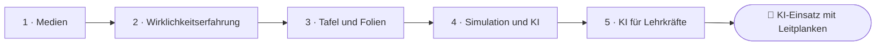
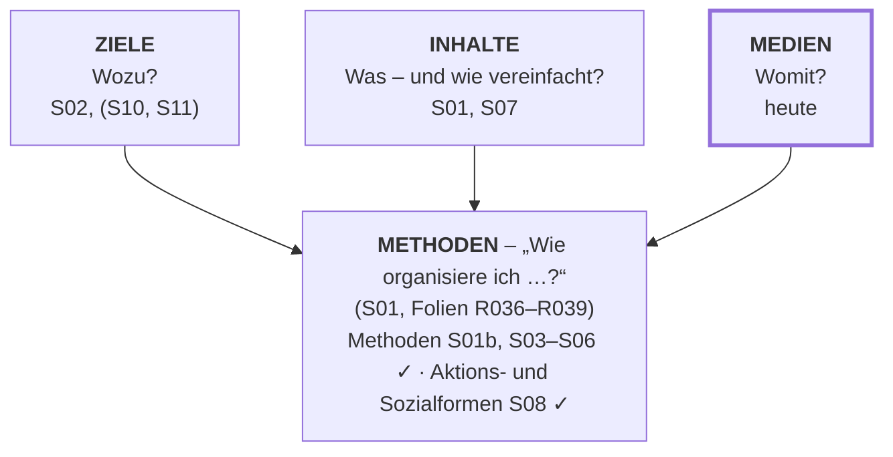
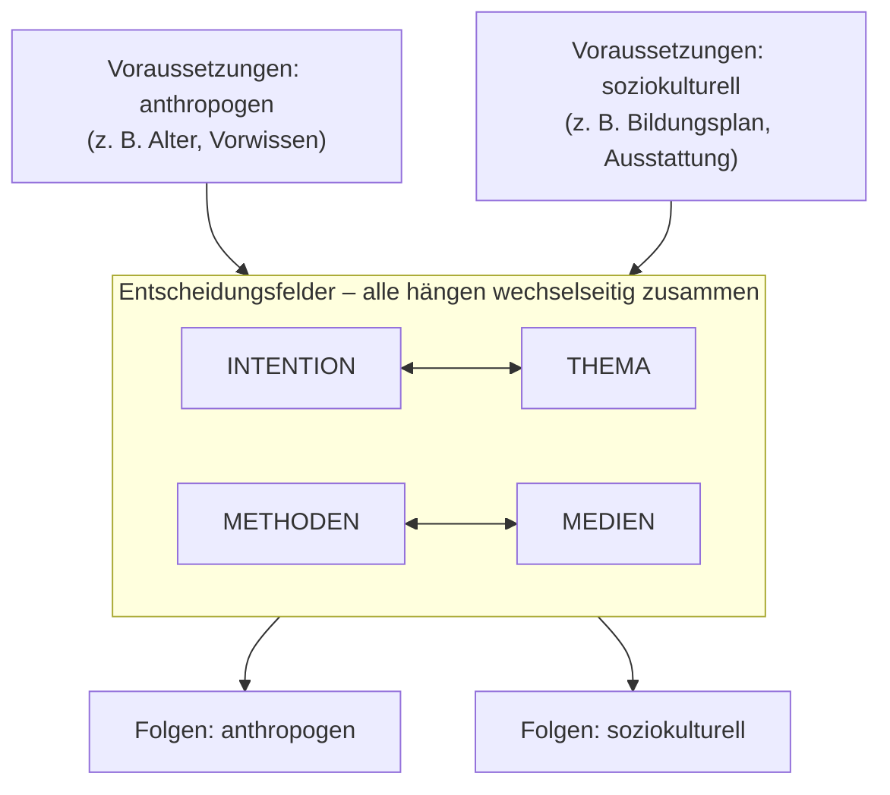
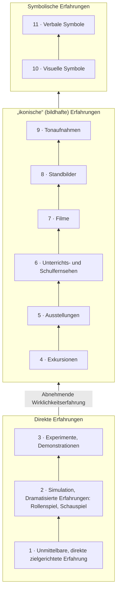

<!--
author:   Hannes Tegelbeckers
email:    hannes.tegelbeckers@ovgu.de
version:  0.2.0
language: de
narrator: Deutsch Female
mode:     Presentation
classroom: enable
comment:  Fachdidaktik technischer Allgemeinbildung II – Sitzung S09. Funktionen von Medien, Grad der Wirklichkeitserfahrung, Tafel und Projektor, Gestaltungsprinzipien sowie Simulationen und KI-Chatbots im Unterricht und für die eigene Professionalisierung.

import:   https://raw.githubusercontent.com/LiaTemplates/mermaid_template/0.1.4/README.md
-->

# S09 – Medien und KI im Unterricht

Fachdidaktik technischer Allgemeinbildung II · OVGU Magdeburg · Montag, 07.12.2026, 07:00–09:00 Uhr

<!-- didaktik="Planungsraster S09 (überarbeitet 2026-10-11: Berliner Modell R166–R168 entfernt, Station 3 Simulation & KI neu) · E-03, E-04, E-09, E-11, E-12, E-17, E-19, E-20, E-27, E-33, E-34 · 0–8 Einstieg (OHP-Umfrage zeigen, These, Ihr Medium) · 8–10 Kurskarte · 10–25 Station 1 Medien · 25–42 Station 2 Tafel, Projektor, Gestaltungsprinzipien, Doppeldecker R162 · 42–74 Station 3 [NEU] Simulationen und KI, Doppeldecker KI-Einsatz · 74–84 Station 4 [NEU] KI für Lehrkräfte · 84–90 Abschluss" -->
> [!IMPORTANT] 🧭 Leitfrage
> Womit lernen sie – und was verändert sich, wenn das Medium antworten kann? – Heute füllen wir das Feld **Medien** der Kurskarte: vom Arbeitsblatt bis zum KI-Chatbot.

> [!TIP] 📚 Vor der Sitzung
> Haben Sie ein Medium für eine Stunde in Ihrer Fachrichtung benannt und abgestimmt, ob der Overheadprojektor tot ist? Wir starten mit Ihren Antworten.

📝 **Beuteblatt S09** – ergänzen Sie es während der Sitzung.

## Einstieg: Macht Abstraktion lustlos?

    --{{0}}--
Zuerst das Ergebnis Ihrer Umfrage zum Overheadprojektor. Dann eine These von den Folien dieser Sitzung – Sie finden sie gleich in Station 1. Stimmen Sie ab; am Ende stimmen wir noch einmal ab.

> **„Je abstrakter ein Medium ist, desto geringer ist seine Motivation.“**

**Vote (before):** Stimmen Sie dieser These zu?

[(a)] Ja, ich stimme zu
[(b)] Nein, ich stimme nicht zu
[(c)] Teils, teils
[(undecided)] Undecided

    --{{1}}--
Notieren Sie allein Ihr Medium aus der Vorbereitung – und was es leisten soll.

      {{1}}
****************************************

> [!TIP] 🧠 Allein · 3 min
> (Noch keins gewählt? Dann entscheiden Sie sich jetzt.) Welches Medium haben Sie für eine Stunde in Ihrer Fachrichtung gewählt – und was soll es leisten: etwas **zeigen**, **damit arbeiten** lassen oder **motivieren**?

[[___ ___ ___]]

****************************************

    --{{2}}--
Zwei oder drei von Ihnen nennen ihr Medium.

      {{2}}
> [!TIP] 📣 Plenum · 2 min
> Zwei bis drei Freiwillige nennen ihr Medium und seinen Zweck. Alle achten darauf: Wurde zuerst das Medium gewählt – oder zuerst das Ziel?

## Ihr Weg durch die Sitzung

    --{{0}}--
Heute in vier Schritten: was Medien sind und wie wirklichkeitsnah sie sind, Tafel, Projektor und gute Folien, Simulationen und KI-Chatbots im Unterricht und schließlich KI für Sie als Lehrkraft.

    --{{1}}--
Auf diesem Weg erreichen Sie sieben Ziele; die sechs wichtigsten sehen Sie hier.

      {{1}}

<!-- data-type="none" -->
| Know | Can do | Value |
|------|--------|-------|
| die Funktionen von Medien **nennen** und an Beispielen aus Ihrer Fachrichtung **erläutern** | Medien einer Funktion und einer Stufe der Wirklichkeitserfahrung **zuordnen** | die These zur Abstraktheit von Medien begründet **beurteilen** |
| Chancen und Risiken von Simulationen und KI-Chatbots für den Lernprozess **erläutern** | Tafel, Projektor und Folien nach Gestaltungsprinzipien **analysieren** | einen KI-Einsatz so **planen**, dass er das Lernen unterstützt statt ersetzt – und KI für die eigene Professionalisierung **nutzen** |

    --{{2}}--
Prüfen Sie kurz, ob Sie den Weg lesen können.

      {{2}}
****************************************

**Decide:** In welcher Station geht es um Simulationen und KI-Chatbots im Unterricht?

<!-- data-hint-button="1" data-solution-button="2" -->
- [(X)] Simulation und KI
- [( )] Tafel und Folien
- [( )] KI für Lehrkräfte
[[?]] KI für Lehrkräfte ist Ihre eigene Professionalisierung, nicht der Unterricht.
***
Richtig: Station 3 – Simulationen und KI-Chatbots als Medien im Unterricht.
***

****************************************

## Kurskarte: das Feld Medien

    --{{0}}--
Auf der Kurskarte fehlt noch ein Feld: die Medien. Ziele, Inhalte und Medien hängen zusammen, und alle münden in die Methoden.

    --{{1}}--
Ziele haben Sie in S02 behandelt, sie kommen in S10 und S11 wieder.

      {{1}}
**① Ziele:** Wozu? – S02, (S10, S11)

    --{{2}}--
Inhalte und ihre Vereinfachung in S01 und S07.

      {{2}}
**② Inhalte:** Was – und wie vereinfacht? – S01, S07

    --{{3}}--
Und heute die Medien.

      {{3}}
**③ Medien:** Womit? – heute: von der Tafel bis zum KI-Chatbot

    --{{4}}--
Wer Fachdidaktik I besucht hat, kennt einiges schon.

      {{4}}
> [!NOTE] Key message
> 📎 Aus [FD I – Medien, Simulation und KI](https://liascript.github.io/course/?https://raw.githubusercontent.com/OVGU-VET-TechEd/Fachdidaktik_technischer_Allgemeinbildung_I/main/08_09_Medien_Simulation_KI.md) bekannt: Funktionen von Medien, Erfahrungskegel, Tafel und OHP. Stationen 1 und 2 sind dann Wiederholung – der Schwerpunkt liegt auf Station 3 und 4.

<small>Kurskarte als Lesehilfe (vgl. S01 und den Kursüberblick), keine Originalfolie.</small>

## Recap: Grundbegriffe aus Fachdidaktik I

    --{{0}}--
Zur Wiederholung – wer Fachdidaktik I besucht hat, kennt diese Begriffe. Alle anderen lesen sie vor oder nach der Sitzung nach. Im Vortrag gibt es dazu nur einen kurzen Hinweis.

<!-- didaktik="zum Selbststudium aufklappbar; im Vortrag nur 1 min Hinweis · Inhalte aus dem FD-I-Material, Belege dort übernommen und nicht erneut geprüft" -->

**Was sind Medien?** (aufklappen)

> „Medien sind Dinge, Instrumente und symbolische Ausdrucksformen, die Mensch und Welt miteinander verbinden und Kultur vermitteln.“ (Kron, 1994, S. 324)

Im Unterricht sind Medien **Vermittlungshilfen oder Mittler im Lernprozess** (R159). Im FD-I-Material werden die drei Funktionen – Demonstrations-, Arbeits- und Motivationsmittel – Schelten (1994, S. 213) zugeordnet.

**Medienpädagogik** (aufklappen)

> „Der Begriff Medienpädagogik umfasst alle Bereiche, in denen Medien für die Entwicklung des Menschen, für die Erziehung, für die Aus- und Weiterbildung pädagogische Relevanz haben.“ (Issing, 1987, S. 24 f.)

Kernbereiche: **Medienrezeption** (mediale Botschaften und Genres) · **Medienwirkung** (Wirkung auf Person und Verhalten) · **Medienerziehung** (gezielte Förderung von Medienkompetenz) · **Mediennutzung** (wie Menschen in sozialen Situationen mit Medien umgehen).

**PowerPoint und Flipchart** (aufklappen)

**PowerPoint (Beamer)** – Vorteile: Blickkontakt bleibt; Visualisierung erleichtert den Zugang; unterstützt den Vortrag; erleichtert das Mitschreiben. Nachteile: Raum muss oft verdunkelt werden; Aufmerksamkeit lässt schnell nach; Technik lenkt vom Vortragenden ab.

**Flipchart** – Vorteile: leichter Umgang; Informationen bleiben während des Vortrags sichtbar; Charts teilweise wiederverwendbar. Nachteile: Korrekturen schwierig; Handouts nur per Abschreiben oder Foto; eher für kleine Gruppen.

Nach Thüring (2003) und Plewa (2010), zitiert nach dem FD-I-Material.

**E-Learning, Blended Learning, Interaktivität** (aufklappen)

- **E-Learning:** Lernen, das ganz über Medien vermittelt wird – unabhängig von Ort, Zeit, Tempo und Lernweg.
- **Blended Learning:** E-Learning verbunden mit regelmäßigen Präsenzphasen und Begleitung.
- **Interaktivität:** Lernende können eingreifen und steuern; aus Empfängern werden Sender. Station 3 zeigt, was das bei Simulationen und KI-Chatbots heißt.

<small>Recap aus Fachdidaktik I, keine Originalfolie dieser Sitzung; Belege aus dem FD-I-Material übernommen.</small>

## Station 1: Medien

    --{{0}}--
Die erste Station, Kapitel 9 der Folien, klärt, was Medien sind und wozu sie dienen – und wie viel Wirklichkeitserfahrung sie ermöglichen.

**Wozu dienen Medien – und wie wirklichkeitsnah sind sie?**

    --{{1}}--
Zuerst: was Medien sind und welche Funktionen sie haben.

      {{1}}
- Was Medien sind – drei Funktionen und ein Merksatz (R159–R161)

    --{{2}}--
Dann eine Ergänzung, als NEU markiert: Wo stehen Medien in der Planung?

      {{2}}
- [NEU] Medien im Berliner Modell (Zinn 2026)

    --{{3}}--
Danach der Grad der Wirklichkeitserfahrung.

      {{3}}
- Grad der Wirklichkeitserfahrung (R162)

    --{{4}}--
Und schließlich ordnen Sie Medien selbst ein.

      {{4}}
- Medien einordnen – auch Ihr eigenes

    --{{5}}--
Warum ist das für Sie wichtig?

      {{5}}
> [!TIP] Why this matters
> Ein Medium ist nie Selbstzweck: Erst das Ziel klären, dann das Medium wählen (R161) – das gilt für die Tafel wie für den KI-Chatbot.

    --{{6}}--
Markieren Sie, was Sie schon kennen.

      {{6}}
****************************************

**Mark:** Which of these do you already know? (several possible)

[[a1]] Was Medien sind – drei Funktionen und ein Merksatz (R159–R161)
[[a2]] [NEU] Medien im Berliner Modell (Zinn 2026)
[[a3]] Grad der Wirklichkeitserfahrung (R162)
[[a4]] Medien einordnen – auch Ihr eigenes

****************************************

## 9. Medien: was sie sind und wozu sie dienen

    --{{0}}--
Medien sind Vermittlungshilfen im Lernprozess; sie sollen das Lernen erleichtern, intensivieren und motivieren. Die Folien unterscheiden drei Funktionen.

- Sind Vermittlungshilfen oder Mittler im Lernprozess
- Sollen das Lernen erleichtern, intensivieren und die Motivation erhöhen

**Funktionen**

1. Demonstrationsmittel
2. Arbeitsmittel
3. Motivationsmittel

    --{{1}}--
Demonstrationsmittel führen Anschauung herbei, Arbeitsmittel wie Lehrbuch oder Lernprogramm dienen dem Arbeiten, und als Motivationsmittel kann fast alles wirken, womit Lehrer und Schüler interagieren.

      {{1}}
****************************************

<!-- data-type="none" -->
| Funktion | Was gehört dazu? |
| --- | --- |
| **Demonstrationsmittel** | Anschauung herbeiführen. Es werden zum Beispiel Arbeitswerkzeuge und Arbeitsgegenstände aus dem beruflichen Alltag im Berufsschulunterricht integriert |
| **Arbeitsmittel** | Z. B. gedruckte Medien im Unterricht, Lernprogramme, Arbeitsbuch, Lehrbuch, Aufgabenbuch, Sachbuch und Nachschlagewerk. Gehören auch apparative Arbeitsmittel wie das Versuchsgerät im experimentellen Unterricht. Einfache Arbeitsmittel stellen z. B. das Arbeitsblatt und die Tafel dar |
| **Motivationsmittel** | Fast alles womit Lehrer und Schüler interagieren, alles, was ihre Kommunikation miteinander trägt bzw. unterstützt, ist Lehr- und Lernmittel · Sprache, Lehrbuch, Tafel, OH-Projektor, Präparat, Kreide, Arbeitsblatt, PC, Software, Wandkarte, Modell |

> **These:** Allgemein ist zu sagen: Je abstrakter ein Medium ist, desto geringer ist seine Motivation

****************************************

    --{{2}}--
Wichtig ist der Merksatz.

      {{2}}
> [!NOTE] Key message
> 📌 **Merksatz:** In der Unterrichtsplanung soll immer erst das Ziel und der Inhalt klar sein und anschließend folgt die Wahl der Medien

<small>Quelle: Folien R159–R161 „9. Medien“ (Kapitel 9, Folie R158) – Tippfehler „unterstütz“ zu „unterstützt“ korrigiert; Merksatz und These stehen auf R161 unter „Motivationsmittel“.</small>

## [NEU] Theorie: Medien im Berliner Modell

    --{{0}}--
Der Merksatz hat einen theoretischen Hintergrund. Das Berliner Modell, die lerntheoretische Didaktik nach Heimann und anderen, beschreibt Strukturelemente, die allen Lehr- und Lernarrangements zugrunde liegen. Medien sind darin eines von vier Entscheidungsfeldern.

    --{{1}}--
Oben stehen die Voraussetzungen der Lernenden und des Umfelds.

      {{1}}
**① Voraussetzungen:** anthropogen (z. B. Alter, Vorwissen) und soziokulturell (z. B. Bildungsplan, Ausstattung)

    --{{2}}--
In der Mitte stehen vier Entscheidungsfelder, die wechselseitig zusammenhängen.

      {{2}}
**② Entscheidungsfelder:** Intention, Thema, Methoden und Medien – Medien sind eines von vier Feldern.

    --{{3}}--
Unten stehen die Folgen des Unterrichts.

      {{3}}
**③ Folgen:** anthropogen und soziokulturell – sie werden zu neuen Voraussetzungen.

    --{{4}}--
Als Denkwerkzeug, wenn Sie Material erstellen.

      {{4}}
> [!NOTE] Key message
> Welche Form trägt das Ziel am besten – und passt das Medium zu Intention, Thema und Methoden? Wer zuerst das Medium wählt, dreht das Modell um.

<small>[NEU] Vereinfacht nachgezeichnet nach Zinn (2026, S. 27, Abb. 2.1, nach Heimann et al. 1970) – keine Originalfolie.</small>

## [NEU] Das Berliner Modell als Denkwerkzeug

    --{{0}}--
Wenn Sie didaktisches Material erstellen – ein Arbeitsblatt, eine Simulation, einen KI-Tutor –, helfen fünf Leitfragen nach dem Berliner Modell.

<!-- neu="Zinn 2026, S. 26–27" -->

<!-- data-type="none" -->
| Feld | Leitfrage für Ihr Material |
| --- | --- |
| Voraussetzungen | Für wen ist es – mit welchem Vorwissen, welcher Sprache, welcher Ausstattung? |
| Intention | Was sollen die Lernenden danach können? |
| Thema | Welcher Inhalt – und wie weit reduziert (S07)? |
| Methoden | In welchem Unterrichtsgang wird es eingesetzt (S01b–S06, S08)? |
| Medien | Welche Form trägt das am besten – und passt sie zu den anderen drei Feldern? |

    --{{1}}--
Denken Sie an Ihr Medium aus der Vorbereitung.

      {{1}}
> [!NOTE] Key message
> 🔗 Haben Sie mit dem Medium angefangen – oder mit dem Ziel? Der Merksatz gilt auch für Station 3: Erst das Ziel, dann die Entscheidung, ob eine Simulation oder ein KI-Chatbot dafür taugt.

<small>[NEU] Leitfragen nach dem Berliner Modell (Zinn 2026, S. 26–27); eigene Darstellung.</small>

## 9. Medien – Grad der Wirklichkeitserfahrung

    --{{0}}--
Die Pyramide ordnet Medien nach dem Grad der Wirklichkeitserfahrung. Die Originalfolie zeigt eine Pyramide mit elf Stufen; von unten nach oben nimmt die Wirklichkeitserfahrung ab.

    --{{1}}--
Unten stehen direkte Erfahrungen: die unmittelbare, zielgerichtete Erfahrung, Simulation und Rollenspiel, Experimente und Demonstrationen.

      {{1}}
**① Direkte Erfahrungen:** Stufen 1–3: unmittelbare Erfahrung, Simulation und Rollenspiel, Experimente und Demonstrationen

    --{{2}}--
In der Mitte stehen bildhafte, ikonische Erfahrungen von der Exkursion bis zur Tonaufnahme.

      {{2}}
**② „ikonische“ (bildhafte) Erfahrungen:** Stufen 4–9: Exkursionen, Ausstellungen, Unterrichts- und Schulfernsehen, Filme, Standbilder, Tonaufnahmen

    --{{3}}--
Oben stehen die symbolischen Erfahrungen. Rollenspiel haben Sie in S04 gespielt, Experimente in S05 geplant. Die Simulation steht schon auf der Originalfolie auf Stufe 2.

      {{3}}
**③ Symbolische Erfahrungen:** Stufen 10–11: visuelle und verbale Symbole

    --{{4}}--
Vorsicht mit der Pyramide – eine Ergänzung, als NEU markiert. Die Darstellung geht auf den Erfahrungskegel von Edgar Dale zurück. Dale ordnete Medien nach ihrem Abstraktionsgrad; eine Rangfolge des Lernerfolgs hat er damit nicht belegt. Im Umlauf sind Versionen mit Behaltensquoten – eine Literaturübersicht fand keine belastbare Quelle für diese Zahlen.

      {{4}}
> [!NOTE] Key message
> 🆕 [NEU] Abstraktheit allein sagt wenig über Motivation und Lernerfolg; die Behaltensquoten („10 % durch Lesen … 90 % durch Tun“) sind nicht belegt (Masters, 2013). Entscheidend ist, ob das Medium zu Ziel, Inhalt und Lernenden passt.

<small>Quelle: Folie R162 „9. Medien - Grad der Wirklichkeitserfahrung“ – Abbildung „C.5. System Unterricht“ (Buchscan ohne Quellenangabe, nicht eingebettet) als Diagramm nachgezeichnet; Achse „Abnehmende Wirklichkeitserfahrung“.</small>

## Aktivierung: Medien einordnen

    --{{0}}--
Drei kurze Fragen zu Funktionen und Wirklichkeitserfahrung.

**1 · Choose one:** Zu welchem Erfahrungsbereich gehören Exkursionen nach R162?

<!-- data-hint-button="1" data-solution-button="2" -->
- [( )] Direkte Erfahrungen
- [(X)] „ikonische“ (bildhafte) Erfahrungen
- [( )] Symbolische Erfahrungen
[[?]] Exkursionen stehen auf Stufe 4.
***
Stufen 4–9 sind ikonische Erfahrungen – Exkursionen, Ausstellungen, Schulfernsehen, Filme, Standbilder, Tonaufnahmen.
***

    --{{1}}--
Jetzt können mehrere Antworten richtig sein.

      {{1}}
****************************************

**2 · Choose all that apply:** Welche Medien nennt R160 als Arbeitsmittel?

<!-- data-hint-button="1" data-solution-button="2" -->
- [[X]] Das Versuchsgerät im experimentellen Unterricht
- [[ ]] Ein Arbeitswerkzeug aus dem beruflichen Alltag, das im Unterricht gezeigt wird
- [[X]] Das Arbeitsblatt
- [[ ]] Ein Film über einen Fertigungsablauf
[[?]] Arbeitsmittel: gedruckte und apparative Mittel, mit denen gearbeitet wird.
***
Das gezeigte Arbeitswerkzeug ist ein Demonstrationsmittel (Anschauung herbeiführen). Beachten Sie R161: Fast alles, womit Lehrer und Schüler interagieren, kann zugleich Motivationsmittel sein.
***

****************************************

    --{{2}}--
Und eine Zahl.

      {{2}}
****************************************

**3 · Type:** Auf welcher Stufe der Pyramide steht das Rollenspiel? (Zahl)

<!-- data-hint-button="1" data-solution-button="2" -->
[[2]]
[[?]] Es gehört zu den direkten Erfahrungen.

***
Stufe 2: Simulation, Dramatisierte Erfahrungen – Rollenspiel, Schauspiel.
***

****************************************

## Ihr Medium auf der Pyramide

    --{{0}}--
Wenden Sie die Pyramide auf Ihr eigenes Medium an.

Auf welcher Stufe der Pyramide steht das Medium aus Ihrer Vorbereitung? Ginge es **eine Stufe weiter unten** – mit mehr Wirklichkeitserfahrung? Und würde das Ihrem Ziel wirklich helfen?

[[___ ___ ___ ___]]

💡 Hint 1

Fragen Sie: Was müssten die Lernenden anfassen, ausprobieren oder sehen, um das Ziel zu erreichen?

✅ Solution

Beispiel: Ein Film über das Einstellen eines Ventilspiels steht auf Stufe 7. Eine Stufe tiefer ginge eine Demonstration am realen Motor (Stufe 3). Das hilft, wenn die Lernenden den Handgriff später selbst ausführen sollen – für einen ersten Überblick genügt der Film.

## Station 2: Tafel & Projektor – und gute Folien heute

    --{{0}}--
In der zweiten Station schauen wir auf zwei klassische Medien – und darauf, was davon heute noch gilt.

**Was macht eine Tafelanschrift oder Folie lernwirksam – damals und heute?**

    --{{1}}--
Zuerst die Tafel.

      {{1}}
- Tafel (R163)

    --{{2}}--
Dann der Overhead-Projektor.

      {{2}}
- Overhead-Projektor (R164)

    --{{3}}--
Danach: Was gute Folien ausmacht.

      {{3}}
- Gute Folien (R165)

    --{{4}}--
Und eine Ergänzung aus Zinn: Gestaltungsprinzipien multimedialen Lernens.

      {{4}}
- [NEU] Gestaltungsprinzipien und Cognitive Load Theory (Zinn 2026)

    --{{5}}--
Warum ist das für Sie wichtig?

      {{5}}
> [!TIP] Why this matters
> Mit diesen Prinzipien prüfen Sie zum Schluss eine Originalfolie dieses Kurses – und später Ihre eigenen Materialien.

    --{{6}}--
Markieren Sie, was Sie schon kennen.

      {{6}}
****************************************

**Mark:** Which of these do you already know? (several possible)

[[a1]] Tafel (R163)
[[a2]] Overhead-Projektor (R164)
[[a3]] Gute Folien (R165)
[[a4]] [NEU] Gestaltungsprinzipien und Cognitive Load Theory (Zinn 2026)

****************************************

## 9.1 Tafel (Kreidetafel oder White Board)

    --{{0}}--
Die Tafel eignet sich, um Sachverhalte schrittweise zu entwickeln, zu erklären und zu sammeln; nicht dagegen für Darstellungen, die lange erhalten bleiben sollen, oder für zeitaufwendige Schreibarbeit. Ihre Vorteile sind einfache Handhabung, große Schreibfläche und jederzeitige Korrektur; ihre Nachteile sind fehlender Blickkontakt beim Anschreiben und fehleranfälliges, zeitaufwendiges Abschreiben.

<!-- data-type="none" -->
| Eignet sich für: | Eignet sich nicht für: |
| --- | --- |
| Schrittweises Entwickeln von Sachverhalten | Darstellungen, die länger erhalten bleiben sollen |
| Erklärungen und Erläuterungen | Zeitaufwendige Schreib- und Zeichenarbeiten während des Unterrichts |
| Sammeln | |

<!-- data-type="none" -->
| Vorteile: | Nachteile: |
| --- | --- |
| Einfache Handhabung | Kein Augenkontakt zu den Schülern beim Anschreiben |
| Große Schreibfläche | Das Abschreiben bzw. Abzeichnen ist zeitaufwändig |
| Löschung, Korrektur jederzeit möglich | Gefahr hoher Fehlerhaftigkeit beim Abschreiben oder Abzeichnen der Tafelanschrift |
| Auf Grund der Größe der Schreibfläche kann die Tafel mehrere Aufgaben gleichzeitig erfüllen | |

    --{{1}}--
Die Stärke der Tafel ist das schrittweise Entwickeln.

      {{1}}
> [!NOTE] Key message
> Die Tafel wächst mit dem Gedankengang – genau das, was heute „Segmentierung“ heißt (gleich bei den Gestaltungsprinzipien).

<small>Quelle: Folie R163 „9.1 Tafel (Kreidetafel oder White Board)“</small>

## 9.2 Overhead-Projektor

    --{{0}}--
Der Overhead-Projektor erlaubt Blickkontakt, braucht keinen verdunkelten Raum, und Folien lassen sich vorbereiten, beschriften und kopieren.

**Vorteile**

- Der Lehrer kann während des Unterrichts Blickkontakt zu den Schülern halten
- Der Raum braucht nicht verdunkelt werden
- Die Folien können mit wasserlöslichen und wasserfesten Stiften beschriftet, vorbereitet und beliebig oder wieder verwendet werden
- Von den Folien können beliebig viele Kopien gemacht werden

    --{{1}}--
Die Folie nennt auch Merkmale guter Folien: Sie erzeugen Aufmerksamkeit, regen zum Nachdenken an, visualisieren Sachverhalte und erlauben durch Aufbau-, Abdeck- oder Ergänzungstechnik eine schrittweise Gedankenentwicklung.

      {{1}}
****************************************

**Gute Folien:**

- Erzeugen Aufmerksamkeit
- Regen zum Nachdenken an
- Motivieren für die Sache
- Geben Impulse
- Verdeutlichen und visualisieren Sachverhalte
- Lassen durch den Gebrauch von Aufbau-, Unterleg-, Abdeck-, Ergänzungs-, Figurentechnik eine schrittweise Gedankenentwicklung zu
- Haben einen hohen Behaltenseffekt
- Dokumentieren sie Arbeitsergebnisse von Gruppen und Paaren und erlauben ihre plenare Diskussion

****************************************

    --{{2}}--
Fragen Sie sich: Gilt das nicht genauso für heutige Präsentationen?

      {{2}}
> [!NOTE] Key message
> **Ist der OHP tot?** Vergleichen Sie mit Ihrer Abstimmung: Welche Vorteile und welche Merkmale guter Folien gelten auch für Beamer-Präsentation, Dokumentenkamera, interaktives Display oder dieses LiaScript?

<small>Quelle: Folien R164 und R165 „9.2 Overhead-Projektor“ – „Die Folie können“ zu „Die Folien können“ korrigiert.</small>

## [NEU] Gute Folien heute: Gestaltungsprinzipien

    --{{0}}--
Hier ergänzen wir aus Zinn 2026, deshalb NEU. Zinn unterscheidet vier Begriffe.

<!-- neu="Zinn 2026, S. 238–240" -->
**Vier Begriffe (Zinn 2026, S. 238, Tab. 9.3):** **Multimedialität** (über welche Medien Informationen aufgenommen werden, z. B. Tafel, Bücher, Computer), **Multicodalität** (wie die Information codiert ist: Text, Bild, Animation, Simulation), **Multimodalität** (mit welchen Sinnen sie wahrgenommen wird), **Interaktivität** (wie stark Lernende eingreifen und steuern können).

    --{{1}}--
Und er nennt Gestaltungsprinzipien für multimediales Lernen: Überflüssiges weglassen, Relevantes hervorheben, Texte und Bilder nah beieinander zeigen, das Tempo selbst bestimmen lassen. Dahinter steht die Cognitive Load Theory: Das Arbeitsgedächtnis ist begrenzt.

      {{1}}
****************************************

**Gestaltungsprinzipien** – „Man lernt besser, wenn …“ (Auswahl aus Zinn 2026, S. 240, Tab. 9.4, nach Rey, Mayer sowie Trojahner & Fürstenau):

<!-- data-type="none" -->
| Prinzip | Man lernt besser, wenn … |
| --- | --- |
| Kohärenzprinzip | überflüssige Informationen (Worte, Bilder, Musik usw.) aus dem Lernmaterial entfernt werden |
| Signalprinzip | die relevanten Bereiche des Lernmaterials hervorgehoben werden (z. B. farblich) |
| Redundanzprinzip | Bilder mit gesprochenem Text als mit gesprochenem und geschriebenem Text kombiniert werden |
| Prinzip der räumlichen Nähe | korrespondierende Texte und Bilder nah beieinander … präsentiert werden |
| Prinzip der Segmentierung | die Geschwindigkeit (und Pausen) der Multimedia-Darstellung selbst bestimmt werden kann |
| Multimediaprinzip | Texte und Bilder kombiniert werden als aus Texten allein |

Hintergrund ist u. a. die **Cognitive Load Theory** (Sweller): Das Arbeitsgedächtnis ist begrenzt; überflüssige Darstellung (*extraneous load*) verbraucht Kapazität, die für das Lernen fehlt (Zinn 2026, S. 238–239).

****************************************

    --{{2}}--
Die alte Aufbau- und Abdecktechnik heißt heute Segmentierung und Signalprinzip.

      {{2}}
> [!NOTE] Key message
> 🔗 „Aufbau-, Abdeck-, Ergänzungstechnik“ auf R165 ist das, was heute *Segmentierung* und *Signalprinzip* heißt.

<small>[NEU] Ergänzung, keine Originalfolie: Zinn (2026), S. 238–240 – siehe Literatur.</small>

## Doppeldecker: Die Originalfolie R162 auf dem Prüfstand

    --{{0}}--
Die Originalfolie R162 ist ein gelblicher Buchscan: Die Pyramide ist gut lesbar, daneben scheint der Text der Buchrückseite durch, Überschrift „C.5. System Unterricht“, keine Quelle. Prüfen Sie sie mit den Gestaltungsprinzipien.

**1 · Choose one:** Welches Gestaltungsprinzip verletzt der Scan am deutlichsten?

<!-- data-hint-button="1" data-solution-button="2" -->
- [( )] Redundanzprinzip
- [(X)] Kohärenzprinzip
- [( )] Multimediaprinzip
[[?]] Was auf der Folie gehört nicht zum Lerninhalt?
***
Durchscheinender Rückseitentext, Gelbstich und die fremde Kapitelüberschrift sind überflüssige Informationen – sie erhöhen die extrinsische Belastung (Kohärenzprinzip, Zinn 2026, S. 240). Ob das Redundanzprinzip verletzt wird, hängt davon ab, wie im Vortrag gesprochen wird.
***

    --{{1}}--
Jetzt können mehrere Antworten richtig sein.

      {{1}}
****************************************

**2 · Choose all that apply:** Welche Merkmale des Scans sind überflüssige Informationen?

<!-- data-hint-button="1" data-solution-button="2" -->
- [[X]] der durchscheinende Text der Buchrückseite
- [[ ]] die elf Stufen der Pyramide
- [[X]] die fremde Kapitelüberschrift „C.5. System Unterricht“
- [[ ]] die Achse „Abnehmende Wirklichkeitserfahrung“
[[?]] Was trägt zum Verständnis der Pyramide bei – und was nicht?
***
Stufen und Achse sind der Lerninhalt; Rückseitentext und fremde Überschrift lenken ab.
***

****************************************

    --{{2}}--
Zum Schluss ein Begriff.

      {{2}}
****************************************

**3 · Type:** Nach welcher Theorie ist das Arbeitsgedächtnis begrenzt? Cognitive … Theory (ein Wort)

<!-- data-hint-button="1" data-solution-button="2" -->
[[Load]]
[[?]] Sweller, extraneous …

***
Cognitive Load Theory (Sweller): Überflüssige Darstellung verbraucht Kapazität, die für das Lernen fehlt.
***

****************************************

## R162 verbessern

    --{{0}}--
Wie würden Sie die Folie verbessern? Denken Sie auch an R165: Wie ließe sich die Pyramide schrittweise aufbauen?

**Allein (3 min):** Wie würden Sie R162 verbessern? Wie ließe sich die Pyramide *schrittweise* aufbauen (R165, Segmentierung)?

[[___ ___ ___ ___]]

💡 Hint 1

Kohärenz: Was streichen Sie? Signal: Was heben Sie hervor? Segmentierung: In welchen Schritten bauen Sie auf?

✅ Solution

Pyramide neu zeichnen statt scannen (Kohärenz: kein Rückseitentext, keine fremde Überschrift) · die drei Erfahrungsbereiche farbig absetzen (Signalprinzip) · in drei Schritten aufbauen: direkte, dann ikonische, dann symbolische Erfahrungen (Segmentierung) · Quelle nennen und die nicht belegten Behaltensquoten weglassen (Masters 2013).

## Station 3: [NEU] Simulationen – Experimentieren ohne Risiko?

    --{{0}}--
Die Originalfolien enden beim Overhead-Projektor. Heute stehen in Schule und Ausbildung Simulationen und KI-Chatbots zur Verfügung – Medien, die nicht nur zeigen, sondern reagieren. Wir prüfen sie mit denselben Fragen wie die Tafel: Welche Funktion haben sie? Wie wirklichkeitsnah sind sie? Und dient der Einsatz dem Ziel? In technischen Fachrichtungen sind Simulationen längst Arbeitsmittel: Schaltungen simulieren, SPS-Programme an einer virtuellen Anlage testen, CNC-Programme am Bildschirm einfahren.

<!-- didaktik="Lehrschritt informieren und üben · 42–74 min · ganze Station ist [NEU], keine Originalfolie" -->

<!-- data-type="none" -->
| Chance | Grenze |
| --- | --- |
| Gefährliche, teure oder unsichtbare Vorgänge werden zugänglich (Hochspannung, Kräfte, Strömungen) | Haptik, Geräusch, Fehler realer Bauteile fehlen – die „Wirklichkeit“ ist vereinfacht |
| Beliebig oft wiederholbar, Parameter frei veränderbar | Lernende können „herumprobieren“, ohne Hypothesen zu bilden |
| Fehler kosten nichts – Lernen am Fehler wird möglich | Das Modell hinter der Simulation bleibt oft eine Blackbox |

    --{{1}}--
Was sagt die Forschung?

      {{1}}
****************************************

<!-- neu="Flegr, Kuhn & Scheiter 2023" -->
**Real und virtuell:** In einer Studie mit 202 Schülerinnen und Schülern der Sekundarstufe I lernten Gruppen, die reale und virtuelle Experimente **kombinierten**, mehr als Gruppen, die nur real experimentierten (Flegr, Kuhn & Scheiter, 2023).

****************************************

    --{{2}}--
Die Simulation ersetzt also nicht das Experiment aus S05.

      {{2}}
> [!NOTE] Key message
> Die Simulation ersetzt das Experiment aus **S05** nicht – sie ergänzt es.

<small>[NEU] Station ohne Originalfolie; Studie: Flegr, Kuhn & Scheiter (2023) – siehe Literatur.</small>

## [NEU] KI-Chatbots: das Medium, das antwortet

    --{{0}}--
Generative KI, zum Beispiel ChatGPT oder HAWKI an der OVGU, erzeugt Texte, Erklärungen, Aufgaben, Code und Bilder auf Zuruf. Ordnen wir sie in die Funktionen von R159 ein.

<!-- neu="SWK 2024; Bastani et al. 2025" -->

<!-- data-type="none" -->
| Funktion (R159) | KI-Chatbot als … | Beispiel aus der Technik |
| --- | --- | --- |
| **Demonstrationsmittel** | Erklärer, der einen Sachverhalt auf verschiedenen Niveaus darstellt | „Erkläre den Unterschied zwischen Reihen- und Parallelschaltung – einmal für das 1. Ausbildungsjahr, einmal für die Meisterschule.“ |
| **Arbeitsmittel** | Tutor, Feedbackgeber, Übungspartner | Fehlersuche in einem SPS-Programm; Rückmeldung zu einem Arbeitsplan |
| **Motivationsmittel** | Gesprächspartner, Rollenspiel-Gegenüber | Kundengespräch simulieren (vgl. Rollenspiel **S04**) |

    --{{1}}--
Was die Forschung sagt – ein Beispiel.

      {{1}}
****************************************

In einem Feldexperiment mit fast 1.000 Schülerinnen und Schülern (Mathematik, Sekundarstufe) verbesserte der Zugang zu GPT‑4 die Leistung **beim Üben** deutlich. In der anschließenden Prüfung **ohne** KI schnitten Lernende, die eine frei nutzbare ChatGPT-Oberfläche hatten, aber **schlechter** ab als die Kontrollgruppe ohne KI. Eine Variante mit Schutzvorkehrungen – sie gab Hinweise statt fertiger Lösungen – hob diesen Nachteil weitgehend auf (Bastani et al., 2025).

****************************************

    --{{2}}--
Die Lesart:

      {{2}}
> [!NOTE] Key message
> KI ohne didaktischen Rahmen kann zur **Krücke** werden – die Aufgabe wird gelöst, gelernt wird wenig. Mit Rahmen kann sie zum **Tutor** werden.

<small>[NEU] Ergänzung, keine Originalfolie: Bastani et al. (2025) – siehe Literatur.</small>

## [NEU] Einordnung für Schulen in Deutschland

    --{{0}}--
Wie ordnen Bildungspolitik und Wissenschaft den Einsatz von KI in Schulen ein?

- Die **Ständige Wissenschaftliche Kommission der KMK** sieht in großen Sprachmodellen Potenzial für Lernen und Unterrichtsvorbereitung – vorausgesetzt, Lehrkräfte sind qualifiziert, tragen die Verantwortung für den Einsatz, und Lernende lernen, die Ausgaben kritisch zu prüfen (SWK, 2024).
- Die **Bildungsministerkonferenz** empfiehlt einen **konstruktiv-kritischen** Umgang mit KI und eine Weiterentwicklung der Prüfungskultur (KMK, 2024).
- Der **UNESCO-Kompetenzrahmen** für Lehrkräfte nennt fünf Dimensionen: menschenzentrierte Haltung, Ethik der KI, Grundlagen und Anwendungen, KI-Pädagogik und KI für die eigene Professionalisierung (Miao & Cukurova, 2024).

    --{{1}}--
Allen gemeinsam ist ein Punkt.

      {{1}}
> [!NOTE] Key message
> Die Verantwortung für den Einsatz bleibt bei der Lehrkraft – und Lernende müssen lernen, KI-Ausgaben kritisch zu prüfen.

<small>[NEU] Ergänzung, keine Originalfolie: SWK (2024), KMK (2024), Miao & Cukurova (2024) – siehe Literatur.</small>

## Aktivierung: Chance oder Risiko?

    --{{0}}--
Manche Aussagen sind je nach Einsatz beides – entscheiden Sie, was überwiegt. Zuerst ein Vergleich.

<!-- data-type="none" -->
| Criterion | Chance | Risiko |
|-----------|---------------|---------------|
| Denkarbeit | wird angeregt (Hinweise, Feedback) | wird abgenommen (fertige Lösungen) |
| Erklärungen | auf unterschiedlichem Niveau, rund um die Uhr | fachlich falsch, aber überzeugend formuliert |
| Übung | Aufgaben in großer Zahl, gefahrlose Wiederholung | Übungsleistung steigt, Leistung ohne KI nicht |
| Rahmen | Leitplanken, Prüfen der Ausgaben | Datenschutz, ungleicher Zugang |

    --{{1}}--
Je ein Beispiel:

      {{1}}
- **Chance:** Ein Tutor-Chatbot gibt Hinweise statt Lösungen.
- **Risiko:** Lernende kopieren die Lösung des Chatbots in ihr Arbeitsblatt.

    --{{2}}--
Ein typischer Fehlschluss:

      {{2}}
> [!WARNING] Common misconception
> KI-Zugang verbessert das Lernen nicht in jedem Fall – und schadet auch nicht grundsätzlich. Beim Üben halfen beide KI-Varianten; in der Prüfung ohne KI schnitt nur die Gruppe mit frei nutzbarer KI schlechter ab (Bastani et al., 2025).

    --{{3}}--
Ordnen Sie jetzt zu – was überwiegt?

      {{3}}
****************************************

**Decide:** Which concept does each statement describe?

<!-- data-hint-button="1" data-solution-button="2" data-show-partial-solution -->
[(Chance) (Risiko)]
[       (X)             ( )      ] Individuelles Feedback rund um die Uhr
[       ( )             (X)      ] Lösungen werden übernommen statt erarbeitet
[       (X)             ( )      ] Erklärungen auf unterschiedlichem Niveau
[       ( )             (X)      ] Fachlich falsche Antworten klingen überzeugend
[[?]] Regt es die Denkarbeit an – oder nimmt es sie ab?
***
Es kommt auf die didaktische Gestaltung an – nicht auf das Werkzeug allein. Weitere Risiken: Daten der Lernenden verlassen die Schule, ungleicher Zugang zu leistungsfähigen Werkzeugen.
***

****************************************

## Doppeldecker: KI-Einsatz planen – mit Leitplanken

    --{{0}}--
Wählen Sie eine Lernsituation aus Ihrer Fachrichtung und planen Sie einen Einsatz von KI oder einer Simulation. Prüfen Sie danach Ihre Planung mit einer Frage: Dient das Medium dem Ziel – oder wurde es gewählt, weil es neu ist?

<!-- didaktik="Lehrschritt üben lassen (Transfer / Entwickeln) · 62–74 min · Einzelarbeit 6 min, Selbstcheck 2 min (Classroom-Auswertung), Plenum 4 min" -->
**Allein (6 min):** Planen Sie **einen** Einsatz von KI oder einer Simulation.

<!-- data-type="none" -->
| Frage | Ihre Planung |
| --- | --- |
| **Ziel:** Was sollen die Lernenden danach können? (Merksatz R161: zuerst!) | … |
| **Funktion:** Demonstrations-, Arbeits- oder Motivationsmittel? | … |
| **Leitplanke:** Wie verhindern Sie, dass die KI die Denkarbeit übernimmt? | … |
| **Prüfen:** Wie lernen die Lernenden, die Ausgabe fachlich zu kontrollieren? | … |
| **Ohne KI:** Woran merken Sie, dass gelernt wurde – auch ohne das Werkzeug? (vgl. **S10**) | … |

**Selbstcheck (2 min):** Dient das Medium dem Ziel – oder wurde es gewählt, weil es neu ist? Woran machen Sie das fest?

[[___ ___ ___ ___]]

💡 Hint 1

Leitplanken: Hinweise statt Lösungen, eigene Lösung zuerst, Begründung verlangen.

✅ Solution

💡 Eine Leitplanke zum Mitnehmen – ein Systemprompt für einen Tutor-Chatbot: *„Du bist Tutor für Auszubildende im 2. Ausbildungsjahr Elektronik. Gib keine fertigen Lösungen. Frage zuerst nach dem eigenen Lösungsweg und gib dann einen Hinweis zum nächsten Schritt.“* Testen Sie solche Prompts immer selbst, bevor Lernende damit arbeiten. Beispielplanung: Ziel – Fehler in einem SPS-Programm selbst finden · Funktion – Arbeitsmittel · Leitplanke – Tutor-Prompt wie oben · Prüfen – Lernende testen jeden Vorschlag an der virtuellen Anlage · Ohne KI – Fehlersuche an einem neuen Programm im Fachgespräch.

## Station 4: [NEU] KI für Sie als Lehrkraft

    --{{0}}--
Die letzte Station betrifft Sie selbst. Dimension 5 des UNESCO-Kompetenzrahmens heißt KI für die berufliche Entwicklung. Der Rahmen beschreibt jede Dimension auf drei Stufen.

<!-- neu="Miao & Cukurova 2024" -->

<!-- data-type="none" -->
| Stufe | Kompetenz | Was das für Sie heißt |
| --- | --- | --- |
| **Aneignen** (*acquire*) | KI für lebenslanges berufliches Lernen | eigene Bereitschaft einschätzen; KI selbstbestimmt nutzen, um sich fortzubilden |
| **Vertiefen** (*deepen*) | KI für das Lernen in der Organisation | mit Kolleginnen und Kollegen Materialien und Erfahrungen teilen; KI-Simulationen zur Übung nutzen |
| **Gestalten** (*create*) | KI für berufliche Weiterentwicklung | eigene KI-Werkzeuge und Fortbildungen mit anderen entwickeln |

    --{{1}}--
Für Ihren Unterrichtsalltag heißt das konkret drei Fertigkeiten.

      {{1}}
****************************************

<!-- data-type="none" -->
| Fertigkeit | Beispiel aus der Technik | Worauf Sie achten |
| --- | --- | --- |
| **1 · Medien finden** | offene Bildungsmaterialien (OER) zur Pneumatik suchen und prüfen | Lizenz (z. B. CC BY), fachliche Richtigkeit, Passung zum Ziel (R161) |
| **2 · Aus Vorhandenem Neues machen** | aus einem Datenblatt ein Arbeitsblatt mit gestuften Hilfen erzeugen lassen | Urheberrecht der Vorlage, Fakten prüfen, didaktische Reduktion bleibt Ihre Entscheidung (**S07**) |
| **3 · Individuelle Lernbedürfnisse adressieren** | einen Tutor-Chatbot mit Systemprompt, eigenem Material und Regeln einrichten | Leitplanken (Station 3), Datenschutz, Sie bleiben verantwortlich |

**Drei Begriffe:** **Prompt** – die Anweisung an das Sprachmodell (Rolle, Zielgruppe, Ziel, Format, Grenzen) · **Harness** – alles, was das Modell umgibt und steuert: Systemprompt mit Regeln, Ihre Materialien, erlaubte Werkzeuge, Ausgabeformat · **Agent** – ein KI-System, das in mehreren Schritten selbst plant und Werkzeuge nutzt. Je selbstständiger der Agent, desto wichtiger das Harness.

****************************************

    --{{2}}--
In allen drei Fertigkeiten gilt dasselbe.

      {{2}}
> [!NOTE] Key message
> KI kann finden, umgestalten und anpassen – die didaktische Entscheidung und die Verantwortung bleiben bei Ihnen.

<small>[NEU] Ergänzung, keine Originalfolie: Miao & Cukurova (2024), UNESCO – siehe Literatur.</small>

## Mini-Übung: ein Text in zwei Fassungen

    --{{0}}--
Probieren Sie Fertigkeit 2 und 3 einmal aus. Alle drei Fertigkeiten üben Sie Schritt für Schritt in der Selbstlerneinheit S09 – mit Checklisten und einer Selbsteinschätzung nach den UNESCO-Stufen.

<!-- didaktik="Lehrschritt informieren und anwenden · 74–84 min · Ausblick auf die Selbstlerneinheit; nur ein Durchgang der Mini-Übung" -->
**Allein (5 min):** Schreiben Sie einen Prompt, der aus einem vorhandenen Text Ihrer Fachrichtung **zwei Fassungen** erzeugt – eine für Lernende mit wenig Vorwissen oder Deutsch als Zweitsprache, eine für Fortgeschrittene. Was müssen Sie danach selbst prüfen?

🧭 Weiter in der [Selbstlerneinheit S09](https://liascript.github.io/course/?https://raw.githubusercontent.com/OVGU-VET-TechEd/Fachdidaktik_technischer_Allgemeinbildung_II/main/Selflearn/S09_Medien_KI.md).

[[___ ___ ___ ___]]

💡 Hint 1

Nennen Sie im Prompt Rolle, Zielgruppe, Ziel, Format und Grenzen – und was nicht verändert werden darf.

✅ Solution

*„Du bist Lehrkraft an einer Berufsschule (Metalltechnik). Formuliere den folgenden Text zum Härten von Stahl in zwei Fassungen: (1) für Lernende mit wenig Vorwissen oder Deutsch als Zweitsprache – kurze Sätze, Fachbegriffe erklärt, ein Bild-Vorschlag; (2) für Fortgeschrittene – mit Gefügeumwandlung. Fachliche Aussagen und Temperaturen dürfen nicht verändert werden.“* Danach prüfen: Fakten und Temperaturen, ob die Vereinfachung korrekt bleibt (S07), Urheberrecht der Vorlage.

## Zum Mitnehmen: Macht Abstraktion lustlos?

    --{{0}}--
Zurück zur These vom Anfang. Stimmen Sie noch einmal ab.

**Vote (after):** Stimmen Sie der These „Je abstrakter ein Medium ist, desto geringer ist seine Motivation.“ zu?

[(a)] Ja, ich stimme zu
[(b)] Nein, ich stimme nicht zu
[(c)] Teils, teils
[(undecided)] Undecided

    --{{1}}--
Was ist Ihnen heute am unklarsten geblieben?

      {{1}}
****************************************

**Reflect:** Muddiest point: Was ist Ihnen heute am unklarsten geblieben?

[[___ ___]]

****************************************

    --{{2}}--
Vergleichen Sie Ihr Votum mit dem vom Anfang.

      {{2}}
> [!NOTE] Key message
> Abstraktheit allein entscheidet nicht über Motivation und Lernerfolg (Masters 2013) – entscheidend ist, ob das Medium zu Ziel, Inhalt und Lernenden passt (Merksatz R161).

## Das Wichtigste aus S09

    --{{0}}--
Fassen wir zusammen.

    --{{1}}--
Erstens: die Funktionen.

      {{1}}
- Medien sind Demonstrations-, Arbeits- und Motivationsmittel – erst Ziel und Inhalt, dann das Medium (R159–R161).

    --{{2}}--
Zweitens: die Wirklichkeitserfahrung.

      {{2}}
- Die Pyramide ordnet nach Wirklichkeitserfahrung, nicht nach Lernerfolg (R162; Masters 2013).

    --{{3}}--
Drittens: die Gestaltung.

      {{3}}
- Gute Folien folgen Kohärenz, Signal und Segmentierung – das Arbeitsgedächtnis ist begrenzt (R165; Zinn 2026).

    --{{4}}--
Und viertens: Simulation und KI.

      {{4}}
****************************************

- Simulation ergänzt das Experiment; KI braucht Leitplanken, sonst wird sie zur Krücke (Flegr et al. 2023; Bastani et al. 2025).

> [!NOTE] Remember
> Das Medium dient dem Ziel – nicht umgekehrt.

****************************************

    --{{5}}--
Eine letzte Frage.

      {{5}}
****************************************

**Recap:** Welche Aussage passt zur Studie von Bastani et al. (2025)?

<!-- data-hint-button="1" data-solution-button="2" -->
- [( )] KI-Zugang verbessert das Lernen in jedem Fall.
- [( )] KI-Tutoren schaden dem Lernen grundsätzlich.
- [(X)] Ohne Schutzvorkehrungen kann KI die Übungsleistung steigern und die Leistung ohne KI trotzdem senken.
[[?]] Unterscheiden Sie Üben und Prüfung ohne KI.
***
Richtig – gemessen wurden nur kurzfristige Effekte in einem Fach; es kommt auf die didaktische Gestaltung an.
***

****************************************

    --{{6}}--
Nächstes Mal geht es um Lernerfolgskontrolle.

      {{6}}
**➡️ Next:** S10 (14.12.2026): Lernerfolgskontrolle · 📝 Ergänzen Sie die Abschnitte 2 und 3 und Ihre wichtigste Beute im Beuteblatt S09.

## Prüfungsfragen zum Üben

    --{{0}}--
Mit diesen acht Fragen können Sie sich auf die mündliche Prüfung vorbereiten. Die Querverweise zeigen, wo die Themen in anderen Sitzungen wieder auftauchen.

<!-- didaktik="E-12 mündliche Prüfung" -->
1. Was sind Medien? Nennen Sie ihre drei Funktionen mit je einem Beispiel aus Ihrer Fachrichtung.
2. Erläutern Sie den Grad der Wirklichkeitserfahrung. Wo stehen Experiment, Simulation und Film?
3. Vergleichen Sie Tafel und Overhead-Projektor: Wofür eignet sich welches Medium?
4. Nennen Sie zwei Gestaltungsprinzipien für Lernmaterial und begründen Sie sie mit der Cognitive Load Theory.
5. Welche Chancen und Risiken haben KI-Chatbots für den Lernprozess? Wie können Sie einen Einsatz so gestalten, dass gelernt wird?
6. „Je abstrakter ein Medium ist, desto geringer ist seine Motivation.“ – Nehmen Sie Stellung.
7. Welche Stellung haben Medien im Berliner Modell, und wie hilft das Modell beim Erstellen von Unterrichtsmaterial?
8. Wie können Lehrkräfte KI nutzen, um Unterrichtsmaterial zu finden, umzugestalten und an individuelle Lernbedürfnisse anzupassen? Was bleibt dabei in ihrer Verantwortung?

> [!NOTE] 🔗 Querverweise
> vier Leitfragen, Kurskarte → **S01** · Rollenspiel → **S04** · Experiment, Leittext → **S05** · Großformen → **S06** · didaktische Reduktion → **S07** · Sozial- und Aktionsformen, Vorführen → **S08** · Lernkontrolle (auch: Prüfen in Zeiten von KI) → **S10** · Medien, Simulation und KI → **Fachdidaktik I**

<small>Die Prüfungsfragen sind experimentell: Sie dienen der Vorbereitung, es ist nicht garantiert, dass Fragen in dieser Form gestellt werden.</small>

## Rückblick auf S09

    --{{0}}--
Nehmen Sie sich zwei Minuten für einen Rückblick. Was ist das Wichtigste – und was ist noch unklar?

**Reflect:** What is the most important thing you learned today – and what is still unclear?

[[___ ___ ___]]

    --{{1}}--
Haken Sie ab, was Sie jetzt können.

      {{1}}
****************************************

**Tick:** What can you do now?

- [ ] Ich kann Medien einer Funktion und einer Stufe der Wirklichkeitserfahrung zuordnen.
- [ ] Ich kann Folien nach Gestaltungsprinzipien analysieren.
- [ ] Ich kann einen KI-Einsatz mit Leitplanken planen.

****************************************

    --{{2}}--
Und zum Schluss: Wie hat die Sitzung für Sie funktioniert?

      {{2}}
****************************************

**Feedback:** How did this session work for you?

[(1 agree)(2 rather agree)(3 neutral)(4 rather disagree)(5 disagree)]
[                                                                   ] The pace was appropriate.
[                                                                   ] The explanations were clear.
[                                                                   ] The examples helped me understand.
[                                                                   ] The interactive parts were useful.

****************************************

## Vorbereitung auf S10

    --{{0}}--
In S10 geht es um Lernerfolgskontrolle – wie man prüft, ob Lernziele erreicht wurden. Planen Sie für die Vorbereitung etwa 15 Minuten ein.

<!-- style="max-width:100%;width:60%;display:block;margin:0 auto;" -->

> [!IMPORTANT] Think about it until next time
> Bringen Sie eine Prüfungs- oder Testaufgabe mit, an die Sie sich erinnern: Was sollte sie prüfen? Könnte ein KI-Chatbot sie lösen? Und: Ist eine mündliche Prüfung objektiv?

*S10 · Montag, 14.12.2026 · 07:00 Uhr*

## Literatur

    --{{0}}--
Hier finden Sie die Quellen dieser Sitzung.

**Zitiert auf den Originalfolien dieser Sitzung**

- R162: Abbildung „C.5. System Unterricht“ (Pyramide „Grad der Wirklichkeitserfahrung“, Buchscan) – Quelle auf Originalfolie nicht angegeben.
- Weitere Literaturangaben enthalten die Originalfolien R158–R165 nicht.

**[NEU] Ergänzende Literatur**

- Bastani, H., Bastani, O., Sungu, A., Ge, H., Kabakcı, Ö. & Mariman, R. (2025). Generative AI without guardrails can harm learning: Evidence from high school mathematics. *Proceedings of the National Academy of Sciences, 122*(26), e2422633122. https://doi.org/10.1073/pnas.2422633122
- Flegr, S., Kuhn, J. & Scheiter, K. (2023). When the whole is greater than the sum of its parts: Combining real and virtual experiments in science education. *Computers & Education, 197*, 104745. https://doi.org/10.1016/j.compedu.2023.104745
- KMK – Bildungsministerkonferenz (2024). *Handlungsempfehlung für die Bildungsverwaltung zum Umgang mit Künstlicher Intelligenz in schulischen Bildungsprozessen* (Beschluss vom 10.10.2024). Berlin: KMK.
- Masters, K. (2013). Edgar Dale's Pyramid of Learning in medical education: A literature review. *Medical Teacher, 35*(11), e1584–e1593. https://doi.org/10.3109/0142159X.2013.800636
- Miao, F. & Cukurova, M. (2024). *AI competency framework for teachers.* Paris: UNESCO. https://doi.org/10.54675/ZJTE2084
- SWK – Ständige Wissenschaftliche Kommission der Kultusministerkonferenz (2024). *Large Language Models und ihre Potenziale im Bildungssystem. Impulspapier.* Bonn: SWK.
- Zinn, B. (2026). *Didaktik des naturwissenschaftlichen, informatischen und technikwissenschaftlichen Unterrichts.* Springer Spektrum, Abschn. 2.3.2 (S. 26–27), 9.5 (S. 238–240). https://doi.org/10.1007/978-3-662-72499-6
- Heimann, P. et al. (1970) – zitiert nach Zinn (2026, S. 26–27).

**Recap aus Fachdidaktik I** (Angaben aus dem FD-I-Material übernommen): Issing (1987), S. 24 f. · Kron (1994), S. 324 · Plewa (2010) · Schelten (1994), S. 213–221 · Thüring (2003)

<small>Gesamtverzeichnis: 00_Literatur.md</small>
