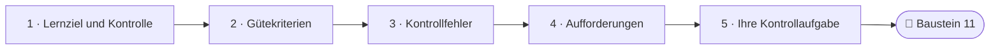
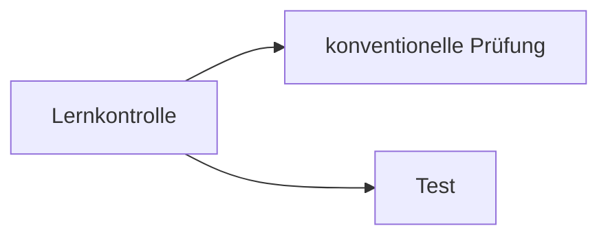
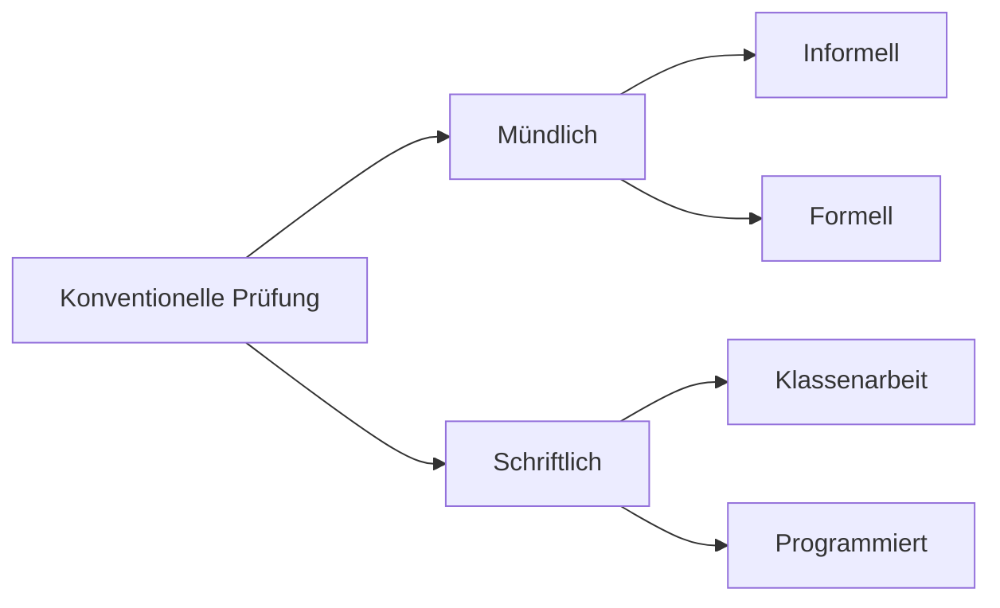
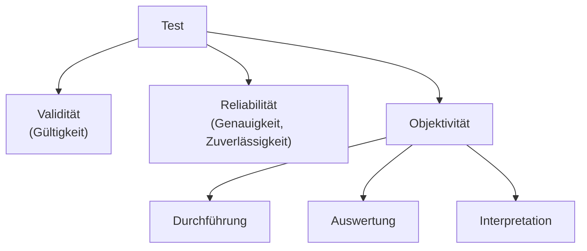

<!--
author:   Hannes Tegelbeckers
email:    hannes.tegelbeckers@ovgu.de
version:  0.2.0
language: de
narrator: Deutsch Female
mode:     Presentation
classroom: enable
comment:  Fachdidaktik technischer Allgemeinbildung II – Sitzung S10. Lernziel und Lernkontrolle, Testgütekriterien, Kontrollfehler und didaktische Aufforderungen nach Lernzielbereichen – mit einem Bewertungsexperiment zum Hof-Effekt.

import:   https://raw.githubusercontent.com/LiaTemplates/mermaid_template/0.1.4/README.md
-->

# S10 – Lernerfolgskontrolle & Testgütekriterien

Fachdidaktik technischer Allgemeinbildung II · OVGU Magdeburg · Montag, 14.12.2026, 07:00–09:00 Uhr

<!-- didaktik="Planungsraster S10 · E-03, E-04, E-09, E-12, E-17, E-19, E-23, E-27, E-33, E-35 · 0–5 Einstieg (Vorbereitungsumfrage, mündliche Modulprüfung) · 5–10 Bewertungsexperiment (nicht auflösen) · 10–15 Kurskarte · 15–30 Station 1 Lernziel und Lernkontrolle · 30–55 Station 2 Test und Gütekriterien, Auflösung des Experiments · 55–68 Station 3 Kontrollfehler · 68–79 Station 4 Aufforderungen und Operatoren · 79–85 Baustein 11 · 85–90 Abschluss" -->
> [!IMPORTANT] 🧭 Leitfrage
> Haben sie es gelernt – und woher wissen wir das? – Heute prüfen wir das Prüfen. Auch Ihre eigene Modulprüfung.

> [!TIP] 📚 Vor der Sitzung
> Haben Sie eine erinnerte Prüfungs- oder Testaufgabe notiert und abgestimmt, ob eine mündliche Prüfung objektiv ist? Wir starten mit dem Ergebnis.

📝 **Beuteblatt S10** – ergänzen Sie es während der Sitzung.

## Einstieg: Ist eine mündliche Prüfung objektiv?

    --{{0}}--
Sie haben in der Vorbereitung abgestimmt. Sie alle werden dieses Modul mündlich abschließen. Stimmen Sie noch einmal ab – jetzt mit diesem Wissen.

Sie alle werden dieses Modul **mündlich** abschließen.

**Vote (before):** Ist eine mündliche Prüfung objektiv?

[(a)] Ja
[(b)] Nein
[(c)] Teils, teils
[(undecided)] Undecided

    --{{1}}--
Gleich sind Sie selbst die Prüfenden: Sie bewerten eine Antwort auf eine Aufgabe aus S09.

      {{1}}
****************************************

> [!TIP] 🧠 Allein · 3 min
> Bewerten Sie auf der nächsten Folie **eine** Antwort – nur die Version zu Ihrem Geburtsmonat (ungerade → A, gerade → B). Notieren Sie hier, worauf Sie beim Bewerten geachtet haben.

[[___ ___ ___]]

****************************************

    --{{2}}--
Die Auflösung folgt später in der Sitzung.

      {{2}}
> [!TIP] 📌 Noch nicht auflösen
> Behalten Sie Ihre Punktzahl für sich – die Auflösung folgt nach Station 2.

## Bewertungsexperiment: Sie sind die Prüfenden

    --{{0}}--
Die Aufgabe stammt aus S09: Nennen Sie die drei Funktionen von Medien und geben Sie je ein Beispiel. Der Erwartungshorizont gibt je Funktion einen Punkt und je passendes Beispiel einen Punkt – höchstens sechs Punkte. Bewerten Sie nur die Antwort zu Ihrem Geburtsmonat.

<!-- didaktik="Lehrschritt Vorwissen aktivieren lassen (Erleben) · 5–10 min · Einzelarbeit · NICHT auflösen – Auflösung nach Station 2. Zuteilung: Geburtsmonat ungerade = A, gerade = B. Bei 10–15 Personen kann der Unterschied klein ausfallen oder fehlen – dann trotzdem mit R180 diskutieren." -->
**Aufgabe aus S09:** „Nennen Sie die drei Funktionen von Medien und geben Sie je ein Beispiel.“ **Erwartungshorizont:** je Funktion 1 Punkt, je passendes Beispiel 1 Punkt – höchstens 6 Punkte.

Geburtsmonat **ungerade** → bewerten Sie nur **Antwort A**. Geburtsmonat **gerade** → nur **Antwort B**.

**Antwort A** (aufklappen, nur Geburtsmonat ungerade)

> Demonstrationsmittel: Sie sollen Anschauung herbeiführen, z. B. ein Arbeitswerkzeug aus dem Betrieb. Arbeitsmittel: z. B. ein Arbeitsblatt oder ein Versuchsgerät. Motivationsmittel: fast alles, womit Lehrer und Schüler interagieren, z. B. ein Modell.

Ihre Punkte für Antwort A:

- [(0–2)] 0–2 Punkte
- [(3)] 3 Punkte
- [(4)] 4 Punkte
- [(5)] 5 Punkte
- [(6)] 6 Punkte

**Antwort B** (aufklappen, nur Geburtsmonat gerade)

> demonstrazionsmittel - anschaung herbeifüren z.b. ein arbeitswerkzeug ausm betrieb, arbeitsmittel z.b. arbeitsblat oder versuchsgerät ,Motivatiosmittel fast alles womit lehrer und schüler interagiren z.b. Modell

Ihre Punkte für Antwort B:

- [(0–2)] 0–2 Punkte
- [(3)] 3 Punkte
- [(4)] 4 Punkte
- [(5)] 5 Punkte
- [(6)] 6 Punkte

<small>Bewertungsexperiment: eigene Ergänzung, keine Originalfolie – Auflösung nach Station 2.</small>

## Kurskarte: Ziel und Kontrolle gehören zusammen

    --{{0}}--
Jede Sitzung beginnt mit Lernzielen. Heute fragen wir: Woher wissen wir, ob sie erreicht wurden? Wir gehen in vier Stationen vor – Lernziel und Lernkontrolle, Test und Gütekriterien, Kontrollfehler und schließlich die passenden Aufforderungen für jeden Lernzielbereich. S04 hat die Kontrolle in Projekten behandelt, S11 behandelt zentrale Abschlussprüfungen.

    --{{1}}--
Auf diesem Weg erreichen Sie sechs Ziele.

      {{1}}

<!-- data-type="none" -->
| Know | Can do | Value |
|------|--------|-------|
| Prüfungsformen, Testgütekriterien und Kontrollfehler **nennen** | didaktische Aufforderungen einem Lernzielbereich **zuordnen** | eine Prüfungsaufgabe anhand der Gütekriterien **beurteilen** |
| den Zusammenhang von Lernziel und Lernkontrolle sowie die Gütekriterien an Beispielen **erläutern** | in einem Bewertungsexperiment den Hof-Effekt **identifizieren** | eine Kontrollaufgabe mit Operator und Erwartungshorizont für Ihren Entwurf **entwickeln** *(optional)* |

    --{{2}}--
Prüfen Sie kurz, ob Sie die Kurskarte lesen können.

      {{2}}
****************************************

**Decide:** In welcher Station wird das Bewertungsexperiment fachlich erklärt?

<!-- data-hint-button="1" data-solution-button="2" -->
- [(X)] Kontrollfehler
- [( )] Gütekriterien
- [( )] Aufforderungen
[[?]] Das Experiment zeigt einen typischen Fehler beim Bewerten.
***
Richtig: Station 3 erklärt den Hof-Effekt – den Kontrollfehler, den Sie gerade erlebt haben.
***

****************************************

## Station 1: Lernziel und Lernkontrolle

    --{{0}}--
Die erste Station, Kapitel 10 der Folien, Lernerfolgskontrollen, beginnt mit einem Grundsatz, der banal klingt und doch oft verletzt wird.

**Was darf geprüft werden – und in welcher Form?**

    --{{1}}--
Zuerst der Grundsatz.

      {{1}}
- Es darf nur geprüft werden, was gelehrt worden ist (R170)

    --{{2}}--
Dann der Aufbau eines Lernziels.

      {{2}}
- Lernziel = Inhalt und Verhalten, mit Verhaltensstufen (R170)

    --{{3}}--
Danach die beiden Arten von Lernkontrollen.

      {{3}}
- Konventionelle Prüfung oder Test (R170)

    --{{4}}--
Und die Formen der konventionellen Prüfung.

      {{4}}
- Mündlich und schriftlich, informell und formell (R171–R172)

    --{{5}}--
Warum ist das für Sie wichtig?

      {{5}}
> [!TIP] Why this matters
> Sie werden selbst Prüfungen stellen – und dieses Modul mündlich abschließen.

    --{{6}}--
Markieren Sie, was Sie schon kennen.

      {{6}}
****************************************

**Mark:** Which of these do you already know? (several possible)

[[a1]] Es darf nur geprüft werden, was gelehrt worden ist (R170)
[[a2]] Lernziel = Inhalt und Verhalten, mit Verhaltensstufen (R170)
[[a3]] Konventionelle Prüfung oder Test (R170)
[[a4]] Mündlich und schriftlich, informell und formell (R171–R172)

****************************************

## 10.1 Zusammenhang zwischen Lernkontrolle und Lernziel

    --{{0}}--
Es darf nur geprüft werden, was auch gelehrt worden ist. Lernkontrollen sind entweder konventionelle Prüfungen oder Tests.

    --{{1}}--
Der Grundsatz steht auf der Folie in Klammern – und ist doch der Kern.

      {{1}}
**① Grundsatz:** (Es darf nur geprüft werden, was auch gelehrt worden ist)

    --{{2}}--
Ein Lernziel besteht aus Inhalt und Verhalten, und im Verhalten unterscheiden wir Stufen – im kognitiven Bereich Wissen, Verstehen, Anwenden und Problemlösen.

      {{2}}
**② Lernziel:** Ein Lernziel besteht aus zwei Teilen: Inhalt und Verhalten · Im Verhalten können Verhaltensstufen unterschieden werden · Im kognitiven Bereich kann man zwischen Wissen, Verstehen, Anwenden und Problemlösen unterscheiden

    --{{3}}--
Daraus folgt: Was auf der Stufe des Wissens unterrichtet wurde, darf auch nur auf dieser Stufe geprüft werden.

      {{3}}
**③ Folge für die Kontrolle:** Das bedeutet für die Kontrolle: Werden im Unterricht die Inhalte auf der Stufe des Wissens vermittelt, dann dürfen diese Inhalte in der Lernkontrolle auch auf der Stufe des Wissens geprüft werden

    --{{4}}--
Genau so sind die Prüfungsfragen zum Üben am Ende jeder Sitzung gebaut.

      {{4}}
> [!NOTE] Key message
> 🔗 Die *Prüfungsfragen zum Üben* prüfen auf den Stufen, auf denen die Lernziele der Sitzung formuliert sind (Constructive Alignment, vgl. S01).

<small>Quelle: Folie R170 „10.1 Zusammenhang zw. Lernkontrolle und Lernziel“ (Kapitel 10 „Lernerfolgskontrollen“, Folie R169) – Verzweigung als Diagramm nachgezeichnet (auf der Originalfolie sind die Linien verrutscht).</small>

## 10.2 Konventionelle Prüfung

    --{{0}}--
Konventionelle Prüfungen sind mündlich oder schriftlich, und beide können handlungsorientiert sein oder nicht.

    --{{1}}--
Die erste Unterscheidung.

      {{1}}
**① Mündlich und schriftlich:** Unterscheidung zwischen der mündlichen und schriftlichen, beide Formen können handlungsorientiert und nicht handlungsorientiert realisiert werden

    --{{2}}--
Mündlich unterscheidet man die informelle Prüfung, das punktuelle Abfragen …

      {{2}}
**② Informell (mündlich):** Informelle mündliche Prüfung bezieht sich auf das mündliche Abfragen – Punktuell wird überprüft, ob bestimmte Lernschritte erreicht wurden

    --{{3}}--
… von der formellen.

      {{3}}
**③ Formell (mündlich):** Formelle mündliche Prüfung ist besonders bekannt – In Berufsschulen hat formelle mündliche Prüfung eher in beruflichen Schulen wie Fachoberschule eine Bedeutung

    --{{4}}--
Schriftlich unterscheidet die Folie Klassenarbeit und programmierte Prüfung.

      {{4}}
> [!NOTE] Key message
> Konventionelle Prüfung: mündlich (informell, formell) oder schriftlich (Klassenarbeit, programmiert) – jeweils handlungsorientiert oder nicht.

<small>Quelle: Folien R171–R172 „10.2 Konventionelle Prüfung“ – „bestimmt“ zu „bestimmte“ korrigiert; Baumdiagramm nachgezeichnet.</small>

## Aktivierung: Darf das geprüft werden?

    --{{0}}--
Drei kurze Fragen zum Grundsatz aus R170.

**1 · Choose one:** Im Unterricht wurde das Ohm'sche Gesetz genannt und an einem Beispiel vorgerechnet (Stufe Wissen). In der Klassenarbeit sollen die Lernenden einen Fehler in einer unbekannten Schaltung finden (Problemlösen). Ist das nach R170 zulässig?

<!-- data-hint-button="1" data-solution-button="2" -->
- [( )] Ja – wer die Formel kennt, kann auch Fehler finden.
- [(X)] Nein – geprüft wird auf einer höheren Stufe als gelehrt.
- [( )] Ja – solange die Aufgabe angekündigt war.
[[?]] Auf welcher Stufe wurde gelehrt, auf welcher wird geprüft?
***
Nach R170 dürfen Inhalte, die auf der Stufe des Wissens vermittelt wurden, auch nur auf dieser Stufe geprüft werden. Wer Problemlösen prüfen will, muss Problemlösen vorher unterrichten und üben.
***

    --{{1}}--
Jetzt können mehrere Antworten richtig sein.

      {{1}}
****************************************

**2 · Choose all that apply:** Welche Aussagen stimmen nach R170?

<!-- data-hint-button="1" data-solution-button="2" -->
- [[X]] Ein Lernziel besteht aus Inhalt und Verhalten.
- [[ ]] Was angekündigt war, darf auf jeder Stufe geprüft werden.
- [[X]] Lernkontrollen sind konventionelle Prüfungen oder Tests.
- [[ ]] Im kognitiven Bereich gibt es nur die Stufe Wissen.
[[?]] Lesen Sie die Folie R170 noch einmal.
***
Im kognitiven Bereich unterscheidet die Folie Wissen, Verstehen, Anwenden und Problemlösen.
***

****************************************

    --{{2}}--
Zum Schluss ein Begriff.

      {{2}}
****************************************

**3 · Type:** Wie heißt die schriftliche konventionelle Prüfung neben der Klassenarbeit? (ein Wort)

<!-- data-hint-button="1" data-solution-button="2" -->
[[programmiert]]
[[?]] Sie steht im Baumdiagramm von R172.

***
Schriftlich: Klassenarbeit und programmierte Prüfung (R172).
***

****************************************

## Ihre mitgebrachte Aufgabe

    --{{0}}--
Ordnen Sie Ihre mitgebrachte Prüfungs- oder Testaufgabe ein.

Ist Ihre mitgebrachte Aufgabe **mündlich oder schriftlich**, **informell oder formell**? Auf welcher **Stufe** prüft sie – und wurde auf dieser Stufe gelehrt?

[[___ ___ ___ ___]]

💡 Hint 1

Stufen im kognitiven Bereich: Wissen, Verstehen, Anwenden, Problemlösen.

✅ Solution

Beispiel: „Berechnen Sie den Gesamtwiderstand der Schaltung“ aus einer Klassenarbeit – schriftlich, Klassenarbeit, Stufe Anwenden. Zulässig, wenn im Unterricht ähnliche Schaltungen berechnet wurden.

## Station 2: Test und Gütekriterien

    --{{0}}--
Was unterscheidet einen Test von einer gewöhnlichen Klassenarbeit? Er ist nach testtheoretischen Kriterien abgesichert – den drei Gütekriterien. Eine Ergänzung aus Zinn, als NEU markiert, erklärt die Bezugsnormen. Am Ende wird das Bewertungsexperiment aufgelöst.

**Woran erkennt man eine gute Prüfung?**

    --{{1}}--
Zuerst: Was ist ein Test?

      {{1}}
- Test (R173)

    --{{2}}--
Misst der Test, was er messen soll?

      {{2}}
- Validität (R174)

    --{{3}}--
Misst er genau?

      {{3}}
- Reliabilität (R175)

    --{{4}}--
Und ist das Ergebnis unabhängig von der prüfenden Person?

      {{4}}
- Objektivität in Durchführung, Auswertung und Interpretation (R176–R178)

    --{{5}}--
Warum ist das für Sie wichtig?

      {{5}}
> [!TIP] Why this matters
> Die Gütekriterien gelten auch für Klassenarbeiten, Fachgespräche – und Ihre mündliche Modulprüfung.

    --{{6}}--
Markieren Sie, was Sie schon kennen.

      {{6}}
****************************************

**Mark:** Which of these do you already know? (several possible)

[[a1]] Test (R173)
[[a2]] Validität (R174)
[[a3]] Reliabilität (R175)
[[a4]] Objektivität in Durchführung, Auswertung und Interpretation (R176–R178)

****************************************

## 10.3 Test

    --{{0}}--
Ein Test ist eine Lernkontrolle, die nach testtheoretischen und teststatistischen Kriterien abgesichert ist. Die Folie zeigt die drei Gütekriterien als Schaubild.

    --{{1}}--
Validität heißt Gültigkeit.

      {{1}}
**① Validität:** (Gültigkeit)

    --{{2}}--
Reliabilität heißt Genauigkeit und Zuverlässigkeit.

      {{2}}
**② Reliabilität:** (Genauigkeit, Zuverlässigkeit)

    --{{3}}--
Und Objektivität gibt es in Durchführung, Auswertung und Interpretation.

      {{3}}
**③ Objektivität:** (Durchführung-, Auswertungs-, Interpretationsobjektivität)

    --{{4}}--
Die Definition auf der Folie:

      {{4}}
> [!NOTE] Key message
> Tests „sind Lernkontrollen, die nach testtheoretischer und teststatistischen Kriterien abgesichert sind“. Die Gütekriterien sind Validität, Reliabilität und Objektivität.

<small>Quelle: Folie R173 „10.3 Test“ – „teststatischen“ zu „teststatistischen“ korrigiert; Schaubild „Test“ als Diagramm nachgezeichnet.</small>

## 10.4 Validität

    --{{0}}--
Ein Test ist valide, wenn er tatsächlich misst, was er zu messen vorgibt. Das Beispiel der Folie: Eine Rechenaufgabe als Textaufgabe prüft auch das Textverständnis – sie ist für das Rechnen also nicht valide.

- Latein *validus*: stark, wirksam, einflussreich, gesund
- Englisch *valid/validity*: gültig, Gültigkeit, Stichhaltigkeit
- „Ein Test ist valide, wenn er tatsächlich das mißt, was er zu messen vorgibt.“
- Bei einer Rechenaufgabe in Form einer Textaufgabe wird nicht nur das Rechnen geprüft, sondern auch das Textverständnis – also nicht valide
- Schulleistungstests überprüfen meist nur die Inhaltsvalidität
- Test muss Lernziele widerspiegeln (Wissenstest bei Wissenslernziele)
- Schwerpunkte des Unterrichts sollten Schwerpunkte des Tests darstellen

    --{{1}}--
Für Schulleistungstests heißt Validität vor allem: Der Test spiegelt die Lernziele wider.

      {{1}}
> [!NOTE] Key message
> *Inhaltsvalidität* (Lesehilfe): Deckt der Test die Inhalte und Ziele des Unterrichts ab – mit denselben Schwerpunkten?

<small>Quelle: Folie R174 „10.4 Validität“ – Zitat wörtlich (alte Schreibweise „mißt“), Quelle des Zitats auf der Folie nicht angegeben; „da Textverständnis“ zu „das Textverständnis“ korrigiert.</small>

## 10.5 Reliabilität

    --{{0}}--
Ein Test ist reliabel, wenn er das, was er misst, genau misst – bei einer Wiederholung mit denselben Personen kommt er zu denselben Ergebnissen.

- Englisch *reliable/reliability*: genau, zuverlässig, Genauigkeit, Zuverlässigkeit
- „Ein Test ist reliabel, wenn er das, was er mißt, genau mißt.“
- Insbesondere bei einer Testwiederholung mit gleichen Probanden muss ein Test zu gleichen Ergebnissen kommen
- Damit ist aber noch nicht gesagt, ob der Test auch zu validen Ergebnissen führt, d. h. ob das, was er reliabel misst, das ist, was er zu messen vorgibt

    --{{1}}--
Die Folie warnt aber.

      {{1}}
> [!NOTE] Key message
> Ein reliabler Test ist damit noch nicht valide – man kann sehr genau das Falsche messen.

<small>Quelle: Folie R175 „10.5 Reliabilität“ – Zitat wörtlich, Quelle auf der Folie nicht angegeben.</small>

## 10.6 Objektivität

    --{{0}}--
Objektiv ist ein Test, wenn sein Ergebnis unabhängig von der Person ist, die ihn durchführt, auswertet und interpretiert. Durchführungsobjektivität heißt gleiche Bedingungen für alle, mit schriftlich festgelegter Bearbeitungszeit und festgelegten Hilfsmitteln.

- „Die Objektivität (Vorurteilslosigkeit) eines Tests bezieht sich darauf, zu welchem Grund die Ergebnisse eines Tests unabhängig vom Untersucher sind.“
- Ein Schultest muss unabhängig von der Person des Lehrers sein, die ihn als Testleiter durchführt, die ihn auswertet und die die Leistungen interpretiert
- Man spricht daher von Durchführungs-, Auswertungs- und Interpretationsobjektivität

**Durchführungsobjektivität**

- Es müssen die äußeren Bedingungen der Testsituation für alle Schüler gleich sein
- Die Anweisungen des Testautors müssen im Detail schriftlich so festgehalten sein, dass eine unterschiedliche Auslegung der Durchführungsanweisungen nicht mehr möglich ist
  - Z. B. die Bearbeitungszeit, Art der Hilfsmittel, Art der Hilfen des Lehrers

    --{{1}}--
Auswertungsobjektivität verlangt einen eindeutigen Lösungsschlüssel. Interpretationsobjektivität heißt, dass zwei Beurteiler aus demselben Ergebnis denselben Schluss ziehen – etwa mit demselben Notenschlüssel. Tests können zudem normorientiert oder kriteriumsorientiert sein.

      {{1}}
****************************************

**Auswertungsobjektivität**

- Das Auswertungsergebnis muss gleich sein, egal welcher Lehrer den Test kontrolliert
- Dazu ist ein eindeutiger Lösungsschlüssel notwendig

**Interpretationsobjektivität**

- Zwei unabhängige Beurteiler ziehen unabhängig voneinander aus dem gleichen Auswertungsergebnis den gleichen Schluss
- Das heißt z. B. dass der gleiche Notenschlüssel als Grundlage dient

**Test** – Normorientiert (formell, informell) · Kriteriumsorientiert

****************************************

    --{{2}}--
Was heißt normorientiert und kriteriumsorientiert? Die nächste Folie erklärt es.

      {{2}}
> [!NOTE] Key message
> Objektivität = Durchführung (gleiche Bedingungen) + Auswertung (Lösungsschlüssel) + Interpretation (gleicher Notenschlüssel).

<small>Quelle: Folien R176–R178 „10.6 Objektivität“ – Zitat wörtlich („zu welchem Grund“ wie im Original, gemeint ist vermutlich „Grad“), Quelle auf der Folie nicht angegeben; „das der gleiche“ zu „dass der gleiche“ korrigiert; Baumdiagramm „Test → normorientiert (formell, informell) / kriteriumsorientiert“ als Zeile wiedergegeben (auf der Originalfolie verrutscht).</small>

## [NEU] Norm oder Kriterium? Bezugsnormen

    --{{0}}--
Was heißt normorientiert und kriteriumsorientiert? Zinn hilft mit den Bezugsnormen, als NEU markiert. Bei der sozialen Bezugsnorm wird mit der Klasse verglichen, bei der individuellen mit dem eigenen früheren Stand, bei der kriterialen mit einem vorher festgelegten Standard.

<!-- neu="Zinn 2026, S. 217" -->

<!-- data-type="none" -->
| Bezugsnorm | Verglichen wird … | sichtbar wird … |
| --- | --- | --- |
| **sozial** (≈ normorientiert) | querschnittlich, z. B. in der Klasse | ob jemand mehr oder weniger kann als die anderen (+); nicht, wie viel jemand gelernt hat (−) |
| **individuell** | eine Person im Längsschnitt | wie viel eine Schülerin/ein Schüler dazugelernt hat (+) |
| **kriterial** (≈ kriteriumsorientiert) | mit einem vorher festgelegten Kriterium | wie weit jemand von einem definierten Standard entfernt ist (+); keine Aussage über die Leistungsänderung (−) |

    --{{1}}--
Dazu gibt Zinn praktische Hinweise, wie man die Gütekriterien im Schulalltag sichert.

      {{1}}
****************************************

<!-- neu="Zinn 2026, S. 217–219" -->
- **Objektivität** sichern Sie durch eindeutige Festlegungen: Erwartungshorizont, Bewertungsanweisungen, transparente Punktevergabe, Prüfungsprotokolle (S. 218).
- **Reliabilität**: Aufgaben sollen differenzieren – ohne **Deckeneffekt** (fast alle lösen sie) und **Bodeneffekt** (fast niemand löst sie) (S. 218).
- **Validität** gilt als das bedeutendste Kriterium und setzt Objektivität und Reliabilität voraus. Beispiel: Ein langer Aufgabentext prüft neben Fachwissen auch Lesekompetenz (S. 218–219) – wie die Textaufgabe auf R174.

****************************************

    --{{2}}--
Und ein Hinweis zum Erwartungshorizont.

      {{2}}
> [!NOTE] Key message
> Der **Erwartungshorizont** soll den Lernenden vorab bekannt sein; Aufgaben sollen bekannte Operatoren verwenden und möglichst alle drei Anforderungsbereiche abdecken (Zinn 2026, S. 217).

<small>[NEU] Ergänzung, keine Originalfolie: Zinn (2026), S. 217–219 (nach Moosbrugger & Kelava 2020); die Zuordnung „≈“ zu R178 ist eine Lesehilfe.</small>

## Aktivierung: Welches Gütekriterium ist verletzt?

    --{{0}}--
Drei kurze Fragen zu den Gütekriterien.

**1 · Choose one:** Eine Aufgabe zum Fachwissen Statik ist so lang formuliert, dass vor allem gute Leser sie lösen. Welches Gütekriterium ist verletzt?

<!-- data-hint-button="1" data-solution-button="2" -->
- [( )] Reliabilität
- [(X)] Validität
- [( )] Objektivität
[[?]] Misst die Aufgabe, was sie messen soll?
***
Validität: misst der Test, was er messen soll – und spiegelt er die Schwerpunkte des Unterrichts (R174)?
***

    --{{1}}--
Jetzt können mehrere Antworten richtig sein.

      {{1}}
****************************************

**2 · Choose all that apply:** Welche Situationen verletzen die Objektivität?

<!-- data-hint-button="1" data-solution-button="2" -->
- [[X]] Eine Klasse schreibt 45 min, die Parallelklasse bekommt 60 min und darf die Formelsammlung benutzen.
- [[ ]] Ein Test wird eine Woche später mit denselben Lernenden wiederholt und liefert eine völlig andere Rangfolge.
- [[X]] Zwei Lehrkräfte korrigieren dieselbe Arbeit ohne Lösungsschlüssel und kommen zu verschiedenen Punkten.
- [[ ]] Im Unterricht stand das Messen im Vordergrund – der Test fragt nur Definitionen ab.
[[?]] Objektivität: Durchführung, Auswertung, Interpretation.
***
Durchführung (gleiche Bedingungen, R176–R177), Auswertung (Lösungsschlüssel, R177). Die Wiederholung betrifft die Reliabilität, die Definitionen die Validität.
***

****************************************

    --{{2}}--
Zum Schluss ein Begriff.

      {{2}}
****************************************

**3 · Type:** Ein Test wird eine Woche später wiederholt und liefert eine völlig andere Rangfolge. Welches Gütekriterium ist verletzt? (ein Wort)

<!-- data-hint-button="1" data-solution-button="2" -->
[[Reliabilität]]
[[?]] Misst der Test genau?

***
Reliabilität: Bei einer Testwiederholung mit gleichen Probanden muss ein Test zu gleichen Ergebnissen kommen (R175).
***

****************************************

## Ihre Aufgabe auf dem Prüfstand

    --{{0}}--
Prüfen Sie jetzt Ihre mitgebrachte Aufgabe.

**Allein (6 min):** Welches Gütekriterium ist bei Ihrer mitgebrachten Aufgabe am stärksten gefährdet – und wie ließe es sich sichern?

[[___ ___ ___ ___]]

💡 Hint 1

Gibt es einen Lösungsschlüssel? Prüft die Aufgabe nebenbei etwas anderes? Würde sie bei Wiederholung dasselbe ergeben?

✅ Solution

Beispiel: „Erklären Sie die Funktion eines FI-Schutzschalters“ ohne Erwartungshorizont – gefährdet ist die Auswertungsobjektivität. Sichern: Erwartungshorizont mit Punkten je Teilaussage (Differenzstrom, Auslöseschwelle, Abschalten) und vorab bekannte Operatoren.

## Auflösung des Experiments

    --{{0}}--
Jetzt die Auflösung. Antwort A und Antwort B hatten denselben Inhalt – alle drei Funktionen und drei passende Beispiele, also nach Erwartungshorizont je sechs Punkte. B war nur unsauber geschrieben.

<!-- didaktik="Lehrschritt problematisieren · 52–55 min · Umfrageergebnisse A und B nebeneinander zeigen" -->
Antwort A und Antwort B hatten **denselben Inhalt** – alle drei Funktionen und drei passende Beispiele, also nach Erwartungshorizont je **6 Punkte**. B war nur unsauber geschrieben.

**Gab es einen Unterschied in Ihren Punkten?** Was hat ihn verursacht?

[[___ ___ ___ ___]]

💡 Hint 1

Den Fachbegriff liefert Station 3.

✅ Solution

Wenn B weniger Punkte bekam, wurde das Umfeld der Leistung – Schrift und Rechtschreibung – mitbewertet: der **Hof-Effekt** (R180). Bei 10–15 Personen kann der Unterschied klein ausfallen; Studien zeigen den Effekt über viele Bewertungen.

## Station 3: Kontrollfehler

    --{{0}}--
Auch wer die Gütekriterien kennt, bewertet nicht fehlerfrei. Die dritte Station beschreibt drei typische Kontrollfehler – und einen davon haben Sie zu Beginn der Sitzung erlebt.

**Welche Fehler machen Prüfende – und wie begegnet man ihnen?**

    --{{1}}--
Zuerst der Reihenfolge-Effekt.

      {{1}}
- Reihenfolge-Effekt (R179)

    --{{2}}--
Dann der Hof-Effekt.

      {{2}}
- Hof-Effekt (R180)

    --{{3}}--
Und der Erwartungs-Effekt.

      {{3}}
- Erwartungs-Effekt (R181)

    --{{4}}--
Dazu Ihr eigenes Experiment.

      {{4}}
- Ihr Bewertungsexperiment

    --{{5}}--
Warum ist das für Sie wichtig?

      {{5}}
> [!TIP] Why this matters
> Sich das Vorhandensein und die Wirkung dieser Effekte bewusst zu sein, ist nach der Folie die beste Schutzmethode (R181).

    --{{6}}--
Markieren Sie, was Sie schon kennen.

      {{6}}
****************************************

**Mark:** Which of these do you already know? (several possible)

[[a1]] Reihenfolge-Effekt (R179)
[[a2]] Hof-Effekt (R180)
[[a3]] Erwartungs-Effekt (R181)
[[a4]] Ihr Bewertungsexperiment

****************************************

## 10.7 Kontrollfehler: Reihenfolge-Effekt

    --{{0}}--
Beim Korrigieren vieler Arbeiten neigt man dazu, die ersten strenger zu bewerten; mit der Gewöhnung wird man milder.

- Bei der Kontrolle mehrerer Tests zeigt sich die Tendenz, die ersten Kontrollen und die ersten Wertungen strenger durchzuführen
- Im weiteren Verlauf tritt der Effekt der Gewöhnung ein
  - Es wird milder bewertet
- In einer Untersuchung hat sich die Zahl 8 von 10 als sehr günstig erwiesen um diesen Fehler einzuschränken
- Man kann diesem Effekt entgegenwirken indem man die Arbeiten zweimal liest und beim ersten Lesen das Wertungsergebnis nicht sofort zum Endurteil macht
- Oder man nimmt beim ersten Lesen nur eine Vorsortierung vor

    --{{1}}--
Was bedeutet „8 von 10“? Die Folie lässt das offen – nehmen wir es als offene Frage.

      {{1}}
> [!NOTE] Key message
> Gegenmittel: jede Arbeit zweimal lesen – das erste Urteil ist noch nicht das Endurteil – oder beim ersten Lesen nur vorsortieren.

<small>Quelle: Folie R179 „10.7 Kontrollfehler“ – „der Gewöhnung aus“ zu „der Gewöhnung ein“ korrigiert; die genannte Untersuchung ist auf der Folie nicht belegt, und was „8 von 10“ bedeutet, bleibt offen.</small>

## 10.8 Hof-Effekt

    --{{0}}--
Beim Hof-Effekt wird das Umfeld einer Leistung mitbewertet: Eine unschöne Schrift und viele Rechtschreibfehler drücken die Bewertung des Inhalts, ebenso Vorleistungen, Herkunft oder Leistungen in anderen Fächern.

- Bei einer Bewertung einer bestimmten Leistung wird auch deren Umfeld (Hof) zwangsläufig mit wahrgenommen, kontrolliert und bewertet
- Eine unschöne Schrift und viele Rechtschreibfehler wirken sich auf die Bewertung des Inhalts aus
- Ähnlich wirken Vorleistungen des Lerners, Herkunft, Verhaltensstil, Leistungen in anderen Fächern eine Rolle
- Dieser Effekt ist geringer, je weniger vom Umfeld bekannt ist, z. B. bei einer verdeckten Kontrolle bei der Ziffern anstatt Namen zur Identifizierung benutzt werden

    --{{1}}--
Vergleichen Sie mit Ihrem Experiment vom Anfang.

      {{1}}
> [!NOTE] Key message
> 🔗 Das war Ihr Experiment: Antwort B hatte eine „unschöne Schrift und viele Rechtschreibfehler“ – bei gleichem Inhalt.

<small>Quelle: Folie R180 „10.8 Hof-Effekt“</small>

## 10.9 Erwartungs-Effekt

    --{{0}}--
Beim Erwartungs-Effekt bringt die prüfende Person aufgrund von Vorinformationen eine Erwartung mit – und sieht sie bestätigt. Die Vorhersage erfüllt sich selbst, und die Lernenden verändern sich sogar nach diesen Erwartungen; das ist der Pygmalion-Effekt.

- Auf Grund von Vorinformationen über die Leistungen trägt der Kontroller an den Lernenden heran mit der Tendenz, diese erfüllt zu sehen
- So erfüllt sich diese Vorhersage selbst (*self-fulfilling prophecy*)
- Der Lernende selbst verändert sich nach diesen Erwartungen (Pygmalion-Effekt)
- Sich das Vorhandensein und die Wirkung dieser Effekte bewusst zu sein, ist die beste Schutzmethode

    --{{1}}--
Der beste Schutz, so die Folie:

      {{1}}
> [!NOTE] Key message
> Die beste Schutzmethode ist, sich das Vorhandensein und die Wirkung dieser Effekte bewusst zu machen.

<small>Quelle: Folie R181 „10.9 Erwartungs-Effekt“ – „self-fulifilling“ zu „self-fulfilling“ korrigiert.</small>

## Aktivierung: Welcher Kontrollfehler?

    --{{0}}--
Drei kurze Fragen zu den Kontrollfehlern.

**1 · Choose one:** Die ersten fünf Arbeiten des Stapels werden strenger bewertet als die letzten. Welcher Kontrollfehler ist das?

<!-- data-hint-button="1" data-solution-button="2" -->
- [( )] Hof-Effekt
- [(X)] Reihenfolge-Effekt
- [( )] Erwartungs-Effekt
[[?]] Gewöhnung beim Korrigieren …
***
Reihenfolge-Effekt: Gewöhnung beim Korrigieren (R179).
***

    --{{1}}--
Jetzt können mehrere Antworten richtig sein.

      {{1}}
****************************************

**2 · Choose all that apply:** Welche Situationen zeigen den Hof-Effekt?

<!-- data-hint-button="1" data-solution-button="2" -->
- [[X]] Ein sauber gezeichnetes Schaltbild führt zu mehr Punkten für eine fachlich gleich gute Lösung.
- [[ ]] „Der war schon im ersten Lehrjahr schwach“ – und genau so liest die Lehrkraft die Arbeit.
- [[X]] Die gute Note in Mathematik färbt auf die Bewertung im Technikunterricht ab.
- [[ ]] Die ersten fünf Arbeiten des Stapels werden strenger bewertet als die letzten.
[[?]] Hof = das Umfeld der Leistung.
***
Hof-Effekt: das Umfeld der Leistung wird mitbewertet – Schrift, Form, Leistungen in anderen Fächern (R180). „Schon im ersten Lehrjahr schwach“ ist der Erwartungs-Effekt (R181).
***

****************************************

    --{{2}}--
Zum Schluss ein Begriff.

      {{2}}
****************************************

**3 · Type:** Wie heißt der Effekt, bei dem sich Lernende nach den Erwartungen der Lehrkraft verändern? (ein Wort, ohne „-Effekt“)

<!-- data-hint-button="1" data-solution-button="2" -->
[[Pygmalion]]
[[?]] Eine Figur aus der griechischen Mythologie …

***
Pygmalion-Effekt: Der Lernende selbst verändert sich nach diesen Erwartungen (R181).
***

****************************************

## Station 4 · 10.10 Didaktische Aufforderungen nach Lernzielbereichen

    --{{0}}--
Zum Schluss: Wie formuliere ich Aufgaben so, dass sie zum Lernziel passen? Die Folien ordnen Aufforderungen nach drei Lernzielbereichen. Kognitiv reicht die Spanne vom deskriptiven Wissen – nennen Sie – über anwendendes – berechnen Sie – bis zum bewertenden Wissen – prüfen Sie.

**Kognitive Handlungen**

<!-- data-type="none" -->
| Wissen | Aufforderung |
| --- | --- |
| Descriptives Wissen | Nennen Sie… |
| Verstehendes Wissen | Fügen Sie… ein. |
| Anwendendes Wissen | Berechnen Sie… |
| Analysierendes Wissen | Klassifizieren Sie… |
| Synthetisierendes Wissen | Entwickeln Sie… |
| Bewertendes Wissen | Prüfen Sie, … |

    --{{1}}--
Affektive Aufforderungen lauten etwa: Setzen Sie sich für … ein. Psychomotorische etwa: Messen Sie, zeichnen Sie.

      {{1}}
****************************************

**Affektive Handlungen**

- Berücksichtigen Sie…
- Beteiligen Sie sich an…
- Setzen Sie sich für… ein.
- Finden Sie Beurteilungsmaßstäbe für…
- Ziehen Sie Konsequenzen aus… für…

**Psychomotorische Handlungen**

- Messen Sie…
- Zeichnen Sie…

****************************************

    --{{2}}--
Die Aufforderung entscheidet, was geprüft wird.

      {{2}}
> [!NOTE] Key message
> Die Aufforderung bestimmt die Stufe: „Nennen Sie“ prüft etwas anderes als „Prüfen Sie“ – wählen Sie sie passend zum Lernziel (R170).

<small>Quelle: Folien R182–R183 „10.10 Einteilung von didaktischen Aufforderungen nach Lernzielbereichen“ – Schreibweise „Descriptives“ wie im Original.</small>

## [NEU] Operatoren und Anforderungsbereiche

    --{{0}}--
Zinn ergänzt das, als NEU markiert: Solche handlungsleitenden Verben heißen Operatoren; sie machen die Verhaltenskomponente eines Lernziels beobachtbar.

<!-- neu="Zinn 2026, S. 70–73" -->
**Lernzielbereiche** (Zinn 2026, S. 70, Tab. 5.2): *kognitiv* (Denken, Wissen, Problemlösen), *affektiv* (Interessen, Bereitschaft, Werthaltungen), *psychomotorisch* (manipulative und motorische Fähigkeiten) – z. B. „Die Schülerinnen und Schüler stellen ein Gewinde fachgerecht her“ (psychomotorisch).

**Operatoren** sind handlungsleitende Verben; sie machen die **Verhaltenskomponente** eines Lernziels beobachtbar und überprüfbar (S. 72) – das ist die Unterscheidung „Inhalt und Verhalten“ von R170. „Verstehen“ ist eine Lernzielstufe, aber nicht direkt beobachtbar und deshalb als Verb für Feinziele ungeeignet (S. 73).

    --{{1}}--
Für die Prüfung im Fach Technik werden drei Anforderungsbereiche unterschieden – am Beispiel des Spannungs-Dehnungs-Diagramms, das Sie aus S01b kennen.

      {{1}}
****************************************

<!-- data-type="none" -->
| | typische Operatoren (S. 73) | Beispiel EPA Technik (S. 72) |
| --- | --- | --- |
| **AFB I** Reproduktion | nennen, erfassen | die Formeln für Dehnung und Spannung nennen |
| **AFB II** Reorganisation und Transfer | berechnen, beschreiben | ein Spannungs-Dehnungs-Diagramm erläutern |
| **AFB III** Bewertung und Problemlösung | analysieren, bewerten | Materialeigenschaften anhand von Spannungs-Dehnungs-Diagrammen beurteilen und problembezogen nutzen |

****************************************

    --{{2}}--
Verbinden Sie das mit unseren Planungsrastern.

      {{2}}
> [!NOTE] Key message
> 🔗 Die Spalte „Verben“ in unseren Planungsrastern (Erinnern … Entwickeln) ist eine solche Taxonomie (vgl. Zinn 2026, S. 71, Tab. 5.4, nach Anderson & Krathwohl).

<small>[NEU] Ergänzung, keine Originalfolie: Zinn (2026), S. 70–73.</small>

## Aktivierung: Welcher Lernzielbereich?

    --{{0}}--
Ergänzen Sie den Text. Wählen, tippen oder ziehen Sie die fehlenden Wörter.

**Complete:**

<!-- data-hint-button="1" data-solution-button="2" data-show-partial-solution -->
„Nennen Sie…“ gehört zum [[ (descriptiven) | bewertenden | anwendenden ]] Wissen. Die Folie unterscheidet so viele kognitive Wissensarten: [[6]]. Eine psychomotorische Aufforderung ist [->[ (Zeichnen Sie…) | Prüfen Sie… ]].
[[?]] Schauen Sie in die Tabelle auf R182 und die Liste auf R183.

    --{{1}}--
Entscheiden Sie jetzt: richtig oder falsch?

      {{1}}
****************************************

**Decide:** True or false?

<!-- data-hint-button="1" data-solution-button="2" data-show-partial-solution -->
[(true) (false)]
[  (X)    ( )  ] „Messen Sie…“ ist eine psychomotorische Aufforderung.
[  ( )    (X)  ] „Setzen Sie sich für… ein.“ ist eine kognitive Aufforderung.
[  (X)    ( )  ] „Klassifizieren Sie…“ gehört zum analysierenden Wissen.
[  ( )    (X)  ] „Verstehen“ ist ein gut geeigneter Operator für Feinziele.
[[?]] Kognitiv, affektiv, psychomotorisch – und Zinns Hinweis zu „Verstehen“.
***
„Setzen Sie sich für… ein.“ ist affektiv (R182). „Verstehen“ ist eine Lernzielstufe, aber nicht direkt beobachtbar und deshalb als Verb für Feinziele ungeeignet (Zinn 2026, S. 73).
***

****************************************

## Wo stehen wir? Baustein 11: Ihre Kontrollaufgabe (optional)

    --{{0}}--
Hier wenden Sie die Sitzung auf eine eigene Aufgabe an: Sie formulieren zu einem Lernziel eine Kontrollaufgabe mit Operator und Erwartungshorizont und prüfen sie mit dem Grundsatz aus Station 1 und den Gütekriterien aus Station 2.

<!-- didaktik="Lehrschritt üben lassen (Transfer) · 79–85 min · Einzelarbeit · Classroom-Auswertung · Doppeldecker: Selbstprüfung auf Validität" -->
**Allein (5 min):** Wählen Sie ein Lernziel einer Stunde aus Ihrer Fachrichtung (oder aus Ihrem optionalen Entwurf).

<!-- data-type="none" -->
| Lernziel | Aufgabe (mit Operator) | Erwartungshorizont (Punkte) | Gütekriterien-Check |
| --- | --- | --- | --- |
| … | … | … | Wurde auf dieser Stufe gelehrt (R170)? Prüft sie nur das Ziel (Validität)? Lösungsschlüssel (Objektivität)? |

**Prüfen Sie selbst:** Ist die Aufgabe **valide** – prüft sie das Feinziel und nicht nebenbei etwas anderes?

[[___ ___ ___ ___]]

💡 Hint 1

Wählen Sie den Operator nach dem Anforderungsbereich, auf dem Sie unterrichtet haben.

✅ Solution

Lernziel: Die Lernenden berechnen den Leitungsquerschnitt für einen Stromkreis (AFB II). Aufgabe: „Berechnen Sie den Mindestquerschnitt für 16 A, Verlegeart C, und begründen Sie Ihre Wahl mit dem Tabellenbuch.“ Erwartungshorizont: Tabellenwert gefunden (2 P.), Querschnitt 1,5 mm² (2 P.), Begründung (2 P.). Check: so geübt ✓, prüft nur das Ziel ✓ (kurzer Aufgabentext), Lösungsschlüssel vorhanden ✓.

## Zum Mitnehmen: Ist eine mündliche Prüfung objektiv?

    --{{0}}--
Zurück zur Frage vom Anfang. Stimmen Sie noch einmal ab.

**Vote (after):** Ist eine mündliche Prüfung objektiv?

[(a)] Ja
[(b)] Nein
[(c)] Teils, teils
[(undecided)] Undecided

    --{{1}}--
Was ist Ihnen heute am unklarsten geblieben?

      {{1}}
****************************************

**Reflect:** Muddiest point: Was ist Ihnen heute am unklarsten geblieben?

[[___ ___]]

****************************************

    --{{2}}--
Vergleichen Sie Ihr Votum mit dem vom Anfang.

      {{2}}
> [!NOTE] Key message
> Vollständig objektiv ist keine Prüfung. Objektiver wird eine mündliche Prüfung durch gleiche Bedingungen, einen Erwartungshorizont, ein Protokoll und das Wissen um Hof-, Reihenfolge- und Erwartungs-Effekt (R176–R181; Zinn 2026).

## Das Wichtigste aus S10

    --{{0}}--
Fassen wir zusammen.

    --{{1}}--
Erstens: der Grundsatz.

      {{1}}
- Es darf nur geprüft werden, was gelehrt worden ist – auf derselben Stufe (R170).

    --{{2}}--
Zweitens: die Gütekriterien.

      {{2}}
- Gütekriterien: Validität, Reliabilität, Objektivität in Durchführung, Auswertung und Interpretation (R173–R178).

    --{{3}}--
Drittens: die Kontrollfehler.

      {{3}}
- Kontrollfehler: Reihenfolge-, Hof- und Erwartungs-Effekt – Bewusstsein ist der beste Schutz (R179–R181).

    --{{4}}--
Und viertens: die Aufforderungen.

      {{4}}
****************************************

- Aufforderungen und Operatoren passend zu Lernzielbereich und Anforderungsbereich wählen (R182–R183; Zinn 2026).

> [!NOTE] Remember
> Prüfen Sie das Lernziel – nicht die Schrift, nicht die Erwartung, nicht das Lesetempo.

****************************************

    --{{5}}--
Eine letzte Frage.

      {{5}}
****************************************

**Recap:** Ein Test liefert bei Wiederholung exakt dieselben Ergebnisse, fragt aber nur Definitionen ab, obwohl Messen geübt wurde. Was gilt?

<!-- data-hint-button="1" data-solution-button="2" -->
- [( )] Er ist reliabel und deshalb auch valide.
- [( )] Er ist weder reliabel noch valide.
- [(X)] Er ist reliabel, aber nicht valide.
[[?]] Man kann sehr genau das Falsche messen.
***
Richtig: Reliabilität sagt noch nichts über Validität (R175).
***

****************************************

    --{{6}}--
Nächstes Mal geht es um zentrale Abschlussprüfungen und den Rückblick auf das Modul.

      {{6}}
**➡️ Next:** S11 (04.01.2027): PAL-Prüfungen & Synthese · 📝 Ergänzen Sie die Abschnitte 3 und 4, Baustein 11 und Ihre wichtigste Beute im Beuteblatt S10.

## Prüfungsfragen zum Üben

    --{{0}}--
Mit diesen fünf Fragen können Sie sich auf die mündliche Prüfung vorbereiten. Die Querverweise zeigen, wo die Themen in anderen Sitzungen wieder auftauchen.

<!-- didaktik="E-12 mündliche Prüfung" -->
1. Erläutern Sie den Zusammenhang zwischen Lernziel und Lernkontrolle.
2. Nennen und erläutern Sie die drei Testgütekriterien an je einem Beispiel aus Ihrer Fachrichtung.
3. Unterscheiden Sie Durchführungs-, Auswertungs- und Interpretationsobjektivität.
4. Beschreiben Sie zwei Kontrollfehler und wie man ihnen begegnen kann.
5. „Eine mündliche Prüfung kann nicht objektiv sein.“ – Nehmen Sie Stellung.

> [!NOTE] 🔗 Querverweise
> Lernziele mit Operatoren, Constructive Alignment → **S01** · Kontrolle und Bewertung in Projekten, Soll-Ist-Vergleich → **S04** · Medien, KI und Prüfen → **S09** · zentrale Abschlussprüfungen (PAL) → **S11**

<small>Die Prüfungsfragen sind experimentell: Sie dienen der Vorbereitung, es ist nicht garantiert, dass Fragen in dieser Form gestellt werden.</small>

## Rückblick auf S10

    --{{0}}--
Nehmen Sie sich zwei Minuten für einen Rückblick. Was ist das Wichtigste – und was ist noch unklar?

**Reflect:** What is the most important thing you learned today – and what is still unclear?

[[___ ___ ___]]

    --{{1}}--
Haken Sie ab, was Sie jetzt können.

      {{1}}
****************************************

**Tick:** What can you do now?

- [ ] Ich kann die drei Testgütekriterien an Beispielen erläutern.
- [ ] Ich kann den Hof-Effekt erkennen und ihm begegnen.
- [ ] Ich kann eine Kontrollaufgabe mit Operator und Erwartungshorizont formulieren.

****************************************

    --{{2}}--
Und zum Schluss: Wie hat die Sitzung für Sie funktioniert?

      {{2}}
****************************************

**Feedback:** How did this session work for you?

[(1 agree)(2 rather agree)(3 neutral)(4 rather disagree)(5 disagree)]
[                                                                   ] The pace was appropriate.
[                                                                   ] The explanations were clear.
[                                                                   ] The examples helped me understand.
[                                                                   ] The interactive parts were useful.

****************************************

## Vorbereitung auf S11

    --{{0}}--
In S11 geht es um zentrale Abschlussprüfungen, die PAL, und den Rückblick auf das ganze Modul. Planen Sie für die Vorbereitung etwa 15 Minuten ein.

<!-- style="max-width:100%;width:60%;display:block;margin:0 auto;" -->

> [!IMPORTANT] Think about it until next time
> Erinnern Sie sich an eine Zwischen- oder Abschlussprüfung (Ausbildung, Abitur): Wer hat sie erstellt – Ihre Schule oder eine zentrale Stelle? Was war daran fair, was nicht? Sollte die Abschlussprüfung zentral erstellt werden?

*S11 · Montag, 04.01.2027 · 07:00 Uhr*

## Literatur

    --{{0}}--
Hier finden Sie die Quellen dieser Sitzung.

**Zitiert auf den Originalfolien dieser Sitzung**

- R174–R176: Zitate zu Validität, Reliabilität und Objektivität – Quelle auf Originalfolie nicht angegeben.
- R179: „In einer Untersuchung …“ – Quelle auf Originalfolie nicht angegeben.

**[NEU] Ergänzende Literatur**

- Zinn, B. (2026). *Didaktik des naturwissenschaftlichen, informatischen und technikwissenschaftlichen Unterrichts. Grundlagen und Denk- und Arbeitsweisen in interdisziplinären Fächern in Schule und Hochschule.* Springer Spektrum, Abschn. 5.1.2–5.1.4 (S. 70–73), 8.2 (S. 217–219). https://doi.org/10.1007/978-3-662-72499-6
- Moosbrugger, H. & Kelava, A. (2020) – zitiert nach Zinn (2026, S. 218); vollständige Angaben dort.

<small>Gesamtverzeichnis: 00_Literatur.md</small>
