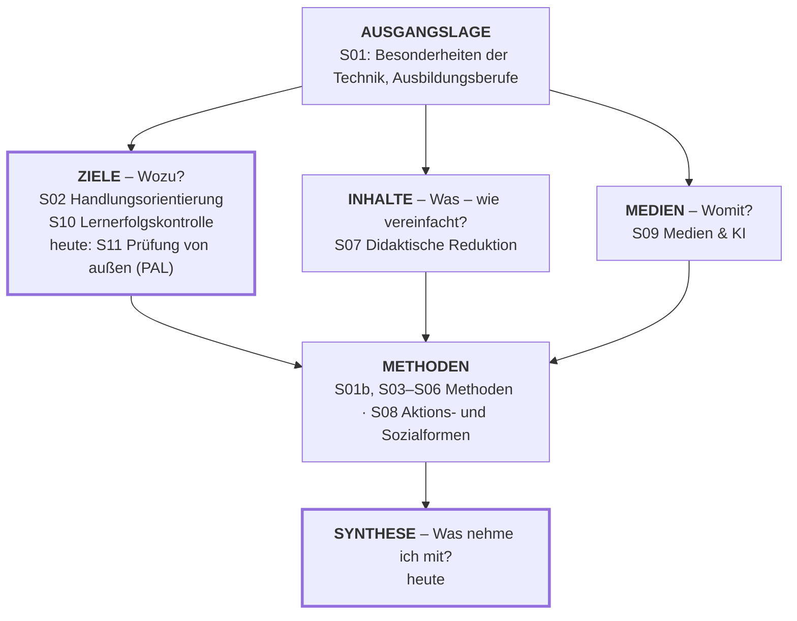
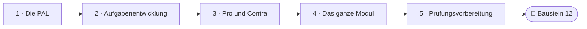

<!--
author:   Hannes Tegelbeckers
email:    hannes.tegelbeckers@ovgu.de
version:  0.2.0
language: de
narrator: Deutsch Female
mode:     Presentation
classroom: enable
comment:  Fachdidaktik technischer Allgemeinbildung II – Sitzung S11. Wer prüft am Ende – und was nehmen Sie mit? PAL-Prüfungen, Pro und Contra betrieblicher Auftrag vs. PAL-Prüfung und die Gesamtkarte des Moduls.

import:   https://raw.githubusercontent.com/LiaTemplates/mermaid_template/0.1.4/README.md
-->

# S11 – PAL-Prüfungen & Modulsynthese

Fachdidaktik technischer Allgemeinbildung II · OVGU Magdeburg · Montag, 04.01.2027, 07:00–09:00 Uhr

<!-- didaktik="Planungsraster S11 · E-03, E-04, E-07, E-09, E-12, E-17, E-19, E-23, E-27, E-33, E-36 · 0–5 Einstieg (Vorbereitungsumfrage „zentral oder Schule?“ zeigen, These R194) · 5–10 Ihre Abschlussprüfung · 10–15 Kurskarte · 15–31 Station 1 Die PAL, Aktivierung Gütekriterien · 31–45 Station 2 Wie eine PAL-Aufgabe entsteht, Ablauf ordnen · 45–60 Station 3 Pro und Contra, Mini-Disputation (Doppeldecker zu S04) · 62–70 Kurskarte ohne Raten · 70–82 Selbsteinschätzung und Baustein 12 · 82–90 Abschluss" -->
> [!IMPORTANT] 🧭 Leitfrage
> Wer prüft am Ende – und was nehmen Sie mit? – Heute schauen wir auf die Prüfung von außen und setzen die Kurskarte ein letztes Mal zusammen.

> [!TIP] 📚 Vor der Sitzung
> Haben Sie sich an eine Zwischen- oder Abschlussprüfung erinnert und abgestimmt, ob Abschlussprüfungen zentral erstellt werden sollten? Wir starten mit Ihrem Ergebnis.

📝 **Beuteblatt S11** – ergänzen Sie es während der Sitzung.

## Einstieg: Programmiert prüfen – handlungskompetent?

    --{{0}}--
Eine Aussage von der letzten Inhaltsfolie dieser Vorlesung, R194. Programmiert meint die schriftliche Prüfungsform mit vorgegebenen Antworten, die Sie in S10 im Baum der konventionellen Prüfung gesehen haben. Ist die Kritik berechtigt?

> **„Der programmierte Teil der PAL-Prüfungen wird vor dem Hintergrund der Zielstellung ‚Entwicklung einer beruflichen Handlungskompetenz‘ häufig heftig kritisiert.“** (Folie R194)

**Vote (before):** Ist die Kritik berechtigt?

[(a)] Ja, die Kritik ist berechtigt
[(b)] Nein, die Kritik ist unberechtigt
[(c)] Teils, teils
[(undecided)] Undecided

    --{{1}}--
Denken Sie an Ihre eigene Abschlussprüfung.

      {{1}}
****************************************

> [!TIP] 🧠 Ihre Abschlussprüfung · allein, 3 min
> Wer hat Ihre Abschlussprüfung erstellt – Ihre Schule, die Kammer, eine zentrale Stelle? Welches Gütekriterium aus S10 war erfüllt, welches verletzt?

[[___ ___ ___]]

****************************************

    --{{2}}--
Am Ende der Sitzung stimmen Sie noch einmal ab.

      {{2}}
> [!TIP] 📌 Merken
> „Programmiert“ = schriftliche Prüfung mit vorgegebenen Antworten (S10, R172). Am Ende der Sitzung stimmen Sie noch einmal über die These ab.

## Kurskarte: das ganze Modul

    --{{0}}--
Die letzte Sitzung. Ein letzter Blick auf die Kurskarte: Fast alle Felder sind gefüllt. Heute schauen wir auf die Prüfung von außen – die zentralen Abschlussprüfungen der PAL – und setzen danach alle Bausteine Ihres Entwurfs zusammen.

    --{{1}}--
Heute ergänzen wir das Feld Ziele um die Prüfung von außen.

      {{1}}
**① Ziele und Kontrolle:** S02 Handlungsorientierung, S10 Lernerfolgskontrolle – heute S11: die Prüfung von außen (PAL)

    --{{2}}--
Inhalte, Medien und Methoden haben Sie in den anderen Sitzungen gefüllt.

      {{2}}
**② Inhalte, Medien, Methoden:** S07 Didaktische Reduktion · S09 Medien & KI · S01b, S03–S06 Methoden, S08 Aktions- und Sozialformen

    --{{3}}--
Und zum Schluss die Synthese.

      {{3}}
**③ Synthese:** Was nehme ich mit? – Kurskarte ohne Raten, Selbsteinschätzung, Baustein 12

    --{{4}}--
Die Kurskarte ist eine Lesehilfe.

      {{4}}
> [!NOTE] Key message
> Ziele, Inhalte und Medien hängen zusammen und münden in die Methoden – heute prüfen Sie, ob Sie das ganze Modul so lesen können.

<small>Kurskarte als Lesehilfe (vgl. S01 und den Kursüberblick), keine Originalfolie.</small>

## Ihr Weg durch die Sitzung

    --{{0}}--
Drei Stationen zur PAL, dann der Rückblick auf das ganze Modul.

    --{{1}}--
Auf diesem Weg erreichen Sie sechs Ziele.

      {{1}}

<!-- data-type="none" -->
| Know | Can do | Value |
|------|--------|-------|
| Entstehung, Zielsetzung und Aufgaben der PAL sowie die Teile der gesetzlich vorgesehenen Prüfungen **nennen** | die Gütekriterien aus S10 auf die PAL-Prüfung **anwenden** | betrieblichen Auftrag und PAL-Prüfung begründet **gegeneinander abwägen** |
| den Weg einer PAL-Aufgabe vom Auftrag bis zur Verabschiedung **beschreiben** | die Themen aller Sitzungen den Planungsfragen der Kurskarte **zuordnen** | die Prüfungsfragen des Moduls für Ihre mündliche Prüfung **nutzen** *(optional: Ihre Bausteine prüfen)* |

    --{{2}}--
Prüfen Sie kurz, ob Sie den Weg lesen können.

      {{2}}
****************************************

**Decide:** Wo führen Sie den Streit betrieblicher Auftrag gegen PAL-Prüfung?

<!-- data-hint-button="1" data-solution-button="2" -->
- [(X)] Pro und Contra
- [( )] Die PAL
- [( )] Das ganze Modul
[[?]] Die Folien R193–R194 heißen „Pro und Contra“.
***
Richtig: Station 3 ist eine Mini-Disputation über die beiden Prüfungsformen.
***

****************************************

## Station 1: Die PAL – Entstehung und Prüfungen

    --{{0}}--
Die erste Station, Kapitel 11 der Folien, PAL-Prüfungen, klärt, was die PAL ist, warum es sie gibt und welche Prüfungen sie entwickelt. Lesen Sie die Folien mit den Gütekriterien aus S10 im Kopf.

**Warum werden Abschlussprüfungen zentral erstellt?**

    --{{1}}--
Zuerst die Entstehung.

      {{1}}
- Vom Austausch von Prüfungsaufgaben zur Objektivierung (R185)

    --{{2}}--
Dann das Ziel.

      {{2}}
- Transparenz, Objektivität und Vergleichbarkeit (R186)

    --{{3}}--
Danach die Prüfungen selbst.

      {{3}}
- Zwischen- und Abschlussprüfung, praktisch und schriftlich (R187)

    --{{4}}--
Und wer die Aufgaben entwickelt.

      {{4}}
- Fachausschüsse aus Arbeitgebern, Arbeitnehmern und Lehrkräften (R188)

    --{{5}}--
Warum ist das für Sie wichtig?

      {{5}}
> [!TIP] Why this matters
> Ihre Schülerinnen und Schüler legen diese Prüfungen ab – und Lehrkräfte wie Sie entwickeln die Aufgaben mit.

    --{{6}}--
Markieren Sie, was Sie schon kennen.

      {{6}}
****************************************

**Mark:** Which of these do you already know? (several possible)

[[a1]] Vom Austausch von Prüfungsaufgaben zur Objektivierung (R185)
[[a2]] Transparenz, Objektivität und Vergleichbarkeit (R186)
[[a3]] Zwischen- und Abschlussprüfung, praktisch und schriftlich (R187)
[[a4]] Fachausschüsse aus Arbeitgebern, Arbeitnehmern und Lehrkräften (R188)

****************************************

## 11.1 Entstehung und Zielsetzung der PAL

    --{{0}}--
Die Industrie- und Handelskammern führen seit über siebzig Jahren Abschlussprüfungen durch. 1948 begann die Prüfungsaufgaben- und Lehrmittel-Entwicklungsstelle, kurz PAL, mit dem Austausch von Prüfungsaufgaben. Mit dem Berufsbildungsgesetz von 1969 vervielfachte sich der Prüfungsaufwand, und es entstand die Forderung nach einer verstärkten Objektivierung.

- IHKs führen über 70 Jahre Abschlussprüfungen durch
- 1948 nahm Prüfungsaufgaben- und Lehrmittel-Entwicklungsstelle (PAL) ihre Tätigkeit mit dem Austausch von Prüfungsaufgaben
- Nachdem das Berufsbildungsgesetz (BBiG) 1969 den zuständigen Stellen fast eine Verdreifachung des Aufwandes für die Durchführung von Prüfungen brachte, ergab sich die Notwendigkeit einer umfassenden Rationalisierung des Prüfungswesens
- **Forderung nach einer verstärkten Objektivierung der Prüfung**

    --{{1}}--
Überregional erstellte Prüfungen sollen Transparenz, Objektivität und Vergleichbarkeit sichern. Heute, so die Folie, entwickelt die PAL Aufgaben für 115 gewerblich-technische Ausbildungsberufe.

      {{1}}
****************************************

- Auch die PISA-Untersuchung 2002 bestätigte diese Ergebnisse
- Ergebnisse, Transparenz, Objektivität und Vergleichbarkeit von Prüfungsergebnissen sind durch überregional erstellte Prüfungen bundesweit besser sicher zu stellen
- Derzeit entwickelt die PAL-Aufgaben für die Zwischen- und Abschlussprüfungen in 115 gewerblich-technischen Ausbildungsberufen

****************************************

    --{{2}}--
Verbinden Sie das mit S10.

      {{2}}
> [!NOTE] Key message
> 🔗 „Objektivierung“, „Transparenz, Objektivität und Vergleichbarkeit“ – die PAL ist die Antwort einer ganzen Branche auf die Gütekriterien aus S10.

<small>Quelle: Folien R185–R186 „11.1 Entstehung und Zielsetzung der PAL“ (Kapitel 11 „PAL-Prüfungen“, Folie R184) – „BbiG“ zu „BBiG“ korrigiert; „über 70 Jahre“ und „derzeit“ = Stand der Originalfolie (Jahr nicht angegeben); R191 nennt 147 Berufe/Fachrichtungen (vermutlich anderer Stand oder andere Zählweise, Z-23); Quelle zur PISA-Aussage auf der Folie nicht angegeben.</small>

## 11.2 Gesetzlich vorgesehene Prüfungen

    --{{0}}--
Jeder Auszubildende legt eine Zwischen- und eine Abschlussprüfung ab, jeweils mit praktischem und theoretischem Teil. Praktisch wird ein Prüfungsstück oder eine Arbeitsprobe abgegeben. Die schriftliche Prüfung hat vier Teile. Grundlage sind die Prüfungsanforderungen, der Ausbildungsrahmenplan und der Rahmenplan der KMK.

- Jeder Auszubildende muss eine Zwischen- und Abschlussprüfung machen
  - Diese ist in einen praktischen und theoretischen Teil gegliedert
  - Für beide bietet PAL Prüfungen an
- In praktischen Prüfung in gewerblich-technischen Ausbildungsberufen muss ein Prüfungsstück oder eine Arbeitsprobe abgegeben werden
- Schriftliche Prüfung besteht aus 4 Teilen: Technologie, technische Mathematik, Arbeitsplanung bzw. Schaltungs- und Funktionsanalyse und Wirtschafts- und Sozialkunde
- Grundlage sind Prüfungsanforderungen, der Ausbildungsrahmenplan und der Rahmenplan der KMK

    --{{1}}--
Zwei Begriffe zur Erklärung – ergänzt, nicht von der Folie.

      {{1}}
> [!NOTE] Key message
> 🔎 Lesehilfe (ergänzt): *Ausbildungsrahmenplan* = Plan für den betrieblichen Teil der Ausbildung; *Rahmenplan der KMK* = Rahmenlehrplan für die Berufsschule, gegliedert in Lernfelder. Die Prüfung stützt sich also auf beide Lernorte.

<small>Quelle: Folie R187 „11.2 Gesetzlich vorgesehene Prüfungen“ – „Jeder Auszubildender“ zu „Jeder Auszubildende“ korrigiert.</small>

## 11.3 Entwicklung der Aufgaben durch die PAL

    --{{0}}--
Die Aufgaben entwickeln alle an der Ausbildung Beteiligten gemeinsam. Neben dem Hauptausschuss aus Vertretern der IHKs und der Gewerkschaften gibt es Fachausschüsse mit in der Regel neun Mitgliedern – zu gleichen Teilen Arbeitgeber, Arbeitnehmer und Lehrkräfte berufsbildender Schulen. Sie arbeiten ehrenamtlich, werden für fünf Jahre berufen und tagen meist zweimal jährlich in Stuttgart.

- Entwicklung alles an Ausbildung Beteiligter – Zusammenarbeit zwischen PAL und dem DGB
- **Hauptausschuss** besteht aus Vertretern des IHK‘s und Gewerkschaften
- **Fachausschuss** umfasst i. d. R. 9 Mitglieder
  - In gleicher Anzahl gehören diesem Ausschuss Beauftragte der Arbeitgeber, Arbeitnehmer und Lehrer der berufsbildenden Schulen an
  - Mitarbeiter arbeiten hier ehrenamtlich
  - Werden von der PAL für fünf Jahre berufen
  - Tagen i. d. R. zweimal jährlich bei der PAL in Stuttgart

    --{{1}}--
Zwei Abkürzungen – ergänzt, nicht von der Folie.

      {{1}}
****************************************

> [!NOTE] 🔎 Lesehilfe (ergänzt, nicht von der Folie)
> *IHK* = Industrie- und Handelskammer, die für Prüfungen in Industrieberufen zuständige Stelle; *DGB* = Deutscher Gewerkschaftsbund (Arbeitnehmerseite).

****************************************

    --{{2}}--
Und für Sie als künftige Lehrkraft:

      {{2}}
> [!NOTE] Key message
> 🎯 Ein Drittel jedes Fachausschusses sind Lehrkräfte berufsbildender Schulen (9 Mitglieder, je gleich viele aus drei Gruppen, R188).

<small>Quelle: Folie R188 „11.3 Entwicklung der Aufgaben durch die PAL“</small>

## Aktivierung: Welches Gütekriterium sichert das?

    --{{0}}--
Wenden Sie die Gütekriterien aus S10 auf die PAL an.

**1 · Choose one:** Bundeseinheitliche Aufgabensätze: Alle Prüflinge bekommen die gleichen Anforderungen. Welches Gütekriterium sichert das vor allem?

<!-- data-hint-button="1" data-solution-button="2" -->
- [( )] Reliabilität
- [(X)] Objektivität
- [( )] Validität
[[?]] Gleiche Bedingungen für alle …
***
Gleiche Aufgaben sichern vor allem die Durchführungs- und Auswertungsobjektivität (R176–R177).
***

    --{{1}}--
Jetzt können mehrere Antworten richtig sein.

      {{1}}
****************************************

**2 · Choose all that apply:** Welche Merkmale der PAL-Prüfung dienen vor allem der Objektivität?

<!-- data-hint-button="1" data-solution-button="2" -->
- [[X]] Bundeseinheitliche Aufgabensätze für alle Prüflinge
- [[ ]] Grundlage der Aufgaben sind Prüfungsanforderungen, Ausbildungsrahmenplan und KMK-Rahmenplan.
- [[X]] Prüfungs- und normgerechte Form durch PAL-Projektmanagement und CAD-Team
- [[ ]] Statistische Auswertung der Prüfungsergebnisse zur Optimierung künftiger Prüfungen
[[?]] Objektivität: unabhängig davon, wer durchführt und auswertet.
***
Gleiche Aufgaben und eine einheitliche Form sichern vor allem Durchführungs- und Auswertungsobjektivität. Die statistische Auswertung (R189) dient der Qualität der Messung – als Reliabilität zuzuordnen; vertretbar ist auch Validität, wenn Aufgaben verbessert werden, die nicht das Richtige messen.
***

****************************************

    --{{2}}--
Zum Schluss ein Begriff.

      {{2}}
****************************************

**3 · Type:** Grundlage der Aufgaben sind Prüfungsanforderungen, Ausbildungsrahmenplan und KMK-Rahmenplan. Welches Gütekriterium soll das vor allem sichern? (ein Wort)

<!-- data-hint-button="1" data-solution-button="2" -->
[[Validität]]
[[?]] Wird geprüft, was gelernt werden soll?

***
Die Orientierung an Prüfungsanforderungen und Rahmenplänen soll sichern, dass geprüft wird, was gelernt werden soll – Validität (R174).
***

****************************************

## Station 2: Wie eine PAL-Aufgabe entsteht

    --{{0}}--
In der zweiten Station verfolgen wir den Weg einer Prüfungsaufgabe von der Idee bis zur Verabschiedung. Eine Ergänzung aus Zinn, als NEU markiert, zeigt, was im allgemeinbildenden Unterricht dieselbe Rolle spielt.

**Wie sichert die PAL die Qualität ihrer Aufgaben?**

    --{{1}}--
Zuerst die Hauptaufgaben der Fachausschüsse.

      {{1}}
- Qualitätssicherung und Qualitätsoptimierung (R189)

    --{{2}}--
Dann der Weg einer Aufgabe.

      {{2}}
- Sechs Schritte vom Auftrag bis zur Verabschiedung (R190)

    --{{3}}--
Danach die Größenordnung.

      {{3}}
- Geschäftsfelder und Aufgaben der PAL (R191–R192)

    --{{4}}--
Und der Blick auf das Gymnasium.

      {{4}}
- [NEU] PISA, Bildungsstandards, EPA Technik

    --{{5}}--
Warum ist das für Sie wichtig?

      {{5}}
> [!TIP] Why this matters
> Erprobung, Statistik, Stellungnahme – so sichert man Gütekriterien im Großen. Was davon können Sie im Kleinen übernehmen?

    --{{6}}--
Markieren Sie, was Sie schon kennen.

      {{6}}
****************************************

**Mark:** Which of these do you already know? (several possible)

[[a1]] Qualitätssicherung und Qualitätsoptimierung (R189)
[[a2]] Sechs Schritte vom Auftrag bis zur Verabschiedung (R190)
[[a3]] Geschäftsfelder und Aufgaben der PAL (R191–R192)
[[a4]] [NEU] PISA, Bildungsstandards, EPA Technik

****************************************

## 11.4 Hauptaufgaben der PAL-Fachausschüsse

    --{{0}}--
Die Fachausschüsse wählen Aufgaben aus und entwickeln sie, legen Umfang und Tiefe der Prüfungen fest und sehen Entwürfe kritisch durch.

- Auswahl, Entwicklung und Entwurf von Prüfungsaufgaben für die schriftlichen und praktischen Zwischen- und Abschlussprüfungen
- Festlegung des Umfangs und der Tiefe der Prüfungen in den einzelnen beruflichen Qualifikationen
- Kritische Durchsicht von Aufgabenentwürfen
- Erprobung bzw. Nachbau von Prüfungen mit dem Ziel die Durchführbarkeit der Prüfungen zu gewährleisten (**Qualitätssicherung**) und Verabschiedung von Prüfungsaufgaben
- Auswertung von statistischen Prüfungsergebnissen und Stellungnahme zu Prüfungen mit dem Ziel der Optimierung zukünftiger Prüfungen (**Qualitätsoptimierung**)

    --{{1}}--
Zwei Begriffe sind hervorgehoben.

      {{1}}
> [!NOTE] Key message
> **Qualitätssicherung** durch Erprobung und Nachbau, **Qualitätsoptimierung** durch die Auswertung statistischer Prüfungsergebnisse.

<small>Quelle: Folie R189 „11.4 Hauptaufgaben der PAL-Fachausschüsse“</small>

## 11.5 Organisation der Arbeit der PAL-Fachausschüsse

    --{{0}}--
Der Weg einer Prüfungsaufgabe hat sechs Schritte – vom Auftrag an die Mitglieder bis zur endgültigen Verabschiedung.

    --{{1}}--
Zuerst der Auftrag an die Mitglieder.

      {{1}}
1. **Auftrag:** Mitglieder der Fachausschüsse erhalten Auftrag zur Entwicklung von neuen Prüfungsaufgaben

    --{{2}}--
Dann die Sichtung im Ausschuss.

      {{2}}
2. **Sichtung:** Entwickelte Aufgaben werden im Fachausschuss gesichtet und vorläufig genehmigt

    --{{3}}--
Projektmanagement und CAD-Team bringen die Entwürfe in eine prüfungs- und normgerechte Form.

      {{3}}
3. **Prüfungsgerechte Form:** Genehmigte Aufgabenentwürfe werden vom zuständigen PAL-Projektmanager/in und vom CAD-Team der PAL in die prüfungs- und normgerechte Form gebracht

    --{{4}}--
Die Mitglieder kontrollieren, testen vor oder bauen nach und nehmen Stellung.

      {{4}}
4. **Kontrolle und Vortest:** Mitglieder der Fachausschüsse erhalten diese Unterlagen zur Kontrolle, zum Vortest/ Nachbau und zur Stellungnahme

    --{{5}}--
Daraus entstehen Vorlagen für die nächste Sitzung.

      {{5}}
5. **Vorlage:** Anhand Stellungnahme der Fachausschuss-Mitglieder bereiten PAL Vorlagen für die jeweils nächste Ausschusssitzung vor

    --{{6}}--
Und dort werden die Aufgaben endgültig verabschiedet.

      {{6}}
6. **Verabschiedung:** Dort erfolgt dann die endgültige Verabschiedung der Aufgaben

<small>Quelle: Folie R190 „11.5 Organisation der Arbeit der PAL-Fachausschüsse“ – „Stellungsnahme“ zu „Stellungnahme“ korrigiert; Nummerierung und Kurzbezeichnungen der Schritte ergänzt (Reihenfolge wie auf der Folie).</small>

## Aktivierung: Der Weg einer PAL-Aufgabe

    --{{0}}--
Bringen Sie die sechs Schritte in die richtige Reihenfolge.

**Order:** Drag each card into the right gap.

<!-- data-randomize data-show-partial-solution data-solution-button="2" -->
Step 1: [->[ Auftrag ]] → Step 2: [->[ Sichtung ]] → Step 3: [->[ Prüfungsgerechte Form ]] → Step 4: [->[ Kontrolle und Vortest ]] → Step 5: [->[ Vorlage ]] → Step 6: [->[ Verabschiedung ]]

## 11.6 Geschäftsfelder der PAL

    --{{0}}--
Die Geschäftsfelder zeigen die Größenordnung: Aufgaben für 147 Berufe und Fachrichtungen, rund 144.000 Aufgabensätze für Zwischen- und 266.000 für Abschlussprüfungen pro Jahr. Daneben entwickelt die PAL das Prüfungssystem weiter – mit Aufgabenanalyse, Statistik und neuen Verfahren.

<!-- data-type="none" -->
| Aufgabenentwicklung | Weiterentwicklung des Prüfungssystems |
| --- | --- |
| Aufgabenentwicklung für Zwischen- und Abschlussprüfungen in 147 Berufen/Fachrichtungen | Aufgabenanalyse |
| Darunter: Holz- und Bauberufe, Wirtschafts- und Sozialkunde, Bekleidungsberufe, Schlosserische Berufe … | Statistik der Prüfung |
| Aufgabensätze pro Jahr: Ca. 144000 für Zwischenprüfungen, Ca. 266000 für Abschlussprüfungen | Entwicklung neuer Prüfungs-, Auswertungs- und Beratungsverfahren |
| | Einsatz neuer Technologien bei Herstellung und Verwendung von Prüfungsaufgaben |
| | Rationalisierung der Prüfungsabwicklung |
| | Problemabwicklung |

    --{{1}}--
Vorsicht mit den Zahlen.

      {{1}}
> [!NOTE] Key message
> ⚠️ Die Zahlen sind Stand der Originalfolie – ohne Jahr und Quelle. Erklären Sie in der Prüfung das **Prinzip** (Rationalisierung, Objektivierung, Vergleichbarkeit), nicht die Zahl.

<small>Quelle: Folie R191 „11.6 Geschäftsfelder der PAL“ – „der Prüfungssystems“ zu „des Prüfungssystems“ korrigiert; Spaltenüberschrift links ergänzt; Zahlen = Stand der Originalfolie (Z-23).</small>

## 11.7 Aufgaben der PAL

    --{{0}}--
Zusammengefasst stellt die PAL bundeseinheitliche Aufgabensätze für die 81 IHKs her, entwickelt Lehrmittel und Informationsmaterial und berücksichtigt dabei Erkenntnisse aus Testtheorie und Pädagogik ebenso wie Erfahrungen aus der Praxis.

- Herstellung optimierter, bundeseinheitlicher Aufgabensätze für Zwischen- und Abschlussprüfungen in industriell-technischen Ausbildungsberufen für die 81 IHK‘s Deutschlands
- Entwicklung von Lehrmitteln und Informationsmaterial zu den industriell-technischen Zwischen- und Abschlussprüfungen
- Berücksichtigung wissenschaftlicher Erkenntnisse aus den Bereichen der Testtheorie und der Pädagogik sowie der Erfahrungen der Berufs- und Prüfungspraxis
- Öffentlichkeitsarbeit für industriell-technische Zwischen- und Abschlussprüfungen

    --{{1}}--
Testtheorie – das Wort kennen Sie aus S10.

      {{1}}
> [!NOTE] Key message
> 🔗 „Testtheorie“: Die PAL-Aufgaben sollen Tests im Sinne von R173 sein – abgesichert nach testtheoretischen und teststatistischen Kriterien.

<small>Quelle: Folie R192 „11.7 Aufgaben der PAL“ – „Berücksichtiger“ zu „Berücksichtigung“ korrigiert; „81 IHK‘s“ = Stand der Originalfolie (Z-23).</small>

## [NEU] Und im allgemeinbildenden Unterricht?

    --{{0}}--
Und am Gymnasium? Dazu eine Ergänzung aus Zinn 2026, als NEU markiert. PISA ist ein internationales Bildungsmonitoring der OECD – daher der PISA-Bezug auf R186 und R193.

<!-- neu="Zinn 2026, S. 48" -->
**PISA** ist ein zyklisches Bildungsmonitoring der OECD: Alle drei Jahre werden alltags- und berufsrelevante Kenntnisse und Fähigkeiten 15-Jähriger international verglichen (Zinn 2026, S. 48, nach OECD 2019). Das erklärt den PISA-Bezug auf R186 und R193: Es geht um **Vergleichbarkeit**.

    --{{1}}--
Bildungsstandards legen fest, welche Kompetenzen Schülerinnen und Schüler erwerben sollen.

      {{1}}
****************************************

<!-- neu="Zinn 2026, S. 53" -->
**Bildungsstandards** legen fest, welche Kompetenzen Schülerinnen und Schüler einer Jahrgangsstufe erwerben sollen – sie beschreiben nicht die Inhalte (Input), sondern die zu erwerbenden Kompetenzen (**Output-Orientierung**); ein Hauptziel ist die Sicherung der Ergebnisse durch Bildungsmonitoring (Zinn 2026, S. 53).

****************************************

    --{{2}}--
Was für die Ausbildung die PAL ist, leisten für das Abitur im Fach Technik die Einheitlichen Prüfungsanforderungen.

      {{2}}
> [!NOTE] Key message
> **Für das Gymnasium:** Was für die Ausbildung die bundeseinheitliche PAL-Prüfung ist, leisten für das Abitur im Fach Technik die **Einheitlichen Prüfungsanforderungen (EPA Technik, KMK)** mit ihren Anforderungsbereichen – vgl. S10 und Zinn (2026, S. 72).

<small>[NEU] Ergänzung, keine Originalfolie: Zinn (2026), S. 48, 53, 72.</small>

## Station 3 · 11.8 Pro und Contra

    --{{0}}--
Zum Abschluss der Inhalte ein Streit: Sollte geprüft werden mit einem betrieblichen Auftrag oder mit der bundeseinheitlichen PAL-Prüfung? Die Folien sammeln Argumente auf beiden Seiten – Motivation und berufliche Relevanz auf der einen, Standardisierung und Vergleichbarkeit auf der anderen.

<!-- data-type="none" -->
| Betrieblicher Auftrag vs. | PAL-Prüfung |
| --- | --- |
| Höhere Motivation aus Selbstständigkeit | Qualitätssicherung der Prüfung durch Standardisierung |
| Fachausbilder übernehmen Wahl der Prüfungsaufgabe (berufliche Relevanz wird sichergestellt) | Prüfung orientiert sich vornehmlich an Unternehmen der IHK |
| Unternehmen profitiert möglicherweise wirtschaftlich | Bundeseinheitliche Prüfung (nicht nur betriebsintern) → Prüfungsergebnisse sind vergleichbar (in der Allgemeinbildung schon lange gefordert → siehe PISA) |
| „Trainingslager“ vor der Prüfung schwer realisierbar | Es wurden an alle Prüflinge die gleichen Anforderungen gestellt |
| Möglicherweise subjektive Einflüsse auf die Prüfung | |
| Kann unter Umständen kostengünstiger realisiert werden | |

    --{{1}}--
Die zweite Folie nennt die Kritik am programmierten Teil der PAL-Prüfungen vor dem Ziel beruflicher Handlungskompetenz. Sie führen den Streit gleich selbst.

      {{1}}
****************************************

<!-- data-type="none" -->
| Betrieblicher Auftrag vs. | PAL-Prüfung |
| --- | --- |
| Ausbilder und Prüfer müssen bei dieser Form der Prüfung in der Lage sein, die gestellten Aufgaben fachlich einwandfrei auszuführen und zu bewerten | Der programmierte Teil der PAL-Prüfungen wird vor dem Hintergrund der Zielstellung „Entwicklung einer beruflichen Handlungskompetenz“ häufig heftig kritisiert |

****************************************

    --{{2}}--
Zwei Begriffe zur Erklärung – ergänzt.

      {{2}}
> [!NOTE] Key message
> 🔎 Lesehilfe (ergänzt): *Betrieblicher Auftrag* = eine Prüfungsform, bei der eine reale Aufgabe aus dem Ausbildungsbetrieb geprüft wird – im Gegensatz zum bundeseinheitlichen PAL-Prüfungsstück. *„Trainingslager“* meint gezieltes Üben auf eine bekannte Prüfungsform.

<small>Quelle: Folien R193–R194 „11.8 Pro und Contra“ – beide Spalten enthalten Vor- und Nachteile; „Es wurden an alle Prüflinge …“ wie im Original.</small>

## Mini-Disputation: Betrieblicher Auftrag oder PAL-Prüfung?

    --{{0}}--
Jetzt führen Sie den Streit selbst. Stimmen Sie zuerst spontan ab.

Soll mit einem **betrieblichen Auftrag** geprüft werden – oder mit der bundeseinheitlichen **PAL-Prüfung**? (Folien R193–R194)

**Vote (before):** Welche Seite überzeugt Sie spontan mehr?

[(a)] Betrieblicher Auftrag
[(b)] PAL-Prüfung
[(c)] Beide gleich
[(undecided)] Undecided

    --{{1}}--
Bereiten Sie sich allein vor – auf beide Seiten.

      {{1}}
****************************************

> [!TIP] 🧠 Vorbereitung allein · 5 min
> Notieren Sie für **jede** Seite das stärkste Argument – und je ein Argument, mit dem Sie es entkräften würden. Betrieb (linke Spalte): Argument … / Entkräftung … · PAL (rechte Spalte): Argument … / Entkräftung …

[[___ ___ ___]]

****************************************

    --{{2}}--
Dann die Plädoyers.

      {{2}}
> [!TIP] 🎤 Plädoyers · 4 min
> Zwei Freiwillige vertreten je eine Seite (je 2 min). Alle anderen sind die **Jury**.

## Urteil der Jury

    --{{0}}--
Sie sind die Jury. Stimmen Sie noch einmal ab.

**Vote (after):** Welche Seite überzeugt Sie nach den Plädoyers mehr?

[(a)] Betrieblicher Auftrag
[(b)] PAL-Prüfung
[(c)] Beide gleich
[(undecided)] Undecided

    --{{1}}--
Begründen Sie Ihr Urteil mit einem Gütekriterium.

      {{1}}
****************************************

**Reflect:** Welches Gütekriterium aus S10 – Objektivität, Reliabilität oder Validität – legen Sie als Maßstab an? Begründen Sie Ihr Urteil in zwei Sätzen.

[[___ ___]]

****************************************

    --{{2}}--
Ein Blick auf die Methode, die Sie gerade erlebt haben.

      {{2}}
> [!NOTE] Key message
> 🪞 Methodenspiegel: Sie haben eine Disputation mit Rollen erlebt – wie das Rollenspiel in **S04**, nur mit Jury und Bewertungsmaßstab. Mit den Gütekriterien ordnet sich der Streit: Die PAL-Prüfung ist stark bei Objektivität und Vergleichbarkeit, der betriebliche Auftrag bei der Validität für berufliche Handlungskompetenz.

## Wo stehen wir? Ihre Kurskarte – jetzt ohne Raten

    --{{0}}--
Zum Abschluss schauen Sie auf das ganze Modul zurück. Zu Semesterbeginn haben Sie die Themen im Kursüberblick der Kurskarte zugeordnet – geraten. Jetzt noch einmal.

**1 · Choose one:** Zu welchem Feld der Kurskarte gehört die Didaktische Reduktion?

<!-- data-hint-button="1" data-solution-button="2" -->
- [( )] Methoden – Erkenntnisweg
- [(X)] Inhalte
- [( )] Medien
[[?]] Was – und wie vereinfacht?
***
Inhalte: S07 Didaktische Reduktion.
***

    --{{1}}--
Jetzt können mehrere Antworten richtig sein.

      {{1}}
****************************************

**2 · Choose all that apply:** Welche Themen gehören zum Feld „Methoden – Erkenntnisweg“?

<!-- data-hint-button="1" data-solution-button="2" -->
- [[X]] Projektmethode
- [[ ]] Sozialformen und Aktionsformen
- [[X]] Leittext und Experiment
- [[ ]] Lernerfolgskontrolle
[[?]] Sozial- und Aktionsformen haben ein eigenes Methodenfeld.
***
Methoden – Erkenntnisweg: Logische Methoden, Projektmethode, Fallstudie und Rollenspiel, Leittext und Experiment, Methodische Großformen. Sozial- und Aktionsformen (S08) bilden das zweite Methodenfeld; Lernerfolgskontrolle gehört zu Ziele und Kontrolle.
***

****************************************

    --{{2}}--
Zum Schluss ein Feld.

      {{2}}
****************************************

**3 · Type:** Zu welchem Feld der Kurskarte gehören Simulation und KI? (ein Wort)

<!-- data-hint-button="1" data-solution-button="2" -->
[[Medien]]
[[?]] Womit?

***
Medien: S09 Medien und Wirklichkeitserfahrung, Simulation und KI. Ziele und Kontrolle: Handlungsorientierung, Lernerfolgskontrolle, PAL-Prüfungen.
***

****************************************

## Selbsteinschätzung: die vier Modulziele

    --{{0}}--
Wie sicher fühlen Sie sich bei den vier Modulzielen? Die Ergebnisse sind anonym und für uns eine Rückmeldung.

<!-- didaktik="Teil von 70–82 min (zusammen mit Baustein 12) · Einzelarbeit · Ergebnisse anonym, für Lehrende als Rückmeldung" -->
Wie sicher fühlen Sie sich? (1 = gar nicht, 4 = sehr sicher)

**Handlungsorientierte Methoden auswählen und begründen**

- [(1)] 1
- [(2)] 2
- [(3)] 3
- [(4)] 4

**Fachinhalte adressatengerecht didaktisch reduzieren**

- [(1)] 1
- [(2)] 2
- [(3)] 3
- [(4)] 4

**Unterricht planen und methodische Entscheidungen begründen**

- [(1)] 1
- [(2)] 2
- [(3)] 3
- [(4)] 4

**Lernerfolgskontrollen nach Gütekriterien beurteilen**

- [(1)] 1
- [(2)] 2
- [(3)] 3
- [(4)] 4

**Und was hat sich geändert?** Wo hätten Sie die Kurskarte zu Beginn anders zugeordnet?

[[___ ___]]

<small>Modulziele nach dem Kursüberblick; keine Originalfolie.</small>

## Baustein 12: Ihr Entwurf – vollständig? (optional)

    --{{0}}--
Prüfen Sie mit der Checkliste, ob Ihr Unterrichtsentwurf alle Bausteine aus S01 bis S10 enthält. Die häufigsten Lücken besprechen wir anschließend gemeinsam.

<!-- didaktik="Lehrschritt üben lassen (Transfer / Entwickeln) · 70–82 min · Einzelarbeit 8 min, Classroom-Auswertung der häufigsten Lücken 4 min" -->

<!-- data-type="none" -->
| Baustein | Inhalt | aus |
| --- | --- | --- |
| 1 | Thema, Lerngruppe, Schulform | S01 |
| 2 | logische Methode | S01b |
| 3 | Lernhandlung (vollständige Handlung) | S02 |
| 4 | Projekt-Grundmuster | S03 |
| 5 | Kontrolle und Bewertung | S04 |
| 6 | Experiment | S05 |
| 7 | Großform | S06 |
| 8 | reduzierte Fachaussage | S07 |
| 9 | Sozial- und Aktionsformen | S08 |
| 10 | Medium (ggf. Simulation oder KI-Einsatz mit Leitplanken) | S09 |
| 11 | Kontrollaufgabe mit Operator und Erwartungshorizont | S10 |

**Allein (8 min):** Welcher Baustein fehlt Ihnen noch oder ist am schwächsten?

- [(1–3)] Baustein 1–3 (Thema, logische Methode, Lernhandlung)
- [(4–6)] Baustein 4–6 (Projekt, Kontrolle und Bewertung, Experiment)
- [(7–9)] Baustein 7–9 (Großform, Reduktion, Sozial- und Aktionsformen)
- [(10–11)] Baustein 10–11 (Medium, Kontrollaufgabe)
- [(keiner)] Mein Entwurf ist vollständig.

Notieren Sie den Baustein mit einem nächsten Schritt:

[[___ ___ ___ ___]]

💡 Hint 1

Die Beuteblätter und die Selbstlerneinheiten der Sitzungen enthalten zu jedem Baustein eine Übung.

✅ Solution

Beispiel: Baustein 6 (Experiment) fehlt noch. Nächster Schritt: Für die Stunde „Leitungsschutz“ ein Schülerexperiment nach S05 planen – Fragestellung, Vermutung, Durchführung, Auswertung – und in den Entwurf eintragen; danach mit Baustein 11 prüfen, ob die Kontrollaufgabe zum Experiment passt.

## Zum Mitnehmen: Ist die Kritik berechtigt?

    --{{0}}--
Zurück zur These vom Anfang. Stimmen Sie noch einmal ab.

**Vote (after):** Ist die Kritik am programmierten Teil der PAL-Prüfungen berechtigt?

[(a)] Ja, die Kritik ist berechtigt
[(b)] Nein, die Kritik ist unberechtigt
[(c)] Teils, teils
[(undecided)] Undecided

    --{{1}}--
Was ist Ihnen im ganzen Modul am unklarsten geblieben? Wir greifen es vor der Prüfung noch einmal auf.

      {{1}}
****************************************

**Reflect:** Muddiest point des Moduls: Was ist Ihnen im ganzen Modul am unklarsten geblieben?

[[___ ___]]

****************************************

    --{{2}}--
Eine Einordnung:

      {{2}}
> [!NOTE] Key message
> Beide Antworten lassen sich mit den Gütekriterien begründen. Programmierte Aufgaben sichern Objektivität und Vergleichbarkeit – das war das Ziel der PAL (R185–R186). Für berufliche Handlungskompetenz sind sie nur begrenzt valide, weil sie vor allem Wissen und Verstehen prüfen (R194; S02, S10). Deshalb gibt es neben dem schriftlichen auch den praktischen Prüfungsteil (R187).

## Das Wichtigste aus S11

    --{{0}}--
Fassen wir zusammen.

    --{{1}}--
Erstens: warum es die PAL gibt.

      {{1}}
- Die PAL entstand aus Rationalisierung und der Forderung nach Objektivierung: Transparenz, Objektivität, Vergleichbarkeit (R185–R186).

    --{{2}}--
Zweitens: wie Aufgaben entstehen.

      {{2}}
- Fachausschüsse – zu einem Drittel BBS-Lehrkräfte – entwickeln Aufgaben in sechs Schritten mit Vortest und Statistik (R188–R190).

    --{{3}}--
Drittens: der Streit.

      {{3}}
- Betrieblicher Auftrag oder PAL-Prüfung: Validität für Handlungskompetenz gegen Objektivität und Vergleichbarkeit (R193–R194).

    --{{4}}--
Und viertens: das ganze Modul.

      {{4}}
****************************************

- Ziele, Inhalte und Medien hängen zusammen und münden in die Methoden – die Kurskarte ordnet das Modul.

> [!NOTE] Remember
> Jede Prüfungsform hat Stärken bei einem Gütekriterium – begründen Sie Ihre Wahl.

****************************************

    --{{5}}--
Eine letzte Frage.

      {{5}}
****************************************

**Recap:** Was nennt Folie R185 als Anlass für die Rationalisierung des Prüfungswesens?

<!-- data-hint-button="1" data-solution-button="2" -->
- [( )] die PISA-Untersuchung 2002
- [( )] der Wunsch der Betriebe nach eigenen Prüfungsaufgaben
- [(X)] fast eine Verdreifachung des Prüfungsaufwands durch das BBiG 1969
[[?]] Ein Gesetz von 1969 …
***
Richtig: Das BBiG 1969 brachte den zuständigen Stellen fast eine Verdreifachung des Aufwands – daraus folgten Rationalisierung und die Forderung nach Objektivierung (R185). PISA nennt R186 als Bestätigung.
***

****************************************

    --{{6}}--
Und jetzt: die Vorbereitung auf die mündliche Prüfung.

      {{6}}
**➡️ Next:** 📝 Beuteblatt-Stopp: Ergänzen Sie Ihre Beute aus dem ganzen Modul. · 🧩 Optionale Selbstlernsitzung am 11.01.2027: Führen Sie Ihre Bausteine 1–11 zu einem Entwurf zusammen.

## Prüfungsfragen zum Üben

    --{{0}}--
Mit diesen fünf Fragen können Sie sich auf die mündliche Prüfung vorbereiten. Die Querverweise zeigen, wo die Themen in anderen Sitzungen wieder auftauchen.

<!-- didaktik="E-12 mündliche Prüfung" -->
1. Warum wurde die PAL gegründet, und welche Ziele verfolgt sie?
2. Beschreiben Sie den Weg einer PAL-Aufgabe vom Auftrag bis zur Verabschiedung.
3. Wägen Sie betrieblichen Auftrag und PAL-Prüfung anhand der Gütekriterien gegeneinander ab.
4. „Der programmierte Teil der PAL-Prüfung passt nicht zur Handlungskompetenz.“ – Nehmen Sie Stellung (vgl. S02).
5. Ordnen Sie die Themen des Moduls den Planungsfragen der Kurskarte (Ziele, Inhalte, Methoden, Medien) zu und begründen Sie eine Zuordnung.

> [!NOTE] 🔗 Querverweise
> Gütekriterien, programmierte Prüfung, Operatoren → **S10** · Rollenspiel, Bewertung in Projekten → **S04** · Handlungskompetenz → **S02** · Medien und KI → **S09** · Kurskarte → **Kursüberblick**

<small>Die Prüfungsfragen sind experimentell: Sie dienen der Vorbereitung, es ist nicht garantiert, dass Fragen in dieser Form gestellt werden.</small>

## Rückblick auf S11 und das Modul

    --{{0}}--
Nehmen Sie sich zwei Minuten für einen Rückblick auf die Sitzung und das ganze Modul.

**Reflect:** What is the most important thing you learned today – and what is still unclear?

[[___ ___ ___]]

    --{{1}}--
Haken Sie ab, was Sie jetzt können.

      {{1}}
****************************************

**Tick:** What can you do now?

- [ ] Ich kann Entstehung und Ziele der PAL erläutern.
- [ ] Ich kann betrieblichen Auftrag und PAL-Prüfung mit den Gütekriterien abwägen.
- [ ] Ich kann die Themen des Moduls der Kurskarte zuordnen und Verbindungen zwischen Sitzungen herstellen.

****************************************

    --{{2}}--
Und zum Schluss: Wie hat die Sitzung für Sie funktioniert?

      {{2}}
****************************************

**Feedback:** How did this session work for you?

[(1 agree)(2 rather agree)(3 neutral)(4 rather disagree)(5 disagree)]
[                                                                   ] The pace was appropriate.
[                                                                   ] The explanations were clear.
[                                                                   ] The examples helped me understand.
[                                                                   ] The interactive parts were useful.

****************************************

## Vorbereitung auf die Modulprüfung

    --{{0}}--
Die Prüfungsleistung ist ausschließlich eine mündliche Prüfung. Arbeiten Sie die Prüfungsfragen zum Üben aller zwölf Sitzungen durch – am besten laut und zu zweit. Die Fragen sind experimentell: Es ist nicht garantiert, dass Fragen in dieser Form gestellt werden.

<!-- style="max-width:100%;width:60%;display:block;margin:0 auto;" -->

> [!IMPORTANT] Think about it until next time
> Welche drei Prüfungsfragen des Moduls fallen Ihnen am schwersten? Beantworten Sie sie laut – mit Begriff, Erläuterung, Beispiel aus Ihrer Fachrichtung und einer Verbindung zu einer anderen Sitzung.

*Optionale Selbstlernsitzung · Montag, 11.01.2027 · danach: mündliche Modulprüfung*

## Vielen Dank!

    --{{0}}--
Vielen Dank für Ihre Aufmerksamkeit – und für Ihre Rückmeldung.

**Feedback zur Veranstaltung:** Was sollte bleiben, was sollte sich ändern?

[[___ ___ ___]]

> **Vielen Dank für Ihre Aufmerksamkeit**

<small>Quelle: Folie R195 „Vielen Dank für Ihre Aufmerksamkeit“</small>

## Literatur

    --{{0}}--
Hier finden Sie die Quellen dieser Sitzung.

**Zitiert auf den Originalfolien dieser Sitzung**

- R185: Berufsbildungsgesetz (BBiG) 1969 – auf der Folie ohne weitere Angaben.
- R186, R193: PISA-Untersuchung 2002 – Quelle auf Originalfolie nicht angegeben.
- R185–R192: Angaben zur PAL ohne Quellen- und Standangabe (Zitationsprüfung Z-23).

**[NEU] Ergänzende Literatur**

- Zinn, B. (2026). *Didaktik des naturwissenschaftlichen, informatischen und technikwissenschaftlichen Unterrichts. Grundlagen und Denk- und Arbeitsweisen in interdisziplinären Fächern in Schule und Hochschule.* Springer Spektrum, Abschn. 4.1.1 (S. 48), 4.2 (S. 53), 5.1.3–5.1.4 (S. 72). https://doi.org/10.1007/978-3-662-72499-6
- OECD (2019) – zitiert nach Zinn (2026, S. 48); vollständige Angaben dort.

<small>Gesamtverzeichnis: 00_Literatur.md</small>
