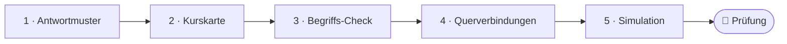
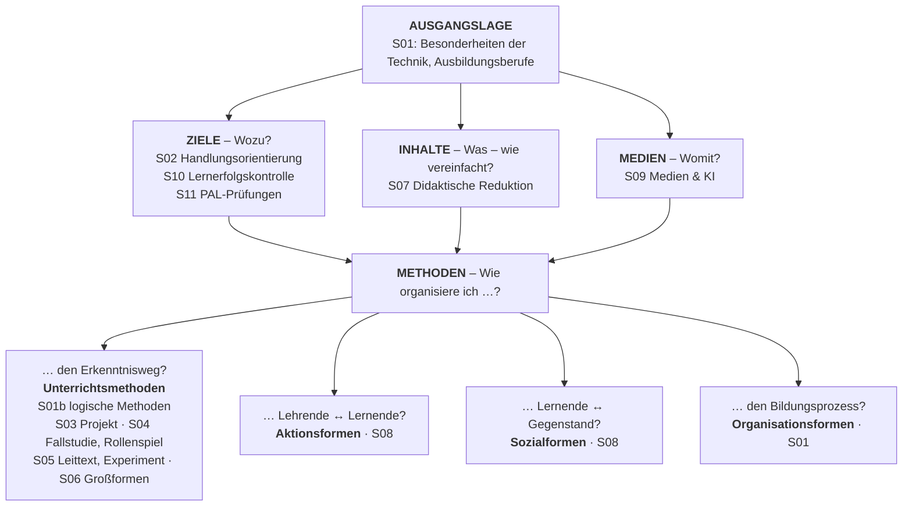

<!--
author:   Hannes Tegelbeckers
email:    hannes.tegelbeckers@ovgu.de
version:  0.1.0
language: de
narrator: Deutsch Female
mode:     Textbook
comment:  Fachdidaktik technischer Allgemeinbildung II – Prüfungstrainer über alle Sitzungen S01–S11: Antwortmuster, Kurskarte, Begriffs-Check, Vergleiche und Querschnittsfragen mit Antwortskizzen, Fallanalyse und Prüfungssimulation mit zufällig gezogenen Fragen.

import:   https://raw.githubusercontent.com/LiaTemplates/mermaid_template/0.1.4/README.md
-->

# Prüfungstrainer – mündliche Modulprüfung (Selbstlerneinheit)

<!-- didaktik="Prüfungstrainer · ca. 90 min, mehrfach nutzbar · über alle Selbstlerneinheiten S01–S11 · Querschnittsfragen mit Antwortskizzen nach dem Muster aus S11" -->
> [!IMPORTANT] 🧭 Leitfrage
> Kann ich jedes Thema des Moduls frei, strukturiert und mit einem Beispiel erklären – und Verbindungen zwischen den Sitzungen herstellen?

> [!NOTE] 📘 So nutzen Sie den Trainer
> Der Trainer setzt die Selbstlerneinheiten S01–S11 voraus und fragt **über alle Sitzungen hinweg** ab. Arbeiten Sie ihn einmal vollständig durch und nutzen Sie danach die **Prüfungssimulation** (Abschnitt 6) so oft Sie möchten. Jede Einheit endet außerdem mit fünf Prüfungsfragen und Antwortskizzen. Die Prüfungsfragen sind experimentell: Es ist nicht garantiert, dass Fragen in dieser Form gestellt werden.

> [!TIP] ✍️ Übung in Moodle
> Bearbeiten Sie den Prüfungstrainer als Übung im Moodle-Kurs – dort wird Ihr Bearbeitungsstand gespeichert: [Übung in Moodle öffnen](https://elearning.ovgu.de/mod/scorm/view.php?id=707260)

**Ablauf (ca. 90 min, danach beliebig oft Abschnitt 6)**

<!-- data-type="none" -->
| Schritt | Inhalt | Zeit |
| --- | --- | --- |
| 0 | Wo stehen Sie? | 5 min |
| 1 | Das Prüfungsformat und ein Antwortmuster | 10 min |
| 2 | Die Kurskarte: alle Sitzungen im Überblick | 15 min |
| 3 | Begriffs-Check über alle Sitzungen | 15 min |
| 4 | Querverbindungen: Vergleiche und Querschnittsfragen | 30 min |
| 5 | Ein Fall: eine Unterrichtseinheit begründen | 10 min |
| 6 | Prüfungssimulation | beliebig |
| 7 | Abschluss | 5 min |

## Ihr Weg durch den Trainer

    --{{0}}--
Der Trainer führt vom Antwortmuster über die Kurskarte und einen Begriffs-Check zu Querverbindungen zwischen den Sitzungen – und endet mit einer Prüfungssimulation.



    --{{1}}--
Auf diesem Weg erreichen Sie sechs Ziele.

      {{1}}
<div>

<!-- data-type="none" -->
| Wissen | Können | Beurteilen |
|------|--------|-------|
| die Themen aller Sitzungen der Kurskarte **zuordnen** | Prüfungsfragen nach dem Muster Begriff – Erläutern – Beispiel – Verbinden **beantworten** | eigene Antworten mit einer Antwortskizze **vergleichen** und **beurteilen** |
| zentrale Begriffe, Modelle und Autoren des Moduls **nennen** und **erläutern** | Verbindungen zwischen Sitzungen **herstellen** und an einem Beispiel **erläutern** | eine Unterrichtsentscheidung mit Begriffen aus mehreren Sitzungen **begründen** |

</div>

    --{{2}}--
Prüfen Sie kurz, ob Sie den Weg lesen können.

      {{2}}
****************************************

**Entscheiden:** Was kommt direkt nach dem Begriffs-Check?

<!-- data-hint-button="1" data-solution-button="2" -->
- [(X)] Querverbindungen
- [( )] Kurskarte
- [( )] Antwortmuster
[[?]] Folgen Sie den Pfeilen von links nach rechts.
***
Richtig: Abschnitt 4 verbindet die Sitzungen durch Vergleiche und Querschnittsfragen.
***

****************************************

## 0 · Wo stehen Sie?

    --{{0}}--
Eine These zum Start. Am Ende stimmen Sie noch einmal ab.

> **„Für die mündliche Prüfung reicht es, die Definitionen auswendig zu können.“**

**Abstimmen (vorher):** Stimmen Sie dieser These zu?

[(a)] Ja, ich stimme zu
[(b)] Nein, ich stimme nicht zu
[(c)] Teils, teils
[(unentschieden)] Unentschieden

    --{{1}}--
Prüfen Sie Ihren Stand ehrlich.

      {{1}}
****************************************

> [!TIP] 🧠 Ihr stärkstes und Ihr schwächstes Thema · 2 min
> Welches Thema des Moduls könnten Sie jetzt sofort zwei Minuten lang erklären – und bei welchem würden Sie ins Stocken geraten? Notieren Sie je eines; im Abschnitt 6 ziehen Sie gezielt Fragen dazu.

[[___ ___ ___]]

****************************************

    --{{2}}--
Und schätzen Sie sich selbst ein.

      {{2}}
> [!TIP] 📌 Wie sicher fühlen Sie sich? (1–4)
> Notieren Sie je eine Zahl von 1 (gar nicht) bis 4 (sehr sicher): „Ich kann zu jeder Sitzung einen zentralen Begriff mit Beispiel erklären.“ – „Ich kann Verbindungen zwischen zwei Sitzungen begründen.“ Im Rückblick vergleichen Sie.

## 1 · Das Prüfungsformat und ein Antwortmuster

    --{{0}}--
Die Prüfungsleistung des Moduls ist ausschließlich eine mündliche Prüfung; weitere Formate wie die Präsentation eines Unterrichtsentwurfs gehören zum Ingenieurpädagogischen Labor. Eine mündliche Prüfung belohnt eine erkennbare Struktur. Das Muster aus S11 hat vier Schritte.

<!-- data-type="none" -->
| Schritt | Was Sie sagen | Beispiel: „Was ist didaktische Reduktion?“ |
| --- | --- | --- |
| 1 Begriff | Definition, möglichst mit Autor | widerspruchsfreier Übergang zu einer vereinfachten Aussage, die unter Nennung der Einschränkungen korrekt bleibt (Grüner) |
| 2 Erläutern | Unterscheidungen, Struktur, Modell | vertikal (Gültigkeitsumfang reduziert) – horizontal (bleibt erhalten) |
| 3 Beispiel | aus der Vorlesung oder Ihrer Fachrichtung | Hebelgesetz für den gewichtslosen Hebel; Ohm'sches Gesetz als Kennlinie |
| 4 Bewerten oder verbinden | Grenze, Bezug zu einer anderen Sitzung | Bezug zu S01: Richtigkeit als Kriterium technischer Aussagen |

    --{{1}}--
Drei Hinweise für die Prüfung selbst.

      {{1}}
> [!NOTE] Kernaussage
> **Struktur ansagen** („Ich erkläre zuerst den Begriff, dann …“) · **Beispiele aus Ihrer Fachrichtung** vorbereiten · **Verbindungen anbieten** – und bei einer Lücke sagen, was Sie wissen, statt zu raten.

<small>Prüfungsformat nach dem Kursüberblick; Antwortmuster wie in S11, Abschnitt 5; Hinweise: eigene Darstellung.</small>

## 2 · Die Kurskarte: Ihr Gerüst für die Prüfung

    --{{0}}--
Die Kurskarte aus S01 ordnet das ganze Modul nach Planungsfragen. Ausgangslage, Ziele, Inhalte und Medien bestimmen, welche Methode passt; die Methoden beantworten vier Leitfragen „Wie organisiere ich …?“. Wenn Sie in der Prüfung eine Frage hören, ordnen Sie sie zuerst in diese Karte ein – dann wissen Sie, welche Begriffe und welche Nachbarsitzungen dazugehören.



    --{{1}}--
Die oberen Felder sind die Planungsfragen.

      {{1}}
**① Planungsfragen:** Ausgangslage (S01), Ziele und Kontrolle (S02, S10, S11), Inhalte (S07), Medien (S09)

    --{{2}}--
Die unteren Felder sind die Methoden.

      {{2}}
**② Vier Leitfragen:** Erkenntnisweg (S01b, S03–S06), Aktions- und Sozialformen (S08), Organisationsformen (S01)

    --{{3}}--
Und so nutzen Sie die Karte in der Prüfung.

      {{3}}
**③ Einordnen:** Frage hören – Feld suchen – Begriffe und eine Nachbarsitzung nennen

    --{{4}}--
Merken Sie sich die Reihenfolge.

      {{4}}
> [!NOTE] Kernaussage
> Erst die Planungsfragen, dann die Methode: Eine Methode ist ein Weg zu einem Ziel, nie Selbstzweck (Meyer & Hilbert, S01).

<small>Kurskarte als Lesehilfe (wie in S01, S11 und im Kursüberblick), keine Originalfolie.</small>

## Alle Einheiten auf einen Blick

    --{{0}}--
Die Tabelle fasst zusammen, welche Begriffe, Modelle und Autoren zu jeder Sitzung gehören. Nutzen Sie sie als Lernlandkarte: Können Sie zu jeder Zeile zwei Minuten frei sprechen? Wo nicht, öffnen Sie die Einheit über den Link und arbeiten Sie die Prüfungsfragen am Ende durch.

<!-- data-type="none" -->
| Einheit | Kernbegriffe und Modelle | Autoren und Quellen |
| --- | --- | --- |
| [S01 Orientierung](https://liascript.github.io/course/?https://raw.githubusercontent.com/OVGU-VET-TechEd/Fachdidaktik_technischer_Allgemeinbildung_II/main/Selflearn/S01_Orientierung.md) | Natur-, Technik-, Wirtschaftswissenschaften (Wahrheit – Richtigkeit und Zweckmäßigkeit – Wirtschaftlichkeit) · Unterrichtsmethode · Methode im weiteren/engeren Sinne · vier Leitfragen · didaktische Funktionen | Bernhard, Ebert & Schröder · Meyer & Hilbert |
| [S01b Logische Methoden](https://liascript.github.io/course/?https://raw.githubusercontent.com/OVGU-VET-TechEd/Fachdidaktik_technischer_Allgemeinbildung_II/main/Selflearn/S01b_Logische_Methoden.md) | analytisch/synthetisch · induktiv/deduktiv · genetisch/historisch · reduktiv (regressiv/progressiv) · Methodenwahl | Diesterweg · [NEU] Dilling |
| [S02 Handlungsorientierung](https://liascript.github.io/course/?https://raw.githubusercontent.com/OVGU-VET-TechEd/Fachdidaktik_technischer_Allgemeinbildung_II/main/Selflearn/S02_Handlungsorientierung.md) | lernpsychologische Begründung · Tätigkeit – Handlung – Operation · TOTE/VVR · vollständige Handlung · Stufen der Selbständigkeit · HoU als Konzept | Leontjew, Galperin, Piaget, Hering, Aebli, Roth · Hacker, Volpert · Frieling · Hortsch · Bünning |
| [S03 Projektmethode](https://liascript.github.io/course/?https://raw.githubusercontent.com/OVGU-VET-TechEd/Fachdidaktik_technischer_Allgemeinbildung_II/main/Selflearn/S03_Projektmethode.md) | Wurzeln der Projektidee · Merkmale der Arbeit an Projekten · Problemarten · Innovationskreislauf · Grundmuster mit Fixpunkten und Metainteraktionen · Rolle der Lehrkraft | Kilpatrick/Dewey · Frey · Hortsch |
| [S04 Bewertung · Fallstudie · Rollenspiel](https://liascript.github.io/course/?https://raw.githubusercontent.com/OVGU-VET-TechEd/Fachdidaktik_technischer_Allgemeinbildung_II/main/Selflearn/S04_Bewertung_Fallstudie_Rollenspiel.md) | Funktionen der Bewertung · Soll-Ist-Vergleich · Bewertungssituation · Widersprüche in Projekten · Fallstudie (vier Varianten, sechs Phasen) · Rollenspiel | Heckhausen · Kersten · Kaiser |
| [S05 Leittext · Experiment](https://liascript.github.io/course/?https://raw.githubusercontent.com/OVGU-VET-TechEd/Fachdidaktik_technischer_Allgemeinbildung_II/main/Selflearn/S05_Leittext_Experiment.md) | Funktionen der Leittexte · Leitfragen-Kette · sechs Schritte · Experiment (Definition, vier Gesichtspunkte) · Phasenmodelle · Effizienzkriterien | Bernard · Bader · Papaloizos & Stiefel |
| [S06 Großformen](https://liascript.github.io/course/?https://raw.githubusercontent.com/OVGU-VET-TechEd/Fachdidaktik_technischer_Allgemeinbildung_II/main/Selflearn/S06_Grossformen.md) | Großform = Akzent + Gerüst · analytisch und synthetisch akzentuierte Großformen · induktiv, deduktiv, historisch, reduktiv · intuitive Phase | Pahl |
| [S07 Didaktische Reduktion](https://liascript.github.io/course/?https://raw.githubusercontent.com/OVGU-VET-TechEd/Fachdidaktik_technischer_Allgemeinbildung_II/main/Selflearn/S07_Didaktische_Reduktion.md) | Korrektheit unter Nennung der Einschränkungen · vertikal/horizontal · Maxwell → Ohm · Reduktionsfeld · Verfahren nach Hering · [NEU] Reduktionsarten, Elementarisierung | Grüner · Wagner · Arnold · Hering · [NEU] Zinn |
| [S08 Sozial- und Aktionsformen](https://liascript.github.io/course/?https://raw.githubusercontent.com/OVGU-VET-TechEd/Fachdidaktik_technischer_Allgemeinbildung_II/main/Selflearn/S08_Sozialformen_Aktionsformen.md) | Frontal-, Einzel-, Gruppenarbeit (vier Varianten) · darbietend, selbstständig, erarbeitend · selbstständige Schülerarbeit · [NEU] Oberflächen- und Tiefenstruktur · Cognitive Apprenticeship | Meyer · Jessipow · [NEU] Zinn |
| [S09 Medien & KI](https://liascript.github.io/course/?https://raw.githubusercontent.com/OVGU-VET-TechEd/Fachdidaktik_technischer_Allgemeinbildung_II/main/Selflearn/S09_Medien_KI.md) | Funktionen der Medien · Grad der Wirklichkeitserfahrung · Tafel, Projektor · [NEU] Berliner Modell, Simulation, KI-Chatbots, OER, Prompt – Harness – Agent | Kron · [NEU] Heimann, Masters, Bastani et al. |
| [S10 Lernerfolgskontrolle](https://liascript.github.io/course/?https://raw.githubusercontent.com/OVGU-VET-TechEd/Fachdidaktik_technischer_Allgemeinbildung_II/main/Selflearn/S10_Lernerfolgskontrolle.md) | Lernziel = Inhalt + Verhalten · Prüfung oder Test · Validität, Reliabilität, Objektivität · Kontrollfehler · Operatoren, Anforderungsbereiche · [NEU] Bezugsnormen, Prüfen mit KI | [NEU] Zinn |
| [S11 PAL & Synthese](https://liascript.github.io/course/?https://raw.githubusercontent.com/OVGU-VET-TechEd/Fachdidaktik_technischer_Allgemeinbildung_II/main/Selflearn/S11_PAL_Synthese.md) | PAL: Gründung, Ziele, Fachausschüsse, Weg einer Aufgabe · betrieblicher Auftrag oder PAL · Kurskarte · Antwortmuster | – |

<small>Zusammenstellung aus den Selbstlerneinheiten S01–S11; [NEU] = Ergänzung aus der Literatur, keine Originalfolie.</small>

## 3a · Begriffs-Check: Methoden und Erkenntnisweg

    --{{0}}--
Drei Runden mit je drei Fragen – gemischt über die Sitzungen. Zuerst die Methoden.

**1 · Eine Antwort:** „Das Problem lässt mindestens zwei Lösungen zu.“ – Zu welchem Konzept gehört dieses Kriterium?

<!-- data-hint-button="1" data-solution-button="2" -->
- [( )] Phasen der Fallstudie nach Kaiser
- [(X)] Merkmale der Arbeit an Projekten
- [( )] Funktionen der Leittexte
[[?]] Woran erkennt man ein Projekt im didaktischen Sinn?
***
Merkmal 3 der Arbeit an Projekten nach Hortsch (S03, R059–R060). Gibt es nur eine richtige Lösung, ist es eine Übungs- oder Fertigungsaufgabe.
***

    --{{1}}--
Jetzt können mehrere Antworten richtig sein.

      {{1}}
****************************************

**2 · Alle zutreffenden:** Welche Großformen sind nach Pahl **analytisch** akzentuiert?

<!-- data-hint-button="1" data-solution-button="2" -->
- [[X]] Diagnoseaufgabe
- [[ ]] Fertigungsaufgabe
- [[X]] Konstruktionsanalyse
- [[ ]] Szenariomethode
[[?]] Wird etwas Vorhandenes untersucht – oder etwas Neues geschaffen?
***
Analytisch: Diagnoseaufgabe, Fallstudie, Instandsetzungsanalyse, Konstruktionsanalyse. Fertigungsaufgabe und Szenariomethode sind synthetisch akzentuiert (S06).
***

****************************************

    --{{2}}--
Zum Schluss ein Wort.

      {{2}}
****************************************

**3 · Eintippen:** Bei welcher logischen Methode schließt man von einem bekannten Sachverhalt auf Ursachen zurück – wie beim Radio, das aufhört zu spielen? (ein Wort)

<!-- data-hint-button="1" data-solution-button="2" -->
[[reduktiv]]
[[?]] regressive und progressive Reaktion …
<script>
const given = `@input`.trim().toLowerCase()
// ADAPT: add further accepted spellings
const accepted = ["reduktiv"]
accepted.map(a => a.trim().toLowerCase()).includes(given)
</script>
***
Die reduktive Methode (S01b, R032–R033): regressiv Ursachen sammeln, progressiv Vermutungen prüfen – die Grundlage der Diagnoseaufgabe (S06).
***

****************************************

## 3b · Begriffs-Check: Handlung, Ziele und Kontrolle

    --{{0}}--
Die zweite Runde: Handlung, Ziele und Kontrolle.

**1 · Eine Antwort:** Was reguliert nach Hacker und Leontjew die **Operation**?

<!-- data-hint-button="1" data-solution-button="2" -->
- [( )] ein Motiv
- [(X)] ein Teilziel
- [( )] ein Ziel
[[?]] Tätigkeit – Handlung – Operation …
***
Motiv → Tätigkeit, Ziel → Handlung, Teilziel → Operation (S02, R046).
***

    --{{1}}--
Jetzt können mehrere Antworten richtig sein.

      {{1}}
****************************************

**2 · Alle zutreffenden:** Welche Aussagen zu den Gütekriterien stimmen?

<!-- data-hint-button="1" data-solution-button="2" -->
- [[X]] Ein reliabler Test ist nicht automatisch valide.
- [[ ]] Objektivität bezieht sich nur auf die Auswertung.
- [[X]] Ein eindeutiger Lösungsschlüssel sichert die Auswertungsobjektivität.
- [[ ]] Validität heißt, dass ein Test bei Wiederholung dieselben Ergebnisse liefert.
[[?]] Valide – misst, was er messen soll. Reliabel – misst genau.
***
Wiederholung mit denselben Ergebnissen ist Reliabilität; Objektivität betrifft Durchführung, Auswertung und Interpretation (S10, R174–R178).
***

****************************************

    --{{2}}--
Zum Schluss eine Zahl.

      {{2}}
****************************************

**3 · Eintippen:** Wie viele Stufen hat die Taxonomie von Selbständigkeit im Handeln? (Zahl)

<!-- data-hint-button="1" data-solution-button="2" -->
[[5]]
[[?]] Von nachvollziehen bis entwerfen …
<script>
const given = `@input`.trim().toLowerCase()
// ADAPT: add further accepted spellings
const accepted = ["5"]
accepted.map(a => a.trim().toLowerCase()).includes(given)
</script>
***
Fünf: nachvollziehen, anpassen, auswählen, kombinieren, eigene entwerfen (S02, R045).
***

****************************************

## 3c · Begriffs-Check: Inhalte, Medien, Sozialformen

    --{{0}}--
Die dritte Runde: Inhalte, Medien und Sozialformen.

**1 · Eine Antwort:** „Die neue Aussage gilt für dieselben Fälle, ist aber anschaulicher.“ – Welche Art der didaktischen Reduktion ist das?

<!-- data-hint-button="1" data-solution-button="2" -->
- [( )] vertikale Reduktion
- [(X)] horizontale Reduktion
- [( )] Tilgung untergeordneter Aussagen
[[?]] Bleibt der Gültigkeitsumfang erhalten?
***
Horizontal: Der Gültigkeitsumfang bleibt erhalten – Veranschaulichung von abstrakt nach konkret (Grüner, S07, R131).
***

    --{{1}}--
Jetzt können mehrere Antworten richtig sein.

      {{1}}
****************************************

**2 · Alle zutreffenden:** Welche Merkmale nennt Jessipow für **selbstständige** Schülerarbeit?

<!-- data-hint-button="1" data-solution-button="2" -->
- [[X]] eine Aufgabenstellung durch die Lehrkraft mit angemessener Zeit
- [[ ]] Arbeit ganz ohne Hilfe der Lehrkraft
- [[X]] die Notwendigkeit, die besten Lösungswege selbst zu suchen
- [[ ]] Arbeit in Gruppen
[[?]] Zwei Merkmale – beide müssen erfüllt sein.
***
Beide Merkmale nach Jessipow (S08, R155). Selbstständige Aktionsformen sind nicht ganz ohne Hilfe der Lehrkraft möglich, und auch Einzelarbeit kann selbstständig sein.
***

****************************************

    --{{2}}--
Zum Schluss eine Zahl.

      {{2}}
****************************************

**3 · Eintippen:** Auf welcher Stufe der Pyramide der Wirklichkeitserfahrung (R162) stehen Experimente und Demonstrationen? (Zahl)

<!-- data-hint-button="1" data-solution-button="2" -->
[[3]]
[[?]] Direkte Erfahrungen sind die Stufen 1 bis 3.
<script>
const given = `@input`.trim().toLowerCase()
// ADAPT: add further accepted spellings
const accepted = ["3"]
accepted.map(a => a.trim().toLowerCase()).includes(given)
</script>
***
Stufe 3 – die letzte der direkten Erfahrungen; Simulation und Rollenspiel stehen auf Stufe 2 (S09).
***

****************************************

## 3d · Wer gehört wozu? Autoren und Modelle

    --{{0}}--
In der Prüfung hilft es, Modelle mit ihrem Autor zu nennen. Ergänzen Sie den Text.

**Ergänzen:**

<!-- data-hint-button="1" data-solution-button="2" data-show-partial-solution -->
Das Grundmuster der Projektmethode mit Fixpunkten und Metainteraktionen stammt von [[ (Frey) | Kaiser | Pahl ]] (S03). Die vier Varianten und sechs Phasen der Fallstudie beschreibt (Nachname) [[Kaiser]](S04), das didaktische Reduktionsfeld mit sechs Entscheidungsschritten [->[ (Arnold) | Grüner ]](S07).
[[?]] Frey: Projekt · Kaiser: Fallstudie · Arnold: Reduktionsfeld · Grüner: Arten der Reduktion.

    --{{1}}--
Entscheiden Sie jetzt: richtig oder falsch?

      {{1}}
****************************************

**Entscheiden:** Richtig oder falsch?

<!-- data-hint-button="1" data-solution-button="2" data-show-partial-solution -->
[(richtig) (falsch)]
[  (X)    ( )  ] Die zwölf Thesen zum handlungsorientierten Unterricht stammen von Hortsch.
[  ( )    (X)  ] Das Phasenmodell des Experiments, das mit dem Beobachten eines Phänomens beginnt, stammt von Bernard.
[  (X)    ( )  ] Die Merkmale einer Bewertungssituation gehen auf Heckhausen zurück.
[  ( )    (X)  ] Die methodischen Großformen stammen aus dem Kompendium von Jessipow.
[[?]] Bader beginnt mit dem Phänomen; die Großformen stammen von Pahl.
***
Richtig: Hortsch (S02), Heckhausen (S04). Falsch: Mit dem Phänomen beginnt Bader, nicht Bernard (S05); die Großformen stammen von Pahl, Jessipow nennt die Merkmale selbstständiger Schülerarbeit (S06, S08).
***

****************************************

## 4a · Projekt oder Leittext?

    --{{0}}--
Projektmethode (S03) und Leittextmethode (S05) lassen die Lernenden selbstständig arbeiten – und werden in Prüfungen gern verwechselt. Vergleichen Sie an vier Kriterien.

<!-- data-type="none" -->
| Kriterium | Projektmethode | Leittextmethode |
|-----------|---------------|---------------|
| Ausgangspunkt | Projektinitiative: ein Anlass, eine Idee, ein Problem – idealerweise von den Lernenden | eine vorgegebene praktische Aufgabe, z. B. ein Werkstück fertigen |
| Lösungsoffenheit | mindestens zwei Lösungen (Merkmal 3); Ergebnis mit Gebrauchswert | der Weg wird selbst erarbeitet, das Ergebnis ist meist festgelegt (fachgerecht gefertigt) |
| Steuerung | Selbstorganisation; Fixpunkte und Metainteraktionen; die Lehrkraft moderiert | Leitfragen; Fachgespräche mit dem Ausbilder beim Entscheiden und Bewerten |
| Gerüst | Initiative – Skizze – Plan – Durchführung – Beendigung, getragen von der vollständigen Handlung (S02) | Informieren – Planen – Entscheiden – Ausführen – Kontrollieren – Bewerten = vollständige Handlung (S02) |

    --{{1}}--
Je ein Beispiel aus dem Modul.

      {{1}}
- **Projektmethode:** Bewässerung für den Schulgarten: Bedarf erkunden, zwei Lösungsideen vergleichen, Anlage übergeben.
- **Leittextmethode:** Gewinde M8 nach Leittext: Leitfragen führen zum Kernlochdurchmesser im Tabellenbuch, ein Kontrollbogen prüft das Ergebnis.

    --{{2}}--
Ein typisches Missverständnis:

      {{2}}
> [!WARNING] Häufiges Missverständnis
> „Jede selbstständige Gruppenarbeit an einem Werkstück ist ein Projekt.“ – Ohne Lösungsalternativen und Selbstorganisation (Merkmale 3 und 9) ist es eher eine Leittext- oder Fertigungsarbeit.

    --{{3}}--
Ordnen Sie zu.

      {{3}}
****************************************

**Entscheiden:** Welchen Begriff beschreibt die Aussage jeweils?

<!-- data-hint-button="1" data-solution-button="2" data-show-partial-solution -->
[(Projektmethode) (Leittextmethode)]
[       (X)             ( )      ] Die Lernenden bringen eine Initiative ein und entwickeln daraus eine Skizze.
[       ( )             (X)      ] Ein Kontrollbogen hilft zu prüfen, ob der Auftrag fachgerecht gefertigt ist.
[       (X)             ( )      ] Fixpunkte und Metainteraktionen werden jederzeit eingeschoben.
[       ( )             (X)      ] Beim Entscheiden und Bewerten steht ein Fachgespräch mit dem Ausbilder.
[[?]] Skizze, Fixpunkte: Frey · Kontrollbogen, Fachgespräch: Leittext.
***
Projekt: Initiative und Skizze, Fixpunkte und Metainteraktionen (Frey, S03). Leittext: Kontrollbogen und Fachgespräche (R092, S05).
***

****************************************

## 4b · Fallstudie oder Experiment?

    --{{0}}--
Fallstudie (S04) und technisches Experiment (S05) enden beide mit einem Vergleich – aber mit ganz verschiedenen Erkenntniswegen.

<!-- data-type="none" -->
| Kriterium | Fallstudie | Technisches Experiment |
|-----------|---------------|---------------|
| Ausgangspunkt | eine Problemsituation aus der Praxis, als Fall dargestellt | ein technisches oder naturwissenschaftliches Phänomen |
| Erkenntnisweg | Problem erkennen, Informationen gewinnen, Lösungen ermitteln und entscheiden | induktiv: vom Versuch unter kontrollierten Bedingungen zur Regel |
| Vergleich am Ende | Kollation: eigene Lösung mit der Entscheidung in der Wirklichkeit vergleichen | Aussage formulieren: Hypothese stützen oder falsifizieren |
| Großform (S06) | analytisch akzentuiert | induktiv akzentuiert |

    --{{1}}--
Je ein Beispiel aus dem Modul.

      {{1}}
- **Fallstudie:** Druckluftanlage: Kompressor mit Wärmerückgewinnung oder Standardkompressor – und wie hat der Betrieb entschieden?
- **Technisches Experiment:** Zugversuch: Erfolgt die Dehnung proportional zur Spannung, und wo liegt die Proportionalitätsgrenze?

    --{{2}}--
Ein typisches Missverständnis:

      {{2}}
> [!WARNING] Häufiges Missverständnis
> „Wenn die Lehrkraft vorn einen Versuch vorführt, ist das ein Experiment.“ – Ohne induktiven Erkenntnisweg der Lernenden ist es eine Vorführung zur Veranschaulichung (S05).

    --{{3}}--
Ordnen Sie zu.

      {{3}}
****************************************

**Entscheiden:** Welchen Begriff beschreibt die Aussage jeweils?

<!-- data-hint-button="1" data-solution-button="2" data-show-partial-solution -->
[(Fallstudie) (Technisches Experiment)]
[       (X)             ( )      ] Am Ende wird die eigene Lösung mit der Entscheidung in der Wirklichkeit verglichen.
[       ( )             (X)      ] Eine Hypothese wird gebildet und an Messwerten geprüft.
[       (X)             ( )      ] Es gibt vier Varianten mit unterschiedlichen Schwerpunkten.
[       ( )             (X)      ] Variablen, Konstanten und Randbedingungen werden geplant.
[[?]] Kollation und Varianten: Kaiser · Hypothese und Randbedingungen: Bader.
***
Fallstudie: Kollation, vier Varianten nach Kaiser (S04). Experiment: Hypothese, Planung mit Variablen und Randbedingungen (Bader, S05).
***

****************************************

## 4c · Querschnittsfragen I: Handlung und Methode

    --{{0}}--
Querschnittsfragen verbinden mehrere Sitzungen – genau das belohnt eine mündliche Prüfung. Die erste Serie dreht sich um Handlung und Methode.

> [!TIP] 🎙️ So üben Sie
> Lesen Sie eine Frage und antworten Sie **laut** in höchstens drei Minuten – nach dem Muster **Begriff – Erläutern – Beispiel – Verbinden**. Öffnen Sie erst danach die Antwortskizze und vergleichen Sie: Was fehlte, was war ungenau? Noch besser: Lassen Sie sich von einer Kommilitonin oder einem Kommilitonen abfragen.

**Frage 1 · Vollständige Handlung:** Zeigen Sie an drei Methoden des Moduls, welche Rolle die vollständige Handlung spielt.

<details>

<summary>✅ Antwortskizze 1</summary>

- **1 Begriff:** Vollständige Handlung nach Hacker: Orientieren – Richten – Entwerfen – Entscheiden – Durchführen – Kontrollieren (S02, R047–R048); Grundstruktur handlungsorientierten Unterrichts (Hortsch, These 9; Bünning, Merkmal 5).
- **2 Erläutern:** Sie ist das **Gerüst** vieler Methoden: Projekt – Skizze, Plan und Bewertung durch die Lernenden (S03, S04); Leittext – Informieren, Planen, Entscheiden, Ausführen, Kontrollieren, Bewerten (S05); Experiment nach Bader – von der Frage über Planung und Durchführung zur Reflexion (S05); Großformen – gemeinsames Gerüst plus intuitive Phase und Transfer (S06).
- **3 Beispiel:** Leittext „Gewinde M8“: Leitfragen, Arbeitsplan, Fachgespräch, Fertigen, Kontrollbogen, Fachgespräch.
- **4 Verbinden:** Entscheidend ist, **wer** die Schritte ausführt – je mehr die Lernenden übernehmen, desto höher die Stufe der Selbständigkeit (S02) und desto eher ist die Arbeit selbstständig nach Jessipow (S08).

</details>

**Frage 2 · Selbstständigkeit gestalten:** Wie hängen Handlungsorientierung (S02), selbstständige Schülerarbeit (S08) und die Rolle der Lehrkraft im Projekt (S03) zusammen?

<details>

<summary>✅ Antwortskizze 2</summary>

- **1 Begriff:** HoU stellt den Lernenden als handelndes Individuum in den Mittelpunkt; die Lehrkraft schafft **Lernbedingungen** (Hortsch). Selbstständige Schülerarbeit verlangt nach Jessipow eine Aufgabe mit angemessener Zeit und die Notwendigkeit, Lösungswege selbst zu suchen.
- **2 Erläutern:** Selbstständigkeit entsteht nicht durch Abwesenheit der Lehrkraft, sondern durch **Gestaltung**: Stufen der Selbständigkeit (S02), mittelbare Führung über Aufgabe und Material (S08), im Projekt viel Arbeit **vorher** und Moderation statt Steuerung (zwölf Schritte nach Hortsch, S03).
- **3 Beispiel:** Schulgarten-Bewässerung: Die Lehrkraft prüft vorher die Realisierbarkeit und stellt Kontakte her; die Klasse plant, entscheidet und bewertet selbst.
- **4 Verbinden:** [NEU] Cognitive Apprenticeship (Zinn 2026) beschreibt den Weg dorthin: Modeling, Coaching, Scaffolding, Fading – bis zur Exploration (S08).

</details>

**Frage 3 · Projekt und Fallstudie:** Vergleichen Sie Projektmethode und Fallstudie: Woher kommt das Problem, was entsteht, und wie wird bewertet?

<details>

<summary>✅ Antwortskizze 3</summary>

- **1 Begriff:** Projekt: Vorhaben mit Problemlösungsstrukturen, mindestens zwei Lösungen und Gebrauchswert (Hortsch, S03). Fallstudie: komplexes Unterrichtsverfahren zu einer Problemsituation aus der Praxis (Kaiser, S04).
- **2 Erläutern:** Im Projekt kommt die Initiative idealerweise von den Lernenden; es entsteht ein **Produkt** mit Gebrauchswert; bewertet wird gemeinsam und prozessorientiert (Selbst → gegenseitig → Lehrkraft, nach Kersten). In der Fallstudie ist der Fall **gegeben**; es entsteht eine **Entscheidung**; am Ende steht die Kollation mit der realen Entscheidung.
- **3 Beispiel:** Projekt: eine Bewässerung für den Schulgarten bauen. Fallstudie: Kompressor mit Wärmerückgewinnung oder Standardkompressor?
- **4 Verbinden:** Beide sind problemorientiert und folgen der vollständigen Handlung. Effizienzkriterien (S05): Group Projects motivieren, die Case Method diagnostiziert und formuliert Lösungen. In S06 ist die Fallstudie eine analytisch akzentuierte Großform.

</details>

**Frage 4 · Induktion als roter Faden:** Wo begegnet Ihnen der induktive Erkenntnisweg im Modul – und wo liegen seine Grenzen?

<details>

<summary>✅ Antwortskizze 4</summary>

- **1 Begriff:** Induktiv = vom Besonderen zum Allgemeinen, Schrittfolge Fall → Lösung → Regel (S01b, R024).
- **2 Erläutern:** S01b: HOOKE'sches Gesetz aus Zugversuchen. S05: Das Experiment ist eine Unterrichtskonzeption mit induktivem Erkenntnisweg; Bader beginnt mit einem Phänomen. S06: das technische Experiment als induktiv akzentuierte Großform. S07 [NEU]: Die Reduktion durch Generalisierung ist ein induktiver Schluss.
- **3 Beispiel:** „Flüssigkeiten und Festkörper dehnen sich bei Erwärmung aus“ gilt nicht für Wasser zwischen 0 °C und 4 °C – die Verallgemeinerung war nicht sicher.
- **4 Verbinden:** Grenze: Ein Fall reicht nicht zum Erkennen des Allgemeinen (R027); [NEU] der induktive Schluss überträgt die Gültigkeit nicht mit Sicherheit (Dilling 2024). Deshalb: induktiv finden, deduktiv anwenden, an neuen Fällen prüfen.

</details>

**Frage 5 · Methodenwahl begründen:** Wie wählen Sie eine Unterrichtsmethode begründet aus? Nutzen Sie Kriterien aus mindestens drei Sitzungen.

<details>

<summary>✅ Antwortskizze 5</summary>

- **1 Begriff:** Eine Unterrichtsmethode ist der prinzipielle Weg, den Lehrer und Schüler beschreiten, um die Ziele des Unterrichts zu erreichen (Meyer & Hilbert, S01) – nie Selbstzweck.
- **2 Erläutern:** **Ziel zuerst** (Kurskarte S01; [NEU] Berliner Modell, S09). **Effizienzkriterien:** Welche Methode ist für dieses Ziel am stärksten? (Papaloizos & Stiefel, S05). **Lernende:** Vorwissen und Abstraktionsfähigkeit (S01b), Stufe der Selbständigkeit (S02). **Gegenstand:** Struktur und Problemlage (S01b), berufliche Aufgabenart (Großformen, S06). [NEU] Sozialformen nicht aus Gewohnheit oder Abwechslung wählen (Zinn, S08).
- **3 Beispiel:** Ziel „ein Kundengespräch über eine Reparatur führen“ → Kommunizieren → Rollenspiel (S04). Ziel „einen Fehler systematisch eingrenzen“ → Diagnoseaufgabe (S06).
- **4 Verbinden:** Constructive Alignment (S10): Die Methode muss das Verhalten üben, das später geprüft wird.

</details>

    --{{1}}--
Schätzen Sie zum Schluss ein, wie sicher Sie sind. Wiederholen Sie die unsicheren Fragen in einigen Tagen – und üben Sie fächerübergreifend mit dem Prüfungstrainer.

      {{1}}
****************************************

**Einschätzen:** Wie sicher beantworten Sie die Fragen frei und in ganzen Sätzen?

[(sicher)(teilweise)(noch unsicher)]
[                                    ] Frage 1 · Vollständige Handlung
[                                    ] Frage 2 · Selbstständigkeit gestalten
[                                    ] Frage 3 · Projekt und Fallstudie
[                                    ] Frage 4 · Induktion als roter Faden
[                                    ] Frage 5 · Methodenwahl begründen

<small>Die Prüfungsfragen sind experimentell: Sie dienen der Vorbereitung, es ist nicht garantiert, dass Fragen in dieser Form gestellt werden. Die Antwortskizzen zeigen eine mögliche Antwort – üben Sie das Argumentieren, nicht das Auswendiglernen.</small>

****************************************

## 4d · Querschnittsfragen II: Ziele, Inhalte, Medien und Kontrolle

    --{{0}}--
Die zweite Serie verbindet Ziele, Inhalte, Medien und Kontrolle – und die Besonderheit der Technik aus S01.

> [!TIP] 🎙️ So üben Sie
> Lesen Sie eine Frage und antworten Sie **laut** in höchstens drei Minuten – nach dem Muster **Begriff – Erläutern – Beispiel – Verbinden**. Öffnen Sie erst danach die Antwortskizze und vergleichen Sie: Was fehlte, was war ungenau? Noch besser: Lassen Sie sich von einer Kommilitonin oder einem Kommilitonen abfragen.

**Frage 1 · Soll-Ist-Vergleich:** Der Soll-Ist-Vergleich taucht im Modul mehrfach auf. Erläutern Sie ihn an drei Stellen.

<details>

<summary>✅ Antwortskizze 1</summary>

- **1 Begriff:** Ein Ist-Zustand wird mit einem vorher festgelegten **Soll** verglichen; daraus folgt eine Entscheidung oder ein Urteil.
- **2 Erläutern:** **Handlungsregulation** (S02, S04): TOTE – testen, handeln, erneut testen, Exit bei Übereinstimmung; VVR nach Hacker. **Bewertung** (S04): Leistung (Ist) und Maßstab aus Bewertungskriterien (Soll) ergeben das Urteil (R070). **Fallstudie** (S04): Kollation mit der realen Entscheidung. **Lernkontrolle** (S10): Hat der Lernende das Ziel erreicht?
- **3 Beispiel:** Ventilspiel mit der Fühlerlehre einstellen (TOTE); ein Werkstück mit einer Toleranz von ±0,1 mm bewerten (pädagogischer Soll-Ist-Vergleich).
- **4 Verbinden:** Ohne klares **Soll** kein fairer Vergleich: Lernende brauchen Soll und Prüfmittel (S04), Lehrkräfte einen Erwartungshorizont (S10); nach Heckhausen muss der Maßstab subjektiv verbindlich sein.

</details>

**Frage 2 · Constructive Alignment:** Erläutern Sie Constructive Alignment und zeigen Sie, wo es im Modul eine Rolle spielt.

<details>

<summary>✅ Antwortskizze 2</summary>

- **1 Begriff:** Ziele, Unterricht und Prüfung passen zusammen; auf der Folie: „Es darf nur geprüft werden, was auch gelehrt worden ist“ (R170).
- **2 Erläutern:** Ein Lernziel besteht aus Inhalt und Verhalten auf einer Stufe (Wissen, Verstehen, Anwenden, Problemlösen); Operatoren und Anforderungsbereiche machen das Verhalten prüfbar (S10). Die Methode muss dieses Verhalten üben (Effizienzkriterien, S05). Die Prüfung ist dann **valide** für das, was gelernt werden sollte.
- **3 Beispiel:** Wer in der Klassenarbeit eine Fehlersuche verlangt, muss Fehlersuche vorher üben – etwa in einer Diagnoseaufgabe (S06).
- **4 Verbinden:** Kritik am programmierten Teil der PAL-Prüfung (S11) und an Projektbewertungen, die nur das Produkt bewerten (Kersten, S04): Beide verfehlen das eigentliche Ziel.

</details>

**Frage 3 · Reduktion und Medien:** Wie hängen didaktische Reduktion (S07) und Medienwahl (S09) zusammen?

<details>

<summary>✅ Antwortskizze 3</summary>

- **1 Begriff:** Horizontale Reduktion = Veranschaulichung bei gleichem Gültigkeitsumfang (Grüner, S07); Medien = Vermittlungshilfen oder Mittler im Lernprozess (S09).
- **2 Erläutern:** Viele Medien sind Mittel der horizontalen Reduktion: Prinzipskizze, Kennlinie, Experiment, Animation, Analogie (Reduktionsmethoden nach Grüner, R130). Die Pyramide der Wirklichkeitserfahrung (R162) zeigt, wie konkret oder symbolisch eine Darstellung ist. [NEU] EIS-Prinzip: enaktiv – ikonisch – symbolisch (Zinn, S07).
- **3 Beispiel:** Das Ohm'sche Gesetz als Formel, Kennlinie, Satz oder Merkregel (Arnold, R136) – vier Darstellungen, ein Gültigkeitsumfang. Eine Simulation macht Unsichtbares zugänglich, ist aber selbst ein vereinfachtes Modell (S09).
- **4 Verbinden:** Nach Arnold zuerst horizontal reduzieren, dann vertikal. Merksatz R161: erst Ziel und Inhalt, dann das Medium.

</details>

**Frage 4 · KI beim Lernen und Prüfen:** Welche Chancen und Risiken hat KI für Lernen und Prüfen? Beziehen Sie mindestens zwei Sitzungen ein.

<details>

<summary>✅ Antwortskizze 4</summary>

- **1 Begriff:** [NEU] Generative KI lässt sich mit den Funktionen der Medien (R159) einordnen: als Demonstrations-, Arbeits- und Motivationsmittel (S09).
- **2 Erläutern:** Chancen: Tutor, Feedback, Umformung von Material, individuelle Erklärungen. Risiko: Krücke statt Tutor – bei Bastani et al. (2025) verbesserte frei nutzbare KI die Übungs-, verschlechterte aber die Prüfungsleistung ohne KI; eine Tutor-Variante mit Hinweisen statt Lösungen hob den Nachteil weitgehend auf. Prüfen (S10): Die Validität einer Hausarbeit ist fraglich, wenn unklar ist, wer sie gelöst hat.
- **3 Beispiel:** Ein Harness mit Systemprompt, Wissensbasis, Leitplanken („Hinweise statt Lösungen“) und Grenzen (S09).
- **4 Verbinden:** KI darf das Planen, Entscheiden und Kontrollieren nicht übernehmen – sonst sinkt die Selbständigkeit (S02, S08). KMK (2024): Prüfungskultur weiterentwickeln.

</details>

**Frage 5 · Technik ist nicht angewandte Physik:** „Technikunterricht ist im Grunde angewandte Physik.“ – Nehmen Sie Stellung und zeigen Sie Folgen für Methoden und Inhalte.

<details>

<summary>✅ Antwortskizze 5</summary>

- **1 Begriff:** Technikwissenschaften untersuchen technische Systeme, bewerten nach **Richtigkeit und Zweckmäßigkeit** und arbeiten integrierend mit der **Zweck-Mittel-Relation** (S01, R003–R006).
- **2 Erläutern:** Folgen für Methoden: Probleme mit mehreren Lösungen (Projektmerkmal 3, S03); Gestaltungs- und Wertungsprobleme mit den Prüfkriterien Tauglichkeit und Zweckmäßigkeit (R064); das technische Experiment fragt, ob ein Gebilde seinen Zweck erfüllt (S05); Großformen orientieren sich an beruflichen Aufgabenarten (S06). Folge für Inhalte: Eine Reduktion muss **richtig** bleiben (Grüner, S07).
- **3 Beispiel:** Steckdose im Bad: Die Physik erklärt die Gefahr; die technische Frage ist die vorgeschriebene und zweckmäßige Schutzmaßnahme.
- **4 Verbinden:** Fazit: Technikunterricht nutzt Physik, ist aber nicht darauf reduzierbar – er lehrt das **Entscheiden zwischen Mitteln**.

</details>

    --{{1}}--
Schätzen Sie zum Schluss ein, wie sicher Sie sind. Wiederholen Sie die unsicheren Fragen in einigen Tagen – und üben Sie fächerübergreifend mit dem Prüfungstrainer.

      {{1}}
****************************************

**Einschätzen:** Wie sicher beantworten Sie die Fragen frei und in ganzen Sätzen?

[(sicher)(teilweise)(noch unsicher)]
[                                    ] Frage 1 · Soll-Ist-Vergleich
[                                    ] Frage 2 · Constructive Alignment
[                                    ] Frage 3 · Reduktion und Medien
[                                    ] Frage 4 · KI beim Lernen und Prüfen
[                                    ] Frage 5 · Technik ist nicht angewandte Physik

<small>Die Prüfungsfragen sind experimentell: Sie dienen der Vorbereitung, es ist nicht garantiert, dass Fragen in dieser Form gestellt werden. Die Antwortskizzen zeigen eine mögliche Antwort – üben Sie das Argumentieren, nicht das Auswendiglernen.</small>

****************************************

## 5 · Ein Fall: eine Unterrichtseinheit begründen

    --{{0}}--
Eine typische Prüfungssituation: Sie bekommen einen Fall und sollen eine Unterrichtsentscheidung mit Begriffen aus mehreren Sitzungen begründen.

<div style="display:flex;gap:1.5rem;flex-wrap:wrap;align-items:flex-start;">
<div style="flex:1 1 260px;">


</div>
<div style="flex:2 1 320px;">

**Fall:** Sie unterrichten eine Berufsschulklasse Industriemechanik im 2. Ausbildungsjahr, Lernfeld „Technische Systeme instand halten“. In der Lehrwerkstatt steht ein Getriebemotor, der beim Anlauf laute Geräusche macht. Die Prüferin fragt: „Wie würden Sie dazu eine Unterrichtseinheit von etwa sechs Stunden planen – und warum so?“ *(Übungsfall, eigene Darstellung.)*

<!-- data-type="none" -->
| Angabe | Wert |
|--------|-------|
| Lerngruppe | 2. Ausbildungsjahr, 18 Auszubildende, unterschiedliche Schulabschlüsse |
| Gegenstand | Getriebemotor mit Anlaufgeräusch; ein Schnittmodell eines Getriebes ist vorhanden |
| Zeit und Ort | sechs Unterrichtsstunden, Lehrwerkstatt und Klassenraum |

</div>
</div>

## Übung 5: Die Einheit begründen

    --{{0}}--
Beantworten Sie drei Fragen in Stichpunkten – dann laut in höchstens drei Minuten.

**1 · Ihre Antwort:** Welche methodische Großform oder Methode wählen Sie – und wie begründen Sie die Wahl mit Begriffen aus mindestens zwei Sitzungen?

[[___ ___]]

<details>

<summary>✅ Musterantwort</summary>

Eine **Diagnoseaufgabe** (analytisch akzentuierte Großform, S06): Ein vorhandenes Fehlverhalten wird untersucht – Zustand identifizieren, Signale verfolgen, Fehlerquellen eingrenzen, Fehler bestimmen. Begründung: Sie folgt der **vollständigen Handlung** (S02) und lässt die Lernenden planen und entscheiden; eine **intuitive Phase** aktiviert Vorwissen (Vermutungen zum Geräusch); die Fehlersuche ist **reduktiv** – regressiv Ursachen sammeln, progressiv prüfen (S01b). Alternative: zuerst eine Instandsetzungsanalyse eines dokumentierten Schadensfalls, dann die eigene Instandsetzungsaufgabe (Analyse vor Synthese, S06).

</details>

    --{{1}}--
Die zweite Frage: Inhalt, Medien, Sozialformen.

      {{1}}
****************************************

**2 · Ihre Antwort:** Wie reduzieren Sie den Inhalt, und welche Medien, Sozial- und Aktionsformen setzen Sie ein?

[[___ ___]]

<details>

<summary>✅ Musterantwort</summary>

**Reduktion (S07):** zuerst horizontal – Schnittmodell, Geräuschprobe, Prinzipskizze statt Berechnung; vertikal I – auf die Herleitung von Lagerlebensdauern verzichten; vertikal II – zunächst nur Lager- und Verzahnungsschäden betrachten und das ausdrücklich sagen. **Medien (S09):** Realgegenstand und Schnittmodell (direkte Erfahrung, Demonstrations- und Arbeitsmittel), Herstellerunterlagen. **Sozial- und Aktionsformen (S08):** Vormachen der Geräuschprüfung frontal (darbietend), Diagnose in aufgabengleichen, arbeitsgleichen Gruppen (selbstständig), Ergebnisvergleich im Unterrichtsgespräch (erarbeitend).

</details>

****************************************

    --{{2}}--
Und die dritte Frage: Kontrolle und Bewertung.

      {{2}}
****************************************

**3 · Ihre Antwort:** Wie kontrollieren und bewerten Sie den Lernerfolg?

[[___ ___]]

<details>

<summary>✅ Musterantwort</summary>

**Ziel und Kontrolle passen zusammen (S10):** Ziel auf der Stufe Problemlösen („die Ursache eines Getriebegeräuschs systematisch eingrenzen“) → Kontrolle als Diagnose an einem neuen Fall, nicht als Abfrage von Begriffen. **Objektivität:** Erwartungshorizont mit Kriterien für Vorgehen, Begründung und Ergebnis; Hof-Effekt bewusst vermeiden. **Prozess vor Produkt (S04):** Selbsteinschätzung der Gruppen, gegenseitige Einschätzung, dann begründetes Urteil der Lehrkraft. Bezug S11: Eine Situationsaufgabe dieser Art ähnelt einer handlungsorientierten Prüfungsaufgabe.

</details>

****************************************

## 6 · Prüfungssimulation: eine Frage ziehen

    --{{0}}--
Jetzt wird es ernst. Ziehen Sie eine zufällige Frage aus dem ganzen Modul – aus den Prüfungsfragen aller Selbstlerneinheiten und den Querschnittsfragen dieses Trainers.

**So geht's:** Lesen Sie die Frage, antworten Sie **laut** in höchstens drei Minuten nach dem Muster *Begriff – Erläutern – Beispiel – Verbinden* und stellen Sie sich danach selbst eine Nachfrage: „Können Sie das an einem Beispiel aus Ihrer Fachrichtung zeigen?“ Zu zweit geht es noch besser: Eine Person zieht und fragt, die andere antwortet.

**Ziehen:** Klicken Sie auf das Würfelfeld.

<script input="button" value="Neue Frage ziehen" output="zug">
window.liaZug = (window.liaZug || 0) + 1
"🎲 Neue Frage ziehen · Zug " + window.liaZug
</script>

<script>
const zug = "@input(`zug`)"
const pool = "Prüfungstrainer|Vollständige Handlung|Zeigen Sie an drei Methoden des Moduls, welche Rolle die vollständige Handlung spielt.|Prüfungstrainer – 4c · Querschnittsfragen I: Handlung und Methode ;; Prüfungstrainer|Selbstständigkeit gestalten|Wie hängen Handlungsorientierung (S02), selbstständige Schülerarbeit (S08) und die Rolle der Lehrkraft im Projekt (S03) zusammen?|Prüfungstrainer – 4c · Querschnittsfragen I: Handlung und Methode ;; Prüfungstrainer|Projekt und Fallstudie|Vergleichen Sie Projektmethode und Fallstudie: Woher kommt das Problem, was entsteht, und wie wird bewertet?|Prüfungstrainer – 4c · Querschnittsfragen I: Handlung und Methode ;; Prüfungstrainer|Induktion als roter Faden|Wo begegnet Ihnen der induktive Erkenntnisweg im Modul – und wo liegen seine Grenzen?|Prüfungstrainer – 4c · Querschnittsfragen I: Handlung und Methode ;; Prüfungstrainer|Methodenwahl begründen|Wie wählen Sie eine Unterrichtsmethode begründet aus? Nutzen Sie Kriterien aus mindestens drei Sitzungen.|Prüfungstrainer – 4c · Querschnittsfragen I: Handlung und Methode ;; Prüfungstrainer|Soll-Ist-Vergleich|Der Soll-Ist-Vergleich taucht im Modul mehrfach auf. Erläutern Sie ihn an drei Stellen.|Prüfungstrainer – 4d · Querschnittsfragen II: Ziele, Inhalte, Medien und Kontrolle ;; Prüfungstrainer|Constructive Alignment|Erläutern Sie Constructive Alignment und zeigen Sie, wo es im Modul eine Rolle spielt.|Prüfungstrainer – 4d · Querschnittsfragen II: Ziele, Inhalte, Medien und Kontrolle ;; Prüfungstrainer|Reduktion und Medien|Wie hängen didaktische Reduktion (S07) und Medienwahl (S09) zusammen?|Prüfungstrainer – 4d · Querschnittsfragen II: Ziele, Inhalte, Medien und Kontrolle ;; Prüfungstrainer|KI beim Lernen und Prüfen|Welche Chancen und Risiken hat KI für Lernen und Prüfen? Beziehen Sie mindestens zwei Sitzungen ein.|Prüfungstrainer – 4d · Querschnittsfragen II: Ziele, Inhalte, Medien und Kontrolle ;; Prüfungstrainer|Technik ist nicht angewandte Physik|„Technikunterricht ist im Grunde angewandte Physik.“ – Nehmen Sie Stellung und zeigen Sie Folgen für Methoden und Inhalte.|Prüfungstrainer – 4d · Querschnittsfragen II: Ziele, Inhalte, Medien und Kontrolle ;; S01|Besonderheit der Technik|Worin unterscheiden sich Technikwissenschaften von Natur- und Wirtschaftswissenschaften? Leiten Sie daraus eine Konsequenz für technischen Unterricht ab.|S01 – Prüfungsfragen zum Üben ;; S01|Unterrichtsmethode|Was ist eine Unterrichtsmethode? Grenzen Sie Methode im weiteren Sinne und Methoden im engeren Sinne ab.|S01 – Prüfungsfragen zum Üben ;; S01|Vier Leitfragen|Ordnen Sie *Frontalunterricht*, *Lehrervortrag*, *Exkursion* und *induktives Vorgehen* den vier Leitfragen der Unterrichtsorganisation zu und begründen Sie.|S01 – Prüfungsfragen zum Üben ;; S01|Didaktische Funktionen|Was sind didaktische Funktionen, und wie hängen sie mit Methode, Sozial- und Aktionsform zusammen?|S01 – Prüfungsfragen zum Üben ;; S01|Klassifikation|Nach welchen zwei Aspekten lassen sich Unterrichtsmethoden klassifizieren? Ordnen Sie das fragend-entwickelnde Unterrichtsgespräch ein.|S01 – Prüfungsfragen zum Üben ;; S01b|Methoden im Überblick|Nennen Sie die Methoden unter dem logischen Aspekt und erläutern Sie zwei davon an einem technischen Beispiel.|S01b – Prüfungsfragen zum Üben ;; S01b|Induktiv und deduktiv|Vergleichen Sie deduktives und induktives Vorgehen: Schrittfolge, Vor- und Nachteile – und wann würden Sie welches wählen?|S01b – Prüfungsfragen zum Üben ;; S01b|Genetisch und historisch|Worin unterscheiden sich genetische und historische Methode? Erläutern Sie am Beispiel Spannbeton.|S01b – Prüfungsfragen zum Üben ;; S01b|Reduktive Methode|Erklären Sie regressive und progressive Reaktion der reduktiven Methode an einem Fehlerfall aus Ihrer Fachrichtung.|S01b – Prüfungsfragen zum Üben ;; S01b|Methodenwahl|Nach welchen Kriterien wählen Sie eine logische Methode für ein Thema? Begründen Sie Ihre Wahl an einem Beispiel.|S01b – Prüfungsfragen zum Üben ;; S02|Begründungen|Begründen Sie Handlungsorientierung lernpsychologisch – mit mindestens zwei Positionen von den Folien – und von der Arbeitswelt her (Frieling).|S02 – Prüfungsfragen zum Üben ;; S02|Tätigkeit – Handlung – Operation|Erläutern Sie den Zusammenhang von Tätigkeit, Handlung und Operation sowie von Motiv, Ziel und Teilziel.|S02 – Prüfungsfragen zum Üben ;; S02|Vollständige Handlung|Beschreiben Sie die vollständige Handlung nach Hacker an einer Tätigkeit Ihrer Fachrichtung.|S02 – Prüfungsfragen zum Üben ;; S02|HoU: Methode oder Konzept?|„Handlungsorientierter Unterricht ist eine Methode.“ – Nehmen Sie Stellung.|S02 – Prüfungsfragen zum Üben ;; S02|Stufen der Selbständigkeit|Ordnen Sie eine Aufgabe Ihrer Wahl einer Stufe der Selbständigkeit zu und zeigen Sie, wie sie auf die nächste Stufe gehoben werden kann.|S02 – Prüfungsfragen zum Üben ;; S03|Wurzeln der Projektidee|Welche Kerngedanken verbinden Arbeitsschule, Reformpädagogik und den Projektunterricht der 60er/70er Jahre?|S03 – Prüfungsfragen zum Üben ;; S03|Grundmuster nach Frey|Erläutern Sie das Grundmuster der Projektmethode nach Frey. Welche Rolle spielen Fixpunkte und Metainteraktionen?|S03 – Prüfungsfragen zum Üben ;; S03|Projekt oder nicht?|Woran erkennen Sie, ob eine Projektwoche ein Projekt im didaktischen Sinn ist?|S03 – Prüfungsfragen zum Üben ;; S03|Rolle der Lehrkraft|Beschreiben Sie die Rolle der Lehrkraft bei der Arbeit an Projekten.|S03 – Prüfungsfragen zum Üben ;; S03|Problemarten|Ordnen Sie die Problemarten ihrem Prüfkriterium zu und erläutern Sie den Bezug zur Besonderheit der Technikwissenschaften (S01).|S03 – Prüfungsfragen zum Üben ;; S04|Funktionen und Soll-Ist-Vergleich|Welche Funktionen haben Kontrolle und Bewertung im Unterricht? Erläutern Sie den pädagogischen Soll-Ist-Vergleich.|S04 – Prüfungsfragen zum Üben ;; S04|Bewertung in Projekten|Welche Widersprüche treten bei der Bewertung von Projektarbeit auf – und wie sollte man ihnen begegnen?|S04 – Prüfungsfragen zum Üben ;; S04|Fallstudie nach Kaiser|Vergleichen Sie zwei Varianten der Fallstudie nach Kaiser und beschreiben Sie den Ablauf einer Fallstudie.|S04 – Prüfungsfragen zum Üben ;; S04|TOTE-Einheit|Erklären Sie die TOTE-Einheit an einer Tätigkeit aus Ihrer Fachrichtung und grenzen Sie sie von der VVR-Einheit ab.|S04 – Prüfungsfragen zum Üben ;; S04|Rollenspiel|Beschreiben Sie Ablauf und Phasen eines Rollenspiels – und wie Sie es im technischen Unterricht einsetzen würden.|S04 – Prüfungsfragen zum Üben ;; S05|Leittext|Welche Funktionen haben Leittexte, und wie unterscheidet sich ein Leittext von einer Arbeitsanleitung?|S05 – Prüfungsfragen zum Üben ;; S05|Leitfragen erstellen|Wie erstellt man Leitfragen? Erläutern Sie die Kette an einem Beispiel aus Ihrer Fachrichtung.|S05 – Prüfungsfragen zum Üben ;; S05|Experiment|Definieren Sie das Experiment als Unterrichtskonzeption und klassifizieren Sie Experimente nach vier Gesichtspunkten.|S05 – Prüfungsfragen zum Üben ;; S05|Bernard und Bader|Vergleichen Sie die Phasen des Experiments nach Bernard und nach Bader am Beispiel Zugversuch.|S05 – Prüfungsfragen zum Üben ;; S05|Effizienzkriterien|Begründen Sie mit den Effizienzkriterien, welche Methode Sie für ein bestimmtes Lernziel wählen würden.|S05 – Prüfungsfragen zum Üben ;; S06|Großform und Akzent|Was ist eine methodische Großform? Erläutern Sie den Zusammenhang mit den logischen Methoden.|S06 – Prüfungsfragen zum Üben ;; S06|Analyse und Aufgabe|Vergleichen Sie Instandsetzungsanalyse und Instandsetzungsaufgabe.|S06 – Prüfungsfragen zum Üben ;; S06|Synthetische Großform|Beschreiben Sie Merkmale und typische Schritte einer synthetisch akzentuierten Großform an einem Beispiel aus Ihrer Fachrichtung.|S06 – Prüfungsfragen zum Üben ;; S06|Vorsicht bei Zuordnungen|Warum ist die Zuordnung einer Methode zu nur einer Großform „mit Vorsicht zu genießen“?|S06 – Prüfungsfragen zum Üben ;; S06|Intuitive Phase|Welche Rolle spielt die intuitive Phase in den Großformen?|S06 – Prüfungsfragen zum Üben ;; S07|Begriff und Bedingung|Definieren Sie didaktische Reduktion. Welche Bedingung muss jede vereinfachte Aussage erfüllen?|S07 – Prüfungsfragen zum Üben ;; S07|Vertikal und horizontal|Unterscheiden Sie vertikale und horizontale Reduktion an einem Beispiel aus Ihrer Fachrichtung.|S07 – Prüfungsfragen zum Üben ;; S07|Maxwell und Ohm|Erläutern Sie am Weg von den Maxwell-Gleichungen zum Ohm'schen Gesetz, was „Einschränkung des Gültigkeitsumfangs“ bedeutet.|S07 – Prüfungsfragen zum Üben ;; S07|Schritte nach Arnold|Beschreiben Sie die Entscheidungsschritte nach Arnold und begründen Sie ihre Reihenfolge.|S07 – Prüfungsfragen zum Üben ;; S07|Hering|Vergleichen Sie die drei Verfahren der didaktischen Vereinfachung nach Hering.|S07 – Prüfungsfragen zum Üben ;; S08|Sozialformen und Frontalunterricht|Was sind Sozialformen? Nennen Sie Vor- und Nachteile des Frontalunterrichts.|S08 – Prüfungsfragen zum Üben ;; S08|Gruppenarbeit|Erläutern Sie die vier Varianten der Gruppenarbeit an einem Beispiel aus Ihrer Fachrichtung.|S08 – Prüfungsfragen zum Üben ;; S08|Aktionsformen|Unterscheiden Sie darbietende, selbstständige und erarbeitende Aktionsformen.|S08 – Prüfungsfragen zum Üben ;; S08|Selbstständige Schülerarbeit|Wann ist Schülerarbeit nach Jessipow „selbstständig“ – und welche Wirkungen hat sie?|S08 – Prüfungsfragen zum Üben ;; S08|Frontalunterricht bewerten|„Frontalunterricht ist schlechter Unterricht.“ – Nehmen Sie Stellung.|S08 – Prüfungsfragen zum Üben ;; S09|Medien und ihre Funktionen|Was sind Medien? Nennen Sie ihre drei Funktionen mit je einem Beispiel aus Ihrer Fachrichtung.|S09 – Prüfungsfragen zum Üben ;; S09|Wirklichkeitserfahrung|Erläutern Sie den Grad der Wirklichkeitserfahrung. Wo stehen Experiment, Simulation und Film?|S09 – Prüfungsfragen zum Üben ;; S09|Tafel und Projektor|Vergleichen Sie Tafel und Overhead-Projektor: Wofür eignet sich welches Medium – und was gilt davon für heutige Präsentationen?|S09 – Prüfungsfragen zum Üben ;; S09|OER und KI-Material|Worauf achten Sie, wenn Sie offene Bildungsmaterialien oder KI-generiertes Material im Unterricht einsetzen oder umgestalten?|S09 – Prüfungsfragen zum Üben ;; S09|Harness und KI-Tutor|Was ist ein Harness, und wie kann es verhindern, dass ein KI-Tutor das Lernen ersetzt?|S09 – Prüfungsfragen zum Üben ;; S10|Lernziel und Lernkontrolle|Erläutern Sie den Zusammenhang zwischen Lernziel und Lernkontrolle.|S10 – Prüfungsfragen zum Üben ;; S10|Gütekriterien|Nennen und erläutern Sie die drei Testgütekriterien an je einem Beispiel aus Ihrer Fachrichtung.|S10 – Prüfungsfragen zum Üben ;; S10|Arten der Objektivität|Unterscheiden Sie Durchführungs-, Auswertungs- und Interpretationsobjektivität und nennen Sie, wie man sie sichert.|S10 – Prüfungsfragen zum Üben ;; S10|Kontrollfehler|Beschreiben Sie zwei Kontrollfehler und wie man ihnen begegnen kann.|S10 – Prüfungsfragen zum Üben ;; S10|Mündliche Prüfung und Objektivität|„Eine mündliche Prüfung kann nicht objektiv sein.“ – Nehmen Sie Stellung.|S10 – Prüfungsfragen zum Üben ;; S11|Gründung und Ziele der PAL|Warum wurde die PAL gegründet, und welche Ziele verfolgt sie?|S11 – Prüfungsfragen zum Üben ;; S11|Weg einer Aufgabe|Beschreiben Sie den Weg einer PAL-Aufgabe vom Auftrag bis zur Verabschiedung.|S11 – Prüfungsfragen zum Üben ;; S11|Betrieblicher Auftrag oder PAL|Wägen Sie betrieblichen Auftrag und PAL-Prüfung anhand der Gütekriterien gegeneinander ab.|S11 – Prüfungsfragen zum Üben ;; S11|Programmierter Teil und HoU|„Der programmierte Teil der PAL-Prüfung passt nicht zur Handlungskompetenz.“ – Nehmen Sie Stellung (vgl. S02).|S11 – Prüfungsfragen zum Üben ;; S11|Kurskarte|Ordnen Sie die Themen des Moduls den Planungsfragen der Kurskarte zu und begründen Sie eine Zuordnung.|S11 – Prüfungsfragen zum Üben".split(" ;; ").map(e => e.split("|"))
const pick = pool[Math.floor(Math.random() * pool.length)]
"LIASCRIPT: > **" + pick[0] + " · " + pick[1] + "**\n>\n> " + pick[2] + "\n\n<small>Antwortskizze: " + pick[3] + "</small>"
</script>

    --{{1}}--
Vergleichen Sie danach mit der Antwortskizze.

      {{1}}
> [!TIP] 💡 Nach der Antwort
> Die Antwortskizze steht in der genannten Einheit auf der Seite mit den Prüfungsfragen. Notieren Sie die Fragen, bei denen Sie gestockt haben, und ziehen Sie in einigen Tagen erneut – verteiltes Üben hält länger als eine lange Sitzung am Vortag.

## Üben mit KI: Lassen Sie sich prüfen

    --{{0}}--
Ein KI-Werkzeug kann die Rolle der Prüferin übernehmen – mit einem Prompt nach dem Bauplan aus S09: Rolle, Zielgruppe, Ziel, Format, Grenzen.

Kopieren Sie den Prompt in ein KI-Werkzeug Ihrer Hochschule und ergänzen Sie die Themen:

```text
Du bist Prüferin in einer mündlichen Prüfung zur Fachdidaktik technischer Fachrichtungen (berufliche Bildung).
Stelle mir nacheinander drei Fragen zu diesen Themen: <z. B. Projektmethode, didaktische Reduktion, Gütekriterien>.
Warte nach jeder Frage auf meine Antwort.
Gib danach kurz Rückmeldung: Ist die Antwort nach Begriff – Erläutern – Beispiel – Verbinden aufgebaut? Was fehlt? Welche Nachfrage würdest du stellen?
Erfinde keine Literatur. Wenn du unsicher bist, sage es.
```

Beantworten Sie die Fragen schriftlich in Stichpunkten oder – besser – per Spracheingabe. Notieren Sie hier, was die Rückmeldung ergeben hat.

[[___ ___ ___ ___]]

<details>

<summary>💡 Hinweis</summary>

Geben Sie keine personenbezogenen Daten ein. Maßstab sind die Selbstlerneinheiten und die Folien, nicht die KI – prüfen Sie jede Rückmeldung mit den Antwortskizzen.

</details>

<details>

<summary>✅ Lösung</summary>

Ein gelungener Durchgang: Die KI fragt „Was ist didaktische Reduktion?“. Sie antworten mit Grüners Definition und der Bedingung der Korrektheit, unterscheiden vertikal und horizontal, nennen das Ohm'sche Gesetz als Kennlinie und verbinden mit S01 (Richtigkeit). Achten Sie darauf, ob die KI **nachfragt** – genau das passiert auch in der Prüfung. Widerspricht die Rückmeldung einer Einheit, gilt die Einheit.

</details>

## 7 · Noch einmal: Reicht Auswendiglernen?

    --{{0}}--
Zum Schluss noch einmal die These vom Anfang.

**Abstimmen (nachher):** Stimmen Sie der These „Für die mündliche Prüfung reicht es, die Definitionen auswendig zu können.“ zu?

[(a)] Ja, ich stimme zu
[(b)] Nein, ich stimme nicht zu
[(c)] Teils, teils
[(unentschieden)] Unentschieden

    --{{1}}--
Was ist Ihnen noch unklar?

      {{1}}
****************************************

**Nachdenken:** Welche Fragen nehmen Sie mit in die Prüfungsvorbereitung am 18.01.2027?

[[___ ___]]

****************************************

    --{{2}}--
Eine Einordnung:

      {{2}}
> [!NOTE] Kernaussage
> Definitionen sind der **Anfang** einer Antwort, nicht die Antwort. Eine mündliche Prüfung fragt nach Erläuterungen, Beispielen und Verbindungen – das lässt sich üben, aber nicht auswendig lernen.

## Das Wichtigste für die Prüfung

    --{{0}}--
Fassen wir zusammen.

    --{{1}}--
Erstens: die Struktur.

      {{1}}
- Antworten Sie nach dem Muster Begriff – Erläutern – Beispiel – Verbinden und sagen Sie die Struktur an.

    --{{2}}--
Zweitens: die Karte.

      {{2}}
- Die Kurskarte ordnet jede Frage: Ausgangslage, Ziele, Inhalte, Medien, Methoden mit vier Leitfragen.

    --{{3}}--
Drittens: die roten Fäden.

      {{3}}
- Vollständige Handlung (S02–S06) · Soll-Ist-Vergleich (S02, S04, S10) · Induktion (S01b, S05, S07) · Richtigkeit technischer Aussagen (S01, S03, S07).

    --{{4}}--
Und viertens: Ihre Beispiele.

      {{4}}
****************************************

- Bereiten Sie zu jeder Sitzung ein Beispiel aus Ihrer Fachrichtung vor.

> [!NOTE] Zum Merken
> Argumentieren statt Auswendiglernen – Begriffe öffnen eine Antwort, Beispiele und Verbindungen tragen sie.

****************************************

    --{{5}}--
Eine letzte Frage.

      {{5}}
****************************************

**Wiederholen:** Welcher rote Faden verbindet Projektmethode, Leittextmethode, Experiment und methodische Großformen?

<!-- data-hint-button="1" data-solution-button="2" -->
- [( )] der Grad der Wirklichkeitserfahrung
- [( )] die vertikale didaktische Reduktion
- [(X)] die vollständige Handlung
[[?]] Orientieren, richten, entwerfen, entscheiden …
***
Richtig: Die vollständige Handlung nach Hacker (S02) ist das Gerüst dieser Methoden (S03, S05, S06).
***

****************************************

    --{{6}}--
Und was kommt danach?

      {{6}}
**➡️ Als Nächstes:** Prüfungsvorbereitung am 18.01.2027 – bringen Sie Ihre offenen Fragen mit. Bis dahin: Abschnitt 6 dieses Trainers so oft wie möglich.

## Rückblick

    --{{0}}--
Nehmen Sie sich zwei Minuten für einen Rückblick und vergleichen Sie mit Ihrer Einschätzung aus Abschnitt 0.

**Nachdenken:** Was ist das Wichtigste, das Sie gelernt haben – und was ist noch unklar?

[[___ ___ ___]]

    --{{1}}--
Haken Sie ab, was Sie jetzt können.

      {{1}}
****************************************

**Abhaken:** Was können Sie jetzt?

- [ ] Ich kann jede Sitzung der Kurskarte zuordnen und ihre zentralen Begriffe nennen.
- [ ] Ich kann eine Prüfungsfrage nach dem Muster Begriff – Erläutern – Beispiel – Verbinden beantworten.
- [ ] Ich kann mindestens drei Verbindungen zwischen Sitzungen begründen.

****************************************

    --{{2}}--
Und zum Schluss: Wie hat der Trainer für Sie funktioniert?

      {{2}}
****************************************

**Feedback:** Wie hat diese Einheit für Sie funktioniert?

[(1 stimme zu)(2 eher ja)(3 teils)(4 eher nein)(5 stimme nicht zu)]
[                                                                   ] Das Tempo war angemessen.
[                                                                   ] Die Erklärungen waren verständlich.
[                                                                   ] Die Beispiele haben mir beim Verstehen geholfen.
[                                                                   ] Die Übungen waren nützlich.

****************************************

## Viel Erfolg in der Prüfung

    --{{0}}--
Am 18.01.2027 bereiten wir die Prüfung gemeinsam vor. Bis dahin hilft vor allem eines: regelmäßig laut üben.

<!-- style="max-width:100%;width:60%;display:block;margin:0 auto;" -->


> [!IMPORTANT] Zum Nachdenken bis zum nächsten Mal
> Welche zwei Sitzungen würden Sie in der Prüfung gern verbinden – und mit welchem Beispiel aus Ihrer Fachrichtung?

*Prüfungsvorbereitung · Montag, 18.01.2027 · danach: mündliche Modulprüfung*

## Literatur

    --{{0}}--
Die Quellen stehen in den einzelnen Einheiten und im Gesamtverzeichnis.

- Quellen zu den Inhalten: siehe den Abschnitt *Literatur* der jeweiligen Selbstlerneinheit S01–S11.
- Gesamtverzeichnis des Kurses: [Literatur](https://liascript.github.io/course/?https://raw.githubusercontent.com/OVGU-VET-TechEd/Fachdidaktik_technischer_Allgemeinbildung_II/main/00_Literatur.md)

<small>Prüfungstrainer: eigene Zusammenstellung auf Grundlage der Selbstlerneinheiten S01–S11.</small>
