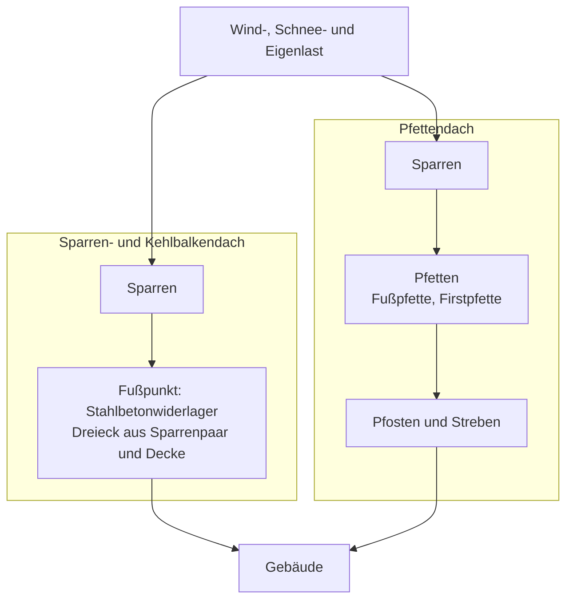
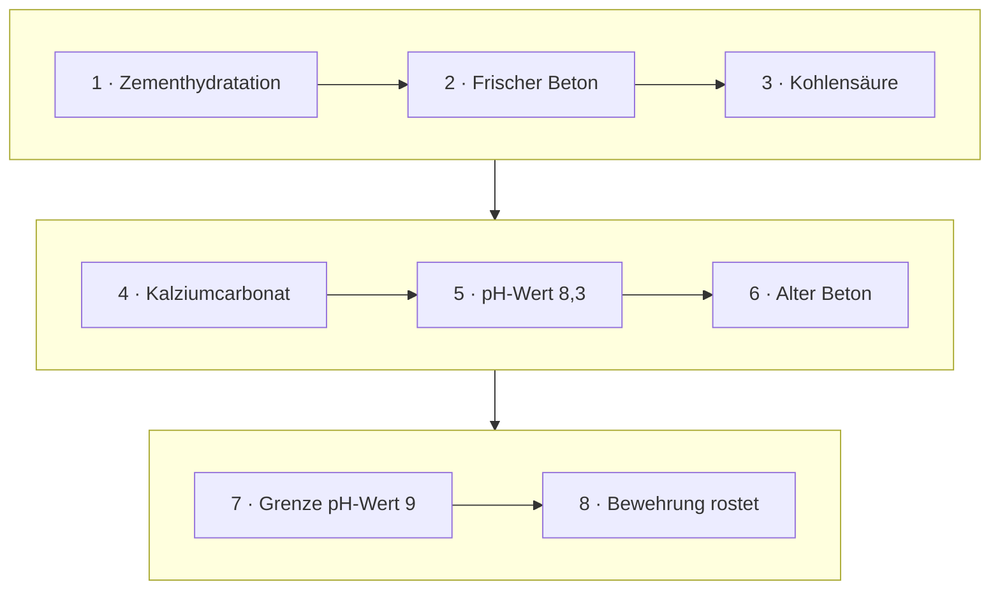
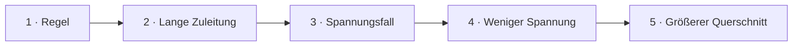
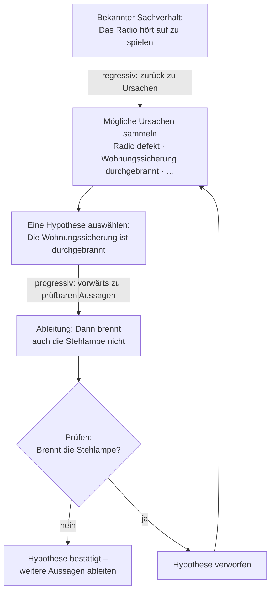

<!--
author:   Hannes Tegelbeckers
email:    hannes.tegelbeckers@ovgu.de
version:  0.3.0
language: de
narrator: Deutsch Female
mode:     Textbook
comment:  Fachdidaktik technischer Allgemeinbildung II – Selbstlerneinheit zu Sitzung S01b. Studientext mit Übungen: die sieben Methoden unter dem logischen Aspekt – analytisch, synthetisch, induktiv, deduktiv, genetisch, historisch, reduktiv – an Beispielen erklären, selbst anwenden und begründet auswählen.

import:   https://raw.githubusercontent.com/LiaTemplates/mermaid_template/0.1.4/README.md
-->

# S01b – Logische Methoden (Selbstlerneinheit)

<!-- didaktik="Selbstlerneinheit S01b · ca. 90 min · Studientext + Übungen · Inhalte der Folien R013–R033 und Dilling (2024), in eigenen Worten erläutert" -->
> [!IMPORTANT] 🧭 Leitfrage
> Wie organisiere ich den Erkenntnisweg – und woran entscheide ich, welche logische Methode zu meinem Thema passt?

> [!NOTE] 📘 So ist diese Einheit aufgebaut
> Diese Einheit **erklärt die Inhalte der Sitzung S01b** in eigenen Worten und mit Beispielen – Sie können sie auch bearbeiten, wenn Sie in der Sitzung nicht dabei waren. Die Originalfolien mit allen Tabellen finden Sie in der [LiaScript-Sitzung S01b](https://liascript.github.io/course/?https://raw.githubusercontent.com/OVGU-VET-TechEd/Fachdidaktik_technischer_Allgemeinbildung_II/main/S01b_Logische_Methoden.md).

> [!TIP] ✍️ Übung in Moodle
> Bearbeiten Sie diese Einheit als Übung im Moodle-Kurs – dort wird Ihr Bearbeitungsstand gespeichert: [Übung in Moodle öffnen](https://elearning.ovgu.de/mod/scorm/view.php?id=707262)

**Ablauf (ca. 90 min)**

<!-- data-type="none" -->
| Schritt | Inhalt | Zeit |
| --- | --- | --- |
| 0 | Wo stehen Sie? | 3 min |
| 1 | Sieben Methoden, vier Denkrichtungen | 5 min |
| 2 | Teil und Ganzes: analytisch und synthetisch | 15 min |
| 3 | Allgemeines und Besonderes: induktiv und deduktiv | 25 min |
| 4 | Entwicklung: genetisch und historisch | 12 min |
| 5 | Rückschluss: reduktiv | 12 min |
| 6 | Die passende Methode wählen | 12 min |
| 7 | Abschluss und Prüfungsfragen | 15 min |

## Ihr Lernweg in dieser Einheit

    --{{0}}--
Die Einheit führt durch vier Denkrichtungen – Teil und Ganzes, Allgemeines und Besonderes, Entwicklung, Rückschluss – und endet mit der Frage, wie Sie die passende Methode für Ihr Thema wählen.

    --{{1}}--
Auf diesem Weg erreichen Sie sechs Ziele.

      {{1}}

<!-- data-type="none" -->
| Wissen | Können | Beurteilen |
|------|--------|-------|
| die sieben Methoden unter dem logischen Aspekt **nennen** und ihre Denkrichtung **beschreiben** | an neuen Messwerten induktiv eine Regel **aufstellen** und eine deduktive Kette **entwickeln** | für eine Unterrichtssituation eine logische Methode **auswählen** und **begründen** |
| jede Methode am Beispiel der Folien **erläutern** | eine Fehlersuche mit regressiver und progressiver Reaktion **strukturieren** | Vor- und Nachteile induktiven und deduktiven Vorgehens **abwägen** |

    --{{2}}--
Prüfen Sie kurz, ob Sie den Lernweg lesen können.

      {{2}}
****************************************

**Entscheiden:** Wo geht es um die reduktive Methode?

<!-- data-hint-button="1" data-solution-button="2" -->
- [(X)] Rückschluss
- [( )] Entwicklung
- [( )] Teil und Ganzes
[[?]] Von der Wirkung zurück zur Ursache …
***
Richtig: Abschnitt 5 – Rückschluss.
***

****************************************

## 0 · Wo stehen Sie?

    --{{0}}--
Eine Ausgangsfrage zum Start. Am Ende der Einheit beantworten Sie sie noch einmal.

> Sie sollen Auszubildenden das **HOOKE'sche Gesetz** (elastisches Verhalten von Stahl) vermitteln. **Womit würden Sie beginnen?**

**Abstimmen (vorher):** Womit beginnen Sie?

[(a)] Mit dem Gesetz – dann Anwendung an Beispielen
[(b)] Mit Messwerten – die Lernenden finden die Regel selbst
[(c)] Mit der Geschichte, wie das Gesetz entdeckt wurde
[(unentschieden)] Unentschieden

    --{{1}}--
Und schätzen Sie sich selbst ein.

      {{1}}
****************************************

> [!TIP] 🧠 Wie sicher fühlen Sie sich? (1–4)
> Notieren Sie je eine Zahl von 1 (gar nicht) bis 4 (sehr sicher): „Ich kann induktives und deduktives Vorgehen an einem eigenen Beispiel erklären.“ – „Ich kann begründen, wann ich welche logische Methode wähle.“

[[___ ___ ___]]

****************************************

    --{{2}}--
Im Rückblick vergleichen Sie.

      {{2}}
> [!TIP] 📌 Merken
> Am Ende der Einheit beantworten Sie die Ausgangsfrage noch einmal und vergleichen Ihre Einschätzung.

## 1 · Sieben Methoden, vier Denkrichtungen

    --{{0}}--
In S01 haben Sie gesehen, dass sich Unterrichtsmethoden unter zwei Aspekten ordnen lassen: nach der äußeren Gestaltung und nach dem logischen Aspekt, Folie R012. Der logische Aspekt beschreibt den Denkweg, auf dem im Unterricht Erkenntnis entsteht – er beantwortet die erste der vier Leitfragen: Wie organisiere ich den Erkenntnisweg? Die Folien stellen in Anlehnung an Diesterweg sieben Methoden vor.

<!-- data-type="none" -->
| Denkrichtung | Methode | Kern | Beispiel der Folien |
| --- | --- | --- | --- |
| Teil ↔ Ganzes | analytisch | ein Ganzes nach einem Ordnungsprinzip in Teile zerlegen | Merkmale von Dachkonstruktionen |
| | synthetisch | Teile zu einem Ganzen zusammenfügen | Lastabtragung im Dach |
| Allgemeines ↔ Besonderes | induktiv | Fall → Lösung → Regel | HOOKE'sches Gesetz aus dem Zugversuch |
| | deduktiv | allgemeine Aussage → Interpretation → Anwendung | pH-Wert von Beton und Bewehrungskorrosion |
| Entwicklung | genetisch | den Gegenstand aus seinem Werden erklären | Spannbeton über seine Fertigung |
| | historisch | den Gegenstand aus der gesellschaftlichen Entwicklung erklären | Spannbeton aus dem Bedarf des 19. Jahrhunderts |
| Rückschluss | reduktiv | von einem Sachverhalt auf eine Ursache oder Struktur zurückschließen | Das Radio hört auf zu spielen |

    --{{1}}--
Die vier Denkrichtungen helfen beim Überblick.

      {{1}}
> [!NOTE] Kernaussage
> Die vier Denkrichtungen sind eine **Lesehilfe** dieser Einheit, nicht Teil der Originalfolien.

<small>Methoden und Beispiele nach Folien R013–R033.</small>

## 2.1 Analytische Methode

    --{{0}}--
Die erste Denkrichtung fragt nach dem Verhältnis von Teil und Ganzem. Beide Methoden werden auf den Folien am selben Gegenstand gezeigt: zwei Dachkonstruktionen aus der Bautechnik. Analytisch vorgehen heißt: Eine Gesamterscheinung wird nach einem Ordnungsprinzip zerlegt, um aus den herausgelösten Teilen das Wesen des Ganzen zu erkennen. Typische Anwendung ist das Erkennen von Aufbau und Wirkungsweise von Maschinen und Konstruktionen. Im Beispiel ist das Ordnungsprinzip eine Liste von Konstruktionsmerkmalen.

<!-- data-type="none" -->
| Merkmal | Sparren- und Kehlbalkendach | Pfettendach |
| --- | --- | --- |
| Tragende Glieder | Sparren | „Stuhl“ |
| Dachneigung | steiler (> 45°) | flacher (< 45°) |
| Fußpunkt | Stahlbetonwiderlager; Schrägzapfen, Versatz | Lagerung des Sparrens auf der Fußpfette (Schwelle) |
| First | Verbindung der Sparren durch Laschen, verkämmte Firstbohle; Scherzapfen | Lagerung des Sparrens auf der Firstpfette, Sicherung durch Lasche |
| Längsverband | Windrispen | Pfettenstränge; Anordnung von Pfosten, Bügen, Sparren |
| Querverband | unverschiebliches Dreieck aus Sparrenpaar und Decke | Dreieck aus Pfosten, Sparren und Decke |

    --{{1}}--
Was zeigt die Zerlegung?

      {{1}}
> [!NOTE] Kernaussage
> Erst durch das Zerlegen nach denselben Merkmalen wird sichtbar, *worin* sich die Konstruktionen unterscheiden: Beim Sparrendach tragen die Sparren selbst, beim Pfettendach trägt ein Unterbau aus Pfetten und Pfosten.

<small>Nach Folien R014–R016.</small>

## 2.2 Synthetische Methode

    --{{0}}--
Die Synthese ist die Gegenbewegung: Teile werden zu einem Ganzen zusammengefügt. Die Folie betont, dass die Analyse dafür Voraussetzung ist – erst muss ein Ganzes in Bestandteile zerlegt sein, dann können sie neu zusammengesetzt werden.

**Der Ablauf:** Die Gesamterscheinung wird beschrieben, der Arbeitsablauf in Einzelteile zerlegt, die Einzelteile werden einzeln erörtert und schließlich wieder zu einem Ganzen zusammengefügt (R017).

**Im Beispiel** entnehmen die Lernenden der Zusammenstellung die Merkmale, die die Unterschiede erkennbar machen (R018), und untersuchen dann, **wie Wind-, Schnee- und Eigenlast aufgenommen und abgeleitet werden** (R019): Beim Sparren- und Kehlbalkendach werden die Lasten nur über die Sparren abgeleitet. Beim Pfettendach werden sie von den Sparren auf die Pfetten übertragen und über Pfosten und Streben ins Gebäude geleitet. Aus den Einzelmerkmalen entsteht so ein Verständnis des ganzen Tragwerks.

    --{{1}}--
Die Folien weisen ausdrücklich auf einen Zusammenhang hin.

      {{1}}
> [!NOTE] Kernaussage
> Analytische und synthetische Methode werden **oft zusammenhängend** behandelt, weil sie einander bedingen (R019).

<small>Nach Folien R017–R019.</small>

## Die Synthese als Bild: der Weg der Lasten

    --{{0}}--
Die Synthese der Folie R019 lässt sich als Weg der Lasten zeichnen. Wind-, Schnee- und Eigenlast greifen bei beiden Dächern gleich an – verschieden ist, über welche Bauteile sie ins Gebäude gelangen.

    --{{1}}--
Beim Sparren- und Kehlbalkendach ist der Weg kurz.

      {{1}}
**① Sparren- und Kehlbalkendach:** Die Lasten werden nur über die Sparren abgeleitet; das Sparrenpaar bildet mit der Decke ein unverschiebliches Dreieck.

    --{{2}}--
Beim Pfettendach ist ein Unterbau dazwischengeschaltet.

      {{2}}
**② Pfettendach:** Die Sparren übertragen die Lasten auf die Pfetten, von dort über Pfosten und Streben ins Gebäude.

    --{{3}}--
Und das ist der Gewinn der Synthese.

      {{3}}
**③ Gewinn der Synthese:** Aus Einzelmerkmalen der Analyse (2.1) wird ein Verständnis des ganzen Tragwerks.

    --{{4}}--
Halten Sie den Zusammenhang fest.

      {{4}}
> [!NOTE] Kernaussage
> Die Analyse liefert die Merkmale, die Synthese den **Zusammenhang** – deshalb werden beide Methoden oft gemeinsam behandelt (R019).

<small>Lastabtragung nach Folie R019 als Diagramm dargestellt; Fußpunkt, Pfetten und Querverband nach R015–R016.</small>

## Übung 1: Dächer zusammensetzen

    --{{0}}--
Setzen Sie aus den Merkmalen die beiden Dachkonstruktionen zusammen. Vergleichen Sie zuerst.

<!-- data-type="none" -->
| Kriterium | Sparren- und Kehlbalkendach | Pfettendach |
|-----------|---------------|---------------|
| Tragende Glieder | Sparren | „Stuhl“ |
| Dachneigung | steiler (>45°) | flacher (<45°) |
| Längsverband | Windrispen | Pfettenstränge |
| Lastabtragung | Belastungen nur über Sparren abgeleitet | über Pfetten, Pfosten und Streben in das Gebäude abgeleitet |

    --{{1}}--
Je ein Merkmal aus dem Querverband:

      {{1}}
- **Sparren- und Kehlbalkendach:** Unverschiebliches Dreieck aus dem Sparrenpaar und der Decke
- **Pfettendach:** Dreieck aus Pfosten, Sparren und Decke

    --{{2}}--
Ein typischer Fehlschluss:

      {{2}}
> [!WARNING] Häufiges Missverständnis
> „Beide Dächer haben Sparren – also tragen beide über die Sparren.“ Beim Pfettendach tragen die Pfetten mit Pfosten und Streben („Stuhl“); die Sparren geben die Lasten nur an die Pfetten weiter.

    --{{3}}--
Ordnen Sie jetzt zu – und überlegen Sie, welche Methode Sie dabei anwenden.

      {{3}}
****************************************

**Entscheiden:** Welchen Begriff beschreibt die Aussage jeweils?

<!-- data-hint-button="1" data-solution-button="2" data-show-partial-solution -->
[(Sparren- und Kehlbalkendach) (Pfettendach)]
[       (X)             ( )      ] Querverband aus Sparrenpaar und Decke
[       ( )             (X)      ] Lasten über Pfetten, Pfosten und Streben abgeleitet
[       (X)             ( )      ] Windrispen im Längsverband
[       ( )             (X)      ] „Stuhl“ als tragende Glieder
[[?]] Wo tragen die Sparren selbst – und wo der Stuhl?
***
Sie haben Teile zu einem Ganzen zusammengefügt – **synthetisch** (R017). Die Zerlegung in Merkmale hatte die Tabelle schon geleistet: Sie ist Voraussetzung der Synthese; beide Methoden bedingen einander (R019).
***

****************************************

## 3.1 Induktive Methode

    --{{0}}--
Die zweite Denkrichtung ist die bekannteste: Gehe ich vom Besonderen zum Allgemeinen – induktiv – oder vom Allgemeinen zum Besonderen – deduktiv? Induktiv heißt: vom Besonderen zum Allgemeinen, vom Konkreten zum Abstrakten, von einzelnen Tatsachen zum übergreifend Gültigen. Die Schrittfolge lautet Fall, Lösung, Regel. Das Beispiel der Folien ist das HOOKE'sche Gesetz für das elastische Verhalten von Stahl. Es läuft in vier Schritten.

1. **Analyse** der Ergebnisse von Zugversuchen an zwei Stählen (C 45W und C 60W): Zu jeder Kraft F wird die Längenänderung gemessen.
2. **Synthese** durch Berechnung von Spannung und Dehnung und Darstellung im Spannungs-Dehnungs-Diagramm für den elastischen Bereich.
3. **Hypothese**: Spannung und Dehnung sind im elastischen Bereich proportional – das HOOKE'sche Gesetz wird durch Induktionsschluss aufgestellt.
4. **Überprüfung** an Versuchsergebnissen weiterer Stahlarten.

**Probieren Sie Schritt 1 selbst.** Die Messwerte der Folie R025 (Spaltenüberschrift auf der Folie: „/ in mm“):

<!-- data-type="none" -->
| C 45W: F in N | Längenänderung in mm | C 60W: F in N | Längenänderung in mm |
| ---: | ---: | ---: | ---: |
| 7,2 | 0,25 | 7,3 | 0,045 |
| 15,1 | 0,52 | 15,3 | 0,09 |
| 24,0 | 0,75 | 19,3 | 0,11 |
| 30,1 | 0,98 | 21,5 | 0,13 |

    --{{1}}--
Was bleibt innerhalb einer Messreihe ungefähr gleich? Prüfen Sie es auf der nächsten Seite.

      {{1}}
> [!NOTE] Kernaussage
> Schrittfolge der induktiven Methode: **Fall → Lösung → Regel** (R024).

<small>Nach Folien R024–R026.</small>

## Übung 2a: Die Regel aus dem Zugversuch

    --{{0}}--
Drei kurze Fragen zu den Messwerten und zur induktiven Methode.

**1 · Eine Antwort:** Was bleibt innerhalb einer Messreihe ungefähr gleich?

<!-- data-hint-button="1" data-solution-button="2" -->
- [( )] Das Produkt aus Kraft und Längenänderung ist konstant.
- [(X)] Das Verhältnis von Längenänderung zu Kraft – Längenänderung und Kraft sind proportional.
- [( )] Beide Stähle verlängern sich bei gleicher Kraft gleich stark.
[[?]] Teilen Sie in jeder Zeile die Längenänderung durch die Kraft.
***
C 45W: 0,25 : 7,2 ≈ 0,035 · 0,52 : 15,1 ≈ 0,034 · 0,75 : 24,0 ≈ 0,031 · 0,98 : 30,1 ≈ 0,033 mm/N. C 60W: durchgehend rund 0,006 mm/N. Vom Fall (Messwerte) über die Lösung (konstantes Verhältnis) zur Regel (Proportionalität) – das ist der induktive Weg.
***

    --{{1}}--
Jetzt können mehrere Antworten richtig sein.

      {{1}}
****************************************

**2 · Alle zutreffenden:** Was nennt Folie R027 als **Nachteile** der induktiven Methode?

<!-- data-hint-button="1" data-solution-button="2" -->
- [[X]] Unterstellung, die Bearbeitung eines Falles reiche aus, um das Allgemeine zu erkennen
- [[ ]] hoher Abstraktionsgrad
- [[X]] Fallkonstruktionen sind oft realitäts- bzw. praxisfern
- [[ ]] geringe Anschaulichkeit
[[?]] Die beiden falschen Antworten sind Nachteile der deduktiven Methode.
***
Der erste Nachteil ist der wichtigste: Aus zwei Messreihen an zwei Stählen folgt noch kein Gesetz für alle Stähle. Deshalb gibt es Schritt 4 – die Überprüfung an weiteren Stahlarten. Vorteile nach R027: dem natürlichen Lernprozess angepasst; Lernende werden mit dem Geschehen konfrontiert.
***

****************************************

    --{{2}}--
Zum Schluss eine Zahl.

      {{2}}
****************************************

**3 · Eintippen:** Wie groß ist das Verhältnis Längenänderung : Kraft bei C 60W ungefähr – in mm/N? (Zahl mit Komma, z. B. 0,03)

<!-- data-hint-button="1" data-solution-button="2" -->
[[0,006]]
[[?]] 0,045 : 7,3 …

***
Rund 0,006 mm/N – C 60W verlängert sich bei gleicher Kraft deutlich weniger als C 45W (rund 0,03 mm/N).
***

****************************************

## 3.2 Deduktive Methode

    --{{0}}--
Deduktiv heißt: vom Allgemeinen zum Besonderen, vom Abstrakten zum Konkreten, von der Regel zu ihrer Anwendung. Die Schrittfolge lautet allgemeine Aussage, Interpretation, Anwendung; Lernziel ist die Befähigung zur konkreten Anwendung.

- Schrittfolge: **allgemeine Aussage → Interpretation → Anwendung**
- Lernziel: Befähigung zur konkreten Anwendung
- Voraussetzung: eine **größere Fähigkeit zum abstrakten Denken** bei den Lernenden (R020)

Das Beispiel der Folien ist eine Schlusskette zum **Korrosionsschutz der Bewehrung in Beton** (R021–R022). Sie beginnt mit allgemeinen chemischen Aussagen und endet bei einer konkreten Folge für das Bauteil – nächste Seite.

    --{{1}}--
Für die Praxis heißt das zum Beispiel: Eine ausreichende Betondeckung schützt die Bewehrung, solange die Carbonatisierung sie nicht erreicht hat.

      {{1}}
> [!NOTE] Kernaussage
> In einer deduktiven Kette folgt jeder Schritt **zwingend** aus dem vorherigen.

<small>Nach Folie R020; Anwendung zur Betondeckung: eigene Darstellung.</small>

## Die Schlusskette: Beton und Bewehrung

    --{{0}}--
Die Kette der Folien in acht Schritten.

    --{{1}}--
Zuerst die allgemeinen Aussagen.

      {{1}}
****************************************

1. **Zementhydratation:** Bei der Zementhydratation im Beton entsteht Kalziumhydroxid Ca(OH)₂ mit einem pH-Wert von 12,6.
2. **Frischer Beton:** Frischer Beton ist deshalb stark basisch – pH-Wert 12,6.
3. **Kohlensäure:** CO₂ aus der Luft bildet mit Wasser Kohlensäure: $\ce{CO2 + H2O -> H2CO3}$

****************************************

    --{{2}}--
Dann die Reaktion an der Oberfläche.

      {{2}}
****************************************

4. **Kalziumcarbonat:** Kalziumhydroxid reagiert mit Kohlensäure zu Kalziumcarbonat: $\ce{Ca(OH)2 + H2CO3 -> CaCO3 + 2 H2O}$
5. **pH-Wert 8,3:** Kalziumcarbonat hat einen pH-Wert von 8,3.
6. **Alter Beton:** Alter Beton hat an der Oberfläche einen pH-Wert von 8,3.

****************************************

    --{{3}}--
Und die Folge für das Bauteil.

      {{3}}
****************************************

7. **Grenze pH-Wert 9:** Der Korrosionsschutz ist nur bei einem pH-Wert über 9 gewährleistet.
8. **Bewehrung rostet:** **Folge:** Die Bewehrung in Oberflächennähe kann rosten.

****************************************

<small>Nach Folien R021–R022; Kurzbezeichnungen der Schritte ergänzt.</small>

## Übung 2b: Die Kette ordnen

    --{{0}}--
Bringen Sie die Schritte der deduktiven Kette in die richtige Reihenfolge.

**Ordnen:** Ziehen Sie jede Karte in die richtige Lücke.

<!-- data-randomize data-show-partial-solution data-solution-button="2" -->
Schritt 1: [->[ Zementhydratation ]] → Schritt 2: [->[ Frischer Beton ]] → Schritt 3: [->[ Kohlensäure ]] → Schritt 4: [->[ Kalziumcarbonat ]] → Schritt 5: [->[ pH-Wert 8,3 ]] → Schritt 6: [->[ Alter Beton ]] → Schritt 7: [->[ Grenze pH-Wert 9 ]] → Schritt 8: [->[ Bewehrung rostet ]]

## Induktiv oder deduktiv? Vor- und Nachteile

    --{{0}}--
Die Vor- und Nachteile beider Methoden sind fast spiegelbildlich: Induktion ist anschaulich und motivierend, aber unsicher; Deduktion ist logisch zwingend, aber abstrakt.

<!-- data-type="none" -->
| Kriterium | Induktive Methode | Deduktive Methode |
|-----------|---------------|---------------|
| Richtung | vom Besonderen zum Allgemeinen; vom Konkreten zum Abstrakten | vom Allgemeinen zum Besonderen; vom Abstrakten zum Konkreten |
| Schrittfolge | Fall → Lösung → Regel | allgemeine Aussage → Interpretation → Anwendung |
| Vorteile | dem natürlichen Lernprozess angepasst; Lernende werden mit dem Geschehen konfrontiert | Schulung des klaren, logischen Denkens; Schulung des Abstraktionsvermögens |
| Nachteile | ein Fall reicht nicht zum Erkennen des Allgemeinen; Fallkonstruktionen oft praxisfern | hoher Abstraktionsgrad; geringe Anschaulichkeit; geringes Motivationspotenzial |

    --{{1}}--
Je ein Beispiel von den Folien:

      {{1}}
- **Induktive Methode:** HOOKE'sches Gesetz aus Messwerten des Zugversuchs
- **Deduktive Methode:** Vom pH-Wert des Betons auf das Rosten der Bewehrung schließen

    --{{2}}--
Ein typischer Fehlschluss:

      {{2}}
> [!WARNING] Häufiges Missverständnis
> „Induktiv ist immer besser, weil die Lernenden selbst entdecken.“ – Ein bearbeiteter Fall reicht nicht, um das Allgemeine sicher zu erkennen (R027).

    --{{3}}--
Ordnen Sie jetzt Unterrichtsbeispiele zu.

      {{3}}
****************************************

**Entscheiden:** Welchen Begriff beschreibt die Aussage jeweils?

<!-- data-hint-button="1" data-solution-button="2" data-show-partial-solution -->
[(Induktive Methode) (Deduktive Methode)]
[       (X)             ( )      ] Die Lernenden messen den Strom bei verschiedenen Spannungen und formulieren daraus das Ohm'sche Gesetz.
[       ( )             (X)      ] Die Lehrkraft nennt das Ohm'sche Gesetz und lässt es an drei Schaltungen anwenden.
[       (X)             ( )      ] Die Lernenden vergleichen mehrere defekte Lager und formulieren eine gemeinsame Ursache als Regel.
[       ( )             (X)      ] Aus der Regel „Korrosionsschutz nur über pH 9“ folgern die Lernenden, dass oberflächennahe Bewehrung in altem Beton rosten kann.
[[?]] Steht die Regel am Anfang oder am Ende?
***
Induktiv: Die Regel steht am Ende (Fall → Lösung → Regel, R024). Deduktiv: Die Regel steht am Anfang (allgemeine Aussage → Interpretation → Anwendung, R020). Vor- und Nachteile nach Folien R023 und R027.
***

****************************************

## 3.3 [NEU] Wie sicher ist ein Schluss?

    --{{0}}--
Eine Ergänzung aus der Forschungsliteratur, als NEU markiert. Dilling unterscheidet die beiden Schlussweisen nach ihrer Sicherheit.

<!-- neu="Dilling 2024, S. 38–39, 43–44" -->
- „Mit einem deduktiven Schluss kann sicher auf das Resultat geschlossen werden“ (Dilling 2024, S. 38).
- „Der induktive Schluss überträgt die Gültigkeit der Prämissen anders als die Deduktion nicht mit Sicherheit auf die Konklusion“ (Dilling 2024, S. 39).

Für das Entdecken und Begründen beschreibt Dilling drei Phasen: **Exploration** (Hypothesen entwickeln), **Wissenserklärung** (die Hypothese deduktiv auf bekanntes Wissen zurückführen) und **Wissenssicherung** (die Hypothese experimentell prüfen und induktiv absichern) (S. 43–44). Im HOOKE-Beispiel entspricht Schritt 4 – die Überprüfung an weiteren Stahlarten – der Wissenssicherung.

    --{{1}}--
Was heißt das für Ihren Unterricht?

      {{1}}
> [!NOTE] Kernaussage
> Gute Unterrichtsgänge verbinden oft **beide Richtungen**: induktiv eine Regel finden, sie dann deduktiv anwenden und an neuen Fällen prüfen.

<small>[NEU] Ergänzung, keine Originalfolie: Dilling (2024), S. 38–39, 43–44.</small>

## Übung 2c: Selbst induzieren

    --{{0}}--
Jetzt finden Sie selbst eine Regel aus neuen Messwerten.

Auszubildende messen an einem Bauteil Spannung und Strom:

<!-- data-type="none" -->
| U in V | I in A |
| ---: | ---: |
| 2 | 0,10 |
| 4 | 0,20 |
| 6 | 0,30 |
| 8 | 0,40 |

Formulieren Sie die **Regel in einem Satz**.

[[___ ___ ___ ___]]

💡 Hinweis

Teilen Sie in jeder Zeile die Spannung durch den Strom.

✅ Lösung

2 : 0,10 = 4 : 0,20 = 6 : 0,30 = 8 : 0,40 = 20. Das Verhältnis U : I ist konstant (20 V/A = 20 Ω) – Spannung und Strom sind **proportional**. Fall (Messwerte) → Lösung (konstantes Verhältnis) → Regel (Proportionalität, ohmscher Widerstand von 20 Ω). Beachten Sie den Nachteil aus R027: Ein Bauteil reicht nicht, um das Allgemeine sicher zu erkennen – wie in Schritt 4 des HOOKE-Beispiels müssten weitere Bauteile geprüft werden.

## Übung 2d: Eine eigene deduktive Kette

    --{{0}}--
Eine deduktive Kette aus der Elektrotechnik. Ausgangsregel: Der Widerstand eines Leiters wächst mit seiner Länge.

    --{{1}}--
Die allgemeine Aussage.

      {{1}}
1. **Regel:** Der Widerstand eines Leiters wächst mit seiner Länge.

    --{{2}}--
Die Interpretation für den Fall.

      {{2}}
2. **Lange Zuleitung:** Eine lange Zuleitung hat einen größeren Widerstand.

    --{{3}}--
Die Folge.

      {{3}}
3. **Spannungsfall:** Am größeren Widerstand fällt bei gleichem Strom mehr Spannung ab.

    --{{4}}--
Die Wirkung am Verbraucher.

      {{4}}
4. **Weniger Spannung:** Am Verbraucher kommt weniger Spannung an.

    --{{5}}--
Und die Anwendung.

      {{5}}
5. **Größerer Querschnitt:** Bei langen Leitungen muss der Querschnitt größer gewählt werden.

<small>Übungsbeispiel für diese Einheit, nicht von den Originalfolien.</small>

## Übung 2d: Die Kette ordnen

    --{{0}}--
Bringen Sie die Schritte in die richtige Reihenfolge.

**Ordnen:** Ziehen Sie jede Karte in die richtige Lücke.

<!-- data-randomize data-show-partial-solution data-solution-button="2" -->
Schritt 1: [->[ Regel ]] → Schritt 2: [->[ Lange Zuleitung ]] → Schritt 3: [->[ Spannungsfall ]] → Schritt 4: [->[ Weniger Spannung ]] → Schritt 5: [->[ Größerer Querschnitt ]]

## 4.1 Genetische Methode

    --{{0}}--
Die dritte Denkrichtung erklärt einen Gegenstand aus seiner Entwicklung. Beide Methoden werden auf den Folien am selben Beispiel gezeigt – dem Spannbeton, also Beton, in dem Stahl vorgespannt ist, sodass das Bauteil schon vor der Belastung unter Druck steht. Der Unterschied liegt darin, welche Entwicklung den Gang des Unterrichts bestimmt.

Die genetische Methode erklärt das Wesen eines Gegenstandes aus seinem **Werden** – vom Einfachen zum Komplizierten, entlang eines Leitgedankens (Folie R028).

Im Beispiel wird Spannbeton nicht an einer fertigen Konstruktion erklärt, bei der der Betonkörper bereits erhärtet und die Vorspannung schon aufgebracht ist. Stattdessen erklärt die genetische Methode ihn **über seine Fertigung**: Wie werden Spannstahl und Beton verbunden – im direkten Verbund oder nachträglich über eine Verankerung in der Hülse? Die Art, wie die Vorspannung aufgebracht wird, ist der Zugang zum Verständnis (R029).

    --{{1}}--
Die Folien fassen das in einem Satz.

      {{1}}
> [!NOTE] Kernaussage
> Genetisch = das **„Sein vor dem Hintergrund des Werdens“** erfassen.

<small>Nach Folien R028–R029.</small>

## 4.2 Historische Methode

    --{{0}}--
Bei der historischen Methode wird der Entwicklungsgedanke durch die gesellschaftliche Entwicklung bestimmt, Folie R030. Die methodische Folge hat vier Schritte.

1. das Lernobjekt in konkreten historischen Erscheinungsformen analysieren,
2. Einflussgrößen der jeweiligen historischen Situation aufdecken,
3. den jeweiligen Entwicklungsstand vergleichen und bewerten,
4. die gewonnenen Erkenntnisse zusammenfassen.

**Am Spannbeton** (R031): Die Erfindung ist fast so alt wie der Stahlbeton, wurde aber wegen ungenügender Stahl- und Betonqualität erst später technisch realisiert. Gefördert wurde die Entwicklung durch den enormen Bedarf an Industrie- und Verkehrsbauten, deren große Spannweiten Stahlbetonkonstruktionen nicht gewachsen waren. Spannbeton erlaubt bei gleicher Belastung einen kleineren Betonquerschnitt und größere Weiten.

    --{{1}}--
Die Folie nennt auch eine Grenze.

      {{1}}
> [!NOTE] Kernaussage
> Das **Wirkungsprinzip** ist historisch schwer erklärbar: Die historische Methode zeigt, *warum* es Spannbeton gibt – *wie* er funktioniert, erklärt eher die genetische.

<small>Nach Folien R030–R031.</small>

## Übung 3: Gleicher Gegenstand, zwei Methoden

    --{{0}}--
Beide Methoden folgen einer Entwicklung – aber einer anderen. Vergleichen Sie zuerst.

<!-- data-type="none" -->
| Kriterium | genetisch | historisch |
|-----------|---------------|---------------|
| Entwicklungsgedanke | Werden des Gegenstandes selbst | durch gesellschaftliche Entwicklung bestimmt |
| Gang | vom Einfachen zum Komplizierten auf Basis eines Leitgedankens | Erscheinungsformen analysieren, Einflussgrößen aufdecken, Entwicklungsstände vergleichen und bewerten, zusammenfassen |
| Spannbeton | über die Fertigung erklärt | aus dem Bedarf an Industrie- und Verkehrsbauten erklärt |
| Wirkungsprinzip | über die Art des Aufbringens der Vorspannung zugänglich | historisch schwer erklärbar |

    --{{1}}--
Je ein Beispiel:

      {{1}}
- **genetisch:** Spannbeton wird über das Aufbringen der Vorspannung bei der Fertigung erklärt.
- **historisch:** Spannbeton wird aus den großen Spannweiten erklärt, denen Stahlbeton nicht gewachsen war.

    --{{2}}--
Ein typischer Fehlschluss:

      {{2}}
> [!WARNING] Häufiges Missverständnis
> „Genetisch heißt geschichtlich.“ – Genetisch folgt dem Werden des Gegenstandes (z. B. der Fertigung), historisch der gesellschaftlichen Entwicklung.

    --{{3}}--
Ordnen Sie jetzt zu.

      {{3}}
****************************************

**Entscheiden:** Welchen Begriff beschreibt die Aussage jeweils?

<!-- data-hint-button="1" data-solution-button="2" data-show-partial-solution -->
[(genetisch) (historisch)]
[       (X)             ( )      ] Spannbeton wird über seine Fertigung erklärt – vom Aufbringen der Vorspannung her.
[       ( )             (X)      ] Spannbeton wird aus dem Bedarf an Industrie- und Verkehrsbauten im 19. Jahrhundert erklärt.
[       (X)             ( )      ] Erfasst das „Sein vor dem Hintergrund des Werdens“.
[       ( )             (X)      ] Der Entwicklungsgedanke wird durch die gesellschaftliche Entwicklung bestimmt.
[[?]] Folgt die Erklärung dem Gegenstand oder der Gesellschaft?
***
Die **genetische** Methode folgt dem Werden des Gegenstandes selbst (Fertigung, vom Einfachen zum Komplizierten). Die **historische** Methode folgt der gesellschaftlichen Entwicklung (Bedarf, Einflussgrößen, Entwicklungsstand) – und hat eine Grenze: Das Wirkungsprinzip ist historisch schwer erklärbar (R031).
***

****************************************

## 5 · Rückschluss: ein Fall

    --{{0}}--
Die vierte Denkrichtung ist der Rückschluss. Sie kennen ihn aus jeder Fehlersuche: Etwas funktioniert nicht – und Sie schließen auf die Ursache zurück.

> **Ein Fall:** Das Radio hört auf zu spielen. Was könnte die Ursache sein – und wie würden Sie Ihre Vermutung prüfen?

[[___ ___ ___ ___]]

💡 Hinweis

Sammeln Sie zuerst mögliche Ursachen. Überlegen Sie dann: Was müsste außerdem zutreffen, wenn Ihre Vermutung stimmt?

✅ Lösung

Mögliche Ursachen: Radio defekt, Wohnungssicherung durchgebrannt, Stecker gezogen … Prüfen: Wenn die Wohnungssicherung durchgebrannt ist, brennt auch die Stehlampe im selben Stromkreis nicht – also die Stehlampe einschalten. Wie das methodisch heißt, zeigt die nächste Seite.

## 5.1 Die reduktive Methode

    --{{0}}--
Bei der reduktiven Methode wird auf eine vorhandene oder zu schaffende Struktur zurückgeschlossen, oft unter Rückgriff auf bereits bekannte Vorgänge, Folie R032. Die Folie betont: Die Methode ist nicht wahrheitserblich. Anders als bei der Deduktion folgt aus einer wahren Beobachtung nicht sicher eine wahre Erklärung – das Radio kann aus vielen Gründen schweigen.

Die Folien unterscheiden zwei Reaktionen (R032–R033):

- **Regressive Reaktion:** vom bekannten Sachverhalt **zurück** auf seine Voraussetzungen, Bedingungen und Ursachen – oft keine einfache Aussage, sondern ein Gefüge von Aussagen oder eine ganze Theorie. *Radio:* Gründe sammeln – Radio defekt, Wohnungssicherung durchgebrannt, …
- **Progressive Reaktion:** von einer **Hypothese vorwärts** zu Aussagen, die sich prüfen lassen – sind die abgeleiteten Aussagen wahr, gilt die Hypothese als bestätigt; deshalb möglichst viele ableiten. *Radio:* „Wenn die Wohnungssicherung durchgebrannt ist, brennt auch die Stehlampe nicht.“

    --{{1}}--
Je mehr abgeleitete Aussagen sich bestätigen, desto besser ist die Hypothese gestützt.

      {{1}}
> [!NOTE] Kernaussage
> Gute Fehlersuche wechselt zwischen beiden Reaktionen: Erst werden mögliche Ursachen gesammelt (regressiv), dann wird jede Vermutung mit einer gezielten Prüfung getestet (progressiv).

<small>Nach Folien R032–R033.</small>

## Regressiv und progressiv: der Radio-Fall als Ablauf

    --{{0}}--
Die beiden Reaktionen der reduktiven Methode greifen bei jeder Fehlersuche ineinander. Das Diagramm zeigt den Radio-Fall der Folien R032–R033 als Ablauf.

    --{{1}}--
Zuerst geht der Blick zurück.

      {{1}}
**① Regressive Reaktion:** Vom Sachverhalt zurück auf Voraussetzungen, Bedingungen und Ursachen – oft ein ganzes Gefüge von Aussagen.

    --{{2}}--
Dann geht der Blick nach vorn.

      {{2}}
**② Progressive Reaktion:** Aus einer Hypothese prüfbare Aussagen ableiten; je mehr sich bestätigen, desto besser ist die Hypothese gestützt.

    --{{3}}--
Und warum die Schleife?

      {{3}}
**③ Nicht wahrheitserblich:** Eine bestätigte Aussage beweist die Hypothese nicht sicher – deshalb möglichst viele Aussagen ableiten.

    --{{4}}--
Merken Sie sich das Zusammenspiel.

      {{4}}
> [!NOTE] Kernaussage
> **Regressiv** Ursachen sammeln, **progressiv** jede Vermutung gezielt prüfen – das ist die Struktur systematischer Fehlersuche (vgl. S06: Diagnoseaufgabe).

<small>Nach Folien R032–R033 als Ablauf dargestellt; Prüfschleife: eigene Darstellung.</small>

## Übung 4: Fehlersuche strukturieren

    --{{0}}--
Fall: Ein Drehstrommotor läuft nicht an. Vergleichen Sie zuerst die beiden Reaktionen.

<!-- data-type="none" -->
| Kriterium | regressiv | progressiv |
|-----------|---------------|---------------|
| Richtung | vom Sachverhalt zurück auf Voraussetzungen, Bedingungen, Ursachen | von einer Hypothese vorwärts zu prüfbaren Aussagen |
| Ergebnis | oft ein Gefüge von Aussagen oder eine ganze Theorie | abgeleitete Aussagen wahr → Hypothese gilt als bestätigt |
| Radio-Beispiel | Radio defekt, Wohnungssicherung durchgebrannt, … | Sicherung durchgebrannt → Stehlampe brennt auch nicht |
| in der Fehlersuche | mögliche Ursachen sammeln | jede Vermutung gezielt prüfen |

    --{{1}}--
Je ein Beispiel zum Motor:

      {{1}}
- **regressiv:** Mögliche Ursachen sammeln: Sicherung, Motorschutz, Wicklung, Ansteuerung
- **progressiv:** „Wenn eine Phase fehlt, zeigt das Messgerät an einem Außenleiter keine Spannung.“

    --{{2}}--
Ein typischer Fehlschluss:

      {{2}}
> [!WARNING] Häufiges Missverständnis
> „Die erste plausible Ursache ist die richtige.“ – Die reduktive Methode ist nicht wahrheitserblich; erst geprüfte Folgerungen stützen eine Hypothese.

    --{{3}}--
Ordnen Sie jetzt zu.

      {{3}}
****************************************

**Entscheiden:** Welchen Begriff beschreibt die Aussage jeweils?

<!-- data-hint-button="1" data-solution-button="2" data-show-partial-solution -->
[(regressiv) (progressiv)]
[       (X)             ( )      ] Mögliche Ursachen sammeln: Sicherung, Motorschutz, Wicklung, Ansteuerung
[       ( )             (X)      ] „Wenn der Motorschutzschalter ausgelöst hat, steht sein Schaltgriff auf Aus – ich schaue nach.“
[       (X)             ( )      ] Aus der Beobachtung „brummt, dreht aber nicht“ auf mögliche Bedingungen schließen
[       ( )             (X)      ] „Wenn eine Phase fehlt, zeigt das Messgerät an einem Außenleiter keine Spannung.“
[[?]] Wird zurück auf Ursachen geschlossen – oder aus einer Hypothese eine prüfbare Folgerung abgeleitet?
***
Regressiv: vom Sachverhalt zurück auf mögliche Ursachen. Progressiv: aus einer Hypothese eine prüfbare Folgerung ableiten und prüfen. Gute Fehlersuche wechselt zwischen beidem.
***

****************************************

## Transfer: Ihr Fehlerfall

    --{{0}}--
Übertragen Sie die beiden Reaktionen auf Ihre Fachrichtung.

Beschreiben Sie einen typischen Fehlerfall Ihrer Fachrichtung mit je einer **regressiven** und einer **progressiven** Reaktion.

[[___ ___ ___ ___]]

💡 Hinweis

Regressiv: Welche Ursachen kommen in Frage? Progressiv: Was müsste ich beobachten oder messen, wenn Ursache X stimmt?

✅ Lösung

Beispiel Pneumatik: Ein Zylinder fährt nicht aus. **Regressiv:** mögliche Ursachen – kein Druck, Ventil schaltet nicht, Zylinder undicht. **Progressiv:** „Wenn das Ventil nicht schaltet, leuchtet seine Spulen-LED nicht und die Handhilfsbetätigung lässt den Zylinder ausfahren.“ – prüfen; bestätigt sich das, ist die Ansteuerung die Ursache.

## 6 · Die passende Methode wählen

    --{{0}}--
Keine Methode ist an sich besser als eine andere. Aus den Folien lassen sich aber Kriterien für die Wahl ableiten.

- **Vorwissen und Abstraktionsfähigkeit:** Deduktion setzt eine größere Fähigkeit zum abstrakten Denken voraus (R020); für Einsteiger ist ein induktiver Zugang oft leichter.
- **Anschaulichkeit und Motivation:** Induktion ist dem natürlichen Lernprozess angepasst und konfrontiert die Lernenden mit dem Geschehen (R027); Deduktion ist wenig anschaulich (R023).
- **Struktur des Gegenstands:** Besteht er aus Teilen, die zusammenwirken (analytisch/synthetisch)? Lässt er sich aus seiner Fertigung (genetisch) oder seiner Geschichte (historisch) verstehen?
- **Problemlage:** Ist eine Ursache unbekannt, liegt die reduktive Methode nahe.

    --{{1}}--
Entscheidend ist die Begründung.

      {{1}}
> [!NOTE] Kernaussage
> Oft sind mehrere Methoden vertretbar – entscheidend ist die **Begründung** mit diesen Kriterien.

<small>Kriterien abgeleitet aus Folien R020, R023, R027–R033; eigene Darstellung.</small>

## Übung 5: Welche Methode liegt am nächsten?

    --{{0}}--
Wenden Sie die Kriterien an.

**1 · Eine Antwort:** Fortgeschrittene wenden eine bekannte Bemessungsregel auf neue Bauteile an. Welche Methode liegt am nächsten?

<!-- data-hint-button="1" data-solution-button="2" -->
- [( )] induktiv
- [(X)] deduktiv
- [( )] reduktiv
[[?]] Die Regel steht am Anfang – und die Lernenden können abstrakt denken.
***
Deduktiv: von der Regel zu ihrer Anwendung; die Fortgeschrittenen bringen die nötige Abstraktionsfähigkeit mit (R020).
***

    --{{1}}--
Jetzt können mehrere Antworten richtig sein.

      {{1}}
****************************************

**2 · Alle zutreffenden:** Welche Zuordnungen liegen am nächsten?

<!-- data-hint-button="1" data-solution-button="2" -->
- [[X]] Einsteiger sollen eine Regel aus eigenen Messungen finden – induktiv
- [[ ]] Der Aufbau eines Getriebes soll nach Baugruppen erschlossen werden – historisch
- [[X]] Eine Anlage zeigt eine Störung; die Ursache ist unbekannt – reduktiv
- [[ ]] Ein Werkstück wird Schritt für Schritt so erklärt, wie es gefertigt wird – deduktiv
[[?]] Getriebe nach Baugruppen: Teil und Ganzes. Werkstück nach Fertigung: Werden.
***
Getriebe nach Baugruppen – analytisch; Werkstück nach Fertigung – genetisch. Oft sind mehrere Antworten vertretbar – entscheidend ist die Begründung.
***

****************************************

    --{{2}}--
Zum Schluss eine Methode.

      {{2}}
****************************************

**3 · Eintippen:** „Warum setzte sich die Glühlampe durch – und warum wurde sie abgelöst?“ – welche Methode? (ein Wort)

<!-- data-hint-button="1" data-solution-button="2" -->
[[historisch]]
[[?]] Gesellschaftliche Entwicklung …

***
Historisch: Einflussgrößen der jeweiligen historischen Situation aufdecken und Entwicklungsstände vergleichen (R030).
***

****************************************

## Ihr Thema: eine Methode wählen

    --{{0}}--
Wählen Sie für ein Thema Ihrer Fachrichtung eine logische Methode.

Welche Methode wählen Sie für ein Thema Ihrer Fachrichtung? Skizzieren Sie den Unterrichtsgang in **drei Schritten** (z. B. *Fall → Lösung → Regel*) und nennen Sie **ein Kriterium** für Ihre Wahl.

[[___ ___ ___ ___]]

💡 Hinweis

Kriterien: Vorwissen und Abstraktionsfähigkeit, Anschaulichkeit und Motivation, Struktur des Gegenstands, Problemlage.

✅ Lösung

Thema Leitungsschutzschalter, **induktiv**: ① Fall – Die Lernenden belasten eine Leitung im Versuchsaufbau mit steigendem Strom und beobachten die Auslösezeit. ② Lösung – Je größer der Überstrom, desto schneller löst der Schalter aus. ③ Regel – Auslösekennlinie formulieren und an der Herstellerkennlinie prüfen. Kriterium: Einsteiger, anschaulicher und messbarer Zusammenhang.

## 7 · Noch einmal: Womit beginnen Sie?

    --{{0}}--
Zum Schluss noch einmal die Ausgangsfrage.

**Abstimmen (nachher):** Womit würden Sie beim HOOKE'schen Gesetz jetzt beginnen?

[(a)] Mit dem Gesetz – dann Anwendung an Beispielen
[(b)] Mit Messwerten – die Lernenden finden die Regel selbst
[(c)] Mit der Geschichte, wie das Gesetz entdeckt wurde
[(unentschieden)] Unentschieden

    --{{1}}--
Was ist Ihnen am unklarsten geblieben?

      {{1}}
****************************************

**Nachdenken:** Muddiest point: Was ist Ihnen am unklarsten geblieben?

[[___ ___]]

****************************************

    --{{2}}--
Eine Einordnung:

      {{2}}
> [!NOTE] Kernaussage
> Jede Antwort ist begründbar: Mit dem Gesetz zu beginnen ist deduktiv (logisch klar, aber abstrakt), mit Messwerten induktiv (anschaulich, aber eine Messreihe reicht nicht zum sicheren Schluss), mit der Geschichte historisch (motivierend, aber das Wirkungsprinzip bleibt offen). Die Folien zeigen das HOOKE'sche Gesetz als Beispiel für den induktiven Weg (R025–R026).

## Das Wichtigste aus S01b

    --{{0}}--
Fassen wir zusammen.

    --{{1}}--
Erstens: Teil und Ganzes.

      {{1}}
- Analytisch zerlegen, synthetisch zusammenfügen – beide bedingen einander (R014–R019).

    --{{2}}--
Zweitens: Allgemeines und Besonderes.

      {{2}}
- Induktiv: Fall → Lösung → Regel · Deduktiv: allgemeine Aussage → Interpretation → Anwendung (R020, R024).

    --{{3}}--
Drittens: Entwicklung.

      {{3}}
- Genetisch folgt dem Werden des Gegenstandes, historisch der gesellschaftlichen Entwicklung (R028–R031).

    --{{4}}--
Und viertens: Rückschluss.

      {{4}}
****************************************

- Reduktiv: nicht wahrheitserblich – regressiv Ursachen sammeln, progressiv Hypothesen prüfen (R032–R033).

> [!NOTE] Zum Merken
> Wählen Sie die Methode nach Lernenden, Gegenstand und Problemlage – und begründen Sie Ihre Wahl.

****************************************

    --{{5}}--
Eine letzte Frage.

      {{5}}
****************************************

**Wiederholen:** Welche Methode setzt laut Folie R020 eine größere Fähigkeit zum abstrakten Denken voraus?

<!-- data-hint-button="1" data-solution-button="2" -->
- [( )] die induktive
- [( )] die genetische
- [(X)] die deduktive
[[?]] Regel zuerst …
***
Richtig: die deduktive Methode (R020).
***

****************************************

    --{{6}}--
Als Nächstes geht es um Handlungsorientierung.

      {{6}}
**➡️ Als Nächstes:** S02: Handlungsorientierung · 🧩 Optional für die Selbstlernsitzung am 11.01.2027: Ihr Unterrichtsgang aus Abschnitt 6 ist Baustein 2.

## Prüfungsfragen zum Üben

    --{{0}}--
Die Prüfungsleistung des Moduls ist eine mündliche Prüfung. Mit diesen fünf Fragen üben Sie, die Inhalte dieser Einheit frei, strukturiert und mit Beispielen zu erklären.

> [!TIP] 🎙️ So üben Sie
> Lesen Sie eine Frage und antworten Sie **laut** in höchstens drei Minuten – nach dem Muster **Begriff – Erläutern – Beispiel – Verbinden**. Öffnen Sie erst danach die Antwortskizze und vergleichen Sie: Was fehlte, was war ungenau? Noch besser: Lassen Sie sich von einer Kommilitonin oder einem Kommilitonen abfragen.

**Frage 1 · Methoden im Überblick:** Nennen Sie die Methoden unter dem logischen Aspekt und erläutern Sie zwei davon an einem technischen Beispiel.

✅ Antwortskizze 1

- **1 Begriff:** Der logische Aspekt beschreibt den **Denkweg**, auf dem Erkenntnis entsteht – Antwort auf die Leitfrage „Wie organisiere ich den Erkenntnisweg?“. In Anlehnung an Diesterweg: analytisch, synthetisch, induktiv, deduktiv, genetisch, historisch, reduktiv (R013–R033).
- **2 Erläutern:** **Analytisch** = ein Ganzes nach einem Ordnungsprinzip in Teile zerlegen, um das Wesen des Ganzen zu erkennen; **synthetisch** = die Teile wieder zu einem Ganzen zusammenfügen – die Analyse ist Voraussetzung.
- **3 Beispiel:** Sparren- und Kehlbalkendach und Pfettendach werden nach denselben Merkmalen zerlegt (tragende Glieder, Dachneigung, Fußpunkt, First, Längs- und Querverband); die Synthese zeigt, wie Wind-, Schnee- und Eigenlast abgeleitet werden.
- **4 Verbinden:** Beide werden oft zusammen behandelt, weil sie einander bedingen (R019). Die Methodenwahl hängt von der Struktur des Gegenstands ab (Abschnitt 6).

**Frage 2 · Induktiv und deduktiv:** Vergleichen Sie deduktives und induktives Vorgehen: Schrittfolge, Vor- und Nachteile – und wann würden Sie welches wählen?

✅ Antwortskizze 2

- **1 Begriff:** **Induktiv** = vom Besonderen zum Allgemeinen, Schrittfolge *Fall → Lösung → Regel*; **deduktiv** = vom Allgemeinen zum Besonderen, *allgemeine Aussage → Interpretation → Anwendung* (R020, R024).
- **2 Erläutern:** Induktion ist dem natürlichen Lernprozess angepasst und konfrontiert die Lernenden mit dem Geschehen, aber ein Fall reicht nicht zum Erkennen des Allgemeinen. Deduktion schult klares, logisches Denken und das Abstraktionsvermögen, ist aber wenig anschaulich und wenig motivierend (R023, R027).
- **3 Beispiel:** Induktiv: das HOOKE'sche Gesetz aus Zugversuchen an C 45W und C 60W (Analyse – Synthese – Hypothese – Überprüfung). Deduktiv: die Schlusskette vom Kalziumhydroxid im frischen Beton (pH 12,6) über die Carbonatisierung (pH 8,3) zur Folge, dass die Bewehrung rosten kann.
- **4 Verbinden:** Wahl nach Vorwissen und Abstraktionsfähigkeit (Deduktion setzt mehr voraus). [NEU] Dilling 2024: Nur der deduktive Schluss ist sicher; gute Unterrichtsgänge verbinden beide Richtungen.

**Frage 3 · Genetisch und historisch:** Worin unterscheiden sich genetische und historische Methode? Erläutern Sie am Beispiel Spannbeton.

✅ Antwortskizze 3

- **1 Begriff:** Beide erklären einen Gegenstand aus einer **Entwicklung**: die genetische aus seinem **Werden** („Sein vor dem Hintergrund des Werdens“), die historische aus der **gesellschaftlichen Entwicklung** (R028, R030).
- **2 Erläutern:** Genetisch: vom Einfachen zum Komplizierten entlang eines Leitgedankens. Historisch in vier Schritten: Lernobjekt in historischen Erscheinungsformen analysieren – Einflussgrößen aufdecken – Entwicklungsstand vergleichen und bewerten – Erkenntnisse zusammenfassen.
- **3 Beispiel:** Genetisch wird Spannbeton über seine **Fertigung** erklärt – Spannstahl im direkten Verbund oder nachträglich über eine Verankerung in der Hülse (R029). Historisch: Die Erfindung ist fast so alt wie der Stahlbeton, wurde aber erst mit besserer Stahl- und Betonqualität und durch den Bedarf an Industrie- und Verkehrsbauten mit großen Spannweiten realisiert (R031).
- **4 Verbinden:** Die historische Methode zeigt, *warum* es Spannbeton gibt; das Wirkungsprinzip – *wie* er funktioniert – erklärt eher die genetische.

**Frage 4 · Reduktive Methode:** Erklären Sie regressive und progressive Reaktion der reduktiven Methode an einem Fehlerfall aus Ihrer Fachrichtung.

✅ Antwortskizze 4

- **1 Begriff:** Bei der reduktiven Methode wird auf eine vorhandene oder zu schaffende **Struktur zurückgeschlossen**; sie ist **nicht wahrheitserblich** (R032).
- **2 Erläutern:** **Regressiv:** vom bekannten Sachverhalt zurück auf Voraussetzungen, Bedingungen und Ursachen. **Progressiv:** aus einer Hypothese vorwärts prüfbare Aussagen ableiten – je mehr sich bestätigen, desto besser ist sie gestützt (R033).
- **3 Beispiel:** Folie: Das Radio hört auf zu spielen → Ursachen sammeln (Radio defekt, Wohnungssicherung durchgebrannt …) → „Wenn die Sicherung durchgebrannt ist, brennt auch die Stehlampe nicht.“ Eigenes Beispiel z. B.: Kfz springt nicht an → Batterie, Anlasser, Kraftstoff … → „Wenn die Batterie leer ist, leuchten auch die Kontrolllampen schwach.“
- **4 Verbinden:** Systematische Fehlersuche wechselt zwischen beiden Reaktionen – Grundlage der Diagnoseaufgabe als Großform (S06).

**Frage 5 · Methodenwahl:** Nach welchen Kriterien wählen Sie eine logische Methode für ein Thema? Begründen Sie Ihre Wahl an einem Beispiel.

✅ Antwortskizze 5

- **1 Begriff:** Keine Methode ist an sich besser; entscheidend ist die **Begründung** mit Kriterien (Abschnitt 6, abgeleitet aus R020, R023, R027–R033).
- **2 Erläutern:** Vier Kriterien: **Vorwissen und Abstraktionsfähigkeit** (Deduktion setzt mehr voraus), **Anschaulichkeit und Motivation** (Induktion konfrontiert mit dem Geschehen), **Struktur des Gegenstands** (Teile, die zusammenwirken – analytisch/synthetisch; Fertigung – genetisch; Geschichte – historisch), **Problemlage** (unbekannte Ursache – reduktiv).
- **3 Beispiel:** Ohm'sches Gesetz im ersten Ausbildungsjahr: induktiv aus Messwerten (U und I proportional), weil die Lernenden wenig abstrakte Vorerfahrung haben; danach deduktiv auf neue Schaltungen anwenden.
- **4 Verbinden:** Oft sind mehrere Methoden vertretbar. Die Methodenwahl ist eine Planungsentscheidung nach Ausgangslage und Ziel (Kurskarte, S01).

    --{{1}}--
Schätzen Sie zum Schluss ein, wie sicher Sie sind. Wiederholen Sie die unsicheren Fragen in einigen Tagen – und üben Sie fächerübergreifend mit dem Prüfungstrainer.

      {{1}}
****************************************

**Einschätzen:** Wie sicher beantworten Sie die Fragen frei und in ganzen Sätzen?

[(sicher)(teilweise)(noch unsicher)]
[                                    ] Frage 1 · Methoden im Überblick
[                                    ] Frage 2 · Induktiv und deduktiv
[                                    ] Frage 3 · Genetisch und historisch
[                                    ] Frage 4 · Reduktive Methode
[                                    ] Frage 5 · Methodenwahl

<small>Die Prüfungsfragen sind experimentell: Sie dienen der Vorbereitung, es ist nicht garantiert, dass Fragen in dieser Form gestellt werden. Die Antwortskizzen zeigen eine mögliche Antwort – üben Sie das Argumentieren, nicht das Auswendiglernen. Über alle Sitzungen hinweg üben Sie mit dem [Prüfungstrainer](https://liascript.github.io/course/?https://raw.githubusercontent.com/OVGU-VET-TechEd/Fachdidaktik_technischer_Allgemeinbildung_II/main/Selflearn/Pruefungstrainer.md).</small>

****************************************

## Rückblick

    --{{0}}--
Nehmen Sie sich zwei Minuten für einen Rückblick und vergleichen Sie mit Ihrer Einschätzung aus Abschnitt 0. 🤖 Tipp zum Üben mit KI: Bitten Sie ein KI-Werkzeug: Gib mir ein kurzes Unterrichtsbeispiel aus der Elektro- oder Metalltechnik. Ich bestimme die logische Methode – analytisch, synthetisch, induktiv, deduktiv, genetisch, historisch, reduktiv – und begründe. Prüfe meine Antwort. Maßstab bleiben die Folien aus S01b.

**Nachdenken:** Was ist das Wichtigste, das Sie gelernt haben – und was ist noch unklar?

[[___ ___ ___]]

    --{{1}}--
Haken Sie ab, was Sie jetzt können.

      {{1}}
****************************************

**Abhaken:** Was können Sie jetzt?

- [ ] Ich kann induktives und deduktives Vorgehen an einem eigenen Beispiel erklären.
- [ ] Ich kann begründen, wann ich welche logische Methode wähle.
- [ ] Ich kann eine Fehlersuche mit regressiver und progressiver Reaktion strukturieren.

****************************************

    --{{2}}--
Und zum Schluss: Wie hat die Einheit für Sie funktioniert?

      {{2}}
****************************************

**Feedback:** Wie hat diese Einheit für Sie funktioniert?

[(1 stimme zu)(2 eher ja)(3 teils)(4 eher nein)(5 stimme nicht zu)]
[                                                                   ] Das Tempo war angemessen.
[                                                                   ] Die Erklärungen waren verständlich.
[                                                                   ] Die Beispiele haben mir beim Verstehen geholfen.
[                                                                   ] Die Übungen waren nützlich.

****************************************

## Als Nächstes: S02

    --{{0}}--
In S02 geht es um Handlungsorientierung – warum Lernende im technischen Unterricht handeln sollen.

<!-- style="max-width:100%;width:60%;display:block;margin:0 auto;" -->

> [!IMPORTANT] Zum Nachdenken bis zum nächsten Mal
> Beschreiben Sie eine typische berufliche Tätigkeit Ihrer Fachrichtung in Schritten: Was passiert vor, während und nach der Ausführung – und wer entscheidet meist, wie sie ausgeführt wird?

*S02 · Handlungsorientierung*

## Literatur

    --{{0}}--
Hier finden Sie die Quellen dieser Einheit.

- Diesterweg – zitiert nach S01b, Folie R013 („vgl. Diesterweg“); vollständige Angabe auf der Originalfolie nicht vorhanden.
- Dilling, F. (2024). Naturwissenschaftliche Erkenntniswege – Was können wir aus diesen über Begründungen im Mathematikunterricht lernen? In F. Dilling et al. (Hrsg.), *Interdisziplinäres Forschen und Lehren in den MINT-Didaktiken* (MINTUS – Beiträge zur mathematisch-naturwissenschaftlichen Bildung, S. 35–54). Wiesbaden: Springer Fachmedien. https://doi.org/10.1007/978-3-658-43873-9_3

<small>Erläuterungen und Beispiele in dieser Einheit: eigene Darstellung auf Grundlage der Folien. Gesamtverzeichnis: 00_Literatur.md</small>
