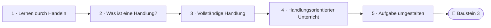
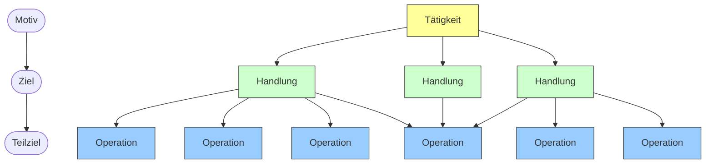
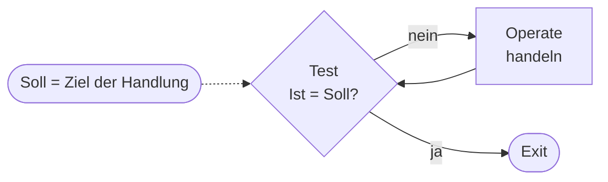
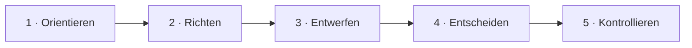
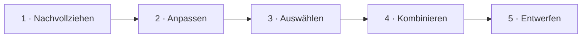

<!--
author:   Hannes Tegelbeckers
email:    hannes.tegelbeckers@ovgu.de
version:  0.3.0
language: de
narrator: Deutsch Female
mode:     Textbook
comment:  Fachdidaktik technischer Allgemeinbildung II – Selbstlerneinheit zu Sitzung S02 (Selbstlerntermin). Studientext mit Übungen: Handlungsorientierung begründen, Tätigkeit, Handlung und Operation unterscheiden, die vollständige Handlung und die Stufen der Selbständigkeit anwenden und eine angeleitete Aufgabe handlungsorientiert umgestalten.

import:   https://raw.githubusercontent.com/LiaTemplates/mermaid_template/0.1.4/README.md
-->

# S02 – Handlungsorientierung (Selbstlerneinheit)

<!-- didaktik="Selbstlerneinheit S02 · Selbstlerntermin 19.10.2026 (Dozent nicht vor Ort) · ca. 90 min · Studientext + Übungen · Inhalte der Folien R040–R053, in eigenen Worten erläutert" -->
> [!IMPORTANT] 🧭 Leitfrage
> Warum sollen Lernende im technischen Unterricht **handeln** – und wie mache ich aus einer Arbeitsanweisung eine vollständige Lernhandlung?

> [!WARNING] 📅 Selbstlerntermin am 19.10.2026
> An diesem Termin gibt es keine Präsenzveranstaltung. Diese Einheit **erklärt alle Inhalte der Sitzung S02** und enthält die Übungen dazu – Sie können sie ohne weitere Unterlagen bearbeiten. Die [LiaScript-Sitzung S02](https://liascript.github.io/course/?https://raw.githubusercontent.com/OVGU-VET-TechEd/Fachdidaktik_technischer_Allgemeinbildung_II/main/S02_Handlungsorientierung.md) enthält die Originalfolien und Zitate im Wortlaut; nutzen Sie sie zum Nachschlagen. Fragen notieren Sie auf dem Beuteblatt – wir greifen sie in S03 auf.

> [!TIP] ✍️ Übung in Moodle
> Bearbeiten Sie diese Einheit als Übung im Moodle-Kurs – dort wird Ihr Bearbeitungsstand gespeichert: [Übung in Moodle öffnen](https://elearning.ovgu.de/mod/scorm/view.php?id=707263)

**Ablauf (ca. 90 min)**

<!-- data-type="none" -->
| Schritt | Inhalt | Zeit |
| --- | --- | --- |
| 0 | Wo stehen Sie? | 3 min |
| 1 | Warum lernt man durch Handeln? | 20 min |
| 2 | Was ist eine Handlung? | 20 min |
| 3 | Vollständige Handlung und Selbständigkeit | 15 min |
| 4 | Wie sieht handlungsorientierter Unterricht aus? | 12 min |
| 5 | Eine Aufgabe handlungsorientiert umgestalten | 15 min |
| 6 | Abschluss und Prüfungsfragen | 15 min |

## Ihr Lernweg in dieser Einheit

    --{{0}}--
Die Einheit führt von den Begründungen der Handlungsorientierung über die Frage, was eine Handlung ist, zur vollständigen Handlung und zum handlungsorientierten Unterricht – und endet damit, dass Sie selbst eine Aufgabe umgestalten.

    --{{1}}--
Auf diesem Weg erreichen Sie sechs Ziele.

      {{1}}

<!-- data-type="none" -->
| Wissen | Können | Beurteilen |
|------|--------|-------|
| Handlungsorientierung lernpsychologisch, handlungstheoretisch und von der Arbeitswelt her **begründen** | eine Tätigkeit nach Handlungen und Operationen **gliedern** | Unterricht anhand der Thesen nach Hortsch und der Merkmale nach Bünning **beurteilen** |
| die Begriffe Tätigkeit, Handlung und Operation sowie Motiv, Ziel und Teilziel **erläutern** | die Schritte der vollständigen Handlung und die Stufen der Selbständigkeit **beschreiben** und Aufgaben einer Stufe **zuordnen** | eine angeleitete Aufgabe so **umgestalten**, dass Lernende die Schritte der vollständigen Handlung selbst durchlaufen |

    --{{2}}--
Prüfen Sie kurz, ob Sie den Lernweg lesen können.

      {{2}}
****************************************

**Entscheiden:** Was kommt direkt vor dem Umgestalten einer Aufgabe?

<!-- data-hint-button="1" data-solution-button="2" -->
- [(X)] Handlungsorientierter Unterricht
- [( )] Vollständige Handlung
- [( )] Lernen durch Handeln
[[?]] Folgen Sie den Pfeilen von links nach rechts.
***
Richtig: Abschnitt 4 beschreibt handlungsorientierten Unterricht, Abschnitt 5 wendet ihn an.
***

****************************************

## 0 · Wo stehen Sie?

    --{{0}}--
Sie haben in Ihrer eigenen Ausbildung oder im Studium sicher beides erlebt – Lernen durch Zuhören und Lernen durch Tun. Am Ende der Einheit kommen Sie auf diese Frage zurück.

> **Ausgangsfrage:** Lernen durch Zuhören oder Lernen durch Tun – woran erinnern Sie sich heute besser?

**Abstimmen (vorher):** Woran erinnern Sie sich heute besser?

[(a)] an das, was ich gehört habe
[(b)] an das, was ich selbst getan habe
[(c)] an beides gleich
[(unentschieden)] Unentschieden

    --{{1}}--
Und warum?

      {{1}}
****************************************

> [!TIP] 🧠 Warum? · 2 min
> Denken Sie an ein konkretes Beispiel. Warum ist Ihnen gerade das in Erinnerung geblieben?

[[___ ___ ___]]

****************************************

    --{{2}}--
Schätzen Sie sich außerdem selbst ein.

      {{2}}
> [!TIP] 📌 Wie sicher fühlen Sie sich? (1–4)
> Notieren Sie je eine Zahl von 1 (gar nicht) bis 4 (sehr sicher): „Ich kann begründen, warum Lernende im Unterricht handeln sollen.“ – „Ich kann eine Tätigkeit in Handlungen und Operationen gliedern.“ – „Ich kann eine Aufgabe so gestalten, dass Lernende selbst planen und entscheiden.“ Im Rückblick vergleichen Sie.

## 1 · Warum lernt man durch Handeln?

    --{{0}}--
Handlungsorientierung ist eines der zentralen Leitprinzipien der beruflichen und technischen Bildung – auf den Folien „Das Konzept der Handlungsorientierung“, R040. Sie wird auf drei Ebenen begründet. Die Ebenen beantworten jeweils eine andere Frage.

<!-- data-type="none" -->
| Ebene | Leitfrage | Kernaussage |
| --- | --- | --- |
| **lernpsychologisch** | Wie entsteht Wissen im Kopf? | Erkenntnis entsteht aus Handlungen und Operationen, nicht aus bloßem Aufnehmen. |
| **handlungstheoretisch** | Was ist eine Handlung, und wie wird sie gesteuert? | Die Handlung ist die Grundeinheit menschlicher Tätigkeit; an ihr setzt Unterricht an. |
| **von der Arbeitswelt her** | Was verlangt die moderne Berufsarbeit? | Fachkräfte müssen vollständige Tätigkeiten selbständig planen, ausführen und prüfen. |

    --{{1}}--
In diesem Kapitel: 1.1 die lernpsychologische Begründung, 1.2 die Begründung von der Arbeitswelt her. Die handlungstheoretische Begründung ist so grundlegend, dass sie ein eigenes Kapitel bekommt, Abschnitt 2.

      {{1}}
> [!NOTE] Kernaussage
> Wenn wir verstehen, wie Menschen Handlungen aufbauen und steuern, können wir Unterricht so planen, dass Lernende genau diese Steuerung lernen.

<small>Nach Folien R040–R053; die Gliederung in drei Ebenen ist eine Lesehilfe dieser Einheit.</small>

## 1.1 Die lernpsychologische Begründung

    --{{0}}--
Die lernpsychologische Begründung stützt sich auf Autoren aus unterschiedlichen Traditionen, die zu einem ähnlichen Schluss kommen: Wissen wird nicht fertig übernommen, sondern durch eigenes Tun aufgebaut.

**Leontjew/Galperin (1966):** Kenntnisse sind das *Produkt* angeeigneter Handlungen. Einen Begriff eignet man sich an, indem man mit den **wesentlichen Merkmalen** von Objekten handelt – zum Beispiel vergleicht und Gegenstände einem Begriff zuordnet.

> *Beispiel:* Den Begriff „Reihenschaltung“ verstehen Lernende nicht dadurch, dass sie die Definition abschreiben, sondern wenn sie mehrere Schaltungen vergleichen, Ströme messen und entscheiden, welche dazugehören. Das Merkmal „derselbe Strom fließt durch alle Bauteile“ wird dabei *handelnd* entdeckt.

**Piaget (1983):** Erkenntnis ist **ständig mit Handlungen verknüpft** – von einfachen sensomotorischen Handlungen (Stoßen, Ziehen) bis zu gedanklichen Operationen (Vereinigen, Reihenbilden, Zuordnen). Gedankliche Operationen sind *verinnerlichte* Handlungen.

> *Beispiel:* Wer Bauteile real nach Größe sortiert hat, kann später eine Toleranztabelle „im Kopf“ ordnen.

    --{{1}}--
Hering, Aebli und Roth richten den Blick auf den Unterricht.

      {{1}}
****************************************

**Hering (1969):** Lernen ist **stets eine Funktion der Tätigkeit**. Die Lehrkraft soll sich immer fragen, wie sie Lernende in Tätigkeit versetzen kann.

**Aebli (1987):** **Stoffsammlungen** – Zusammenfassungen, Merksätze, fertige Tafelbilder – sind gefährlich, wenn sie nicht wieder in Tätigkeiten zurückverwandelt werden. *Beispiel:* Ein Merksatz zum ohmschen Gesetz bekommt erst Bedeutung, wenn Lernende die Untersuchung selbst durchführen.

**Roth (1976):** „Alle methodische Kunst liegt darin beschlossen, **tote Sachverhalte in lebendige Handlungen rückzuverwandeln**, aus denen sie entsprungen sind.“ *Beispiel:* Eine Schraubensicherung wird lebendig, wenn Lernende das Problem erleben, für das sie erfunden wurde: Eine Schraube lockert sich unter Vibration – was können wir tun?

****************************************

    --{{2}}--
Der gemeinsame Kern:

      {{2}}
> [!NOTE] Kernaussage
> 💡 Lehrkräfte können Wissen nicht „übergeben“. Sie können Situationen schaffen, in denen Lernende es **durch Handeln selbst aufbauen**.

<small>Nach Folien R041–R042; Beispiele: eigene Darstellung.</small>

## Übung 1a: Wer sagt was?

    --{{0}}--
Ordnen Sie die Kernaussagen den Autoren zu.

**1 · Eine Antwort:** „Gedankliche Operationen sind verinnerlichte Handlungen.“ – Auf wen geht das zurück?

<!-- data-hint-button="1" data-solution-button="2" -->
- [( )] Hering (1969)
- [(X)] Piaget (1983)
- [( )] Roth (1976)
[[?]] Von sensomotorischen Handlungen bis zu intellektuellen Operationen …
***
Piaget, 1983, S. 25 (R041).
***

    --{{1}}--
Jetzt können mehrere Antworten richtig sein.

      {{1}}
****************************************

**2 · Alle zutreffenden:** Welche Zuordnungen stimmen?

<!-- data-hint-button="1" data-solution-button="2" -->
- [[X]] Hering 1969 – Lernen ist stets eine Funktion der Tätigkeit
- [[ ]] Roth 1976 – Stoffsammlungen sind gefährlich ohne Rückwandlung in Tätigkeiten
- [[X]] Leontjew/Galperin 1966 – Kenntnisse sind das Produkt angeeigneter Handlungen
- [[ ]] Aebli 1987 – tote Sachverhalte in lebendige Handlungen rückverwandeln
[[?]] Aebli warnt vor Stoffsammlungen, Roth spricht von toten Sachverhalten.
***
Aebli 1987: Stoffsammlungen sind gefährlich ohne Rückwandlung in Tätigkeiten · Roth 1976: tote Sachverhalte in lebendige Handlungen rückverwandeln (R042).
***

****************************************

    --{{2}}--
Zum Schluss ein Name.

      {{2}}
****************************************

**3 · Eintippen:** Wer fordert, tote Sachverhalte in lebendige Handlungen rückzuverwandeln? (Nachname)

<!-- data-hint-button="1" data-solution-button="2" -->
[[Roth]]
[[?]] 1976, S. 123.

***
Roth, 1976, S. 123 (R042).
***

****************************************

## 1.2 Die Begründung von der Arbeitswelt her

    --{{0}}--
Frieling beschreibt, wie sich die Produktionsstrukturen verändert haben. Daraus folgt, was Fachkräfte heute können müssen – und damit, was berufliche Bildung leisten muss.

<!-- data-type="none" -->
| Heute gefragt … | … statt früher | Was folgt daraus für den Unterricht? |
| --- | --- | --- |
| prozesskettenorientierte Organisation | funktionale Hierarchien | Zusammenhänge über die eigene Station hinaus verstehen |
| Kundenorientierung | Produktorientierung | von Kundenaufträgen und echten Problemen ausgehen |
| Projekt- und Budgetverantwortung | hierarchisches Aufgabenmanagement | Lernende planen und verantworten selbst |
| Team- bzw. Gruppenarbeit | Einzelarbeit | kooperative Lernformen |
| vollständige Tätigkeiten | Verrichtungen | Lernende planen, führen aus und kontrollieren |
| Selbststeuerung | standardisierte Vorgaben | Entscheidungsspielräume statt Rezepte |
| Beteiligung | Fremdbestimmung | Lernende gestalten Ziele und Wege mit |
| kontinuierliche Verbesserung | Hoffnung auf Innovation | eigenes Vorgehen bewerten und verbessern |

    --{{1}}--
Das Argument lautet:

      {{1}}
> [!NOTE] Kernaussage
> Wer im Beruf **vollständig und selbstgesteuert** arbeiten soll, muss das im Unterricht auch üben. Eine Ausbildung, die nur „Verrichtungen nach Vorgabe“ trainiert, bereitet auf eine Arbeitswelt vor, die es so kaum noch gibt.

<small>Linke zwei Spalten nach Frieling (1993, S. 32), Folie R049; rechte Spalte: Erläuterung für diese Einheit.</small>

## Übung 1b: Welche Begründung steckt in der Aussage?

    --{{0}}--
Ordnen Sie Aussagen den drei Begründungsebenen zu.

**1 · Eine Antwort:** „Im Betrieb wird statt Einzelarbeit zunehmend im Team gearbeitet.“ – Welche Begründung?

<!-- data-hint-button="1" data-solution-button="2" -->
- [( )] lernpsychologisch
- [(X)] von der Arbeitswelt her
- [( )] handlungstheoretisch
[[?]] Frieling …
***
Arbeitswelt: Team- bzw. Gruppenarbeit statt Einzelarbeit (Frieling, R049).
***

    --{{1}}--
Jetzt können mehrere Antworten richtig sein.

      {{1}}
****************************************

**2 · Alle zutreffenden:** Welche Aussagen gehören zur **lernpsychologischen** Begründung?

<!-- data-hint-button="1" data-solution-button="2" -->
- [[X]] „Einen Begriff eignet man sich an, indem man mit den wesentlichen Merkmalen von Objekten handelt.“
- [[ ]] „Die kleinste abgrenzbare zielbewusste Verhaltenseinheit ist die Handlung.“
- [[X]] „Tote Sachverhalte müssen in lebendige Handlungen rückverwandelt werden.“
- [[ ]] „Gefragt ist Selbststeuerung statt standardisierter Vorgaben.“
[[?]] Wie entsteht Wissen im Kopf?
***
Lernpsychologisch: Leontjew/Galperin (R041), Roth (R042). Handlung als Analyse-Einheit: handlungstheoretisch (R044). Selbststeuerung: Arbeitswelt (R049).
***

****************************************

    --{{2}}--
Zum Schluss eine Ebene.

      {{2}}
****************************************

**3 · Eintippen:** „Eine Tätigkeit gliedert sich in Handlungen, eine Handlung in Operationen.“ – Welche Begründungsebene? (ein Wort)

<!-- data-hint-button="1" data-solution-button="2" -->
[[handlungstheoretisch]]
[[?]] Was ist eine Handlung?

***
Handlungstheoretisch: das Modell Tätigkeit – Handlung – Operation (R044, R046) – Thema von Abschnitt 2.
***

****************************************

## 2.1 Handlung: zielgerichtet und bewusst

    --{{0}}--
Im Alltag nennen wir fast alles handeln. Die Handlungstheorie ist genauer: Sie legt fest, was eine Handlung ausmacht, und gliedert menschliche Arbeit in drei Ebenen. Nicht jede Aktivität ist eine Handlung. Nach Leontjew ist eine Handlung eine Aktivität mit zwei Merkmalen.

- **Zielgerichtetheit:** Sie ist auf ein vorweggenommenes Ergebnis ausgerichtet. Der Handelnde weiß, *was* am Ende stehen soll.
- **Bewusstheit:** Sie wird bewusst gesteuert. Der Handelnde weiß, *dass* und *warum* er etwas tut.

Ein Reflex (Hand von der heißen Platte ziehen) ist deshalb keine Handlung. „Einen Bremsbelag wechseln, damit das Fahrzeug wieder sicher bremst“ ist eine.

    --{{1}}--
Leontjew zieht daraus zwei Folgerungen: Menschliche Tätigkeit vollzieht sich immer in Handlungen, und auch die Persönlichkeit entwickelt sich in und durch Handlungen.

      {{1}}
> [!NOTE] Kernaussage
> Wer Kompetenz entwickeln will, muss Lernende **handeln** lassen.

<small>Nach Folie R043 (Leontjew 1979, S. 103); Beispiele: eigene Darstellung.</small>

## 2.2 Tätigkeit – Handlung – Operation

    --{{0}}--
Das hierarchisch-sequentielle Modell der Handlungsregulation nach Hacker und Volpert unterscheidet drei Ebenen. Hierarchisch heißt: Die Ebenen sind ineinander geschachtelt. Sequentiell heißt: Auf jeder Ebene laufen Schritte nacheinander ab.

<!-- data-type="none" -->
| Ebene | Was ist das? | Wodurch wird sie gesteuert? | Beispiel Kfz-Technik |
| --- | --- | --- | --- |
| **Tätigkeit** | ein komplexes Gefüge mehrerer Handlungen | ein **Motiv** – *warum* tue ich das überhaupt? | Bremsanlage an der Vorderachse instand setzen (Motiv: Kundenauftrag erfüllen, Fahrsicherheit herstellen) |
| **Handlung** | bewusstes, zielgerichtetes Verhalten | ein **Ziel** – *was* soll am Ende dieser Handlung vorliegen? | Bremsbeläge erneuern (Ziel: neue Beläge korrekt montiert) |
| **Operation** | unselbständiger Bestandteil einer Handlung, oft automatisiert | ein **Teilziel** und die äußeren Bedingungen | Radschrauben lösen, Bremssattel abschrauben |

Die Grafik auf Folie R046 zeigt zusätzlich: Eine Tätigkeit besteht aus **mehreren** Handlungen, jede Handlung aus **mehreren** Operationen – und **dieselbe Operation kann in verschiedenen Handlungen** vorkommen. „Radschrauben lösen“ braucht man beim Belagwechsel ebenso wie beim Reifenwechsel.

    --{{1}}--
Was Handlung ist, hängt vom Ziel ab. Für Auszubildende im ersten Monat ist Radschrauben mit dem richtigen Drehmoment anziehen eine eigene Handlung mit bewusstem Ziel. Für Erfahrene ist es eine Operation, die nebenbei abläuft.

      {{1}}
> [!NOTE] Kernaussage
> 💭 Ob etwas eine Handlung oder eine Operation ist, hängt vom **Ziel und vom Können** ab. Lernen heißt auch: Handlungen werden zu Operationen, und der Kopf wird frei für das Ziel der nächsthöheren Ebene.

<small>Nach Folien R044 und R046 (Hacker 1978, 1998; Volpert 1980); Beispiele: eigene Darstellung.</small>

## Die Hierarchie als Bild (Folie R046)

    --{{0}}--
Folie R046 zeigt die drei Ebenen als Baum, nach Hacker und Leontjew. Eine Tätigkeit besteht aus mehreren Handlungen, jede Handlung aus mehreren Operationen – und dieselbe Operation kann in mehreren Handlungen vorkommen. Im Diagramm ist das die Operation, auf die drei Pfeile zeigen.

    --{{1}}--
Lesen Sie die Zeile oben von links nach rechts: Jeder Ebene entspricht eine Regulationsgröße.

      {{1}}
**① Tätigkeit – Motiv:** Die Tätigkeit wird durch ein Motiv reguliert – im Beispiel: Kundenauftrag erfüllen, Fahrsicherheit herstellen.

    --{{2}}--
Darunter die Handlungen.

      {{2}}
**② Handlung – Ziel:** Jede Handlung wird durch ein Ziel reguliert – etwa neue Bremsbeläge korrekt montiert.

    --{{3}}--
Und die Operationen.

      {{3}}
**③ Operation – Teilziel:** Operationen werden durch Teilziele reguliert; „Radschrauben lösen“ kommt im Belag- und im Reifenwechsel vor.

    --{{4}}--
Merken Sie sich die Zuordnung.

      {{4}}
> [!NOTE] Kernaussage
> **Motiv → Ziel → Teilziel** regulieren **Tätigkeit → Handlung → Operation**.

<small>Nach Folie R046 „Beziehung der Begriffe Tätigkeit, Handlung und Operation in der Theorie der Handlungsregulation (nach Hacker und Leontjew)“ – Grafik als Diagramm nachgezeichnet (Farben wie im Original; im Original von links nach rechts, die Zeile Motiv → Ziel → Teilziel steht dort unter den Ebenen); Beispiele aus 2.2.</small>

## 2.3 Warum die Handlung als Analyse-Einheit?

    --{{0}}--
Frühe Arbeitswissenschaftler wie Taylor und Gilbreth zerlegten Arbeit in kleinste Bewegungselemente, um sie zu optimieren. Dabei geht der Sinn verloren: Eine einzelne Bewegung hat kein Ziel, das der Arbeitende selbst verfolgt. Die Handlungstheorie wählt deshalb die Handlung als kleinste abgrenzbare zielbewusste Verhaltenseinheit. Innen ist eine Handlung kein gerader Ablauf, sondern ein Regelkreis – auf den Folien heißen diese zyklischen Einheiten TOTE- bzw. VVR-Einheiten.

    --{{1}}--
TOTE steht für Test – Operate – Test – Exit.

      {{1}}
**① TOTE:** Test – Operate – Test – Exit (Miller, Galanter und Pribram, 1960): Zuerst prüft man, ob der Ist-Zustand dem Soll entspricht (Test). Wenn nicht, handelt man (Operate). Dann prüft man erneut (Test). Erst wenn Ist und Soll übereinstimmen, steigt man aus (Exit).

    --{{2}}--
Das klassische Beispiel:

      {{2}}
**② Beispiel:** einen Nagel einschlagen – man schlägt so lange, bis der Nagel bündig sitzt

    --{{3}}--
Und die VVR-Einheit nach Hacker.

      {{3}}
**③ VVR (Hacker):** Vergleichs-Veränderungs-Rückkopplungs-Einheit – das deutsche Gegenstück zu TOTE: Soll und Ist vergleichen, eingreifen und verändern, das Ergebnis zurückmelden

    --{{4}}--
Entscheidend ist der Sollwert.

      {{4}}
> [!NOTE] Kernaussage
> Der **Sollwert** ist das Ziel der Handlung. Wir vertiefen VVR und TOTE in **S04** – dort als Grundlage des Bewertens.

<small>Nach Folie R044 und ihren Sprechernotizen (Stand 26.10.2026); Regelkreis als Diagramm ergänzt.</small>

## Übung 2a: Gliedern (Kfz-Technik)

    --{{0}}--
Ordnen Sie die Elemente den Ebenen zu.

**1 · Eine Antwort:** „Bremsanlage an der Vorderachse instand setzen“ – welche Ebene?

<!-- data-hint-button="1" data-solution-button="2" -->
- [( )] Handlung
- [(X)] Tätigkeit
- [( )] Operation
[[?]] Ein komplexes Gefüge mehrerer Handlungen …
***
Tätigkeit: Bremsanlage instand setzen · Handlungen: Bremsbeläge erneuern, Bremsflüssigkeit wechseln · Operationen: Radschrauben lösen, Bremssattel abschrauben, Entlüftungsventil öffnen.
***

    --{{1}}--
Jetzt können mehrere Antworten richtig sein.

      {{1}}
****************************************

**2 · Alle zutreffenden:** Welche davon sind **Operationen**?

<!-- data-hint-button="1" data-solution-button="2" -->
- [[X]] Radschrauben lösen
- [[ ]] Bremsbeläge erneuern
- [[X]] Entlüftungsventil öffnen
- [[ ]] Bremsflüssigkeit wechseln
[[?]] Operationen sind unselbständige Bestandteile von Handlungen.
***
Belagwechsel und Bremsflüssigkeitswechsel sind Handlungen mit eigenem Ziel; Radschrauben lösen und Entlüftungsventil öffnen sind Operationen darin.
***

****************************************

    --{{2}}--
Zum Schluss ein Begriff.

      {{2}}
****************************************

**3 · Eintippen:** Die Tätigkeit wird gesteuert durch ein … (ein Wort)

<!-- data-hint-button="1" data-solution-button="2" -->
[[Motiv]]
[[?]] Warum tue ich das überhaupt?

***
Motiv → Tätigkeit · Ziel → Handlung · Teilziel → Operation (R046).
***

****************************************

## Übung 2b: Motiv – Ziel – Teilziel (Elektrotechnik)

    --{{0}}--
Tätigkeit: Elektroinstallation einer Küche. Was steuert welche Ebene?

**1 · Eine Antwort:** „Die Familie soll eine sichere, normgerechte Küche nutzen können.“ – Was ist das?

<!-- data-hint-button="1" data-solution-button="2" -->
- [( )] ein Ziel (Handlung)
- [(X)] das Motiv (Tätigkeit)
- [( )] ein Teilziel (Operation)
[[?]] Warum installiere ich überhaupt?
***
Das **Motiv** begründet die ganze Tätigkeit.
***

    --{{1}}--
Jetzt können mehrere Antworten richtig sein.

      {{1}}
****************************************

**2 · Alle zutreffenden:** Welche Aussagen beschreiben **Ziele** von Handlungen?

<!-- data-hint-button="1" data-solution-button="2" -->
- [[X]] „Der Herdanschluss ist hergestellt und geprüft.“
- [[ ]] „Die Leitung ist auf 10 mm abisoliert.“
- [[X]] „Der Steckdosenstromkreis ist verlegt und funktionsfähig.“
- [[ ]] „Die Klemme sitzt fest.“
[[?]] Ziele beschreiben das Ergebnis einer abgrenzbaren Handlung.
***
**Ziele** beschreiben das Ergebnis einer abgrenzbaren Handlung (Herdanschluss, Stromkreis). **Teilziele** gehören zu einzelnen Operationen innerhalb einer Handlung (abisolieren, Klemme anziehen).
***

****************************************

    --{{2}}--
Zum Schluss ein Begriff.

      {{2}}
****************************************

**3 · Eintippen:** „Die Klemme sitzt fest.“ ist ein … (ein Wort)

<!-- data-hint-button="1" data-solution-button="2" -->
[[Teilziel]]
[[?]] Es gehört zu einer Operation.

***
Teilziel – es reguliert die Operation „Klemme anziehen“.
***

****************************************

## Übung 2c: Ihre Fachrichtung

    --{{0}}--
Übertragen Sie das Modell auf Ihre Fachrichtung.

Wählen Sie eine **Tätigkeit** aus Ihrer Fachrichtung. Nennen Sie das **Motiv**, zwei **Handlungen** mit ihrem Ziel und je zwei **Operationen**.

[[___ ___ ___ ___]]

💡 Hinweis

Fragen Sie für jede Ebene: Warum? (Motiv) – Was soll am Ende vorliegen? (Ziel) – Welche Teilschritte laufen darin ab? (Teilziel)

✅ Lösung

Beispiel SHK: **Tätigkeit** Heizkörper in einem Bad erneuern – Motiv: Kundenauftrag, das Bad soll zuverlässig warm werden. **Handlung 1:** neuen Heizkörper montieren – Ziel: Heizkörper hängt waagerecht und fest; Operationen: Halter anzeichnen, Löcher bohren. **Handlung 2:** Heizkörper anschließen – Ziel: Anschluss dicht, Heizkörper wird warm; Operationen: Verschraubungen anziehen, Heizkörper entlüften.

## 3.1 Die vollständige Handlung

    --{{0}}--
Für den Unterricht ist entscheidend, wer die Handlung plant, entscheidet und kontrolliert – die Lernenden selbst oder die Lehrkraft. Im einfachsten Modell besteht eine vollständige Handlung aus Orientieren, Durchführen und Kontrollieren. Hacker beschreibt die Phasen vor und nach der Durchführung genauer – hier am Beispiel Gewinde M8 herstellen. Zwischen Entscheiden und Kontrollieren steht das Durchführen: bohren, senken, Gewinde schneiden.

    --{{1}}--
Orientieren.

      {{1}}
1. **Orientieren:** Der Handelnde macht sich mit der Handlungssituation vertraut. *Beispiel:* Kundenauftrag lesen – eine Halterung soll mit M8 an einer Stahlplatte befestigt werden.

    --{{2}}--
Richten.

      {{2}}
2. **Richten:** Handlungsziel und Teilziele werden gebildet. *Beispiel:* Ziel tragfähige Gewindebohrung; Teilziele Kernloch, Senkung, Gewinde, Prüfung.

    --{{3}}--
Entwerfen.

      {{3}}
3. **Entwerfen:** Mögliche Handlungswege werden erarbeitet. *Beispiel:* Kernlochdurchmesser im Tabellenbuch ermitteln, Werkzeugsatz und Reihenfolge überlegen.

    --{{4}}--
Entscheiden.

      {{4}}
4. **Entscheiden:** Über Wege und Mittel wird geurteilt und entschieden. *Beispiel:* Maschinen- oder Handgewindebohrer? Begründete Wahl treffen.

    --{{5}}--
Und nach dem Durchführen: Kontrollieren.

      {{5}}
5. **Kontrollieren:** Ablauf und Ergebnis werden kontrolliert. *Beispiel:* mit Gewindelehre prüfen; überlegen, was beim nächsten Mal besser geht.

<small>Schritte nach Folien R047–R048; Beispiel ergänzt. Das Durchführen steht auf R048 nicht eigens in der Liste, gehört aber zur vollständigen Handlung (R047). 🔗 Die Phasen bilden das Gerüst der Projektmethode (S03), der Leittextmethode und des technischen Experiments (S05).</small>

## Übung 3a: Die Schritte nach Hacker ordnen

    --{{0}}--
Eine Handlung ist unvollständig, wenn jemand anderes Teile davon übernimmt – typisch für tayloristisch organisierte Arbeit und für Unterricht nach Arbeitsblatt. Bringen Sie die Schritte nach Hacker in die richtige Reihenfolge.

**Ordnen:** Ziehen Sie jede Karte in die richtige Lücke.

<!-- data-randomize data-show-partial-solution data-solution-button="2" -->
Schritt 1: [->[ Orientieren ]] → Schritt 2: [->[ Richten ]] → Schritt 3: [->[ Entwerfen ]] → Schritt 4: [->[ Entscheiden ]] → Schritt 5: [->[ Kontrollieren ]]

## 3.2 Taxonomie der Selbständigkeit im Handeln

    --{{0}}--
Wie viel der vollständigen Handlung Lernende selbst leisten, lässt sich in fünf Stufen beschreiben, Folie R045. Mit jeder Stufe übernehmen Lernende mehr vom Orientieren, Richten, Entwerfen und Entscheiden.

<!-- data-type="none" -->
| Stufe | Bezeichnung | Was leisten Lernende selbst? | Beispiel Elektrotechnik |
| --- | --- | --- | --- |
| 1 | Handlungsmuster **nachvollziehen** | ein vorgegebenes Muster genau ausführen | Wendeschaltung nach Schaltplan verdrahten |
| 2 | Handlungsmuster **anpassen** | ein bekanntes Muster an veränderte Bedingungen anpassen | Wendeschaltung für Stern-Dreieck-Anlauf abwandeln |
| 3 | Handlungsmuster **auswählen** | aus mehreren bekannten Mustern das passende wählen | entscheiden, welche gelernte Verbindungsart geeignet ist |
| 4 | Handlungsmuster **kombinieren** | mehrere Muster zu etwas Neuem verbinden | Steuerung und Sensorik aus zwei Übungen zu einer Anlage verbinden |
| 5 | eigene Handlungsmuster **entwerfen** | eine Lösung ohne Vorbild entwickeln | Lösung für eine Förderaufgabe ohne Muster entwickeln |

    --{{1}}--
Stufe 1 ist nicht schlecht: Am Anfang brauchen Lernende Muster, die sie nachvollziehen können.

      {{1}}
> [!NOTE] Kernaussage
> Problematisch ist es, **auf Stufe 1 stehenzubleiben**. Gute Lernsequenzen steigern die Selbständigkeit schrittweise.

<small>Stufen nach Folie R045; Beispiele: eigene Darstellung.</small>

## Die fünf Stufen als Weg

    --{{0}}--
Die Stufen der Taxonomie bauen aufeinander auf. Von Stufe zu Stufe nimmt die Selbständigkeit der Handlungsausführung zu – auf Folie R045 steht dieser Pfeil neben der Liste.

    --{{1}}--
Stufe eins: ein vorgegebenes Muster genau ausführen.

      {{1}}
1. **Nachvollziehen:** Handlungsmuster nachvollziehen – z. B. Wendeschaltung nach Schaltplan verdrahten

    --{{2}}--
Stufe zwei: ein bekanntes Muster an neue Bedingungen anpassen.

      {{2}}
2. **Anpassen:** Handlungsmuster anpassen – z. B. für Stern-Dreieck-Anlauf abwandeln

    --{{3}}--
Stufe drei: aus mehreren bekannten Mustern wählen.

      {{3}}
3. **Auswählen:** Handlungsmuster auswählen – die geeignete Verbindungsart begründet wählen

    --{{4}}--
Stufe vier: Muster zu Neuem verbinden.

      {{4}}
4. **Kombinieren:** Handlungsmuster kombinieren – Steuerung und Sensorik zu einer Anlage verbinden

    --{{5}}--
Stufe fünf: ohne Vorbild entwickeln.

      {{5}}
5. **Entwerfen:** Eigene Handlungsmuster entwerfen – Lösung für eine Förderaufgabe ohne Muster

<small>Stufen nach Folie R045 als Ablauf dargestellt („Zunahme der Selbständigkeit der Handlungsausführung“); Beispiele aus 3.2.</small>

## Übung 3a: Stufen der Selbständigkeit ordnen

    --{{0}}--
Ordnen Sie die Stufen – von wenig zu viel Selbständigkeit.

**Ordnen:** Ziehen Sie jede Karte in die richtige Lücke.

<!-- data-randomize data-show-partial-solution data-solution-button="2" -->
Schritt 1: [->[ Nachvollziehen ]] → Schritt 2: [->[ Anpassen ]] → Schritt 3: [->[ Auswählen ]] → Schritt 4: [->[ Kombinieren ]] → Schritt 5: [->[ Entwerfen ]]

## Übung 3b: Welche Stufe verlangt die Aufgabe?

    --{{0}}--
Neue Beispiele aus der Metalltechnik.

**1 · Eine Antwort:** „Fertigen Sie den Flansch genau nach Zeichnung und Arbeitsplan.“ – Welche Stufe?

<!-- data-hint-button="1" data-solution-button="2" -->
- [( )] Stufe 2 – anpassen
- [(X)] Stufe 1 – nachvollziehen
- [( )] Stufe 3 – auswählen
[[?]] Ist das Muster vollständig vorgegeben?
***
Stufe 1: ein vorgegebenes Muster genau ausführen.
***

    --{{1}}--
Jetzt können mehrere Antworten richtig sein.

      {{1}}
****************************************

**2 · Alle zutreffenden:** Welche Zuordnungen stimmen?

<!-- data-hint-button="1" data-solution-button="2" -->
- [[X]] „Ändern Sie den Arbeitsplan so, dass der Flansch aus Aluminium statt aus Stahl gefertigt wird.“ – Stufe 2, anpassen
- [[ ]] „Entscheiden Sie, ob Sie die Bohrung reiben oder ausdrehen, und begründen Sie Ihre Wahl.“ – Stufe 4, kombinieren
- [[X]] „Entwickeln Sie eine Vorrichtung, mit der zehn Werkstücke gleich gespannt werden können.“ – Stufe 5, entwerfen
- [[ ]] „Verbinden Sie die gefertigten Einzelteile aus Übung 3 und 5 zu einer Baugruppe.“ – Stufe 3, auswählen
[[?]] Auswählen = aus bekannten Mustern wählen; kombinieren = Muster verbinden.
***
Reiben oder ausdrehen: Stufe 3 (auswählen) · Einzelteile zur Baugruppe verbinden: Stufe 4 (kombinieren). Je höher die Stufe, desto mehr Schritte der vollständigen Handlung übernehmen die Lernenden selbst (R045).
***

****************************************

    --{{2}}--
Zum Schluss eine Zahl.

      {{2}}
****************************************

**3 · Eintippen:** „Entscheiden Sie, ob Sie die Bohrung reiben oder ausdrehen, und begründen Sie Ihre Wahl.“ – Welche Stufe? (Zahl)

<!-- data-hint-button="1" data-solution-button="2" -->
[[3]]
[[?]] Aus zwei bekannten Verfahren wählen …

***
Stufe 3: Handlungsmuster auswählen.
***

****************************************

## 4.1 Thesen nach Hortsch

    --{{0}}--
Aus den drei Begründungen folgt ein Konzept für den Unterricht. Hortsch fasst handlungstheoretisch begründeten – kurz handlungsorientierten Unterricht, HoU – in zwölf Thesen. Gebündelt sagen sie Folgendes.

<!-- data-type="none" -->
| Thema | Kernaussage | Thesen |
| --- | --- | --- |
| **Was HoU ist** | HoU ist **keine Methode, sondern ein Konzept** für die Gestaltung des Lernprozesses – offen für alle Gestaltungsmöglichkeiten, auch ein Lehrervortrag kann seinen Platz haben. | 1 |
| **Rolle der Lernenden und Lehrenden** | Im Mittelpunkt steht der Lernende als **handelndes Individuum**, das weitgehend selbstbestimmt und selbstgesteuert lernt. Die Lehrkraft tritt zurück und gewährt **als Partner Lernhilfe**; Unterricht gestalten heißt vor allem **Lernbedingungen schaffen**. | 2–5 |
| **Ziele** | **berufliche Handlungskompetenz** (fachlich, methodisch, sozial); Handeln im Unterricht **und** im beruflichen und privaten Leben; **ganzheitliches Lernen** (kognitiv, emotional-volitiv, psychomotorisch). | 6–8 |
| **Grundstruktur** | **Orientierung** (Problemanalyse, Zielbestimmung, Informationsbeschaffung, Planung, Entscheidung) – **Ausführung** – **Kontrolle und Bewertung** einschließlich Reflexion des Vorgehens. | 9 |
| **Inhalte** | zuerst die **innere Logik des Lernens**, dann die Fachsystematik; **fachübergreifend**; **exemplarisch** vertieft und übertragbar. | 10–11 |
| **Rahmen** | institutionelle und organisatorische Rahmenbedingungen mit **Handlungsspielräumen** (Zeit, Räume, Fächerzuordnung). | 12 |

    --{{1}}--
Den vollständigen Wortlaut finden Sie in der LiaScript-Sitzung S02.

      {{1}}
> [!NOTE] Kernaussage
> HoU ist **keine Methode, sondern ein Konzept** (These 1).

<small>Gebündelt und erläutert nach Hortsch (1999), Folien R050–R052.</small>

## 4.2 Merkmale nach Bünning

    --{{0}}--
Für die Praxis lassen sich die Thesen auf fünf Merkmale verdichten. Sie eignen sich als Prüfliste für eigene Unterrichtsentwürfe.

1. Der Lernende steht als **handelnde Person** im Mittelpunkt des Unterrichts.
2. HoU ist **selbstbestimmtes Lernen**; der Lehrer tritt aus seiner dominierenden Rolle zurück.
3. HoU zielt auf die **ganzheitliche Entwicklung der Persönlichkeit** (fachliche, methodische und soziale Komponente).
4. HoU zielt auf die **Einheit kognitiver, emotionaler und psychomotorischer** Lernprozesse.
5. Die Gestaltung orientiert sich am **Ablauf vollständiger Handlungen**.

    --{{1}}--
Ein häufiges Missverständnis: Handlungsorientiert heißt nicht einfach praktisch oder in der Werkstatt. Wer nur nach Arbeitsblatt feilt, ist zwar körperlich aktiv, plant und entscheidet aber nichts. Umgekehrt kann eine Planungsaufgabe am Schreibtisch sehr handlungsorientiert sein.

      {{1}}
> [!NOTE] Kernaussage
> ⚠️ Entscheidend ist, **wer orientiert, richtet, entwirft, entscheidet und kontrolliert** – nicht, ob die Hände beschäftigt sind.

<small>Nach Folie R053 (verkürzt Bünning).</small>

## Übung 4: Thesen-Check

    --{{0}}--
Ergänzen Sie den Text. Wählen, tippen oder ziehen Sie die fehlenden Wörter.

**Ergänzen:**

<!-- data-hint-button="1" data-solution-button="2" data-show-partial-solution -->
HoU ist keine Methode, sondern ein [[ (Konzept) | Lehrplan | Medium ]] für die Gestaltung des Lernprozesses. Die Grundstruktur menschlichen Handelns lautet: Orientierung, Ausführung, Kontrolle und [[Bewertung]]. HoU folgt in erster Linie der inneren Logik des [->[ (Lernens) | Faches ]].
[[?]] Thesen 1, 9 und 10 nach Hortsch.

    --{{1}}--
Entscheiden Sie jetzt: richtig oder falsch?

      {{1}}
****************************************

**Entscheiden:** Richtig oder falsch?

<!-- data-hint-button="1" data-solution-button="2" data-show-partial-solution -->
[(richtig) (falsch)]
[  (X)    ( )  ] Zur Grundstruktur gehört auch die Reflexion der eigenen Vorgehensweise.
[  ( )    (X)  ] Eine Werkstattübung nach Arbeitsblatt ist automatisch handlungsorientiert.
[  (X)    ( )  ] Handlungsorientierter Unterricht zielt auch auf das Handeln außerhalb des Unterrichts.
[  ( )    (X)  ] Handlungsorientierter Unterricht ist eine Unterrichtsmethode wie das Gruppenpuzzle.
[[?]] Thesen 1, 7 und 9 – und das Missverständnis aus 4.2.
***
Richtig: These 9 (Reflexion), These 7 (zwei Handlungsebenen). Falsch: „Werkstattübung nach Arbeitsblatt“ (körperliche Aktivität allein reicht nicht; Ziel, Weg und Mittel sind vorgegeben) und „eine Methode“ (HoU ist ein Konzept – These 1).
***

****************************************

## 5 · Eine Aufgabe handlungsorientiert umgestalten

    --{{0}}--
Ausgangsaufgabe, angeleitet: Schneiden Sie ein Gewinde M8 in die Bohrung. Erstens Kernloch 6,8 Millimeter bohren. Zweitens ansenken. Drittens Vorschneider, Mittelschneider, Fertigschneider nacheinander verwenden. Viertens mit Gewindelehre prüfen.

**1 · Eine Antwort:** Ausgangsaufgabe: „Schneiden Sie ein Gewinde M8 in die Bohrung. 1. Kernloch 6,8 mm bohren. 2. Ansenken. 3. Vorschneider, Mittelschneider, Fertigschneider nacheinander verwenden. 4. Mit Gewindelehre prüfen.“ – Auf welcher Stufe der Selbständigkeit arbeiten die Lernenden?

<!-- data-hint-button="1" data-solution-button="2" -->
- [( )] Stufe 3 – auswählen
- [(X)] Stufe 1 – nachvollziehen
- [( )] Stufe 2 – anpassen
[[?]] Was ist alles vorgegeben?
***
Stufe 1 – als Einstieg sinnvoll, handlungsorientiert ist es noch nicht.
***

    --{{1}}--
Jetzt können mehrere Antworten richtig sein.

      {{1}}
****************************************

**2 · Alle zutreffenden:** Welche Schritte nach Hacker nimmt die Aufgabe den Lernenden ab?

<!-- data-hint-button="1" data-solution-button="2" -->
- [[X]] Richten (Ziel und Teilziele bilden)
- [[ ]] Durchführen
- [[X]] Entscheiden (über Wege und Mittel)
- [[ ]] Das Gewinde mit der Lehre prüfen
[[?]] Was müssen die Lernenden nicht mehr selbst überlegen?
***
Die Aufgabe nennt keine Situation – zu orientieren gibt es nichts. Ziel, Teilziele, Weg und Mittel sind vorgegeben: Auch Orientieren und Entwerfen sind abgenommen. Die Lernenden führen aus und prüfen selbst mit der Lehre – allerdings mit vorgegebenem Prüfmittel und ohne Reflexion des Vorgehens.
***

****************************************

    --{{2}}--
Zum Schluss ein Schritt.

      {{2}}
****************************************

**3 · Eintippen:** Wie heißt der Schritt, in dem Handlungswege erarbeitet werden? (ein Wort)

<!-- data-hint-button="1" data-solution-button="2" -->
[[Entwerfen]]
[[?]] Orientieren – Richten – … – Entscheiden – Kontrollieren

***
Entwerfen: Erarbeitung von Handlungswegen (R048).
***

****************************************

## So gehen Sie beim Umgestalten vor

    --{{0}}--
Fünf Regeln, eine je Schritt der vollständigen Handlung.

1. **Situation statt Anweisung:** Geben Sie einen Anlass (Kundenauftrag, Störung, Problem), in dem das Ergebnis gebraucht wird → *Orientieren*.
2. **Ziel statt Schritte:** Nennen Sie, was am Ende vorliegen soll, nicht wie → *Richten*.
3. **Informationsquellen statt Werte:** Verweisen Sie auf Tabellenbuch, Datenblatt, Herstellerangaben → *Entwerfen*.
4. **Wahl statt Vorgabe:** Lassen Sie Lernende Werkzeuge, Reihenfolge oder Verfahren begründet wählen → *Entscheiden*.
5. **Kriterien und Reflexion:** Lassen Sie Lernende Prüfkriterien selbst festlegen und ihr Vorgehen bewerten → *Kontrollieren*.

    --{{1}}--
So steigt die Selbständigkeit.

      {{1}}
> [!NOTE] Kernaussage
> Jede Regel gibt den Lernenden einen Schritt der vollständigen Handlung zurück.

<small>Eigene Darstellung auf Grundlage der Folien R045, R048 und These 9 (R052).</small>

## Ihre Umgestaltung

    --{{0}}--
Jetzt gestalten Sie die Gewinde-Aufgabe um.

Formulieren Sie die Gewinde-Aufgabe so um, dass die Lernenden **orientieren, richten, entwerfen, entscheiden und kontrollieren**. Welche Informationen geben Sie mit, welche sollen sie selbst beschaffen? Welche **Stufe der Selbständigkeit** erreichen Sie?

[[___ ___ ___ ___]]

💡 Hinweis

Prüfen Sie Ihre Umgestaltung danach mit den fünf Merkmalen nach Bünning: Welches Merkmal ist noch schwach – und wie könnten Sie es stärken (z. B. soziale Komponente durch Partnerarbeit)?

✅ Lösung

*„Ein Kunde braucht eine Halterung, die mit vier Schrauben M8 an einer 10 mm starken Stahlplatte befestigt wird. Planen Sie die Gewindebohrungen: Ermitteln Sie Kernlochdurchmesser und Werkzeuge mit dem Tabellenbuch, legen Sie die Arbeitsschritte fest und begründen Sie Ihre Wahl. Führen Sie die Bohrungen aus, prüfen Sie sie und bewerten Sie Ihr Vorgehen: Was würden Sie beim nächsten Mal anders machen?“* – Orientieren (Kundenauftrag) · Richten (Ziel: tragfähige Befestigung) · Entwerfen und Entscheiden (Werte, Werkzeuge, Reihenfolge) · Durchführen · Kontrollieren und Reflexion (These 9 nach Hortsch). Selbständigkeit: etwa Stufe 2–3 – das bekannte Muster „Gewinde schneiden“ wird an eine Situation angepasst, Werkzeuge werden ausgewählt.

## 6 · Noch einmal: Zuhören oder Tun?

    --{{0}}--
Zum Schluss noch einmal die Ausgangsfrage – jetzt mit den Begriffen dieser Einheit.

**Abstimmen (nachher):** Woran erinnern Sie sich heute besser?

[(a)] an das, was ich gehört habe
[(b)] an das, was ich selbst getan habe
[(c)] an beides gleich
[(unentschieden)] Unentschieden

    --{{1}}--
Was ist Ihnen am unklarsten geblieben? Wir greifen es in S03 auf.

      {{1}}
****************************************

**Nachdenken:** Muddiest point: Was ist Ihnen am unklarsten geblieben?

[[___ ___]]

****************************************

    --{{2}}--
Eine Einordnung:

      {{2}}
> [!NOTE] Kernaussage
> Nach den Folien entsteht Erkenntnis durch Handeln (R041–R042). Entscheidend ist dabei nicht körperliche Aktivität, sondern ob Lernende selbst orientieren, richten, entwerfen, entscheiden und kontrollieren – also eine vollständige Handlung durchlaufen.

## Das Wichtigste aus S02

    --{{0}}--
Fassen wir zusammen.

    --{{1}}--
Erstens: drei Begründungen.

      {{1}}
- Handlungsorientierung lernpsychologisch (Leontjew/Galperin bis Roth), handlungstheoretisch und von der Arbeitswelt her (Frieling) begründet.

    --{{2}}--
Zweitens: was eine Handlung ist.

      {{2}}
- Handlung = zielgerichtet und bewusst; Tätigkeit – Handlung – Operation, gesteuert durch Motiv – Ziel – Teilziel; innen ein Regelkreis (TOTE/VVR).

    --{{3}}--
Drittens: die vollständige Handlung.

      {{3}}
- Orientieren – Richten – Entwerfen – Entscheiden – Kontrollieren; fünf Stufen der Selbständigkeit vom Nachvollziehen bis zum Entwerfen.

    --{{4}}--
Und viertens: der Unterricht.

      {{4}}
****************************************

- HoU ist ein Konzept, keine Methode; die fünf Merkmale nach Bünning sind Ihre Prüfliste.

> [!NOTE] Zum Merken
> Geben Sie Lernenden Schritte der vollständigen Handlung zurück: Situation, Ziel, Quellen, Wahl, Kriterien.

****************************************

    --{{5}}--
Eine letzte Frage.

      {{5}}
****************************************

**Wiederholen:** Lernende feilen nach Arbeitsblatt ein Werkstück. Was gilt nach dieser Einheit?

<!-- data-hint-button="1" data-solution-button="2" -->
- [( )] Das ist handlungsorientiert, weil die Lernenden praktisch arbeiten.
- [( )] Das ist Stufe 5 der Selbständigkeit.
- [(X)] Das ist eine unvollständige Handlung auf Stufe 1 – Ziel, Weg und Mittel sind vorgegeben.
[[?]] Wer orientiert, richtet, entwirft und entscheidet?
***
Richtig: Körperliche Aktivität allein macht Unterricht nicht handlungsorientiert.
***

****************************************

    --{{6}}--
Als Nächstes geht es um tradierte methodische Konzepte und die Projektmethode.

      {{6}}
**➡️ Als Nächstes:** S03: Tradierte Konzepte & Projektmethode · 🧩 Optional für die Selbstlernsitzung am 11.01.2027: Ihre umgestaltete Aufgabe ist ein guter Baustein 3 (Lernhandlung).

## Prüfungsfragen zum Üben

    --{{0}}--
Die Prüfungsleistung des Moduls ist eine mündliche Prüfung. Mit diesen fünf Fragen üben Sie, die Inhalte dieser Einheit frei, strukturiert und mit Beispielen zu erklären.

> [!TIP] 🎙️ So üben Sie
> Lesen Sie eine Frage und antworten Sie **laut** in höchstens drei Minuten – nach dem Muster **Begriff – Erläutern – Beispiel – Verbinden**. Öffnen Sie erst danach die Antwortskizze und vergleichen Sie: Was fehlte, was war ungenau? Noch besser: Lassen Sie sich von einer Kommilitonin oder einem Kommilitonen abfragen.

**Frage 1 · Begründungen:** Begründen Sie Handlungsorientierung lernpsychologisch – mit mindestens zwei Positionen von den Folien – und von der Arbeitswelt her (Frieling).

✅ Antwortskizze 1

- **1 Begriff:** Handlungsorientierung ist ein Leitprinzip beruflicher Bildung, begründet lernpsychologisch, handlungstheoretisch und von der Arbeitswelt her (R040).
- **2 Erläutern:** Lernpsychologisch: **Leontjew/Galperin** – Kenntnisse sind das Produkt angeeigneter Handlungen; **Piaget** – gedankliche Operationen sind verinnerlichte Handlungen; **Hering** – Lernen ist stets eine Funktion der Tätigkeit; **Aebli** – Stoffsammlungen in Tätigkeiten zurückverwandeln; **Roth** – „tote Sachverhalte in lebendige Handlungen rückverwandeln“ (R041–R042). Arbeitswelt nach **Frieling** (1993): vollständige Tätigkeiten statt Verrichtungen, Selbststeuerung statt standardisierter Vorgaben, Team- statt Einzelarbeit, Kundenorientierung, Beteiligung (R049).
- **3 Beispiel:** Den Begriff „Reihenschaltung“ erarbeiten Lernende durch Vergleichen und Messen mehrerer Schaltungen, nicht durch Abschreiben der Definition.
- **4 Verbinden:** Wer im Beruf vollständig und selbstgesteuert arbeiten soll, muss das im Unterricht üben – das begründet Projekt-, Leittext- und Fallmethode (S03–S05).

**Frage 2 · Tätigkeit – Handlung – Operation:** Erläutern Sie den Zusammenhang von Tätigkeit, Handlung und Operation sowie von Motiv, Ziel und Teilziel.

✅ Antwortskizze 2

- **1 Begriff:** Hierarchisch-sequentielles Modell der Handlungsregulation nach **Hacker und Volpert**; eine Handlung ist nach **Leontjew** zielgerichtet und bewusst (R043–R044).
- **2 Erläutern:** Die **Tätigkeit** ist ein Gefüge mehrerer Handlungen, reguliert durch ein **Motiv**; die **Handlung** ist bewusstes, zielgerichtetes Verhalten, reguliert durch ein **Ziel**; die **Operation** ist ein unselbständiger, oft automatisierter Bestandteil, reguliert durch ein **Teilziel**. Dieselbe Operation kann in mehreren Handlungen vorkommen (R046). Im Inneren ist eine Handlung ein Regelkreis (TOTE, VVR).
- **3 Beispiel:** Bremsanlage instand setzen (Tätigkeit, Motiv Kundenauftrag) → Bremsbeläge erneuern (Handlung) → Radschrauben lösen (Operation, auch beim Reifenwechsel).
- **4 Verbinden:** Ob etwas Handlung oder Operation ist, hängt vom **Ziel und Können** ab – Lernen heißt, dass Handlungen zu Operationen werden. TOTE/VVR werden in S04 Grundlage des Bewertens.

**Frage 3 · Vollständige Handlung:** Beschreiben Sie die vollständige Handlung nach Hacker an einer Tätigkeit Ihrer Fachrichtung.

✅ Antwortskizze 3

- **1 Begriff:** Eine vollständige Handlung umfasst im einfachsten Modell **Orientieren, Durchführen, Kontrollieren**; Hacker gliedert genauer (R047–R048).
- **2 Erläutern:** **Orientieren** (sich mit der Situation vertraut machen) – **Richten** (Handlungs- und Teilziele bilden) – **Entwerfen** (Handlungswege erarbeiten) – **Entscheiden** (über Wege und Mittel urteilen) – Durchführen – **Kontrollieren** (Ablauf und Ergebnis prüfen). Entscheidend für den Unterricht: *Wer* plant, entscheidet und kontrolliert – Lernende oder Lehrkraft?
- **3 Beispiel:** Gewinde M8: Auftrag lesen – Teilziele Kernloch, Senkung, Gewinde, Prüfung – Kernlochdurchmesser im Tabellenbuch ermitteln – Maschinen- oder Handgewindebohrer wählen – bohren, senken, schneiden – mit Gewindelehre prüfen.
- **4 Verbinden:** Die Phasen bilden das Gerüst der Projektmethode (S03), der Leittextmethode (sechs Schritte) und des technischen Experiments (S05).

**Frage 4 · HoU: Methode oder Konzept?:** „Handlungsorientierter Unterricht ist eine Methode.“ – Nehmen Sie Stellung.

✅ Antwortskizze 4

- **1 Begriff:** Nach **Hortsch** (These 1) ist HoU **keine Methode, sondern ein Konzept** für die Gestaltung des Lernprozesses – offen für alle Gestaltungsmöglichkeiten (R050).
- **2 Erläutern:** Der Lernende steht als handelndes Individuum im Mittelpunkt; die Lehrkraft schafft **Lernbedingungen** und gewährt als Partner Lernhilfe; Ziel ist berufliche Handlungskompetenz (fachlich, methodisch, sozial) und ganzheitliches Lernen; Grundstruktur: Orientierung – Ausführung – Kontrolle und Bewertung mit Reflexion (Thesen 2–9). Bünning verdichtet das auf fünf Merkmale (R053).
- **3 Beispiel:** Auch ein Lehrervortrag kann in HoU seinen Platz haben; umgekehrt ist Feilen nach Arbeitsblatt körperlich aktiv, aber nicht handlungsorientiert – die Lernenden planen und entscheiden nichts.
- **4 Verbinden:** Methoden wie Projekt, Leittext oder Fallstudie (S03–S05) *setzen* das Konzept um. Prüfkriterium: Wer orientiert, richtet, entwirft, entscheidet und kontrolliert?

**Frage 5 · Stufen der Selbständigkeit:** Ordnen Sie eine Aufgabe Ihrer Wahl einer Stufe der Selbständigkeit zu und zeigen Sie, wie sie auf die nächste Stufe gehoben werden kann.

✅ Antwortskizze 5

- **1 Begriff:** Taxonomie von Selbständigkeit im Handeln (R045): Handlungsmuster **nachvollziehen – anpassen – auswählen – kombinieren – eigene entwerfen**; die Selbständigkeit der Handlungsausführung nimmt zu.
- **2 Erläutern:** Stufe 1 ist am Anfang sinnvoll; problematisch ist, auf Stufe 1 **stehenzubleiben**. Heben lässt sich eine Aufgabe, indem man den Lernenden Schritte der vollständigen Handlung zurückgibt: Situation statt Anweisung, Ziel statt Schritte, Informationsquellen statt Werte, Wahl statt Vorgabe, Kriterien und Reflexion.
- **3 Beispiel:** „Wendeschaltung nach Schaltplan verdrahten“ (Stufe 1) → „Wendeschaltung für Stern-Dreieck-Anlauf abwandeln“ (Stufe 2) → „für diesen Antrieb die geeignete Anlaufschaltung begründet auswählen“ (Stufe 3).
- **4 Verbinden:** Die Stufen helfen beim Formulieren von Lernaufgaben und Leitfragen (S05) und beim Prüfen auf passendem Niveau (S10).

    --{{1}}--
Schätzen Sie zum Schluss ein, wie sicher Sie sind. Wiederholen Sie die unsicheren Fragen in einigen Tagen – und üben Sie fächerübergreifend mit dem Prüfungstrainer.

      {{1}}
****************************************

**Einschätzen:** Wie sicher beantworten Sie die Fragen frei und in ganzen Sätzen?

[(sicher)(teilweise)(noch unsicher)]
[                                    ] Frage 1 · Begründungen
[                                    ] Frage 2 · Tätigkeit – Handlung – Operation
[                                    ] Frage 3 · Vollständige Handlung
[                                    ] Frage 4 · HoU: Methode oder Konzept?
[                                    ] Frage 5 · Stufen der Selbständigkeit

<small>Die Prüfungsfragen sind experimentell: Sie dienen der Vorbereitung, es ist nicht garantiert, dass Fragen in dieser Form gestellt werden. Die Antwortskizzen zeigen eine mögliche Antwort – üben Sie das Argumentieren, nicht das Auswendiglernen. Über alle Sitzungen hinweg üben Sie mit dem [Prüfungstrainer](https://liascript.github.io/course/?https://raw.githubusercontent.com/OVGU-VET-TechEd/Fachdidaktik_technischer_Allgemeinbildung_II/main/Selflearn/Pruefungstrainer.md).</small>

****************************************

## Rückblick

    --{{0}}--
Nehmen Sie sich zwei Minuten für einen Rückblick und vergleichen Sie mit Ihrer Einschätzung aus Abschnitt 0. 🤖 Tipp zum Üben mit KI: Geben Sie einem KI-Werkzeug Ihre umgestaltete Aufgabe und fragen Sie: Welche Schritte der vollständigen Handlung – Orientieren, Richten, Entwerfen, Entscheiden, Kontrollieren – müssen die Lernenden selbst leisten, welche nimmt ihnen die Aufgabe ab? Vergleichen Sie die Antwort mit Ihrer eigenen Analyse – und prüfen Sie sie kritisch.

**Nachdenken:** Was ist das Wichtigste, das Sie gelernt haben – und was ist noch unklar?

[[___ ___ ___]]

    --{{1}}--
Haken Sie ab, was Sie jetzt können.

      {{1}}
****************************************

**Abhaken:** Was können Sie jetzt?

- [ ] Ich kann begründen, warum Lernende im Unterricht handeln sollen.
- [ ] Ich kann eine Tätigkeit in Handlungen und Operationen gliedern.
- [ ] Ich kann eine Aufgabe so gestalten, dass Lernende selbst planen und entscheiden.

****************************************

    --{{2}}--
Und zum Schluss: Wie hat die Einheit für Sie funktioniert?

      {{2}}
****************************************

**Feedback:** Wie hat diese Einheit für Sie funktioniert?

[(1 stimme zu)(2 eher ja)(3 teils)(4 eher nein)(5 stimme nicht zu)]
[                                                                   ] Das Tempo war angemessen.
[                                                                   ] Die Erklärungen waren verständlich.
[                                                                   ] Die Beispiele haben mir beim Verstehen geholfen.
[                                                                   ] Die Übungen waren nützlich.

****************************************

## Vorbereitung auf S03

    --{{0}}--
In S03 geht es um tradierte methodische Konzepte und die Projektmethode – dort begegnet Ihnen die vollständige Handlung wieder. Planen Sie etwa 15 Minuten ein.

<!-- style="max-width:100%;width:60%;display:block;margin:0 auto;" -->

> [!IMPORTANT] Zum Nachdenken bis zum nächsten Mal
> Erinnern Sie sich an ein „Projekt“ aus Schule, Ausbildung oder Studium: Wer hatte die Idee? Wer hat geplant? Was kam am Ende heraus?

*S03 · Montag, 26.10.2026 · 07:00 Uhr*

## Literatur

    --{{0}}--
Hier finden Sie die Quellen dieser Einheit.

Alle Angaben zitiert nach den Folien der Sitzung S02 (R040–R053); vollständige Angaben, soweit vorhanden, dort und in der Gesamtliteratur.

- Aebli (1987), S. 30 f. · Hering (1969), S. 7 · Leontjew/Galperin (1966), S. 55 · Leontjew (1979), S. 103 · Piaget (1983), S. 25 · Roth (1976), S. 123 · Hacker (1978, 1998) · Volpert (1980) · Taylor, Gilbreth · „verkürzt Bünning“ – Folien R041–R053.
- Miller, Galanter & Pribram (1960) – Sprechernotizen zu Folie R044 (TOTE-Einheit).
- Frieling, E.: Personalentwicklung und Qualifizierung – Neue Ansätze und Probleme – In: Das lernende Unternehmen. – Hochheim, 1993 – Folie R049.
- Hortsch, Hanno: Didaktik der Berufsbildung – Merkblätter zur Vorlesung, Dresden 1999 – Folien R050–R052.

<small>Erläuterungen und Beispiele in dieser Einheit: eigene Darstellung auf Grundlage der Folien. Gesamtverzeichnis: 00_Literatur.md</small>
