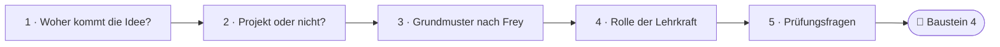
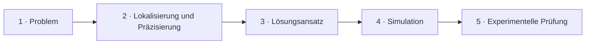
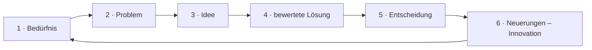
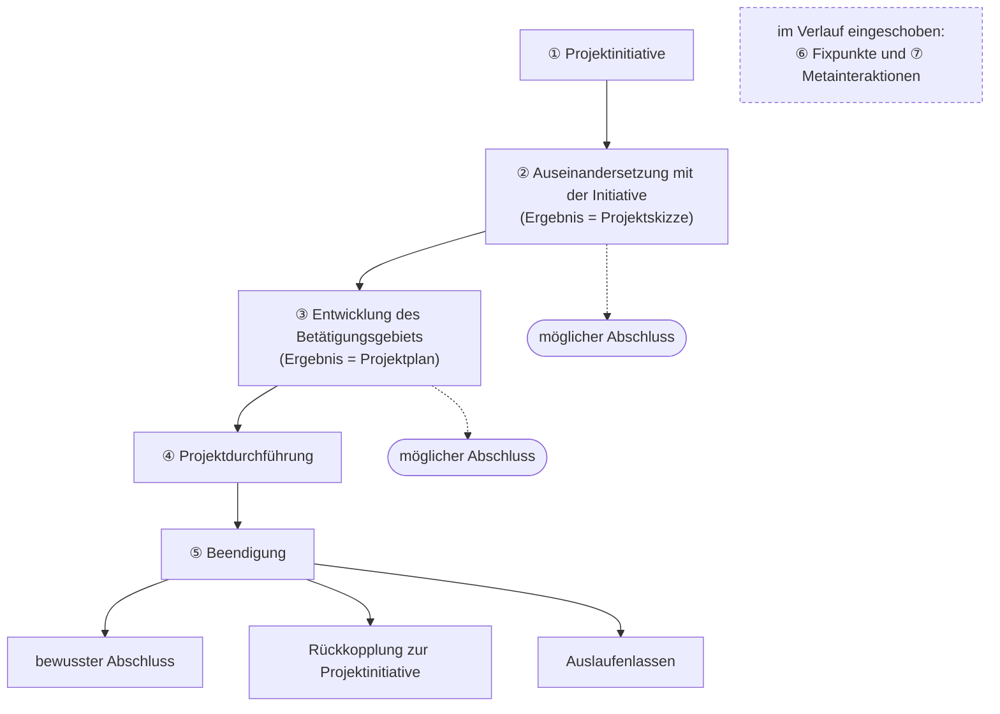

<!--
author:   Hannes Tegelbeckers
email:    hannes.tegelbeckers@ovgu.de
version:  0.3.0
language: de
narrator: Deutsch Female
mode:     Textbook
comment:  Fachdidaktik technischer Allgemeinbildung II – Selbstlerneinheit zu Sitzung S03. Studientext mit Übungen: Herkunft der Projektidee, Merkmale der Arbeit an Projekten, Problemarten, Grundmuster nach Frey und die Rolle der Lehrkraft.

import:   https://raw.githubusercontent.com/LiaTemplates/mermaid_template/0.1.4/README.md
-->

# S03 – Projektmethode (Selbstlerneinheit)

<!-- didaktik="Selbstlerneinheit S03 · ca. 90 min · Studientext + Übungen · Inhalte der Folien R054–R068, in eigenen Worten erläutert" -->
> [!IMPORTANT] 🧭 Leitfrage
> Wann ist ein Vorhaben ein Projekt im didaktischen Sinn – und wie plane ich es so, dass die Lernenden es tragen?

> [!NOTE] 📘 So ist diese Einheit aufgebaut
> Diese Einheit **erklärt die Inhalte der Sitzung S03** in eigenen Worten und mit Beispielen – Sie können sie auch bearbeiten, wenn Sie in der Sitzung nicht dabei waren. Die Originalfolien und Zitate im Wortlaut finden Sie in der [LiaScript-Sitzung S03](https://liascript.github.io/course/?https://raw.githubusercontent.com/OVGU-VET-TechEd/Fachdidaktik_technischer_Allgemeinbildung_II/main/S03_Projektmethode.md).

> [!TIP] ✍️ Übung in Moodle
> Bearbeiten Sie diese Einheit als Übung im Moodle-Kurs – dort wird Ihr Bearbeitungsstand gespeichert: [Übung in Moodle öffnen](https://elearning.ovgu.de/mod/scorm/view.php?id=707264)

**Ablauf (ca. 90 min)**

<!-- data-type="none" -->
| Schritt | Inhalt | Zeit |
| --- | --- | --- |
| 0 | Wo stehen Sie? | 3 min |
| 1 | Woher kommt die Projektidee? | 12 min |
| 2 | Projekt oder nicht? Die Merkmale und drei Vorhaben | 25 min |
| 3 | Das Grundmuster nach Frey | 20 min |
| 4 | Die Rolle der Lehrkraft | 20 min |
| 5 | Abschluss und Prüfungsfragen | 15 min |

## Ihr Lernweg in dieser Einheit

    --{{0}}--
Die Einheit führt von der Herkunft der Projektidee über die Merkmale eines Projekts und das Grundmuster nach Frey zur Rolle der Lehrkraft.

    --{{1}}--
Auf diesem Weg erreichen Sie sechs Ziele.

      {{1}}

<!-- data-type="none" -->
| Wissen | Können | Beurteilen |
|------|--------|-------|
| die Herkunft der Projektidee aus Arbeitsschule, Reformpädagogik und dem Projektunterricht nach Kilpatrick/Dewey **erläutern** | die Komponenten des Grundmusters nach Frey an einem neuen Beispiel **erkennen** | Vorhaben anhand der Merkmale der Arbeit an Projekten **beurteilen** |
| Fixpunkte und Metainteraktionen **unterscheiden** | Problemarten in einem technischen Projekt **identifizieren** und ihrem Prüfkriterium **zuordnen** | die Handlungsstruktur der Lehrkraft für ein eigenes Projekt **skizzieren** |

    --{{2}}--
Prüfen Sie kurz, ob Sie den Lernweg lesen können.

      {{2}}
****************************************

**Entscheiden:** Was kommt direkt nach „Projekt oder nicht?“

<!-- data-hint-button="1" data-solution-button="2" -->
- [(X)] Grundmuster nach Frey
- [( )] Rolle der Lehrkraft
- [( )] Woher kommt die Idee?
[[?]] Folgen Sie den Pfeilen von links nach rechts.
***
Richtig: Abschnitt 3 behandelt das Grundmuster nach Frey.
***

****************************************

## 0 · Wo stehen Sie?

    --{{0}}--
Eine These zum Start. Am Ende der Einheit stimmen Sie noch einmal ab.

> **„Wenn die Lehrkraft das Thema vorgibt, ist es kein Projekt.“**

**Abstimmen (vorher):** Stimmen Sie dieser These zu?

[(a)] Ja, ich stimme zu
[(b)] Nein, ich stimme nicht zu
[(c)] Teils, teils
[(unentschieden)] Unentschieden

    --{{1}}--
Denken Sie an ein Projekt, das Sie erlebt haben.

      {{1}}
****************************************

> [!TIP] 🧠 Ihr Projekt · 2 min
> Erinnern Sie sich an ein „Projekt“ aus Schule, Ausbildung oder Studium: Wer hatte die Idee, wer plante, was kam heraus?

[[___ ___ ___]]

****************************************

    --{{2}}--
Und schätzen Sie sich selbst ein.

      {{2}}
> [!TIP] 📌 Wie sicher fühlen Sie sich? (1–4)
> Notieren Sie je eine Zahl von 1 (gar nicht) bis 4 (sehr sicher): „Ich kann begründen, ob ein Vorhaben ein Projekt im didaktischen Sinn ist.“ – „Ich kann ein Projekt nach dem Grundmuster von Frey planen.“ Im Rückblick vergleichen Sie.

## 1 · Woher kommt die Projektidee?

    --{{0}}--
Projektunterricht ist keine Erfindung der letzten Jahre. Die Folien zeigen drei Wurzeln, die alle gegen eine Schule protestieren, in der Lernende nur zuhören und Wissen wiedergeben.

**Arbeitsschulkonzepte in Russland.** Sie sahen in **produktiver Betätigung** selbst ein bildendes Element: Wer etwas herstellt, lernt dabei. Bildung sollte sich an den **Realitäten der Gegenwart** orientieren statt an überliefertem Bildungsgut, und Kopf- und Handarbeit sollten einander **angenähert** werden.

**Reformpädagogen zu Beginn des 20. Jahrhunderts.** Sie forderten die **Selbsttätigkeit** der Schüler, konstruktive Betätigung, **Teilnahme an der Unterrichtsplanung** und produktorientierte Arbeit. Die Arbeitsschule war für sie das Beispiel einer praxisbezogenen Ausbildung.

**Projektunterricht der 60er und 70er Jahre.** Er griff diese Ideen wieder auf: das **Alltagsleben** stärker in die Bildung holen, Kopf- und Handarbeit wieder **vereinigen**, die Lernenden den Bildungsprozess **mitbestimmen und mitgestalten** lassen und **kollektiv** lernen.

    --{{1}}--
Ein roter Faden zieht sich durch alle drei Wurzeln.

      {{1}}
> [!NOTE] Kernaussage
> 🧵 „Kopf- und Handarbeit“ – vergleichen Sie mit S02: Handlungsorientierter Unterricht zielt auf die **Einheit kognitiver, emotionaler und psychomotorischer Lernprozesse**.

<small>Nach Folien R055–R057; Erläuterungen: eigene Darstellung.</small>

## Projektunterricht nach Kilpatrick und Dewey

    --{{0}}--
Kilpatrick und Dewey beschreiben den Ablauf eines Projekts als Problemlösung in fünf Schritten. Der Kern: Lernen wird durch ein echtes Problem ausgelöst, nicht durch einen Stoffplan. Das Wissen, das die Lernenden brauchen, ergibt sich aus dem Problem.

    --{{1}}--
Der Beginn.

      {{1}}
1. **Problem:** Beginn mit einem offensichtlichen Problem aus dem Lebensraum der Teilnehmenden – auf der Folie: „Woher kommt Typhus?“ Das Problem gibt das Bildungsziel vor.

    --{{2}}--
Dann die Präzisierung.

      {{2}}
2. **Lokalisierung und Präzisierung:** Was genau ist das Problem? Was wollen wir herausfinden?

    --{{3}}--
Dann der Plan.

      {{3}}
3. **Lösungsansatz:** Ein Plan zur Problemlösung, der die Zielrichtung schärft.

    --{{4}}--
Dann die Simulation.

      {{4}}
4. **Simulation:** Der Plan wird zuerst **gedanklich** durchgespielt.

    --{{5}}--
Und die Prüfung.

      {{5}}
5. **Experimentelle Prüfung:** Der Plan wird ausgeführt, ggf. arbeitsteilig; das Ergebnis wird praktisch umgesetzt und genutzt.

<small>Nach Folie R058 (vgl. Frey 1991); Kurzbezeichnungen der Schritte ergänzt.</small>

## Übung 1a: Reihenfolge nach Kilpatrick/Dewey

    --{{0}}--
Bringen Sie die Schritte in die richtige Reihenfolge.

**Ordnen:** Ziehen Sie jede Karte in die richtige Lücke.

<!-- data-randomize data-show-partial-solution data-solution-button="2" -->
Schritt 1: [->[ Problem ]] → Schritt 2: [->[ Lokalisierung und Präzisierung ]] → Schritt 3: [->[ Lösungsansatz ]] → Schritt 4: [->[ Simulation ]] → Schritt 5: [->[ Experimentelle Prüfung ]]

## Übung 1b: Wer wollte was?

    --{{0}}--
Welcher Kerngedanke gehört zu welchem Konzept?

**1 · Eine Antwort:** „Teilnahme an der Unterrichtsplanung“ – wer forderte das?

<!-- data-hint-button="1" data-solution-button="2" -->
- [( )] die Arbeitsschulkonzepte in Russland
- [(X)] die Reformpädagogen zu Beginn des 20. Jh.
- [( )] der Projektunterricht der 60er und 70er Jahre
[[?]] Selbsttätigkeit, konstruktive Betätigung, Teilnahme an der Planung …
***
Reformpädagogen (R056).
***

    --{{1}}--
Jetzt können mehrere Antworten richtig sein.

      {{1}}
****************************************

**2 · Alle zutreffenden:** Welche Kerngedanken stammen aus den **Arbeitsschulkonzepten in Russland**?

<!-- data-hint-button="1" data-solution-button="2" -->
- [[X]] produktive Betätigung als bildendes Element
- [[ ]] Kollektives Lernen
- [[X]] Bildung an Realitäten der Gegenwart
- [[ ]] Produktorientierte Arbeit
[[?]] Drei Merkmale auf R055.
***
Kollektives Lernen: Projektunterricht der 60er/70er Jahre (R057) · Produktorientierte Arbeit: Reformpädagogen (R056).
***

****************************************

    --{{2}}--
Zum Schluss eine Zahl.

      {{2}}
****************************************

**3 · Eintippen:** In wie vielen Schritten beschreibt R058 den Projektunterricht nach Kilpatrick/Dewey? (Zahl)

<!-- data-hint-button="1" data-solution-button="2" -->
[[5]]
[[?]] Vom Problem bis zur experimentellen Prüfung …

***
Fünf: Problem – Lokalisierung, Präzisierung – Lösungsansatz – Simulation – experimentelle Prüfung.
***

****************************************

## 2 · Projekt oder nicht? Die zehn Merkmale

    --{{0}}--
Nicht alles, was Projekt heißt, ist ein Projekt im didaktischen Sinn. Hortsch nennt zehn Merkmale der Arbeit an Projekten. Man kann sie in drei Gruppen lesen.

**A · Das Projekt selbst**

- **1 Es ist ein Projekt vorhanden.** Das ist die Existenzbedingung: Es gibt ein konkretes Vorhaben mit einem Ergebnis.
- **2 Die Arbeit weist Problemlösungsstrukturen auf.** Ein Projekt *hat* Probleme oder erzeugt sie unterwegs. Wo alles vorher feststeht, wird nichts gelöst.
- **3 Das Problem lässt mindestens zwei Lösungen zu.** Gibt es nur *eine* richtige Lösung, ist es eine Übungs- oder Fertigungsaufgabe – kein Projekt. Erst Alternativen erzwingen Entscheidungen.
- **10 Das Ergebnis hat einen Gebrauchswert** – objektiv oder subjektiv. Wichtig ist, dass etwas für die Lernenden **Bedeutsames** entsteht, nicht ein Werkstück für die Schublade.

    --{{1}}--
Dazu kommen Merkmale des Lernens und des Arbeitens.

      {{1}}
****************************************

**B · Wie gelernt wird**

- **4 Orientierung an Erfahrungen und Interessen der Lernenden.** Weil die Lerninhalte aus dem Projekt entstehen und von den Lernenden erarbeitet werden, müssen ihre Bedürfnisse im Mittelpunkt stehen.
- **5 Vollständige Lernhandlungen** – orientieren, planen, entscheiden, ausführen, kontrollieren (S02).
- **9 Selbstorganisation und Selbstverantwortung** prägen die Arbeit.

**C · Wie gearbeitet wird**

- **6 In größeren oder kleineren Gruppen, aber auch einzeln.**
- **7 Fach- und berufsfeldübergreifend** – echte Probleme halten sich nicht an Fächergrenzen. Angestrebt wird eine **Integration von Wissen, Können und Wollen**; angezielt werden Fach-, Sozial- und Methodenkompetenz.
- **8 Polyinstrumental und methodenpluralistisch** – viele Werkzeuge und Methoden kommen zum Einsatz (Recherche, Befragung, Versuch, Bau, Präsentation …).

****************************************

    --{{2}}--
Die häufigsten Stolpersteine sind Merkmal 3 und Merkmal 9.

      {{2}}
> [!NOTE] Kernaussage
> ⚠️ **Merkmal 3** (nur eine Lösung → kein Projekt) und **Merkmal 9** (Lehrkraft plant alles → kein Projekt). Eine Projektwoche, in der alle nach Plan dasselbe bauen, ist ein Werkstattkurs – sinnvoll, aber kein Projekt.

<small>Merkmale nach Hortsch (1999), Folien R059–R060; Gruppierung A–C als Lesehilfe für diese Einheit.</small>

## Übung 2a: Drei Vorhaben

    --{{0}}--
Beurteilen Sie drei Vorhaben mit den zehn Merkmalen.

**1 · Eine Antwort:** **Vorhaben A:** In der Projektwoche bauen alle Schülerinnen und Schüler nach Bauplan dasselbe Vogelhaus. – Wie ordnen Sie es ein?

<!-- data-hint-button="1" data-solution-button="2" -->
- [( )] Projekt
- [(X)] kein Projekt
- [( )] Grenzfall
[[?]] Wie viele Lösungen gibt es? Wer plant?
***
**A** hat eine Lösung (Bauplan) – Merkmal 3 fehlt, ebenso Selbstorganisation (9); es ist eine Fertigungsübung.
***

    --{{1}}--
Jetzt können mehrere Antworten richtig sein.

      {{1}}
****************************************

**2 · Alle zutreffenden:** **Vorhaben B:** Eine Berufsschulklasse Elektronik soll für den Schulgarten eine Bewässerung mit Feuchtesensor entwickeln. Die Klasse erkundet den Bedarf beim Hausmeister, vergleicht zwei Lösungsideen, plant in Gruppen und übergibt die Anlage. – Was trifft zu?

<!-- data-hint-button="1" data-solution-button="2" -->
- [[X]] Das Problem lässt mindestens zwei Lösungen zu (Merkmal 3).
- [[ ]] Die Lehrkraft plant die Arbeit vollständig vor.
- [[X]] Das Ergebnis hat einen Gebrauchswert (Merkmal 10).
- [[ ]] Es ist eine reine Fertigungsübung nach Plan.
[[?]] Gehen Sie die Merkmale 2, 3, 5, 9 und 10 durch.
***
**B** erfüllt fast alle Merkmale: echtes Problem, Alternativen, vollständige Handlung, Gebrauchswert – ein Projekt.
***

****************************************

    --{{2}}--
Zum Schluss der schwierige Fall.

      {{2}}
****************************************

**3 · Eintippen:** **Vorhaben C:** Die Lehrkraft gibt das Thema „Solarladestation für Handys“ vor. Die Lernenden entscheiden selbst über Bauform, Bauteile und Arbeitsteilung und präsentieren das Ergebnis am Tag der offenen Tür. – Projekt, kein Projekt oder Grenzfall? (ein Wort)

<!-- data-hint-button="1" data-solution-button="2" -->
[[Grenzfall]]
[[?]] Das Thema ist vorgegeben – die Lösungswege nicht.

***
**C** ist ein Grenzfall – und berührt die Eingangsthese: Das Thema ist vorgegeben (Initiative bei der Lehrkraft), aber Lösungswege, Organisation und Gebrauchswert liegen bei den Lernenden. Ob es ein Projekt ist, hängt davon ab, wie viel Mitbestimmung in Skizze und Plan (Grundmuster ② und ③) tatsächlich möglich ist.
***

****************************************

## Ihr Urteil zu Vorhaben C

    --{{0}}--
Bleiben Sie beim Grenzfall.

**Ihr Urteil zu Vorhaben C in zwei Sätzen:** Was müsste sich ändern, damit es eindeutig ein Projekt wird?

[[___ ___ ___ ___]]

💡 Hinweis

Denken Sie an die Merkmale 2, 4 und 9 – und daran, wer die Initiative hat.

✅ Lösung

Die Lernenden müssten die Initiative mittragen: z. B. selbst erkunden, wo in der Schule Ladebedarf besteht, und das Thema mit der Lehrkraft aushandeln. Außerdem sollten Skizze und Plan gemeinsam entstehen und das Ergebnis einen echten Nutzen haben – etwa eine dauerhaft genutzte Ladestation im Pausenbereich.

## Kreislauf der Innovation

    --{{0}}--
Projekte lösen Probleme – aber wo kommen die Probleme her, und was passiert nach der Lösung? Folie R063 zeigt dazu einen Kreislauf. Im Wortlaut der Folie: „Die Innovation ist nur das vorläufige Ende der erfolgreichen Problemlösung. In unserem fortlaufenden Bemühen um die Verbesserung der Gesamtsituation durchlaufen wir immer wieder einen Kreislauf.“

    --{{1}}--
Am Anfang steht ein Bedürfnis – in der Schule, im Haushalt, am Arbeitsplatz, in Unternehmen, Behörde oder Staat.

      {{1}}
1. **Bedürfnis:** entsteht in Schule, Haushalt, Arbeitsplatz: Unternehmen, Behörde, Staat

    --{{2}}--
Wird das Bedürfnis nicht von selbst erfüllt, entsteht ein Problem – der Ausgangspunkt jedes Projekts.

      {{2}}
2. **Problem:** Aus dem Bedürfnis wird ein Problem.

    --{{3}}--
Zum Problem entwickeln die Beteiligten eine Idee.

      {{3}}
3. **Idee:** Zum Problem entsteht eine Idee.

    --{{4}}--
Aus der Idee wird eine Lösung, die bewertet wird – mit den Prüfkriterien der Problemarten auf der nächsten Seite.

      {{4}}
4. **bewertete Lösung:** Aus der Idee wird eine Lösung, die bewertet wird.

    --{{5}}--
Unter mehreren bewerteten Lösungen wird entschieden – Merkmal 3 der Arbeit an Projekten verlangt, dass es mindestens zwei gibt.

      {{5}}
5. **Entscheidung:** Für eine Lösung wird entschieden.

    --{{6}}--
Die Neuerung wirkt in Schule, Haushalt, Unternehmen oder Staat zurück – und erzeugt dort neue Bedürfnisse. Im Schulgarten-Beispiel: Die Bewässerung läuft, nun möchte der Hausmeister den Wasserverbrauch sehen.

      {{6}}
6. **Neuerungen – Innovation:** Neuerungen wirken zurück in Schule, Haushalt, Arbeitsplatz: Unternehmen, Behörde, Staat.

<small>Nach Folie R063 „Kreislauf der Innovation“ – gescannte Abbildung als Kreislauf nachgezeichnet; auf der Originalfolie ist keine Quelle der Abbildung angegeben. Schulgarten-Beispiel: eigene Darstellung.</small>

## Kurz geordnet: der Kreislauf der Innovation

    --{{0}}--
Bringen Sie die Stationen des Kreislaufs in die richtige Reihenfolge – beginnend mit dem Bedürfnis.

**Ordnen:** Ziehen Sie jede Karte in die richtige Lücke.

<!-- data-randomize data-show-partial-solution data-solution-button="2" -->
Schritt 1: [->[ Bedürfnis ]] → Schritt 2: [->[ Problem ]] → Schritt 3: [->[ Idee ]] → Schritt 4: [->[ bewertete Lösung ]] → Schritt 5: [->[ Entscheidung ]] → Schritt 6: [->[ Neuerungen – Innovation ]]

## Problemarten – und woran man ihre Lösung prüft

    --{{0}}--
In Projekten tauchen verschiedene Arten von Problemen auf. Jede Art hat ein eigenes Prüfkriterium – woran man erkennt, ob die Lösung gut ist.

- **Erkenntnisproblem** – *Wie ist es?* Gesucht ist Wissen über einen Zusammenhang. Geprüft wird die **Wahrheit**.
- **Gestaltungsproblem** – *Wie bauen wir es?* Gesucht ist ein funktionierendes technisches Gebilde. Geprüft wird die **Tauglichkeit**.
- **Wertungsproblem** – *Was ist besser?* Gesucht ist eine begründete Entscheidung zwischen Alternativen. Geprüft wird die **Zweckmäßigkeit**.
- **Ausdruckproblem** – *Wie zeigen wir es?* Gesucht ist eine Darstellung für andere. Geprüft wird die **Verständlichkeit**.

    --{{1}}--
Das passt zu S01: Naturwissenschaften fragen nach Wahrheit, Technikwissenschaften nach Richtigkeit und Zweckmäßigkeit.

      {{1}}
> [!NOTE] Kernaussage
> Ein technisches Projekt enthält meist **alle vier** Problemarten.

<small>Problemarten und Prüfkriterien nach Folie R064; Leitfragen in Kursiv als Lesehilfe.</small>

## Übung 2b: Welche Problemarten stecken in Vorhaben B?

    --{{0}}--
Vorhaben B ist die Bewässerung für den Schulgarten.

**1 · Eine Antwort:** „Wie hängt der Messwert des Sensors mit der Bodenfeuchte zusammen?“ – welche Problemart?

<!-- data-hint-button="1" data-solution-button="2" -->
- [( )] Gestaltungsproblem
- [(X)] Erkenntnisproblem
- [( )] Ausdruckproblem
[[?]] Wie ist es?
***
Erkenntnisproblem – geprüft wird die Wahrheit (R064).
***

    --{{1}}--
Jetzt können mehrere Antworten richtig sein.

      {{1}}
****************************************

**2 · Alle zutreffenden:** Welche Zuordnungen stimmen?

<!-- data-hint-button="1" data-solution-button="2" -->
- [[X]] „Funktioniert die Steuerung zuverlässig?“ – Gestaltungsproblem
- [[ ]] „Ist Lösung 1 oder Lösung 2 für den Schulgarten sinnvoller?“ – Erkenntnisproblem
- [[X]] „Versteht der Hausmeister die Bedienungsanleitung?“ – Ausdruckproblem
- [[ ]] „Wie hängt der Messwert des Sensors mit der Bodenfeuchte zusammen?“ – Wertungsproblem
[[?]] Wie bauen wir es? Was ist besser? Wie zeigen wir es?
***
Ein technisches Projekt enthält typischerweise alle vier Problemarten. Gestaltungs- und Wertungsproblem entsprechen dem, was S01 für die Technikwissenschaften festhielt: Richtigkeit (Realisierbarkeit) und Zweckmäßigkeit.
***

****************************************

    --{{2}}--
Zum Schluss ein Kriterium.

      {{2}}
****************************************

**3 · Eintippen:** „Ist Lösung 1 oder Lösung 2 für den Schulgarten sinnvoller?“ – Woran wird die Lösung geprüft? (ein Wort)

<!-- data-hint-button="1" data-solution-button="2" -->
[[Zweckmäßigkeit]]
[[?]] Wertungsproblem …

***
Wertungsproblem – Zweckmäßigkeit (R064).
***

****************************************

## 3 · Das Grundmuster nach Frey

    --{{0}}--
Karl Frey beschreibt den Ablauf eines Projekts als Grundmuster aus sieben Komponenten. Es ist kein starres Schema, sondern zeigt, welche Phasen ein Projekt typischerweise durchläuft – und an welchen Stellen es auch enden darf.

    --{{1}}--
Wenn sich in der Auseinandersetzung zeigt, dass die Initiative nicht trägt, darf das Projekt dort enden. Auch das ist ein Lernergebnis.

      {{1}}
**① Möglicher Abschluss:** Nach ② und ③ ist ein **Abschluss möglich**.

    --{{2}}--
Beendet wird auf drei Wegen.

      {{2}}
**② Beendigung:** bewusster Abschluss (z. B. Präsentation), Rückkopplung zur Initiative (Was wollten wir – was haben wir erreicht?) oder Auslaufenlassen

    --{{3}}--
Und quer dazu:

      {{3}}
**③ Fixpunkte und Metainteraktionen:** ⑥ und ⑦ sind keine Phasen, sondern werden **jederzeit eingeschoben**.

    --{{4}}--
Sie sichern die Selbststeuerung.

      {{4}}
> [!NOTE] Kernaussage
> ⑥ und ⑦ sichern, dass die Lernenden ihr Projekt **selbst steuern** können.

<small>Nach Frey (1991), Folie R061; Grafik vereinfacht nachgezeichnet (Wortlaut in der LiaScript-Sitzung S03).</small>

## 3.1 Die sieben Komponenten

    --{{0}}--
Die Komponenten im Einzelnen – was geschieht, und was kommt dabei heraus?

<!-- data-type="none" -->
| Komponente | Was geschieht? | Ergebnis |
| --- | --- | --- |
| **① Projektinitiative** | Ein Anlass, eine Idee, ein Problem wird eingebracht – von Lernenden, Lehrkraft oder von außen. | ein Vorschlag |
| **② Auseinandersetzung mit der Initiative** | In einem vorher vereinbarten Rahmen prüfen die Beteiligten: Wollen wir das? Was genau soll entstehen? | **Projektskizze** (Produkt, Fragestellungen, Arbeitsmethoden) |
| **③ Entwicklung des Betätigungsgebiets** | Gemeinsam wird geplant, wer was wann tut. | **Projektplan** (Gruppen, Aufgaben, Zeitplan) |
| **④ Projektdurchführung** | Die Aktivitäten im Betätigungsgebiet – einzeln, in Untergruppen oder in der ganzen Gruppe. | das Produkt |
| **⑤ Beendigung** | auf drei Wegen: **bewusster Abschluss**, **Rückkopplung zur Initiative** oder **Auslaufenlassen** | |
| **⑥ Fixpunkte** | im Verlauf eingeschobene **organisatorische Haltepunkte**: Wo steht jede Gruppe, was ist der nächste Schritt? | Abstimmung |
| **⑦ Metainteraktionen** | eingeschobene **Gespräche über das Projekt selbst**: Wie arbeiten wir zusammen? Was läuft schief? | Reflexion |

    --{{1}}--
Der Unterschied zwischen sechs und sieben wird oft verwechselt.

      {{1}}
> [!NOTE] Kernaussage
> **Fixpunkte** organisieren das Projekt, **Metainteraktionen** reflektieren die Zusammenarbeit.

<small>Nach Frey (1991), Folie R061; Erläuterungen: eigene Darstellung.</small>

## Kurz geprüft: das Grundmuster

    --{{0}}--
Drei kurze Fragen zum Grundmuster nach Frey.

**1 · Eine Antwort:** Was ist das Ergebnis von Komponente ②?

<!-- data-hint-button="1" data-solution-button="2" -->
- [( )] der Projektplan
- [(X)] die Projektskizze
- [( )] die Projektinitiative
[[?]] Produkt, Fragestellungen, Arbeitsmethoden …
***
② → Projektskizze · ③ → Projektplan (R061).
***

    --{{1}}--
Jetzt können mehrere Antworten richtig sein.

      {{1}}
****************************************

**2 · Alle zutreffenden:** Auf welchen Wegen kann ein Projekt nach Frey beendet werden?

<!-- data-hint-button="1" data-solution-button="2" -->
- [[X]] durch Rückkoppeln zur Projektinitiative
- [[ ]] erst durch die Bewertung des Produkts durch die Lehrkraft
- [[X]] durch Auslaufenlassen
- [[ ]] ausschließlich nach der Projektdurchführung ④
[[?]] Frey nennt bei ⑤ drei Wege – und gestrichelte Abschlüsse vorher.
***
Frey nennt drei Wege der Beendigung ⑤: bewusster Abschluss (1), Rückkopplung zur Projektinitiative (2) oder Auslaufenlassen (3). Ein Abschluss ist außerdem schon nach ② und ③ möglich (R061).
***

****************************************

    --{{2}}--
Zum Schluss ein Begriff.

      {{2}}
****************************************

**3 · Eintippen:** Wie heißt das Ergebnis von Komponente ③? (ein Wort)

<!-- data-hint-button="1" data-solution-button="2" -->
[[Projektplan]]
[[?]] Gruppen, Aufgaben, Zeitplan …

***
Projektplan: Gemeinsam wird geplant, wer was wann tut.
***

****************************************

## 3.2 Das Beispiel „Abriss eines alten Hauses“

    --{{0}}--
Die Folien zeigen ein Projekt aus der Bautechnik.

- **Hauptziel:** Die Auszubildenden lernen am Abriss eines nicht sanierungswürdigen Hauses die Möglichkeiten der **Wiederverwendung alter Baustoffe** kennen. Teilziele reichen von Abrissverfahren über Aufbereitungsanlagen bis zu Kooperation und Präsentation.
- **Projektskizze (②):** Produkt ist eine Präsentation über den Weg vom Abriss bis zur Wiederverwendung. Fragestellungen: Wie entsteht Baumüll? Welche Baustoffe stecken in einem alten Haus? Wie werden sie aufbereitet, wo eingesetzt? Methoden: Literaturstudium, Befragungen im Bauamt und in Baufirmen, Schautafel.

    --{{1}}--
Der Projektplan verteilt die Arbeit.

      {{1}}
****************************************

- **Projektplan (③):** Fünf Gruppen mit je einer Frage (Gründe für den Abriss · Abrissverfahren · Baustoffe im Haus · Aufbereitung · Einsatz) und ein Zeitplan über vier Tage – vom Planen über Befragungen und Untersuchungen bis zur Präsentation.

****************************************

    --{{2}}--
Beachten Sie, was fehlt.

      {{2}}
> [!NOTE] Kernaussage
> Die **Projektinitiative (①)** wird im Beispiel nicht beschrieben. Ob sie von den Auszubildenden kam, entscheidet mit darüber, wie viel Selbstbestimmung das Projekt wirklich hatte.

<small>Nach Folien R065–R068.</small>

## Übung 3a: Ereignisse aus Vorhaben B zuordnen

    --{{0}}--
Ordnen Sie die Ereignisse aus Vorhaben B, der Bewässerung für den Schulgarten, den Komponenten zu.

**1 · Eine Antwort:** „Der Hausmeister klagt, dass die Beete im Sommer vertrocknen.“ – welche Komponente?

<!-- data-hint-button="1" data-solution-button="2" -->
- [( )] ② Projektskizze
- [(X)] ① Projektinitiative
- [( )] ④ Durchführung
[[?]] Ein Anlass wird eingebracht …
***
① Projektinitiative: ein Anlass von außen.
***

    --{{1}}--
Jetzt können mehrere Antworten richtig sein.

      {{1}}
****************************************

**2 · Alle zutreffenden:** Welche Zuordnungen stimmen?

<!-- data-hint-button="1" data-solution-button="2" -->
- [[X]] „Gruppen, Aufgaben und Zeitplan werden festgelegt.“ – ③ Projektplan
- [[ ]] „Die Klasse einigt sich auf Ziel, Produkt und Fragestellungen.“ – ③ Projektplan
- [[X]] „Kurzer Stand der Gruppen jeden Morgen.“ – ⑥ Fixpunkt
- [[ ]] „Übergabe der Anlage an den Hausmeister.“ – ④ Durchführung
[[?]] Ziel, Produkt und Fragestellungen gehören zur Skizze; die Übergabe beendet das Projekt.
***
② Projektskizze: Ziel, Produkt, Fragestellungen · ③ Projektplan: Gruppen, Aufgaben, Zeitplan · ④ Durchführung: Sensor testen, Steuerung programmieren, Anlage aufbauen · ⑤ Beendigung: Übergabe · ⑥ Fixpunkt: kurzer Stand jeden Morgen.
***

****************************************

    --{{2}}--
Zum Schluss ein Begriff.

      {{2}}
****************************************

**3 · Eintippen:** „Gespräch darüber, warum die Zusammenarbeit in Gruppe 2 stockt.“ – welche Komponente? (ein Wort, Einzahl)

<!-- data-hint-button="1" data-solution-button="2" -->
[[Metainteraktion]]
[[?]] Ein Gespräch über das Projekt selbst …

***
⑦ Metainteraktion: Gespräch über das Projekt und die Zusammenarbeit selbst.
***

****************************************

## Übung 3b: Fixpunkt oder Metainteraktion?

    --{{0}}--
Erklären Sie den Unterschied.

Erklären Sie den Unterschied zwischen **Fixpunkt** und **Metainteraktion** in eigenen Worten.

[[___ ___ ___ ___]]

💡 Hinweis

Was wird besprochen – der Stand der Arbeit oder die Art, wie zusammengearbeitet wird?

✅ Lösung

**Fixpunkte** sind eingeschobene Haltepunkte zur Organisation: Wo stehen wir, was ist der nächste Schritt? **Metainteraktionen** sind Gespräche über das Projekt und die Zusammenarbeit selbst – eine Reflexion auf der Ebene darüber. In S03 waren die Beuteblatt-Stopps Fixpunkte, die Schlussrunde eine Metainteraktion.

## 4 · Die Rolle der Lehrkraft

    --{{0}}--
Wenn die Lernenden ihr Projekt selbst steuern – hat die Lehrkraft dann nichts zu tun? Im Gegenteil. Hortsch beschreibt eine Handlungsstruktur des Lehrers mit zwölf Schritten. Vor dem Projekt erkundet sie die Interessen der Lernenden, bestimmt geeignete Projekte und prüft, ob sie sich realisieren lassen. Sie erarbeitet selbst verschiedene Lösungsmöglichkeiten – nicht, um sie vorzugeben, sondern um die typischen Vorschläge der Lernenden schon vorher durchdacht zu haben. Während des Projekts lässt sie die Planung von den Lernenden erarbeiten, moderiert den Plan, schafft Bedingungen wie Räume, Material und Kontakte zu Betrieben und moderiert die Realisierung. Am Ende lässt sie einen Bericht erstellen und die Bewertung von den Lernenden vornehmen; danach wird über eine mögliche Fortführung entschieden.

<!-- data-type="none" -->
| Phase | Schritte | Kernidee |
| --- | --- | --- |
| **Vorbereiten** | 1–4: geeignete Projekte bestimmen, Realisierbarkeit prüfen, Lösungsmöglichkeiten erarbeiten, Varianten vergleichen | Interessen der Lernenden erkunden; typische Vorschläge vorher durchdenken |
| **Moderieren** | 5–9: Planung erarbeiten lassen, Plan moderieren, Organisationsformen entwickeln, Bedingungen schaffen, Realisierung moderieren | Die Ausführung geht auf die Lernenden über |
| **Abschließen** | 10–12: Bericht erstellen lassen, Bewertung vornehmen lassen, über Fortführung entscheiden | Bewertung durch die Lernenden selbst (mehr dazu in S04) |

    --{{1}}--
Der Kern:

      {{1}}
> [!NOTE] Kernaussage
> Die Lehrkraft arbeitet viel **vor** dem Projekt und **moderiert** es dann, statt es zu steuern: Sie orientiert, reguliert phasenweise und kontrolliert gegebenenfalls.

<small>Nach Hortsch (2001), Folie R062; Gliederung in drei Phasen als Lesehilfe.</small>

## Ihr Projekt: Was tun Sie vorher?

    --{{0}}--
Planen Sie für ein Projekt Ihrer Fachrichtung.

**Planen Sie für ein Projekt Ihrer Fachrichtung:** Was tun Sie *vor* dem Projekt, damit es gelingt – und was tun Sie bewusst *nicht*, damit es ein Projekt bleibt?

[[___ ___ ___ ___]]

💡 Hinweis

Gehen Sie die Schritte 1–4 der Handlungsstruktur durch – und Schritt 5: Wer erarbeitet die Planung?

✅ Lösung

Beispiel Bewässerung im Schulgarten. **Vorher:** Interessen der Klasse erkunden, mit dem Hausmeister klären, ob das Vorhaben realisierbar ist, selbst zwei Lösungen durchspielen (Tropfschlauch oder Sprühnebel), Material und Budget klären, typische Vorschläge der Lernenden durchdenken. **Bewusst nicht:** die Lösung vorgeben, den Projektplan selbst schreiben, die Gruppen vorab einteilen.

## Übung 4: Passt das zur Handlungsstruktur?

    --{{0}}--
Drei kurze Fragen zur Rolle der Lehrkraft.

**1 · Eine Antwort:** Welche Lehrerhandlung **widerspricht** der Handlungsstruktur?

<!-- data-hint-button="1" data-solution-button="2" -->
- [( )] Vor Projektbeginn mögliche Lösungen selbst durchdenken
- [(X)] Den Projektplan selbst schreiben und an die Gruppen verteilen
- [( )] Bedingungen für die Realisierung schaffen, z. B. Termine mit Betrieben
[[?]] Schritt 5 lautet: „Planung durch Lernende erarbeiten lassen (Projektplan)“.
***
Die Lehrkraft moderiert den Plan (Schritt 6), schreibt ihn aber nicht selbst. Vorher durchdenken (Schritt 3–4) und Bedingungen schaffen (Schritt 8) gehören ausdrücklich zu ihren Aufgaben.
***

    --{{1}}--
Jetzt können mehrere Antworten richtig sein.

      {{1}}
****************************************

**2 · Alle zutreffenden:** Was gehört zur Phase **Vorbereiten** (Schritte 1–4)?

<!-- data-hint-button="1" data-solution-button="2" -->
- [[X]] geeignete Projekte bestimmen
- [[ ]] Realisierung moderieren
- [[X]] Varianten vergleichen
- [[ ]] Bericht erstellen lassen
[[?]] Was geschieht, bevor die Lernenden planen?
***
Realisierung moderieren: Schritt 9 · Bericht erstellen lassen: Schritt 10 (R062).
***

****************************************

    --{{2}}--
Zum Schluss eine Zahl.

      {{2}}
****************************************

**3 · Eintippen:** Aus wie vielen Schritten besteht die Handlungsstruktur des Lehrers nach Hortsch? (Zahl)

<!-- data-hint-button="1" data-solution-button="2" -->
[[12]]
[[?]] Von „Bestimmen von geeigneten Projekten“ bis „Entscheidung über Fortführung“ …

***
Zwölf Schritte (R062).
***

****************************************

## 5 · Noch einmal: Thema vorgegeben = kein Projekt?

    --{{0}}--
Zum Schluss noch einmal die These vom Anfang.

**Abstimmen (nachher):** Stimmen Sie der These „Wenn die Lehrkraft das Thema vorgibt, ist es kein Projekt.“ zu?

[(a)] Ja, ich stimme zu
[(b)] Nein, ich stimme nicht zu
[(c)] Teils, teils
[(unentschieden)] Unentschieden

    --{{1}}--
Was ist Ihnen am unklarsten geblieben?

      {{1}}
****************************************

**Nachdenken:** Muddiest point: Was ist Ihnen am unklarsten geblieben?

[[___ ___]]

****************************************

    --{{2}}--
Eine Einordnung:

      {{2}}
> [!NOTE] Kernaussage
> Auch wenn die Lehrkraft das Thema vorgibt, kann ein Projekt entstehen – wenn die Lernenden Problem, Lösungsweg und Plan mitbestimmen (Merkmale 2–4 und 9; Vorhaben C). Entscheidend ist nicht, wer das Thema nennt, sondern wer plant und entscheidet.

## Das Wichtigste aus S03

    --{{0}}--
Fassen wir zusammen.

    --{{1}}--
Erstens: die Wurzeln.

      {{1}}
- Arbeitsschule, Reformpädagogik, 60er/70er Jahre und Kilpatrick/Dewey: Lernen wird durch ein echtes Problem ausgelöst.

    --{{2}}--
Zweitens: die Merkmale.

      {{2}}
- Zehn Merkmale nach Hortsch – die häufigsten Stolpersteine sind Merkmal 3 (nur eine Lösung) und Merkmal 9 (Lehrkraft plant alles).

    --{{3}}--
Drittens: das Grundmuster.

      {{3}}
- Initiative → Skizze → Plan → Durchführung → Beendigung, mit Fixpunkten und Metainteraktionen (Frey).

    --{{4}}--
Und viertens: die Lehrkraft.

      {{4}}
****************************************

- Vorbereiten – moderieren – abschließen: viel Arbeit vor dem Projekt, dann moderieren statt steuern (Hortsch).

> [!NOTE] Zum Merken
> Ein Projekt beginnt mit einem echten Problem – und die Lernenden planen mit.

****************************************

    --{{5}}--
Eine letzte Frage.

      {{5}}
****************************************

**Wiederholen:** Woran scheitert eine Projektwoche mit fertigem Bauplan am ehesten als Projekt im didaktischen Sinn?

<!-- data-hint-button="1" data-solution-button="2" -->
- [( )] am fehlenden Gebrauchswert
- [( )] an der Gruppenarbeit
- [(X)] daran, dass das Problem nur eine Lösung zulässt und die Lernenden nicht selbst planen
[[?]] Merkmale 3 und 9 …
***
Richtig: Ein Projekt braucht mindestens zwei Lösungen (Merkmal 3) und Selbstorganisation (Merkmal 9).
***

****************************************

    --{{6}}--
Als Nächstes geht es um Kontrolle und Bewertung in Projekten, die Fallstudie und das Rollenspiel.

      {{6}}
**➡️ Als Nächstes:** S04: Kontrolle & Bewertung · Fallstudie · Rollenspiel · 🧩 Optional für die Selbstlernsitzung am 11.01.2027: Ihre Planung aus Abschnitt 4 ergänzt Baustein 4 (Projekt-Grundmuster).

## Prüfungsfragen zum Üben

    --{{0}}--
Die Prüfungsleistung des Moduls ist eine mündliche Prüfung. Mit diesen fünf Fragen üben Sie, die Inhalte dieser Einheit frei, strukturiert und mit Beispielen zu erklären.

> [!TIP] 🎙️ So üben Sie
> Lesen Sie eine Frage und antworten Sie **laut** in höchstens drei Minuten – nach dem Muster **Begriff – Erläutern – Beispiel – Verbinden**. Öffnen Sie erst danach die Antwortskizze und vergleichen Sie: Was fehlte, was war ungenau? Noch besser: Lassen Sie sich von einer Kommilitonin oder einem Kommilitonen abfragen.

**Frage 1 · Wurzeln der Projektidee:** Welche Kerngedanken verbinden Arbeitsschule, Reformpädagogik und den Projektunterricht der 60er/70er Jahre?

✅ Antwortskizze 1

- **1 Begriff:** Drei Wurzeln der Projektidee (R055–R057): **Arbeitsschulkonzepte in Russland**, **Reformpädagogen** zu Beginn des 20. Jahrhunderts, **Projektunterricht** der 60er und 70er Jahre; dazu der Projektunterricht nach **Kilpatrick und Dewey** (R058).
- **2 Erläutern:** Arbeitsschule: produktive Betätigung als bildendes Element, Bildung an Realitäten der Gegenwart, Kopf- und Handarbeit annähern. Reformpädagogen: Selbsttätigkeit, konstruktive Betätigung, Teilnahme an der Unterrichtsplanung, produktorientierte Arbeit. 60er/70er: Alltagsleben in die Bildung, Kopf- und Handarbeit vereinigen, mitbestimmen und mitgestalten, kollektiv lernen. Gemeinsam: Protest gegen eine Schule des bloßen Zuhörens.
- **3 Beispiel:** Kilpatrick/Dewey in fünf Schritten: Problem („Woher kommt Typhus?“) – Lokalisierung und Präzisierung – Lösungsansatz – Simulation – experimentelle Prüfung.
- **4 Verbinden:** Der rote Faden „Kopf- und Handarbeit“ entspricht der Einheit kognitiver, emotionaler und psychomotorischer Lernprozesse im handlungsorientierten Unterricht (S02).

**Frage 2 · Grundmuster nach Frey:** Erläutern Sie das Grundmuster der Projektmethode nach Frey. Welche Rolle spielen Fixpunkte und Metainteraktionen?

✅ Antwortskizze 2

- **1 Begriff:** Frey (1991) beschreibt Projekte mit einem **Grundmuster aus sieben Komponenten** – kein starres Schema (R061).
- **2 Erläutern:** ① Projektinitiative – ② Auseinandersetzung mit der Initiative (Ergebnis: **Projektskizze**) – ③ Entwicklung des Betätigungsgebiets (Ergebnis: **Projektplan**) – ④ Projektdurchführung – ⑤ Beendigung (bewusster Abschluss, Rückkopplung zur Initiative oder Auslaufenlassen). Nach ② und ③ ist ein Abschluss möglich. ⑥ **Fixpunkte** sind organisatorische Haltepunkte, ⑦ **Metainteraktionen** Gespräche über die Zusammenarbeit – beide werden jederzeit eingeschoben.
- **3 Beispiel:** „Abriss eines alten Hauses“: Skizze mit Produkt Präsentation und Fragen (Wie entsteht Baumüll? …), Plan mit fünf Gruppen und vier Tagen (R065–R068).
- **4 Verbinden:** Fixpunkte und Metainteraktionen sichern die **Selbststeuerung** der Lernenden – Merkmal 9 der Arbeit an Projekten. Bewertung im Projekt: S04.

**Frage 3 · Projekt oder nicht?:** Woran erkennen Sie, ob eine Projektwoche ein Projekt im didaktischen Sinn ist?

✅ Antwortskizze 3

- **1 Begriff:** An den **Merkmalen der Arbeit an Projekten** nach Hortsch (R059–R060).
- **2 Erläutern:** U. a. ein Projekt ist vorhanden; die Arbeit hat Problemlösungsstrukturen; das Problem lässt **mindestens zwei Lösungen** zu; Orientierung an Erfahrungen und Interessen der Lernenden; vollständige Lernhandlungen; Gruppen- oder Einzelarbeit; fach- und berufsfeldübergreifend; polyinstrumental und methodenpluralistisch; **Selbstorganisation und Selbstverantwortung**; das Ergebnis hat einen **Gebrauchswert**.
- **3 Beispiel:** Alle bauen nach Bauplan dasselbe Vogelhaus → kein Projekt (nur eine Lösung, keine Selbstorganisation). Bewässerung für den Schulgarten mit Bedarfserkundung, zwei Lösungsideen und Übergabe → Projekt. Vorgegebenes Thema „Solarladestation“ mit freier Lösung → Grenzfall.
- **4 Verbinden:** Die häufigsten Stolpersteine sind Merkmal 3 und 9. Ob die Initiative bei den Lernenden liegt, entscheidet über die Selbstbestimmung (Grundmuster ①–③).

**Frage 4 · Rolle der Lehrkraft:** Beschreiben Sie die Rolle der Lehrkraft bei der Arbeit an Projekten.

✅ Antwortskizze 4

- **1 Begriff:** Hortsch (2001) beschreibt eine **Handlungsstruktur des Lehrers** in zwölf Schritten (R062).
- **2 Erläutern:** **Vorbereiten** (1–4): geeignete Projekte bestimmen, Realisierbarkeit prüfen, Lösungsmöglichkeiten selbst erarbeiten und vergleichen – um typische Vorschläge vorher durchdacht zu haben. **Moderieren** (5–9): Planung erarbeiten lassen, Plan moderieren, Organisationsformen entwickeln, Bedingungen schaffen (Räume, Material, Betriebskontakte), Realisierung moderieren. **Abschließen** (10–12): Bericht erstellen lassen, Bewertung vornehmen lassen, über Fortführung entscheiden.
- **3 Beispiel:** Schulgarten-Bewässerung: Die Lehrkraft prüft vorher, ob Sensoren beschaffbar sind, und stellt den Kontakt zum Hausmeister her – geplant wird von der Klasse.
- **4 Verbinden:** Viel Arbeit **vor** dem Projekt, dann moderieren statt steuern. Bewertung durch die Lernenden selbst: S04 (Selbst- → gegenseitige → Lehrendeneinschätzung).

**Frage 5 · Problemarten:** Ordnen Sie die Problemarten ihrem Prüfkriterium zu und erläutern Sie den Bezug zur Besonderheit der Technikwissenschaften (S01).

✅ Antwortskizze 5

- **1 Begriff:** In Projekten treten vier **Problemarten** auf, jede mit eigenem Prüfkriterium (R064).
- **2 Erläutern:** **Erkenntnisproblem** – Wahrheit; **Gestaltungsproblem** – Tauglichkeit; **Wertungsproblem** – Zweckmäßigkeit; **Ausdruckproblem** – Verständlichkeit. Ein technisches Projekt enthält meist alle vier.
- **3 Beispiel:** Bewässerung: Wie hängt der Sensorwert mit der Bodenfeuchte zusammen? (Erkenntnis) · Funktioniert die Steuerung zuverlässig? (Gestaltung) · Lösung 1 oder 2? (Wertung) · Versteht der Hausmeister die Anleitung? (Ausdruck).
- **4 Verbinden:** S01: Naturwissenschaften fragen nach **Wahrheit**, Technikwissenschaften nach **Richtigkeit und Zweckmäßigkeit** – Gestaltungs- und Wertungsproblem sind die typisch technischen. Der Kreislauf der Innovation (R063) zeigt, dass jede Lösung neue Bedürfnisse erzeugt.

    --{{1}}--
Schätzen Sie zum Schluss ein, wie sicher Sie sind. Wiederholen Sie die unsicheren Fragen in einigen Tagen – und üben Sie fächerübergreifend mit dem Prüfungstrainer.

      {{1}}
****************************************

**Einschätzen:** Wie sicher beantworten Sie die Fragen frei und in ganzen Sätzen?

[(sicher)(teilweise)(noch unsicher)]
[                                    ] Frage 1 · Wurzeln der Projektidee
[                                    ] Frage 2 · Grundmuster nach Frey
[                                    ] Frage 3 · Projekt oder nicht?
[                                    ] Frage 4 · Rolle der Lehrkraft
[                                    ] Frage 5 · Problemarten

<small>Die Prüfungsfragen sind experimentell: Sie dienen der Vorbereitung, es ist nicht garantiert, dass Fragen in dieser Form gestellt werden. Die Antwortskizzen zeigen eine mögliche Antwort – üben Sie das Argumentieren, nicht das Auswendiglernen. Über alle Sitzungen hinweg üben Sie mit dem [Prüfungstrainer](https://liascript.github.io/course/?https://raw.githubusercontent.com/OVGU-VET-TechEd/Fachdidaktik_technischer_Allgemeinbildung_II/main/Selflearn/Pruefungstrainer.md).</small>

****************************************

## Rückblick

    --{{0}}--
Nehmen Sie sich zwei Minuten für einen Rückblick und vergleichen Sie mit Ihrer Einschätzung aus Abschnitt 0. 🤖 Tipp zum Üben mit KI: Bitten Sie ein KI-Werkzeug: Beschreibe mir drei Schulvorhaben aus dem Technikunterricht, die als Projekt bezeichnet werden. Ich prüfe sie mit den Merkmalen der Arbeit an Projekten und entscheide, ob es Projekte im didaktischen Sinn sind. Begründen Sie mit den Merkmalen aus S03, nicht mit dem Urteil der KI.

**Nachdenken:** Was ist das Wichtigste, das Sie gelernt haben – und was ist noch unklar?

[[___ ___ ___]]

    --{{1}}--
Haken Sie ab, was Sie jetzt können.

      {{1}}
****************************************

**Abhaken:** Was können Sie jetzt?

- [ ] Ich kann begründen, ob ein Vorhaben ein Projekt im didaktischen Sinn ist.
- [ ] Ich kann ein Projekt nach dem Grundmuster von Frey planen.
- [ ] Ich kann meine Rolle als Lehrkraft in einem Projekt beschreiben.

****************************************

    --{{2}}--
Und zum Schluss: Wie hat die Einheit für Sie funktioniert?

      {{2}}
****************************************

**Feedback:** Wie hat diese Einheit für Sie funktioniert?

[(1 stimme zu)(2 eher ja)(3 teils)(4 eher nein)(5 stimme nicht zu)]
[                                                                   ] Das Tempo war angemessen.
[                                                                   ] Die Erklärungen waren verständlich.
[                                                                   ] Die Beispiele haben mir beim Verstehen geholfen.
[                                                                   ] Die Übungen waren nützlich.

****************************************

## Als Nächstes: S04

    --{{0}}--
In S04 geht es um Kontrolle und Bewertung in Projekten, die Fallstudie und das Rollenspiel – mit einem Fall zu einer gentechnisch veränderten Kartoffel.

<!-- style="max-width:100%;width:60%;display:block;margin:0 auto;" -->

> [!IMPORTANT] Zum Nachdenken bis zum nächsten Mal
> Erinnern Sie sich an eine Note für eine Gruppenarbeit oder ein Projekt: Wie kam sie zustande – und fanden Sie sie gerecht?

*S04 · Kontrolle & Bewertung · Fallstudie · Rollenspiel*

## Literatur

    --{{0}}--
Hier finden Sie die Quellen dieser Einheit.

- Frey, Karl: Die Projektmethode. Weinheim, Basel 1991 – zitiert nach S03, Folien R058, R061.
- Hortsch, Hanno: Didaktik der Berufsbildung – Merkblätter zur Vorlesung, Dresden 1999 – zitiert nach S03, Folie R060.
- Hortsch, Hanno: Didaktik der Berufsbildung. Dresden 2001 – zitiert nach S03, Folie R062.

<small>Erläuterungen und Beispiele in dieser Einheit: eigene Darstellung auf Grundlage der Folien. Gesamtverzeichnis: 00_Literatur.md</small>
