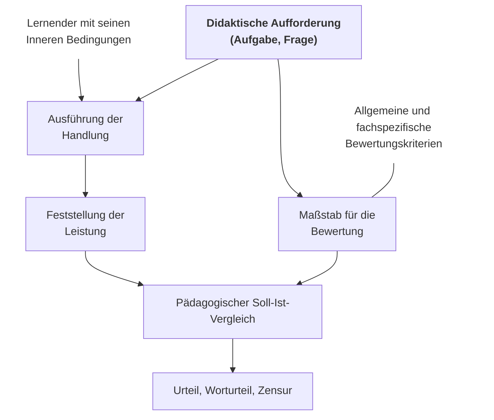
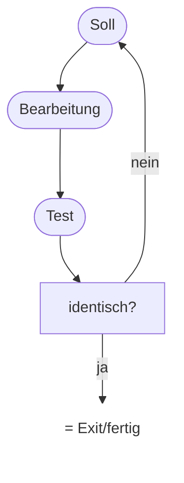
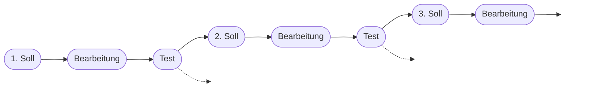
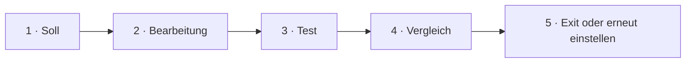
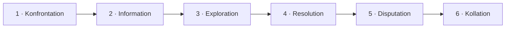
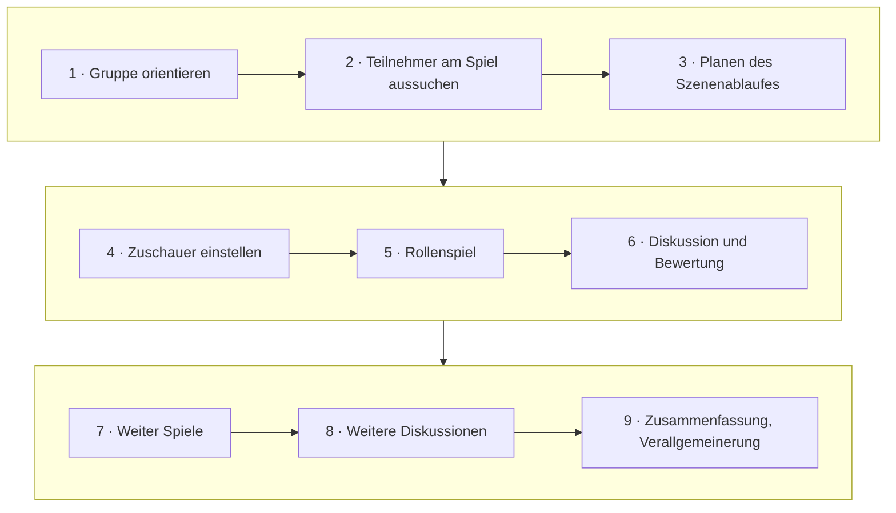
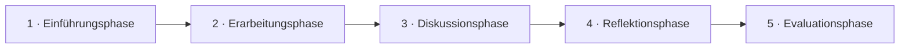

<!--
author:   Hannes Tegelbeckers
email:    hannes.tegelbeckers@ovgu.de
version:  0.3.0
language: de
narrator: Deutsch Female
mode:     Textbook
comment:  Fachdidaktik technischer Allgemeinbildung II – Selbstlerneinheit zu Sitzung S04. Bewertung als Soll-Ist-Vergleich, Bewertungskonzept für Projekte, eine technische Fallstudie nach Kaiser und ein Rollenspiel für die eigene Fachrichtung planen.

import:   https://raw.githubusercontent.com/LiaTemplates/mermaid_template/0.1.4/README.md
-->

# S04 – Bewertung · Fallstudie · Rollenspiel (Selbstlerneinheit)

<!-- didaktik="Selbstlerneinheit S04 · ca. 100 min · Studientext + Übungen · Inhalte der Folien R069–R088, in eigenen Worten erläutert" -->
> [!IMPORTANT] 🧭 Leitfrage
> Wie bewerte ich Projektarbeit fair – und wie baue ich Fallstudie und Rollenspiel so auf, dass der Vergleich mit der Wirklichkeit gelingt?

> [!NOTE] 📘 So ist diese Einheit aufgebaut
> Diese Einheit **erklärt die Inhalte der Sitzung S04** in eigenen Worten und mit Beispielen – Sie können sie auch bearbeiten, wenn Sie in der Sitzung nicht dabei waren. Ein roter Faden verbindet alle Teile: der **Soll-Ist-Vergleich**.

> [!TIP] 📖 Originalfolien zum Nachschlagen
> Die LiaScript-Sitzung [S04 – Kontrolle & Bewertung · Fallstudie · Rollenspiel](https://liascript.github.io/course/?https://raw.githubusercontent.com/OVGU-VET-TechEd/Fachdidaktik_technischer_Allgemeinbildung_II/main/S04_Bewertung_Fallstudie_Rollenspiel.md).

> [!TIP] ✍️ Übung in Moodle
> Bearbeiten Sie diese Einheit als Übung im Moodle-Kurs – dort wird Ihr Bearbeitungsstand gespeichert: [Übung in Moodle öffnen](https://elearning.ovgu.de/mod/scorm/view.php?id=707265)

## Ablauf der Einheit

    --{{0}}--
Die Einheit dauert etwa 100 Minuten und hat vier Abschnitte. Jeder Abschnitt erklärt zuerst die Inhalte der Folien und lässt Sie sie dann in Übungen anwenden.

<!-- data-type="none" -->
| Nr. | Abschnitt | Format | Dauer |
|----|--------|--------|----------|
| 1 | Kontrolle und Bewertung – und die Probleme bei Projekten | Studientext, drei Übungen | 30 min |
| 2 | Regelkreise: VVR- und TOTE-Einheit | Studientext, zwei Übungen | 12 min |
| 3 | Die Fallstudie | Studientext, Fall Druckluftanlage | 30 min |
| 4 | Das Rollenspiel | Studientext, eigenes Rollenspiel | 18 min |

> [!NOTE] Prüfungsbezug
> Zum Abschluss (ca. 10 min): Rückblick und Prüfungsfragen zum Üben für die mündliche Prüfung.

## Lernziele der Einheit

    --{{0}}--
Nach dieser Einheit können Sie vier Dinge.

**Am Ende dieser Einheit können Sie …**

    --{{1}}--
Erstens entwerfen Sie ein Bewertungskonzept für Projektarbeit.

      {{1}}
- **Bewertungskonzept entwerfen** für Projektarbeit, das die Widersprüche nach Kersten berücksichtigt

    --{{2}}--
Zweitens erläutern Sie die TOTE-Einheit an einer Tätigkeit Ihrer Fachrichtung.

      {{2}}
- **TOTE-Einheit erläutern** an einer Tätigkeit Ihrer Fachrichtung

    --{{3}}--
Drittens ordnen Sie einen technischen Fall einer Variante nach Kaiser zu und planen die Phasen.

      {{3}}
- **Fallstudie zuordnen und planen** einen technischen Fall einer Variante nach Kaiser zuordnen und die Phasen planen

    --{{4}}--
Und viertens skizzieren Sie ein Rollenspiel zu einem technischen Konflikt.

      {{4}}
- **Rollenspiel skizzieren** zu einem technischen Konflikt Ihrer Fachrichtung

    --{{5}}--
Welche Abschnitte interessieren Sie am meisten?

      {{5}}
****************************************

**Auswählen:** Auf welche Abschnitte sind Sie am meisten gespannt? (mehrere möglich)

[[m1]] Kontrolle und Bewertung – und die Probleme bei Projekten
[[m2]] Regelkreise: VVR- und TOTE-Einheit
[[m3]] Die Fallstudie
[[m4]] Das Rollenspiel

****************************************

## 1 · Kontrolle und Bewertung – und die Probleme bei Projekten

    --{{0}}--
In S03 haben Sie Projekte geplant. Am Ende eines Projekts steht die Frage: Wie kontrolliere und bewerte ich, was die Lernenden geleistet haben? Dieser Abschnitt klärt zuerst, wozu Bewertung überhaupt dient und was sie pädagogisch bedeutet. Danach geht es um die Widersprüche, die bei Projekten entstehen, und um die Konsequenz daraus: gemeinsam und prozessorientiert bewerten.

**Wie entsteht ein faires Urteil – und warum ist das bei Projekten so schwierig?**

    --{{1}}--
Zuerst: wozu wir überhaupt kontrollieren und bewerten.

      {{1}}
- 1.1 Wozu kontrollieren und bewerten wir? (R069)

    --{{2}}--
Dann: wie ein Urteil im pädagogischen Soll-Ist-Vergleich entsteht – und wann eine Situation eine Bewertungssituation ist.

      {{2}}
- 1.2 Bewertung als pädagogischer Soll-Ist-Vergleich (R070–R071)

    --{{3}}--
Danach: die drei Widersprüche bei Projekten nach Kersten.

      {{3}}
- 1.3 Drei Widersprüche bei Projekten (R072)

    --{{4}}--
Und schließlich die Konsequenz: gemeinsam und prozessorientiert bewerten.

      {{4}}
- 1.4 Bewertung gemeinsam und prozessorientiert (R073)

    --{{5}}--
Warum ist das für Sie wichtig?

      {{5}}
> [!TIP] Warum das wichtig ist
> Als Lehrkraft benoten Sie Projektarbeit – auch wenn Sie die Ziele nicht allein gesetzt haben und viele am Ergebnis mitgewirkt haben.

    --{{6}}--
Markieren Sie, was Sie schon kennen.

      {{6}}
****************************************

**Markieren:** Was davon kennen Sie schon? (mehrere möglich)

[[a1]] 1.1 Wozu kontrollieren und bewerten wir? (R069)
[[a2]] 1.2 Bewertung als pädagogischer Soll-Ist-Vergleich (R070–R071)
[[a3]] 1.3 Drei Widersprüche bei Projekten (R072)
[[a4]] 1.4 Bewertung gemeinsam und prozessorientiert (R073)

****************************************

## 1.1 Wozu kontrollieren und bewerten wir?

    --{{0}}--
Bewertung ist mehr als Noten geben. Die Folie nennt vier Funktionen: Rückkopplung für die Lehrkraft, Rückkopplung für die Lernenden, die Bewertung von Ausbildungsgängen und -unterlagen sowie Zeugnisse und Beurteilungen als Grundlage für Laufbahnentscheidungen.

- **Rückkopplung für den Lehrer**
  - Hat er seine pädagogischen Ziele erreicht?
  - War die didaktisch-methodische Gestaltung zweckmäßig?
- **Rückkopplung für den Schüler**
  - Welche Lernfortschritte wurden erzielt?
- **Bewertung von Ausbildungsgängen und Ausbildungsunterlagen**
  - Ist der Lehrplan geeignet um bestimmte Qualifikationen zu entwickeln?
- **Ermittlung von Zeugnissen und Beurteilungen als Grundlage für weitere Laufbahnentscheidungen**

    --{{1}}--
Oft wird nur an die letzte Funktion gedacht. Die ersten beiden sind für das Lernen aber mindestens so wichtig.

      {{1}}
> [!NOTE] Kernaussage
> Eine Klassenarbeit, die die halbe Klasse nicht besteht, sagt auch etwas über den **Unterricht** – Bewertung ist immer auch Rückmeldung an die Lehrkraft.

<small>Quelle: Folie R069 „Funktion von Kontrolle und Bewertung im Unterricht“</small>

## 1.2 Bewertung als pädagogischer Soll-Ist-Vergleich

    --{{0}}--
Wie entsteht ein Urteil? Das Schema auf Folie R070 hat zwei Stränge, die sich treffen. Am Anfang steht eine didaktische Aufforderung, also eine Aufgabe oder Frage.

    --{{1}}--
Der erste Strang ist das Ist.

      {{1}}
**① Ist:** Die Lernenden – mit ihren inneren Bedingungen (Vorwissen, Motivation …) – führen auf die Aufforderung hin eine Handlung aus, und die Leistung wird festgestellt.

    --{{2}}--
Der zweite Strang ist das Soll.

      {{2}}
**② Soll:** Aus allgemeinen und fachspezifischen Bewertungskriterien wird ein Maßstab gebildet.

    --{{3}}--
Im pädagogischen Soll-Ist-Vergleich werden beide gegenübergestellt.

      {{3}}
**③ Pädagogischer Soll-Ist-Vergleich:** Leistung und Maßstab werden verglichen; daraus folgt das Urteil – als Worturteil oder Zensur.

    --{{4}}--
Daraus folgt eine wichtige Regel.

      {{4}}
> [!NOTE] Kernaussage
> Ohne vorher festgelegten Maßstab gibt es keinen fairen Vergleich.

<small>Quelle: Folie R070 „Kontrolle und Bewertung von Lernleistungen im Unterricht“ – Grafik (nur Bild) als Diagramm nachgezeichnet; „Ist“ und „Soll“ als Lesehilfe.</small>

## Merkmale einer Bewertungssituation

    --{{0}}--
Wann ist eine Situation überhaupt eine Bewertungssituation? Heckhausen nennt fünf Merkmale: Das Ergebnis ist objektivierbar und hat Aufgabencharakter, es gibt einen Schwierigkeitsmaßstab, die Handlung kann gelingen oder misslingen, es gibt verbindliche Maßstäbe, und die Leistung hängt vom Handelnden ab.

1. Objektivierbarkeit und Aufgabencharakter des Handlungsergebnisses
2. Bezug auf einen Schwierigkeitsmaßstab bzw. „Kraftaufwand“
3. Möglichkeit des Gelingens oder Misslingens einer Handlung
4. Subjektive verbindliche „Maßstäbe“ für die Bewertung
5. Abhängigkeit (Urheberschaft) der Leistung vom Handelnden

(vgl. Heckhausen, 1974)

    --{{1}}--
Merkmal 4 ist leicht misszuverstehen: Warum heißt es subjektiv verbindlich und nicht objektiv? Heckhausen beschreibt die Bewertungssituation aus Sicht der Leistungsmotivation, also psychologisch.

      {{1}}
****************************************

**Zu Merkmal 4: Warum „subjektiv verbindlich“ und nicht „objektiv“?**

Gemeint ist ein Gütemaßstab, den der Handelnde als für sich verbindlich ansieht.

- Der Maßstab kann durchaus objektiv sein, zum Beispiel eine Toleranz von ±0,1 mm nach Zeichnung. Akzeptiert der Lernende ihn aber nicht als seinen Anspruch, entsteht kein Leistungshandeln. Die Arbeit wird dann nur von außen beurteilt.
- Erst wenn jemand sagt „Das will ich schaffen“, gibt es Stolz bei Erfolg und Ärger bei Misserfolg. Erst dann wirkt die Bewertung motivierend.

****************************************

    --{{2}}--
Behalten Sie diese fünf Merkmale im Kopf – im nächsten Schritt sehen Sie, dass genau sie bei Projekten oft fehlen.

      {{2}}
> [!NOTE] Kernaussage
> Bewertung wirkt erst, wenn der Lernende den Maßstab als eigenen Anspruch übernimmt.

<small>Quelle: Folie R071 „Merkmale einer Bewertungssituation im Unterricht“ (im Original: HECKHAUSEN); Erläuterung zu Merkmal 4 aus den Sprechernotizen dieser Folie.</small>

## 1.3 Drei Widersprüche bei Projekten

    --{{0}}--
Genau diese Merkmale sind bei Projekten aus S03 oft nicht erfüllt. Kersten beschreibt drei Widersprüche.

- **Widerspruch zwischen Selbstorganisation / Selbstverantwortung und Fremdkontrolle**
  - Lehrer setzt die Ziele nicht und kann daher auch über kein Antwortbild verfügen: Wie kann er daher die Leistung bewerten?
- **Widerspruch zwischen kooperativer Lernorganisation und individueller Leistungsbewertung**
- **Widerspruch zwischen pädagogischen Zwecken der Arbeit an und mit Projekten und der Kontrolle und Bewertung des Projektprodukts**
  - gemeint ist das Projektprodukt war letztlich auch nur Mittel zum Zweck: Persönlichkeitseigenschaften sollten am Produkt entwickelt werden …

(vgl. Kersten, 1997)

    --{{1}}--
Was bedeuten die drei Widersprüche – und welches Heckhausen-Merkmal fehlt jeweils?

      {{1}}
****************************************

**In eigenen Worten – mit Bezug zu Heckhausen**

- **Selbstorganisation ↔ Fremdkontrolle.** Wenn die Lernenden ihre Ziele selbst setzen, hat die Lehrkraft **kein Antwortbild** – woran soll sie messen? (Merkmal 4, der verbindliche Maßstab, fehlt.)
- **Kooperative Lernorganisation ↔ individuelle Bewertung.** Gearbeitet wird in der Gruppe, Noten werden aber einzeln vergeben. Wer hat was geleistet? (Merkmal 5, die Urheberschaft, ist unklar.)
- **Pädagogischer Zweck ↔ Bewertung des Produkts.** Das Produkt war nur **Mittel zum Zweck**: Am Produkt sollten Fähigkeiten und Persönlichkeitseigenschaften entwickelt werden. Bewertet man nur das Produkt, verfehlt man das eigentliche Ziel.

****************************************

    --{{2}}--
Alle drei Widersprüche führen zur selben Frage.

      {{2}}
> [!NOTE] Kernaussage
> Woher kommt bei Projekten der Maßstab – und wessen Leistung wird eigentlich gemessen?

<small>Quelle: Folie R072 „Probleme der Kontrolle und Bewertung in Projekten“ (im Original: KERSTEN); Erläuterungen: eigene Darstellung.</small>

## 1.4 Die Konsequenz: Bewertung gemeinsam und prozessorientiert

    --{{0}}--
Daraus folgt nach Folie R073: Eine ausschließliche Fremdbewertung durch die Lehrkraft ist bei Projekten nicht möglich. Bewertung entsteht in Zusammenarbeit in einer festen Reihenfolge – Selbstkontrolle und -bewertung der Lernenden, gegenseitige Einschätzung, dann legt die Lehrkraft ihre Einschätzung begründet dar. Und trotz der Produktorientierung liegt der Schwerpunkt auf dem Prozess der Problemlösung.

- Eine ausschließliche Fremdkontrolle und –bewertung der Lernleistungen durch den Lehrenden ist nicht möglich.
- Kontrolle und Bewertung von Lernleistungen muss in Zusammenarbeit zwischen den Lernenden und dem Lehrenden erfolgen. Ausgangspunkt dafür bildet die Selbstkontrolle und –bewertung der Lernenden, gefolgt von der gegenseitigen Einschätzung der erbrachten Leistungen durch die Lernenden. Auf dieser Grundlage kann dann der Lehrende seine Leistungseinschätzung begründet darlegen.
- Trotz der Produktorientiertheit beim Lernen durch die Arbeit an und mit Projekten sollte der Schwerpunkt der Kontrolle und Bewertung nicht auf den Qualitätsmerkmalen des Produktes sondern im Prozess der Problemlösung liegen.

    --{{1}}--
Warum gerade diese Reihenfolge? Wer sich zuerst selbst einschätzt, muss sich mit den Kriterien auseinandersetzen – das ist selbst ein Lernprozess. Die Lehrkraft spricht zuletzt, damit ihr Urteil die Selbsteinschätzung nicht vorwegnimmt.

      {{1}}
> [!NOTE] Kernaussage
> Selbstkontrolle und -bewertung → gegenseitige Einschätzung → begründete Einschätzung der Lehrenden. Schwerpunkt: der Prozess der Problemlösung.

<small>Quelle: Folie R073 „Besonderheiten von Kontrolle und Bewertung bei der Arbeit an und mit Projekten“</small>

## Übung 1: Bewerten in Projekten

    --{{0}}--
Prüfen Sie Ihr Verständnis an einem Fall. Die Bewässerungsanlage einer Projektgruppe aus der Selbstlerneinheit S03 funktioniert nur teilweise. Die Gruppe hat aber sauber dokumentiert, zwei Lösungen verglichen und einen Fehler selbst gefunden.

**1 · Eine Antwort:** Die Bewässerungsanlage funktioniert nur teilweise; die Gruppe hat aber dokumentiert, zwei Lösungen verglichen und einen Fehler selbst gefunden. Welches Vorgehen entspricht R073 am besten?

<!-- data-hint-button="1" data-solution-button="2" -->
- [( )] Die Lehrkraft bewertet die Funktion der Anlage und vergibt allen dieselbe Note.
- [(X)] Erst Selbst-, dann gegenseitige Einschätzung; danach legt die Lehrkraft ihre Einschätzung begründet dar – mit Kriterien zu Prozess und Produkt.
- [( )] Die Lernenden bewerten sich ausschließlich selbst.
[[?]] R073 nennt eine feste Reihenfolge und einen Schwerpunkt.
***
Eine ausschließliche Fremdbewertung ist nicht möglich; der Schwerpunkt liegt im Prozess – hier also Dokumentation, Variantenvergleich und Fehlersuche, nicht nur die Funktion (R073).
***

    --{{1}}--
Jetzt können mehrere Antworten richtig sein.

      {{1}}
****************************************

**2 · Alle zutreffenden:** Welche Merkmale einer Bewertungssituation nach Heckhausen sind bei Projekten oft nicht erfüllt?

<!-- data-hint-button="1" data-solution-button="2" -->
- [[X]] Verbindliche Maßstäbe – die Lehrkraft hat kein Antwortbild.
- [[ ]] Möglichkeit des Gelingens oder Misslingens einer Handlung
- [[X]] Urheberschaft – wer hat in der Gruppe was geleistet?
- [[ ]] Bezug auf einen Schwierigkeitsmaßstab
[[?]] Denken Sie an die ersten beiden Widersprüche nach Kersten.
***
Selbstorganisation nimmt den verbindlichen Maßstab (Merkmal 4), Gruppenarbeit verwischt die Urheberschaft (Merkmal 5).
***

****************************************

    --{{2}}--
Zum Schluss tippen Sie einen Begriff.

      {{2}}
****************************************

**3 · Eintippen:** Worüber kann die Lehrkraft nicht verfügen, wenn die Lernenden die Ziele selbst setzen? (ein Wort)

<!-- data-hint-button="1" data-solution-button="2" -->
[[Antwortbild]]
[[?]] Gemeint ist das Bild der erwarteten Antwort, ähnlich einer Musterlösung.

***
Ohne Antwortbild fehlt der Maßstab für den Soll-Ist-Vergleich (R072).
***

****************************************

## Übung 1c: Ihr Bewertungsraster

    --{{0}}--
Übertragen Sie das jetzt auf ein Projekt Ihrer Fachrichtung. Ihr Raster ist zugleich Baustein 5 für Ihren Unterrichtsentwurf.

Notieren Sie für ein Projekt Ihrer Fachrichtung je zwei Kriterien für **Prozess** und **Produkt** und legen Sie fest, wer wann einschätzt (selbst – gegenseitig – Lehrkraft).

<!-- data-type="none" -->
| | Kriterium 1 | Kriterium 2 | Wer schätzt ein? |
| --- | --- | --- | --- |
| **Prozess** | … | … | … |
| **Produkt** | … | … | … |

**Prüfen Sie Ihr Raster mit Heckhausen (R071):** Ist das Ergebnis objektivierbar? Gibt es einen verbindlichen Maßstab? Ist die Leistung den einzelnen Lernenden zurechenbar (Urheberschaft)?

[[___ ___ ___ ___]]

💡 Hinweis

Prozess-Kriterien beschreiben, **wie** gearbeitet wurde (Planung, Abstimmung, Fehlersuche); Produkt-Kriterien beschreiben, **was** herauskam.

✅ Lösung

Beispiel Bewässerungsanlage: **Prozess** – Planung dokumentiert und begründet angepasst; Lösungsvarianten verglichen. **Produkt** – Anlage hält die Bodenfeuchte im Sollbereich; Bedienungsanleitung ist verständlich. **Wer:** Selbsteinschätzung nach jeder Projektphase, gegenseitige Einschätzung bei der Präsentation, zuletzt die begründete Einschätzung der Lehrkraft. **Heckhausen:** Die Kriterien werden vorab vereinbart (verbindlicher Maßstab); ein Projekttagebuch mit Aufgabenverteilung macht die Urheberschaft sichtbar.

## 2 · Regelkreise: die TOTE-Einheit

    --{{0}}--
In S02 hieß es: Jede Handlung basiert auf zyklischen Einheiten, den TOTE- und VVR-Einheiten. Sie beschreiben, wie Menschen eine Handlung im Kopf steuern – wieder mit einem Soll-Ist-Vergleich, diesmal beim Handelnden selbst. Die TOTE-Einheit steht für Test, Operate, Test, Exit.

    --{{1}}--
Der Handelnde hat ein Soll im Kopf.

      {{1}}
**① Soll:** Das Ziel, das der Handelnde im Kopf hat.

    --{{2}}--
Er bearbeitet etwas und testet das Ergebnis.

      {{2}}
**② Bearbeitung und Test:** Etwas wird bearbeitet, dann wird das Ergebnis getestet.

    --{{3}}--
Dann fragt er: Ist das Ist mit dem Soll identisch? Wenn nein, geht es zurück in die Bearbeitung. Wenn ja, ist die Handlung fertig.

      {{3}}
**③ identisch?:** nein → zurück und weiter bearbeiten · ja = Exit, die Handlung ist fertig.

    --{{4}}--
Für den Unterricht folgt daraus eine Bedingung.

      {{4}}
> [!NOTE] Kernaussage
> Lernende brauchen ein **klares Soll** und eine **Möglichkeit zum Testen** (Prüfmittel, Kriterien, Rückmeldung). Fehlt eines davon, können sie ihre Handlung nicht selbst regulieren.

<small>Quelle: Folie R078 „Test-Operation-Test-Exit (TOTE-Einheit)“ – Grafik (nur Bild) als Diagramm nachgezeichnet; Erläuterungen: eigene Darstellung.</small>

## Die VVR-Einheit

    --{{0}}--
Die Vergleichs-Veränderungs-Rückkopplungs-Einheit beschreibt dasselbe Prinzip als Folge.

    --{{1}}--
Auf ein Soll folgen Bearbeitung und Test.

      {{1}}
**① Soll:** Das Ziel des jeweiligen Handlungsschritts: 1., 2., 3. Soll.

    --{{2}}--
Der Test vergleicht das Ergebnis mit dem Soll.

      {{2}}
**② Bearbeitung und Test:** Die Handlung wird ausgeführt und ihr Ergebnis geprüft.

    --{{3}}--
Danach kommt das nächste Soll mit Bearbeitung und Test – und so weiter.

      {{3}}
**③ Neues Soll:** Jeder Test führt zum nächsten Soll; so wird eine längere Handlung Schritt für Schritt reguliert.

    --{{4}}--
Das ist der Kern dieser Einheit.

      {{4}}
> [!NOTE] Kernaussage
> VVR: vergleichen, verändern, rückkoppeln – eine längere Handlung als Folge von Soll-Ist-Vergleichen.

<small>Quelle: Folie R077 „Vergleichs-Veränderungs-Rückkoppelungs-Einheit (VVR-Einheit)“ – Grafik (nur Bild) nachgezeichnet: im Original eine Spirale, in der jeder Test zum nächsten Soll führt; gestrichelte Pfeile wie im Original.</small>

## Übung 2a: TOTE beim Einstellen des Ventilspiels

    --{{0}}--
Ein Beispiel aus der Kfz-Technik: das Einstellen des Ventilspiels an einem Motor als TOTE-Einheit.

    --{{1}}--
Das Soll ist das vorgeschriebene Ventilspiel.

      {{1}}
1. **Soll:** vorgeschriebenes Ventilspiel aus den Herstellerangaben

    --{{2}}--
Bearbeitet wird mit der Einstellschraube.

      {{2}}
2. **Bearbeitung:** Einstellschraube verstellen

    --{{3}}--
Getestet wird mit der Fühlerlehre.

      {{3}}
3. **Test:** Spiel mit der Fühlerlehre messen

    --{{4}}--
Dann wird verglichen.

      {{4}}
4. **Vergleich:** Stimmt der Wert mit dem Soll überein?

    --{{5}}--
Bei Abweichung wird erneut eingestellt, sonst ist die Handlung fertig.

      {{5}}
5. **Exit oder erneut einstellen:** Bei Abweichung erneut einstellen, sonst Exit.

<small>Beispiel: eigene Darstellung zur TOTE-Einheit (Folie R078), keine Originalfolie.</small>

## Ventilspiel: Schritte ordnen

    --{{0}}--
Ordnen Sie den Ablauf beim Einstellen des Ventilspiels.

**Ordnen:** Ziehen Sie jede Karte in die richtige Lücke.

<!-- data-randomize data-show-partial-solution data-solution-button="2" -->
Schritt 1: [->[ Soll ]] → Schritt 2: [->[ Bearbeitung ]] → Schritt 3: [->[ Test ]] → Schritt 4: [->[ Vergleich ]] → Schritt 5: [->[ Exit oder erneut einstellen ]]

## Übung 2b: Ihre Tätigkeit als TOTE-Einheit

    --{{0}}--
Übertragen Sie die TOTE-Einheit auf Ihre eigene Fachrichtung.

Beschreiben Sie eine Tätigkeit Ihrer Fachrichtung als TOTE-Einheit: Was ist das **Soll**, was wird **bearbeitet**, womit wird **getestet** – und wo genau liegt der Test?

[[___ ___ ___ ___]]

💡 Hinweis

Suchen Sie das Prüfmittel: Womit stellen Sie fest, ob das Ergebnis stimmt (Messgerät, Lehre, Sichtprüfung, Funktionsprobe)?

✅ Lösung

Beispiel Metalltechnik: **Soll** – Wellendurchmesser 20 mm h7 nach Zeichnung · **Bearbeitung** – Welle auf der Drehmaschine abdrehen · **Test** – Durchmesser mit der Bügelmessschraube messen · **identisch?** – liegt das Maß in der Toleranz, ist die Handlung fertig (Exit); sonst wird nachgedreht.

## 3 · Die Fallstudie

    --{{0}}--
Projekte enden mit einem Produkt. Die Fallstudie setzt anders an: Im Mittelpunkt steht eine Entscheidung in einer realistischen Problemsituation. Dieser Abschnitt erklärt, was eine Fallstudie ist, welche Varianten Kaiser unterscheidet, in welchen Phasen sie abläuft und wie Sie selbst eine technische Fallstudie aufbauen.

**Wie lernen Lernende an einem echten Fall – und womit vergleichen sie ihre Entscheidung?**

    --{{1}}--
Zuerst: Was ist eine Fallstudie?

      {{1}}
- 3.1 Was ist eine Fallstudie? (R074)

    --{{2}}--
Dann: die vier Varianten nach Kaiser.

      {{2}}
- 3.2 Vier Varianten nach Kaiser (R075)

    --{{3}}--
Danach: das Phasenmodell von der Konfrontation bis zur Kollation.

      {{3}}
- 3.3 Das Phasenmodell nach Kaiser (R076)

    --{{4}}--
Und schließlich bauen Sie selbst eine technische Fallstudie auf.

      {{4}}
- 3.4 Eine technische Fallstudie aufbauen: die Druckluftanlage

    --{{5}}--
Warum ist das für Sie wichtig?

      {{5}}
> [!TIP] Warum das wichtig ist
> Fallstudien holen betriebliche Entscheidungen in den Unterricht – und der Vergleich mit der realen Entscheidung zeigt, ob eine Lösung trägt.

    --{{6}}--
Markieren Sie, was Sie schon kennen.

      {{6}}
****************************************

**Markieren:** Was davon kennen Sie schon? (mehrere möglich)

[[a1]] 3.1 Was ist eine Fallstudie? (R074)
[[a2]] 3.2 Vier Varianten nach Kaiser (R075)
[[a3]] 3.3 Das Phasenmodell nach Kaiser (R076)
[[a4]] 3.4 Eine technische Fallstudie aufbauen: die Druckluftanlage

****************************************

## 3.1 Was ist eine Fallstudie?

    --{{0}}--
Die Fallstudie ist ein komplexes Unterrichtsverfahren, in dem das Lösen eines Problems aus der Praxis im Vordergrund steht. Die Lernenden analysieren eine Problemsituation selbstständig, erarbeiten in Gruppen Lösungen und unterziehen die verschiedenen Lösungen einem kritischen Vergleich.

- Komplexes Unterrichtsverfahren
- Problemlösungskonzept steht im Vordergrund
- Problemsituation meist aus der Praxis
- Die Lernenden müssen die Problemsituation selbstständig analysieren und in Gruppenarbeit Problemlösungen erarbeiten
- Die unterschiedlichen Problemlösungen sollten einem kritischen Vergleich unterzogen werden

    --{{1}}--
Die Fallbearbeitung hat vier Phasen: Problemerkennung – was ist eigentlich das Problem? Informationsgewinnung – was müssen wir wissen? Problemlösung – Lösungsalternativen suchen und sich begründet für eine entscheiden. Und Lösungskritik – Gruppenergebnisse diskutieren und mit der realen Problemlösung vergleichen.

      {{1}}
****************************************

**Phasen der Fallbearbeitung**

1. Problemerkennung
2. Informationsgewinnung
3. Problemlösung
   - Suche nach unterschiedlichen Lösungsalternativen
   - Begründete Entscheidung für eine Lösungsvariante
4. Lösungskritik
   - Diskussion der Gruppenergebnisse
   - Vergleich mit der realen Problemlösung

****************************************

    --{{2}}--
Der letzte Schritt ist das Besondere.

      {{2}}
> [!NOTE] Kernaussage
> Weil der Fall echt ist, gibt es eine **Entscheidung, die in der Wirklichkeit getroffen wurde**. Die Lernenden vergleichen ihre Lösung damit – wieder ein Soll-Ist-Vergleich.

<small>Quelle: Folie R074 „Fallstudie“</small>

## 3.2 Vier Varianten nach Kaiser

    --{{0}}--
Kaiser unterscheidet vier Varianten. Sie haben dieselben Phasen, aber unterschiedliche Schwerpunkte. Bei der Case-Study-Method ist das Problem verborgen und muss erst analysiert werden. Bei der Case-Problem-Method sind Problem und Informationen gegeben; die Lernenden ermitteln Lösungsvarianten und entscheiden. Bei der Case-Incident-Method ist der Fall lückenhaft, die Informationen müssen selbst beschafft werden. Bei der Stated-Problem-Method sind sogar die fertigen Lösungen gegeben; die Lernenden kritisieren sie und suchen Alternativen.

<!-- data-type="none" -->
| Methode | Problemerkennung | Informationsgewinnung | Problemlösung | Lösungskritik |
| --- | --- | --- | --- | --- |
| **Case-Study-Method** | **Schwerpunkt:** Verborgene Probleme müssen analysiert werden | Informationen werden gegeben | Lösungsvarianten des Problems werden ermittelt und Entscheidungen gefällt | Vergleich der Lösung mit der Entscheidung in der Wirklichkeit |
| **Case-Problem-Method** | Probleme sind ausdrücklich genannt | Informationen werden gegeben | **Schwerpunkt:** Lösungsvarianten des Problems werden ermittelt und Entscheidungen gefällt | Vergleich der Lösung mit der Entscheidung in der Wirklichkeit |
| **Case-Incident-Method** | Der Fall wird lückenhaft dargestellt | **Schwerpunkt:** Informationen müssen selbstständig beschafft werden | Lösungsvarianten werden ermittelt. Der Fall wird gelöst. | |
| **Stated-Problem-Method** | Probleme sind vorgegeben | Informationen werden gegeben | Die fertigen Lösungen werden gegeben. Es wird nach alternativen Lösungen gesucht. | **Schwerpunkt:** Kritik der vorgegebenen Lösungen |

    --{{1}}--
Lesen Sie die Tabelle diagonal: Der Schwerpunkt wandert von Variante zu Variante in eine andere Phase.

      {{1}}
> [!NOTE] Kernaussage
> Schwerpunkte: Problemerkennung (Case-Study) · Problemlösung (Case-Problem) · Informationsgewinnung (Case-Incident) · Lösungskritik (Stated-Problem).

<small>Quelle: Folie R075 „Varianten der Arbeit mit Fallstudien nach KAISER“</small>

## 3.3 Das Phasenmodell nach Kaiser

    --{{0}}--
Kaiser beschreibt den Ablauf in sechs Phasen mit lateinischen Namen.

    --{{1}}--
Konfrontation: Die Lernenden werden mit dem Fall konfrontiert.

      {{1}}
1. **Konfrontation:** Die Lernenden werden mit dem Fall konfrontiert und erfassen die Situation.

    --{{2}}--
Information: Sie erschließen die nötigen Informationen.

      {{2}}
2. **Information:** Sie beschaffen bzw. erschließen die nötigen Informationen.

    --{{3}}--
Exploration: Sie erkunden Lösungsmöglichkeiten.

      {{3}}
3. **Exploration:** Sie erkunden Lösungsmöglichkeiten.

    --{{4}}--
Resolution: Sie treffen eine Entscheidung.

      {{4}}
4. **Resolution:** Sie treffen eine Entscheidung.

    --{{5}}--
Disputation: Sie verteidigen ihre Entscheidung.

      {{5}}
5. **Disputation:** Sie verteidigen ihre Entscheidung gegenüber den anderen Gruppen.

    --{{6}}--
Kollation: Sie vergleichen ihre Lösung mit der Entscheidung in der Wirklichkeit.

      {{6}}
6. **Kollation:** Sie vergleichen ihre Lösung mit der Entscheidung in der Wirklichkeit.

<small>Quelle: Folie R076 „Phasenmodell der Fallstudie nach KAISER¹“ – ¹ Kaiser, F.-J.: Entscheidungstraining – Methoden der Entscheidungsfindung (2.Auflage). Bad Heilbrunn 1976 · Erläuterungen der Phasen: eigene Darstellung.</small>

## Übung 3a: Phasen nach Kaiser ordnen

    --{{0}}--
Ordnen Sie die sechs Phasen nach Kaiser.

**Ordnen:** Ziehen Sie jede Karte in die richtige Lücke.

<!-- data-randomize data-show-partial-solution data-solution-button="2" -->
Schritt 1: [->[ Konfrontation ]] → Schritt 2: [->[ Information ]] → Schritt 3: [->[ Exploration ]] → Schritt 4: [->[ Resolution ]] → Schritt 5: [->[ Disputation ]] → Schritt 6: [->[ Kollation ]]

## Übung 3b: Varianten und Phasen

    --{{0}}--
Ergänzen Sie den Text. Wählen, tippen oder ziehen Sie die fehlenden Wörter.

**Ergänzen:**

<!-- data-hint-button="1" data-solution-button="2" data-show-partial-solution -->
Bei der [[ (Case-Incident-Method) | Case-Study-Method | Stated-Problem-Method ]] müssen die Informationen selbstständig beschafft werden. Kaisers Phasenmodell umfasst so viele Phasen: [[6]]. Die letzte Phase, die Kollation, vergleicht die eigene Lösung mit der Entscheidung in der Wirklichkeit – ein [->[ (Soll-Ist-Vergleich) | Meinungsbild ]].
[[?]] Schauen Sie in die Tabelle zu R075 und in das Phasenmodell R076.

    --{{1}}--
Entscheiden Sie jetzt: richtig oder falsch?

      {{1}}
****************************************

**Entscheiden:** Richtig oder falsch?

<!-- data-hint-button="1" data-solution-button="2" data-show-partial-solution -->
[(richtig) (falsch)]
[  (X)    ( )  ] Bei der Case-Study-Method müssen verborgene Probleme analysiert werden.
[  ( )    (X)  ] Bei der Case-Problem-Method liegt der Schwerpunkt auf der Problemerkennung.
[  (X)    ( )  ] Bei der Stated-Problem-Method liegt der Schwerpunkt auf der Kritik der vorgegebenen Lösungen.
[  ( )    (X)  ] Bei der Case-Incident-Method werden alle Informationen gegeben.
[[?]] Jede Variante hat genau einen Schwerpunkt – suchen Sie ihn in der Tabelle.
***
Case-Study: verborgene Probleme analysieren · Case-Problem: Lösungsvarianten ermitteln und entscheiden · Case-Incident: Informationen selbstständig beschaffen · Stated-Problem: Kritik der vorgegebenen Lösungen (R075).
***

****************************************

## 3.4 Fall: die Druckluftanlage

    --{{0}}--
Bauen Sie jetzt selbst eine technische Fallstudie auf. Ein mittelständischer Betrieb muss eine veraltete Druckluftanlage ersetzen.

**Fall (Kurzfassung):** Ein mittelständischer Betrieb muss eine veraltete Druckluftanlage ersetzen. Zur Wahl stehen ein Kompressor mit Wärmerückgewinnung (teurer) und ein günstigerer Standardkompressor. Der Betrieb hat sich in der Wirklichkeit für eine der Varianten entschieden.

<!-- data-type="none" -->
| Angabe | Wert |
|--------|-------|
| Variante A | Kompressor mit Wärmerückgewinnung (teurer) |
| Variante B | Standardkompressor (günstiger) |
| Reale Entscheidung | bekannt – für die Kollation |

## Übung 3c–3d: Den Fall gestalten

    --{{0}}--
Erstens: Ordnen Sie zu.

**1 · Ihre Antwort:** Die Lernenden erhalten Betriebsdaten und müssen selbst erkennen, dass die Druckluftanlage das eigentliche Problem ist. Welche Variante nach Kaiser ist das – und wie sähe der Fall als Case-Incident-Method aus?

[[___ ___]]

✅ Musterantwort

Das ist die **Case-Study-Method** (Schwerpunkt Problemerkennung). Als **Case-Incident-Method** wäre der Fall lückenhaft: Verbrauchswerte und Preise müssten die Lernenden selbst beschaffen (R075).

    --{{1}}--
Zweitens: eine andere Variante.

      {{1}}
****************************************

**2 · Ihre Antwort:** Die Entscheidung des Betriebs ist vorgegeben. Welche Variante liegt vor, und was tun die Lernenden? Und wie lautet die Aufgabe in der Case-Problem-Method?

[[___ ___]]

✅ Musterantwort

**Stated-Problem-Method:** Die Lernenden kritisieren die vorgegebene Lösung und suchen Alternativen. In der **Case-Problem-Method** ist das Problem „Welcher Kompressor?“ genannt, die Daten liegen bei; Schwerpunkt ist die begründete Entscheidung (R075).

****************************************

    --{{2}}--
Drittens: Planen Sie die Phasen nach Kaiser für die Case-Problem-Variante.

      {{2}}
****************************************

**3 · Ihre Antwort:** Planen Sie die sechs Phasen nach Kaiser für die Case-Problem-Variante: Was tun die Lernenden in jeder Phase?

[[___ ___]]

✅ Musterantwort

**Konfrontation:** Brief der Geschäftsführung, die alte Anlage fällt häufig aus. **Information:** Datenblätter, Energiepreise, Verbrauchsprofil. **Exploration:** Lösungsalternativen erkunden, z. B. auch Leckagen beseitigen. **Resolution:** Gruppen entscheiden begründet (Kosten, Energie, Wartung). **Disputation:** Gruppen verteidigen ihre Entscheidung im Plenum. **Kollation:** Vergleich mit der tatsächlichen Entscheidung des Betriebs – ein Soll-Ist-Vergleich. 💭 Die Kollation braucht einen *echten* Fall mit bekannter Entscheidung: Fragen Sie in Praktikumsbetrieben nach – oft erzählen Betriebe gern von einer abgeschlossenen Investitionsentscheidung.

****************************************

## 4 · Das Rollenspiel: der Ablauf

    --{{0}}--
Im Rollenspiel übernehmen Lernende die Positionen verschiedener Interessengruppen in einem Konflikt und vertreten sie mit Argumenten. Sie lernen so, Standpunkte zu verstehen, zu argumentieren und zu verhandeln – Fähigkeiten, die nach Papaloizos und Stiefel, siehe S05, vor allem das Kommunizieren fördern. Der Ablauf hat neun Schritte.

    --{{1}}--
Zuerst wird die Gruppe orientiert und mit dem Problem konfrontiert; dann werden die Spielenden ausgewählt, und der Szenenablauf wird geplant.

      {{1}}
****************************************

1. **Gruppe orientieren:** (Konfrontation mit dem Problem)
2. **Teilnehmer am Spiel aussuchen:** Die Spielenden werden ausgewählt.
3. **Planen des Szenenablaufes:** Welche Szenen folgen aufeinander?

****************************************

    --{{2}}--
Die Zuschauenden werden auf ihre Rolle als teilnehmende Beobachter eingestellt – am besten mit Beobachtungsaufträgen. Dann wird gespielt, diskutiert und bewertet.

      {{2}}
****************************************

4. **Zuschauer einstellen:** auf ihre Rolle als teilnehmende Beobachter – mit Beobachtungsaufträgen
5. **Rollenspiel:** Die geplanten Szenen werden gespielt.
6. **Diskussion und Bewertung:** Was ist geschehen, wie hat es gewirkt?

****************************************

    --{{3}}--
Danach wird mit getauschten Rollen oder alternativen Szenen weitergespielt, weiter diskutiert und schließlich zusammengefasst und verallgemeinert.

      {{3}}
****************************************

7. **Weiter Spiele:** (getauschte Rollen, alternative Szenen)
8. **Weitere Diskussionen:** zu den weiteren Spielen
9. **Zusammenfassung, Verallgemeinerung:** Was lässt sich über den Fall hinaus festhalten?

****************************************

<small>Quelle: Folie R079 „Ablauf des Rollenspiels“ – Wortlaut der Schritte unverändert (Schritt 4 im Original: „Zuschauer auf ihre Rolle als teilnehmende Beobachter einstellen“); Erläuterungen: eigene Darstellung.</small>

## Ablauf ordnen

    --{{0}}--
Ordnen Sie die neun Schritte des Rollenspiels.

**Ordnen:** Ziehen Sie jede Karte in die richtige Lücke.

<!-- data-randomize data-show-partial-solution data-solution-button="2" -->
Schritt 1: [->[ Gruppe orientieren ]] → Schritt 2: [->[ Teilnehmer am Spiel aussuchen ]] → Schritt 3: [->[ Planen des Szenenablaufes ]] → Schritt 4: [->[ Zuschauer einstellen ]] → Schritt 5: [->[ Rollenspiel ]] → Schritt 6: [->[ Diskussion und Bewertung ]] → Schritt 7: [->[ Weiter Spiele ]] → Schritt 8: [->[ Weitere Diskussionen ]] → Schritt 9: [->[ Zusammenfassung, Verallgemeinerung ]]

## Die fünf Phasen des Rollenspiels

    --{{0}}--
Kürzer gefasst sind es fünf Phasen: Einführung, Erarbeitung, Diskussion, Reflexion und Evaluation.

    --{{1}}--
In der Einführung wird die Gruppe mit dem Problem konfrontiert.

      {{1}}
1. **Einführungsphase:** Die Gruppe wird mit dem Problem konfrontiert (vgl. R079).

    --{{2}}--
In der Erarbeitung werden die Rollen mit Argumenten gefüllt.

      {{2}}
2. **Erarbeitungsphase:** Rollen werden entsprechend der Standpunkte mit Argumenten gefüllt (R082).

    --{{3}}--
In der Diskussion werden die Standpunkte vertreten.

      {{3}}
3. **Diskussionsphase:** Pressekonferenz und Diskussion am „Runden Tisch“ (R082).

    --{{4}}--
In der Reflexion wird das Handeln der Rollen erklärt.

      {{4}}
4. **Reflektionsphase:** Warum hat X so gehandelt? (R082)

    --{{5}}--
Und in der Evaluation wird geprüft, wie sich das Meinungsbild verändert hat.

      {{5}}
5. **Evaluationsphase:** Wie wurde das Meinungsbild beeinflusst? (R082)

<small>Quelle: Folie R080 „Phasenaufbau des Rollenspiels“ (Schreibweise „Reflektionsphase“ wie im Original); Erläuterungen aus R079 und R082.</small>

## Phasen ordnen

    --{{0}}--
Ordnen Sie die fünf Phasen des Rollenspiels.

**Ordnen:** Ziehen Sie jede Karte in die richtige Lücke.

<!-- data-randomize data-show-partial-solution data-solution-button="2" -->
Schritt 1: [->[ Einführungsphase ]] → Schritt 2: [->[ Erarbeitungsphase ]] → Schritt 3: [->[ Diskussionsphase ]] → Schritt 4: [->[ Reflektionsphase ]] → Schritt 5: [->[ Evaluationsphase ]]

## Das Beispiel aus der Sitzung: „Transgene Kartoffel – Umweltkiller oder Schlankmacher“

    --{{0}}--
In der Sitzung wurde ein Fall aus der Biotechnologie gespielt. Eine fiktive Firma hat eine gentechnisch veränderte Kartoffel entwickelt, die beim Frittieren weniger Fett aufnimmt und zum Nachweis ein Antibiotikaresistenz-Markergen trägt.

**Ausgangsszenario (R081):**

- Die fiktive Firma FloraTec GmbH hat eine gentechnisch veränderte Kartoffelsorte entwickelt, die über einen höheren Stärkeanteil verfügt
- Durch den geringeren Wassergehalt der transgenen Kartoffel wird bei der Weiterverarbeitung durch Frittieren oder Braten weniger Fett aufgenommen. Die so hergestellten Nahrungsmittel enthalten demzufolge auch wenige Kalorien als Produkte aus herkömmlichen Kartoffeln.
- Zum Nachweis wurde die Kartoffelsorte mit einem Markergen versehen. Markergene werden zusammen mit dem veränderten Gen in die Pflanzen eingebracht und lassen sich im Verlaufe der Züchtung meist leichter nachweisen als die eigentliche genetische Veränderung. In diesem Falle wurde als Markergen ein Antibiotikaresistenzgen (Resistenz gegen das Antibiotikum Amikacin) in die Kartoffelpflanzen implementiert.

**Sechs Rollen (R083–R088)** – ökologischer Landwirt, Züchtungsbetrieb, Bauernverband, Minister, Wissenschaftler, Verbraucherfamilie – haben jeweils **eigene, nachvollziehbare Interessen**: Ökolabel, Investitionen, Absatz, Wahlkampf, Forschungsgelder, Gesundheit. Die Rollenkarten im Wortlaut finden Sie in der [Sitzung S04](https://liascript.github.io/course/?https://raw.githubusercontent.com/OVGU-VET-TechEd/Fachdidaktik_technischer_Allgemeinbildung_II/main/S04_Bewertung_Fallstudie_Rollenspiel.md).

<small>Quelle: Folie R081 (Wortlaut unverändert); Rollen: Zusammenfassung der Folien R083–R088.</small>

    --{{1}}--
Behalten Sie den Kern des Konflikts im Blick.

      {{1}}
> [!NOTE] Kernaussage
> Ein Produkt, viele Interessen – und keine Rolle ist ein „Bösewicht“. Darum eignet sich der Fall für ein Rollenspiel.

    --{{2}}--
Eine kurze Leseprobe.

      {{2}}
****************************************

**Eintippen:** Gegen welches Antibiotikum ist das Markergen der transgenen Kartoffel resistent?

<!-- data-hint-button="1" data-solution-button="2" -->
[[Amikacin]]
[[?]] Es steht im letzten Punkt des Ausgangsszenarios.

***
Richtig: Als Markergen wurde ein Antibiotikaresistenzgen gegen Amikacin eingebracht.
***

****************************************

## Die Phasen im Beispiel

    --{{0}}--
So sahen die Phasen im Beispiel aus: Rollen mit Argumenten füllen, eine Pressekonferenz und ein runder Tisch mit dem Ziel eines Konsenses, eine Reflexion und eine Abstimmung vorher und nachher.

- **Erarbeitungsphase**
- Rollen müssen entsprechend der Standpunkte mit Argumenten gefüllt werden
  - Materialsammlung wird bereitgestellt
- **Diskussionsphase**
- Pressekonferenz – Statements der am Spiel beteiligten Parteien werden verlesen
  - Diskussion am „Runden Tisch“ – es ist ein Konsens zu finden
- **Reflektionsphase**
  - Warum hat X so gehandelt?
- **Evaluationsphase**
  - Wie wurde das Meinungsbild beeinflusst?

    --{{1}}--
Was macht ein gutes Rollenspiel aus?

      {{1}}
> [!NOTE] Kernaussage
> Ein echter **Interessenkonflikt** ohne eindeutig richtige Lösung · Rollen, die **alle vertretbar** sind · **Beobachtungsaufträge** für die Zuschauenden · eine **Reflexion**, die zwischen Rolle und eigener Meinung trennt.

<small>Quelle: Folie R082 „Bsp.: „Transgene Kartoffel – Umweltkiller oder Schlankmacher““ (Gliederungsebenen wie im Original); Merkmale eines guten Rollenspiels: eigene Darstellung.</small>

## Übung 4: Ihr Rollenspiel

    --{{0}}--
Das Beispiel stammt aus der Biotechnologie – technische Konflikte gibt es in jeder Fachrichtung. Skizzieren Sie jetzt ein eigenes Rollenspiel.

Wählen Sie einen Konflikt aus Ihrer Fachrichtung, zum Beispiel ein Windrad am Ortsrand, die Umstellung einer Werkstatt auf E-Mobilität oder Videoüberwachung im Betrieb. Gute Konflikte haben keine eindeutig richtige Lösung, und alle Rollen sind vertretbar.

<!-- data-type="none" -->
| Angabe | Wert |
|--------|-------|
| Ausgangsszenario | zwei Sätze |
| Rollen | vier, je mit einem Interesse |
| Beobachtungsaufträge | zwei (Ablauf, Schritt 4) |

## Übung 4a–4c: Rollenspiel skizzieren

    --{{0}}--
Erstens: Szenario und Rollen.

**1 · Ihre Antwort:** Nennen Sie das Ausgangsszenario in zwei Sätzen und vier Rollen mit je einem Interesse.

[[___ ___]]

✅ Musterantwort

Beispiel: Ein Landwirt will am Ortsrand ein Windrad bauen; der Gemeinderat entscheidet nächste Woche. **Rollen:** Landwirt (Einnahmen) · Anwohnerin (Lärm, Schattenwurf) · Energiegenossenschaft (Beteiligung, Klimaschutz) · Naturschutzverband (Vögel, Landschaft).

    --{{1}}--
Zweitens: Was beobachten die Zuschauenden?

      {{1}}
****************************************

**2 · Ihre Antwort:** Formulieren Sie zwei Beobachtungsaufträge für die teilnehmenden Beobachter (Ablauf, Schritt 4).

[[___ ___]]

✅ Musterantwort

Beispiele: „Notieren Sie das stärkste Argument jeder Rolle.“ · „Achten Sie darauf, wann jemand auf ein Argument einer anderen Rolle eingeht – und wann nicht.“

****************************************

    --{{2}}--
Drittens: ein Blick auf KI als Hilfsmittel.

      {{2}}
****************************************

**3 · Ihre Antwort:** Lassen Sie sich von einem KI-Werkzeug Rollenkarten für Ihr Rollenspiel entwerfen. Woran prüfen Sie die Entwürfe?

[[___ ___]]

✅ Musterantwort

Prüfen Sie: Sind die Positionen fair verteilt? Sind die Fakten richtig? Hat jede Rolle ein Interesse, das sich vertreten lässt? Die KI liefert Rohmaterial – die didaktische Entscheidung treffen Sie.

****************************************

## 5 · Das Wichtigste aus S04

    --{{0}}--
Fassen wir zusammen.

    --{{1}}--
Erstens: Bewerten ist ein Vergleich.

      {{1}}
- Bewerten ist ein pädagogischer Soll-Ist-Vergleich – ohne festgelegten Maßstab kein fairer Vergleich (R070).

    --{{2}}--
Zweitens: In Projekten wird gemeinsam bewertet.

      {{2}}
- In Projekten gilt: Selbst → gegenseitig → Lehrende, Prozess vor Produkt (R072–R073).

    --{{3}}--
Drittens: Handeln ist ein Regelkreis.

      {{3}}
- TOTE und VVR: Lernende brauchen ein klares Soll und eine Möglichkeit zum Testen (R077–R078).

    --{{4}}--
Und viertens: Fallstudie und Rollenspiel enden mit einem Vergleich.

      {{4}}
****************************************

- Fallstudie: Kollation mit der realen Entscheidung · Rollenspiel: Meinungsbild vorher – nachher (R074–R082).

> [!NOTE] Zum Merken
> Bewerten heißt vergleichen: Soll ↔ Ist – mit einem offengelegten Maßstab.

****************************************

    --{{5}}--
Eine letzte Frage.

      {{5}}
****************************************

**Wiederholen:** In welcher Reihenfolge sollen Kontrolle und Bewertung in Projekten nach R073 erfolgen?

<!-- data-hint-button="1" data-solution-button="2" -->
- [( )] Lehrende → gegenseitige Einschätzung → Selbstbewertung
- [( )] Nur die Lehrenden, anhand der Qualität des Produkts
- [(X)] Selbstbewertung → gegenseitige Einschätzung → Lehrende
[[?]] Ausgangspunkt ist das, was die Lernenden selbst einschätzen.
***
Richtig: Auf der Grundlage von Selbst- und gegenseitiger Einschätzung legt die Lehrkraft ihre Einschätzung begründet dar.
***

****************************************

    --{{6}}--
Als Nächstes geht es um die Leittextmethode und das technische Experiment.

      {{6}}
**➡️ Als Nächstes:** S05: Leittextmethode & technisches Experiment · 🧩 Optional für die Selbstlernsitzung am 11.01.2027: Ihr Bewertungsraster aus Übung 1c ist Baustein 5.

## Prüfungsfragen zum Üben

    --{{0}}--
Die Prüfungsleistung des Moduls ist eine mündliche Prüfung. Mit diesen fünf Fragen üben Sie, die Inhalte dieser Einheit frei, strukturiert und mit Beispielen zu erklären.

> [!TIP] 🎙️ So üben Sie
> Lesen Sie eine Frage und antworten Sie **laut** in höchstens drei Minuten – nach dem Muster **Begriff – Erläutern – Beispiel – Verbinden**. Öffnen Sie erst danach die Antwortskizze und vergleichen Sie: Was fehlte, was war ungenau? Noch besser: Lassen Sie sich von einer Kommilitonin oder einem Kommilitonen abfragen.

**Frage 1 · Funktionen und Soll-Ist-Vergleich:** Welche Funktionen haben Kontrolle und Bewertung im Unterricht? Erläutern Sie den pädagogischen Soll-Ist-Vergleich.

✅ Antwortskizze 1

- **1 Begriff:** Vier Funktionen (R069): **Rückkopplung für den Lehrer** (Ziele erreicht? Gestaltung zweckmäßig?), **Rückkopplung für den Schüler** (Lernfortschritte), **Bewertung von Ausbildungsgängen und -unterlagen** (Lehrplan geeignet?), **Zeugnisse und Beurteilungen** als Grundlage für Laufbahnentscheidungen.
- **2 Erläutern:** Soll-Ist-Vergleich (R070): Auf eine didaktische Aufforderung führt der Lernende mit seinen inneren Bedingungen eine Handlung aus; die Leistung wird festgestellt (**Ist**). Aus allgemeinen und fachspezifischen Bewertungskriterien wird ein **Maßstab** gebildet (**Soll**). Der Vergleich ergibt das Urteil – Worturteil oder Zensur.
- **3 Beispiel:** Eine Klassenarbeit, die die halbe Klasse nicht besteht, ist auch Rückmeldung an die Lehrkraft über ihren Unterricht.
- **4 Verbinden:** Heckhausen: Bewertung wirkt erst, wenn der Maßstab **subjektiv verbindlich** ist. Ohne vorher festgelegten Maßstab kein fairer Vergleich – Gütekriterien in S10.

**Frage 2 · Bewertung in Projekten:** Welche Widersprüche treten bei der Bewertung von Projektarbeit auf – und wie sollte man ihnen begegnen?

✅ Antwortskizze 2

- **1 Begriff:** Drei Widersprüche nach **Kersten** (1997, R072).
- **2 Erläutern:** **Selbstorganisation ↔ Fremdkontrolle:** Die Lehrkraft setzt die Ziele nicht und hat kein Antwortbild. **Kooperative Lernorganisation ↔ individuelle Leistungsbewertung:** Wer hat was geleistet? **Pädagogischer Zweck ↔ Bewertung des Produkts:** Das Produkt war nur Mittel zum Zweck. Bezug zu Heckhausen: Es fehlen verbindlicher Maßstab (Merkmal 4) und klare Urheberschaft (Merkmal 5).
- **3 Beispiel:** Konsequenz (R073): Eine ausschließliche Fremdbewertung ist nicht möglich. Reihenfolge: **Selbstkontrolle und -bewertung → gegenseitige Einschätzung → begründete Einschätzung der Lehrenden**; Schwerpunkt auf dem **Prozess** der Problemlösung, nicht auf dem Produkt.
- **4 Verbinden:** Passt zu Freys Grundmuster (Metainteraktionen) und zur Rolle der Lehrkraft (Bewertung von den Lernenden vornehmen lassen, S03).

**Frage 3 · Fallstudie nach Kaiser:** Vergleichen Sie zwei Varianten der Fallstudie nach Kaiser und beschreiben Sie den Ablauf einer Fallstudie.

✅ Antwortskizze 3

- **1 Begriff:** Die Fallstudie ist ein **komplexes Unterrichtsverfahren**, bei dem das Lösen eines Praxisproblems im Vordergrund steht; die Lernenden analysieren selbstständig, erarbeiten in Gruppen Lösungen und vergleichen sie kritisch (R074).
- **2 Erläutern:** Vier Varianten mit unterschiedlichem Schwerpunkt (R075): **Case-Study** – verborgene Probleme erkennen; **Case-Problem** – Lösungsvarianten ermitteln und entscheiden; **Case-Incident** – Informationen selbst beschaffen; **Stated-Problem** – vorgegebene Lösungen kritisieren. Phasen nach Kaiser (R076): Konfrontation – Information – Exploration – Resolution – Disputation – Kollation.
- **3 Beispiel:** Druckluftanlage: Lernende erkennen aus Betriebsdaten selbst das Problem (Case-Study); die Entscheidung des Betriebs ist vorgegeben und wird kritisiert (Stated-Problem).
- **4 Verbinden:** In der Kollation wird die eigene Lösung mit der **realen Entscheidung** verglichen – wieder ein Soll-Ist-Vergleich. Die Fallstudie ist auch eine Großform (S06).

**Frage 4 · TOTE-Einheit:** Erklären Sie die TOTE-Einheit an einer Tätigkeit aus Ihrer Fachrichtung und grenzen Sie sie von der VVR-Einheit ab.

✅ Antwortskizze 4

- **1 Begriff:** **TOTE** = Test – Operate – Test – Exit (Miller, Galanter & Pribram 1960); **VVR** = Vergleichs-Veränderungs-Rückkopplungs-Einheit nach Hacker (R077–R078).
- **2 Erläutern:** Soll im Kopf – bearbeiten – testen – identisch? Nein: weiter bearbeiten; ja: Exit. Die VVR-Einheit reguliert eine längere Handlung als **Folge** von Soll-Ist-Vergleichen: Jeder Test führt zum nächsten Soll.
- **3 Beispiel:** Ventilspiel einstellen: Soll aus Herstellerangaben – Einstellschraube verstellen – mit Fühlerlehre messen – stimmt der Wert? – erneut einstellen oder Exit.
- **4 Verbinden:** Lernende brauchen ein **klares Soll** und eine **Möglichkeit zum Testen** (Prüfmittel, Kriterien) – sonst können sie ihre Handlung nicht selbst regulieren. Grundlage aus S02 (Handlungsregulation).

**Frage 5 · Rollenspiel:** Beschreiben Sie Ablauf und Phasen eines Rollenspiels – und wie Sie es im technischen Unterricht einsetzen würden.

✅ Antwortskizze 5

- **1 Begriff:** Im Rollenspiel übernehmen Lernende die Positionen von Interessengruppen in einem Konflikt und vertreten sie mit Argumenten.
- **2 Erläutern:** Ablauf in neun Schritten (R079): Gruppe orientieren – Teilnehmer aussuchen – Szenenablauf planen – Zuschauer als teilnehmende Beobachter einstellen – Rollenspiel – Diskussion und Bewertung – weitere Spiele – weitere Diskussionen – Zusammenfassung, Verallgemeinerung. Kürzer fünf Phasen (R080): Einführung – Erarbeitung – Diskussion – Reflexion – Evaluation.
- **3 Beispiel:** „Transgene Kartoffel – Umweltkiller oder Schlankmacher“ mit sechs Rollen (ökologischer Landwirt, Züchtungsbetrieb, Bauernverband, Minister, Wissenschaftler, Verbraucherfamilie), Pressekonferenz und „Runder Tisch“ (R081–R088).
- **4 Verbinden:** Geeignet für technische Konflikte ohne eindeutig richtige Lösung – etwa ein Windpark am Ortsrand. Wichtig: alle Rollen vertretbar, Beobachtungsaufträge, Reflexion trennt Rolle und eigene Meinung. Fördert vor allem das Kommunizieren (S05, Schlüsselqualifikationen).

    --{{1}}--
Schätzen Sie zum Schluss ein, wie sicher Sie sind. Wiederholen Sie die unsicheren Fragen in einigen Tagen – und üben Sie fächerübergreifend mit dem Prüfungstrainer.

      {{1}}
****************************************

**Einschätzen:** Wie sicher beantworten Sie die Fragen frei und in ganzen Sätzen?

[(sicher)(teilweise)(noch unsicher)]
[                                    ] Frage 1 · Funktionen und Soll-Ist-Vergleich
[                                    ] Frage 2 · Bewertung in Projekten
[                                    ] Frage 3 · Fallstudie nach Kaiser
[                                    ] Frage 4 · TOTE-Einheit
[                                    ] Frage 5 · Rollenspiel

<small>Die Prüfungsfragen sind experimentell: Sie dienen der Vorbereitung, es ist nicht garantiert, dass Fragen in dieser Form gestellt werden. Die Antwortskizzen zeigen eine mögliche Antwort – üben Sie das Argumentieren, nicht das Auswendiglernen. Über alle Sitzungen hinweg üben Sie mit dem [Prüfungstrainer](https://liascript.github.io/course/?https://raw.githubusercontent.com/OVGU-VET-TechEd/Fachdidaktik_technischer_Allgemeinbildung_II/main/Selflearn/Pruefungstrainer.md).</small>

****************************************

## Rückblick

    --{{0}}--
Nehmen Sie sich zwei Minuten für einen Rückblick. Was ist das Wichtigste – und was ist noch unklar?

**Nachdenken:** Was ist das Wichtigste, das Sie gelernt haben – und was ist noch unklar?

[[___ ___ ___]]

    --{{1}}--
Haken Sie ab, was Sie jetzt können.

      {{1}}
****************************************

**Abhaken:** Was können Sie jetzt?

- [ ] Ich kann ein Bewertungskonzept für Projektarbeit entwerfen, das die Widersprüche nach Kersten berücksichtigt.
- [ ] Ich kann die TOTE-Einheit an einer Tätigkeit meiner Fachrichtung erläutern.
- [ ] Ich kann einen technischen Fall einer Variante nach Kaiser zuordnen und die Phasen planen.

****************************************

    --{{2}}--
Und zum Schluss: Wie hat die Einheit für Sie funktioniert?

      {{2}}
****************************************

**Feedback:** Wie hat diese Einheit für Sie funktioniert?

[(1 stimme zu)(2 eher ja)(3 teils)(4 eher nein)(5 stimme nicht zu)]
[                                                                   ] Das Tempo war angemessen.
[                                                                   ] Die Erklärungen waren verständlich.
[                                                                   ] Die Beispiele haben mir beim Verstehen geholfen.
[                                                                   ] Die Übungen waren nützlich.

****************************************

## Als Nächstes: S05

    --{{0}}--
In S05 geht es um die Leittextmethode und das technische Experiment.

<!-- style="max-width:100%;width:60%;display:block;margin:0 auto;" -->

> [!IMPORTANT] Zum Nachdenken bis zum nächsten Mal
> Welche Fragen beantwortet eine Arbeits- oder Bedienungsanleitung aus Ihrer Fachrichtung – und welche müssten Lernende sich selbst stellen, um die Aufgabe selbstständig zu planen?

*S05 · Leittextmethode & technisches Experiment*

## Literatur

    --{{0}}--
Die Quellen dieser Einheit.

- Heckhausen (1974) – zitiert nach S04, Folie R071; vollständige Angabe auf der Originalfolie nicht vorhanden.
- Kaiser, F.-J.: Entscheidungstraining – Methoden der Entscheidungsfindung (2. Auflage). Bad Heilbrunn 1976 – zitiert nach S04, Folien R075–R076.
- Kersten (1997) – zitiert nach S04, Folie R072; vollständige Angabe auf der Originalfolie nicht vorhanden.

<small>Erläuterungen und Beispiele in dieser Einheit: eigene Darstellung auf Grundlage der Folien. Gesamtverzeichnis: 00_Literatur.md</small>
