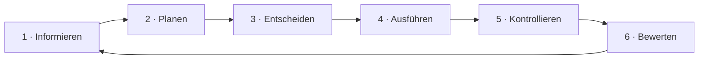
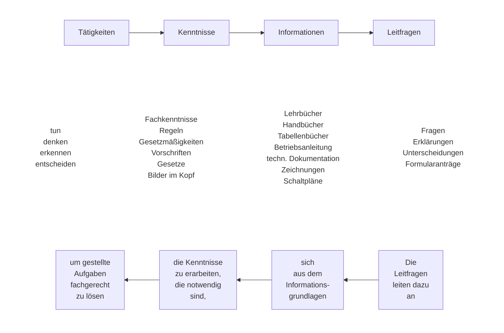
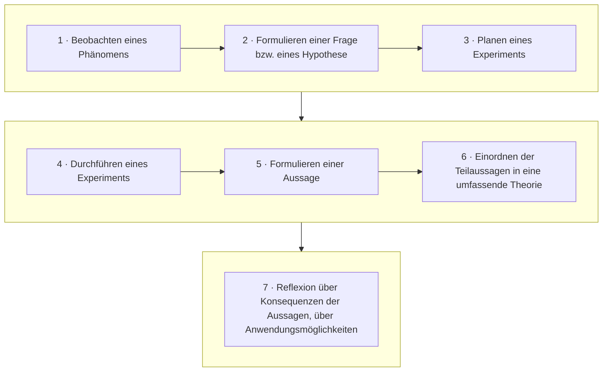
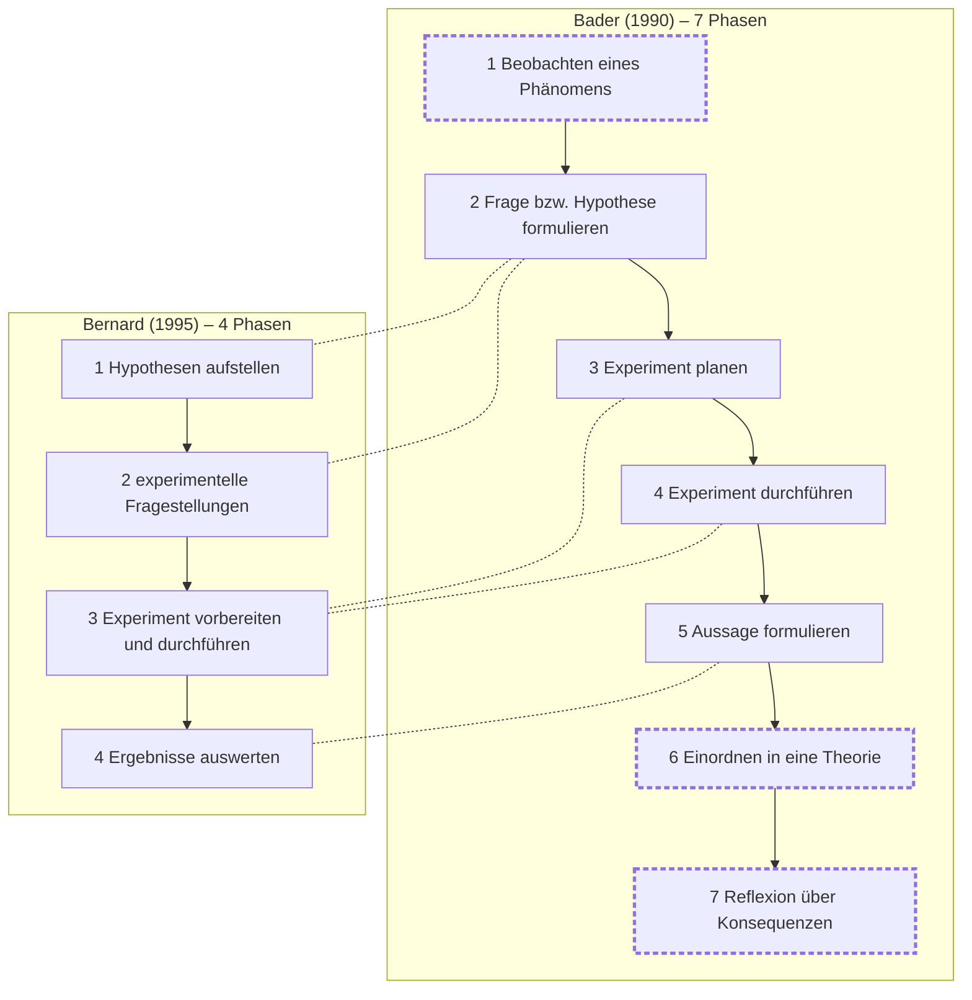

<!--
author:   Hannes Tegelbeckers
email:    hannes.tegelbeckers@ovgu.de
version:  0.3.0
language: de
narrator: Deutsch Female
mode:     Textbook
comment:  Fachdidaktik technischer Allgemeinbildung II – Selbstlerneinheit zu Sitzung S05. Leitfragen formulieren und prüfen, Experimente klassifizieren, ein technisches Experiment nach Bader planen und Methoden nach Effizienzkriterien wählen.

import:   https://raw.githubusercontent.com/LiaTemplates/mermaid_template/0.1.4/README.md
-->

# S05 – Leittext & Experiment (Selbstlerneinheit)

<!-- didaktik="Selbstlerneinheit S05 · ca. 90 min · Studientext + Übungen · Inhalte der Folien R089–R100, in eigenen Worten erläutert" -->
> [!IMPORTANT] 🧭 Leitfrage
> Wie mache ich aus einer Anleitung einen Leittext – und wie plane ich ein technisches Experiment, bei dem Lernende selbst zu Erkenntnissen kommen?

> [!NOTE] 📘 So ist diese Einheit aufgebaut
> Diese Einheit **erklärt die Inhalte der Sitzung S05** in eigenen Worten und mit Beispielen – Sie können sie auch bearbeiten, wenn Sie in der Sitzung nicht dabei waren. Die Originalfolien finden Sie in der [LiaScript-Sitzung S05](https://liascript.github.io/course/?https://raw.githubusercontent.com/OVGU-VET-TechEd/Fachdidaktik_technischer_Allgemeinbildung_II/main/S05_Leittext_Experiment.md).

> [!TIP] ✍️ Übung in Moodle
> Bearbeiten Sie diese Einheit als Übung im Moodle-Kurs – dort wird Ihr Bearbeitungsstand gespeichert: [Übung in Moodle öffnen](https://elearning.ovgu.de/mod/scorm/view.php?id=707266)

## Ablauf der Einheit

    --{{0}}--
Die Einheit dauert etwa 90 Minuten und hat vier Abschnitte. Jeder Abschnitt erklärt zuerst die Inhalte der Folien und lässt Sie sie dann in Übungen anwenden.

<!-- data-type="none" -->
| Nr. | Abschnitt | Format | Dauer |
|----|--------|--------|----------|
| 1 | Die Leittextmethode – und Leitfragen formulieren | Studientext, drei Übungen | 25 min |
| 2 | Das Experiment – Definition und Arten | Studientext, zwei Übungen | 15 min |
| 3 | Phasen des Experiments – ein Experiment planen | Studientext, Experiment nach Bader planen | 30 min |
| 4 | Methoden nach Effizienzkriterien wählen | Studientext, eine Übung | 10 min |

> [!NOTE] Prüfungsbezug
> Zum Abschluss (ca. 10 min): Rückblick und Prüfungsfragen zum Üben für die mündliche Prüfung.

## Lernziele der Einheit

    --{{0}}--
Nach dieser Einheit können Sie vier Dinge.

**Am Ende dieser Einheit können Sie …**

    --{{1}}--
Erstens unterscheiden Sie gute von schlechten Leitfragen und formulieren eigene.

      {{1}}
- **Leitfragen unterscheiden und formulieren** für eine Aufgabe Ihrer Fachrichtung

    --{{2}}--
Zweitens klassifizieren Sie Experimente nach vier Gesichtspunkten.

      {{2}}
- **Experimente klassifizieren** nach vier Gesichtspunkten

    --{{3}}--
Drittens planen Sie ein technisches Experiment mit den Phasen nach Bader.

      {{3}}
- **Experiment planen** mit den Phasen nach Bader

    --{{4}}--
Und viertens wählen Sie für ein Lernziel mit den Effizienzkriterien eine Methode aus.

      {{4}}
- **Methode auswählen** für ein Lernziel, begründet mit den Effizienzkriterien

    --{{5}}--
Welche Abschnitte interessieren Sie am meisten?

      {{5}}
****************************************

**Auswählen:** Auf welche Abschnitte sind Sie am meisten gespannt? (mehrere möglich)

[[m1]] Die Leittextmethode – und Leitfragen formulieren
[[m2]] Das Experiment – Definition und Arten
[[m3]] Phasen des Experiments – ein Experiment planen
[[m4]] Methoden nach Effizienzkriterien wählen

****************************************

## 1 · Die Leittextmethode – und Leitfragen formulieren

    --{{0}}--
Eine Arbeitsanleitung sagt, was in welcher Reihenfolge zu tun ist. Ein Leittext dagegen stellt eine Aufgabe und führt mit Leitfragen dazu, dass die Lernenden sich das nötige Wissen selbst erarbeiten, selbst planen, entscheiden und ihre Arbeit selbst kontrollieren. Die Leittextmethode stammt aus der betrieblichen Ausbildung und ist eine direkte Umsetzung der vollständigen Handlung aus S02.

**Wie wird aus einer Arbeitsanleitung ein Leittext?**

    --{{1}}--
Zuerst: was Leittexte leisten.

      {{1}}
- 1.1 Was Leittexte leisten (R089–R090)

    --{{2}}--
Dann: der Ablauf in sechs Schritten.

      {{2}}
- 1.2 Der Ablauf in sechs Schritten (R092)

    --{{3}}--
Danach: wie man Leitfragen erstellt.

      {{3}}
- 1.3 Leitfragen erstellen (R091)

    --{{4}}--
Und schließlich üben Sie mit Ihrer eigenen Anleitung.

      {{4}}
- Übungen: gute Leitfragen erkennen und formulieren

    --{{5}}--
Warum ist das für Sie wichtig?

      {{5}}
> [!TIP] Warum das wichtig ist
> [NEU] Nach Stettler (2025) kann Unterricht offene Aufgaben mit hoher Strukturiertheit verbinden – ein Leittext leistet genau das.

    --{{6}}--
Markieren Sie, was Sie schon kennen.

      {{6}}
****************************************

**Markieren:** Was davon kennen Sie schon? (mehrere möglich)

[[a1]] 1.1 Was Leittexte leisten (R089–R090)
[[a2]] 1.2 Der Ablauf in sechs Schritten (R092)
[[a3]] 1.3 Leitfragen erstellen (R091)
[[a4]] Übungen: gute Leitfragen erkennen und formulieren

****************************************

## 1.1 Was Leittexte leisten

    --{{0}}--
Leittexte haben auf den Folien sechs Funktionen. Sie führen ein, erläutern die Spielregeln, stellen die praktische Aufgabe vor, leiten mit Leitfragen und Impulsen den Kenntniserwerb und die Arbeitsplanung an, nennen Medien und leiten zur Selbst- und Fremdeinschätzung an.

**Funktionen der Leittexte**

- Sie führen in den Ausbildungsabschnitt ein.
- Sie erläutern die „Spielregeln“ für den folgenden Lern- und Arbeitsprozess.
- Sie stellen die anstehende praktische Aufgabe vor.
- Sie leiten mit Leitfragen und Impulsen den Kenntniserwerb und die Arbeitsplanung an.
- Sie geben Hinweise, anhand welcher Medien die Kenntnisse erarbeitet werden können und stellen ggf. auch Informationen bereit.
- Sie geben Anleitung zur Selbst- und Fremdeinschätzung der geleisteten Arbeit.

    --{{1}}--
Daraus ergeben sich die Merkmale leittextgestützten Lernens: Die Lernenden bearbeiten komplexe Aufgaben selbstständig. Die nötigen Kenntnisse erarbeiten sie sich, angeleitet durch Leitfragen, aus bereitstehenden Medien. Sie planen selbst, teils mit Planungsrastern. Neue Fertigkeiten üben sie an Übungshilfen und entscheiden weitgehend selbst, wie viel sie üben. Nach Teilaufgaben werten sie Verlauf und Ergebnis zuerst selbst aus und besprechen die Auswertung dann mit dem Ausbilder.

      {{1}}
****************************************

**Merkmale leittextgestützten Lernens**

- Die Lernenden bearbeiten komplexe Aufgabenstellungen selbstständig.
- Die für die Aufgabenbewältigung erforderlichen Kenntnisse erarbeiten sich die Lernenden selbstständig aus bereitstehenden Medien, angeleitet durch Leitfragen.
- Die Lernenden planen selbst, teilweise gestützt aus Planungsraster oder andere Hilfsmittel, die Durchführung der Arbeiten.
- Die Lernenden üben neue Fertigkeiten an sogenannten Übungshilfen, wobei sie weitgehend selbst über das Ausmaß der Übungen entscheiden.
- Nach Abschluss angemessener Teilaufgaben werten die Lernenden den Verlauf und die Ergebnisse ihrer Arbeit zunächst selbst aus und besprechen ihre Auswertung schließlich mit dem Ausbilder.

****************************************

    --{{2}}--
Der Kern in einem Satz:

      {{2}}
> [!NOTE] Kernaussage
> Eine Arbeitsanleitung sagt, **was** zu tun ist. Ein Leittext **leitet an**, sich Kenntnisse und Arbeitsplanung selbst zu erarbeiten.

<small>Quelle: Folien R089 „Funktionen der Leittexte“ und R090 „Merkmale leittextgestützten Lernens“</small>

## 1.2 Der Ablauf in sechs Schritten

    --{{0}}--
Die Leittextmethode läuft in sechs Schritten im Kreis. Die beiden Fachgespräche stehen an den Stellen, an denen Fehler am teuersten wären oder am meisten zu lernen ist; dazwischen arbeiten die Lernenden selbstständig.

    --{{1}}--
Informieren: Was soll getan werden? Die Lernenden arbeiten mit Leitfragen.

      {{1}}
1. **Informieren:** Was soll getan werden? → Leitfragen

    --{{2}}--
Planen: Wie geht man vor? Es entsteht ein Arbeitsplan.

      {{2}}
2. **Planen:** Wie geht man vor? → Arbeitsplan

    --{{3}}--
Entscheiden: Fertigungsweg und Betriebsmittel werden im Fachgespräch mit dem Ausbilder festgelegt – vor der Ausführung, denn ist der Plan nicht tragfähig, wird Material verschwendet oder es wird gefährlich.

      {{3}}
3. **Entscheiden:** Fertigungsweg und Betriebsmittel festlegen → Fachgespräch mit dem Ausbilder

    --{{4}}--
Ausführen: Das Werkstück wird gefertigt.

      {{4}}
4. **Ausführen:** Fertigen des Werkstückes → Auftragsbearbeitung

    --{{5}}--
Kontrollieren: Ist der Auftrag fachgerecht gefertigt? Dafür gibt es einen Kontrollbogen.

      {{5}}
5. **Kontrollieren:** Ist der Auftrag fachgerecht gefertigt? → Kontrollbogen

    --{{6}}--
Bewerten: Was muss beim nächsten Mal besser werden? Das zweite Fachgespräch folgt nach der Kontrolle – hier lernen alle aus dem Ergebnis.

      {{6}}
6. **Bewerten:** Was muss beim nächsten Mal besser gemacht werden? → Fachgespräch mit dem Ausbilder

<small>Quelle: Folie R092 „Ablauf“ – gescannte Abbildung „Leittextmethode“ nachgezeichnet; Erläuterungen: eigene Darstellung.</small>

## Übung 1a: Reihenfolge der Leittextmethode

    --{{0}}--
Bringen Sie die sechs Schritte in die richtige Reihenfolge.

**Ordnen:** Ziehen Sie jede Karte in die richtige Lücke.

<!-- data-randomize data-show-partial-solution data-solution-button="2" -->
Schritt 1: [->[ Informieren ]] → Schritt 2: [->[ Planen ]] → Schritt 3: [->[ Entscheiden ]] → Schritt 4: [->[ Ausführen ]] → Schritt 5: [->[ Kontrollieren ]] → Schritt 6: [->[ Bewerten ]]

## 1.3 Leitfragen erstellen

    --{{0}}--
Gute Leitfragen entstehen in einer Kette, die die Lehrkraft rückwärts von der Aufgabe her denkt.

    --{{1}}--
Tätigkeiten: Was müssen die Lernenden tun, denken, erkennen, entscheiden? Kenntnisse: Welche Fachkenntnisse, Regeln, Vorschriften, Bilder im Kopf brauchen sie dafür?

      {{1}}
**① Tätigkeiten und Kenntnisse:** Was müssen die Lernenden tun, denken, erkennen, entscheiden – und welche Kenntnisse brauchen sie dafür?

    --{{2}}--
Informationen: Wo stehen diese Kenntnisse – im Lehrbuch, im Tabellenbuch, in der Betriebsanleitung, in einer Zeichnung oder einem Schaltplan? Leitfragen: Welche Frage führt die Lernenden genau zu dieser Information?

      {{2}}
**② Informationen und Leitfragen:** Wo stehen die Kenntnisse – und welche Frage führt genau dorthin?

    --{{3}}--
Gelesen in der Gegenrichtung, so steht es in der unteren Reihe: Die Leitfragen leiten dazu an, sich aus den Informationsgrundlagen die Kenntnisse zu erarbeiten, die nötig sind, um die Aufgabe fachgerecht zu lösen.

      {{3}}
**③ Rückweg:** Die Leitfragen leiten dazu an, sich aus dem Informationsgrundlagen die Kenntnisse zu erarbeiten, die notwendig sind, um gestellte Aufgaben fachgerecht zu lösen.

    --{{4}}--
Woran scheitert eine Leitfrage?

      {{4}}
> [!NOTE] Kernaussage
> ⚠️ Eine Leitfrage ist **keine Anweisung** („Schließen Sie … an“) und **verrät die Lösung nicht** („Ist es richtig, dass …?“). Sie verlangt, dass die Lernenden etwas **nachschlagen, herausfinden oder entscheiden**.

<small>Quelle: Folie R091 „Leitfragen erstellen“ – Grafik (nur Bild) als Diagramm nachgezeichnet; Erläuterungen: eigene Darstellung.</small>

## Übung 1b: Gute Leitfragen erkennen

    --{{0}}--
Ergänzen Sie zuerst den Text. Wählen, tippen oder ziehen Sie die fehlenden Wörter.

**Ergänzen:**

<!-- data-hint-button="1" data-solution-button="2" data-show-partial-solution -->
Ein Leittext stellt eine Aufgabe und führt mit [[ (Leitfragen) | Anweisungen | Musterlösungen ]] dazu, dass die Lernenden sich das nötige Wissen selbst erarbeiten. Die Leittextmethode hat so viele Schritte: [[6]]. Zweimal führen Lernende und Ausbilder ein [->[ (Fachgespräch) | Kontrollbogen ]].
[[?]] Schauen Sie in den Ablauf der Leittextmethode (R092).

    --{{1}}--
Aufgabe aus der Elektrotechnik: Installieren Sie eine Außenleuchte mit Bewegungsmelder am Hauseingang. Entscheiden Sie bei jeder Frage: Ist sie eine gute Leitfrage – dann true – oder keine Leitfrage – dann false?

      {{1}}
****************************************

**Entscheiden:** Richtig oder falsch?

<!-- data-hint-button="1" data-solution-button="2" data-show-partial-solution -->
[(richtig) (falsch)]
[  (X)    ( )  ] Welche Schutzart muss eine Leuchte im Außenbereich mindestens haben? Schlagen Sie im Tabellenbuch nach.
[  ( )    (X)  ] Schließen Sie den braunen Leiter an Klemme L an.
[  (X)    ( )  ] Welche Montagehöhe und welchen Erfassungswinkel empfiehlt die Betriebsanleitung des Melders – und was bedeutet das für den Montageort?
[  ( )    (X)  ] Ist es richtig, dass Sie vorher die Spannungsfreiheit feststellen müssen?
[[?]] true = gute Leitfrage, false = keine Leitfrage. Verweist die Frage auf ein Medium, oder ist sie eine Anweisung bzw. verrät sie die Lösung?
***
Gute Leitfragen verweisen auf ein Medium, verlangen eine eigene Erarbeitung oder Entscheidung und verraten die Lösung nicht. „Schließen Sie … an“ ist eine Anweisung. „Ist es richtig, dass …?“ enthält die Antwort schon – besser: „Welche Sicherheitsregeln gelten vor Arbeiten an elektrischen Anlagen?“
***

****************************************

## Übung 1c: Ihre Anleitung wird zum Leittext

    --{{0}}--
Nehmen Sie eine Arbeits- oder Bedienungsanleitung aus Ihrer Fachrichtung und bauen Sie sie um. Prüfen Sie am Ende mit Stettler: Bleibt die Aufgabe offen genug – und geben die Leitfragen genug Struktur?

Formulieren Sie drei Leitfragen für eine Aufgabe aus Ihrer Anleitung – je eine zum **Informieren**, zum **Planen** und zum **Entscheiden**. Nennen Sie jeweils das Medium.

[[___ ___ ___ ___]]

💡 Hinweis

Gehen Sie die Kette rückwärts: Tätigkeit → nötige Kenntnis → wo steht sie? → welche Frage führt dorthin? Prüfen Sie dann: Ist die Frage eine Anweisung, oder verrät sie die Lösung?

✅ Lösung

Beispiel Metalltechnik, Aufgabe „M8-Gewinde schneiden“: **Informieren** – „Welchen Kernlochdurchmesser brauchen Sie für M8? Schlagen Sie im Tabellenbuch nach.“ · **Planen** – „In welcher Reihenfolge arbeiten Sie, und welche Werkzeuge brauchen Sie? Erstellen Sie einen Arbeitsplan.“ · **Entscheiden** – „Schneiden Sie von Hand oder maschinell? Begründen Sie im Fachgespräch.“ 🤖 *Üben mit KI:* Lassen Sie ein KI-Werkzeug aus Ihrer Anleitung fünf Leitfragen formulieren, die auf Tabellenbuch oder Betriebsanleitung verweisen und die Lösung nicht verraten – und streichen Sie, was die Lösung doch verrät.

## 2 · Das Experiment – Definition

    --{{0}}--
Im Unterricht ist ein Experiment mehr als ein Versuch. Die Folie definiert es als Unterrichtskonzeption mit induktivem Erkenntnisweg: Ausgangspunkt ist ein technisches oder naturwissenschaftliches Phänomen, das unter kontrollierten, eingeschränkten Bedingungen nachgestellt oder simuliert und analysiert wird.

> Ein Experiment ist eine Unterrichtskonzeption mit **induktivem Erkenntnisweg**. Ausgangspunkt ist ein technisches oder naturwissenschaftlich Phänomen, welches unter kontrollierten/eingeschränkten Bedingungen nachgestellt/simuliert und analysiert wird.

    --{{1}}--
Was heißt induktiv?

      {{1}}
****************************************

*Induktiv* heißt (S01b): Die Lernenden gehen vom **Einzelfall zur Regel**. Sie kennen das Ergebnis vorher nicht, sondern gewinnen es aus ihren Beobachtungen und Messungen.

****************************************

    --{{2}}--
Daraus folgt eine wichtige Unterscheidung.

      {{2}}
> [!NOTE] Kernaussage
> Zeigt die Lehrkraft nur, was ohnehin im Buch steht, ist es eine **Vorführung** zur Veranschaulichung – kein Experiment in diesem Sinn.

<small>Quelle: Folie R093 „Definition Experiment“; Erläuterung: eigene Darstellung.</small>

## Arten von Experimenten

    --{{0}}--
Experimente lassen sich nach vier Gesichtspunkten einteilen.

- **…nach dem Erkenntnisziel:**
  - Naturwissenschaftliches Experiment
  - Technisches Experiment
- **…nach ihrer didaktischen Funktion:**
  - Experimente zum Einstieg in eine bestimmte Thematik
  - Experimente für die Erarbeitung von Erkenntnissen
  - Experimente zur Übung, Festigung, Falsifikation und Verifikation
  - Experimente zur Leistungskontrolle
- **…nach ihrer Sozial- und Organisationsform:**
  - Lehrerexperiment (Demonstration)
  - Schülerexperiment in Einzelarbeit, in Partnerarbeit oder in Gruppenarbeit
- **…nach ihrem Wirklichkeitsbezug:**
  - Experimente mit Modellen
  - Experimente mit Realgegenständen
  - Gedankenexperiment

    --{{1}}--
In eigenen Worten und mit Beispielen:

      {{1}}
****************************************

- **Erkenntnisziel:** Ein *naturwissenschaftliches* Experiment fragt, wie die Natur ist (z. B. Wärmeleitung). Ein *technisches* Experiment fragt, ob und wie ein technisches Gebilde seinen Zweck erfüllt (z. B. welcher Dämmstoff am besten geeignet ist).
- **Didaktische Funktion:** Vergleichen Sie mit den didaktischen Funktionen aus S01.
- **Sozial- und Organisationsform:** Wer führt den Versuch durch – die Lehrkraft oder die Lernenden?
- **Wirklichkeitsbezug:** Modell, Realgegenstand – oder nur im Kopf.

****************************************

    --{{2}}--
Und das gilt immer:

      {{2}}
> [!NOTE] Kernaussage
> Ein und dasselbe Experiment hat immer eine Ausprägung in **allen vier** Gesichtspunkten.

<small>Quelle: Folie R094 „Arten von Experimenten klassifiziert…“; Erläuterungen und Beispiele: eigene Darstellung.</small>

## Übung 2a: Welche Form, welcher Wirklichkeitsbezug?

    --{{0}}--
Drei kurze Fragen zu den Arten von Experimenten.

**1 · Eine Antwort:** Die Lehrkraft zeigt den Zugversuch an der Prüfmaschine. Welche Sozial- und Organisationsform ist das?

<!-- data-hint-button="1" data-solution-button="2" -->
- [( )] Schülerexperiment
- [(X)] Lehrerexperiment (Demonstration)
- [( )] Gedankenexperiment
[[?]] Wer führt den Versuch durch?
***
Lehrerexperiment = Demonstration (R094).
***

    --{{1}}--
Jetzt können mehrere Antworten richtig sein.

      {{1}}
****************************************

**2 · Alle zutreffenden:** Welche dieser Experimente sind Schülerexperimente?

<!-- data-hint-button="1" data-solution-button="2" -->
- [[X]] Zu zweit messen Lernende die Verlängerung von Drähten unter Gewichten.
- [[ ]] Die Lehrkraft zeigt den Zugversuch an der Prüfmaschine.
- [[X]] Eine Auszubildende prüft allein mehrere Dämmplatten im Wärmekasten.
- [[ ]] „Was passiert, wenn wir die Probe doppelt so lang machen?“ – ohne Versuch.
[[?]] Schülerexperimente gibt es in Einzel-, Partner- oder Gruppenarbeit.
***
Schülerexperiment in Einzel-, Partner- oder Gruppenarbeit; die Frage ohne Versuch ist ein Gedankenexperiment – eine eigene Form nach dem Wirklichkeitsbezug (R094).
***

****************************************

    --{{2}}--
Zum Schluss tippen Sie einen Begriff.

      {{2}}
****************************************

**3 · Eintippen:** Wie heißt der Erkenntnisweg des Experiments – vom Einzelfall zur Regel? (ein Wort)

<!-- data-hint-button="1" data-solution-button="2" -->
[[induktiv]]
[[?]] Das Gegenteil heißt deduktiv (S01b).

***
Das Experiment ist eine Unterrichtskonzeption mit induktivem Erkenntnisweg (R093).
***

****************************************

## Übung 2b: Alle vier Gesichtspunkte

    --{{0}}--
Klassifizieren Sie jetzt ein Experiment nach allen vier Gesichtspunkten.

**Experiment:** *Auszubildende prüfen zu zweit an echten Dämmplatten, welches Material bei gleicher Dicke die Wärme am schlechtesten leitet – als Einstieg in das Lernfeld.* Klassifizieren Sie nach Erkenntnisziel, didaktischer Funktion, Sozial- und Organisationsform und Wirklichkeitsbezug.

[[___ ___ ___ ___]]

💡 Hinweis

Gehen Sie die vier Gesichtspunkte von Folie R094 nacheinander durch.

✅ Lösung

**Erkenntnisziel:** technisch (Auswahl eines zweckmäßigen Dämmstoffs) – mit naturwissenschaftlichem Kern (Wärmeleitung). **Didaktische Funktion:** Einstieg. **Sozialform:** Schülerexperiment in Partnerarbeit. **Wirklichkeitsbezug:** Realgegenstand.

## 3 · Phasen des Experiments: Bernard (1995)

    --{{0}}--
Zwei Modelle beschreiben, in welchen Phasen ein Experiment im Unterricht abläuft. Beide nutzen den Zugversuch bzw. das Hooke'sche Gesetz als Beispiel – die Dehnung eines Werkstoffs unter Last. Bernard beschreibt vier Phasen.

1. Aufstellen von Hypothesen
2. Herausarbeiten experimenteller Fragestellungen
3. Vorbereiten und Durchführen des Experiments
4. Auswerten der Ergebnisse des Experiments

    --{{1}}--
Im Beispiel heißt die Hypothese: Die Dehnung ist proportional zur Spannung. Experimentelle Fragen sind: Ergibt die grafische Auswertung eine Gerade? Wo liegt die Proportionalitätsgrenze? Ausgewertet wird im Spannungs-Dehnungs-Diagramm.

      {{1}}
****************************************

**Beispiel: Hooke‘sches Gesetz für das elastische Verhalten von Werkstoffen**

- Analyse der Problemstellung
  - Verhältnis von Dehnung bei vorliegender Belastung
- Hypothesenbildung und experimentelle Fragestellung
  - Erfolgt die Dehnung proportional zur Spannung?
  - Ergibt die graphische Auswertung eine Gerade?
  - Wo liegt die Proportionalitätsgrenze?
- Durchführung des Experiments
- Auswertung der Ergebnisse des Experiments
  - Kurven im Spannungs-Dehnungs-Diagramm
  - Beantwortung der Fragen
  - Bestätigung der Hypothese

****************************************

    --{{2}}--
Bernard beginnt bei den Hypothesen und endet mit ihrer Bestätigung.

      {{2}}
> [!NOTE] Kernaussage
> Bernard: von der Hypothese zur Auswertung – das Experiment prüft eine Vermutung.

<small>Quelle: Folie R095 „Methodische Phasen von Experimenten nach BERNARD“ (BERNARD 1995)</small>

## Phasen des Experiments: Bader (1990)

    --{{0}}--
Bader setzt früher an und hört später auf. Nur Bader beginnt mit dem Beobachten eines Phänomens – dadurch entsteht die Frage bei den Lernenden selbst, statt von der Lehrkraft zu kommen. Und nur Bader endet mit Einordnen in eine Theorie und Reflexion: Das Ergebnis bleibt nicht als isolierter Messwert stehen, sondern wird verallgemeinert und auf die Berufspraxis bezogen.

    --{{1}}--
Ausgangspunkt ist eine Erfahrung aus der Wirklichkeit. Aus der Beobachtung wird eine prüfbare Vermutung. Beim Planen wird eine künstliche, technische Wirklichkeit geschaffen: Variablen – was verändert wird –, Konstanten – was gleich bleibt –, Randbedingungen und Messfehler.

      {{1}}
****************************************

1. **Beobachten eines Phänomens:** (z.B. Bauteile verformen sich unter Belastung)
2. **Formulieren einer Frage bzw. eines Hypothese:** (z.B. Welcher Zusammenhang besteht zwischen wirkender Kraft und der Formänderung eines Bauteils)
3. **Planen eines Experiments:** d.h. Schaffen einer künstlichen, technischen Wirklichkeit unter Beachtung bestimmter Randbedingungen (z.B. Planen eines Zug-Versuchs: Festlegen von Variablen und Konstanten; Einspannvorrichtung; Aufbringen der Last; Abmessungen der Probe; Laststeigerung in der Zeiteinheit; Abschätzen vom Messfehlern)

****************************************

    --{{2}}--
Dann wird beobachtet, gemessen und protokolliert. Die Aussage stützt oder falsifiziert die Hypothese – unter Beachtung der Randbedingungen und der Messgenauigkeit. Danach wird die Teilaussage mit größerem Wissen verbunden.

      {{2}}
****************************************

4. **Durchführen eines Experiments:** (Beobachten, Messen, Protokollieren, Auswerten …)
5. **Formulieren einer Aussage:** (eines Ergebnisses) bzw. Stützen, Falsifizieren der Ausgangshypothese unter Berücksichtigung der Randbedingungen und der Messgenauigkeit (z.B. Gültigkeit des Hooke‘schen Gesetzes für einen bestimmten Werkstoff, für einen bestimmten Lastbereich)
6. **Einordnen der Teilaussagen in eine umfassende Theorie:** (z.B. Annahme eines einachsigen Spannungszustandes; Spannungshypothesen)

****************************************

    --{{3}}--
Am Ende steht die Frage: Was bedeutet das Ergebnis für die Praxis?

      {{3}}
7. **Reflexion über Konsequenzen der Aussagen, über Anwendungsmöglichkeiten:** (z.B. Übereinstimmung der experimentellen Ergebnisse mit dem Verhalten eines Bauteils im Gebrauchszustand; Möglichkeiten der rechnerischen Dimensionierung von Bauteilen)

<small>Quelle: Folie R096 „Methodische Phasen von Experimenten nach BADER“ (BADER 1990) – Wortlaut unverändert; Erläuterungen: eigene Darstellung.</small>

## Phasen nach Bader ordnen

    --{{0}}--
Ordnen Sie die sieben Phasen nach Bader.

**Ordnen:** Ziehen Sie jede Karte in die richtige Lücke.

<!-- data-randomize data-show-partial-solution data-solution-button="2" -->
Schritt 1: [->[ Beobachten eines Phänomens ]] → Schritt 2: [->[ Formulieren einer Frage bzw. eines Hypothese ]] → Schritt 3: [->[ Planen eines Experiments ]] → Schritt 4: [->[ Durchführen eines Experiments ]] → Schritt 5: [->[ Formulieren einer Aussage ]] → Schritt 6: [->[ Einordnen der Teilaussagen in eine umfassende Theorie ]] → Schritt 7: [->[ Reflexion über Konsequenzen der Aussagen, über Anwendungsmöglichkeiten ]]

## Bernard und Bader im Vergleich

    --{{0}}--
Legt man beide Modelle nebeneinander, wird sichtbar, wo sie übereinstimmen und wo Bader weiter geht. Die gestrichelten Linien zeigen, welche Phasen einander entsprechen.

    --{{1}}--
In der Mitte stimmen beide Modelle überein.

      {{1}}
**① Gemeinsamer Kern:** Hypothese und Fragestellung, Vorbereiten und Durchführen, Auswerten bzw. eine Aussage formulieren.

    --{{2}}--
Bader setzt früher an.

      {{2}}
**② Nur Bader: der Anfang:** Beobachten eines Phänomens – so entsteht die Frage bei den Lernenden selbst.

    --{{3}}--
Und Bader hört später auf.

      {{3}}
**③ Nur Bader: das Ende:** Einordnen in eine Theorie und Reflexion über Anwendungen – das Ergebnis wird verallgemeinert.

    --{{4}}--
Für die Planung heißt das:

      {{4}}
> [!NOTE] Kernaussage
> Wer nach Bader plant, gibt den Lernenden mehr vom **Erkenntnisweg** – vom Phänomen bis zur Anwendung im Beruf (vgl. Induktion, S01b, und vollständige Handlung, S02).

<small>Phasen nach Folien R095 (Bernard 1995) und R096 (Bader 1990); Zuordnung der Phasen: eigene Darstellung. Hervorgehobene Kästen: nur bei Bader.</small>

## Ein Experiment vorbereiten

    --{{0}}--
Die Folien geben eine Checkliste zur Vorbereitung technischer Experimente. Hier die wichtigsten Fragen in Kurzform. Zur Durchführung gehören außerdem zwei Dokumente: eine Handreichung für die Lehrkraft und ein Arbeitsblatt für die Lernenden.

- **Fachliche Grundlagen:** Welcher fachliche Kontext? Was sagen Regelwerke (DIN, Richtlinien)? Was davon ist für Facharbeiter, Meister, Techniker relevant?
- **Einordnung:** Für welche Berufe, welches Lernfeld, wie viel Zeit?
- **Theoretische Konzeption:** Welche Vorkenntnisse? **Wie stark muss vereinfacht werden** (→ didaktische Reduktion, S07)? Welche Aussage soll erarbeitet werden? Welche didaktische Funktion, welche Organisationsform?
- **Praktische Konzeption:** Geräte, Verbrauchsmittel – und **Arbeitsschutzmaßnahmen**.
- **Durchführung:** Welche Hypothesen stellen die Lernenden auf? Versuchsanordnung (Skizze), Ablauf, Protokollform.
- **Auswertung:** Wie werden die Protokolle ausgewertet, werden sie bewertet? Ist das Experiment exemplarisch für andere Inhalte?

    --{{1}}--
Und die beiden Dokumente:

      {{1}}
> [!NOTE] Kernaussage
> **Handreichung für die Lehrkraft:** Grundlagen, mögliche Fehlerquellen, Beispielergebnisse, Arbeitsblatt mit Lösungen · **Arbeitsblatt für die Lernenden:** verständliche Grundlagen, Hinweise zur Durchführung, Arbeitsaufgaben.

<small>Zusammenfassung der Folien R097–R099 (Hinweise zur Vorbereitung, Handreichungen zur Versuchsdurchführung); Wortlaut der Folien in der Sitzung S05.</small>

## Übung 3a: Bernard und Bader

    --{{0}}--
Drei kurze Fragen zu den beiden Phasenmodellen.

**1 · Eine Antwort:** Womit beginnt Bader – anders als Bernard?

<!-- data-hint-button="1" data-solution-button="2" -->
- [( )] Aufstellen von Hypothesen
- [(X)] Beobachten eines Phänomens
- [( )] Vorbereiten und Durchführen des Experiments
[[?]] Woher kommt bei Bader die Frage?
***
Bader beginnt mit dem Beobachten eines Phänomens – so entsteht die Frage bei den Lernenden selbst.
***

    --{{1}}--
Jetzt können mehrere Antworten richtig sein.

      {{1}}
****************************************

**2 · Alle zutreffenden:** Welche Phasen gibt es nur bei Bader?

<!-- data-hint-button="1" data-solution-button="2" -->
- [[X]] Einordnen der Teilaussagen in eine umfassende Theorie
- [[ ]] Aufstellen bzw. Formulieren einer Hypothese
- [[X]] Reflexion über Konsequenzen und Anwendungsmöglichkeiten
- [[ ]] Durchführen des Experiments
[[?]] Beide Modelle enthalten Hypothese, Durchführung und Auswertung.
***
Nur Bader beginnt mit dem Beobachten und endet mit Einordnen und Reflexion (R095, R096).
***

****************************************

    --{{2}}--
Zum Schluss tippen Sie einen Begriff.

      {{2}}
****************************************

**3 · Eintippen:** In welcher Phase nach Bader wird die Hypothese gestützt oder falsifiziert? Formulieren einer … (ein Wort)

<!-- data-hint-button="1" data-solution-button="2" -->
[[Aussage]]
[[?]] Es ist Phase 5.

***
Phase 5: Formulieren einer Aussage (eines Ergebnisses) bzw. Stützen, Falsifizieren der Ausgangshypothese (R096).
***

****************************************

## Übung 3b: Ein Experiment nach Bader planen

    --{{0}}--
Planen Sie jetzt selbst ein Experiment nach Bader. Ihre Planung ist zugleich Baustein 6 für Ihren Unterrichtsentwurf. Vergleichen Sie danach mit Bernard: Welche Ihrer Phasen fehlen dort – und sind sie für Ihre Lerngruppe wichtig?

**Phänomen:** *Eine Kfz-Batterie liefert an einem kalten Wintermorgen weniger Startleistung.* Planen Sie das Experiment für eine Berufsschulklasse:

<!-- data-type="none" -->
| Phase | Ihre Planung |
| --- | --- |
| 1 Beobachten | … |
| 2 Hypothese | … |
| 3 Planen: Was verändern Sie, was halten Sie konstant? | … |
| 4 Durchführen: Was wird gemessen und protokolliert? | … |
| 5 Aussage | … |
| 6 Einordnen | … |
| 7 Reflexion: Was folgt für die Praxis? | … |

[[___ ___ ___ ___]]

💡 Hinweis

Variablen sind das, was Sie verändern (hier: die Temperatur), Konstanten das, was gleich bleibt (Ladezustand, Last, Messdauer).

✅ Lösung

1 Startprobleme im Winter. 2 „Je kälter die Batterie, desto geringer der Strom, den sie unter Last liefert.“ 3 Batterietemperatur variieren (Raum, Kühlschrank, ggf. Kühlkammer); konstant: Ladezustand, Last, Messdauer. 4 Klemmenspannung und Strom unter definierter Last messen, Temperatur protokollieren. 5 Hypothese gestützt oder nicht – unter Berücksichtigung der Messgenauigkeit. 6 Einordnen: Chemische Reaktionen laufen bei niedriger Temperatur langsamer ab, der Innenwiderstand steigt. 7 Konsequenzen: Batterieprüfung vor dem Winter, Kälteprüfstrom als Kennwert verstehen. **Arbeitsschutz** (Vorbereitungshinweise S05): Säure, Kurzschlussgefahr, Gasbildung beim Laden.

## 4 · Methoden nach Effizienzkriterien wählen

    --{{0}}--
Jede Methode ist für manche Ziele besser geeignet als für andere. Eine Abbildung von Papaloizos und Stiefel vergleicht sechs Methoden an sieben Kriterien: beobachten, relevante Daten auswählen, Probleme diagnostizieren, Lösungen formulieren, entscheiden, kommunizieren, motivieren. Jede Methode hat ihren stärksten Ausschlag bei einem Kriterium.

> Abb. 4: Effizienzkriterien verschiedener Methoden (entnommen aus: Papaloizos/Stiefel 1971, 180)

<!-- data-type="none" -->
| Methode | stärkster Ausschlag | kennen Sie aus … |
| --- | --- | --- |
| Field Studies (Erkundung, Exkursion) | Beobachten | S09 |
| Incident Method | relevante Daten auswählen | Case-Incident-Method, S04 |
| Case Method | Probleme diagnostizieren, Lösungen formulieren | Fallstudie, S04 |
| Decision Simulations | Entscheiden | – |
| Role Playing | Kommunizieren | Rollenspiel, S04 |
| Group Projects | Motivieren | Projekt, S03 |

    --{{1}}--
Daraus folgt eine einfache Regel für die Planung.

      {{1}}
> [!NOTE] Kernaussage
> **Erst das Lernziel klären, dann die Methode wählen**, die für dieses Ziel am stärksten ist. Die Abbildung ist eine qualitative Darstellung von 1971, keine Messung – sie hilft beim Nachdenken, ersetzt aber nicht Ihre Begründung.

<small>Quelle: Folie R100 „Effizienzkriterien verschiedener Methoden“ – Tabelle aus der Abbildung abgelesen; die Abbildung ist ein Buchscan und wird wegen der Bildrechte nicht eingebettet.</small>

## Übung 4: Welche Methode wählen Sie?

    --{{0}}--
Wählen Sie nach dem stärksten Ausschlag in der Abbildung.

**1 · Eine Antwort:** Lernende sollen in einer Lackiererei genau beobachten, wie Arbeitsschutz umgesetzt wird. Welche Methode wählen Sie?

<!-- data-hint-button="1" data-solution-button="2" -->
- [( )] Rollenspiel
- [(X)] Exkursion (Field Study)
- [( )] Gruppenprojekt
[[?]] Welches Kriterium steckt in „genau beobachten“?
***
Field Studies haben ihren stärksten Ausschlag bei Observing (Beobachten).
***

    --{{1}}--
Jetzt können mehrere Antworten richtig sein.

      {{1}}
****************************************

**2 · Alle zutreffenden:** Für welche Lernziele passt nach der Abbildung die Fallstudie (Case Method) am besten?

<!-- data-hint-button="1" data-solution-button="2" -->
- [[X]] Die Ursache für häufige Reklamationen in einem Betrieb diagnostizieren
- [[ ]] Ein Reklamationsgespräch mit einem Kunden führen
- [[X]] Lösungen für ein betriebliches Problem formulieren
- [[ ]] Eine Klasse für ein neues Lernfeld begeistern
[[?]] Die Case Method hat ihren Ausschlag bei Diagnosing Problems und Formulating Solutions.
***
Das Gespräch passt zum Rollenspiel (Kommunizieren), die Begeisterung zum Gruppenprojekt (Motivieren).
***

****************************************

    --{{2}}--
Zum Schluss ein Begriff.

      {{2}}
****************************************

**3 · Eintippen:** Welches Kriterium fördert das Rollenspiel nach der Abbildung am stärksten? (ein deutsches Wort)

<!-- data-hint-button="1" data-solution-button="2" -->
[[Kommunizieren]]
[[?]] Role Playing – Communicating.

***
Rollenspiel – Kommunizieren. Beachten Sie: Die Abbildung ist eine qualitative Darstellung aus dem Jahr 1971, keine Messung.
***

****************************************

## 5 · Das Wichtigste aus S05

    --{{0}}--
Fassen wir zusammen.

    --{{1}}--
Erstens: der Leittext.

      {{1}}
- Ein Leittext leitet mit Leitfragen an, sich Kenntnisse und Arbeitsplanung selbst zu erarbeiten (R089–R091).

    --{{2}}--
Zweitens: die Leitfrage.

      {{2}}
- Eine gute Leitfrage ist keine Anweisung, verrät die Lösung nicht und verweist auf ein Medium.

    --{{3}}--
Drittens: das Experiment.

      {{3}}
- Experiment = induktiver Erkenntnisweg; Bader ergänzt Beobachten, Einordnen und Reflexion (R093–R096).

    --{{4}}--
Und viertens: die Methodenwahl.

      {{4}}
****************************************

- Erst das Lernziel klären, dann die Methode wählen, die dafür am stärksten ist (R100).

> [!NOTE] Zum Merken
> Selbstständigkeit entsteht, wenn Lernende selbst informieren, planen, entscheiden und kontrollieren.

****************************************

    --{{5}}--
Eine letzte Frage.

      {{5}}
****************************************

**Wiederholen:** Wo stehen in der Leittextmethode die beiden Fachgespräche mit dem Ausbilder?

<!-- data-hint-button="1" data-solution-button="2" -->
- [( )] Beim Informieren und beim Ausführen
- [( )] Beim Planen und beim Kontrollieren
- [(X)] Beim Entscheiden und beim Bewerten
[[?]] Eines steht vor der Ausführung, eines nach der Kontrolle.
***
Richtig: vor der Ausführung (Entscheiden) und nach der Kontrolle (Bewerten) – R092.
***

****************************************

    --{{6}}--
Als Nächstes geht es um methodische Großformen.

      {{6}}
**➡️ Als Nächstes:** S06: Methodische Großformen · 🧩 Optional für die Selbstlernsitzung am 11.01.2027: Ihre Experimentplanung aus Übung 3b oder ein eigenes Experiment ist Baustein 6.

## Prüfungsfragen zum Üben

    --{{0}}--
Die Prüfungsleistung des Moduls ist eine mündliche Prüfung. Mit diesen fünf Fragen üben Sie, die Inhalte dieser Einheit frei, strukturiert und mit Beispielen zu erklären.

> [!TIP] 🎙️ So üben Sie
> Lesen Sie eine Frage und antworten Sie **laut** in höchstens drei Minuten – nach dem Muster **Begriff – Erläutern – Beispiel – Verbinden**. Öffnen Sie erst danach die Antwortskizze und vergleichen Sie: Was fehlte, was war ungenau? Noch besser: Lassen Sie sich von einer Kommilitonin oder einem Kommilitonen abfragen.

**Frage 1 · Leittext:** Welche Funktionen haben Leittexte, und wie unterscheidet sich ein Leittext von einer Arbeitsanleitung?

✅ Antwortskizze 1

- **1 Begriff:** Leittexte leiten Lernende an, sich die für eine Aufgabe nötigen Kenntnisse und die Arbeitsplanung **selbst** zu erarbeiten (R089–R090).
- **2 Erläutern:** Sechs Funktionen: in den Ausbildungsabschnitt einführen, „Spielregeln“ erläutern, die praktische Aufgabe vorstellen, mit **Leitfragen und Impulsen** Kenntniserwerb und Arbeitsplanung anleiten, Medien nennen bzw. Informationen bereitstellen, zur **Selbst- und Fremdeinschätzung** anleiten. Ablauf in sechs Schritten: Informieren – Planen – Entscheiden (Fachgespräch) – Ausführen – Kontrollieren (Kontrollbogen) – Bewerten (Fachgespräch) (R092).
- **3 Beispiel:** Eine Arbeitsanleitung sagt „Bohren Sie ein Kernloch mit 6,8 mm“; eine Leitfrage fragt „Welcher Kernlochdurchmesser gehört zu M8? Wo finden Sie ihn?“.
- **4 Verbinden:** Die sechs Schritte entsprechen der vollständigen Handlung (S02). Die Lernenden planen und kontrollieren selbst – Stufe 3 bis 5 der Selbständigkeit.

**Frage 2 · Leitfragen erstellen:** Wie erstellt man Leitfragen? Erläutern Sie die Kette an einem Beispiel aus Ihrer Fachrichtung.

✅ Antwortskizze 2

- **1 Begriff:** Leitfragen entstehen in einer Kette **Tätigkeiten → Kenntnisse → Informationen → Leitfragen**, die die Lehrkraft rückwärts von der Aufgabe her denkt (R091).
- **2 Erläutern:** Was müssen die Lernenden tun, denken, erkennen, entscheiden? Welche Kenntnisse brauchen sie dafür (Regeln, Vorschriften, „Bilder im Kopf“)? Wo stehen diese (Tabellenbuch, Betriebsanleitung, Schaltplan)? Welche Frage führt genau dorthin? Rückweg: Die Leitfragen leiten an, sich aus den Informationsgrundlagen die Kenntnisse zu erarbeiten, die nötig sind, um die Aufgabe fachgerecht zu lösen.
- **3 Beispiel:** Tätigkeit: Leitung für einen Durchlauferhitzer verlegen → Kenntnis: zulässiger Querschnitt → Information: Tabellenbuch, Herstellerangaben → Leitfrage: „Welchen Querschnitt verlangt die Leistung des Geräts – und welche Angaben brauchen Sie dafür?“
- **4 Verbinden:** Eine Leitfrage ist **keine Anweisung** und **verrät die Lösung nicht**. Sie fördert das Entwerfen und Entscheiden der vollständigen Handlung (S02).

**Frage 3 · Experiment:** Definieren Sie das Experiment als Unterrichtskonzeption und klassifizieren Sie Experimente nach vier Gesichtspunkten.

✅ Antwortskizze 3

- **1 Begriff:** Ein Experiment ist eine **Unterrichtskonzeption mit induktivem Erkenntnisweg**; Ausgangspunkt ist ein technisches oder naturwissenschaftliches Phänomen, das unter kontrollierten, eingeschränkten Bedingungen nachgestellt oder simuliert und analysiert wird (R093).
- **2 Erläutern:** Vier Gesichtspunkte (R094): **Erkenntnisziel** (naturwissenschaftlich – technisch), **didaktische Funktion** (Einstieg, Erarbeitung, Übung/Festigung/Falsifikation/Verifikation, Leistungskontrolle), **Sozial- und Organisationsform** (Lehrerexperiment als Demonstration – Schülerexperiment einzeln, zu zweit, in Gruppen), **Wirklichkeitsbezug** (Modell, Realgegenstand, Gedankenexperiment).
- **3 Beispiel:** Dämmstoffe vergleichen: technisches Experiment, Erarbeitung, Schülerexperiment in Gruppen, mit Realgegenständen.
- **4 Verbinden:** Ein Experiment hat immer eine Ausprägung in **allen vier** Gesichtspunkten. Zeigt die Lehrkraft nur, was im Buch steht, ist es eine Vorführung, kein Experiment. Didaktische Funktionen: S01; Wirklichkeitsbezug: S09.

**Frage 4 · Bernard und Bader:** Vergleichen Sie die Phasen des Experiments nach Bernard und nach Bader am Beispiel Zugversuch.

✅ Antwortskizze 4

- **1 Begriff:** Zwei Phasenmodelle für Experimente im Unterricht: **Bernard** (1995, vier Phasen, R095) und **Bader** (1990, sieben Phasen, R096).
- **2 Erläutern:** Bernard: Hypothesen aufstellen – experimentelle Fragestellungen herausarbeiten – vorbereiten und durchführen – auswerten. Bader: Phänomen beobachten – Frage bzw. Hypothese formulieren – planen – durchführen – Aussage formulieren – in eine Theorie einordnen – über Konsequenzen und Anwendungen reflektieren.
- **3 Beispiel:** Zugversuch: Bauteile verformen sich unter Belastung (Phänomen) → „Erfolgt die Dehnung proportional zur Spannung? Wo liegt die Proportionalitätsgrenze?“ → Variablen, Einspannung, Laststeigerung planen → messen und protokollieren → Gültigkeit des Hooke'schen Gesetzes für einen Werkstoff und Lastbereich → einachsiger Spannungszustand → rechnerische Dimensionierung von Bauteilen.
- **4 Verbinden:** Bader setzt **früher** an (die Frage entsteht bei den Lernenden) und hört **später** auf (Verallgemeinerung, Berufspraxis). Beide folgen dem induktiven Weg (S01b).

**Frage 5 · Effizienzkriterien:** Begründen Sie mit den Effizienzkriterien, welche Methode Sie für ein bestimmtes Lernziel wählen würden.

✅ Antwortskizze 5

- **1 Begriff:** Papaloizos und Stiefel (1971) vergleichen sechs Methoden an sieben **Effizienzkriterien**: beobachten, relevante Daten auswählen, Probleme diagnostizieren, Lösungen formulieren, entscheiden, kommunizieren, motivieren (R100).
- **2 Erläutern:** Stärkster Ausschlag: Field Studies – beobachten; Incident Method – relevante Daten auswählen; Case Method – diagnostizieren und Lösungen formulieren; Decision Simulations – entscheiden; Role Playing – kommunizieren; Group Projects – motivieren.
- **3 Beispiel:** Lernziel „Kundengespräch über eine Reparatur führen“ → Kommunizieren → Rollenspiel (S04). Lernziel „aus Betriebsdaten den Fehler eingrenzen“ → relevante Daten auswählen → Case-Incident-Method.
- **4 Verbinden:** **Erst das Lernziel, dann die Methode.** Die Abbildung ist qualitativ (1971), keine Messung – sie stützt die Begründung, ersetzt sie nicht. Bezug zu Constructive Alignment (Ziel – Methode – Prüfung, S10).

    --{{1}}--
Schätzen Sie zum Schluss ein, wie sicher Sie sind. Wiederholen Sie die unsicheren Fragen in einigen Tagen – und üben Sie fächerübergreifend mit dem Prüfungstrainer.

      {{1}}
****************************************

**Einschätzen:** Wie sicher beantworten Sie die Fragen frei und in ganzen Sätzen?

[(sicher)(teilweise)(noch unsicher)]
[                                    ] Frage 1 · Leittext
[                                    ] Frage 2 · Leitfragen erstellen
[                                    ] Frage 3 · Experiment
[                                    ] Frage 4 · Bernard und Bader
[                                    ] Frage 5 · Effizienzkriterien

<small>Die Prüfungsfragen sind experimentell: Sie dienen der Vorbereitung, es ist nicht garantiert, dass Fragen in dieser Form gestellt werden. Die Antwortskizzen zeigen eine mögliche Antwort – üben Sie das Argumentieren, nicht das Auswendiglernen. Über alle Sitzungen hinweg üben Sie mit dem [Prüfungstrainer](https://liascript.github.io/course/?https://raw.githubusercontent.com/OVGU-VET-TechEd/Fachdidaktik_technischer_Allgemeinbildung_II/main/Selflearn/Pruefungstrainer.md).</small>

****************************************

## Rückblick

    --{{0}}--
Nehmen Sie sich zwei Minuten für einen Rückblick. Was ist das Wichtigste – und was ist noch unklar?

**Nachdenken:** Was ist das Wichtigste, das Sie gelernt haben – und was ist noch unklar?

[[___ ___ ___]]

    --{{1}}--
Haken Sie ab, was Sie jetzt können.

      {{1}}
****************************************

**Abhaken:** Was können Sie jetzt?

- [ ] Ich kann Leitfragen formulieren, die Lernende zum selbstständigen Planen bringen.
- [ ] Ich kann ein technisches Experiment mit den Phasen nach Bader planen.
- [ ] Ich kann mit den Effizienzkriterien begründen, welche Methode zu einem Lernziel passt.

****************************************

    --{{2}}--
Und zum Schluss: Wie hat die Einheit für Sie funktioniert?

      {{2}}
****************************************

**Feedback:** Wie hat diese Einheit für Sie funktioniert?

[(1 stimme zu)(2 eher ja)(3 teils)(4 eher nein)(5 stimme nicht zu)]
[                                                                   ] Das Tempo war angemessen.
[                                                                   ] Die Erklärungen waren verständlich.
[                                                                   ] Die Beispiele haben mir beim Verstehen geholfen.
[                                                                   ] Die Übungen waren nützlich.

****************************************

## Als Nächstes: S06

    --{{0}}--
In S06 geht es um methodische Großformen – Aufgabenarten wie Diagnose-, Fertigungs-, Konstruktions- oder Instandsetzungsaufgabe.

<!-- style="max-width:100%;width:60%;display:block;margin:0 auto;" -->

> [!IMPORTANT] Zum Nachdenken bis zum nächsten Mal
> Welche Aufgabenarten kommen in Ihrem Beruf bzw. Ihrem Technikunterricht vor – Fehler suchen, fertigen, konstruieren, instand setzen, prüfen?

*S06 · Methodische Großformen*

## Literatur

    --{{0}}--
Die Quellen dieser Einheit.

- Bader, R.: Entwicklung beruflicher Handlungskompetenz in der Berufsschule / Zum Begriff der „beruflichen Handlungskompetenz“ und zur didaktischen Strukturierung handlungsorientierten Unterrichts. Hochschuldidaktisches Zentrum Universität Dortmund. Dortmund 1990 – zitiert nach S05, Folie R096.
- Bernard, F.; Ebert, D.; Schröder, B.: Unterricht Metalltechnik – Fachdidaktische Handlungsanleitung. Handwerk und Technik. Hamburg 1995 – zitiert nach S05, Folie R095.
- Papaloizos/Stiefel 1971, S. 180 – zitiert nach S05, Folie R100; Herkunftswerk auf der Folie nicht angegeben.
- Stettler, A. (2025). Offenheit der Aufgabenstellung und Strukturiertheit des Unterrichtes im Technischen Gestalten. In A. Steinmann, M. Seidler-Proffe & K. Lange-Schubert (Hrsg.), *Mitwelt im Wandel wahrnehmen, verstehen und gestalten* (S. 73 ff.). Bad Heilbrunn: Klinkhardt. https://doi.org/10.35468/6199-07

<small>Erläuterungen und Beispiele in dieser Einheit: eigene Darstellung auf Grundlage der Folien. Gesamtverzeichnis: 00_Literatur.md</small>
