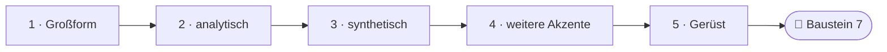
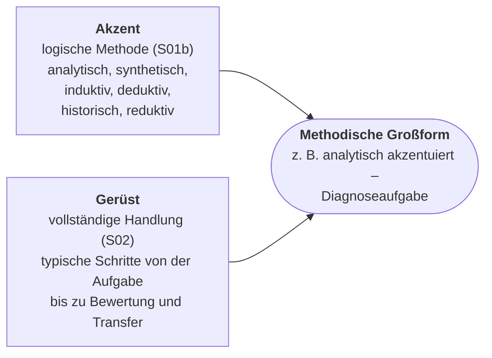
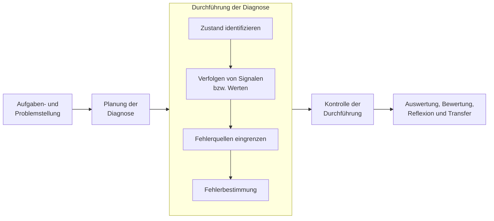
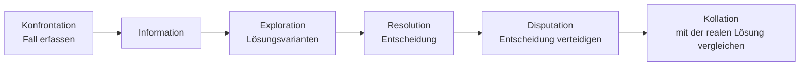
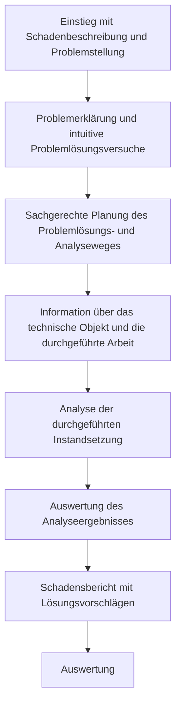
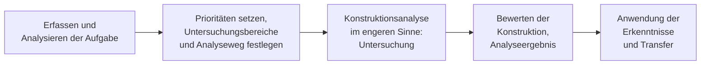
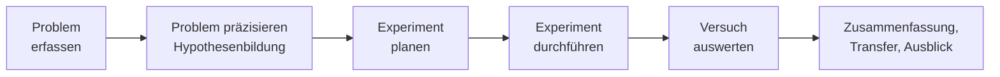
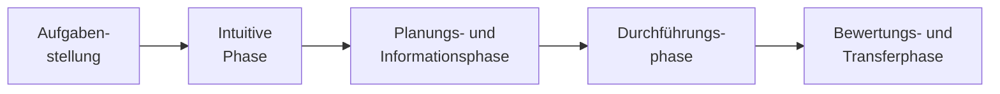
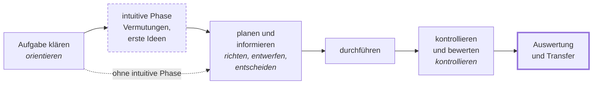

<!--
author:   Hannes Tegelbeckers
email:    hannes.tegelbeckers@ovgu.de
version:  0.3.0
language: de
narrator: Deutsch Female
mode:     Textbook
comment:  Fachdidaktik technischer Allgemeinbildung II – Selbstlerneinheit zu Sitzung S06 (Selbstlerntermin 16.11.2026). Großformen nach Pahl mit ihrer Akzentuierung verstehen, an neuen Situationen erkennen, Analyse- und Aufgabenform unterscheiden und eine Großform für die eigene Fachrichtung ausgestalten.

import:   https://raw.githubusercontent.com/LiaTemplates/mermaid_template/0.1.4/README.md
-->

# S06 – Methodische Großformen (Selbstlerneinheit)

<!-- didaktik="Selbstlerneinheit S06 · Selbstlerntermin 16.11.2026 (Dozent nicht vor Ort) · ca. 90 min · Studientext + Übungen · Inhalte der Folien R101–R127, in eigenen Worten erläutert" -->
> [!IMPORTANT] 🧭 Leitfrage
> Welche Großform passt zu welcher beruflichen Situation – und wie gestalte ich sie aus?

> [!WARNING] 📅 Selbstlerntermin am 16.11.2026
> An diesem Termin gibt es keine Präsenzveranstaltung. Diese Einheit **erklärt alle Inhalte der Sitzung S06** und enthält die Übungen dazu – Sie können sie ohne weitere Unterlagen bearbeiten. Die [LiaScript-Sitzung S06](https://liascript.github.io/course/?https://raw.githubusercontent.com/OVGU-VET-TechEd/Fachdidaktik_technischer_Allgemeinbildung_II/main/S06_Grossformen.md) enthält die Originalfolien im Wortlaut; nutzen Sie sie zum Nachschlagen. Fragen notieren Sie auf dem Beuteblatt – wir greifen sie in S07 auf.

> [!TIP] ✍️ Übung in Moodle
> Bearbeiten Sie diese Einheit als Übung im Moodle-Kurs – dort wird Ihr Bearbeitungsstand gespeichert: [Übung in Moodle öffnen](https://elearning.ovgu.de/mod/scorm/view.php?id=707267)

**Ablauf (ca. 90 min)**

<!-- data-type="none" -->
| Schritt | Inhalt | Zeit |
| --- | --- | --- |
| 0 | Wo stehen Sie? | 3 min |
| 1 | Was ist eine methodische Großform? | 12 min |
| 2 | Analytisch akzentuierte Großformen | 15 min |
| 3 | Synthetisch akzentuierte Großformen | 18 min |
| 4 | Induktiv, deduktiv, historisch, reduktiv | 12 min |
| 5 | Das gemeinsame Gerüst – und warum Zuordnungen vorsichtig sein müssen | 10 min |
| 6 | Eine Großform ausgestalten | 15 min |
| 7 | Abschluss und Prüfungsfragen | 15 min |

## Ihr Lernweg in dieser Einheit

    --{{0}}--
Die Einheit führt von der Frage, was eine Großform ist, über die analytisch und synthetisch akzentuierten Formen und die übrigen Akzente zum gemeinsamen Gerüst. Am Ende gestalten Sie eine Großform für Ihre Fachrichtung aus.

    --{{1}}--
Auf diesem Weg erreichen Sie sechs Ziele.

      {{1}}

<!-- data-type="none" -->
| Wissen | Können | Beurteilen |
|------|--------|-------|
| **erklären**, was eine methodische Großform ist und wie sie mit logischen Methoden (S01b) und vollständiger Handlung (S02) zusammenhängt | berufliche Situationen einer Großform **zuordnen** und Analyse- und Aufgabenform **unterscheiden** | **begründen**, warum eine eindeutige Zuordnung „mit Vorsicht zu genießen“ ist |
| die Großformen nach Pahl mit ihrer Akzentuierung **nennen** und ihre Merkmale **erläutern** | eine Großform für Ihre Fachrichtung mit ihren typischen Schritten **ausgestalten** | Ihre Wahl einer Großform mit Ihrem Lernziel **begründen** |

    --{{2}}--
Prüfen Sie kurz, ob Sie den Lernweg lesen können.

      {{2}}
****************************************

**Entscheiden:** Was kommt direkt nach den synthetisch akzentuierten Großformen?

<!-- data-hint-button="1" data-solution-button="2" -->
- [(X)] weitere Akzente
- [( )] Großform
- [( )] Gerüst
[[?]] Folgen Sie den Pfeilen von links nach rechts.
***
Richtig: induktiv, deduktiv, historisch und reduktiv akzentuierte Großformen folgen in Abschnitt 4.
***

****************************************

## 0 · Wo stehen Sie?

    --{{0}}--
Bevor Sie beginnen: Wie stehen Sie zu dieser These? Am Ende der Einheit stimmen Sie noch einmal ab.

> **„Jede Großform lässt sich eindeutig einer logischen Methode zuordnen.“**

**Abstimmen (vorher):** Stimmen Sie dieser These zu?

[(a)] Ja, ich stimme zu
[(b)] Nein, ich stimme nicht zu
[(c)] Teils, teils
[(unentschieden)] Unentschieden

    --{{1}}--
Notieren Sie zwei typische Aufgabenarten aus Ihrem Beruf.

      {{1}}
****************************************

> [!TIP] 🧠 Ausgangsfrage · 3 min
> Notieren Sie zwei typische Aufgabenarten aus Ihrem Beruf (z. B. „Fehler suchen“, „Bauteil herstellen“, „Anlage prüfen“).

[[___ ___ ___]]

****************************************

    --{{2}}--
Behalten Sie Ihre Aufgabenarten im Blick.

      {{2}}
> [!TIP] 📌 Merken
> Ihre Aufgabenarten begegnen Ihnen in dieser Einheit als Großformen wieder. Notieren Sie, wo Sie sie wiederfinden.

## 1 · Was ist eine methodische Großform?

    --{{0}}--
In S01b haben Sie logische Methoden kennengelernt – Denkwege wie Analyse, Synthese, Induktion oder Deduktion. Sie beschreiben, wie Erkenntnis gewonnen wird, aber noch nicht, wie eine ganze Unterrichtseinheit abläuft.

**Methodische Großform**

- Vorrangig unter dem Aspekt der analytischen und synthetischen Akzentuierung betrachtet
- **Hinweis:**
  - Zuordnung einer Methode im engeren Sinne nur zu einer methodischen Großform „mit Vorsicht zu genießen“

    --{{1}}--
Eine methodische Großform ist ein vollständiges Ausbildungs- und Unterrichtsverfahren: eine Abfolge typischer Schritte, die über mehrere Stunden trägt und sich an einer beruflichen Aufgabenart orientiert.

      {{1}}
****************************************

**In eigenen Worten:** Eine **methodische Großform** ist ein vollständiges Ausbildungs- und Unterrichtsverfahren – eine Abfolge typischer Schritte, die über mehrere Stunden trägt und sich an einer **beruflichen Aufgabenart** orientiert: Diagnose, Fertigung, Inspektion, Konstruktion, Instandsetzung usw.

Die Großformen stammen aus dem Kompendium von **Jörg-Peter Pahl**: *Ausbildungs- und Unterrichtsverfahren. Ein Kompendium für den Lernbereich Arbeit und Technik* (wbv).

****************************************

    --{{2}}--
Schon die erste Folie warnt.

      {{2}}
> [!NOTE] Kernaussage
> ⚠️ Eine Methode im engeren Sinne **nur einer** Großform zuzuordnen, ist „mit Vorsicht zu genießen“. Der Akzent beschreibt einen **Schwerpunkt**, keine Ausschließlichkeit – warum, sehen Sie in Abschnitt 5.

<small>Quelle: Folien R101 „Methodische Großform“ und R102 (Buchcover); Erläuterung: eigene Darstellung.</small>

## Lesehilfe: Großform = Akzent + Gerüst

    --{{0}}--
Eine Lesehilfe für diese Einheit: Jede Großform hat einen Akzent und ein Gerüst.

    --{{1}}--
Akzent: Jede Großform hat einen Schwerpunkt in einer logischen Methode. Die Folien ordnen sie vor allem nach analytischer oder synthetischer Akzentuierung, dazu kommen induktiv, deduktiv, historisch und reduktiv akzentuierte Formen.

      {{1}}
**① Akzent:** der Schwerpunkt in einer logischen Methode aus S01b

    --{{2}}--
Gerüst: Die typischen Schritte folgen fast immer der vollständigen Handlung aus S02.

      {{2}}
**② Gerüst:** Aufgabe erfassen → (intuitive Lösungsideen) → planen und informieren → durchführen → kontrollieren und bewerten → übertragen

    --{{3}}--
Zusammen ergeben sie die Großform.

      {{3}}
**③ Großform:** ein vollständiges Verfahren, benannt nach einer beruflichen Aufgabenart

    --{{4}}--
Und der Akzent ist kein Etikett, sondern ein Schwerpunkt.

      {{4}}
> [!NOTE] Kernaussage
> Großform = Akzent (logische Methode) + Gerüst (vollständige Handlung).

<small>Lesehilfe, nicht Teil der Originalfolien.</small>

## Zur Erinnerung aus S01b: die Akzente in einem Satz

    --{{0}}--
Mit jeder logischen Methode verbindet sich eine Frage, die Sie an eine Großform stellen können.

<!-- data-type="none" -->
| Akzent | Denkweg | Frage an die Großform |
| --- | --- | --- |
| **analytisch** | ein Ganzes in Teile zerlegen, um sein Wesen zu erkennen | Wird etwas **Vorhandenes** untersucht? |
| **synthetisch** | Teile zu einem neuen Ganzen zusammenfügen | Entsteht etwas **Neues** oder wird etwas (wieder)hergestellt? |
| **induktiv** | vom Einzelfall (Beobachtung, Versuch) zur Regel | Wird eine Regel aus Versuchen gewonnen? |
| **deduktiv** | von der Regel zum Einzelfall | Wird eine bekannte Gesetzmäßigkeit angewendet? |
| **historisch** | Entwicklung der Technik nachvollziehen | Hilft der Blick auf frühere Technik? |
| **reduktiv** | auf bekannte Vorgänge zurückgreifen, z. B. aus der Natur | Wird eine Lösung aus einem bekannten System übertragen? |

<small>Zusammenfassung der logischen Methoden aus S01b; eigene Darstellung.</small>

## 2 · Analytisch akzentuierte Großformen

    --{{0}}--
Die vier analytisch akzentuierten Großformen haben gemeinsam: Etwas Vorhandenes wird zerlegt und untersucht – ein Fehlverhalten, ein Fall, eine bereits durchgeführte Instandsetzung, eine fertige Konstruktion.

**Was haben Großformen gemeinsam, die etwas Vorhandenes untersuchen?**

    --{{1}}--
Die Diagnoseaufgabe untersucht ein Fehlverhalten.

      {{1}}
- 2.1 Diagnoseaufgabe (R103–R104)

    --{{2}}--
Die Fallstudie kennen Sie aus S04.

      {{2}}
- 2.2 Fallstudie (R105–R106)

    --{{3}}--
Die Instandsetzungsanalyse untersucht eine bereits durchgeführte Instandsetzung.

      {{3}}
- 2.3 Instandsetzungsanalyse (R107–R108)

    --{{4}}--
Und die Konstruktionsanalyse vollzieht eine fertige Konstruktion nach.

      {{4}}
- 2.4 Konstruktionsanalyse (R109–R110)

    --{{5}}--
Warum ist das für Sie wichtig?

      {{5}}
> [!TIP] Warum das wichtig ist
> Fehler finden, Fälle beurteilen, Arbeiten anderer prüfen – analytische Aufgaben prägen viele technische Berufe.

    --{{6}}--
Markieren Sie, was Sie schon kennen.

      {{6}}
****************************************

**Markieren:** Was davon kennen Sie schon? (mehrere möglich)

[[a1]] 2.1 Diagnoseaufgabe (R103–R104)
[[a2]] 2.2 Fallstudie (R105–R106)
[[a3]] 2.3 Instandsetzungsanalyse (R107–R108)
[[a4]] 2.4 Konstruktionsanalyse (R109–R110)

****************************************

## 2.1 Diagnoseaufgabe

    --{{0}}--
Die Diagnoseaufgabe befähigt Lernende, Geräte, Maschinen und Anlagen zu diagnostizieren. Sie lernen typische Abläufe kennen und erwerben ein Vorgehen, das sie auf künftige Systemdiagnosen übertragen können.

Kern ist die **Durchführung der Diagnose**: Was funktioniert, was nicht? Wo kommt das Signal noch an? So wird die Fehlerquelle Schritt für Schritt eingegrenzt.

**Folienbeispiel:** Untersuchung des Fehlverhaltens einer Titrations- und Neutralisationsanlage.

    --{{1}}--
Der Akzent:

      {{1}}
> [!NOTE] Kernaussage
> analytisch: Ein vorhandenes Fehlverhalten wird zerlegt und untersucht.

<small>Typische Schritte nach Folien R103–R104 „5.1 analytische akzentuiert – Diagnoseaufgabe“ als Ablauf dargestellt; Erläuterung: eigene Darstellung.</small>

## 2.2 Fallstudie

    --{{0}}--
Die Fallstudie kennen Sie aus S04. Als Großform ist sie ein Entscheidungstraining: Die Lernenden treffen in einer Fallsituation Entscheidungen und bewerten sie.

Die Schritte entsprechen den Phasen nach Kaiser:

**Folienbeispiel:** „Wasser in den Wänden“ (Bautechnik; die Folie nennt nur den Titel).

    --{{1}}--
Der Akzent:

      {{1}}
> [!NOTE] Kernaussage
> analytisch: Ein vorhandener Fall wird untersucht und entschieden.

<small>Erläuterung zu den Folien R105–R106 „5.1 analytische akzentuiert – Fallstudie“; Phasen nach Kaiser siehe S04.</small>

## 2.3 Instandsetzungsanalyse

    --{{0}}--
Hier wird eine bereits durchgeführte Instandsetzung aus der betrieblichen Praxis analysiert. Die Lernenden setzen also nicht selbst instand: Motorische Aktivitäten treten zurück, analytisches und schlussfolgerndes Denken dominieren. Sie lernen dabei fachliche Inhalte und prozessbezogene Methoden kennen.

**Folienbeispiel:** Instandsetzung von Stahlbeton (Bautechnik).

    --{{1}}--
Der Akzent:

      {{1}}
> [!NOTE] Kernaussage
> analytisch: Eine Instandsetzung, die andere durchgeführt haben, wird untersucht.

<small>Typische Schritte nach Folien R107–R108 „5.1 analytische akzentuiert – Instandsetzungsanalyse“ als Ablauf dargestellt; Erläuterung: eigene Darstellung.</small>

## 2.4 Konstruktionsanalyse

    --{{0}}--
Die Konstruktionsanalyse vollzieht eine fertige Konstruktion nach: Warum wurde sie so gebaut? Welche Konstruktionsschritte stecken dahinter? Sie macht den Konstruktionsprozess verständlich, gibt Einblick in Voraussetzungen und Zusammenhänge und fördert Systemdenken und Kritikfähigkeit.

**Folienbeispiel:** einen Leitungskanal analysieren.

    --{{1}}--
Der Akzent:

      {{1}}
> [!NOTE] Kernaussage
> analytisch: Eine fertige Konstruktion wird nachvollzogen und untersucht.

<small>Typische Schritte nach Folien R109–R110 „5.1 analytische akzentuiert – Konstruktionsanalyse“ als Ablauf dargestellt (Schritt 2 gekürzt); Erläuterung: eigene Darstellung.</small>

## Übung 2: Welches Folienbeispiel – welche Großform?

    --{{0}}--
Drei kurze Fragen zu den analytisch akzentuierten Großformen.

**1 · Eine Antwort:** Zu welcher Großform gehört das Folienbeispiel „Untersuchung des Fehlverhaltens einer Titrations- und Neutralisationsanlage“?

<!-- data-hint-button="1" data-solution-button="2" -->
- [( )] Konstruktionsanalyse
- [(X)] Diagnoseaufgabe
- [( )] Fallstudie
[[?]] Ein Fehlverhalten wird untersucht.
***
Richtig: Diagnoseaufgabe (R104).
***

    --{{1}}--
Jetzt können mehrere Antworten richtig sein.

      {{1}}
****************************************

**2 · Alle zutreffenden:** Welche Folienbeispiele gehören zu analytisch akzentuierten Großformen?

<!-- data-hint-button="1" data-solution-button="2" -->
- [[X]] Wasser in den Wänden
- [[ ]] Herstellung von Betonprobekörpern
- [[X]] Leitungskanal analysieren
- [[ ]] TÜV-Kontrolle eines Autos
[[?]] Wird etwas Vorhandenes untersucht – oder etwas hergestellt bzw. geprüft?
***
Analytisch: Etwas Vorhandenes wird zerlegt und untersucht. Betonprobekörper (Fertigungsaufgabe) und TÜV-Kontrolle (Inspektionsaufgabe) sind synthetisch akzentuiert.
***

****************************************

    --{{2}}--
Zum Schluss tippen Sie einen Begriff.

      {{2}}
****************************************

**3 · Eintippen:** Zu welcher Großform gehört das Beispiel „Instandsetzung von Stahlbeton“? (ein Wort)

<!-- data-hint-button="1" data-solution-button="2" -->
[[Instandsetzungsanalyse]]
[[?]] Eine bereits durchgeführte Instandsetzung wird analysiert.

***
Instandsetzungsanalyse (R108): Die Lernenden untersuchen eine Instandsetzung, die andere durchgeführt haben.
***

****************************************

## 3 · Synthetisch akzentuierte Großformen

    --{{0}}--
Bei den fünf synthetisch akzentuierten Großformen entsteht etwas Neues oder wird wiederhergestellt – ein Produkt, eine Prüfdokumentation, ein Zukunftsbild, eine Konstruktion, ein instand gesetztes Objekt.

<!-- data-type="none" -->
| Großform | Worum geht es? | Was ist besonders? | Folienbeispiel |
| --- | --- | --- | --- |
| **Fertigungsaufgabe** | Herstellung von Bauteilen, Baugruppen, Geräten, Anlagen | Die Lernenden analysieren den Auftrag selbst; Durchführung **und Bewertung des Produkts** gehören zum Auftrag, am Ende steht die Optimierung des Fertigungsablaufs. | Betonprobekörper herstellen |
| **Inspektionsaufgabe** | Planung und Durchführung einer Inspektion | Sie endet mit einer **Dokumentation** und **Maßnahmeempfehlungen**; Wirkprinzipien der geprüften Technik können besprochen werden. | TÜV-Kontrolle eines Autos |
| **Szenariomethode** | hypothetische Abfolge aufeinander aufbauender Ereignisse | Planungsinstrument für Entwicklungen; verlangt Kreativität und Fantasie, fördert Analyse-, Problemlöse- und Entscheidungsfähigkeit. Mehrere Szenarien werden verglichen, dann bezieht man Stellung. | Wasserknappheit in einer Truppe im Einsatz |
| **Konstruktionsaufgabe** | ein technisches Gebilde selbst konstruieren | regt schöpferisches Denken an und motiviert stark; Ideen werden in der Praxis geprüft. Die Schritte reichen vom Klären der Aufgabe über Lösungsvarianten bis zur Gestaltung und Optimierung. | Blumenbänke erstellen |
| **Instandsetzungsaufgabe** | ein Objekt selbst instand setzen | Handlungsabläufe sind gut überschaubar, sodass Lernende **den nächsten Schritt selbst festlegen** können; endet mit Kontrolle, Funktionsprüfung und Abnahme. | eine Wand instand setzen und den ursprünglichen Zustand herrichten |

    --{{1}}--
Instandsetzung und Konstruktion kommen doppelt vor.

      {{1}}
> [!NOTE] Kernaussage
> 🔍 Ein Gegenstand, zwei Großformen: Die *Instandsetzungsanalyse* untersucht eine Instandsetzung, die **andere durchgeführt** haben; bei der *Instandsetzungsaufgabe* setzen die Lernenden **selbst** instand. Nach S01b ist die Analyse Voraussetzung der Synthese – oft lohnt es sich, die Analyseform **vor** die Aufgabenform zu setzen.

<small>Nach Folien R111–R120 (5.2 synthetisch akzentuiert); Wortlaut in der Sitzung S06.</small>

## Übung 3a: Welche Großform liegt am nächsten?

    --{{0}}--
Ordnen Sie berufliche Situationen einer Großform zu. Einige Großformen lernen Sie erst in Abschnitt 4 genauer kennen.

**1 · Eine Antwort:** Eine Förderbandsteuerung stoppt sporadisch; die Lernenden sollen den Fehler eingrenzen. Welche Großform liegt am nächsten?

<!-- data-hint-button="1" data-solution-button="2" -->
- [( )] Fertigungsaufgabe
- [(X)] Diagnoseaufgabe
- [( )] Szenariomethode
[[?]] Zustand identifizieren, Signale verfolgen, Fehler eingrenzen …
***
Diagnoseaufgabe: Zustand identifizieren, Signale verfolgen, Fehlerquellen eingrenzen, Fehler bestimmen.
***

    --{{1}}--
Jetzt können mehrere Antworten richtig sein.

      {{1}}
****************************************

**2 · Alle zutreffenden:** Welche Situationen gehören zu synthetisch akzentuierten Großformen?

<!-- data-hint-button="1" data-solution-button="2" -->
- [[X]] Die Lernenden stellen nach Kundenauftrag einen Schaltschrank her und bewerten das Ergebnis.
- [[ ]] Eine selbstreinigende Oberfläche wird nach dem Vorbild eines Pflanzenblatts entwickelt.
- [[X]] Eine Heizungsanlage wird geprüft; am Ende steht ein Protokoll mit Maßnahmeempfehlungen.
- [[ ]] Ein früher Elektromotor wird untersucht, um heutige Motoren zu verstehen.
[[?]] Fertigung und Inspektion sind synthetisch akzentuiert.
***
Fertigung: Herstellung mit Bewertung des Produkts · Inspektion: Dokumentation und Maßnahmeempfehlungen. Das Pflanzenblatt gehört zur Naturstudie (reduktiv), der frühe Elektromotor zum historisch-genetischen Verfahren (historisch).
***

****************************************

    --{{2}}--
Zum Schluss tippen Sie einen Begriff.

      {{2}}
****************************************

**3 · Eintippen:** Wie könnte sich die Kfz-Werkstatt bis 2040 entwickeln? Mehrere Zukunftsbilder werden verglichen. Welche Großform ist das? (ein Wort)

<!-- data-hint-button="1" data-solution-button="2" -->
[[Szenariomethode]]
[[?]] Eine hypothetische Abfolge von Ereignissen …

***
Szenariomethode: hypothetische Abfolge von Ereignissen, Vergleich der Szenarien, persönliche Stellungnahme.
***

****************************************

## Übung 3b: Analyse oder Aufgabe?

    --{{0}}--
Gegenstand ist ein Treppengeländer aus Stahl. Je nachdem, ob die Lernenden etwas Vorhandenes untersuchen oder selbst etwas herstellen, ist es eine Analyse- oder eine Aufgabenform.

<!-- data-type="none" -->
| Kriterium | Analyseform | Aufgabenform |
|-----------|---------------|---------------|
| Ausgangspunkt | eine bereits durchgeführte Arbeit | ein Auftrag an die Lernenden |
| Tätigkeit | nachvollziehen, untersuchen | selbst konstruieren oder instand setzen |
| Motorik | tritt zurück, kognitive Aktivitäten dominieren | gehört dazu, bis zur Funktionsprüfung |
| Akzent | analytisch | synthetisch |

    --{{1}}--
Je ein Beispiel:

      {{1}}
- **Analyseform:** Konstruktions- bzw. Instandsetzungsanalyse
- **Aufgabenform:** Konstruktions- bzw. Instandsetzungsaufgabe

    --{{2}}--
Ein typischer Fehlschluss:

      {{2}}
> [!WARNING] Häufiges Missverständnis
> Gleicher Gegenstand heißt nicht gleiche Großform – entscheidend ist, ob die Lernenden untersuchen oder selbst herstellen.

    --{{3}}--
Ordnen Sie die vier Situationen zum Treppengeländer zu.

      {{3}}
****************************************

**Entscheiden:** Welchen Begriff beschreibt die Aussage jeweils?

<!-- data-hint-button="1" data-solution-button="2" data-show-partial-solution -->
[(Analyseform) (Aufgabenform)]
[       (X)             ( )      ] Ein vorhandenes Geländer wird untersucht: Wie wurde es konstruiert, warum so?
[       ( )             (X)      ] Die Lernenden entwerfen ein Geländer für eine neue Außentreppe.
[       (X)             ( )      ] Ein Betrieb hat ein korrodiertes Geländer saniert; die Lernenden analysieren Schadensbericht und Vorgehen.
[       ( )             (X)      ] Die Lernenden setzen ein beschädigtes Geländer selbst instand und prüfen die Funktion.
[[?]] Wird eine durchgeführte Arbeit untersucht – oder arbeiten die Lernenden selbst?
***
Analyseformen: „nachvollziehendes Analysieren einer durchgeführten Konstruktion“ bzw. „bereits durchgeführte Instandsetzungen analysiert“. Aufgabenformen: Die Lernenden konstruieren bzw. setzen selbst instand, bis zur Kontrolle, Funktionsprüfung und Abnahme.
***

****************************************

## Zum Nachdenken: Analyse vor Aufgabe?

    --{{0}}--
Nach S01b ist die Analyse Voraussetzung der Synthese. Was heißt das für Ihre Planung?

Wann würden Sie in Ihrer Fachrichtung die **Analyse** vor die **Aufgabe** setzen – und wann nicht?

[[___ ___ ___ ___]]

💡 Hinweis

Denken Sie an Sicherheit, Kosten von Fehlern und an das Vorwissen Ihrer Lernenden.

✅ Lösung

Analyse zuerst, wenn die Lernenden wenig Vorwissen haben oder Fehler teuer bzw. gefährlich wären: Erst eine fachgerecht durchgeführte Instandsetzung untersuchen, dann selbst instand setzen. Aufgabe direkt, wenn die Lernenden den Ablauf schon kennen oder das Ausprobieren selbst das Lernziel ist.

## 4.1 Technisches Experiment (induktiv)

    --{{0}}--
Vier weitere Großformen haben andere Akzente. Mehrere davon kennen Sie bereits unter anderem Namen. Das technische Experiment kennen Sie aus S05: Aus Versuchen wird eine Erkenntnis gewonnen.

Das technische Experiment verbindet die **Erarbeitung technologischer Sachverhalte** mit den **Verfahren der Erkenntnisgewinnung** und kann Theorie und Praxis zu einem Gesamtbild zusammenführen.

**Folienbeispiel:** Entwurf und Bau einer stabilen Brücke im Modell.

    --{{1}}--
Der Akzent:

      {{1}}
> [!NOTE] Kernaussage
> induktiv: vom Versuch zur Regel – wie in S05.

<small>Erläuterung zu den Folien R121–R122 „5.3 induktiv akzentuiert – Technisches Experiment“; Wortlaut in der Sitzung S06.</small>

## 4.2 Konstruktionsaufgabe (deduktiv)

    --{{0}}--
Dieselbe Großform wie in Abschnitt 3 – aber mit anderem Akzent: Es werden Gesetzmäßigkeiten vorgegeben, auf deren Grundlage konstruiert wird. Die Lernenden gehen also von der Regel zum konkreten Gebilde.

**Folienbeispiel:** ein Auto mit möglichst geringem cw-Wert konstruieren – die strömungstechnischen Zusammenhänge sind vorgegeben, die Konstruktion wendet sie an.

    --{{1}}--
Der Akzent:

      {{1}}
> [!NOTE] Kernaussage
> deduktiv: von der vorgegebenen Gesetzmäßigkeit zum Gebilde. Dieselbe Großform war in Abschnitt 3 synthetisch akzentuiert.

<small>Erläuterung zur Folie R123 „5.4 deduktiv akzentuiert – Konstruktionsaufgabe“.</small>

## 4.3 Historisch-genetisches Verfahren (historisch)

    --{{0}}--
Technik vergangener Zeiten war einfacher und liegt deshalb eher im Verständnishorizont der Lernenden. Wer sie verstanden hat, kann darauf aufbauen und heutige Prozesse besser verstehen. Zugleich entstehen schnell Bezüge zu Gegenwart und Zukunft, und Technik wird als etwas Gewordenes reflektiert.

**Folienbeispiel:** die Funktionsweise einer Dampflok überprüfen.

    --{{1}}--
Der Akzent:

      {{1}}
> [!NOTE] Kernaussage
> historisch: Die Entwicklung der Technik wird nachvollzogen – vgl. genetische und historische Methode in S01b.

<small>Erläuterung zu den Folien R124–R125 „5.5 historisch akzentuiert – historisch-genetisches Ausbildungs- und Unterrichtsverfahren“.</small>

## 4.4 Naturstudie (reduktiv)

    --{{0}}--
Ein technisches Problem wird mit Hilfe einer Lösung aus der Natur bearbeitet: Ein passendes biologisches System wird gesucht, analysiert und auf das technische Problem übertragen. Gefördert werden Kreativität, Ideenreichtum und Transfervermögen.

Die Folie betont, dass solche Lösungen sehr verlässlich sind, weil sie in der Evolution meist perfektioniert wurden.

**Folienbeispiel:** Verschmutzungs- und Abnutzungsgrad von Lacken und Farben (Vorbild: selbstreinigende Oberflächen in der Natur).

    --{{1}}--
Der Akzent:

      {{1}}
> [!NOTE] Kernaussage
> reduktiv: Eine bekannte Lösung aus der Natur wird übertragen – vgl. reduktive Methode in S01b (R032).

<small>Erläuterung zu den Folien R126–R127 „5.6 reduktiv akzentuiert – Naturstudie“.</small>

## Übung 4: Großform und Akzent

    --{{0}}--
Ergänzen Sie den Text. Wählen, tippen oder ziehen Sie die fehlenden Wörter.

**Ergänzen:**

<!-- data-hint-button="1" data-solution-button="2" data-show-partial-solution -->
Die Diagnoseaufgabe ist [[ (analytisch) | synthetisch | induktiv ]] akzentuiert. Insgesamt nennen die Folien so viele Einträge für Großformen: [[13]]. Reduktiv akzentuiert ist die [->[ (Naturstudie) | Fertigungsaufgabe ]].
[[?]] Zählen Sie: vier analytische, fünf synthetische und vier weitere Einträge.

    --{{1}}--
Entscheiden Sie jetzt: richtig oder falsch?

      {{1}}
****************************************

**Entscheiden:** Richtig oder falsch?

<!-- data-hint-button="1" data-solution-button="2" data-show-partial-solution -->
[(richtig) (falsch)]
[  (X)    ( )  ] Das technische Experiment ist induktiv akzentuiert.
[  ( )    (X)  ] Die Szenariomethode ist analytisch akzentuiert.
[  (X)    ( )  ] Die Konstruktionsaufgabe erscheint synthetisch und deduktiv akzentuiert.
[  ( )    (X)  ] Das historisch-genetische Verfahren ist reduktiv akzentuiert.
[[?]] Kapitelnummern der Folien: 5.1 analytisch, 5.2 synthetisch, 5.3 induktiv, 5.4 deduktiv, 5.5 historisch, 5.6 reduktiv.
***
Die Szenariomethode ist synthetisch akzentuiert (5.2), das historisch-genetische Verfahren historisch (5.5). Die Konstruktionsaufgabe steht unter 5.2 und 5.4.
***

****************************************

## 5 · Das gemeinsame Gerüst – und warum Zuordnungen vorsichtig sein müssen

    --{{0}}--
Legen Sie die Schrittfolgen der Großformen nebeneinander, erkennen Sie die vollständige Handlung aus S02 wieder. Die Großformen ergänzen das Gerüst fast immer um Auswertung und Transfer am Ende. Ein Schritt taucht in sieben der dreizehn Großformen auf, aber nicht bei Hacker: die intuitive Phase.

**Das gemeinsame Gerüst:** Aufgabe klären (orientieren) → planen und Informationen beschaffen (richten, entwerfen, entscheiden) → durchführen → kontrollieren und bewerten – ergänzt um **Auswertung und Transfer**.

**Die intuitive Phase** („intuitive Lösungsansätze“, „intuitive Problemlösungsvorschläge“): Die Lernenden äußern Vermutungen und erste Lösungsideen, **bevor** systematisch geplant wird. Das hat drei Vorteile:

1. Vorwissen wird aktiviert, und Fehlvorstellungen werden sichtbar, bevor sie sich festsetzen.
2. Alle können sich beteiligen, denn zunächst zählt jede Idee.
3. Am Ende gibt es einen Vergleichspunkt für die Reflexion: Lag meine erste Vermutung richtig – und warum (nicht)?

    --{{1}}--
Und warum sind Zuordnungen mit Vorsicht zu genießen? Die Folien selbst liefern die Belege.

      {{1}}
****************************************

**Belege von den Folien:**

- Die **Konstruktionsaufgabe** erscheint synthetisch **und** deduktiv akzentuiert.
- Die **Fallstudie** ist eine analytisch akzentuierte Großform und zugleich eine eigene Methode mit mehreren Varianten (S04).
- **Instandsetzung** gibt es analytisch (Analyse) und synthetisch (Aufgabe).

Jede Großform enthält außerdem mehrere logische Methoden: Auch bei einer Fertigungsaufgabe wird zuerst der Auftrag **analysiert**.

****************************************

    --{{2}}--
Der Akzent sagt also nur, welcher Denkweg überwiegt.

      {{2}}
> [!NOTE] Kernaussage
> Der Akzent sagt nur, welcher Denkweg **überwiegt**. Die intuitive Phase ähnelt der Hypothesenbildung beim Experiment (S05).

<small>Vergleich der Folien R101, R103–R127; Erläuterungen: eigene Darstellung.</small>

## Das Gerüst als Ablauf

    --{{0}}--
So sieht das gemeinsame Gerüst als Ablauf aus. Unter den Schritten stehen kursiv die Phasen der vollständigen Handlung nach Hacker aus S02.

    --{{1}}--
Der Kern ist die vollständige Handlung.

      {{1}}
**① Vollständige Handlung:** Orientieren, richten, entwerfen, entscheiden, durchführen, kontrollieren – wie in S02.

    --{{2}}--
In sieben der dreizehn Großformen kommt die intuitive Phase hinzu – gestrichelt, weil sie fehlen kann.

      {{2}}
**② Intuitive Phase:** erste Vermutungen vor der Planung – aktiviert Vorwissen und liefert einen Vergleichspunkt

    --{{3}}--
Am Ende ergänzen fast alle Großformen Auswertung und Transfer.

      {{3}}
**③ Auswertung und Transfer:** Das Ergebnis wird verallgemeinert und auf neue Aufgaben übertragen.

    --{{4}}--
Merken Sie sich das Gerüst.

      {{4}}
> [!NOTE] Kernaussage
> Wer das Gerüst kennt, kann **jede** Großform planen – der Akzent bestimmt nur, welcher Denkweg überwiegt.

<small>Vergleich der typischen Schritte auf den Folien R103–R127 mit der vollständigen Handlung (R047–R048); eigene Darstellung.</small>

## Übung 5a: Gerüst

    --{{0}}--
Welchem Schritt der vollständigen Handlung entspricht der Schritt aus der Großform? Die Zuordnung ist eine Deutungsübung, kein Fakt der Folien.

**1 · Eine Antwort:** Welchem Schritt der vollständigen Handlung entspricht „Kontrolle, Funktionsprüfung und Abnahme“ (Instandsetzungsaufgabe)?

<!-- data-hint-button="1" data-solution-button="2" -->
- [( )] Orientieren
- [(X)] Kontrollieren
- [( )] Richten/Entwerfen
[[?]] Am Ende der Handlung wird geprüft.
***
Die typischen Schritte folgen dem Gerüst der vollständigen Handlung.
***

    --{{1}}--
Jetzt können mehrere Antworten richtig sein.

      {{1}}
****************************************

**2 · Alle zutreffenden:** Welche Schritte entsprechen am ehesten dem Richten/Entwerfen?

<!-- data-hint-button="1" data-solution-button="2" -->
- [[X]] Fachgerechte Planung der Fertigung
- [[ ]] Durchführung der Instandsetzung
- [[X]] Übertragung auf ein technisches Problem – technische Problemlösung (Naturstudie)
- [[ ]] Analyse des Fertigungsauftrages/Klärung der Aufgabenstellung
[[?]] Richten/Entwerfen = planen, Lösungen entwerfen.
***
Analyse des Fertigungsauftrages entspricht dem Orientieren, Durchführung dem Ausführen. „Entscheiden“ steckt oft implizit in der Planung.
***

****************************************

    --{{2}}--
Und ein Schritt, der bei Hacker fehlt.

      {{2}}
****************************************

**3 · Eintippen:** Welche Phase steht in sieben der dreizehn Großformen, aber nicht bei Hacker? Die … Phase (ein Wort)

<!-- data-hint-button="1" data-solution-button="2" -->
[[intuitive]]
[[?]] „… Lösungsansätze“, „… Problemlösungsvorschläge“.

***
Die intuitive Phase steht bei Instandsetzungsanalyse, Fertigungs-, Inspektions-, Konstruktions- und Instandsetzungsaufgabe, historisch-genetischem Verfahren und Naturstudie.
***

****************************************

## Übung 5b: Noch einmal zur These

    --{{0}}--
Stimmen Sie jetzt noch einmal über die These vom Anfang ab.

**Abstimmen (nachher):** Stimmen Sie der These „Jede Großform lässt sich eindeutig einer logischen Methode zuordnen.“ zu?

[(a)] Ja, ich stimme zu
[(b)] Nein, ich stimme nicht zu
[(c)] Teils, teils
[(unentschieden)] Unentschieden

    --{{1}}--
Welche Belege sprechen gegen eine eindeutige Zuordnung?

      {{1}}
****************************************

**Nachdenken:** Nennen Sie zwei Belege von den Folien, die gegen eine eindeutige Zuordnung sprechen.

[[___ ___]]

****************************************

    --{{2}}--
Die Folie R101 hat es von Anfang an gesagt.

      {{2}}
> [!NOTE] Kernaussage
> R101: Die Zuordnung einer Methode im engeren Sinne zu nur einer Großform ist „mit Vorsicht zu genießen“. Die Akzentuierung beschreibt einen *Schwerpunkt*, keine Ausschließlichkeit.

## 6 · Eine Großform ausgestalten

    --{{0}}--
Eine Großform ausgestalten heißt: Sie übernehmen ihre typischen Schritte und füllen jeden mit einer konkreten Situation, Tätigkeit und Fragestellung aus Ihrer Fachrichtung. Ein Beispiel: die Diagnoseaufgabe „Licht im Flur geht nicht“ für das erste Ausbildungsjahr Elektrotechnik.

**Beispiel: Diagnoseaufgabe „Licht im Flur geht nicht“** (Elektrotechnik, 1. Ausbildungsjahr)

<!-- data-type="none" -->
| Typischer Schritt | Ausgestaltung |
| --- | --- |
| 1 Aufgaben- und Problemstellung | Kundenanruf: Licht im Flur bleibt dunkel, alle anderen Räume funktionieren. |
| *intuitive Phase (ergänzt – bei der Diagnoseaufgabe nicht auf der Folie)* | Erste Vermutungen sammeln – ohne Bewertung. |
| 2 Planung der Diagnose | Reihenfolge festlegen: Leuchtmittel, Schalter, Sicherung, Verbindungen; Messgeräte und Sicherheitsregeln klären. |
| 3 Durchführung: Zustand identifizieren · Signale verfolgen · Fehlerquellen eingrenzen · Fehler bestimmen | Am Übungsboard messen, Fehler eingrenzen und bestimmen. |
| 4 Kontrolle der Durchführung | Funktion nach der Fehlerbehebung prüfen. |
| 5 Auswertung, Bewertung, Reflexion, Transfer | War die Reihenfolge sinnvoll? Was gilt für andere Stromkreise? |

    --{{1}}--
Achten Sie auf die ergänzte intuitive Phase.

      {{1}}
> [!NOTE] Kernaussage
> Ausgestalten = jeden typischen Schritt mit einer konkreten Situation, Tätigkeit und Fragestellung füllen. Eine intuitive Phase kann man ergänzen, auch wenn sie auf der Folie fehlt.

<small>Beispiel: eigene Darstellung; Schritte nach den Folien R103–R104 (Diagnoseaufgabe).</small>

## Ihre Großform (Baustein 7)

    --{{0}}--
Jetzt sind Sie dran. Ihre ausgestaltete Großform ist zugleich Baustein 7 für Ihren Unterrichtsentwurf.

Wählen Sie eine Großform aus dieser Einheit und gestalten Sie sie für Ihre Fachrichtung aus – mit **allen** typischen Schritten. Markieren Sie die **intuitive Phase** (falls vorhanden) und den Schritt, in dem **kontrolliert** wird.

**Begründen Sie Ihre Wahl:** Welcher Akzent passt zu Ihrem Lernziel – und warum nicht eine andere Großform?

[[___ ___ ___ ___]]

💡 Hinweis

Nehmen Sie eine der Aufgabenarten, die Sie in Abschnitt 0 notiert haben, und suchen Sie die Großform mit den passenden typischen Schritten.

✅ Lösung

Beispiel Instandsetzungsaufgabe „Fahrradbremse instand setzen“ (Metalltechnik): Einstieg mit Problemstellung (Bremse greift nicht) → **intuitive Phase** (Vermutungen: Belag, Zug, Einstellung?) → Probleme und Ziele klären, Lösungsweg planen → Informationen sammeln (Herstellerangaben) → Arbeits- und Instandsetzungsplan → Durchführung → **Kontrolle**, Funktionsprüfung und Abnahme → Auswertung. Begründung: synthetischer Akzent, weil die Lernenden selbst instand setzen sollen; eine Instandsetzungsanalyse wäre sinnvoll, wenn sie zuerst eine fachgerechte Reparatur untersuchen sollen.

## 7 · Das Wichtigste aus S06

    --{{0}}--
Fassen wir zusammen.

    --{{1}}--
Erstens: was eine Großform ist.

      {{1}}
- Eine methodische Großform ist ein vollständiges Unterrichtsverfahren, benannt nach einer beruflichen Aufgabenart (Pahl).

    --{{2}}--
Zweitens: die beiden großen Gruppen.

      {{2}}
- analytisch akzentuiert: Vorhandenes untersuchen · synthetisch akzentuiert: Neues herstellen.

    --{{3}}--
Drittens: die übrigen Akzente.

      {{3}}
- induktiv, deduktiv, historisch, reduktiv: Experiment, Konstruktionsaufgabe, historisch-genetisches Verfahren, Naturstudie.

    --{{4}}--
Und viertens: das gemeinsame Gerüst.

      {{4}}
****************************************

- Die Schritte folgen der vollständigen Handlung – oft mit intuitiver Phase und Transfer.

> [!NOTE] Zum Merken
> Großform = Akzent + Gerüst – und der Akzent ist ein Schwerpunkt, keine Ausschließlichkeit (R101).

****************************************

    --{{5}}--
Eine letzte Frage.

      {{5}}
****************************************

**Wiederholen:** Welcher Beleg von den Folien spricht gegen eine eindeutige Zuordnung von Großformen zu logischen Methoden?

<!-- data-hint-button="1" data-solution-button="2" -->
- [( )] Jede Großform besteht aus genau einem Schritt.
- [( )] Die Diagnoseaufgabe ist analytisch akzentuiert.
- [(X)] Die Konstruktionsaufgabe erscheint synthetisch und deduktiv akzentuiert.
[[?]] Welche Großform taucht unter zwei verschiedenen Kapitelnummern auf?
***
Richtig: R117–R118 (5.2 synthetisch) und R123 (5.4 deduktiv).
***

****************************************

    --{{6}}--
Als Nächstes geht es um didaktische Reduktion.

      {{6}}
**➡️ Als Nächstes:** S07: Didaktische Reduktion · 🧩 Optional für die Selbstlernsitzung am 11.01.2027: Ihre ausgestaltete Großform aus Abschnitt 6 ist Baustein 7.

## Prüfungsfragen zum Üben

    --{{0}}--
Die Prüfungsleistung des Moduls ist eine mündliche Prüfung. Mit diesen fünf Fragen üben Sie, die Inhalte dieser Einheit frei, strukturiert und mit Beispielen zu erklären.

> [!TIP] 🎙️ So üben Sie
> Lesen Sie eine Frage und antworten Sie **laut** in höchstens drei Minuten – nach dem Muster **Begriff – Erläutern – Beispiel – Verbinden**. Öffnen Sie erst danach die Antwortskizze und vergleichen Sie: Was fehlte, was war ungenau? Noch besser: Lassen Sie sich von einer Kommilitonin oder einem Kommilitonen abfragen.

**Frage 1 · Großform und Akzent:** Was ist eine methodische Großform? Erläutern Sie den Zusammenhang mit den logischen Methoden.

✅ Antwortskizze 1

- **1 Begriff:** Eine methodische Großform ist ein **vollständiges Ausbildungs- und Unterrichtsverfahren**, das über mehrere Stunden trägt und sich an einer **beruflichen Aufgabenart** orientiert (Diagnose, Fertigung, Inspektion, Konstruktion, Instandsetzung …); nach Pahl (R101–R102).
- **2 Erläutern:** Großform = **Akzent** + **Gerüst**. Der Akzent ist die logische Methode, die überwiegt (S01b): vorrangig analytisch oder synthetisch, außerdem induktiv, deduktiv, historisch, reduktiv. Das Gerüst ist die vollständige Handlung (S02), ergänzt um Auswertung und Transfer.
- **3 Beispiel:** Diagnoseaufgabe (analytisch): ein vorhandenes Fehlverhalten wird zerlegt – Folienbeispiel Titrations- und Neutralisationsanlage. Technisches Experiment (induktiv): vom Versuch zur Regel – Brücke im Modell.
- **4 Verbinden:** Die logischen Methoden beschreiben Denkwege; erst die Großform beschreibt den **Ablauf einer ganzen Unterrichtseinheit**.

**Frage 2 · Analyse und Aufgabe:** Vergleichen Sie Instandsetzungsanalyse und Instandsetzungsaufgabe.

✅ Antwortskizze 2

- **1 Begriff:** Beide Großformen haben die Instandsetzung zum Gegenstand: die **Instandsetzungsanalyse** ist analytisch, die **Instandsetzungsaufgabe** synthetisch akzentuiert (R107–R108, R111–R120).
- **2 Erläutern:** Analyse: Eine **bereits durchgeführte** Instandsetzung aus der Praxis wird untersucht; motorische Aktivitäten treten zurück, analytisches und schlussfolgerndes Denken dominieren; Ergebnis ist ein **Schadensbericht mit Lösungsvorschlägen**. Aufgabe: Die Lernenden setzen **selbst** instand; die Abläufe sind überschaubar, sodass sie den nächsten Schritt selbst festlegen können; Ende mit Kontrolle, Funktionsprüfung und Abnahme.
- **3 Beispiel:** Analyse: Instandsetzung von Stahlbeton. Aufgabe: eine Wand instand setzen und den ursprünglichen Zustand herrichten.
- **4 Verbinden:** Nach S01b ist die Analyse Voraussetzung der Synthese – oft lohnt es sich, die Analyseform **vor** die Aufgabenform zu setzen.

**Frage 3 · Synthetische Großform:** Beschreiben Sie Merkmale und typische Schritte einer synthetisch akzentuierten Großform an einem Beispiel aus Ihrer Fachrichtung.

✅ Antwortskizze 3

- **1 Begriff:** Bei synthetisch akzentuierten Großformen entsteht etwas **Neues** oder wird **wiederhergestellt**: Fertigungs-, Inspektions-, Konstruktions-, Instandsetzungsaufgabe, Szenariomethode (R111–R120).
- **2 Erläutern:** Beispiel Konstruktionsaufgabe: regt schöpferisches Denken an und motiviert stark; Ideen werden in der Praxis geprüft; Schritte vom Klären der Aufgabe über Lösungsvarianten bis zur Gestaltung und Optimierung. Fertigungsaufgabe: Die Lernenden analysieren den Auftrag selbst, Durchführung und **Bewertung des Produkts** gehören dazu, am Ende steht die Optimierung des Fertigungsablaufs.
- **3 Beispiel:** Folien: Blumenbänke erstellen (Konstruktion), Betonprobekörper herstellen (Fertigung), TÜV-Kontrolle eines Autos (Inspektion). Eigenes Beispiel z. B.: eine Halterung für einen Sensor konstruieren.
- **4 Verbinden:** Gerüst ist die vollständige Handlung (S02); die intuitive Phase kann ergänzt werden.

**Frage 4 · Vorsicht bei Zuordnungen:** Warum ist die Zuordnung einer Methode zu nur einer Großform „mit Vorsicht zu genießen“?

✅ Antwortskizze 4

- **1 Begriff:** Der **Akzent** einer Großform beschreibt einen **Schwerpunkt**, keine Ausschließlichkeit (Hinweis auf Folie R101).
- **2 Erläutern:** Jede Großform enthält mehrere logische Methoden – auch bei einer Fertigungsaufgabe wird zuerst der Auftrag analysiert.
- **3 Beispiel:** Belege von den Folien: Die **Konstruktionsaufgabe** erscheint synthetisch **und** deduktiv akzentuiert (cw-Wert-Auto); **Instandsetzung** gibt es analytisch und synthetisch; die **Fallstudie** ist Großform und zugleich eigene Methode mit Varianten (S04).
- **4 Verbinden:** Für die Planung heißt das: nicht „die richtige Schublade“ suchen, sondern begründen, welcher Denkweg für das Lernziel überwiegen soll (S01b, Methodenwahl).

**Frage 5 · Intuitive Phase:** Welche Rolle spielt die intuitive Phase in den Großformen?

✅ Antwortskizze 5

- **1 Begriff:** Die intuitive Phase („intuitive Lösungsansätze“, „intuitive Problemlösungsvorschläge“) kommt in **sieben der dreizehn** Großformen vor, aber nicht bei Hacker: Die Lernenden äußern Vermutungen und erste Ideen, **bevor** systematisch geplant wird.
- **2 Erläutern:** Drei Vorteile: Vorwissen wird aktiviert und Fehlvorstellungen werden sichtbar; alle können sich beteiligen, weil zunächst jede Idee zählt; am Ende gibt es einen Vergleichspunkt für die Reflexion (Lag meine Vermutung richtig – und warum?).
- **3 Beispiel:** Historisch-genetisches Verfahren (Dampflok): Aufgabenstellung – intuitive Phase – Planung und Information – Durchführung – Bewertung und Transfer. In der Diagnoseaufgabe „Licht im Flur geht nicht“ kann man sie ergänzen: erst Vermutungen sammeln, dann messen.
- **4 Verbinden:** Die intuitive Phase ähnelt der **Hypothesenbildung** beim Experiment (S05) und der regressiven Reaktion der reduktiven Methode (S01b).

    --{{1}}--
Schätzen Sie zum Schluss ein, wie sicher Sie sind. Wiederholen Sie die unsicheren Fragen in einigen Tagen – und üben Sie fächerübergreifend mit dem Prüfungstrainer.

      {{1}}
****************************************

**Einschätzen:** Wie sicher beantworten Sie die Fragen frei und in ganzen Sätzen?

[(sicher)(teilweise)(noch unsicher)]
[                                    ] Frage 1 · Großform und Akzent
[                                    ] Frage 2 · Analyse und Aufgabe
[                                    ] Frage 3 · Synthetische Großform
[                                    ] Frage 4 · Vorsicht bei Zuordnungen
[                                    ] Frage 5 · Intuitive Phase

<small>Die Prüfungsfragen sind experimentell: Sie dienen der Vorbereitung, es ist nicht garantiert, dass Fragen in dieser Form gestellt werden. Die Antwortskizzen zeigen eine mögliche Antwort – üben Sie das Argumentieren, nicht das Auswendiglernen. Über alle Sitzungen hinweg üben Sie mit dem [Prüfungstrainer](https://liascript.github.io/course/?https://raw.githubusercontent.com/OVGU-VET-TechEd/Fachdidaktik_technischer_Allgemeinbildung_II/main/Selflearn/Pruefungstrainer.md).</small>

****************************************

## Rückblick

    --{{0}}--
Nehmen Sie sich zwei Minuten für einen Rückblick. Was ist Ihnen am unklarsten geblieben? Wir greifen es in S07 auf. 🤖 Tipp zum Üben mit KI: Lassen Sie sich sechs berufliche Situationen aus Bau-, Elektro- oder Metalltechnik nennen, ordnen Sie jeder eine Großform nach Pahl zu und prüfen Sie strittige Fälle mit den Merkmalen aus dieser Einheit.

**Nachdenken:** Was ist das Wichtigste, das Sie gelernt haben – und was ist noch unklar?

[[___ ___ ___]]

    --{{1}}--
Haken Sie ab, was Sie jetzt können.

      {{1}}
****************************************

**Abhaken:** Was können Sie jetzt?

- [ ] Ich kann die Großformen mit ihrer Akzentuierung nennen.
- [ ] Ich kann Analyse- und Aufgabenform am selben Gegenstand unterscheiden.
- [ ] Ich kann für eine Aufgabe aus meinem Beruf eine passende Großform ausgestalten.

****************************************

    --{{2}}--
Und zum Schluss: Wie hat die Einheit für Sie funktioniert?

      {{2}}
****************************************

**Feedback:** Wie hat diese Einheit für Sie funktioniert?

[(1 stimme zu)(2 eher ja)(3 teils)(4 eher nein)(5 stimme nicht zu)]
[                                                                   ] Das Tempo war angemessen.
[                                                                   ] Die Erklärungen waren verständlich.
[                                                                   ] Die Beispiele haben mir beim Verstehen geholfen.
[                                                                   ] Die Übungen waren nützlich.

****************************************

## Vorbereitung auf S07

    --{{0}}--
In S07 geht es um didaktische Reduktion – wie man fachliche Aussagen vereinfacht, ohne sie falsch zu machen. Planen Sie für die Vorbereitung etwa 15 Minuten ein.

<!-- style="max-width:100%;width:60%;display:block;margin:0 auto;" -->

> [!IMPORTANT] Zum Nachdenken bis zum nächsten Mal
> Bringen Sie eine Fachaussage aus Ihrer Fachrichtung mit, die für Lernende „zu schwer“ ist (Formel, Norm, Gesetz), und notieren Sie, wie Sie sie bisher erklären würden.

*S07 · Montag, 23.11.2026 · 07:00 Uhr*

## Literatur

    --{{0}}--
Die Quellen dieser Einheit.

- Pahl, Jörg-Peter: Ausbildungs- und Unterrichtsverfahren. Ein Kompendium für den Lernbereich Arbeit und Technik. Berufsbildung, Arbeit und Innovation – Studientexte, Bd. 6. wbv – zitiert nach S06, Folie R102; Erscheinungsjahr auf der Folie nicht angegeben.
- Phasen der Fallstudie nach Kaiser – siehe S04.

<small>Erläuterungen und Beispiele in dieser Einheit: eigene Darstellung auf Grundlage der Folien. Gesamtverzeichnis: 00_Literatur.md</small>
