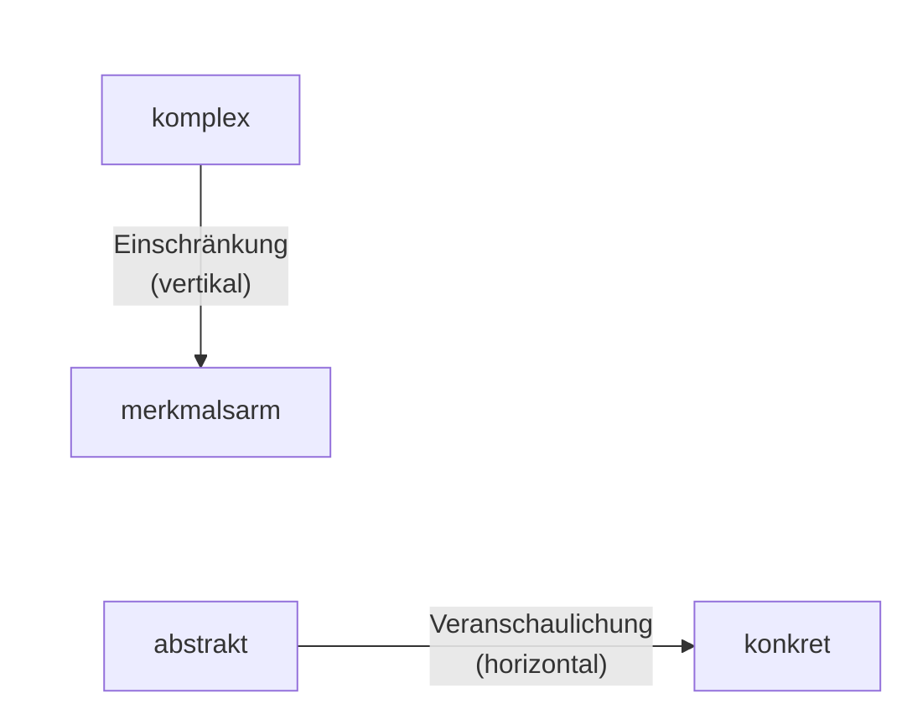
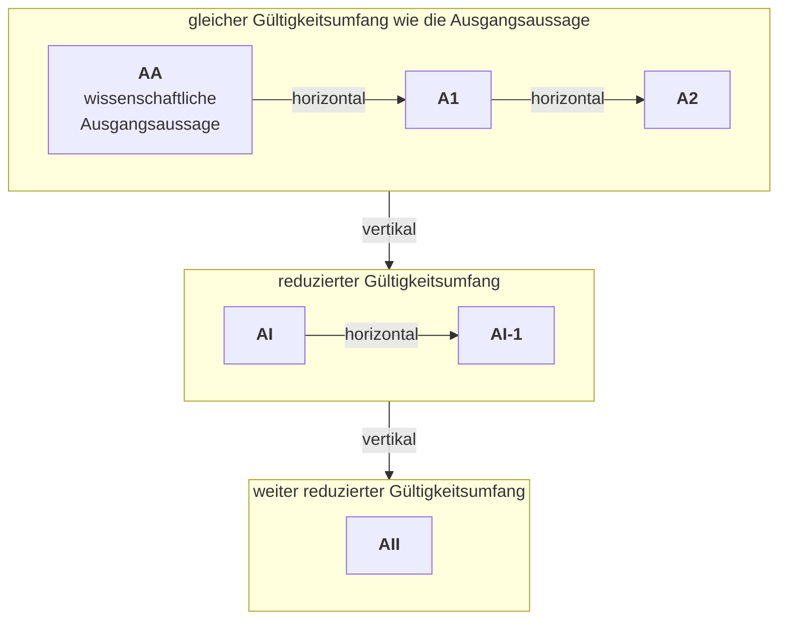

<!--
author:   Hannes Tegelbeckers
email:    hannes.tegelbeckers@ovgu.de
version:  0.3.0
language: de
narrator: Deutsch Female
mode:     Textbook
comment:  Fachdidaktik technischer Allgemeinbildung II – Selbstlerneinheit zu Sitzung S07. Didaktische Reduktion nach Grüner verstehen, vertikal und horizontal unterscheiden, die Beispiele der Sitzung nachvollziehen und mit den Schritten nach Arnold und den Verfahren nach Hering eine eigene Fachaussage reduzieren.

import:   https://raw.githubusercontent.com/LiaTemplates/mermaid_template/0.1.4/README.md
-->

# S07 – Didaktische Reduktion (Selbstlerneinheit)

<!-- didaktik="Selbstlerneinheit S07 · ca. 90 min · Studientext + Übungen · Inhalte der Folien R128–R145 und Zinn (2026), in eigenen Worten erläutert" -->
> [!IMPORTANT] 🧭 Leitfrage
> Wie vereinfache ich eine Fachaussage so, dass sie verständlich wird – **ohne falsch zu werden**?

> [!NOTE] 📘 So ist diese Einheit aufgebaut
> Diese Einheit **erklärt die Inhalte der Sitzung S07** in eigenen Worten und mit Beispielen – Sie können sie auch bearbeiten, wenn Sie in der Sitzung nicht dabei waren. Die Originalfolien (u. a. die vollständige Herleitung von den Maxwell-Gleichungen zum Ohm'schen Gesetz) finden Sie in der [LiaScript-Sitzung S07](https://liascript.github.io/course/?https://raw.githubusercontent.com/OVGU-VET-TechEd/Fachdidaktik_technischer_Allgemeinbildung_II/main/S07_Didaktische_Reduktion.md).

> [!TIP] ✍️ Übung in Moodle
> Bearbeiten Sie diese Einheit als Übung im Moodle-Kurs – dort wird Ihr Bearbeitungsstand gespeichert: [Übung in Moodle öffnen](https://elearning.ovgu.de/mod/scorm/view.php?id=707268)

## Ablauf der Einheit

    --{{0}}--
Die Einheit dauert etwa 90 Minuten. Nach einem kurzen Einstieg klären Sie, was didaktische Reduktion ist, gehen die Beispiele der Sitzung durch, lernen die Entscheidungsschritte nach Arnold und die Verfahren nach Hering kennen und ergänzen weitere Reduktionsarten nach Zinn.

<!-- data-type="none" -->
| Nr. | Abschnitt | Format | Dauer |
|----|--------|--------|----------|
| 1 | Was ist didaktische Reduktion? Vertikal und horizontal | Studientext, zwei Übungen | 24 min |
| 2 | Die Beispiele der Sitzung: Elektro- und Bautechnik | Studientext, eine Übung | 15 min |
| 3 | Wie entscheide ich? Die Schritte nach Arnold | Beispiel durchgespielt, eigene Fachaussage | 20 min |
| 4 | Hering, weitere Reduktionsarten und Elementarisierung | Studientext, zwei Übungen | 22 min |

> [!NOTE] Prüfungsbezug
> Zum Abschluss (ca. 6 min): Rückblick und Prüfungsfragen zum Üben für die mündliche Prüfung.

## Lernziele der Einheit

    --{{0}}--
Nach dieser Einheit können Sie vier Dinge.

**Am Ende dieser Einheit können Sie …**

    --{{1}}--
Erstens definieren Sie didaktische Reduktion und prüfen vereinfachte Aussagen auf Korrektheit.

      {{1}}
- **definieren und prüfen** didaktische Reduktion definieren und vereinfachte Aussagen auf Korrektheit prüfen

    --{{2}}--
Zweitens unterscheiden Sie vertikale und horizontale Reduktion.

      {{2}}
- **unterscheiden und erläutern** vertikale und horizontale Reduktion am Gültigkeitsumfang unterscheiden und an Beispielen erläutern

    --{{3}}--
Drittens beschreiben Sie die Entscheidungsschritte nach Arnold und reduzieren damit eine Fachaussage.

      {{3}}
- **beschreiben und reduzieren** die Entscheidungsschritte nach Arnold beschreiben und eine Fachaussage damit reduzieren

    --{{4}}--
Und viertens ordnen Sie Vereinfachungen den Verfahren nach Hering und den Reduktionsarten nach Zinn zu.

      {{4}}
- **zuordnen** Vereinfachungen den Verfahren nach Hering und den Reduktionsarten nach Zinn

    --{{5}}--
Welche Abschnitte interessieren Sie am meisten?

      {{5}}
****************************************

**Auswählen:** Auf welche Abschnitte sind Sie am meisten gespannt? (mehrere möglich)

[[m1]] Was ist didaktische Reduktion? Vertikal und horizontal
[[m2]] Die Beispiele der Sitzung: Elektro- und Bautechnik
[[m3]] Wie entscheide ich? Die Schritte nach Arnold
[[m4]] Hering, weitere Reduktionsarten und Elementarisierung

****************************************

## 0 · Wo stehen Sie?

    --{{0}}--
Eine Ausgangsfrage, über die Sie am Ende noch einmal abstimmen.

> **„Im Unterricht darf man auch mal etwas Falsches sagen – Hauptsache, es wird verstanden.“**

**Abstimmen (vorher):** Stimmen Sie zu?

[(a)] Ja, ich stimme zu
[(b)] Nein, ich stimme nicht zu
[(c)] Teils, teils
[(unentschieden)] Unentschieden

    --{{1}}--
Notieren Sie eine Fachaussage, mit der Sie in Abschnitt 3 weiterarbeiten.

      {{1}}
****************************************

> [!TIP] 🧠 Ihre Fachaussage · 3 min
> Notieren Sie eine Fachaussage aus Ihrer Fachrichtung, die für Ihre Lernenden „zu schwer“ ist – so, wie sie im Fachbuch steht.

[[___ ___ ___]]

****************************************

    --{{2}}--
Behalten Sie diese Aussage im Blick.

      {{2}}
> [!TIP] 📌 Merken
> Mit Ihrer Fachaussage arbeiten Sie in Abschnitt 3 (Schritte nach Arnold) weiter.

## 1 · Was ist didaktische Reduktion – und wann wird sie falsch?

    --{{0}}--
Jede Lehrkraft vereinfacht. Eine wissenschaftliche Aussage ist für Lernende oft nicht fasslich – das ist nach Grüner das Kernproblem. Dafür gibt es zwei Gründe.

- Die Aussage ist **zu abstrakt**: Sie ist allgemein formuliert, oft mathematisch, und hat keinen erkennbaren Bezug zu Dingen, die die Lernenden kennen.
- Die Aussage ist **zu komplex**: Sie enthält so viele Größen, Bedingungen und Sonderfälle, dass das Wesentliche darin untergeht.

    --{{1}}--
Didaktische Reduktion ist nach Grüner der widerspruchsfreie Übergang von einer wissenschaftlichen Aussage zu einer verständlicheren, vereinfachten Aussage. Entscheidend ist die Bedingung, die er daran knüpft.

      {{1}}
****************************************

> Die abgeleitete Aussage muss **unter Nennung der Einschränkungen immer korrekt** bleiben (Grüner, Folie R129).

Vereinfachen heißt also *weglassen und eingrenzen* – nicht *verfälschen*. Eine Aussage, die nur für einen Sonderfall gilt, ist in Ordnung, wenn der Sonderfall genannt wird. Eine Aussage, die schlicht nicht stimmt, ist keine Reduktion, sondern ein Fehler – und Lernende müssen ihn später mühsam wieder verlernen.

****************************************

    --{{2}}--
Das ist die Prüffrage, die Sie durch die ganze Einheit begleitet.

      {{2}}
> [!NOTE] Kernaussage
> **Prüffrage:** Ist die vereinfachte Aussage – gegebenenfalls mit ihren Einschränkungen – korrekt?

<small>Nach den Folien R128–R130 (Grüner); Erläuterungen: eigene Darstellung.</small>

## Mit welchen Mitteln wird vereinfacht?

    --{{0}}--
Grüner nennt fünf Reduktionsmethoden, um eine Aussage fasslicher zu machen.

<!-- data-type="none" -->
| Methode | Was passiert | Beispiel |
| --- | --- | --- |
| Einschränkung auf wichtige Sonderfälle | Nur ein typischer Fall wird betrachtet. | Nur Gleichstrom statt Wechselstrom |
| Verdeutlichung durch Beispiele | Die allgemeine Aussage wird an einem konkreten Fall gezeigt. | Ohm'sches Gesetz an einem bestimmten Heizwiderstand |
| Veranschaulichung | Prinzipskizze, Kennlinie, Experiment, Animation, Analogie | U-I-Kennlinie statt Formel |
| Verbale Erläuterung oder Merkregel statt Gleichung | Der Zusammenhang wird in Worten formuliert. | „Je größer der Widerstand, desto kleiner der Strom – bei gleicher Spannung.“ |
| Vernachlässigung von „Randeffekten“ | Kleine Einflüsse werden weggelassen. | Leitungswiderstand, Reibung, Luftwiderstand |

    --{{1}}--
Achten Sie schon hier auf einen Unterschied.

      {{1}}
> [!NOTE] Kernaussage
> Bei der ersten und der letzten Methode gilt die neue Aussage für **weniger Fälle**, bei den drei mittleren für **dieselben Fälle** – sie ist nur anschaulicher. Diesen Unterschied macht Abschnitt 2 zum Kriterium.

<small>Methoden nach Folie R130 „6.2 Reduktionsmethoden“; Beispiele: eigene Darstellung.</small>

## Übung 1: Didaktische Reduktion oder Fehler?

    --{{0}}--
Prüfen Sie Aussagen mit der Prüffrage: Ist die Aussage – gegebenenfalls mit ihren Einschränkungen – korrekt? Vergleichen Sie zuerst, woran man eine korrekte Reduktion erkennt.

<!-- data-type="none" -->
| Kriterium | korrekt reduziert | falsch vereinfacht |
|-----------|---------------|---------------|
| fachlich | stimmt, ggf. mit genannter Einschränkung | stimmt nicht |
| Einschränkung | wird genannt | wird verschwiegen |
| später | lässt sich erweitern | muss verlernt werden |
| Verfahren | Reduktion | Fehler |

    --{{1}}--
Ein Beispielpaar:

      {{1}}
- **korrekt reduziert:** „Die meisten Stähle sind magnetisierbar – nichtrostende austenitische Stähle dagegen kaum.“
- **falsch vereinfacht:** „Stahl ist magnetisch.“

    --{{2}}--
Ein typischer Fehlschluss:

      {{2}}
> [!WARNING] Häufiges Missverständnis
> Kurz heißt nicht falsch: „Stahl ist magnetisch“ wird durch den Hinweis auf austenitische Stähle zu einer korrekten Reduktion (in Abschnitt 4: *indizierte Verallgemeinerung*).

    --{{3}}--
Ordnen Sie jetzt zu.

      {{3}}
****************************************

**Entscheiden:** Welchen Begriff beschreibt die Aussage jeweils?

<!-- data-hint-button="1" data-solution-button="2" data-show-partial-solution -->
[(korrekt reduziert) (falsch vereinfacht)]
[       (X)             ( )      ] „Der Verbraucher wandelt elektrische Energie in andere Energieformen um.“
[       ( )             (X)      ] „Im Verbraucher wird der Strom verbraucht.“
[       (X)             ( )      ] „Warme Luft steigt nach oben, weil sie eine geringere Dichte hat als die kältere Umgebungsluft.“
[       ( )             (X)      ] „Wärme steigt nach oben.“
[[?]] Stimmt die Aussage, wenn man sie genau nimmt?
***
„Strom wird verbraucht“ ist falsch: Der Strom ist im unverzweigten Stromkreis überall gleich; umgewandelt wird Energie. „Wärme steigt“ verwechselt Wärme (eine Energieform) mit warmer Luft.
***

****************************************

## Ihre Fachrichtung: eine falsche Vereinfachung korrigieren

    --{{0}}--
Übertragen Sie die Prüffrage auf Ihre Fachrichtung.

Notieren Sie eine typische, aber **falsche** Vereinfachung, die Sie aus Unterricht oder Ausbildung kennen – und formulieren Sie sie so, dass sie **korrekt reduziert** ist.

[[___ ___ ___ ___]]

💡 Hinweis

Suchen Sie Sätze mit „immer“, „nie“ oder „alle“ – oft fehlt dort die Einschränkung.

✅ Lösung

Falsch: „Strom fließt immer den Weg des geringsten Widerstands.“ Korrekt reduziert: „Bei einer Parallelschaltung teilt sich der Strom auf; durch den Zweig mit dem kleineren Widerstand fließt der größere Teil.“

## 2 · Vertikal und horizontal: der Gültigkeitsumfang entscheidet

    --{{0}}--
Grüner unterscheidet zwei Arten der didaktischen Reduktion. Das Unterscheidungsmerkmal ist der Gültigkeitsumfang – also die Menge der Fälle, für die eine Aussage gilt. Die Folie zeigt das als Achsenkreuz.

    --{{1}}--
Die vertikale Achse führt durch Einschränkung von komplex nach merkmalsarm – die Aussage verliert Merkmale und damit Fälle, für die sie gilt.

      {{1}}
**① Vertikal:** Einschränkung: von „komplex“ nach „merkmalsarm“ – der Gültigkeitsumfang wird reduziert.

    --{{2}}--
Die horizontale Achse führt durch Veranschaulichung von abstrakt nach konkret – die Aussage wird greifbarer, aber nicht kleiner.

      {{2}}
**② Horizontal:** Veranschaulichung: von „abstrakt“ nach „konkret“ – der Gültigkeitsumfang bleibt erhalten.

    --{{3}}--
Daraus folgt die Prüffrage für die Zuordnung.

      {{3}}
**③ Prüffrage:** Gilt die neue Aussage für *weniger* Fälle? Dann vertikal. Für *dieselben* Fälle, nur anschaulicher? Dann horizontal.

    --{{4}}--
Merken Sie sich die beiden Richtungen.

      {{4}}
> [!NOTE] Kernaussage
> Vertikal = einschränken · horizontal = veranschaulichen.

<small>Achsenkreuz nach Folie R131 „6.3 Arten Didaktischer Reduktion“, als zwei Pfeile nachgezeichnet.</small>

## Übung 2: Vertikal oder horizontal?

    --{{0}}--
Die beiden Arten im Vergleich. Danach ordnen Sie Reduktionen des Hebelgesetzes zu: Am Hebel herrscht Gleichgewicht, wenn die Summe der Drehmomente null ist.

<!-- data-type="none" -->
| Kriterium | vertikal | horizontal |
|-----------|---------------|---------------|
| Gültigkeitsumfang | wird **reduziert** | bleibt **erhalten** |
| Vorgehen | Ausschnitt bilden: Sonderfälle betrachten, Einflüsse vernachlässigen | konkretere, gleichwertige Darstellung, der Ausgangsaussage *nebengeordnet* |
| Typische Mittel | Sonderfall, Randeffekte weglassen | Beispiel, Kennlinie, Skizze, Experiment, Analogie, Merkregel |
| Gefahr | Die Einschränkung wird verschwiegen – dann wird die Aussage falsch. | Die Darstellung passt nicht ganz (z. B. eine Analogie, die hinkt). |

    --{{1}}--
Je ein Beispiel:

      {{1}}
- **vertikal:** nur Gleichstrom in einem homogenen Leiter
- **horizontal:** Watteflocken machen das elektrische Feld zwischen zwei Kugeln sichtbar

    --{{2}}--
Achtung:

      {{2}}
> [!WARNING] Häufiges Missverständnis
> Die Merkregel „Kraft mal Kraftarm gleich Last mal Lastarm“ ist nur horizontal zum *Sonderfall* F₁ · l₁ = F₂ · l₂, nicht zur allgemeinen Drehmomentsumme – ein Beispiel kann beide Arten enthalten.

    --{{3}}--
Ordnen Sie die Reduktionen des Hebelgesetzes zu.

      {{3}}
****************************************

**Entscheiden:** Welchen Begriff beschreibt die Aussage jeweils?

<!-- data-hint-button="1" data-solution-button="2" data-show-partial-solution -->
[(vertikal) (horizontal)]
[       (X)             ( )      ] Man betrachtet nur einen geraden, gewichtslosen Hebel mit zwei Kräften senkrecht zum Hebelarm: F₁ · l₁ = F₂ · l₂.
[       ( )             (X)      ] Die Lernenden probieren das Gleichgewicht an einer Wippe mit Gewichten aus.
[       (X)             ( )      ] Reibung im Drehpunkt wird vernachlässigt.
[       ( )             (X)      ] Merkregel „Kraft mal Kraftarm gleich Last mal Lastarm“ – gemeinsam mit der Formel und ihren Bedingungen.
[[?]] Gilt die neue Aussage für weniger Fälle als die Drehmomentsumme?
***
Vertikal: Der Sonderfall (zwei senkrechte Kräfte, masseloser Hebel, keine Reibung) schränkt den Gültigkeitsumfang ein – korrekt, solange die Einschränkungen genannt werden. Horizontal: Wippe und Merkregel stellen dieselbe Aussage konkreter dar.
***

****************************************

## 3 · Vertikal: von den Maxwell-Gleichungen zum Ohm'schen Gesetz

    --{{0}}--
In der Sitzung wurden beide Reduktionsarten an je einem Beispiel aus der Elektrotechnik und der Bautechnik gezeigt. Sie müssen die Formeln nicht herleiten können – wichtig ist, welche Einschränkung an welcher Stelle gemacht wird. Das Ohm'sche Gesetz lernen Auszubildende im ersten Jahr. Wissenschaftlich ist es keine Grundaussage, sondern ein Sonderfall der Maxwell-Gleichungen. Wagner zeigt, wie man in einer Treppe von Einschränkungen von Maxwell zu Ohm kommt.

<!-- data-type="none" -->
| Stufe | Einschränkung | Ergebnis |
| --- | --- | --- |
| Ausgangsaussage | keine | Maxwell-Gleichungen (Durchflutungssatz, Induktionsgesetz) gelten allgemein |
| 1. Schritt | Die magnetische Wirkung zeitlich veränderlicher elektrischer Felder im Nichtleiter wird vernachlässigt ($dD/dt \approx 0$). Betrachtet wird nur das elektrische Feld in **Leitern**. | Strom $I$ und Spannung $U$ lassen sich aus Stromdichte und Feldstärke bestimmen; bei konstanter Leitfähigkeit gilt $S = \gamma \cdot E$. |
| 2. Schritt | Stromdichte senkrecht auf dem Querschnitt, Feldstärke parallel zur Leiterlänge und zur Stromdichte – die Felder sind **homogen und konstant**. | $\dfrac{U}{I} = \dfrac{l}{A \cdot \gamma} = \text{konst.} = R$ – das Ohm'sche Gesetz |

Das Ohm'sche Gesetz gilt **für homogene Felder in homogenen Leitern der Länge l mit konstantem Querschnitt A bei konstanter Leitfähigkeit γ**.

    --{{1}}--
Warum ist das für den Unterricht wichtig?

      {{1}}
****************************************

💡 Die Bedingung „konstante Leitfähigkeit“ ist kein Detail. Die Leitfähigkeit eines Metalls hängt von der Temperatur ab. Der Glühfaden einer Glühlampe wird beim Einschalten sehr heiß, sein Widerstand steigt stark – seine U-I-Kennlinie ist deshalb **keine Gerade**. Wer das Ohm'sche Gesetz ohne Einschränkung lehrt, kann diesen Messbefund nicht erklären. Wer die Einschränkung nennt, hat sofort eine Erklärung. *(Eigenes Beispiel.)*

****************************************

    --{{2}}--
Mit jeder Stufe wird der Gültigkeitsumfang kleiner – das ist vertikale Reduktion.

      {{2}}
> [!NOTE] Kernaussage
> Korrekt bleibt das Ohm'sche Gesetz, weil die Einschränkungen genannt werden.

<small>Zusammenfassung der Folien R133–R134 (Wagner, 2006; vgl. Moeller 1986). Die vollständige Herleitung mit den Gleichungen (1)–(12) steht in der LiaScript-Sitzung S07.</small>

## Vertikal: von der Streckenlast zur Punktlast

    --{{0}}--
Im Bauwesen liegt auf einem Träger selten eine einzelne Kraft. Meist ist die Last verteilt – etwa eine Schüttung oder eine Decke. Die Folie zeigt drei Stufen.

1. **Unregelmäßige Streckenlast:** Die Gesamtkraft ist die Fläche unter der Lastverteilung, $F = \int g \, dl$. Das gilt immer.
2. **Gleichmäßig verteilte Last** (auf der Folie „Flächenlast“): Die Streckenlast g ist überall gleich, also $F = g \cdot l$.
3. **Punktlast:** Die verteilte Last wird durch **eine Einzelkraft** ersetzt.

Damit der Ersatz zulässig ist, nennt die Folie drei Bedingungen: Die Einzellast hat **dieselbe Richtung** wie die Streckenlast, ihre **Größe** entspricht der Fläche der Lastfigur, und ihre **Wirkungslinie** geht durch deren **Schwerpunkt**.

    --{{1}}--
Eine Einschränkung bleibt trotzdem.

      {{1}}
****************************************

👀 Mit diesen Bedingungen liefert die Punktlast für einen Träger auf zwei Auflagern die richtigen **Auflagerkräfte**. Für die **Biegung im Träger** gilt das nicht: Eine mittige Einzellast erzeugt in Trägermitte das doppelte Biegemoment wie dieselbe Last gleichmäßig verteilt. *(Eigene Ergänzung.)*

****************************************

    --{{2}}--
Die Reduktion ist also korrekt für eine bestimmte Rechnung.

      {{2}}
> [!NOTE] Kernaussage
> Korrekt *für eine bestimmte Rechnung* – genau das muss man dazusagen.

<small>Nach Folie R135 „6.5 Beispiel für vertikale didaktische Reduktion Bautechnik“; Erläuterungen: eigene Darstellung.</small>

## Horizontal: Ohm in vier Darstellungen

    --{{0}}--
Arnold zeigt dasselbe Ohm'sche Gesetz in vier gleichwertigen Formen. Jede gilt für genau dieselben Fälle – es wird also nichts eingeschränkt, nur anders dargestellt. Ein zweites Beispiel ist das elektrostatische Feld zwischen zwei entgegengesetzt geladenen Kugeln: als Formel, als Feldlinienbild und als Experiment mit Watteflocken. Drei Darstellungen, ein Gültigkeitsumfang.

<!-- data-type="none" -->
| Mathematische Formel | Grafische Darstellung | Verbale Erläuterung | Merkregel |
| --- | --- | --- | --- |
| $U = R \cdot I$ | Kennlinie: Gerade im U-I-Diagramm | Das Verhältnis von Spannung zu Strom in einem elektrischen Leiter ist konstant und stellt den Widerstand dar. | Dreieck: U oben, R und I unten |

    --{{1}}--
Arnold fasst beide Richtungen in einem Schema zusammen: Von der Ausgangsaussage geht es nach rechts zu nebengeordneten, konkreteren Aussagen und nach unten zu Aussagen mit kleinerem Gültigkeitsumfang. Beide Wege lassen sich kombinieren.

      {{1}}
****************************************

****************************************

    --{{2}}--
Auch einen Sonderfall kann man wieder anschaulich darstellen.

      {{2}}
> [!NOTE] Kernaussage
> Nach rechts: horizontal (gleicher Gültigkeitsumfang) · nach unten: vertikal (reduzierter Gültigkeitsumfang).

<small>Nach Folien R136–R137 (Arnold, 1990); Schema als Diagramm nachgezeichnet – im Original führen die Pfeile von AA nach rechts zu A1 und A2 und nach unten zu AI und AII.</small>

## Horizontal und vertikal zugleich: Lasten in Worten

    --{{0}}--
Folie R138 nimmt die drei Lastfälle wieder auf und stellt jede Formel in Worten dar – etwa: Die auftretende Kraft ergibt sich aus der Berechnung der Fläche unter der Funktion, die die Streckenlast beschreibt. Diese Verbalformulierung ist horizontal zur jeweiligen Formel.

Die Folie hat aber auch eine Spalte **„Einschränkungen“**:

- Zeile 1: „gilt immer“
- Zeile 2: nur bei nahezu symmetrischer Kraftverteilung
- Zeile 3: nur, wenn die Annahme einer Punktlast für das Berechnungsverfahren ausreicht

Gegenüber Zeile 1 sind Zeile 2 und 3 also *vertikal* reduziert.

    --{{1}}--
Ein Beispiel kann beide Reduktionsarten zugleich enthalten.

      {{1}}
> [!NOTE] Kernaussage
> Geben Sie immer an, *im Vergleich wozu* Sie die Art bestimmen.

<small>Nach Folie R138 „6.7 Beispiel für Horizontal didaktische Reduktion bautechnik“.</small>

## Übung 3: Treppe und Darstellungen

    --{{0}}--
Drei kurze Fragen zu den Beispielen der Sitzung.

**1 · Eine Antwort:** Zu welchem Schritt der Maxwell-Treppe gehört die Einschränkung „zeitliche Änderung des elektrischen Feldes im Nichtleiter vernachlässigt (dD/dt ≈ 0)“?

<!-- data-hint-button="1" data-solution-button="2" -->
- [( )] 2. Schritt
- [(X)] 1. Schritt
- [( )] Ausgangsaussage
[[?]] Der 1. Schritt führt zu Strom und Spannung.
***
1. Schritt: Die Einschränkungen führen zu Strom, Spannung und S = γ·E. 2. Schritt: Die Homogenitätsannahmen führen zum Ohm'schen Gesetz (R133–R134).
***

    --{{1}}--
Jetzt können mehrere Antworten richtig sein.

      {{1}}
****************************************

**2 · Alle zutreffenden:** Welche Reduktionen sind vertikal?

<!-- data-hint-button="1" data-solution-button="2" -->
- [[X]] Man betrachtet nur Gleichstrom in einem homogenen Leiter.
- [[ ]] Das Ohm'sche Gesetz wird zusätzlich als Kennlinie gezeichnet.
- [[X]] Eine Streckenlast wird als Punktlast in der Mitte angesetzt.
- [[ ]] Watteflocken zwischen zwei geladenen Kugeln machen das elektrische Feld sichtbar.
[[?]] Vertikal = weniger Fälle.
***
Vertikal = weniger Fälle (Sonderfall, vernachlässigter Einfluss, Ersatzlast). Horizontal = dieselben Fälle, konkreter dargestellt (Kennlinie, Experiment).
***

****************************************

    --{{2}}--
Zum Schluss tippen Sie einen Begriff.

      {{2}}
****************************************

**3 · Eintippen:** Wie heißt die Darstellung „Dreieck: U oben, R und I unten“? (ein Wort)

<!-- data-hint-button="1" data-solution-button="2" -->
[[Merkregel]]
[[?]] Sie hilft, die Formel umzustellen.

***
Formel, Kennlinie, verbale Erläuterung, Merkregel – vier Darstellungen, ein Gültigkeitsumfang (R136).
***

****************************************

## 4 · Wie entscheide ich? Die Schritte nach Arnold

    --{{0}}--
Bisher haben Sie fertige Reduktionen eingeordnet. Im Unterricht müssen Sie selbst entscheiden, was Sie weglassen. Arnold beschreibt dafür das didaktische Reduktionsfeld – sechs Entscheidungsschritte in fester Reihenfolge. Die Reihenfolge ist der Kern: zuerst horizontal, dann vertikal ohne Gültigkeitsverlust und erst ganz zuletzt mit Einschränkung. Wer sofort Teile weglässt, prüft nicht, ob eine gute Veranschaulichung schon gereicht hätte.

    --{{1}}--
Was Sie tun: die Fachaussage zerlegen – welche Größen, Begriffe, Bedingungen stecken darin?

      {{1}}
1. **Sachanalyse:** Durch welche Begriffe, Elemente ist die Komplexität des Unterrichts bestimmt

    --{{2}}--
Was Sie tun: den Kern bestimmen – das, was die Lernenden am Ende auf jeden Fall verstanden haben sollen.

      {{2}}
2. **Didaktische Strukturierung:** Welche Bestandteile sind von zentraler Bedeutung, um den Gegenstand zu verstehen

    --{{3}}--
Was Sie tun: Vorwissen, Mathematik und typische Fehlvorstellungen der Lerngruppe einschätzen.

      {{3}}
3. **Restriktionsanalyse:** Erwartete Lernschwierigkeiten der Adressaten in die Planung einbeziehen

    --{{4}}--
Was Sie tun: anschauliche Darstellungen wählen, die den Gültigkeitsumfang nicht verändern.

      {{4}}
4. **Horizontale didaktische Reduktion:** Förderung des Verständnisses durch Beispiele, Analogien, usw.

    --{{5}}--
Was Sie tun: zum Beispiel eine Herleitung weglassen und das Ergebnis nutzen. Dieser Schritt wird oft übersehen: Wer die Formel ohne Herleitung nutzt, sagt nichts Falsches und schränkt nichts ein.

      {{5}}
5. **Vertikale didaktische Reduktion I:** Auf welche Bestandteile kann verzichtet werden, ohne die Gültigkeit einzuschränken

    --{{6}}--
Was Sie tun: erst jetzt einen Sonderfall wählen oder Einflüsse vernachlässigen – und die Einschränkung nennen.

      {{6}}
6. **Vertikale didaktische Reduktion II:** Welche Einschränkungen des Gültigkeitsumfanges können verantwortet werden, um das Verständnis zu fördern

<small>Schritte und Leitfragen nach Folien R139–R140 „6.8 Didaktisches Reduktionsfeld“ (Arnold); Erläuterungen: eigene Darstellung.</small>

## Übung 4a: Schritte ordnen

    --{{0}}--
Bringen Sie die sechs Entscheidungsschritte in die richtige Reihenfolge.

**Ordnen:** Ziehen Sie jede Karte in die richtige Lücke.

<!-- data-randomize data-show-partial-solution data-solution-button="2" -->
Schritt 1: [->[ Sachanalyse ]] → Schritt 2: [->[ Didaktische Strukturierung ]] → Schritt 3: [->[ Restriktionsanalyse ]] → Schritt 4: [->[ Horizontale didaktische Reduktion ]] → Schritt 5: [->[ Vertikale didaktische Reduktion I ]] → Schritt 6: [->[ Vertikale didaktische Reduktion II ]]

## Ein Beispiel durchgespielt: der U-Wert

    --{{0}}--
Ausgangsaussage: Der Wärmedurchgangskoeffizient, der U-Wert eines Bauteils, gibt an, welcher Wärmestrom pro Quadratmeter Fläche und pro Kelvin Temperaturdifferenz durch das Bauteil fließt; er hängt von den Schichten, ihren Dicken und Wärmeleitfähigkeiten sowie von den Wärmeübergangswiderständen ab.

<!-- data-type="none" -->
| Schritt nach Arnold | Ausgestaltung für Auszubildende im Ausbauhandwerk |
| --- | --- |
| 1 Sachanalyse | Begriffe: Wärmestrom, Fläche, Temperaturdifferenz, Schicht, Wärmeleitfähigkeit, Übergangswiderstand |
| 2 Didaktische Strukturierung | Zentral: Je kleiner der U-Wert, desto weniger Wärme geht verloren; Dämmstoffdicke und -art bestimmen ihn wesentlich. |
| 3 Restriktionsanalyse | Lernschwierigkeiten: Kehrwerte, Einheit W/(m²·K), „klein ist gut“ wirkt unlogisch. |
| 4 Horizontale Reduktion | Vergleich zweier Wandaufbauten mit Wärmebildkamera; Analogie zur Daunenjacke (Grenzen der Analogie besprechen). |
| 5 Vertikale Reduktion I | Auf die Herleitung über Kehrwertsummen verzichten – Tabellenwerte nutzen; die Gültigkeit bleibt unberührt. |
| 6 Vertikale Reduktion II | Wärmeübergangswiderstände und Wärmebrücken zunächst vernachlässigen – und das ausdrücklich sagen. |

    --{{1}}--
Beachten Sie Schritt 6.

      {{1}}
> [!NOTE] Kernaussage
> Wer Wärmebrücken vernachlässigt, muss dazusagen, dass reale Wände an Fensteranschlüssen oder Deckenauflagern mehr Wärme verlieren, als der U-Wert allein vermuten lässt – sonst entsteht genau die falsche Vereinfachung aus Abschnitt 1.

<small>Übungsbeispiel für diese Einheit, nicht von den Originalfolien; Schrittfolge nach Arnold (Folien R139–R140).</small>

## Übung 4b: Ihre Fachaussage reduzieren

    --{{0}}--
Nehmen Sie die Fachaussage aus Abschnitt 0, oder eine neue, und gehen Sie die sechs Schritte durch. Ihre reduzierte Fachaussage ist zugleich Baustein 8 für Ihren Unterrichtsentwurf.

1. **Sachanalyse** – Welche Begriffe und Elemente machen sie komplex?
2. **Didaktische Strukturierung** – Was ist zentral?
3. **Restriktionsanalyse** – Welche Lernschwierigkeiten erwarten Sie?
4. **Horizontale Reduktion** – Welches Beispiel, welche Analogie, welche Skizze?
5. **Vertikale Reduktion I** – Worauf verzichten Sie ohne Gültigkeitsverlust?
6. **Vertikale Reduktion II** – Welche Einschränkung verantworten Sie, und wie **nennen** Sie sie den Lernenden?

**Prüfen Sie Ihr Ergebnis:**

- [ ] Ist die reduzierte Aussage unter Nennung der Einschränkungen noch korrekt?
- [ ] Ist klar, welche Teile horizontal und welche vertikal reduziert wurden?
- [ ] Lässt sich die Aussage später erweitern, ohne dass die Lernenden etwas verlernen müssen?

[[___ ___ ___ ___]]

💡 Hinweis

Formulieren Sie die Einschränkung als Halbsatz, der in Ihrer Aussage stehen bleibt: „… gilt, solange …“, „… meist …“, „… im Bereich von … bis …“.

✅ Lösung

Beispiel Elektrotechnik, „Der Leitungsquerschnitt richtet sich nach Strom, Verlegeart und Häufung (DIN VDE 0298-4)“: **Sachanalyse** Belastbarkeit, Verlegeart, Häufung, Umgebungstemperatur · **zentral** Strom bestimmt Erwärmung · **Restriktion** Tabellen wirken abschreckend · **horizontal** Analogie Wasserschlauch, Kennlinie Erwärmung · **vertikal I** Häufung zunächst weglassen, wenn nur ein Stromkreis verlegt wird · **vertikal II** „Bei Umgebungstemperatur bis 30 °C und Verlegeart C gilt: 16 A → 1,5 mm² Cu“ – Einschränkung genannt, also korrekt.

## 5 · Vereinfachen nach Hering

    --{{0}}--
Hering hat sich 1959, vor Grüner, mit der Frage beschäftigt, wie naturwissenschaftliche und technische Aussagen fasslich werden. Sein Hauptsatz der didaktischen Vereinfachung lautet so.

> „Didaktische Vereinfachung einer wissenschaftlichen Aussage ist der Übergang von einer (in die besonderen Merkmale des Gegenstandes) *differenzierten* Aussage zu einer *allgemeinen* Aussage (gleichen Gültigkeitsumfangs über den gleichen Gegenstand unter gleichem Aspekt).“
>
> Hering: Zur Faßlichkeit naturwissenschaftlicher und technischer Aussagen. – Berlin, 1959, S. 92

**In einfachen Worten:** Eine Aussage, die viele Einzelheiten aufzählt, wird durch eine **allgemeinere** ersetzt, die über denselben Gegenstand spricht und für dieselben Fälle gilt. Die Einzelheiten verschwinden, die Aussage bleibt richtig.

    --{{1}}--
Das Beispiel aus der Sitzung ist die Bilanzgleichung der Photosynthese. Sie fasst einen in Wirklichkeit vielstufigen Prozess in einer Zeile zusammen.

      {{1}}
****************************************

$$\ce{6 CO2 + 6 H2O ->[\text{Lichtenergie, Chlorophyll}] C6H12O6 + 6 O2}$$

Als Bilanz ist sie richtig. Was sie nicht zeigt, ist der Weg dorthin – zum Beispiel, dass der freigesetzte Sauerstoff aus dem **Wasser** stammt und nicht aus dem Kohlenstoffdioxid. Diese Information bringen erst die Sprechernotizen der Folie zurück.

****************************************

    --{{2}}--
Eine allgemeine Aussage ist also richtig, aber sie lässt Fragen offen.

      {{2}}
> [!NOTE] Kernaussage
> Eine allgemeine Aussage ist richtig, lässt aber Fragen offen, die man im Unterricht kennen sollte.

<small>Nach Folien R141 „Hauptsatz der didaktischen Vereinfachung nach HERING“ und R142 „Bsp.: Bilanzgleichung der Photosynthese“ (inkl. Sprechernotizen); Erläuterungen: eigene Darstellung.</small>

## Drei Verfahren

    --{{0}}--
Hering beschreibt drei Verfahren, wie man von der differenzierten zur allgemeinen Aussage kommt.

<!-- data-type="none" -->
| Verfahren | Vorgehen | Ausgangsaussage | Vereinfacht |
| --- | --- | --- | --- |
| **1) Tilgung untergeordneter Aussagen** | Ein **Oberbegriff** wird gebildet, der alle Teilaussagen einschließt. | Die elektrische Leitfähigkeit in Werkstoffen wird durch Elektronen, Defektelektronen und/oder Ionen ermöglicht. | … durch frei bewegliche Ladungsträger ermöglicht. |
| **2) Indizierte Tilgung nebengeordneter Aussagen** | Teilaussagen, die für das Ziel zunächst unwesentlich sind, werden weggelassen – mit einem **Hinweis**, dass es weitere gibt. Vor allem dann, wenn kein passender Oberbegriff existiert. | Als Zuschläge im Hochofenprozess kommen Quarz, Feldspat, Schiefer, Kalkstein und Dolomit in Betracht. | Als Zuschlag kommt vorwiegend Kalkstein in Betracht. Bestimmte andere Zuschläge sind möglich. |
| **3) Indizierte Verallgemeinerung** | Eine allgemeinere Aussage wird getroffen und die **Einschränkungen** des Gültigkeitsumfangs werden genannt. | (wie oben) | Als Zuschlag werden bestimmte Stoffe benutzt, meist Kalk. |

    --{{1}}--
Was heißt indiziert?

      {{1}}
> [!NOTE] Kernaussage
> **„Indiziert“ heißt:** Die Vereinfachung trägt einen *Hinweis*, dass etwas weggelassen wurde – „bestimmte andere sind möglich“, „meist“. Fehlt der Hinweis („Als Zuschlag wird Kalkstein verwendet.“), wird aus der Vereinfachung eine falsche Aussage.

<small>Nach Folien R143–R145 „Didaktische Vereinfachung nach HERING“.</small>

## Übung 5: Welches Verfahren?

    --{{0}}--
Ordnen Sie Vereinfachungen den Verfahren nach Hering zu. Die Beispiele sind Übungsbeispiele, nicht von den Originalfolien.

**1 · Eine Antwort:** „Schrauben, Nieten und Bolzen“ wird zu „lösbare und unlösbare Verbindungselemente“. Welches Verfahren ist das?

<!-- data-hint-button="1" data-solution-button="2" -->
- [( )] Indizierte Verallgemeinerung
- [(X)] Tilgung untergeordneter Aussagen
- [( )] Indizierte Tilgung nebengeordneter Aussagen
[[?]] Wird ein Oberbegriff gebildet?
***
Oberbegriff bilden = Tilgung untergeordneter Aussagen.
***

    --{{1}}--
Jetzt können mehrere Antworten richtig sein.

      {{1}}
****************************************

**2 · Alle zutreffenden:** Welche Vereinfachungen sind „indiziert“?

<!-- data-hint-button="1" data-solution-button="2" -->
- [[X]] „Als Schutzmaßnahmen kommen vor allem Fehlerstromschutzschalter in Betracht; weitere sind möglich.“
- [[ ]] „Die elektrische Leitfähigkeit wird durch frei bewegliche Ladungsträger ermöglicht.“
- [[X]] „Für Fundamente werden bestimmte Betone verwendet, meist C25/30.“
- [[ ]] „Schrauben, Nieten und Bolzen sind Verbindungselemente.“
[[?]] Indiziert = mit Hinweis, dass etwas weggelassen wurde.
***
Eine Teilaussage auswählen und auf weitere hinweisen = indizierte Tilgung nebengeordneter Aussagen · allgemeinere Aussage mit Hinweis („meist“) = indizierte Verallgemeinerung.
***

****************************************

    --{{2}}--
Zum Schluss tippen Sie einen Begriff.

      {{2}}
****************************************

**3 · Eintippen:** Wie nennt Hering eine Vereinfachung, die auf das Weggelassene hinweist? (ein Wort)

<!-- data-hint-button="1" data-solution-button="2" -->
[[indiziert]]
[[?]] Es steht in zwei der drei Verfahrensnamen.

***
Indizierte Tilgung nebengeordneter Aussagen und indizierte Verallgemeinerung (R144–R145).
***

****************************************

## 6 · [NEU] Weitere Reduktionsarten und Elementarisierung

    --{{0}}--
Dieser Abschnitt ergänzt die Folien um ein aktuelles Lehrbuch, als NEU markiert. Zinn bestätigt die Unterscheidung der Folien und nennt typische Arten, wie in technischen Fächern reduziert wird.

<!-- neu="Zinn 2026, S. 302–306" -->
Zinn (2026): Bei horizontaler Reduktion bleibt der „wissenschaftliche Gültigkeitsumfang … vollständig erhalten“, bei vertikaler wird er „bewusst eingeschränkt“ (S. 302–303).

<!-- data-type="none" -->
| Art | Was passiert | Beispiel nach Zinn |
| --- | --- | --- |
| Reduktion auf das Qualitative | Ohne Rechnung, nur „mehr – weniger“, „biegt sich – biegt sich nicht“ | Belastungstest eines Einfeldträgers mit qualitativer Beschreibung |
| Reduktion durch Vernachlässigung | Ein Einfluss wird weggelassen | Luftwiderstand bei Fall- und Wurfbewegungen |
| Reduktion mittels Blackbox | Nur Eingang und Ausgang werden betrachtet, nicht das Innere | Messsensor oder Batterie |
| Reduktion durch Generalisierung | Eine Regel wird verallgemeinert | „Flüssigkeiten und Festkörper dehnen sich bei Erwärmung aus“ – gilt nicht für Wasser zwischen 0 °C und 4 °C |
| Reduktion durch mangelnde begriffliche Differenzierung | Begriffe werden zunächst grob unterschieden | nur Leiter und Nichtleiter, Halbleiter erst später |
| Reduktion durch Partikularisierung | Ein Begriff wird zunächst nur in einem Teilaspekt behandelt | Kraft zunächst nur als Ursache für Verformung |

    --{{1}}--
Neben die Reduktion stellt Zinn die Elementarisierung: Ein Inhalt wird auf seine elementaren, für Lernende zugänglichen Grundideen zurückgeführt.

      {{1}}
****************************************

**Elementarisierung** (Kircher 2009, nach Zinn): Dafür empfiehlt Zinn u. a.

- das **EIS-Prinzip** nach Bruner: einen Inhalt erst *handelnd* (enaktiv), dann *bildlich* (ikonisch), dann *symbolisch* (Formel, Fachbegriff) erarbeiten,
- **Analogien** – deren Grenzen mit den Lernenden ausdrücklich zu besprechen sind. Beispiel: Die Wasserkreislauf-Analogie für den Stromkreis trägt weit, aber aus einem offenen Draht „läuft“ kein Strom heraus wie Wasser aus einem offenen Rohr.

**Verbinden Sie mit S01b:** Die Reduktion durch Generalisierung ist ein *induktiver Schluss* – und das Wasser-Beispiel zeigt, warum er nicht sicher ist (Dilling 2024).

****************************************

    --{{2}}--
Als Leitlinie für jede Reduktion nennt Zinn drei Kriterien.

      {{2}}
> [!NOTE] Kernaussage
> **fachgerecht – schülergerecht – zielgerecht** (S. 305–306): *fachgerecht* ist Grüners Prüffrage, *schülergerecht* Arnolds Restriktionsanalyse, *zielgerecht* die didaktische Strukturierung.

<small>[NEU] Ergänzung, keine Originalfolie: Zinn (2026), S. 302–306; Spalte „Was passiert“ und Erläuterungen: eigene Darstellung.</small>

## Übung 6: Welche Reduktionsart nach Zinn liegt vor?

    --{{0}}--
Bei jeder dieser Reduktionen bleibt die Prüffrage: Nenne ich die Einschränkung – oder lerne ich den Lernenden etwas, das sie später verlernen müssen?

**1 · Eine Antwort:** Der Widerstand der Zuleitungen wird in der Rechnung weggelassen. Welche Reduktionsart ist das?

<!-- data-hint-button="1" data-solution-button="2" -->
- [( )] Reduktion mittels Blackbox
- [(X)] Reduktion durch Vernachlässigung
- [( )] Reduktion durch Partikularisierung
[[?]] Ein Einfluss wird weggelassen.
***
Reduktion durch Vernachlässigung – wie der Luftwiderstand bei Fallbewegungen.
***

    --{{1}}--
Jetzt können mehrere Antworten richtig sein.

      {{1}}
****************************************

**2 · Alle zutreffenden:** Welche Beispiele sind eine Reduktion mittels Blackbox?

<!-- data-hint-button="1" data-solution-button="2" -->
- [[X]] Ein Frequenzumrichter wird nur über Eingang (Netz) und Ausgang (Motordrehzahl) betrachtet.
- [[ ]] Zunächst wird nur zwischen Leitern und Nichtleitern unterschieden.
- [[X]] Ein Messsensor wird nur über Input und Output betrachtet.
- [[ ]] Drehmoment wird zunächst nur als Ursache für das Lösen einer Schraube behandelt.
[[?]] Blackbox = das Innere wird nicht betrachtet.
***
Leiter und Nichtleiter: mangelnde begriffliche Differenzierung · Drehmoment nur beim Lösen einer Schraube: Partikularisierung.
***

****************************************

    --{{2}}--
Zum Schluss tippen Sie eine Abkürzung.

      {{2}}
****************************************

**3 · Eintippen:** Wie heißt das Prinzip nach Bruner – handelnd, ikonisch, symbolisch? (Abkürzung)

<!-- data-hint-button="1" data-solution-button="2" -->
[[EIS]]
[[?]] Enaktiv – Ikonisch – Symbolisch.

***
EIS-Prinzip: erst handelnd, dann bildlich, dann symbolisch erarbeiten.
***

****************************************

## Ihre Reduktion mit Zinn prüfen

    --{{0}}--
Prüfen Sie Ihre Reduktion aus Übung 4b mit der Leitlinie nach Zinn.

Ist Ihre Reduktion **fachgerecht**, **schülergerecht** und **zielgerecht**? Wo hakt es?

[[___ ___ ___ ___]]

💡 Hinweis

Fachgerecht = korrekt unter Nennung der Einschränkungen · schülergerecht = passend zur Restriktionsanalyse · zielgerecht = trifft den Kern aus der didaktischen Strukturierung.

✅ Lösung

Beispiel Leitungsquerschnitt: **fachgerecht** – ja, weil Temperatur- und Verlegebedingung genannt werden · **schülergerecht** – ja, eine Tabellenzeile statt der ganzen Norm · **zielgerecht** – nur teilweise: Die Häufung fehlt, obwohl sie auf Baustellen häufig vorkommt; sie sollte in der nächsten Stunde ergänzt werden.

## 7 · Noch einmal: Darf man Falsches sagen?

    --{{0}}--
Zum Schluss noch einmal die Ausgangsfrage.

**Abstimmen (nachher):** „Im Unterricht darf man auch mal etwas Falsches sagen – Hauptsache, es wird verstanden.“ Stimmen Sie zu?

[(a)] Ja, ich stimme zu
[(b)] Nein, ich stimme nicht zu
[(c)] Teils, teils
[(unentschieden)] Unentschieden

    --{{1}}--
Was hat Ihre Einschätzung verändert?

      {{1}}
****************************************

**Nachdenken:** Was hat Ihre Einschätzung seit Abschnitt 0 verändert – oder bestätigt?

[[___ ___]]

****************************************

    --{{2}}--
Die Einordnung nach Grüner:

      {{2}}
> [!NOTE] Kernaussage
> Man darf **vereinfachen**, aber nichts Falsches sagen: „Ich lasse etwas weg und sage es dazu“ ist Reduktion – „ich sage etwas, das nicht stimmt“ ist ein Fehler.

## Das Wichtigste aus S07

    --{{0}}--
Fassen wir zusammen.

    --{{1}}--
Erstens: die Definition.

      {{1}}
- Didaktische Reduktion: widerspruchsfreier Übergang – unter Nennung der Einschränkungen immer korrekt (Grüner).

    --{{2}}--
Zweitens: die beiden Arten.

      {{2}}
- Vertikal schränkt den Gültigkeitsumfang ein, horizontal erhält ihn.

    --{{3}}--
Drittens: die Reihenfolge nach Arnold.

      {{3}}
- Arnold: erst analysieren und strukturieren, dann horizontal, erst zuletzt vertikal mit Einschränkung.

    --{{4}}--
Und viertens: Hering und Zinn.

      {{4}}
****************************************

- Hering: indiziert vereinfachen · Zinn: fachgerecht – schülergerecht – zielgerecht.

> [!NOTE] Zum Merken
> Vereinfachen ja, Falsches sagen nein – nennen Sie die Einschränkung.

****************************************

    --{{5}}--
Eine letzte Frage.

      {{5}}
****************************************

**Wiederholen:** Was ist nach Arnold das letzte Mittel der didaktischen Reduktion?

<!-- data-hint-button="1" data-solution-button="2" -->
- [( )] Beispiele und Analogien suchen
- [( )] Auf eine Herleitung verzichten
- [(X)] Den Gültigkeitsumfang einschränken
[[?]] Schritt 6 – Vertikale didaktische Reduktion II.
***
Richtig: Die Einschränkung des Gültigkeitsumfangs ist das letzte Mittel – und muss genannt werden.
***

****************************************

    --{{6}}--
Als Nächstes geht es um Sozialformen und Aktionsformen.

      {{6}}
**➡️ Als Nächstes:** S08: Sozialformen & Aktionsformen · 🧩 Optional für die Selbstlernsitzung am 11.01.2027: Ihre reduzierte Fachaussage aus Übung 4b ist Baustein 8 – bei welcher Großform Ihres Entwurfs (Baustein 7, S06) brauchen Sie sie?

## Prüfungsfragen zum Üben

    --{{0}}--
Die Prüfungsleistung des Moduls ist eine mündliche Prüfung. Mit diesen fünf Fragen üben Sie, die Inhalte dieser Einheit frei, strukturiert und mit Beispielen zu erklären.

> [!TIP] 🎙️ So üben Sie
> Lesen Sie eine Frage und antworten Sie **laut** in höchstens drei Minuten – nach dem Muster **Begriff – Erläutern – Beispiel – Verbinden**. Öffnen Sie erst danach die Antwortskizze und vergleichen Sie: Was fehlte, was war ungenau? Noch besser: Lassen Sie sich von einer Kommilitonin oder einem Kommilitonen abfragen.

**Frage 1 · Begriff und Bedingung:** Definieren Sie didaktische Reduktion. Welche Bedingung muss jede vereinfachte Aussage erfüllen?

✅ Antwortskizze 1

- **1 Begriff:** Nach **Grüner** der widerspruchsfreie Übergang von einer wissenschaftlichen Aussage zu einer verständlicheren, vereinfachten Aussage (R128–R129). Anlass: Die Aussage ist für Lernende zu **abstrakt** oder zu **komplex**.
- **2 Erläutern:** Bedingung: Die abgeleitete Aussage muss **unter Nennung der Einschränkungen immer korrekt** bleiben. Mittel nach Grüner (R130): Einschränkung auf wichtige Sonderfälle, Verdeutlichung durch Beispiele, Veranschaulichung, verbale Erläuterung oder Merkregel, Vernachlässigung von Randeffekten.
- **3 Beispiel:** „Metalle leiten umso besser, je wärmer sie sind“ ist keine Reduktion, sondern ein Fehler. „Das Ohm'sche Gesetz gilt bei konstanter Temperatur des Leiters“ ist eine korrekte Reduktion.
- **4 Verbinden:** Bezug S01: Technische Aussagen werden nach **Richtigkeit** bewertet. [NEU] Zinn: fachgerecht – schülergerecht – zielgerecht.

**Frage 2 · Vertikal und horizontal:** Unterscheiden Sie vertikale und horizontale Reduktion an einem Beispiel aus Ihrer Fachrichtung.

✅ Antwortskizze 2

- **1 Begriff:** Unterscheidungsmerkmal ist der **Gültigkeitsumfang** – die Menge der Fälle, für die eine Aussage gilt (R131).
- **2 Erläutern:** **Vertikal** = Einschränkung, von komplex nach merkmalsarm: Der Gültigkeitsumfang wird reduziert, es entsteht ein Ausschnitt durch Betrachtung von Sonderfällen. **Horizontal** = Veranschaulichung, von abstrakt nach konkret: Der Gültigkeitsumfang bleibt erhalten, die konkretere Aussage ist der Ausgangsaussage nebengeordnet. Prüffrage: Gilt die neue Aussage für weniger Fälle (vertikal) oder für dieselben (horizontal)?
- **3 Beispiel:** Vertikal: Streckenlast → Punktlast (gilt nur für die Auflagerkräfte). Horizontal: Ohm'sches Gesetz als Formel, Kennlinie, Satz oder Merkdreieck (Arnold, R136).
- **4 Verbinden:** Ein Beispiel kann beide Arten enthalten (Lasten in Worten, R138) – immer angeben, *im Vergleich wozu*. Arnold: zuerst horizontal, erst zuletzt mit Einschränkung.

**Frage 3 · Maxwell und Ohm:** Erläutern Sie am Weg von den Maxwell-Gleichungen zum Ohm'schen Gesetz, was „Einschränkung des Gültigkeitsumfangs“ bedeutet.

✅ Antwortskizze 3

- **1 Begriff:** Das Ohm'sche Gesetz ist wissenschaftlich keine Grundaussage, sondern ein **Sonderfall** der Maxwell-Gleichungen; Wagner (2006) zeigt den Weg als Treppe vertikaler Reduktionen (R133–R134).
- **2 Erläutern:** Ausgangsaussage ohne Einschränkung: Durchflutungssatz und Induktionsgesetz. 1. Schritt: $dD/dt \approx 0$, nur das elektrische Feld in Leitern → Strom, Spannung, $S = \gamma \cdot E$. 2. Schritt: homogene, konstante Felder → $U/I = l/(A \cdot \gamma) = R$.
- **3 Beispiel:** Die U-I-Kennlinie einer Glühlampe ist keine Gerade, weil die Leitfähigkeit mit der Temperatur sinkt – mit der genannten Einschränkung „konstante Leitfähigkeit“ sofort erklärbar.
- **4 Verbinden:** Jede Stufe nennt eine Einschränkung – deshalb bleibt die Aussage korrekt (Grüner). Für die Prüfung genügt die Logik der Stufen, nicht die Herleitung.

**Frage 4 · Schritte nach Arnold:** Beschreiben Sie die Entscheidungsschritte nach Arnold und begründen Sie ihre Reihenfolge.

✅ Antwortskizze 4

- **1 Begriff:** Das **didaktische Reduktionsfeld** nach Arnold: sechs Entscheidungsschritte in fester Reihenfolge (R139–R140).
- **2 Erläutern:** Sachanalyse (welche Begriffe bestimmen die Komplexität?) – didaktische Strukturierung (was ist zentral?) – Restriktionsanalyse (erwartete Lernschwierigkeiten) – horizontale Reduktion (Beispiele, Analogien) – vertikale Reduktion I (verzichten ohne Gültigkeitsverlust) – vertikale Reduktion II (verantwortbare Einschränkungen).
- **3 Beispiel:** U-Wert im Ausbauhandwerk: Wärmebildkamera und Daunenjacken-Analogie (horizontal), Tabellenwerte statt Kehrwertsummen (vertikal I), Wärmebrücken zunächst vernachlässigen – und das ausdrücklich sagen (vertikal II).
- **4 Verbinden:** Die Reihenfolge verhindert, dass vorschnell weggelassen wird, wo eine gute Veranschaulichung gereicht hätte. Die Restriktionsanalyse knüpft an die Ausgangslage der Lernenden an (S01).

**Frage 5 · Hering:** Vergleichen Sie die drei Verfahren der didaktischen Vereinfachung nach Hering.

✅ Antwortskizze 5

- **1 Begriff:** Hauptsatz nach **Hering** (1959): Übergang von einer *differenzierten* zu einer *allgemeinen* Aussage gleichen Gültigkeitsumfangs über den gleichen Gegenstand unter gleichem Aspekt (R141).
- **2 Erläutern:** **Tilgung untergeordneter Aussagen:** ein Oberbegriff schließt alle Teilaussagen ein. **Indizierte Tilgung nebengeordneter Aussagen:** Unwesentliches wird weggelassen, mit Hinweis auf weitere – vor allem, wenn kein Oberbegriff existiert. **Indizierte Verallgemeinerung:** allgemeinere Aussage mit Nennung der Einschränkungen (R143–R145).
- **3 Beispiel:** Leitfähigkeit durch Elektronen, Defektelektronen, Ionen → „durch frei bewegliche Ladungsträger“. Zuschläge im Hochofen → „vorwiegend Kalkstein; bestimmte andere sind möglich“ bzw. „bestimmte Stoffe, meist Kalk“.
- **4 Verbinden:** „Indiziert“ heißt: Die Vereinfachung trägt einen **Hinweis** – fehlt er, wird sie falsch. Die Photosynthese-Bilanz (R142) zeigt, dass auch richtige Vereinfachungen Fragen offenlassen.

    --{{1}}--
Schätzen Sie zum Schluss ein, wie sicher Sie sind. Wiederholen Sie die unsicheren Fragen in einigen Tagen – und üben Sie fächerübergreifend mit dem Prüfungstrainer.

      {{1}}
****************************************

**Einschätzen:** Wie sicher beantworten Sie die Fragen frei und in ganzen Sätzen?

[(sicher)(teilweise)(noch unsicher)]
[                                    ] Frage 1 · Begriff und Bedingung
[                                    ] Frage 2 · Vertikal und horizontal
[                                    ] Frage 3 · Maxwell und Ohm
[                                    ] Frage 4 · Schritte nach Arnold
[                                    ] Frage 5 · Hering

<small>Die Prüfungsfragen sind experimentell: Sie dienen der Vorbereitung, es ist nicht garantiert, dass Fragen in dieser Form gestellt werden. Die Antwortskizzen zeigen eine mögliche Antwort – üben Sie das Argumentieren, nicht das Auswendiglernen. Über alle Sitzungen hinweg üben Sie mit dem [Prüfungstrainer](https://liascript.github.io/course/?https://raw.githubusercontent.com/OVGU-VET-TechEd/Fachdidaktik_technischer_Allgemeinbildung_II/main/Selflearn/Pruefungstrainer.md).</small>

****************************************

## Rückblick

    --{{0}}--
Nehmen Sie sich zwei Minuten für einen Rückblick. 🤖 Tipp zum Üben mit KI: KI-Werkzeuge vereinfachen gern – oft zu stark. Bitten Sie: Erkläre meine Fachaussage für Auszubildende im 1. Ausbildungsjahr. Prüfen Sie die Antwort mit der Prüffrage: Ist sie unter Nennung der Einschränkungen noch korrekt? Welche Einschränkung fehlt? Ist sie vertikal oder horizontal reduziert?

**Nachdenken:** Was ist das Wichtigste, das Sie gelernt haben – und was ist noch unklar?

[[___ ___ ___]]

    --{{1}}--
Haken Sie ab, was Sie jetzt können.

      {{1}}
****************************************

**Abhaken:** Was können Sie jetzt?

- [ ] Ich erkenne, ob eine vereinfachte Aussage noch korrekt ist.
- [ ] Ich kann vertikale und horizontale Reduktion am Gültigkeitsumfang unterscheiden.
- [ ] Ich kann eine Fachaussage aus meiner Fachrichtung begründet reduzieren.

****************************************

    --{{2}}--
Und zum Schluss: Wie hat die Einheit für Sie funktioniert?

      {{2}}
****************************************

**Feedback:** Wie hat diese Einheit für Sie funktioniert?

[(1 stimme zu)(2 eher ja)(3 teils)(4 eher nein)(5 stimme nicht zu)]
[                                                                   ] Das Tempo war angemessen.
[                                                                   ] Die Erklärungen waren verständlich.
[                                                                   ] Die Beispiele haben mir beim Verstehen geholfen.
[                                                                   ] Die Übungen waren nützlich.

****************************************

## Als Nächstes: S08

    --{{0}}--
In S08 geht es um Sozialformen und Aktionsformen – wer arbeitet mit wem, und wer tut was?

<!-- style="max-width:100%;width:60%;display:block;margin:0 auto;" -->

> [!IMPORTANT] Zum Nachdenken bis zum nächsten Mal
> Schätzen Sie: Wie viel Prozent der Unterrichtszeit an Schulen ist Frontalunterricht? Beobachten Sie eine Ihrer Lehrveranstaltungen: Welche Sozialformen kamen vor, und wie lange?

*S08 · Sozialformen & Aktionsformen*

## Literatur

    --{{0}}--
Die Quellen dieser Einheit.

- Arnold (1990) – zitiert nach S07, Folien R136–R140; vollständige Angabe auf der Originalfolie nicht vorhanden.
- Dilling, F. (2024) – siehe S01b.
- Grüner, G. (1967). Die didaktische Reduktion als Kernstück der Didaktik. *Die Deutsche Schule (DDS), 7/8*, 414–430 – Angabe laut Zinn (2026), auf den Folien R128, R132 ohne Jahr.
- Hering: Zur Faßlichkeit naturwissenschaftlicher und technischer Aussagen. – Berlin, 1959, S. 92 – zitiert nach S07, Folie R141.
- Kircher (2009) und Bruner – zitiert nach Zinn (2026), S. 305–306.
- Moeller 1986 – zitiert nach S07, Folie R133; vollständige Angabe auf der Originalfolie nicht vorhanden.
- Wagner (2006) – zitiert nach S07, Folien R133–R134; vollständige Angabe auf der Originalfolie nicht vorhanden.
- Zinn, B. (2026). *Didaktik des naturwissenschaftlichen, informatischen und technikwissenschaftlichen Unterrichts.* Springer Spektrum, Abschn. 12.3.10, S. 302–306. https://doi.org/10.1007/978-3-662-72499-6

<small>Erläuterungen und Beispiele in dieser Einheit: eigene Darstellung auf Grundlage der Folien. Gesamtverzeichnis: 00_Literatur.md</small>
