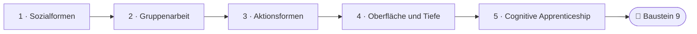
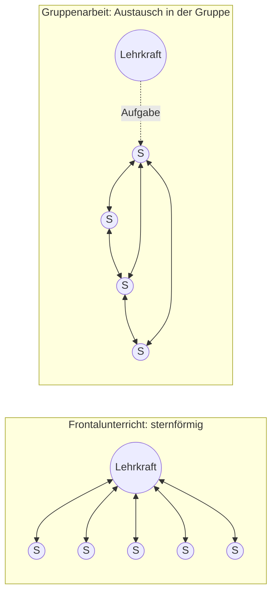
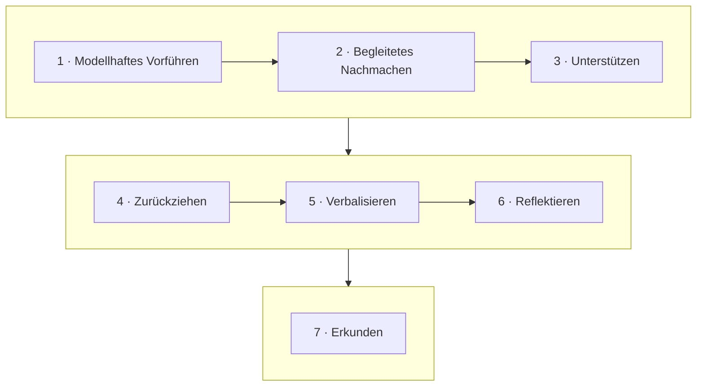

<!--
author:   Hannes Tegelbeckers
email:    hannes.tegelbeckers@ovgu.de
version:  0.3.0
language: de
narrator: Deutsch Female
mode:     Textbook
comment:  Fachdidaktik technischer Allgemeinbildung II – Selbstlerneinheit zu Sitzung S08. Sozialformen und Aktionsformen unterscheiden, Gruppenarbeit gezielt einsetzen, selbstständige Schülerarbeit nach Jessipow prüfen, Unterricht nach Oberflächen- und Tiefenstruktur analysieren und eine Abfolge nach Cognitive Apprenticeship planen.

import:   https://raw.githubusercontent.com/LiaTemplates/mermaid_template/0.1.4/README.md
-->

# S08 – Sozialformen & Aktionsformen (Selbstlerneinheit)

<!-- didaktik="Selbstlerneinheit S08 · ca. 90 min · Studientext + Übungen · Inhalte der Folien R146–R157 und Zinn (2026), in eigenen Worten erläutert" -->
> [!IMPORTANT] 🧭 Leitfrage
> Wer arbeitet mit wem – und wer tut was? Und wie wähle ich das so, dass die Lernenden nicht nur beschäftigt sind, sondern wirklich denken?

> [!NOTE] 📘 So ist diese Einheit aufgebaut
> Diese Einheit **erklärt die Inhalte der Sitzung S08** in eigenen Worten und mit Beispielen – Sie können sie auch bearbeiten, wenn Sie in der Sitzung nicht dabei waren. Die Originalfolien finden Sie in der [LiaScript-Sitzung S08](https://liascript.github.io/course/?https://raw.githubusercontent.com/OVGU-VET-TechEd/Fachdidaktik_technischer_Allgemeinbildung_II/main/S08_Sozialformen_Aktionsformen.md).

> [!TIP] ✍️ Übung in Moodle
> Bearbeiten Sie diese Einheit als Übung im Moodle-Kurs – dort wird Ihr Bearbeitungsstand gespeichert: [Übung in Moodle öffnen](https://elearning.ovgu.de/mod/scorm/view.php?id=707269)

**Ablauf (ca. 90 min)**

<!-- data-type="none" -->
| Schritt | Inhalt | Zeit |
| --- | --- | --- |
| 0 | Wo stehen Sie? | 3 min |
| 1 | Zwei Fragen der Methodik: Sozialform und Aktionsform | 5 min |
| 2 | Sozialformen: Frontalunterricht, Einzelarbeit, Gruppenarbeit | 22 min |
| 3 | Aktionsformen: darbietend, selbstständig, erarbeitend | 20 min |
| 4 | Oberfläche und Tiefe: Was macht Unterricht wirksam? | 20 min |
| 5 | Vom Vormachen zum Selbermachen: Cognitive Apprenticeship | 14 min |
| 6 | Abschluss und Prüfungsfragen | 15 min |

## Ihr Lernweg in dieser Einheit

    --{{0}}--
Die Einheit führt von den Sozialformen und der Gruppenarbeit über die Aktionsformen zu der Frage, was Unterricht wirksam macht, und endet mit einem Modell für den Weg vom Vormachen zum Selbermachen.

    --{{1}}--
Auf diesem Weg erreichen Sie sechs Ziele.

      {{1}}

<!-- data-type="none" -->
| Wissen | Können | Beurteilen |
|------|--------|-------|
| Sozialformen und Aktionsformen mit ihren Merkmalen **nennen** und **unterscheiden** | für eine Aufgabe eine Variante der Gruppenarbeit **auswählen** und **begründen** | eine Stunde nach Oberflächen- und Tiefenstruktur **analysieren** und die These zum Frontalunterricht **beurteilen** |
| Jessipows zwei Merkmale selbstständiger Schülerarbeit **erläutern** | eine Abfolge von Sozial- und Aktionsformen nach Cognitive Apprenticeship **planen** | Aufgaben daraufhin **prüfen**, ob sie selbstständige Schülerarbeit ermöglichen |

    --{{2}}--
Prüfen Sie kurz, ob Sie den Lernweg lesen können.

      {{2}}
****************************************

**Entscheiden:** Was kommt direkt vor Cognitive Apprenticeship?

<!-- data-hint-button="1" data-solution-button="2" -->
- [(X)] Oberfläche und Tiefe
- [( )] Gruppenarbeit
- [( )] Aktionsformen
[[?]] Folgen Sie den Pfeilen von links nach rechts.
***
Richtig: Abschnitt 4 fragt, was Unterricht wirksam macht; Abschnitt 5 zeigt eine wirksame Abfolge.
***

****************************************

## 0 · Wo stehen Sie?

    --{{0}}--
Eine These zum Start. Am Ende der Einheit stimmen Sie noch einmal ab.

> **„Wer zu 77 % frontal unterrichtet, unterrichtet schlecht.“**

**Abstimmen (vorher):** Stimmen Sie dieser These zu?

[(a)] Ja, ich stimme zu
[(b)] Nein, ich stimme nicht zu
[(c)] Teils, teils
[(unentschieden)] Unentschieden

    --{{1}}--
Schätzen Sie zuerst.

      {{1}}
****************************************

> [!TIP] 🧠 Schätzen · 1 min
> Wie viel Prozent der Unterrichtszeit an Schulen ist Frontalunterricht? Notieren Sie Ihre Schätzung.

[[___ ___ ___]]

****************************************

    --{{2}}--
Die Zahl von den Folien sehen Sie in Abschnitt 2.

      {{2}}
> [!TIP] 📌 Merken
> Vergleichen Sie Ihre Schätzung in Abschnitt 2 mit der Erhebung nach Meyer.

## 1 · Zwei Fragen der Methodik: Sozialform und Aktionsform

    --{{0}}--
In S01 haben Sie vier Leitfragen der Methodik kennengelernt: Wie organisiere ich den Erkenntnisweg, die Beziehung zwischen Lehrenden und Lernenden, die Beziehung zwischen Lernenden und Gegenstand und den Bildungsprozess? Den Erkenntnisweg haben S01b und S03 bis S06 beantwortet, den Bildungsprozess S01. Zwei Fragen sind noch offen – um sie geht es hier.

<!-- data-type="none" -->
| Frage | Begriff | Typische Formen |
| --- | --- | --- |
| **Wer arbeitet mit wem?** – Wie sind die Lernenden zueinander und zum Gegenstand organisiert? | **Sozialform** | Frontalunterricht, Einzelarbeit, Partnerarbeit, Gruppenarbeit |
| **Wer tut was?** – Wie verteilt sich die Aktivität zwischen Lehrkraft und Lernenden? | **Aktionsform** | darbietend, selbstständig, erarbeitend |

    --{{1}}--
Halten Sie die beiden Begriffe auseinander.

      {{1}}
> [!NOTE] Kernaussage
> Beide Fragen sind **unabhängig**: Einzelarbeit kann darbietend sein (alle lesen still einen Lehrbuchtext) oder selbstständig (alle lösen ein offenes Problem). Frontalunterricht kann darbietend sein (Lehrervortrag) oder erarbeitend (Unterrichtsgespräch).

<small>Zuordnung nach der Kurskarte der Sitzung S08 (vgl. S01, Folien R036–R039); eigene Darstellung.</small>

## 2 · Sozialformen: was sie sind und wie oft sie vorkommen

    --{{0}}--
Sozialformen sind nach den Folien Organisationsformen, die durch unterschiedliche Möglichkeiten der Lehrer-Schüler-Interaktion bestimmt sind. Sie legen die organisatorische Seite des Unterrichts fest: Wer spricht mit wem, wer arbeitet mit wem zusammen? Wie häufig sie vorkommen, zeigt eine Erhebung, die auf der Folie Meyer zugeschrieben wird.

<!-- data-type="BarChart" data-title="Sozialformen – Anteil an der Unterrichtszeit (nach Meyer)" data-ylabel="Anteil in %" data-show -->
| Sozialform | Anteil an der Unterrichtszeit |
| --- | ---: |
| Frontalunterricht | 76.86 |
| Einzelarbeit | 10.24 |
| Gruppenunterricht | 7.4 |
| Partnerarbeit | 2.88 |
| Klassenkooperation | 2.6 |

    --{{1}}--
Vergleichen Sie mit Ihrer Schätzung aus Abschnitt 0.

      {{1}}
> [!NOTE] Kernaussage
> Gut drei Viertel der Unterrichtszeit ist Frontalunterricht. Ob diese Zahl ein Problem ist, klären Sie in Abschnitt 4 – zuerst geht es darum, was die einzelnen Sozialformen leisten.

<small>Werte nach Folie R147 („Häufigkeit nach MEYER“, auf der Folie mit Komma); Jahr der Erhebung auf der Folie nicht angegeben; nach Größe sortiert.</small>

## 2.1 Frontalunterricht

    --{{0}}--
Im Frontalunterricht geht die ganze Klasse gemeinsam unter unmittelbarer Führung der Lehrkraft vor. Die Lehrkraft richtet ihre Impulse an alle, und alle Reaktionen laufen wieder bei ihr zusammen – eine sternförmige Kommunikation. Typische Aktionsformen sind Lehrervortrag, Demonstration und Unterrichtsgespräch.

<!-- data-type="none" -->
| Stärken | Schwächen |
| --- | --- |
| **Rationell:** Viele Lernende erhalten in kurzer Zeit dieselbe Information. | Nicht immer am rationellsten – die **Selbstständigkeit** der Lernenden wird übergangen. |
| Die Klasse wird **schnell auf direktem Weg** zur Erkenntnis geführt. | Die **Individualität** wird für die Klasse aufgegeben: Alle müssen im selben Tempo folgen. |
| Die Lehrkraft kann Fehlvorstellungen sofort aufgreifen. | Ob alle verstanden haben, bleibt offen – eine **Überprüfung der Lernergebnisse** ist unbedingt nötig, besonders bei schwächeren Lernenden. |

    --{{1}}--
Ein Beispiel aus der Werkstatt.

      {{1}}
****************************************

**Beispiel:** Die Lehrkraft führt an der Drehmaschine vor, wie ein Werkstück gespannt und ausgerichtet wird. Das geht frontal schneller und sicherer, als wenn jede Gruppe es selbst herausfindet. Ob es aber jede und jeder verstanden hat, zeigt sich erst, wenn alle es selbst tun.

****************************************

    --{{2}}--
Der Kern:

      {{2}}
> [!NOTE] Kernaussage
> Frontalunterricht ist rationell – die Überprüfung der Lernergebnisse gehört aber unbedingt dazu.

<small>Nach Folie R148 „7.1 Frontalunterricht“, in Stärken und Schwächen geordnet; Beispiel: eigene Darstellung.</small>

## Wer spricht mit wem? Frontal und in der Gruppe

    --{{0}}--
Der Unterschied zwischen Frontalunterricht und Gruppenarbeit lässt sich als Kommunikationsbild zeichnen. Im Frontalunterricht richtet die Lehrkraft ihre Impulse an alle, und alle Reaktionen laufen wieder bei ihr zusammen. In der Gruppenarbeit tauschen die Lernenden untereinander Informationen aus; die Lehrkraft tritt zwischen Aufgabenstellung und Ergebniskontrolle zurück.

    --{{1}}--
Links das Bild des Frontalunterrichts.

      {{1}}
**① Sternförmig:** Unmittelbare Führung: Jede Äußerung läuft über die Lehrkraft – rationell, aber alle im selben Tempo.

    --{{2}}--
Rechts das Bild der Gruppenarbeit.

      {{2}}
**② Vernetzt:** Die Lernenden sprechen miteinander; kooperatives und individuelles Lernen wechseln sich ab.

    --{{3}}--
Die Lehrkraft verschwindet dabei nicht.

      {{3}}
**③ Mittelbare Führung:** Die Lehrkraft führt über Aufgabe und Material und kontrolliert die Ergebnisse.

    --{{4}}--
Was folgt daraus?

      {{4}}
> [!NOTE] Kernaussage
> Die Sozialform bestimmt, **wer mit wem spricht** – und damit, wie viele Lernende gleichzeitig aktiv sein können.

<small>Kommunikationsstrukturen nach Folien R148 und R150 als Diagramm dargestellt; eigene Darstellung.</small>

## 2.2 Einzelarbeit

    --{{0}}--
In der Einzelarbeit löst jede Schülerin und jeder Schüler dieselbe Aufgabe allein, ohne Austausch mit anderen. Die Lehrkraft führt dabei mittelbar – über die Aufgabe und das Material, nicht über jeden einzelnen Schritt.

Einzelarbeit eignet sich zum Üben, aber auch zum Erarbeiten, Erweitern und Vertiefen von Wissen. Sie verlangt **Selbstständigkeit, Energie und Beharrlichkeit** und stärkt das Selbstvertrauen.

Damit Einzelarbeit gelingt, braucht es Anleitung und Hilfe durch Lehrkraft und Mitlernende – das Ziel ist, die Lernenden zum selbstständigen Lösen zu befähigen.

    --{{1}}--
Ein wichtiger Vorteil für die Lehrkraft:

      {{1}}
> [!NOTE] Kernaussage
> Die **tatsächliche Leistung** einzelner Lernender lässt sich in der Einzelarbeit besser einschätzen als in der Gruppe.

<small>Nach Folie R149 „7.2 Einzelarbeit“; Erläuterung: eigene Darstellung.</small>

## 2.3 Gruppenarbeit und ihre vier Varianten

    --{{0}}--
In der Gruppenarbeit arbeiten die Lernenden selbstständig in Gruppen und tauschen dabei Informationen aus. Kooperatives und individuelles Lernen wechseln sich ab. Die unmittelbare Führung der Lehrkraft tritt zwischen Aufgabenstellung und Ergebniskontrolle zurück.

Gruppenarbeit übt die **Sozialfähigkeit**, und sie kann die Spaltung einer Klasse in aktive und passive Lernende verringern – vorausgesetzt, die Aufgabe verlangt tatsächlich, dass alle mitarbeiten.

Hinter den **vier Varianten** stehen zwei Fragen:

- **aufgabengleich oder aufgabenverschieden?** – Bekommen die *Gruppen* dieselbe Aufgabe oder verschiedene?
- **arbeitsgleich oder arbeitsteilig?** – Arbeiten die *Mitglieder einer Gruppe* alle an allem oder an Teilaufgaben?

<!-- data-type="none" -->
| | Gruppen haben **gleiche** Aufgaben | Gruppen haben **verschiedene** Aufgaben |
| --- | --- | --- |
| Mitglieder arbeiten **an allem** | aufgabengleich + arbeitsgleich | aufgabenverschieden + arbeitsgleich |
| Mitglieder arbeiten **an Teilaufgaben** | aufgabengleich + arbeitsteilig | aufgabenverschieden + arbeitsteilig |

    --{{1}}--
Wofür welche Variante?

      {{1}}
****************************************

- **Aufgabengleich + arbeitsgleich:** gut zum **Üben und Vergleichen** – alle Gruppen lösen dasselbe, die Ergebnisse lassen sich nebeneinanderlegen.
- **Aufgabenverschieden:** deckt ein **breites Thema in kurzer Zeit** ab – jede Gruppe wird Expertin für einen Teil und stellt ihn vor. Dann braucht es eine gute Austauschphase, sonst kennt jede Gruppe nur ihren Teil.
- **Arbeitsteilig:** passt zu **komplexen Vorhaben** mit klar trennbaren Teilen. Es spart Zeit, aber nicht jede und jeder lernt alles.

****************************************

    --{{2}}--
Planen Sie bei Arbeitsteilung immer eine Phase ein, in der die Teile zusammengeführt werden.

      {{2}}
> [!NOTE] Kernaussage
> Arbeitsteilung spart Zeit, aber nicht jede und jeder lernt alles – planen Sie eine Phase ein, in der die Teile zusammengeführt und von allen verstanden werden.

<small>Nach Folien R150–R151 „7.3 Gruppenarbeit“ (Grafik als Tabelle zusammengefasst); „Wofür welche Variante?“: eigene Zusammenfassung.</small>

## Übung 1: Welche Variante der Gruppenarbeit?

    --{{0}}--
Drei kurze Fragen zu den Varianten der Gruppenarbeit.

**1 · Eine Antwort:** Alle sollen das Berechnen von Riementrieben üben; die Ergebnisse werden verglichen. Welche Variante passt?

<!-- data-hint-button="1" data-solution-button="2" -->
- [( )] aufgabenverschieden + arbeitsteilig
- [(X)] aufgabengleich + arbeitsgleich
- [( )] aufgabengleich + arbeitsteilig
[[?]] Üben und Vergleichen …
***
Üben und Vergleichen → aufgabengleich + arbeitsgleich.
***

    --{{1}}--
Jetzt können mehrere Antworten richtig sein.

      {{1}}
****************************************

**2 · Alle zutreffenden:** Welche Situationen sind aufgabenverschieden?

<!-- data-hint-button="1" data-solution-button="2" -->
- [[X]] Jede Gruppe erarbeitet eine andere Verbindungsart (Schrauben, Schweißen, Kleben) und präsentiert sie der Klasse.
- [[ ]] Alle sollen das Berechnen von Riementrieben üben; die Ergebnisse werden verglichen.
- [[X]] Für ein Hausprojekt plant jede Gruppe ein anderes Gewerk; jedes Mitglied übernimmt einen Teilbereich.
- [[ ]] Alle Gruppen erstellen denselben Wartungsplan; eine Person kümmert sich um Elektrik, eine um Mechanik, eine um Hydraulik.
[[?]] Aufgabenverschieden fragt nach den Gruppen, nicht nach den Mitgliedern.
***
Breites Thema in kurzer Zeit abdecken → aufgabenverschieden. Der Wartungsplan ist aufgabengleich, aber arbeitsteilig.
***

****************************************

    --{{2}}--
Zum Schluss tippen Sie einen Begriff.

      {{2}}
****************************************

**3 · Eintippen:** Alle Gruppen erstellen denselben Wartungsplan; in jeder Gruppe kümmert sich eine Person um Elektrik, eine um Mechanik, eine um Hydraulik. Arbeitsgleich oder …? (ein Wort)

<!-- data-hint-button="1" data-solution-button="2" -->
[[arbeitsteilig]]
[[?]] Die Mitglieder bearbeiten Teilaufgaben.

***
Aufgabengleich + arbeitsteilig – planen Sie eine Phase ein, in der alle den ganzen Plan verstehen.
***

****************************************

## Ihr Fall: eine Gruppenarbeit planen

    --{{0}}--
Übertragen Sie die Varianten auf Ihre Fachrichtung.

Beschreiben Sie eine Gruppenarbeit aus Ihrer Fachrichtung, benennen Sie die **Variante** und sagen Sie, wie Sie sicherstellen, dass **alle Mitglieder** am Ende das Wesentliche können.

[[___ ___ ___ ___]]

💡 Hinweis

Bei arbeitsteiligen Varianten: Wie führen Sie die Teile wieder zusammen?

✅ Lösung

Beispiel Elektrotechnik: Jede Gruppe plant die Elektroinstallation eines anderen Raums (aufgabenverschieden), in der Gruppe übernimmt je eine Person Beleuchtung, Steckdosen und Schutzmaßnahmen (arbeitsteilig). Sicherung: Jede Person erklärt in der Gruppe ihren Teil, und am Ende beantwortet jede Person allein drei Fragen zu allen Teilen.

## 3 · Aktionsformen: darbietend, selbstständig, erarbeitend

    --{{0}}--
Aktionsformen beschreiben, bei wem die Aktivität liegt und wie die Lehrkraft führt. Die Folien unterscheiden drei Formen.

<!-- data-type="none" -->
| | darbietend | selbstständig | erarbeitend |
| --- | --- | --- | --- |
| Aktivität liegt bei | der Lehrkraft | den Lernenden | beiden – im Gespräch |
| Lehrkraft … | zeigt, demonstriert, berichtet, erzählt | tritt in den Hintergrund, stellt die Aufgabe | lenkt das Gespräch |
| Führung | **unmittelbar** | **mittelbar** | je nach Gesprächsform |
| Lernen | überwiegend **rezeptiv** (aufnehmend) | überwiegend **produktiv** (selbst hervorbringend) | rezeptiv, reproduktiv und produktiv |

    --{{1}}--
Was heißt unmittelbar und mittelbar?

      {{1}}
> [!NOTE] Kernaussage
> **Unmittelbar** führt die Lehrkraft, wenn sie jeden Schritt selbst steuert – im Vortrag oder in einem eng geführten Gespräch. **Mittelbar** führt sie über die gestellte Aufgabe und das Material, während die Lernenden arbeiten.

<small>Nach Folie R153 „8. Aktionsformen“, als Vergleichstabelle geordnet.</small>

## 3.1 Darbietend

    --{{0}}--
Darbietende Aktionsformen ermöglichen eine rationelle Stoffvermittlung. Laut Folie haben sie durch den Lehrervortrag auch eine erziehende Wirkung, und Lernende üben, sich Wissen rationell anzueignen – also einem Vortrag zu folgen und das Wichtige festzuhalten. Die Folie nennt vier Verfahren.

<!-- data-type="none" -->
| Verfahren | Was geschieht | Beispiel |
| --- | --- | --- |
| **Vormachen** | Die Lehrkraft führt eine Tätigkeit aus, die die Lernenden danach selbst ausführen. | eine Kehlnaht schweißen, eine Aderendhülse crimpen |
| **Vorzeigen** | An einem statischen Lernmittel wird etwas stellvertretend gezeigt. | ein Schnittmodell eines Getriebes |
| **Vorführen** | Ein Prozess wird veranschaulicht. | Experiment, Exkursion, Video eines Fertigungsablaufs |
| **Vortragen** | Die Sprache ist das vorherrschende Mittel. | Lehrervortrag über Korrosionsarten |

    --{{1}}--
Darbietend heißt nicht schlecht.

      {{1}}
> [!NOTE] Kernaussage
> Darbietend ist rationell – Vormachen ist oft der sicherste Einstieg in eine neue Tätigkeit.

<small>Verfahren nach Folie R154 „8.1 Darbietend“; Spalten „Was geschieht“ und „Beispiel“: eigene Erläuterung.</small>

## 3.2 Selbstständig – und wann Schülerarbeit wirklich selbstständig ist

    --{{0}}--
Selbstständige Aktionsformen sind nicht ganz ohne Hilfe der Lehrkraft möglich. Umgekehrt ist auch nicht jede Arbeit, die Lernende allein erledigen, selbstständige Schülerarbeit. Wer eine Tabelle abschreibt, arbeitet allein – aber nicht selbstständig im didaktischen Sinn. Jessipow nennt zwei Merkmale, die beide erfüllt sein müssen.

1. Eine **Aufgabenstellung** durch die Lehrkraft und **angemessene Zeit** für die Lösung.
2. Die aus der Aufgabe entstehende **Notwendigkeit**, unter Anspannung der eigenen Kräfte **die besten Lösungswege selbst zu suchen** und zu gehen.

Das zweite Merkmal ist der Kern: Die Aufgabe muss Lösungswege **offenlassen** und die Lernenden **fordern**.

    --{{1}}--
Richtig gesteuerte selbstständige Schülerarbeit hat laut Folie positive Wirkungen.

      {{1}}
****************************************

- Die Lernenden eignen sich den Stoff **tiefer und bewusster** an.
- Die **Lerneinstellung** wird positiv beeinflusst.
- Die Fähigkeit zum **selbstständigen Denken, Arbeiten und Organisieren** wächst.
- Die **Leistungsunterschiede** in der Klasse werden kleiner – die Folie nennt das „Leistungskonglobation“ (lat. *conglobare* = zusammenballen).

****************************************

    --{{2}}--
Verbinden Sie das mit S02 und S05.

      {{2}}
> [!NOTE] Kernaussage
> 🔗 Die Selbständigkeitsstufen aus S02 beschreiben, *wie* selbstständig eine Aufgabe ist; Jessipows Merkmale, *ab wann* eine Arbeit überhaupt als selbstständige Schülerarbeit gilt. Und S05: Eine Schritt-für-Schritt-Anleitung nimmt das Planen und Entscheiden vorweg – ein Leittext lässt es den Lernenden.

<small>Nach Folien R155–R156 „8.2 Selbstständig“ (Jessipow); Erläuterungen: eigene Darstellung.</small>

## 3.3 Erarbeitend

    --{{0}}--
Die Grundform der erarbeitenden Aktionsform ist das Unterrichtsgespräch. Sie ist besonders erfolgreich, wenn eine neue Erkenntnis gewonnen werden soll: Die Lehrkraft stellt Fragen und gibt Impulse, die Lernenden bringen Vermutungen, Wissen und Beispiele ein, und gemeinsam entsteht die neue Einsicht. Die Folie ordnet Gespräche nach zwei Gesichtspunkten.

<!-- data-type="none" -->
| Nach der didaktischen Aufgabe | Nach der Art der Führung |
| --- | --- |
| Gespräch zur **Erarbeitung** von neuem Wissen, Überzeugungen und Fähigkeiten | **Lehrergespräch** mit starker Belehrung und direkter Führung |
| **Wiederholungsgespräch** | **locker gehaltenes Gespräch** – die Lehrkraft führt, tritt aber zurück |
| **Prüfungsgespräch** | **Diskussion und Debatte** als Vorformen des wissenschaftlichen Gesprächs |

    --{{1}}--
Von oben nach unten nimmt in der rechten Spalte die Führung durch die Lehrkraft ab.

      {{1}}
> [!NOTE] Kernaussage
> Ein „Gespräch“, in dem die Lehrkraft nur Ein-Wort-Antworten abfragt, ist eher ein verkappter Vortrag als eine Erarbeitung.

<small>Nach Folie R157 „8.3 Erarbeitend“.</small>

## Übung 2a: Welche Aktionsform?

    --{{0}}--
Drei kurze Fragen zu den Aktionsformen.

**1 · Eine Antwort:** Die Lehrkraft zeigt an einem Schnittmodell eines Getriebes, wie die Zahnräder ineinandergreifen. Welches darbietende Verfahren ist das?

<!-- data-hint-button="1" data-solution-button="2" -->
- [( )] Vortragen
- [(X)] Vorzeigen
- [( )] Vormachen
[[?]] An einem statischen Lernmittel wird etwas gezeigt.
***
Vorzeigen: an statischen Lernmitteln wird etwas repräsentativ gezeigt (R154).
***

    --{{1}}--
Jetzt können mehrere Antworten richtig sein.

      {{1}}
****************************************

**2 · Alle zutreffenden:** Welche Gesprächsformen sind nach der didaktischen Aufgabe geordnet?

<!-- data-hint-button="1" data-solution-button="2" -->
- [[X]] Wiederholungsgespräch
- [[ ]] Lehrergespräch
- [[X]] Prüfungsgespräch
- [[ ]] Diskussion und Debatte
[[?]] Linke Spalte: wozu das Gespräch dient.
***
Nach der Aufgabe: Erarbeitung, Wiederholung, Prüfung. Nach der Führung: Lehrergespräch, lockeres Gespräch, Diskussion und Debatte (R157).
***

****************************************

    --{{2}}--
Zum Schluss tippen Sie einen Begriff.

      {{2}}
****************************************

**3 · Eintippen:** Wie heißt die Grundform der erarbeitenden Aktionsform? (ein Wort)

<!-- data-hint-button="1" data-solution-button="2" -->
[[Unterrichtsgespräch]]
[[?]] Lehrkraft und Lernende entwickeln die Erkenntnis gemeinsam im …

***
Grundform ist das Unterrichtsgespräch (R157).
***

****************************************

## Übung 2b: Selbstständige Schülerarbeit nach Jessipow?

    --{{0}}--
Allein zu arbeiten reicht nicht. Vergleichen Sie zuerst.

<!-- data-type="none" -->
| Kriterium | selbstständig nach Jessipow | nicht selbstständig |
|-----------|---------------|---------------|
| Aufgabe | lässt Lösungswege offen | Lösungsweg vorgegeben oder kein Auftrag |
| Merkmal 1 | Aufgabe und angemessene Zeit | kann erfüllt sein |
| Merkmal 2 | Lernende müssen die besten Lösungswege selbst suchen | fehlt |
| Lehrkraft | führt mittelbar über die Aufgabe | regelt jede Einzelheit vor |

    --{{1}}--
Je ein Beispiel:

      {{1}}
- **selbstständig nach Jessipow:** Lernende sollen herausfinden, warum eine Pumpe zu wenig fördert, und zwei Lösungen vorschlagen.
- **nicht selbstständig:** Lernende lesen still einen Text – ohne Auftrag.

    --{{2}}--
Ein typischer Fehlschluss:

      {{2}}
> [!WARNING] Häufiges Missverständnis
> Allein arbeiten ist nicht selbstständig arbeiten – Abschreiben, Lesen ohne Auftrag und ein vorgegebener Lösungsweg erfüllen Merkmal 2 nicht.

    --{{3}}--
Ordnen Sie jetzt zu.

      {{3}}
****************************************

**Entscheiden:** Welchen Begriff beschreibt die Aussage jeweils?

<!-- data-hint-button="1" data-solution-button="2" data-show-partial-solution -->
[(selbstständig nach Jessipow) (nicht selbstständig)]
[       (X)             ( )      ] Lernende sollen herausfinden, warum eine Pumpe zu wenig fördert, und zwei Lösungen vorschlagen.
[       ( )             (X)      ] Lernende übertragen Messwerte in eine vorbereitete Tabelle.
[       (X)             ( )      ] Lernende entwickeln einen Prüfablauf für eine neue Maschine und begründen die Reihenfolge.
[       ( )             (X)      ] Lernende bearbeiten ein Arbeitsblatt, dessen Lösungsweg Schritt für Schritt vorgegeben ist.
[[?]] Müssen die Lernenden den Lösungsweg selbst suchen?
***
Es braucht eine Aufgabe, die Lösungswege offenlässt und die Lernenden fordert (Merkmal 2, R155).
***

****************************************

## Ihre Fachrichtung: eine Aufgabe umformulieren

    --{{0}}--
Übertragen Sie Jessipows Merkmale auf Ihre Fachrichtung.

Nehmen Sie eine Aufgabe, die Sie kennen und die *nicht* selbstständig im Sinne Jessipows ist. Formulieren Sie sie so um, dass sie **beide Merkmale** erfüllt.

[[___ ___ ___ ___]]

💡 Hinweis

Streichen Sie die vorgegebenen Schritte und fragen Sie nach einer Entscheidung oder einer Begründung.

✅ Lösung

Vorher: „Messen Sie den Isolationswiderstand: 1. Spannung freischalten, 2. Messgerät auf 500 V stellen, 3. …“ Nachher: „Prüfen Sie, ob die Installation in Raum 2 sicher in Betrieb gehen darf. Legen Sie Prüfschritte und Grenzwerte fest und begründen Sie Ihre Entscheidung.“ – Aufgabe mit Zeit (Merkmal 1) und eigene Suche nach dem besten Lösungsweg (Merkmal 2).

## 4 · [NEU] Oberfläche und Tiefe: Was macht Unterricht wirksam?

    --{{0}}--
Dieser Abschnitt ergänzt die Folien um ein aktuelles Lehrbuch, als NEU markiert: Zinn 2026. Zinn nennt typische Sozialformen und betont, dass sie nicht aus Gewohnheit und nicht um der Abwechslung willen gewählt werden sollen.

<!-- neu="Zinn 2026, S. 270–273" -->
Zinn (2026, S. 270) nennt als typische Sozialformen **Plenumsunterricht, Gruppenunterricht, Tandemarbeit, Einzelarbeit** und den **hybriden Sozialformenmix** (vgl. Meyer & Junghans 2021). Gewählt werden sollen sie „insbesondere in Abhängigkeit der intendierten Lernziele, dem Vorwissen, dem Lerninhalt, den personalen und sozialen Kompetenzen“. Die kleinsten Einheiten der Interaktion nennt er **Handlungsformen**: eine Frage stellen, loben und tadeln, hinweisen, vorführen (S. 270–271).

    --{{1}}--
Für die Frage, ob Unterricht wirksam ist, unterscheidet Zinn zwei Ebenen. Oberflächenstrukturen sind leicht beobachtbar. Tiefenstrukturen betreffen die Qualität der Interaktion – mit dem Lernstoff und zwischen Lehrenden und Lernenden.

      {{1}}
****************************************

<!-- data-type="none" -->
| Dimension der Tiefenstruktur | Leitfrage (gekürzt nach Zinn 2026, S. 273) | Woran man es erkennt *(eigene Beispiele)* |
| --- | --- | --- |
| **Klassenführung** | Verstehen die Lernenden die Ziele, gibt es wenige Störungen, sind alle beteiligt, wird die Zeit effektiv genutzt? | kein Leerlauf, klare Arbeitsaufträge, Übergänge ohne Zeitverlust |
| **Potenzial zur kognitiven Aktivierung** | Setzen sich die Lernenden aktiv und vertieft mit dem Lernstoff auseinander? | Aufgaben, die an Vorwissen anknüpfen, Begründungen verlangen, einen Widerspruch erzeugen |
| **Konstruktive Unterstützung** | Wie hilft die Lehrkraft bei Verständnisproblemen – wertschätzend und respektvoll? | gezielte Hinweise statt fertiger Lösungen, Fehler als Lernanlass |

****************************************

    --{{2}}--
Der entscheidende Satz:

      {{2}}
> [!NOTE] Kernaussage
> „Innerhalb einer gleichen Oberflächenstruktur (z. B. Projektarbeit mit Gruppenarbeit) können unterschiedliche Lehr-Lern-Prozesse erfolgen.“ (Zinn 2026, S. 272) – Die Sozialform allein sagt nichts darüber, ob gelernt wird.

<small>[NEU] Ergänzung, keine Originalfolie: Zinn (2026), S. 270–273; Spalte „Woran man es erkennt“: eigene Beispiele.</small>

## Kurzcheck: Oberflächen- oder Tiefenstruktur?

    --{{0}}--
Was ist Oberflächenstruktur, was Tiefenstruktur? Zuerst der Vergleich.

<!-- data-type="none" -->
| Kriterium | Oberflächenstruktur | Tiefenstruktur |
|-----------|---------------|---------------|
| beobachtbar | leicht, auf einen Blick | nur über die Qualität der Prozesse |
| Beispiele | Sozialform, Organisationsform, Unterrichtsform | Klassenführung, kognitive Aktivierung, konstruktive Unterstützung |
| Leitfrage | Wie ist der Unterricht organisiert? | Wie intensiv und gut wird gelernt? |
| Gleiche Oberfläche … | sieht gleich aus | kann ganz unterschiedlich sein |

    --{{1}}--
Je ein Beispiel:

      {{1}}
- **Oberflächenstruktur:** Die Klasse arbeitet in Dreiergruppen.
- **Tiefenstruktur:** Die Lehrkraft gibt formatives Feedback und geht konstruktiv mit Fehlern um.

    --{{2}}--
Ein typischer Fehlschluss:

      {{2}}
> [!WARNING] Häufiges Missverständnis
> Abwechslungsreiche Sozialformen sind noch kein guter Unterricht – entscheidend ist, was in der Tiefenstruktur passiert.

    --{{3}}--
Ordnen Sie jetzt zu.

      {{3}}
****************************************

**Entscheiden:** Welchen Begriff beschreibt die Aussage jeweils?

<!-- data-hint-button="1" data-solution-button="2" data-show-partial-solution -->
[(Oberflächenstruktur) (Tiefenstruktur)]
[       (X)             ( )      ] Die Klasse arbeitet in Dreiergruppen.
[       ( )             (X)      ] Die Aufgabe knüpft an Vorwissen an und löst einen kognitiven Konflikt aus.
[       (X)             ( )      ] Es ist eine Projektwoche.
[       ( )             (X)      ] Die Lehrkraft gibt formatives Feedback und geht konstruktiv mit Fehlern um.
[[?]] Sieht man es auf einen Blick – oder nur, wenn man auf die Qualität achtet?
***
Oberflächenstrukturen sind leicht beobachtbar (Sozialform, Organisationsform). Tiefenstrukturen betreffen die Qualität der Lehr-Lern-Prozesse (Zinn 2026, S. 272–273).
***

****************************************

## Übung 3: Zwei Stunden analysieren

    --{{0}}--
Lesen Sie die beiden Stundenbeschreibungen. Es sind Übungsbeispiele, nicht von den Originalfolien. Bewerten Sie dann beide Stunden in den drei Dimensionen der Tiefenstruktur.

**Stunde A:** Gruppenarbeit, Stationenlernen, drei Medien, Abschlusspräsentation. Die Aufgaben sind reine Abschreibaufträge aus dem Lehrbuch; zwei Gruppen sind nach zehn Minuten fertig und unterhalten sich. Bei Fragen sagt die Lehrkraft: „Steht doch im Buch.“ **Stunde B:** Überwiegend Frontalunterricht. Die Lehrkraft zeigt einen Schaden an einer Welle und fragt: „Was ist hier passiert?“ Sie sammelt Vermutungen, lässt sie begründen, greift Fehlvorstellungen wertschätzend auf und lässt zum Schluss alle allein eine ähnliche Schadensanalyse schreiben.

<!-- data-type="none" -->
| Angabe | Wert |
|--------|-------|
| Stunde A, Oberfläche | Gruppenarbeit, Stationen, drei Medien |
| Stunde B, Oberfläche | überwiegend Frontalunterricht |
| Ihre Frage | Welche Stunde ist wirksamer – und warum? |

## Übung 3: die drei Dimensionen

    --{{0}}--
Erstens: die Klassenführung.

**1 · Ihre Antwort:** Klassenführung – wie schneiden Stunde A und Stunde B ab?

[[___ ___]]

✅ Musterantwort

Stunde A: Leerlauf, zwei Gruppen sind nach zehn Minuten fertig – schwache Klassenführung. Stunde B: alle sind beteiligt, die Zeit wird genutzt.

    --{{1}}--
Zweitens: die kognitive Aktivierung.

      {{1}}
****************************************

**2 · Ihre Antwort:** Kognitive Aktivierung – wie schneiden Stunde A und Stunde B ab?

[[___ ___]]

✅ Musterantwort

Stunde A: Abschreiben statt Denken – kaum kognitive Aktivierung. Stunde B: Vermutungen müssen begründet werden, ein Schadensbild erzeugt einen Erklärungsbedarf – hohe kognitive Aktivierung.

****************************************

    --{{2}}--
Drittens: die konstruktive Unterstützung.

      {{2}}
****************************************

**3 · Ihre Antwort:** Konstruktive Unterstützung – wie schneiden Stunde A und Stunde B ab? Und was folgt daraus für die These „Wer zu 77 % frontal unterrichtet, unterrichtet schlecht“?

[[___ ___]]

✅ Musterantwort

Stunde A: keine Hilfe bei Verständnisproblemen („Steht doch im Buch“). Stunde B: Fehlvorstellungen werden wertschätzend aufgegriffen, die Einzelaufgabe sichert das Ergebnis. Stunde A sieht an der Oberfläche abwechslungsreich aus, Stunde B ist „frontal“ – und doch ist B wirksamer. Die Sozialform allein sagt nichts über die Qualität.

****************************************

## 5 · Vom Vormachen zum Selbermachen: Cognitive Apprenticeship

    --{{0}}--
Sozial- und Aktionsformen stehen im Unterricht nicht einzeln, sondern in einer Abfolge. Ein bewährtes Modell dafür ist Cognitive Apprenticeship – eine kognitive Meisterlehre, die den Weg vom Vormachen der Meisterin zum selbstständigen Arbeiten des Lehrlings auf das Lernen von Denkprozessen überträgt. Zinn beschreibt sieben Stufen. Als Beispiel dient die Fehlersuche an einer Schützschaltung.

    --{{1}}--
Modeling: Die Lehrkraft macht vor und denkt laut – „Der Motor läuft nicht an. Ich prüfe zuerst, ob Spannung am Steuerstromkreis anliegt, weil …“. Coaching: Lernende suchen einen ähnlichen Fehler, die Lehrkraft schaut zu. Scaffolding: Ein Prüfablauf als Karte liegt bereit.

      {{1}}
****************************************

1. **Modellhaftes Vorführen:** Modeling – die Lehrkraft macht vor und spricht ihre Gedanken laut aus.
2. **Begleitetes Nachmachen:** Coaching – Lernende machen nach, die Lehrkraft beobachtet und gibt Rückmeldung.
3. **Unterstützen:** Scaffolding – die Lehrkraft gibt gezielte Hilfen (Prüfschema, Leitfragen).

****************************************

    --{{2}}--
Fading: Die Karte gibt es nur noch auf Nachfrage. Articulation: „Ich habe zuerst den Schutzleiter geprüft, weil …“. Reflection: Zwei Fehlersuchwege werden verglichen – welcher war schneller und warum?

      {{2}}
****************************************

4. **Zurückziehen:** Fading – die Hilfen werden schrittweise weggenommen.
5. **Verbalisieren:** Articulation – Lernende sprechen ihr Vorgehen und ihre Gründe aus.
6. **Reflektieren:** Reflection – Lernende vergleichen ihr Vorgehen mit dem anderer und dem der Expertin.

****************************************

    --{{3}}--
Exploration: Fehlersuche an einer unbekannten Wendeschützschaltung. Verbinden Sie mit Abschnitt 3: Modeling ist darbietend, Fading und Exploration führen zur selbstständigen Schülerarbeit im Sinne Jessipows, Articulation und Reflection lassen sich gut erarbeitend im Gespräch gestalten.

      {{3}}
7. **Erkunden:** Exploration – Lernende lösen neue, offene Probleme selbstständig.

<small>[NEU] Stufen nach Zinn (2026), S. 271, Tab. 11.3 – keine Originalfolie; Erläuterungen und Beispiel: eigene Darstellung.</small>

## Stufen ordnen

    --{{0}}--
Ordnen Sie die sieben Stufen vom Vorführen bis zum Erkunden.

**Ordnen:** Ziehen Sie jede Karte in die richtige Lücke.

<!-- data-randomize data-show-partial-solution data-solution-button="2" -->
Schritt 1: [->[ Modellhaftes Vorführen ]] → Schritt 2: [->[ Begleitetes Nachmachen ]] → Schritt 3: [->[ Unterstützen ]] → Schritt 4: [->[ Zurückziehen ]] → Schritt 5: [->[ Verbalisieren ]] → Schritt 6: [->[ Reflektieren ]] → Schritt 7: [->[ Erkunden ]]

## Übung 4: Eine Abfolge planen

    --{{0}}--
Die Sozialform kann in der Abfolge wechseln – etwa Frontalunterricht beim Modeling, Partnerarbeit beim Coaching, Einzelarbeit bei der Exploration. Ihre Abfolge ist zugleich Baustein 9 für Ihren Unterrichtsentwurf.

**Planen Sie eine Abfolge für „MIG/MAG-Schweißen einer Kehlnaht“ oder für ein Thema Ihrer Fachrichtung.** Nennen Sie für jede Stufe, was passiert, welche **Sozialform** und welche **Aktionsform** Sie wählen – und begründen Sie die Wahl mit dem **Lernziel**, nicht mit Abwechslung.

<!-- data-type="none" -->
| Stufe | Was passiert | Sozialform | Aktionsform | Begründung |
| --- | --- | --- | --- | --- |
| Modeling | … | … | … | … |
| Coaching | … | … | … | … |
| Scaffolding und Fading | … | … | … | … |
| Articulation und Reflection | … | … | … | … |
| Exploration | … | … | … | … |

[[___ ___ ___ ___]]

💡 Hinweis

Beginnen Sie bei der Exploration: Was sollen die Lernenden am Ende allein können? Planen Sie dann rückwärts.

✅ Lösung

Modeling – Lehrkraft schweißt vor und kommentiert Brennerhaltung und Geschwindigkeit (Frontalunterricht, darbietend: Vormachen) · Coaching – Lernende schweißen an Probeblechen, die Lehrkraft gibt Rückmeldung (Einzelarbeit, eng geführt) · Scaffolding und Fading – Fehlerkatalog als Karte, später nur auf Nachfrage · Articulation und Reflection – Partner beschreiben einander ihre Naht und vergleichen mit dem Fehlerkatalog (Partnerarbeit, erarbeitend) · Exploration – Kehlnaht an einem neuen Werkstück in Zwangslage (Einzelarbeit, selbstständig nach Jessipow).

## 6 · Noch einmal: Wie viel ist frontal?

    --{{0}}--
Zum Schluss noch einmal die These vom Anfang.

**Abstimmen (nachher):** Stimmen Sie der These „Wer zu 77 % frontal unterrichtet, unterrichtet schlecht.“ zu?

[(a)] Ja, ich stimme zu
[(b)] Nein, ich stimme nicht zu
[(c)] Teils, teils
[(unentschieden)] Unentschieden

    --{{1}}--
Wie antworten Sie jetzt – in drei Sätzen?

      {{1}}
****************************************

**Nachdenken:** Wie antworten Sie jetzt auf die These – in drei Sätzen? Beziehen Sie die Stärken und Schwächen des Frontalunterrichts und die Tiefenstrukturen ein.

[[___ ___]]

****************************************

    --{{2}}--
Eine Einordnung:

      {{2}}
> [!NOTE] Kernaussage
> Die Zahl allein erlaubt kein Urteil. Frontalunterricht ist eine Oberflächenstruktur: Problematisch wird ein hoher Anteil, wenn Lernende nie selbstständig im Sinne Jessipows arbeiten und die Lernergebnisse nicht überprüft werden. Entscheidend ist die Tiefenstruktur.

## Das Wichtigste aus S08

    --{{0}}--
Fassen wir zusammen.

    --{{1}}--
Erstens: zwei unabhängige Fragen.

      {{1}}
- Sozialform (wer mit wem?) und Aktionsform (wer tut was?) sind unabhängig voneinander.

    --{{2}}--
Zweitens: die Gruppenarbeit.

      {{2}}
- Gruppenarbeit: aufgabengleich oder -verschieden, arbeitsgleich oder -teilig – je nach Ziel.

    --{{3}}--
Drittens: Jessipow.

      {{3}}
- Selbstständige Schülerarbeit braucht Aufgabe mit Zeit **und** die Notwendigkeit, die besten Lösungswege selbst zu suchen.

    --{{4}}--
Und viertens: die Tiefenstruktur.

      {{4}}
****************************************

- Wirksam macht Unterricht die Tiefenstruktur – und Cognitive Apprenticeship führt vom Vormachen zum Selbermachen.

> [!NOTE] Zum Merken
> Wählen Sie Sozial- und Aktionsform nach dem Lernziel – und achten Sie auf die Tiefenstruktur.

****************************************

    --{{5}}--
Eine letzte Frage.

      {{5}}
****************************************

**Wiederholen:** Was ist nach Zinn eine Tiefenstruktur von Unterricht?

<!-- data-hint-button="1" data-solution-button="2" -->
- [( )] die Sozialform Gruppenarbeit
- [( )] die Organisationsform Projektwoche
- [(X)] das Potenzial zur kognitiven Aktivierung
[[?]] Tiefenstrukturen sieht man nicht auf einen Blick.
***
Richtig: Klassenführung, kognitive Aktivierung und konstruktive Unterstützung sind Tiefenstrukturen (Zinn 2026, S. 273).
***

****************************************

    --{{6}}--
Als Nächstes geht es um Medien und KI im Unterricht.

      {{6}}
**➡️ Als Nächstes:** S09: Medien & KI im Unterricht · 🧩 Optional für die Selbstlernsitzung am 11.01.2027: Ihre Abfolge aus Übung 4 ist Baustein 9 – Sie können sie auf Ihre Großform aus Baustein 7 (S06) beziehen.

## Prüfungsfragen zum Üben

    --{{0}}--
Die Prüfungsleistung des Moduls ist eine mündliche Prüfung. Mit diesen fünf Fragen üben Sie, die Inhalte dieser Einheit frei, strukturiert und mit Beispielen zu erklären.

> [!TIP] 🎙️ So üben Sie
> Lesen Sie eine Frage und antworten Sie **laut** in höchstens drei Minuten – nach dem Muster **Begriff – Erläutern – Beispiel – Verbinden**. Öffnen Sie erst danach die Antwortskizze und vergleichen Sie: Was fehlte, was war ungenau? Noch besser: Lassen Sie sich von einer Kommilitonin oder einem Kommilitonen abfragen.

**Frage 1 · Sozialformen und Frontalunterricht:** Was sind Sozialformen? Nennen Sie Vor- und Nachteile des Frontalunterrichts.

✅ Antwortskizze 1

- **1 Begriff:** Sozialformen sind Organisationsformen, die durch unterschiedliche Möglichkeiten der **Lehrer-Schüler-Interaktion** bestimmt sind – Antwort auf die Leitfrage „Wer arbeitet mit wem?“ (S01, R036; R146–R147).
- **2 Erläutern:** Frontalunterricht: die ganze Klasse unter unmittelbarer Führung der Lehrkraft, sternförmige Kommunikation. Stärken: rationell, schnell und direkt zur Erkenntnis, Fehlvorstellungen sofort aufgreifbar. Schwächen: Selbstständigkeit wird übergangen, Individualität für die Klasse aufgegeben, eine Überprüfung der Lernergebnisse ist unbedingt nötig (R148).
- **3 Beispiel:** Spannen und Ausrichten an der Drehmaschine wird frontal schneller und sicherer vorgeführt – ob alle es verstanden haben, zeigt sich erst beim eigenen Tun.
- **4 Verbinden:** Laut Meyer etwa drei Viertel der Unterrichtszeit (R147). Sozialform und Aktionsform sind unabhängig: frontal kann darbietend oder erarbeitend sein.

**Frage 2 · Gruppenarbeit:** Erläutern Sie die vier Varianten der Gruppenarbeit an einem Beispiel aus Ihrer Fachrichtung.

✅ Antwortskizze 2

- **1 Begriff:** In der Gruppenarbeit arbeiten Lernende selbstständig in Gruppen und tauschen Informationen aus; die Führung der Lehrkraft tritt zwischen Aufgabenstellung und Ergebniskontrolle zurück (R150–R151).
- **2 Erläutern:** Zwei Fragen ergeben vier Varianten: **aufgabengleich oder aufgabenverschieden** (haben die *Gruppen* dieselbe Aufgabe?) × **arbeitsgleich oder arbeitsteilig** (arbeiten die *Mitglieder* an allem oder an Teilen?).
- **3 Beispiel:** Elektrotechnik: Alle Gruppen dimensionieren dieselbe Leitung, jedes Mitglied rechnet alles (aufgabengleich, arbeitsgleich – zum Üben und Vergleichen). Jede Gruppe untersucht eine andere Schutzmaßnahme und stellt sie vor (aufgabenverschieden – breites Thema in kurzer Zeit). In einer Gruppe planen zwei die Verdrahtung und zwei die Prüfung (arbeitsteilig – komplexes Vorhaben).
- **4 Verbinden:** Arbeitsteilung spart Zeit, aber nicht jede und jeder lernt alles – eine Zusammenführungsphase einplanen. Gruppenarbeit übt die Sozialfähigkeit; Bewertung in Gruppen: S04 (Kersten).

**Frage 3 · Aktionsformen:** Unterscheiden Sie darbietende, selbstständige und erarbeitende Aktionsformen.

✅ Antwortskizze 3

- **1 Begriff:** Aktionsformen beschreiben, **bei wem die Aktivität liegt** und wie die Lehrkraft führt – Leitfrage „Wer tut was?“ (R152–R153).
- **2 Erläutern:** **Darbietend:** Aktivität bei der Lehrkraft, unmittelbare Führung, überwiegend rezeptives Lernen; Verfahren Vormachen, Vorzeigen, Vorführen, Vortragen (R154). **Selbstständig:** Aktivität bei den Lernenden, mittelbare Führung über Aufgabe und Material, überwiegend produktives Lernen (R155–R156). **Erarbeitend:** Grundform Unterrichtsgespräch – nach didaktischer Aufgabe (Erarbeitung, Wiederholung, Prüfung) und nach Art der Führung (Lehrergespräch, lockeres Gespräch, Diskussion und Debatte) (R157).
- **3 Beispiel:** Kehlnaht vormachen (darbietend) – Lernende suchen den Fehler an einer Schützschaltung selbst (selbstständig) – im Gespräch Ursachen für Korrosion sammeln (erarbeitend).
- **4 Verbinden:** [NEU] Cognitive Apprenticeship verbindet die Formen zu einer Abfolge: Modeling (darbietend) → Coaching, Scaffolding, Fading → Exploration (selbstständig) (Zinn 2026).

**Frage 4 · Selbstständige Schülerarbeit:** Wann ist Schülerarbeit nach Jessipow „selbstständig“ – und welche Wirkungen hat sie?

✅ Antwortskizze 4

- **1 Begriff:** Nach **Jessipow** müssen zwei Merkmale erfüllt sein (R155): eine **Aufgabenstellung** durch die Lehrkraft mit **angemessener Zeit** und die aus der Aufgabe entstehende **Notwendigkeit**, unter Anspannung der eigenen Kräfte die besten Lösungswege **selbst zu suchen**.
- **2 Erläutern:** Allein arbeiten ist nicht gleich selbstständig arbeiten: Der Kern ist das zweite Merkmal – die Aufgabe muss Lösungswege offenlassen und fordern. Wirkungen bei richtiger Steuerung (R156): tiefere, bewusstere Aneignung, positive Lerneinstellung, wachsende Fähigkeit zum selbstständigen Denken, Arbeiten und Organisieren, kleinere Leistungsunterschiede („Leistungskonglobation“).
- **3 Beispiel:** Eine Tabelle abschreiben = allein, aber nicht selbstständig. „Finden Sie heraus, warum der Motor nicht anläuft“ mit Prüfmitteln und Zeit = selbstständig.
- **4 Verbinden:** S02: Die Selbständigkeitsstufen beschreiben, *wie* selbstständig; Jessipow, *ab wann*. S05: Ein Leittext lässt das Planen und Entscheiden bei den Lernenden.

**Frage 5 · Frontalunterricht bewerten:** „Frontalunterricht ist schlechter Unterricht.“ – Nehmen Sie Stellung.

✅ Antwortskizze 5

- **1 Begriff:** Frontalunterricht ist eine **Sozialform** – eine Oberflächenstruktur des Unterrichts (Zinn 2026 [NEU]).
- **2 Erläutern:** Die These ist zu pauschal. Frontalunterricht ist rationell und für Vormachen und Einführen oft sinnvoll, aber er übergeht Selbstständigkeit und Individualität (R148). Entscheidend für Lernwirksamkeit sind nach Zinn die **Tiefenstrukturen**: Klassenführung, Potenzial zur kognitiven Aktivierung, konstruktive Unterstützung – „innerhalb einer gleichen Oberflächenstruktur können unterschiedliche Lehr-Lern-Prozesse erfolgen“ (S. 272).
- **3 Beispiel:** Ein frontales Unterrichtsgespräch, das Begründungen verlangt und einen Widerspruch erzeugt, kann kognitiv aktivierender sein als eine Gruppenarbeit, in der eine Person alles erledigt.
- **4 Verbinden:** Sozialformen nicht aus Gewohnheit oder Abwechslung wählen, sondern nach Lernziel, Vorwissen, Inhalt und Kompetenzen (Zinn 2026, S. 270). Wichtig bleibt die Überprüfung der Lernergebnisse (S10).

    --{{1}}--
Schätzen Sie zum Schluss ein, wie sicher Sie sind. Wiederholen Sie die unsicheren Fragen in einigen Tagen – und üben Sie fächerübergreifend mit dem Prüfungstrainer.

      {{1}}
****************************************

**Einschätzen:** Wie sicher beantworten Sie die Fragen frei und in ganzen Sätzen?

[(sicher)(teilweise)(noch unsicher)]
[                                    ] Frage 1 · Sozialformen und Frontalunterricht
[                                    ] Frage 2 · Gruppenarbeit
[                                    ] Frage 3 · Aktionsformen
[                                    ] Frage 4 · Selbstständige Schülerarbeit
[                                    ] Frage 5 · Frontalunterricht bewerten

<small>Die Prüfungsfragen sind experimentell: Sie dienen der Vorbereitung, es ist nicht garantiert, dass Fragen in dieser Form gestellt werden. Die Antwortskizzen zeigen eine mögliche Antwort – üben Sie das Argumentieren, nicht das Auswendiglernen. Über alle Sitzungen hinweg üben Sie mit dem [Prüfungstrainer](https://liascript.github.io/course/?https://raw.githubusercontent.com/OVGU-VET-TechEd/Fachdidaktik_technischer_Allgemeinbildung_II/main/Selflearn/Pruefungstrainer.md).</small>

****************************************

## Rückblick

    --{{0}}--
Nehmen Sie sich zwei Minuten für einen Rückblick. 🤖 Tipp zum Üben mit KI: Beschreiben Sie einem KI-Werkzeug eine Stunde, die Sie gehalten oder beobachtet haben, und fragen Sie: Bewerte diese Stunde nach Klassenführung, kognitiver Aktivierung und konstruktiver Unterstützung. Was ließe sich verbessern, ohne die Sozialform zu ändern? Prüfen Sie, ob die KI Oberflächen- und Tiefenstruktur auseinanderhält.

**Nachdenken:** Was ist das Wichtigste, das Sie gelernt haben – und was ist noch unklar?

[[___ ___ ___]]

    --{{1}}--
Haken Sie ab, was Sie jetzt können.

      {{1}}
****************************************

**Abhaken:** Was können Sie jetzt?

- [ ] Ich kann die vier Varianten der Gruppenarbeit unterscheiden und gezielt einsetzen.
- [ ] Ich kann prüfen, ob eine Aufgabe selbstständige Schülerarbeit nach Jessipow ermöglicht.
- [ ] Ich kann begründen, warum eine Sozialform allein noch nichts über die Qualität des Unterrichts sagt.

****************************************

    --{{2}}--
Und zum Schluss: Wie hat die Einheit für Sie funktioniert?

      {{2}}
****************************************

**Feedback:** Wie hat diese Einheit für Sie funktioniert?

[(1 stimme zu)(2 eher ja)(3 teils)(4 eher nein)(5 stimme nicht zu)]
[                                                                   ] Das Tempo war angemessen.
[                                                                   ] Die Erklärungen waren verständlich.
[                                                                   ] Die Beispiele haben mir beim Verstehen geholfen.
[                                                                   ] Die Übungen waren nützlich.

****************************************

## Als Nächstes: S09

    --{{0}}--
In S09 geht es um Medien – von der Tafel bis zu Simulationen und KI-Chatbots.

<!-- style="max-width:100%;width:60%;display:block;margin:0 auto;" -->

> [!IMPORTANT] Zum Nachdenken bis zum nächsten Mal
> Welches Medium wollen Sie in einer Stunde Ihrer Fachrichtung einsetzen – und wozu? Ist der Overheadprojektor im Technikunterricht tot?

*S09 · Medien & KI im Unterricht*

## Literatur

    --{{0}}--
Die Quellen dieser Einheit.

- Jessipow – zitiert nach S08, Folie R155; Jahr und vollständige Angabe auf der Originalfolie nicht vorhanden.
- Meyer – zitiert nach S08, Folie R147; Jahr und vollständige Angabe auf der Originalfolie nicht vorhanden.
- Meyer & Junghans (2021) – zitiert nach Zinn (2026), S. 270.
- Zinn, B. (2026). *Didaktik des naturwissenschaftlichen, informatischen und technikwissenschaftlichen Unterrichts.* Springer Spektrum, Abschn. 11.5–11.7, S. 270–273. https://doi.org/10.1007/978-3-662-72499-6

<small>Erläuterungen und Beispiele in dieser Einheit: eigene Darstellung auf Grundlage der Folien. Gesamtverzeichnis: 00_Literatur.md</small>
