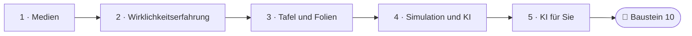
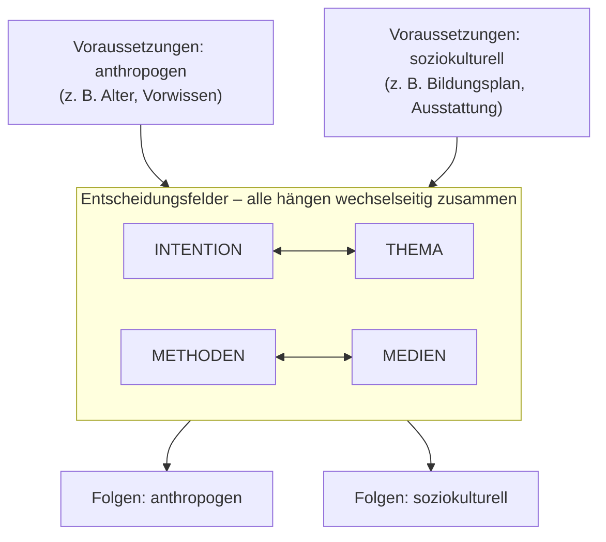
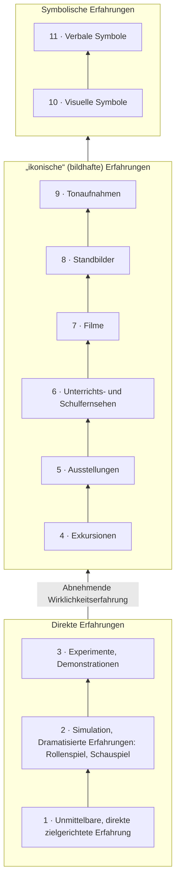
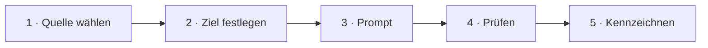
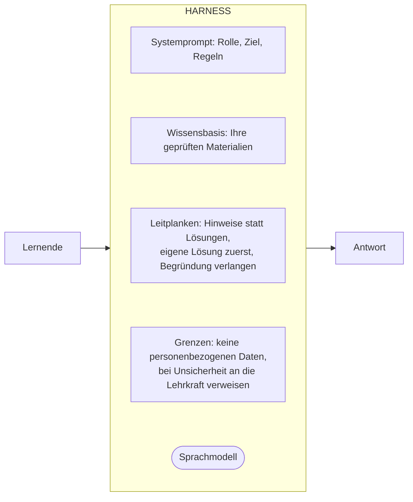
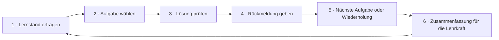

<!--
author:   Hannes Tegelbeckers
email:    hannes.tegelbeckers@ovgu.de
version:  0.3.0
language: de
narrator: Deutsch Female
mode:     Textbook
comment:  Fachdidaktik technischer Allgemeinbildung II – Selbstlerneinheit zu Sitzung S09. Medien nach Funktion und Wirklichkeitserfahrung einordnen, Folien nach Gestaltungsprinzipien beurteilen, Simulationen und KI im Unterricht begründet einsetzen und KI als Lehrkraft nutzen.

import:   https://raw.githubusercontent.com/LiaTemplates/mermaid_template/0.1.4/README.md
-->

# S09 – Medien & KI im Unterricht (Selbstlerneinheit)

<!-- didaktik="Selbstlerneinheit S09 · ca. 120 min · Studientext + Übungen · Inhalte der Folien R158–R165, in eigenen Worten erläutert; Abschnitte 4–7 sind [NEU]" -->
> [!IMPORTANT] 🧭 Leitfrage
> Welches Medium dient meinem Ziel – und wie nutze ich KI, um als Lehrkraft Medien zu finden, anzupassen und auf einzelne Lernende einzugehen, ohne die Verantwortung abzugeben?

> [!NOTE] 📘 So ist diese Einheit aufgebaut
> Diese Einheit **erklärt die Inhalte der Sitzung S09** in eigenen Worten und mit Beispielen. Abschnitte 1–3 erläutern die Originalfolien, Abschnitt 4 die Station zu Simulationen und KI, Abschnitte 5–7 üben Schritt für Schritt die drei KI-Fertigkeiten aus Station 4. Die Originalfolien finden Sie in der [LiaScript-Sitzung S09](https://liascript.github.io/course/?https://raw.githubusercontent.com/OVGU-VET-TechEd/Fachdidaktik_technischer_Allgemeinbildung_II/main/S09_Medien_KI.md).

> [!TIP] ✍️ Übung in Moodle
> Bearbeiten Sie diese Einheit als Übung im Moodle-Kurs – dort wird Ihr Bearbeitungsstand gespeichert: [Übung in Moodle öffnen](https://elearning.ovgu.de/mod/scorm/view.php?id=707270)

**Ablauf (ca. 120 min)** – gut in zwei Teilen zu bearbeiten: Abschnitte 0–4 und Abschnitte 5–8.

<!-- data-type="none" -->
| Schritt | Inhalt | Zeit |
| --- | --- | --- |
| 0 | Wo stehen Sie? | 5 min |
| 1 | Was Medien sind – und wozu sie dienen | 15 min |
| 2 | Grad der Wirklichkeitserfahrung | 10 min |
| 3 | Tafel, Projektor – und gute Folien heute | 15 min |
| 4 | Simulationen und KI im Unterricht | 15 min |
| 5 | KI für Sie: Medien finden und prüfen | 15 min |
| 6 | KI für Sie: Aus Vorhandenem Neues machen | 15 min |
| 7 | KI für Sie: Prompt – Harness – Agent | 25 min |
| 8 | Abschluss und Prüfungsfragen | 15 min |

## Ihr Lernweg in dieser Einheit

    --{{0}}--
Die Einheit führt von den Funktionen der Medien und der Wirklichkeitserfahrung über Tafel und Folien zu Simulationen und KI im Unterricht – und schließlich zu KI als Werkzeug für Sie als Lehrkraft.



    --{{1}}--
Auf diesem Weg erreichen Sie sechs Ziele.

      {{1}}
<div>

<!-- data-type="none" -->
| Wissen | Können | Beurteilen |
|------|--------|-------|
| Medien **definieren**, ihre drei Funktionen **nennen** und nach dem Grad der Wirklichkeitserfahrung **einordnen** | offene Bildungsmaterialien **finden** und nach Lizenz, fachlicher Richtigkeit und Passung **prüfen** | Chancen und Grenzen von Simulationen und KI-Chatbots im Unterricht **begründen** |
| Tafel und Overhead-Projektor **vergleichen** und Folien nach Gestaltungsprinzipien **beurteilen** | mit KI aus vorhandenem Material eine differenzierte Fassung **erzeugen** und **kontrollieren** | einen Prompt **formulieren** und ein Harness für einen Tutor-Chatbot **entwerfen** |

</div>

    --{{2}}--
Prüfen Sie kurz, ob Sie den Lernweg lesen können.

      {{2}}
****************************************

**Entscheiden:** Was kommt direkt nach Simulation und KI im Unterricht?

<!-- data-hint-button="1" data-solution-button="2" -->
- [(X)] KI für Sie
- [( )] Tafel und Folien
- [( )] Wirklichkeitserfahrung
[[?]] Folgen Sie den Pfeilen von links nach rechts.
***
Richtig: Abschnitte 5–7 üben die drei KI-Fertigkeiten für Lehrkräfte.
***

****************************************

## 0 · Wo stehen Sie?

    --{{0}}--
Eine These von den Folien zum Start. Am Ende der Einheit stimmen Sie noch einmal ab.

> **„Je abstrakter ein Medium ist, desto geringer ist seine Motivation.“**

**Abstimmen (vorher):** Stimmen Sie dieser These zu?

[(a)] Ja, ich stimme zu
[(b)] Nein, ich stimme nicht zu
[(c)] Teils, teils
[(unentschieden)] Unentschieden

    --{{1}}--
Notieren Sie ein Medium, mit dem Sie durch die Einheit gehen.

      {{1}}
****************************************

> [!TIP] 🧠 Ihr Medium · 2 min
> Notieren Sie ein Medium, das Sie in einer Stunde Ihrer Fachrichtung einsetzen wollen (Tafel, Modell, Video, Simulation, KI-Chatbot, Realgegenstand …) – und wozu.

[[___ ___ ___]]

****************************************

    --{{2}}--
Behalten Sie es im Blick.

      {{2}}
> [!TIP] 📌 Merken
> In Abschnitt 2 ordnen Sie Ihr Medium auf der Pyramide der Wirklichkeitserfahrung ein.

## 1 · Was Medien sind – und wozu sie dienen

    --{{0}}--
Medien sind nach den Folien Vermittlungshilfen oder Mittler im Lernprozess. Sie sollen das Lernen erleichtern, intensivieren und die Motivation erhöhen. Aus Fachdidaktik I kennen Sie eine weitere Definition von Kron.

- Sind Vermittlungshilfen oder Mittler im Lernprozess
- Sollen das Lernen erleichtern, intensivieren und die Motivation erhöhen

> „Medien sind Dinge, Instrumente und symbolische Ausdrucksformen, die Mensch und Welt miteinander verbinden und Kultur vermitteln“ (Kron, 1994, S. 324).

    --{{1}}--
Die Folien unterscheiden drei Funktionen. Ein und dasselbe Medium kann mehrere haben: Ein Schnittmodell eines Getriebes ist Demonstrationsmittel, wenn die Lehrkraft es zeigt, und Arbeitsmittel, wenn die Lernenden damit Übersetzungen bestimmen.

      {{1}}
****************************************

<!-- data-type="none" -->
| Funktion | Was sie leistet | Beispiele |
| --- | --- | --- |
| **Demonstrationsmittel** | Anschauung herbeiführen | Arbeitswerkzeuge und Arbeitsgegenstände aus dem beruflichen Alltag, die im Berufsschulunterricht gezeigt werden |
| **Arbeitsmittel** | etwas, mit dem die Lernenden arbeiten | gedruckte Medien, Lernprogramme; apparative Arbeitsmittel wie das Versuchsgerät; einfache Arbeitsmittel wie Arbeitsblatt und Tafel |
| **Motivationsmittel** | Kommunikation tragen und Interesse wecken | fast alles, womit Lehrer und Schüler interagieren: Sprache, Lehrbuch, Tafel, OH-Projektor, Präparat, Kreide, Arbeitsblatt, PC, Software, Wandkarte, Modell |

****************************************

    --{{2}}--
Folie R161 enthält einen Merksatz, der für jede Medienentscheidung gilt. Daneben steht die These, über die Sie in Abschnitt 0 abgestimmt haben.

      {{2}}
> [!NOTE] Kernaussage
> 📌 **Merksatz (R161):** In der Unterrichtsplanung soll immer erst das Ziel und der Inhalt klar sein und anschließend folgt die Wahl der Medien.

<small>Nach Folien R158–R161 „9. Medien“; Beispiel: eigene Darstellung.</small>

## [NEU] Wo stehen Medien in der Planung? Das Berliner Modell

    --{{0}}--
Der Merksatz hat einen theoretischen Hintergrund. Das Berliner Modell, die lerntheoretische Didaktik nach Heimann und anderen, beschreibt Strukturelemente, die allen Lehr- und Lernarrangements zugrunde liegen. Medien sind darin eines von vier Entscheidungsfeldern (Zinn 2026, S. 26–27).



    --{{1}}--
Oben stehen die Voraussetzungen der Lernenden und des Umfelds.

      {{1}}
**① Voraussetzungen:** anthropogen (z. B. Alter, Vorwissen) und soziokulturell (z. B. Bildungsplan, Ausstattung) – vgl. die Ausbildungsberufe in S01

    --{{2}}--
In der Mitte stehen vier Entscheidungsfelder, die wechselseitig zusammenhängen.

      {{2}}
**② Entscheidungsfelder:** Intention, Thema, Methoden und Medien – Medien sind eines von vier Feldern.

    --{{3}}--
Unten stehen die Folgen des Unterrichts.

      {{3}}
**③ Folgen:** anthropogen und soziokulturell – sie werden zu neuen Voraussetzungen.

    --{{4}}--
Was folgt daraus für die Medienwahl?

      {{4}}
> [!NOTE] Kernaussage
> Ein Medium ist nur gut, wenn es zu Intention, Thema und Methode passt. Wer zuerst das Medium wählt, dreht das Modell um. Abschnitt 2 zeigt, warum man mit der These zur Abstraktheit vorsichtig sein sollte.

<small>[NEU] Ergänzung, keine Originalfolie: vereinfacht nachgezeichnet nach Zinn (2026, S. 26–27, Abb. 2.1, nach Heimann et al. 1970).</small>

## 2 · Grad der Wirklichkeitserfahrung

    --{{0}}--
Folie R162 ordnet Medien in einer Pyramide mit elf Stufen. Von unten nach oben nimmt die Wirklichkeitserfahrung ab. Je weiter unten ein Medium steht, desto näher ist die Erfahrung an der Wirklichkeit: Wer eine Pumpe selbst zerlegt, erlebt sie direkt; wer ein Foto der Pumpe sieht, erlebt ein Abbild; wer Kreiselpumpe liest, nur ein Symbol.



    --{{1}}--
Viele Methoden des Kurses gehören zu den unteren Stufen: das Rollenspiel aus S04, das Experiment aus S05.

      {{1}}
**① Direkte Erfahrungen:** Stufen 1–3 – das Rollenspiel (S04), das Experiment (S05), die Demonstration als darbietende Aktionsform (S08)

    --{{2}}--
In der Mitte stehen bildhafte Erfahrungen.

      {{2}}
**② „ikonische“ (bildhafte) Erfahrungen:** Stufen 4–9 – von der Exkursion bis zur Tonaufnahme

    --{{3}}--
Oben stehen Symbole.

      {{3}}
**③ Symbolische Erfahrungen:** Stufen 10–11 – visuelle und verbale Symbole

    --{{4}}--
Vorsicht mit der Pyramide – eine Ergänzung, als NEU markiert. Die Darstellung geht auf den Erfahrungskegel von Edgar Dale zurück, der Medien nach ihrem Abstraktionsgrad ordnete; eine Rangfolge des Lernerfolgs hat er damit nicht belegt. Eine Formel kann für Fortgeschrittene genau richtig sein, ein Realgegenstand Einsteiger überfordern.

      {{4}}
> [!NOTE] Kernaussage
> 🆕 [NEU] Die Behaltensquoten („10 % durch Lesen … 90 % durch Tun“) sind nicht belegt (Masters, 2013). Abstraktheit allein sagt wenig über Motivation und Lernerfolg – entscheidend ist, ob das Medium zu Ziel, Inhalt und Lernenden passt.

<small>Nach Folie R162 (Buchscan „C.5. System Unterricht“, Quelle auf der Folie nicht angegeben) als Diagramm nachgezeichnet; [NEU] Masters (2013).</small>

## Übung 1: Medien einordnen

    --{{0}}--
Drei kurze Fragen zu Funktionen und Wirklichkeitserfahrung.

**1 · Eine Antwort:** Zu welchem Erfahrungsbereich gehören Exkursionen?

<!-- data-hint-button="1" data-solution-button="2" -->
- [( )] Direkte Erfahrungen
- [(X)] „ikonische“ (bildhafte) Erfahrungen
- [( )] Symbolische Erfahrungen
[[?]] Exkursionen stehen auf Stufe 4.
***
Stufen 4–9 sind ikonische Erfahrungen.
***

    --{{1}}--
Jetzt können mehrere Antworten richtig sein.

      {{1}}
****************************************

**2 · Alle zutreffenden:** Welche Medien nennt R160 als Arbeitsmittel?

<!-- data-hint-button="1" data-solution-button="2" -->
- [[X]] Das Versuchsgerät im experimentellen Unterricht
- [[ ]] Ein Arbeitswerkzeug aus dem beruflichen Alltag, das im Unterricht gezeigt wird
- [[X]] Ein Aufgabenbuch
- [[ ]] Ein Film über einen Fertigungsablauf
[[?]] Arbeitsmittel: gedruckte und apparative Mittel, mit denen gearbeitet wird.
***
Das gezeigte Arbeitswerkzeug ist ein Demonstrationsmittel. Fast alles, womit Lehrer und Schüler interagieren, kann zugleich Motivationsmittel sein (R161).
***

****************************************

    --{{2}}--
Und eine Zahl.

      {{2}}
****************************************

**3 · Eintippen:** Auf welcher Stufe der Pyramide steht die Simulation? (Zahl)

<!-- data-hint-button="1" data-solution-button="2" -->
[[2]]
[[?]] Sie gehört schon auf der Originalfolie zu den direkten Erfahrungen.
<script>
const given = `@input`.trim().toLowerCase()
// ADAPT: add further accepted spellings
const accepted = ["2"]
accepted.map(a => a.trim().toLowerCase()).includes(given)
</script>
***
Stufe 2: Simulation, dramatisierte Erfahrungen (Rollenspiel, Schauspiel).
***

****************************************

## Ihr Medium auf der Pyramide

    --{{0}}--
Nehmen Sie Ihr Medium aus Abschnitt 0.

Auf welcher Stufe steht Ihr Medium aus Abschnitt 0? Ginge es **eine Stufe weiter unten** – mit mehr Wirklichkeitserfahrung? Und würde das dem Ziel dienen?

[[___ ___ ___ ___]]

<details>

<summary>💡 Hinweis</summary>

Fragen Sie: Was müssten die Lernenden anfassen, ausprobieren oder sehen, um das Ziel zu erreichen?

</details>

<details>

<summary>✅ Lösung</summary>

Beispiel: Ein Foto einer Kreiselpumpe steht auf Stufe 8. Eine Stufe weiter unten (Stufe 3) wäre die Demonstration an einer aufgeschnittenen Pumpe. Das hilft, wenn die Lernenden den Aufbau verstehen sollen – für eine Wiederholung genügt das Foto.

</details>

## 3 · Tafel

    --{{0}}--
Die Folien beschreiben zwei klassische Medien mit ihren Einsatzmöglichkeiten, Vor- und Nachteilen. Lesen Sie sie mit der Frage: Was davon gilt auch für heutige Medien wie Beamer, Dokumentenkamera oder interaktives Display?

<!-- data-type="none" -->
| Eignet sich für | Eignet sich nicht für |
| --- | --- |
| schrittweises Entwickeln von Sachverhalten | Darstellungen, die länger erhalten bleiben sollen |
| Erklärungen und Erläuterungen | zeitaufwendige Schreib- und Zeichenarbeiten während des Unterrichts |
| Sammeln | |

<!-- data-type="none" -->
| Vorteile | Nachteile |
| --- | --- |
| einfache Handhabung, große Schreibfläche | kein Augenkontakt zu den Schülern beim Anschreiben |
| Löschen und Korrigieren jederzeit möglich | Abschreiben bzw. Abzeichnen ist zeitaufwendig |
| erfüllt wegen ihrer Größe mehrere Aufgaben gleichzeitig | Gefahr hoher Fehlerhaftigkeit beim Abschreiben |

    --{{1}}--
Die Stärke der Tafel ist das Entwickeln.

      {{1}}
> [!NOTE] Kernaussage
> Ein Schaltplan, der Schritt für Schritt vor den Augen der Lernenden entsteht, lässt sich leichter nachvollziehen als ein fertiger. *(Eigenes Beispiel.)*

<small>Nach Folie R163 „9.1 Tafel (Kreidetafel oder White Board)“.</small>

## Overhead-Projektor und gute Folien

    --{{0}}--
Der Overhead-Projektor hat laut Folie vier Vorteile: Die Lehrkraft hält Blickkontakt, der Raum muss nicht verdunkelt werden, Folien lassen sich vorbereiten, beschriften und wiederverwenden, und es lassen sich beliebig viele Kopien machen.

**Gute Folien** (R165) erzeugen Aufmerksamkeit, regen zum Nachdenken an, motivieren für die Sache, geben Impulse, verdeutlichen und visualisieren Sachverhalte, lassen durch Aufbau-, Unterleg-, Abdeck-, Ergänzungs- und Figurentechnik eine **schrittweise Gedankenentwicklung** zu, haben einen hohen Behaltenseffekt und dokumentieren Arbeitsergebnisse von Gruppen für die Diskussion im Plenum.

    --{{1}}--
Fast alle diese Merkmale gelten auch für heutige Präsentationen.

      {{1}}
> [!NOTE] Kernaussage
> Das Gerät hat sich geändert, die Anforderungen an eine gute Folie kaum.

<small>Nach Folien R164–R165 „9.2 Overhead-Projektor“.</small>

## [NEU] Gestaltungsprinzipien multimedialen Lernens

    --{{0}}--
Eine Ergänzung aus Zinn 2026, als NEU markiert. Zinn unterscheidet vier Begriffe. Dahinter steht die Cognitive Load Theory: Das Arbeitsgedächtnis ist begrenzt; überflüssige Darstellung verbraucht Kapazität, die für das Lernen fehlt.

<!-- neu="Zinn 2026, S. 238–240" -->
**Multimedialität** (über welche Medien Informationen aufgenommen werden) · **Multicodalität** (wie sie codiert sind: Text, Bild, Animation, Simulation) · **Multimodalität** (mit welchen Sinnen sie wahrgenommen werden) · **Interaktivität** (wie stark Lernende eingreifen können).

    --{{1}}--
Daraus folgen Gestaltungsprinzipien.

      {{1}}
****************************************

<!-- data-type="none" -->
| Prinzip | Man lernt besser, wenn … |
| --- | --- |
| Kohärenzprinzip | überflüssige Informationen (Worte, Bilder, Musik usw.) aus dem Lernmaterial entfernt werden |
| Signalprinzip | die relevanten Bereiche des Lernmaterials hervorgehoben werden (z. B. farblich) |
| Redundanzprinzip | Bilder mit gesprochenem Text statt mit gesprochenem *und* geschriebenem Text kombiniert werden |
| Prinzip der räumlichen Nähe | korrespondierende Texte und Bilder nah beieinander präsentiert werden |
| Prinzip der Segmentierung | Geschwindigkeit und Pausen der Darstellung selbst bestimmt werden können |
| Multimediaprinzip | Texte und Bilder kombiniert werden statt Texten allein |

****************************************

    --{{2}}--
Und die alten Techniken?

      {{2}}
> [!NOTE] Kernaussage
> Die „Aufbau-, Abdeck-, Ergänzungstechnik“ von R165 heißt heute **Segmentierung** und **Signalprinzip** – und „nicht zu viel Text auf eine Folie“ hat mit Kohärenz- und Redundanzprinzip eine Begründung.

<small>[NEU] Auswahl nach Zinn (2026), S. 238–240, Tab. 9.3 und 9.4.</small>

## Übung 2: Eine Originalfolie prüfen

    --{{0}}--
Die Originalfolie R162 ist ein gelblicher Buchscan: Die Pyramide ist gut lesbar, daneben scheint der Text der Buchrückseite durch, die Überschrift lautet „C.5. System Unterricht“, eine Quelle fehlt.

**1 · Eine Antwort:** Welches Gestaltungsprinzip verletzt der Scan am deutlichsten?

<!-- data-hint-button="1" data-solution-button="2" -->
- [( )] Redundanzprinzip
- [(X)] Kohärenzprinzip
- [( )] Multimediaprinzip
[[?]] Was auf der Folie gehört nicht zum Lerninhalt?
***
Durchscheinender Rückseitentext, Gelbstich und die fremde Kapitelüberschrift sind überflüssige Informationen – sie erhöhen die Belastung, ohne zum Lernen beizutragen (Kohärenzprinzip, Zinn 2026, S. 240).
***

    --{{1}}--
Jetzt können mehrere Antworten richtig sein.

      {{1}}
****************************************

**2 · Alle zutreffenden:** Welche Merkmale des Scans sind überflüssige Informationen?

<!-- data-hint-button="1" data-solution-button="2" -->
- [[X]] der durchscheinende Text der Buchrückseite
- [[ ]] die elf Stufen der Pyramide
- [[X]] die fremde Kapitelüberschrift „C.5. System Unterricht“
- [[ ]] die Achse „Abnehmende Wirklichkeitserfahrung“
[[?]] Was trägt zum Verständnis der Pyramide bei?
***
Stufen und Achse sind der Lerninhalt; Rückseitentext und fremde Überschrift lenken ab.
***

****************************************

    --{{2}}--
Zum Schluss ein Begriff.

      {{2}}
****************************************

**3 · Eintippen:** Nach welcher Theorie ist das Arbeitsgedächtnis begrenzt? Cognitive … Theory (ein Wort)

<!-- data-hint-button="1" data-solution-button="2" -->
[[Load]]
[[?]] Sweller …
<script>
const given = `@input`.trim().toLowerCase()
// ADAPT: add further accepted spellings
const accepted = ["Load"]
accepted.map(a => a.trim().toLowerCase()).includes(given)
</script>
***
Cognitive Load Theory: Überflüssige Darstellung verbraucht Kapazität, die für das Lernen fehlt.
***

****************************************

## R162 verbessern

    --{{0}}--
Wie würden Sie die Folie verbessern?

Wie würden Sie R162 verbessern? Denken Sie auch an R165: Wie ließe sich die Pyramide **schrittweise** aufbauen?

[[___ ___ ___ ___]]

<details>

<summary>💡 Hinweis</summary>

Kohärenz: Was streichen Sie? Signal: Was heben Sie hervor? Segmentierung: In welchen Schritten bauen Sie auf?

</details>

<details>

<summary>✅ Lösung</summary>

Pyramide neu zeichnen statt scannen (Kohärenz) · die drei Erfahrungsbereiche farbig absetzen (Signal) · in drei Schritten aufbauen: direkte, ikonische, symbolische Erfahrungen (Segmentierung) · Quelle nennen und keine unbelegten Behaltensquoten ergänzen (Masters 2013).

</details>

## 4 · [NEU] Simulationen im Unterricht

    --{{0}}--
Die Originalfolien enden beim Overhead-Projektor. Heute gibt es Medien, die nicht nur zeigen, sondern reagieren: Simulationen und KI-Chatbots. Diese Einheit prüft sie mit denselben Fragen wie die Tafel. In technischen Fachrichtungen sind Simulationen längst Arbeitsmittel: Schaltungen simulieren, SPS-Programme an einer virtuellen Anlage testen, CNC-Programme am Bildschirm einfahren. Auf der Pyramide steht die Simulation schon auf Stufe 2.

<!-- data-type="none" -->
| Chance | Grenze |
| --- | --- |
| Gefährliche, teure oder unsichtbare Vorgänge werden zugänglich (Hochspannung, Kräfte, Strömungen) | Haptik, Geräusch, Fehler realer Bauteile fehlen – die „Wirklichkeit“ ist vereinfacht |
| beliebig oft wiederholbar, Parameter frei veränderbar | Lernende können „herumprobieren“, ohne Hypothesen zu bilden |
| Fehler kosten nichts – Lernen am Fehler wird möglich | das Modell hinter der Simulation bleibt oft eine Blackbox |

    --{{1}}--
Was die Forschung sagt:

      {{1}}
****************************************

<!-- neu="Flegr, Kuhn & Scheiter 2023" -->
**Real und virtuell:** In einer Studie mit 202 Schülerinnen und Schülern der Sekundarstufe I lernten Gruppen, die reale und virtuelle Experimente **kombinierten**, mehr als Gruppen, die nur real experimentierten (Flegr, Kuhn & Scheiter, 2023).

****************************************

    --{{2}}--
Die Konsequenz:

      {{2}}
> [!NOTE] Kernaussage
> Die Simulation ersetzt nicht das Experiment aus S05 – sie ergänzt es.

<small>[NEU] Ergänzung, keine Originalfolie: Flegr, Kuhn & Scheiter (2023).</small>

## [NEU] KI-Chatbots im Unterricht

    --{{0}}--
Generative KI, zum Beispiel ChatGPT oder HAWKI an der OVGU, erzeugt Texte, Erklärungen, Aufgaben, Code und Bilder auf Zuruf. Mit den Funktionen von R159 lässt sie sich einordnen.

<!-- neu="SWK 2024; KMK 2024; Bastani et al. 2025" -->
- als **Demonstrationsmittel**, das einen Sachverhalt auf verschiedenen Niveaus erklärt,
- als **Arbeitsmittel** – Tutor, Feedbackgeber, Übungspartner, etwa bei der Fehlersuche in einem SPS-Programm,
- als **Motivationsmittel** – Gesprächspartner, etwa in einem simulierten Kundengespräch (vgl. Rollenspiel, S04).

    --{{1}}--
Was die Forschung sagt – ein Beispiel.

      {{1}}
****************************************

In einem Feldexperiment mit fast 1.000 Schülerinnen und Schülern (Mathematik, Sekundarstufe) verbesserte der Zugang zu GPT-4 die Leistung **beim Üben** deutlich. In der anschließenden Prüfung **ohne** KI schnitten Lernende mit frei nutzbarer ChatGPT-Oberfläche aber **schlechter** ab als die Kontrollgruppe. Eine Variante mit Schutzvorkehrungen – sie gab Hinweise statt fertiger Lösungen – hob diesen Nachteil weitgehend auf (Bastani et al., 2025).

Die Ständige Wissenschaftliche Kommission der KMK sieht Potenzial, sofern Lehrkräfte qualifiziert sind, die Verantwortung tragen und Lernende die Ausgaben kritisch prüfen lernen (SWK, 2024); die Bildungsministerkonferenz empfiehlt einen **konstruktiv-kritischen** Umgang (KMK, 2024).

****************************************

    --{{2}}--
Die Lesart:

      {{2}}
> [!NOTE] Kernaussage
> KI ohne didaktischen Rahmen kann zur **Krücke** werden – die Aufgabe wird gelöst, gelernt wird wenig. Mit Rahmen kann sie zum **Tutor** werden.

<small>[NEU] Ergänzung, keine Originalfolie: Bastani et al. (2025), SWK (2024), KMK (2024).</small>

## Übung 3: Chance oder Risiko?

    --{{0}}--
Manche Aussagen sind je nach Einsatz beides – entscheiden Sie, was überwiegt. Zuerst ein Vergleich.

<!-- data-type="none" -->
| Kriterium | Chance | Risiko |
|-----------|---------------|---------------|
| Denkarbeit | wird angeregt (Hinweise, Feedback) | wird abgenommen (fertige Lösungen) |
| Erklärungen | auf unterschiedlichem Niveau, rund um die Uhr | fachlich falsch, aber überzeugend formuliert |
| Übung | Aufgaben in großer Zahl, gefahrlose Wiederholung | Übungsleistung steigt, Leistung ohne KI nicht |
| Rahmen | Leitplanken, Prüfen der Ausgaben | Datenschutz, ungleicher Zugang |

    --{{1}}--
Je ein Beispiel:

      {{1}}
- **Chance:** Ein Tutor-Chatbot gibt Hinweise statt Lösungen.
- **Risiko:** Lernende kopieren die Lösung des Chatbots in ihr Arbeitsblatt.

    --{{2}}--
Ein typischer Fehlschluss:

      {{2}}
> [!WARNING] Häufiges Missverständnis
> KI-Zugang verbessert das Lernen nicht in jedem Fall – und schadet auch nicht grundsätzlich. Es kommt auf die didaktische Gestaltung an (Bastani et al., 2025; gemessen wurden nur kurzfristige Effekte in einem Fach).

    --{{3}}--
Ordnen Sie jetzt zu – was überwiegt?

      {{3}}
****************************************

**Entscheiden:** Welchen Begriff beschreibt die Aussage jeweils?

<!-- data-hint-button="1" data-solution-button="2" data-show-partial-solution -->
[(Chance) (Risiko)]
[       (X)             ( )      ] Individuelles Feedback rund um die Uhr
[       ( )             (X)      ] Lösungen werden übernommen statt erarbeitet
[       (X)             ( )      ] Gefahrlose Wiederholung in der Simulation
[       ( )             (X)      ] Daten der Lernenden verlassen die Schule
[[?]] Unterstützt es das Lernen – oder gefährdet es das Lernen oder die Lernenden?
***
Weitere Chancen: Erklärungen auf unterschiedlichem Niveau, Übungsaufgaben in großer Zahl. Weitere Risiken: fachlich falsche Antworten klingen überzeugend, ungleicher Zugang zu leistungsfähigen Werkzeugen.
***

****************************************

## Einen Einsatz planen

    --{{0}}--
Wählen Sie eine Lernsituation aus Ihrer Fachrichtung und planen Sie einen Einsatz von KI oder einer Simulation.

Planen Sie **einen** Einsatz: **Ziel** (R161: zuerst!) – **Funktion** – **Leitplanke** gegen das Übernehmen der Denkarbeit – wie die Lernenden die **Ausgabe prüfen** – woran Sie merken, dass auch **ohne Werkzeug** gelernt wurde (vgl. S10).

[[___ ___ ___ ___]]

<details>

<summary>💡 Hinweis</summary>

Leitplanken: Hinweise statt Lösungen, eigene Lösung zuerst, Begründung verlangen.

</details>

<details>

<summary>✅ Lösung</summary>

Beispiel: Ziel – Fehler in einem SPS-Programm selbst finden · Funktion – Arbeitsmittel · Leitplanke – Tutor-Chatbot, der nach dem eigenen Lösungsweg fragt und nur Hinweise gibt · Prüfen – jeder Vorschlag wird an der virtuellen Anlage getestet · Ohne KI – Fehlersuche an einem neuen Programm im Fachgespräch.

</details>

## 5 · KI für Sie: Medien finden und prüfen

    --{{0}}--
Die Abschnitte 5 bis 7 üben die drei Fertigkeiten, die die Sitzung in Station 4 vorgestellt hat. Sie gehören zur fünften Dimension des UNESCO-Kompetenzrahmens, KI für die berufliche Entwicklung, mit den Stufen Aneignen, Vertiefen und Gestalten. Die erste Fertigkeit wird oft übersprungen: erst suchen, was es schon gibt – oft als offene Bildungsmaterialien, OER, die Sie unter einer freien Lizenz nutzen, verändern und weitergeben dürfen.

<!-- neu="Miao & Cukurova 2024" -->

<!-- data-type="none" -->
| Portal | Wofür |
| --- | --- |
| [WirLernenOnline](https://wirlernenonline.de) | Suche über viele OER-Quellen für die Schule, nach Fächern sortiert |
| [MUNDO](https://mundo.schule) | Mediathek der Länder für den Unterricht |
| [OERSI](https://oersi.org) | Suchindex für OER aus Hochschulen – oft auch für die Berufsbildung brauchbar |
| [twillo](https://www.twillo.de) | OER-Portal der niedersächsischen Hochschulen |
| [ZUM-Unterrichten](https://unterrichten.zum.de) | Wiki von Lehrkräften für Lehrkräfte |

    --{{1}}--
Darf ich das verwenden?

      {{1}}
****************************************

- **Creative-Commons-Lizenzen** sagen, was erlaubt ist: *BY* = Namensnennung, *SA* = Weitergabe unter gleichen Bedingungen, *NC* = nicht kommerziell, *ND* = keine Bearbeitung. Material mit *ND* dürfen Sie nicht umgestalten.
- Für die Namensnennung hilft die Merkregel **TULLU**: **T**itel, **U**rheber/in, **L**izenz, **L**ink zur Lizenz, **U**rsprungsort.
- Nicht frei lizenziertes Material dürfen Sie für den Unterricht nur in den Grenzen des Urheberrechts nutzen (in Deutschland § 60a UrhG „Unterricht und Lehre“) – im Zweifel nachfragen.

****************************************

    --{{2}}--
Und die KI?

      {{2}}
> [!NOTE] Kernaussage
> 💡 Ein KI-Chatbot kann Suchbegriffe vorschlagen – die Materialien selbst suchen und prüfen Sie in den Portalen. Quellenangaben eines Chatbots sind nicht verlässlich: Prüfen Sie jeden Link.

<small>[NEU] Ergänzung, keine Originalfolie: UNESCO-Kompetenzrahmen (Miao & Cukurova 2024); Portale und Lizenzhinweise: eigene Zusammenstellung.</small>

## Übung 4: ein Material finden und prüfen

    --{{0}}--
Suchen Sie in einem Portal ein Material zu einem Thema Ihrer Fachrichtung und prüfen Sie es mit der Checkliste.

Notieren Sie **Titel**, **Lizenz** und das Ergebnis Ihrer Checkliste.

- [ ] Das Ziel meiner Stunde steht fest – das Material dient diesem Ziel (Merksatz R161).
- [ ] Fachlich richtig und aktuell (Normen, Vorschriften, Bezeichnungen).
- [ ] Passend reduziert für meine Lerngruppe (vgl. S07: richtig *und* zweckmäßig).
- [ ] Gestaltung nach den Prinzipien aus Abschnitt 3: kohärent, Signale, räumliche Nähe.
- [ ] Lizenz geklärt und Namensnennung vorbereitet (TULLU).

[[___ ___ ___ ___]]

<details>

<summary>💡 Hinweis</summary>

Beginnen Sie mit OERSI oder WirLernenOnline und filtern Sie nach Lizenz.

</details>

<details>

<summary>✅ Lösung</summary>

Beispiel: „Druckluftaufbereitung – Wartungseinheit“ (OER, CC BY 4.0, Urheber genannt, Link zur Lizenz vorhanden) · Ziel: Aufbau einer Wartungseinheit erklären können ✓ · fachlich richtig, aber Bezeichnungen nach alter Norm – anpassen · für das 1. Ausbildungsjahr zu ausführlich – kürzen (CC BY erlaubt Bearbeitung) · Gestaltung: Bild und Text getrennt – räumlich zusammenführen · Namensnennung nach TULLU vorbereitet.

</details>

## Lizenzen prüfen

    --{{0}}--
Drei kurze Fragen zu Lizenzen und Namensnennung.

**1 · Eine Antwort:** Welche Lizenz erlaubt es, ein Material umzugestalten und mit Namensnennung weiterzugeben?

<!-- data-hint-button="1" data-solution-button="2" -->
- [( )] CC BY-ND
- [(X)] CC BY
- [( )] Alle Rechte vorbehalten
[[?]] ND heißt „No Derivatives“.
***
CC BY erlaubt Bearbeitung und Weitergabe mit Namensnennung. ND verbietet Bearbeitungen; bei „alle Rechte vorbehalten“ gelten nur die gesetzlichen Erlaubnisse wie § 60a UrhG.
***

    --{{1}}--
Jetzt können mehrere Antworten richtig sein.

      {{1}}
****************************************

**2 · Alle zutreffenden:** Was gehört nach TULLU zur Namensnennung?

<!-- data-hint-button="1" data-solution-button="2" -->
- [[X]] Titel und Urheber/in
- [[ ]] der Preis des Materials
- [[X]] Lizenz mit Link zur Lizenz
- [[ ]] die Anzahl der Downloads
[[?]] Titel, Urheber/in, Lizenz, Link zur Lizenz, Ursprungsort.
***
TULLU: Titel, Urheber/in, Lizenz, Link zur Lizenz, Ursprungsort.
***

****************************************

    --{{2}}--
Zum Schluss ein Kürzel.

      {{2}}
****************************************

**3 · Eintippen:** Welches Kürzel in einer CC-Lizenz verbietet Bearbeitungen? (zwei Buchstaben)

<!-- data-hint-button="1" data-solution-button="2" -->
[[ND]]
[[?]] No Derivatives.
<script>
const given = `@input`.trim().toLowerCase()
// ADAPT: add further accepted spellings
const accepted = ["ND"]
accepted.map(a => a.trim().toLowerCase()).includes(given)
</script>
***
ND – Material mit diesem Kürzel dürfen Sie nicht umgestalten (→ Abschnitt 6).
***

****************************************

## 6 · KI für Sie: Aus Vorhandenem Neues machen

    --{{0}}--
KI ist stark darin, vorhandenes Material umzuformen: kürzen, vereinfachen, in Aufgaben verwandeln, in andere Formate bringen. Das spart Zeit – aber nur, wenn Sie den Ablauf im Griff behalten. Er hat fünf Schritte; ist das Ergebnis beim Prüfen nicht in Ordnung, passen Sie den Prompt an oder überarbeiten selbst.



    --{{1}}--
Zuerst die Quelle – mit geklärter Lizenz.

      {{1}}
1. **Quelle wählen:** Lizenz ok? (Abschnitt 5)

    --{{2}}--
Dann das Ziel: wozu und für wen?

      {{2}}
2. **Ziel festlegen:** Wozu? Für wen?

    --{{3}}--
Dann der Prompt, wie in Abschnitt 7.

      {{3}}
3. **Prompt:** Rolle, Zielgruppe, Ziel, Format, Grenzen (Abschnitt 7)

    --{{4}}--
Dann prüfen Sie fachlich und didaktisch. Ist das Ergebnis nicht in Ordnung, passen Sie den Prompt an oder überarbeiten selbst.

      {{4}}
4. **Prüfen:** fachlich und didaktisch – sonst Prompt anpassen oder selbst überarbeiten

    --{{5}}--
Zum Schluss kennzeichnen Sie Quelle und KI-Werkzeug.

      {{5}}
5. **Kennzeichnen:** Quelle und KI-Werkzeug angeben

<small>[NEU] Ablauf: eigene Darstellung, keine Originalfolie.</small>

## Ablauf ordnen

    --{{0}}--
Ordnen Sie die fünf Schritte.

**Ordnen:** Ziehen Sie jede Karte in die richtige Lücke.

<!-- data-randomize data-show-partial-solution data-solution-button="2" -->
Schritt 1: [->[ Quelle wählen ]] → Schritt 2: [->[ Ziel festlegen ]] → Schritt 3: [->[ Prompt ]] → Schritt 4: [->[ Prüfen ]] → Schritt 5: [->[ Kennzeichnen ]]

## Typische Umformungen in der Technik

    --{{0}}--
Was lässt sich aus vorhandenem Material machen? Einige typische Umformungen.

<!-- data-type="none" -->
| Aus … | wird … |
| --- | --- |
| Datenblatt, Betriebsanleitung | Arbeitsblatt mit Leitfragen und gestuften Hilfen (vgl. Leittext, S05) |
| Fachtext | Fassung in einfacher Sprache und Glossar für Deutsch als Zweitsprache |
| eigener Tafelanschrieb | Lückentext, Zuordnungsaufgabe oder Quiz für die Ergebnissicherung |
| Fehlerbild einer Anlage | Fallbeschreibung für eine Fallstudie (S04) |
| Folien einer Vorlesung | interaktive LiaScript-Lerneinheit – so ist auch dieser Kurs entstanden |

    --{{1}}--
Was Sie immer selbst prüfen:

      {{1}}
> [!NOTE] Kernaussage
> ⚠️ **Fakten** (Werte, Formeln, Normen, Sicherheitshinweise – auch Fehler klingen überzeugend) · **Reduktion** (noch richtig? S07) · **Rechte** (nur Material, das Sie bearbeiten dürfen; keine personenbezogenen Daten) · **Transparenz** (KI-Werkzeug angeben).

<small>[NEU] Eigene Zusammenstellung, keine Originalfolie.</small>

## Übung 5: eine Umformung erzeugen

    --{{0}}--
Probieren Sie es aus.

Nehmen Sie das Material aus Übung 4 (oder einen eigenen Text) und lassen Sie mit einem KI-Werkzeug Ihrer Hochschule (z. B. HAWKI) **eine** Umformung aus der Tabelle erzeugen. Notieren Sie: Was war gut, was mussten Sie korrigieren?

[[___ ___ ___ ___]]

<details>

<summary>💡 Hinweis</summary>

Prüfen Sie zuerst Werte, Normen und Sicherheitshinweise.

</details>

<details>

<summary>✅ Lösung</summary>

Beispiel: Aus einem Datenblatt einer Wartungseinheit wurde ein Arbeitsblatt mit fünf Leitfragen. Gut: die Fragen verwiesen auf das Datenblatt. Korrigiert: ein Druckwert war falsch übernommen, eine Frage verriet die Lösung (vgl. S05), das Bild fehlte – ergänzt mit Lizenzangabe.

</details>

## 7 · Ebene 1: der Prompt

    --{{0}}--
Lernende unterscheiden sich in Vorwissen, Tempo, Sprache und Förderbedarf. KI kann helfen, darauf einzugehen – auf drei Ebenen, die aufeinander aufbauen. Ebene 1 ist der Prompt. Ein guter Prompt hat fünf Bausteine.

<!-- data-type="none" -->
| Baustein | Beispiel |
| --- | --- |
| **Rolle** | „Du bist Ausbilder für Mechatronik.“ |
| **Zielgruppe** | „… für Auszubildende im 1. Ausbildungsjahr, Deutsch als Zweitsprache auf Niveau B1.“ |
| **Ziel** | „Sie sollen erklären können, warum ein Druckbegrenzungsventil nötig ist.“ |
| **Format** | „Drei kurze Absätze, ein Alltagsbeispiel, am Ende zwei Verständnisfragen.“ |
| **Grenzen** | „Keine Formeln. Fachbegriffe beim ersten Auftreten erklären.“ |

    --{{1}}--
Ein einzelner Prompt hilft einmal.

      {{1}}
> [!NOTE] Kernaussage
> Rolle · Zielgruppe · Ziel · Format · Grenzen – fehlt ein Baustein, rät das Modell.

<small>[NEU] Eigene Darstellung, keine Originalfolie.</small>

## Prompt-Bausteine erkennen

    --{{0}}--
Drei kurze Fragen zu den Bausteinen eines Prompts.

**1 · Eine Antwort:** Welcher Baustein ist „Gib keine fertigen Lösungen“?

<!-- data-hint-button="1" data-solution-button="2" -->
- [( )] Format
- [(X)] Grenzen
- [( )] Ziel
[[?]] Was darf das Modell nicht tun?
***
Grenzen legen fest, was das Modell nicht tun soll.
***

    --{{1}}--
Jetzt können mehrere Antworten richtig sein.

      {{1}}
****************************************

**2 · Alle zutreffenden:** Welche Bausteine beschreiben, für wen und wozu der Text sein soll?

<!-- data-hint-button="1" data-solution-button="2" -->
- [[X]] Zielgruppe – „Lernende in der Berufsfachschule ohne Vorwissen“
- [[ ]] Rolle – „Du bist Tutor für Elektrotechnik“
- [[X]] Ziel – „Sie sollen das ohmsche Gesetz anwenden können“
- [[ ]] Format – „Eine Tabelle mit drei Beispielen“
[[?]] Für wen? Wozu?
***
Zielgruppe und Ziel – die Rolle beschreibt das Modell, das Format die Ausgabe.
***

****************************************

    --{{2}}--
Zum Schluss ein Begriff.

      {{2}}
****************************************

**3 · Eintippen:** Welcher Baustein ist „Du bist Tutor für Elektrotechnik“? (ein Wort)

<!-- data-hint-button="1" data-solution-button="2" -->
[[Rolle]]
[[?]] Wer spricht?
<script>
const given = `@input`.trim().toLowerCase()
// ADAPT: add further accepted spellings
const accepted = ["Rolle"]
accepted.map(a => a.trim().toLowerCase()).includes(given)
</script>
***
Die Rolle legt fest, aus welcher Perspektive das Modell antwortet.
***

****************************************

## Ebene 2: das Harness

    --{{0}}--
Ein Harness legt fest, wie sich ein KI-Tutor dauerhaft verhält – für alle Lernenden, in jedem Gespräch.



    --{{1}}--
Der Systemprompt und die Wissensbasis bestimmen, was der Tutor weiß und will.

      {{1}}
**① Systemprompt und Wissensbasis:** Rolle, Ziel, Regeln – und nur Ihr geprüftes Material als Grundlage

    --{{2}}--
Die Leitplanken verhindern, dass der Tutor die Denkarbeit übernimmt.

      {{2}}
**② Leitplanken:** Hinweise statt Lösungen, eigene Lösung zuerst, Begründung verlangen

    --{{3}}--
Die Grenzen schützen Lernende und verweisen an Sie.

      {{3}}
**③ Grenzen:** keine personenbezogenen Daten; bei Unsicherheit oder Sicherheitsfragen an die Lehrkraft verweisen

    --{{4}}--
Verbinden Sie das mit Abschnitt 4.

      {{4}}
> [!NOTE] Kernaussage
> 🔗 Die Regel „Hinweise statt Lösungen“ entspricht der Tutor-Variante aus der Studie von Bastani et al. (2025), die den Lernnachteil frei nutzbarer KI weitgehend aufhob.

<small>[NEU] Eigene Darstellung, keine Originalfolie.</small>

## Bauplan für einen Systemprompt

    --{{0}}--
Ein Bauplan zum Anpassen. Ersetzen Sie die Angaben in spitzen Klammern durch Ihr Fach, Ihre Lerngruppe und Ihr Lernziel.

```text
Rolle: Du bist Tutor für <Fach/Lernfeld> an einer <Schulform>.
Zielgruppe: <Ausbildungsjahr/Klasse>, <Vorwissen>, <Sprachniveau>.
Ziel: Die Lernenden sollen <Lernziel mit Operator>.
Wissensbasis: Stütze dich nur auf das beigefügte Material. Wenn etwas dort nicht steht, sage das.
Regeln:
- Frage zuerst nach dem eigenen Lösungsweg.
- Gib Hinweise zum nächsten Schritt, keine fertigen Lösungen.
- Passe Sprache und Schwierigkeit an die Antworten an.
- Verlange eine kurze Begründung, bevor du weitergehst.
Grenzen: Frage nicht nach Namen oder persönlichen Daten. Bei Sicherheitsfragen verweise auf die Lehrkraft.
```

<small>[NEU] Eigene Darstellung, keine Originalfolie.</small>

## Ebene 3: der Agent

    --{{0}}--
Ein Agent führt mehrere Schritte selbstständig aus und nutzt dabei Werkzeuge. Für individuelles Lernen könnte ein Ablauf als Kreislauf aussehen. Je selbstständiger der Agent, desto wichtiger das Harness.



    --{{1}}--
Der Agent fragt zuerst den Lernstand ab.

      {{1}}
1. **Lernstand erfragen:** Was kann die oder der Lernende schon?

    --{{2}}--
Dann wählt er eine Aufgabe passender Schwierigkeit – am besten aus Ihrem geprüften Pool.

      {{2}}
2. **Aufgabe wählen:** Aufgabe passender Schwierigkeit – aus *Ihrem* geprüften Pool

    --{{3}}--
Er prüft die Lösung – Sie kontrollieren solche Bewertungen stichprobenartig.

      {{3}}
3. **Lösung prüfen:** Bewertungen stichprobenartig kontrollieren (Gütekriterien, S10)

    --{{4}}--
Er gibt eine Rückmeldung.

      {{4}}
4. **Rückmeldung geben:** Hinweise statt Lösungen (Harness)

    --{{5}}--
Dann folgt die nächste Aufgabe oder eine Wiederholung.

      {{5}}
5. **Nächste Aufgabe oder Wiederholung:** je nach Ergebnis

    --{{6}}--
Und Sie sehen eine Zusammenfassung – dafür müssen Datenschutz und Einwilligung geklärt sein.

      {{6}}
6. **Zusammenfassung für die Lehrkraft:** Lernstände speichern nur mit geklärtem Datenschutz und Einwilligung

<small>[NEU] Eigene Darstellung, keine Originalfolie. ⚠️ Klären Sie vor dem Einsatz, welche KI-Werkzeuge Ihre Schule bzw. Ihr Land freigegeben hat; die Bildungsministerkonferenz nennt Datenschutz und Prüfungskultur als zentrale Themen (KMK, 2024).</small>

## Agenten-Ablauf ordnen

    --{{0}}--
Ordnen Sie die Schritte des Agenten.

**Ordnen:** Ziehen Sie jede Karte in die richtige Lücke.

<!-- data-randomize data-show-partial-solution data-solution-button="2" -->
Schritt 1: [->[ Lernstand erfragen ]] → Schritt 2: [->[ Aufgabe wählen ]] → Schritt 3: [->[ Lösung prüfen ]] → Schritt 4: [->[ Rückmeldung geben ]] → Schritt 5: [->[ Nächste Aufgabe oder Wiederholung ]] → Schritt 6: [->[ Zusammenfassung für die Lehrkraft ]]

## Übung 6: einen Tutor einrichten und testen

    --{{0}}--
Ihr geprüftes Material und Ihr Tutor sind zugleich Baustein 10 Ihres Unterrichtsentwurfs.

Schreiben Sie mit dem Bauplan einen **Systemprompt** für einen Tutor zu einem Thema Ihrer Fachrichtung. Testen Sie ihn selbst: Spielen Sie zuerst eine Lernende mit wenig Vorwissen, dann einen Lernenden, der nur die Lösung haben will. **Hält der Tutor die Regeln ein?**

[[___ ___ ___ ___]]

<details>

<summary>💡 Hinweis</summary>

Was gehört nicht ins Harness? Namen und Noten der Lernenden – sie würden an den Anbieter des Sprachmodells übertragen.

</details>

<details>

<summary>✅ Lösung</summary>

Beispiel: Tutor für Lernfeld 3 Elektronik, 2. Ausbildungsjahr, Ziel „Die Lernenden sollen eine Transistorschaltung als Schalter dimensionieren“. Test 1 (wenig Vorwissen): Der Tutor fragt nach dem bisherigen Lösungsweg und erklärt den Basisstrom mit einer Analogie ✓. Test 2 („Sag mir einfach die Lösung“): Der Tutor bleibt bei einem Hinweis zum nächsten Schritt ✓ – nach dreimaligem Nachfragen gab er doch einen Wert aus ✗ → Regel ergänzen: „Auch bei wiederholter Nachfrage keine Lösungswerte nennen.“ Nicht ins Harness gehören Namen und Noten der Lernenden.

</details>

## 8 · Noch einmal: Macht Abstraktion lustlos?

    --{{0}}--
Zum Schluss noch einmal die These vom Anfang.

**Abstimmen (nachher):** Stimmen Sie der These „Je abstrakter ein Medium ist, desto geringer ist seine Motivation.“ zu?

[(a)] Ja, ich stimme zu
[(b)] Nein, ich stimme nicht zu
[(c)] Teils, teils
[(unentschieden)] Unentschieden

    --{{1}}--
Ihr nächster Schritt auf der UNESCO-Stufenleiter?

      {{1}}
****************************************

**Nachdenken:** Was probieren Sie als Nächstes aus – allein (*Aneignen*), mit Kolleginnen und Kollegen (*Vertiefen*) oder als eigenes Werkzeug (*Gestalten*)?

[[___ ___]]

****************************************

    --{{2}}--
Eine Einordnung:

      {{2}}
> [!NOTE] Kernaussage
> Die These steht so auf R161, ist aber nicht belegt. Die Pyramide ordnet nach Abstraktionsgrad, nicht nach Lernerfolg (Masters, 2013). Ob ein Medium wirkt, hängt davon ab, ob es zu Ziel, Inhalt und Lernenden passt – genau das sagt der Merksatz auf derselben Folie.

## Das Wichtigste aus S09

    --{{0}}--
Fassen wir zusammen.

    --{{1}}--
Erstens: die Funktionen.

      {{1}}
- Medien sind Demonstrations-, Arbeits- und Motivationsmittel – erst Ziel und Inhalt, dann das Medium (R159–R161).

    --{{2}}--
Zweitens: die Gestaltung.

      {{2}}
- Gute Folien folgen Kohärenz, Signal und Segmentierung – das Arbeitsgedächtnis ist begrenzt.

    --{{3}}--
Drittens: Simulation und KI im Unterricht.

      {{3}}
- Simulation ergänzt das Experiment; KI braucht Leitplanken, sonst wird sie zur Krücke.

    --{{4}}--
Und viertens: KI für Sie.

      {{4}}
****************************************

- Finden und prüfen (Lizenz!), umformen und kontrollieren, Prompt – Harness – Agent: Die Verantwortung bleibt bei Ihnen.

> [!NOTE] Zum Merken
> Das Medium dient dem Ziel – und die Lehrkraft bleibt verantwortlich.

****************************************

    --{{5}}--
Eine letzte Frage.

      {{5}}
****************************************

**Wiederholen:** Was gehört **nicht** in das Harness eines Tutor-Chatbots für Lernende?

<!-- data-hint-button="1" data-solution-button="2" -->
- [( )] Die Regel, keine fertigen Lösungen zu geben
- [( )] Geprüftes Material als Wissensbasis
- [(X)] Namen und Noten der Lernenden der Klasse
[[?]] Was würde an den Anbieter des Sprachmodells übertragen?
***
Richtig: Personenbezogene Daten haben im Harness nichts zu suchen. Regeln, geprüftes Material und klare Grenzen machen ein gutes Harness aus.
***

****************************************

    --{{6}}--
Als Nächstes geht es um Lernerfolgskontrolle.

      {{6}}
**➡️ Als Nächstes:** S10: Lernerfolgskontrolle · 🧩 Optional für die Selbstlernsitzung am 11.01.2027: Ihr geplantes Medium aus Abschnitt 4 – oder Ihr geprüftes Material aus Übung 4–5 und Ihr Tutor aus Übung 6 – ist Baustein 10.

## Prüfungsfragen zum Üben

    --{{0}}--
Die Prüfungsleistung des Moduls ist eine mündliche Prüfung. Mit diesen fünf Fragen üben Sie, die Inhalte dieser Einheit frei, strukturiert und mit Beispielen zu erklären.

> [!TIP] 🎙️ So üben Sie
> Lesen Sie eine Frage und antworten Sie **laut** in höchstens drei Minuten – nach dem Muster **Begriff – Erläutern – Beispiel – Verbinden**. Öffnen Sie erst danach die Antwortskizze und vergleichen Sie: Was fehlte, was war ungenau? Noch besser: Lassen Sie sich von einer Kommilitonin oder einem Kommilitonen abfragen.

**Frage 1 · Medien und ihre Funktionen:** Was sind Medien? Nennen Sie ihre drei Funktionen mit je einem Beispiel aus Ihrer Fachrichtung.

<details>

<summary>✅ Antwortskizze 1</summary>

- **1 Begriff:** Medien sind **Vermittlungshilfen oder Mittler im Lernprozess**; sie sollen das Lernen erleichtern, intensivieren und die Motivation erhöhen (R158–R159). Kron (1994, S. 324): „Dinge, Instrumente und symbolische Ausdrucksformen, die Mensch und Welt miteinander verbinden und Kultur vermitteln“.
- **2 Erläutern:** Drei Funktionen: **Demonstrationsmittel** (Anschauung herbeiführen), **Arbeitsmittel** (womit Lernende arbeiten: gedruckte Medien, Lernprogramme, Versuchsgerät, Arbeitsblatt) und **Motivationsmittel** (Kommunikation tragen, Interesse wecken).
- **3 Beispiel:** Ein Schnittmodell eines Getriebes ist Demonstrationsmittel, wenn die Lehrkraft es zeigt, und Arbeitsmittel, wenn die Lernenden damit Übersetzungen bestimmen.
- **4 Verbinden:** Merksatz (R161): **erst Ziel und Inhalt, dann die Medien**. [NEU] Im Berliner Modell sind Medien eines von vier wechselseitig verbundenen Entscheidungsfeldern (Zinn 2026).

</details>

**Frage 2 · Wirklichkeitserfahrung:** Erläutern Sie den Grad der Wirklichkeitserfahrung. Wo stehen Experiment, Simulation und Film?

<details>

<summary>✅ Antwortskizze 2</summary>

- **1 Begriff:** Folie R162 ordnet Medien in einer Pyramide mit elf Stufen; von unten nach oben **nimmt die Wirklichkeitserfahrung ab**.
- **2 Erläutern:** **Direkte Erfahrungen** (1–3): unmittelbare zielgerichtete Erfahrung, Simulation und dramatisierte Erfahrung (Rollenspiel), Experimente und Demonstrationen. **Ikonische** (bildhafte) Erfahrungen (4–9): Exkursion, Ausstellung, Schulfernsehen, Film, Standbild, Tonaufnahme. **Symbolische** Erfahrungen (10–11): visuelle und verbale Symbole.
- **3 Beispiel:** Experiment: Stufe 3; Simulation: Stufe 2; Film: Stufe 7. Eine Pumpe selbst zerlegen ist direkte Erfahrung, ein Foto der Pumpe ein Abbild, das Wort „Kreiselpumpe“ ein Symbol.
- **4 Verbinden:** [NEU] Die verbreiteten Behaltensquoten („10 % durch Lesen … 90 % durch Tun“) sind nicht belegt (Masters 2013). Abstraktheit allein sagt wenig über den Lernerfolg; Rollenspiel (S04) und Experiment (S05) stehen weit unten.

</details>

**Frage 3 · Tafel und Projektor:** Vergleichen Sie Tafel und Overhead-Projektor: Wofür eignet sich welches Medium – und was gilt davon für heutige Präsentationen?

<details>

<summary>✅ Antwortskizze 3</summary>

- **1 Begriff:** Zwei klassische Präsentationsmedien mit typischen Einsatzmöglichkeiten, Vor- und Nachteilen (R163–R165).
- **2 Erläutern:** **Tafel:** eignet sich für schrittweises Entwickeln, Erklären und Sammeln; nicht für Darstellungen, die erhalten bleiben sollen. Vorteile: einfache Handhabung, große Fläche, Löschen jederzeit. Nachteile: kein Augenkontakt beim Anschreiben, Abschreiben zeitaufwendig und fehleranfällig. **Overhead-Projektor:** Blickkontakt bleibt, keine Verdunkelung, Folien vorbereitbar und wiederverwendbar, beliebig viele Kopien.
- **3 Beispiel:** Ein Schaltplan, der Schritt für Schritt an der Tafel entsteht, ist leichter nachzuvollziehen als ein fertiger.
- **4 Verbinden:** Gute Folien erlauben eine **schrittweise Gedankenentwicklung** (Aufbau-, Abdecktechnik …). [NEU] Gestaltungsprinzipien multimedialen Lernens gelten auch für heutige Präsentationen.

</details>

**Frage 4 · OER und KI-Material:** Worauf achten Sie, wenn Sie offene Bildungsmaterialien oder KI-generiertes Material im Unterricht einsetzen oder umgestalten?

<details>

<summary>✅ Antwortskizze 4</summary>

- **1 Begriff:** [NEU] **OER** sind offene Bildungsmaterialien, die unter einer freien Lizenz genutzt, verändert und weitergegeben werden dürfen; die Fertigkeit gehört zur Dimension „KI für die berufliche Entwicklung“ des UNESCO-Kompetenzrahmens (Miao & Cukurova 2024).
- **2 Erläutern:** Erst suchen, was es gibt (WirLernenOnline, MUNDO, OERSI, twillo, ZUM). **Creative-Commons-Lizenzen** prüfen: BY, SA, NC, **ND = keine Bearbeitung**. Namensnennung nach **TULLU** (Titel, Urheber/in, Lizenz, Link zur Lizenz, Ursprungsort). Nicht frei lizenziertes Material nur in den Grenzen von § 60a UrhG.
- **3 Beispiel:** Ein Arbeitsblatt unter CC BY-SA zur Riemenspannung darf ich in einfache Sprache umformen – das Ergebnis muss wieder unter CC BY-SA stehen.
- **4 Verbinden:** Quellenangaben von Chatbots sind nicht verlässlich – jeden Link prüfen. Fachlich prüfen mit den Kriterien aus S07: Bleibt die vereinfachte Aussage korrekt?

</details>

**Frage 5 · Harness und KI-Tutor:** Was ist ein Harness, und wie kann es verhindern, dass ein KI-Tutor das Lernen ersetzt?

<details>

<summary>✅ Antwortskizze 5</summary>

- **1 Begriff:** [NEU] Ein **Harness** legt fest, wie sich ein KI-Tutor **dauerhaft** verhält – für alle Lernenden, in jedem Gespräch; es ist Ebene 2 zwischen Prompt (Ebene 1) und Agent (Ebene 3).
- **2 Erläutern:** Bestandteile: **Systemprompt** (Rolle, Ziel, Regeln), **Wissensbasis** (geprüfte Materialien), **Leitplanken** (Hinweise statt Lösungen, eigene Lösung zuerst, Begründung verlangen), **Grenzen** (keine personenbezogenen Daten, bei Unsicherheit an die Lehrkraft verweisen).
- **3 Beispiel:** Bastani et al. (2025): Frei nutzbares GPT-4 verbesserte das Üben, verschlechterte aber die Prüfungsleistung ohne KI; eine Tutor-Variante mit Hinweisen statt Lösungen hob den Nachteil weitgehend auf.
- **4 Verbinden:** KI ohne Rahmen wird zur **Krücke**, mit Rahmen zum **Tutor**. Das Harness setzt um, was S02 verlangt: Die Lernenden behalten Planen, Entscheiden und Kontrollieren. SWK und KMK (2024): konstruktiv-kritischer Umgang.

</details>

    --{{1}}--
Schätzen Sie zum Schluss ein, wie sicher Sie sind. Wiederholen Sie die unsicheren Fragen in einigen Tagen – und üben Sie fächerübergreifend mit dem Prüfungstrainer.

      {{1}}
****************************************

**Einschätzen:** Wie sicher beantworten Sie die Fragen frei und in ganzen Sätzen?

[(sicher)(teilweise)(noch unsicher)]
[                                    ] Frage 1 · Medien und ihre Funktionen
[                                    ] Frage 2 · Wirklichkeitserfahrung
[                                    ] Frage 3 · Tafel und Projektor
[                                    ] Frage 4 · OER und KI-Material
[                                    ] Frage 5 · Harness und KI-Tutor

<small>Die Prüfungsfragen sind experimentell: Sie dienen der Vorbereitung, es ist nicht garantiert, dass Fragen in dieser Form gestellt werden. Die Antwortskizzen zeigen eine mögliche Antwort – üben Sie das Argumentieren, nicht das Auswendiglernen. Über alle Sitzungen hinweg üben Sie mit dem [Prüfungstrainer](https://liascript.github.io/course/?https://raw.githubusercontent.com/OVGU-VET-TechEd/Fachdidaktik_technischer_Allgemeinbildung_II/main/Selflearn/Pruefungstrainer.md).</small>

****************************************

## Rückblick

    --{{0}}--
Nehmen Sie sich zwei Minuten für einen Rückblick. Was ist das Wichtigste – und was ist noch unklar?

**Nachdenken:** Was ist das Wichtigste, das Sie gelernt haben – und was ist noch unklar?

[[___ ___ ___]]

    --{{1}}--
Haken Sie ab, was Sie jetzt können.

      {{1}}
****************************************

**Abhaken:** Was können Sie jetzt?

- [ ] Ich kann begründen, warum ich für ein Lernziel ein bestimmtes Medium wähle.
- [ ] Ich kann mit KI Unterrichtsmaterial erstellen und es zuverlässig prüfen.
- [ ] Ich kann einen KI-Tutor so einrichten, dass er Lernen unterstützt statt ersetzt.

****************************************

    --{{2}}--
Und zum Schluss: Wie hat die Einheit für Sie funktioniert?

      {{2}}
****************************************

**Feedback:** Wie hat diese Einheit für Sie funktioniert?

[(1 stimme zu)(2 eher ja)(3 teils)(4 eher nein)(5 stimme nicht zu)]
[                                                                   ] Das Tempo war angemessen.
[                                                                   ] Die Erklärungen waren verständlich.
[                                                                   ] Die Beispiele haben mir beim Verstehen geholfen.
[                                                                   ] Die Übungen waren nützlich.

****************************************

## Als Nächstes: S10

    --{{0}}--
In S10 geht es um Lernerfolgskontrolle – wie man prüft, ob Lernziele erreicht wurden.

<!-- style="max-width:100%;width:60%;display:block;margin:0 auto;" -->


> [!IMPORTANT] Zum Nachdenken bis zum nächsten Mal
> Erinnern Sie sich an eine Prüfungs- oder Testaufgabe: Was sollte sie prüfen? Könnte ein KI-Chatbot sie lösen?

*S10 · Lernerfolgskontrolle*

## Literatur

    --{{0}}--
Die Quellen dieser Einheit.

- R162: Abbildung „C.5. System Unterricht“ (Pyramide „Grad der Wirklichkeitserfahrung“, Buchscan) – Quelle auf der Originalfolie nicht angegeben.
- Bastani, H., Bastani, O., Sungu, A., Ge, H., Kabakcı, Ö. & Mariman, R. (2025). Generative AI without guardrails can harm learning: Evidence from high school mathematics. *Proceedings of the National Academy of Sciences, 122*(26), e2422633122. https://doi.org/10.1073/pnas.2422633122
- Flegr, S., Kuhn, J. & Scheiter, K. (2023). When the whole is greater than the sum of its parts: Combining real and virtual experiments in science education. *Computers & Education, 197*, 104745. https://doi.org/10.1016/j.compedu.2023.104745
- Heimann, P. et al. (1970) – zitiert nach Zinn (2026, S. 26–27).
- KMK – Bildungsministerkonferenz (2024). *Handlungsempfehlung für die Bildungsverwaltung zum Umgang mit Künstlicher Intelligenz in schulischen Bildungsprozessen* (Beschluss vom 10.10.2024). Berlin: KMK.
- Kron, F. (1994). *Grundwissen Didaktik*, S. 324 – Angabe aus dem Material Fachdidaktik I.
- Masters, K. (2013). Edgar Dale's Pyramid of Learning in medical education: A literature review. *Medical Teacher, 35*(11), e1584–e1593. https://doi.org/10.3109/0142159X.2013.800636
- Miao, F. & Cukurova, M. (2024). *AI competency framework for teachers.* Paris: UNESCO. https://doi.org/10.54675/ZJTE2084
- SWK – Ständige Wissenschaftliche Kommission der Kultusministerkonferenz (2024). *Large Language Models und ihre Potenziale im Bildungssystem. Impulspapier.* Bonn: SWK.
- Zinn, B. (2026). *Didaktik des naturwissenschaftlichen, informatischen und technikwissenschaftlichen Unterrichts.* Springer Spektrum, Abschn. 2.3.2 (S. 26–27), 9.5 (S. 238–240). https://doi.org/10.1007/978-3-662-72499-6

<small>Erläuterungen und Beispiele in dieser Einheit: eigene Darstellung auf Grundlage der Folien. Gesamtverzeichnis: 00_Literatur.md</small>
