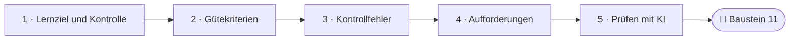
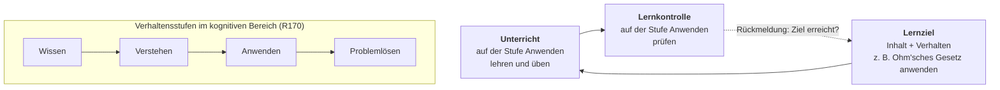
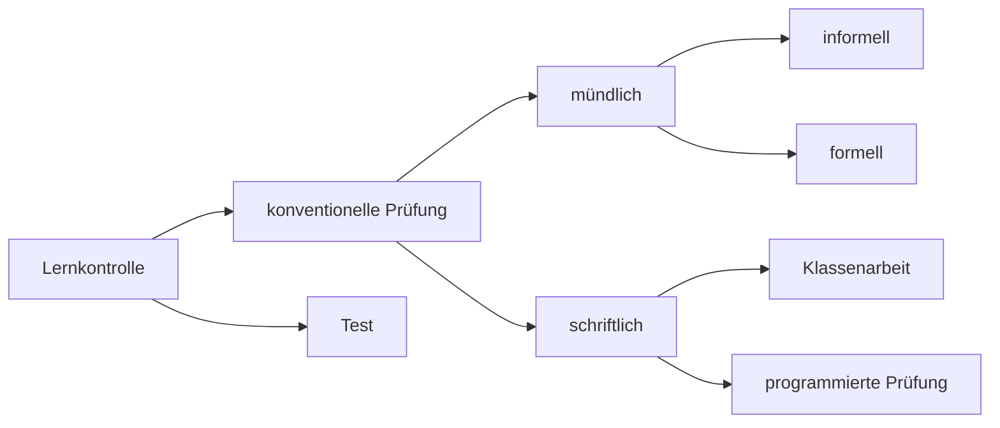
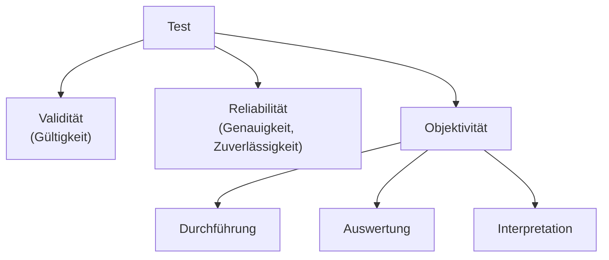

<!--
author:   Hannes Tegelbeckers
email:    hannes.tegelbeckers@ovgu.de
version:  0.3.0
language: de
narrator: Deutsch Female
mode:     Textbook
comment:  Fachdidaktik technischer Allgemeinbildung II – Selbstlerneinheit zu Sitzung S10. Studientext mit Übungen: Zusammenhang von Lernziel und Lernkontrolle, konventionelle Prüfung und Test, die drei Gütekriterien, Kontrollfehler, didaktische Aufforderungen, Operatoren und Anforderungsbereiche – und Prüfen in Zeiten von KI.

import:   https://raw.githubusercontent.com/LiaTemplates/mermaid_template/0.1.4/README.md
-->

# S10 – Lernerfolgskontrolle (Selbstlerneinheit)

<!-- didaktik="Selbstlerneinheit S10 · ca. 90 min · Studientext + Übungen · Inhalte der Folien R169–R183 und Zinn (2026), in eigenen Worten erläutert" -->
> [!IMPORTANT] 🧭 Leitfrage
> Wie baue ich eine Prüfungsaufgabe, die misst, was sie messen soll – fair bewertet wird und auch dann noch gilt, wenn Lernende einen KI-Chatbot in der Tasche haben?

> [!NOTE] 📘 So ist diese Einheit aufgebaut
> Diese Einheit **erklärt die Inhalte der Sitzung S10** in eigenen Worten und mit Beispielen – Sie können sie auch bearbeiten, wenn Sie in der Sitzung nicht dabei waren. Die Originalfolien finden Sie in der [LiaScript-Sitzung S10](https://liascript.github.io/course/?https://raw.githubusercontent.com/OVGU-VET-TechEd/Fachdidaktik_technischer_Allgemeinbildung_II/main/S10_Lernerfolgskontrolle.md).

> [!TIP] ✍️ Übung in Moodle
> Bearbeiten Sie diese Einheit als Übung im Moodle-Kurs – dort wird Ihr Bearbeitungsstand gespeichert: [Übung in Moodle öffnen](https://elearning.ovgu.de/mod/scorm/view.php?id=707272)

**Ablauf (ca. 90 min)**

<!-- data-type="none" -->
| Schritt | Inhalt | Zeit |
| --- | --- | --- |
| 0 | Wo stehen Sie? | 3 min |
| 1 | Lernziel und Lernkontrolle | 12 min |
| 2 | Test und Gütekriterien | 25 min |
| 3 | Kontrollfehler | 12 min |
| 4 | Aufforderungen, Operatoren, Anforderungsbereiche | 20 min |
| 5 | Prüfen in Zeiten von KI | 12 min |
| 6 | Abschluss und Prüfungsfragen | 15 min |

## Ihr Lernweg in dieser Einheit

    --{{0}}--
Die Einheit führt vom Grundsatz „Geprüft wird, was gelehrt wurde“ über die drei Gütekriterien und typische Kontrollfehler zu Aufgaben mit Operator und Erwartungshorizont – und schließlich zur Frage, wie Prüfen gelingt, wenn Lernende KI nutzen.

    --{{1}}--
Auf diesem Weg erreichen Sie sechs Ziele.

      {{1}}

<!-- data-type="none" -->
| Wissen | Können | Beurteilen |
|------|--------|-------|
| den Zusammenhang zwischen Lernziel und Lernkontrolle **erläutern** | **prüfen**, ob eine Aufgabe auf der Stufe prüft, auf der unterrichtet wurde | **beurteilen**, welche Aufgabenformate ein KI-Chatbot leicht lösen kann, und Alternativen **begründen** |
| die drei Gütekriterien **erklären** und drei Kontrollfehler mit Gegenmaßnahmen **beschreiben** | Verletzungen der Gütekriterien in Aufgaben **erkennen** und die Aufgaben **verbessern** | Aufgaben mit Operator und Erwartungshorizont für die drei Anforderungsbereiche **entwickeln** |

    --{{2}}--
Prüfen Sie kurz, ob Sie den Lernweg lesen können.

      {{2}}
****************************************

**Entscheiden:** Was kommt direkt nach den Kontrollfehlern?

<!-- data-hint-button="1" data-solution-button="2" -->
- [(X)] Aufforderungen
- [( )] Gütekriterien
- [( )] Prüfen mit KI
[[?]] Folgen Sie den Pfeilen von links nach rechts.
***
Richtig: Abschnitt 4 behandelt Aufforderungen, Operatoren und Anforderungsbereiche.
***

****************************************

## 0 · Wo stehen Sie?

    --{{0}}--
Eine These zum Start. Am Ende der Einheit stimmen Sie noch einmal ab.

> **„Eine mündliche Prüfung kann nicht objektiv sein.“**

**Abstimmen (vorher):** Stimmen Sie dieser These zu?

[(a)] Ja, ich stimme zu
[(b)] Nein, ich stimme nicht zu
[(c)] Teils, teils
[(unentschieden)] Unentschieden

    --{{1}}--
Schätzen Sie sich zuerst selbst ein.

      {{1}}
****************************************

> [!TIP] 🧠 Wie sicher fühlen Sie sich? · 1 min
> Notieren Sie je eine Zahl von 1 (gar nicht) bis 4 (sehr sicher): „Ich kann eine Prüfungsaufgabe nach Validität, Reliabilität und Objektivität beurteilen.“ – „Ich kann einen Erwartungshorizont schreiben, mit dem zwei Lehrkräfte zum selben Ergebnis kommen.“

[[___ ___ ___]]

****************************************

    --{{2}}--
Behalten Sie Ihre Einschätzung im Blick.

      {{2}}
> [!TIP] 📌 Merken
> Im Rückblick am Ende der Einheit schätzen Sie sich noch einmal ein.

## 1 · Lernziel und Lernkontrolle

    --{{0}}--
Jede Lernerfolgskontrolle, so der Titel von Kapitel 10 auf Folie R169, beantwortet die Frage: Haben die Lernenden das Ziel erreicht? Daraus folgt ein Grundsatz, der banal klingt und doch oft verletzt wird. Ein Lernziel besteht nach Folie R170 aus zwei Teilen: einem Inhalt, zum Beispiel das Ohm'sche Gesetz, und einem Verhalten, zum Beispiel nennen oder anwenden. Im Verhalten lassen sich Stufen unterscheiden.

> **Es darf nur geprüft werden, was auch gelehrt worden ist.** (Folie R170)

**Inhalt und Verhalten:** Ein Lernziel besteht aus einem **Inhalt** (z. B. „das Ohm'sche Gesetz“) und einem **Verhalten** (z. B. „nennen“ oder „anwenden“). Im kognitiven Bereich unterscheidet R170 die Stufen **Wissen, Verstehen, Anwenden und Problemlösen**.

Für die Kontrolle heißt das: Wurden Inhalte im Unterricht auf der Stufe des Wissens vermittelt, dürfen sie auch nur auf dieser Stufe geprüft werden.

    --{{1}}--
Dieser Gedanke heißt heute Constructive Alignment: Ziele, Unterricht und Prüfung passen zusammen.

      {{1}}
> [!NOTE] Kernaussage
> Wer in der Klassenarbeit Problemlösen verlangt, muss Problemlösen vorher unterrichten und üben – **Constructive Alignment**: Ziele, Unterricht und Prüfung passen zusammen.

<small>Nach Folien R169–R170; Erläuterungen und Beispiele: eigene Darstellung.</small>

## 1.1 Ziel, Unterricht und Kontrolle als Kette

    --{{0}}--
Der Grundsatz von Folie R170 lässt sich als Kette lesen. Das Lernziel legt Inhalt und Verhaltensstufe fest. Der Unterricht lehrt und übt auf dieser Stufe. Die Lernkontrolle prüft auf derselben Stufe – und meldet zurück, ob das Ziel erreicht wurde.

    --{{1}}--
Am Anfang steht das Lernziel.

      {{1}}
**① Lernziel:** Inhalt und Verhalten; das Verhalten liegt auf einer Stufe – Wissen, Verstehen, Anwenden oder Problemlösen.

    --{{2}}--
Der Unterricht muss genau diese Stufe erreichen.

      {{2}}
**② Unterricht:** Wer Anwenden prüfen will, muss Anwenden lehren und üben – nicht nur Nennen.

    --{{3}}--
Und die Kontrolle prüft auf derselben Stufe.

      {{3}}
**③ Lernkontrolle:** Es darf nur geprüft werden, was auch gelehrt worden ist – auf der Stufe, auf der es gelehrt wurde.

    --{{4}}--
Das ist Constructive Alignment.

      {{4}}
> [!NOTE] Kernaussage
> Ziel, Unterricht und Prüfung passen zusammen – sonst ist die Prüfung nicht **valide** für das, was gelernt werden sollte (Abschnitt 2).

<small>Grundsatz und Verhaltensstufen nach Folie R170; Darstellung als Kette und Beispiel: eigene Darstellung.</small>

## 1.2 Konventionelle Prüfung oder Test

    --{{0}}--
Lernkontrollen sind nach R170 entweder konventionelle Prüfungen oder Tests. Konventionelle Prüfungen ordnen die Folien R171 und R172 nach mündlich und schriftlich. Beide Formen können handlungsorientiert oder nicht handlungsorientiert sein.

    --{{1}}--
Mündlich unterscheidet man die informelle und die formelle Prüfung. Die formelle mündliche Prüfung hat in Berufsschulen weniger Bedeutung als etwa an der Fachoberschule.

      {{1}}
**① mündlich:** **informell** – punktuelles Abfragen, ob bestimmte Lernschritte erreicht wurden · **formell** – die bekannte mündliche Prüfung

    --{{2}}--
Schriftlich unterscheiden die Folien Klassenarbeit und programmierte Prüfung.

      {{2}}
**② schriftlich:** **Klassenarbeit** · **programmierte Prüfung** (vorgegebene Antworten, z. B. Mehrfachwahl)

    --{{3}}--
Was einen Test von einer Klassenarbeit unterscheidet, zeigt Abschnitt 2.

      {{3}}
**③ Test:** nach testtheoretischen und teststatistischen Kriterien abgesichert (R173) – siehe Abschnitt 2

    --{{4}}--
Für alle Formen gilt:

      {{4}}
> [!NOTE] Kernaussage
> Mündliche und schriftliche Prüfungen können **handlungsorientiert oder nicht handlungsorientiert** sein (R171).

<small>Nach Folien R170–R172 als Diagramm nachgezeichnet; Erläuterung „programmierte Prüfung“ ergänzt.</small>

## Übung 1: Darf das geprüft werden?

    --{{0}}--
Prüfen Sie den Grundsatz aus R170 an zwei Fällen.

**1 · Eine Antwort:** Im Unterricht wurde das Ohm'sche Gesetz **genannt und an einem Beispiel vorgerechnet** (Stufe Wissen). In der Klassenarbeit sollen die Lernenden einen **Fehler in einer unbekannten Schaltung finden** (Problemlösen). Ist das nach R170 zulässig?

<!-- data-hint-button="1" data-solution-button="2" -->
- [( )] Ja – wer die Formel kennt, kann auch Fehler finden.
- [(X)] Nein – geprüft wird auf einer höheren Stufe als gelehrt.
- [( )] Ja – solange die Aufgabe angekündigt war.
[[?]] Auf welcher Stufe wurde gelehrt, auf welcher wird geprüft?
***
Nach R170 dürfen Inhalte, die auf der Stufe des Wissens vermittelt wurden, auch nur auf dieser Stufe geprüft werden. Wer Problemlösen prüfen will, muss Problemlösen vorher unterrichten und üben.
***

    --{{1}}--
Jetzt können mehrere Antworten richtig sein.

      {{1}}
****************************************

**2 · Alle zutreffenden:** Die Lernenden haben die Bauteile eines Pneumatikzylinders benannt und an einem Schnittmodell erklärt bekommen (Wissen, Verstehen). Welche Aufgaben sind zulässig?

<!-- data-hint-button="1" data-solution-button="2" -->
- [[X]] „Benennen Sie die Bauteile im Schnittbild.“
- [[ ]] „Entwickeln Sie eine Steuerung für eine Presse mit zwei Zylindern.“
- [[X]] „Erklären Sie, wie der Kolben zurückfährt.“
- [[ ]] „Bewerten Sie, ob ein elektrischer Antrieb für diese Anlage zweckmäßiger wäre.“
[[?]] Welche Aufgaben bleiben bei Wissen und Verstehen?
***
Entwickeln und Bewerten liegen über dem, was unterrichtet wurde. Wer sie prüfen will, muss sie vorher unterrichten und üben – sonst ist die Aufgabe nicht valide für das, was gelernt werden sollte.
***

****************************************

    --{{2}}--
Zum Schluss ein Begriff.

      {{2}}
****************************************

**3 · Eintippen:** Ziele, Unterricht und Prüfung passen zusammen – wie heißt dieser Gedanke? Constructive … (ein Wort)

<!-- data-hint-button="1" data-solution-button="2" -->
[[Alignment]]
[[?]] Sie kennen den Begriff aus S01.

***
Constructive Alignment: Geprüft wird auf der Stufe, auf der die Lernziele formuliert und unterrichtet wurden.
***

****************************************

## 2 · Test und Gütekriterien

    --{{0}}--
Ein Test ist nach Folie R173 eine Lernkontrolle, die nach testtheoretischen und teststatistischen Kriterien abgesichert ist. Diese Kriterien heißen Gütekriterien. Auch wenn Sie im Unterricht selten echte Tests im testtheoretischen Sinn einsetzen, sind die drei Kriterien der beste Maßstab, um jede Prüfungsaufgabe zu beurteilen.

    --{{1}}--
Das erste Kriterium fragt nach dem Ziel der Messung.

      {{1}}
**① Validität:** Misst die Aufgabe, was sie messen soll? (2.1)

    --{{2}}--
Das zweite nach der Genauigkeit.

      {{2}}
**② Reliabilität:** Misst sie genau? (2.2)

    --{{3}}--
Das dritte nach der Person, die prüft.

      {{3}}
**③ Objektivität:** Hängt das Ergebnis von der Lehrkraft ab – bei Durchführung, Auswertung oder Interpretation? (2.3)

    --{{4}}--
Merken Sie sich die drei Fragen.

      {{4}}
> [!NOTE] Kernaussage
> Die Gütekriterien gelten nicht nur für Tests, sondern als Maßstab für jede Prüfungsaufgabe – auch für Klassenarbeit und mündliche Prüfung.

<small>Nach Folie R173 „10.3 Test“; Schaubild als Diagramm nachgezeichnet.</small>

## 2.1 Validität und 2.2 Reliabilität

    --{{0}}--
Das Beispiel der Folie zur Validität: Eine Rechenaufgabe in Form einer Textaufgabe prüft nicht nur das Rechnen, sondern auch das Textverständnis – für das Rechnen ist sie also nicht valide. Schulleistungstests prüfen meist die Inhaltsvalidität: Der Test muss die Lernziele widerspiegeln, ein Wissenstest für Wissenslernziele, und die Schwerpunkte des Unterrichts sollten auch die Schwerpunkte des Tests sein.

**2.1 Validität – misst die Aufgabe, was sie messen soll?**

> „Ein Test ist valide, wenn er tatsächlich das mißt, was er zu messen vorgibt.“ (Folie R174)

- Textaufgabe zum Rechnen prüft auch das Textverständnis → für das Rechnen nicht valide
- **Inhaltsvalidität:** Der Test spiegelt die Lernziele und die Schwerpunkte des Unterrichts wider.
- **Beispiel:** Im Unterricht stand das Messen im Vordergrund, der Test fragt aber nur Definitionen ab – der Test ist nicht valide für das, was gelernt werden sollte. *(Eigenes Beispiel.)*

    --{{1}}--
Wird ein reliabler Test mit denselben Personen wiederholt, kommt er zu denselben Ergebnissen. Die Folie warnt aber: Damit ist noch nicht gesagt, ob der Test auch valide ist.

      {{1}}
****************************************

**2.2 Reliabilität – misst sie genau?**

> „Ein Test ist reliabel, wenn er das, was er mißt, genau mißt.“ (Folie R175)

- Testwiederholung mit denselben Personen → dieselben Ergebnisse
- Reliabel heißt noch nicht valide.

****************************************

    --{{2}}--
Was folgt daraus?

      {{2}}
> [!NOTE] Kernaussage
> Man kann sehr genau das Falsche messen – etwa sehr zuverlässig die Lesegeschwindigkeit statt des Fachwissens.

<small>Nach Folien R174–R175; Zitate wörtlich (alte Schreibweise „mißt“), Quelle auf den Originalfolien nicht angegeben.</small>

## 2.3 Objektivität – hängt das Ergebnis von der Lehrkraft ab?

    --{{0}}--
Objektivität bezieht sich darauf, wie weit das Ergebnis unabhängig von der Person ist, die den Test durchführt, auswertet und interpretiert (Folie R176). Die Folien unterscheiden drei Arten.

<!-- data-type="none" -->
| Art | Bedeutung | Wie man sie sichert |
| --- | --- | --- |
| **Durchführungsobjektivität** | gleiche äußere Bedingungen für alle | Anweisungen schriftlich festlegen: Bearbeitungszeit, Hilfsmittel, Hilfen der Lehrkraft (R176–R177) |
| **Auswertungsobjektivität** | gleiches Auswertungsergebnis, egal wer korrigiert | eindeutiger Lösungsschlüssel (R177) |
| **Interpretationsobjektivität** | zwei Beurteiler ziehen aus demselben Ergebnis denselben Schluss | z. B. gleicher Notenschlüssel (R178) |

    --{{1}}--
Folie R178 unterscheidet außerdem normorientierte und kriteriumsorientierte Tests. Was das bedeutet, erklären die Bezugsnormen – eine Ergänzung aus Zinn, als NEU markiert. Bei der sozialen Bezugsnorm wird mit anderen verglichen, zum Beispiel mit der Klasse. Bei der individuellen wird eine Person mit ihrem eigenen früheren Stand verglichen. Bei der kriterialen wird mit einem vorher festgelegten Standard verglichen.

      {{1}}
****************************************

<!-- neu="Zinn 2026, S. 217, Tab. 8.1" -->

<!-- data-type="none" -->
| Bezugsnorm | Verglichen wird … | sichtbar wird … |
| --- | --- | --- |
| **sozial** (≈ normorientiert) | mit anderen, z. B. mit der Klasse | ob jemand mehr oder weniger kann als die anderen – nicht, wie viel er gelernt hat |
| **individuell** | eine Person mit ihrem eigenen früheren Stand | der Lernzuwachs |
| **kriterial** (≈ kriteriumsorientiert) | mit einem vorher festgelegten Standard | wie weit jemand vom Ziel entfernt ist |

****************************************

    --{{2}}--
Beachten Sie die Zuordnung.

      {{2}}
> [!NOTE] Kernaussage
> Die Zuordnung „≈“ von Bezugsnorm und Testart (R178) ist eine Lesehilfe.

<small>Nach Folien R176–R178; [NEU] Bezugsnormen nach Zinn (2026), S. 217.</small>

## [NEU] Gütekriterien in der Schulpraxis

    --{{0}}--
Wie sichert man die Gütekriterien im Schulalltag? Zinn gibt dazu praktische Hinweise, als NEU markiert.

<!-- neu="Zinn 2026, S. 217–219" -->
- **Objektivität** sichern Sie durch einen Erwartungshorizont, Bewertungsanweisungen, transparente Punktevergabe und Prüfungsprotokolle.
- **Reliabilität** heißt in der Praxis auch: Aufgaben sollen differenzieren – ohne **Deckeneffekt** (fast alle lösen sie) und **Bodeneffekt** (fast niemand löst sie).
- **Validität** gilt als das bedeutendste Kriterium und setzt Objektivität und Reliabilität voraus.

    --{{1}}--
Und ein Hinweis zum Erwartungshorizont.

      {{1}}
> [!NOTE] Kernaussage
> Der **Erwartungshorizont** soll den Lernenden vorab bekannt sein; Aufgaben sollen bekannte Operatoren verwenden und möglichst alle drei Anforderungsbereiche abdecken.

<small>[NEU] Ergänzung, keine Originalfolie: Zinn (2026), S. 217–219.</small>

## Übung 2: Welches Gütekriterium ist verletzt?

    --{{0}}--
Ordnen Sie fünf Fälle den Gütekriterien zu.

**1 · Eine Antwort:** Eine Aufgabe zur Leistungsberechnung ist in einen langen, verschachtelten Text verpackt. Welches Gütekriterium ist verletzt?

<!-- data-hint-button="1" data-solution-button="2" -->
- [( )] Reliabilität
- [(X)] Validität
- [( )] Auswertungsobjektivität
[[?]] Was prüft die Aufgabe nebenbei?
***
Validität: Die Textaufgabe prüft auch Lesekompetenz (R174; Zinn 2026, S. 218–219).
***

    --{{1}}--
Jetzt können mehrere Antworten richtig sein.

      {{1}}
****************************************

**2 · Alle zutreffenden:** Welche Fälle verletzen die Durchführungs- oder die Auswertungsobjektivität?

<!-- data-hint-button="1" data-solution-button="2" -->
- [[X]] Eine Gruppe darf das Tabellenbuch benutzen, die andere nicht.
- [[ ]] Ein Test besteht aus drei Aufgaben, die fast alle lösen (Deckeneffekt).
- [[X]] „Beschreiben Sie den Aufbau eines Transformators.“ – ohne Erwartungshorizont.
- [[ ]] Eine Aufgabe zur Leistungsberechnung ist in einen langen, verschachtelten Text verpackt.
[[?]] Durchführung: gleiche Bedingungen. Auswertung: eindeutiger Lösungsschlüssel.
***
Durchführungsobjektivität: gleiche Bedingungen und Hilfsmittel für alle (R176–R177). Auswertungsobjektivität: eindeutiger Lösungsschlüssel (R177). Der Deckeneffekt betrifft die Reliabilität – Aufgaben sollen differenzieren (Zinn 2026, S. 218); die lange Textaufgabe die Validität.
***

****************************************

    --{{2}}--
Zum Schluss ein Begriff.

      {{2}}
****************************************

**3 · Eintippen:** Zwei Lehrkräfte verwenden für dieselben Punkte verschiedene Notenschlüssel. Welche Objektivität ist verletzt? (ein Wort, z. B. Durchführungsobjektivität)

<!-- data-hint-button="1" data-solution-button="2" -->
[[Interpretationsobjektivität]]
[[?]] Wer zieht aus demselben Ergebnis welchen Schluss?

***
Interpretationsobjektivität: Zwei Beurteiler ziehen aus demselben Ergebnis denselben Schluss, z. B. mit demselben Notenschlüssel (R178).
***

****************************************

## Reparieren Sie

    --{{0}}--
Machen Sie aus einer offenen Aufgabe eine, die sich objektiv auswerten lässt.

Formulieren Sie die Aufgabe „Beschreiben Sie den Aufbau eines Transformators.“ so um, dass **Auswertungsobjektivität** möglich ist – mit einem kurzen Erwartungshorizont.

[[___ ___ ___ ___]]

💡 Hinweis

Ein Operator wie „Nennen Sie … und beschreiben Sie …“ und Punkte je Teilaussage machen die Auswertung eindeutig.

✅ Lösung

*„Nennen Sie die drei Hauptbestandteile eines Einphasentransformators und beschreiben Sie in je einem Satz ihre Funktion.“* Erwartungshorizont: Primärwicklung (nimmt Energie aus dem Netz auf), Sekundärwicklung (gibt Energie an den Verbraucher ab), Eisenkern (führt den magnetischen Fluss) – je Bauteil 1 Punkt, je richtige Funktion 1 Punkt, höchstens 6 Punkte.

## 3 · Kontrollfehler

    --{{0}}--
Auch wer die Gütekriterien kennt, bewertet nicht fehlerfrei. In der Sitzung haben Sie das selbst erlebt: Zu Beginn bewerteten Sie eine Antwort – die Hälfte der Gruppe sah Version A, die andere Version B. Beide hatten denselben Inhalt; B war nur unsauber geschrieben und voller Rechtschreibfehler. Unterschiede in den Punkten haben eine Ursache, die die Folien beschreiben. Sie nennen drei typische Kontrollfehler.

<!-- data-type="none" -->
| Kontrollfehler | Was passiert | Gegenmittel |
| --- | --- | --- |
| **Reihenfolge-Effekt** (R179) | Wer viele Arbeiten korrigiert, bewertet die **ersten strenger**; mit der Gewöhnung wird man **milder**. | jede Arbeit zweimal lesen und das Ergebnis des ersten Lesens nicht sofort zum Endurteil machen – oder beim ersten Lesen nur vorsortieren |
| **Hof-Effekt** (R180) | Das **Umfeld** einer Leistung (der „Hof“) wird mitbewertet: Eine unschöne Schrift und viele Rechtschreibfehler drücken die Bewertung des Inhalts. Ähnlich wirken Vorleistungen, Herkunft, Verhaltensstil oder Leistungen in anderen Fächern. | möglichst wenig vom Umfeld kennen – z. B. verdeckte Kontrolle mit Ziffern statt Namen |
| **Erwartungs-Effekt** (R181) | Aufgrund von **Vorinformationen** trägt die prüfende Person eine Erwartung heran und neigt dazu, sie erfüllt zu sehen (*self-fulfilling prophecy*); die Lernenden verändern sich sogar nach diesen Erwartungen (**Pygmalion-Effekt**). | sich das Vorhandensein und die Wirkung dieser Effekte bewusst machen |

    --{{1}}--
Die Folie R179 verweist außerdem auf eine Untersuchung, nach der sich „die Zahl 8 von 10“ als günstig erwiesen habe. Die Untersuchung ist nicht belegt, und was die Zahl bedeutet, bleibt offen. Den Hof-Effekt zeigt das Experiment aus der Sitzung.

      {{1}}
> [!NOTE] Kernaussage
> Der beste Schutz ist laut Folie R181, sich das Vorhandensein und die Wirkung dieser Effekte **bewusst** zu machen.

<small>Nach Folien R179–R181 „10.7 Kontrollfehler“ bis „10.9 Erwartungs-Effekt“; Tabelle: eigene Darstellung.</small>

## Übung 3a: Reihenfolge-Effekt und Pygmalion

    --{{0}}--
Drei kurze Fragen zu den Kontrollfehlern.

**1 · Eine Antwort:** Die ersten fünf Arbeiten des Stapels werden strenger bewertet als die letzten. Welcher Kontrollfehler ist das?

<!-- data-hint-button="1" data-solution-button="2" -->
- [( )] Hof-Effekt
- [(X)] Reihenfolge-Effekt
- [( )] Erwartungs-Effekt
[[?]] Gewöhnung beim Korrigieren …
***
Reihenfolge-Effekt: Mit der Gewöhnung wird milder bewertet (R179).
***

    --{{1}}--
Jetzt können mehrere Antworten richtig sein.

      {{1}}
****************************************

**2 · Alle zutreffenden:** Welche Gegenmittel nennt R179 gegen den Reihenfolge-Effekt?

<!-- data-hint-button="1" data-solution-button="2" -->
- [[X]] die Arbeiten zweimal lesen
- [[ ]] Ziffern statt Namen verwenden
- [[X]] beim ersten Lesen nur vorsortieren
- [[ ]] Vorinformationen über die Lernenden vorher lesen
[[?]] Das erste Urteil soll noch nicht das Endurteil sein.
***
Ziffern statt Namen helfen gegen den Hof-Effekt (R180). Vorinformationen vorher zu lesen begünstigt den Erwartungs-Effekt (R181).
***

****************************************

    --{{2}}--
Zum Schluss ein Begriff.

      {{2}}
****************************************

**3 · Eintippen:** Wie heißt der Effekt, bei dem sich Lernende nach den Erwartungen der Lehrkraft verändern? (ein Wort, ohne „-Effekt“)

<!-- data-hint-button="1" data-solution-button="2" -->
[[Pygmalion]]
[[?]] Eine Figur aus der griechischen Mythologie …

***
Pygmalion-Effekt: Der Lernende selbst verändert sich nach diesen Erwartungen (R181).
***

****************************************

## Übung 3b: Hof-Effekt oder Erwartungs-Effekt?

    --{{0}}--
Die beiden Effekte werden leicht verwechselt. Vergleichen Sie zuerst.

<!-- data-type="none" -->
| Kriterium | Hof-Effekt | Erwartungs-Effekt |
|-----------|---------------|---------------|
| Was wirkt? | das Umfeld der Leistung, das beim Bewerten mit wahrgenommen wird | Vorinformationen über die Leistungen der Lernenden |
| Beispiele | Schrift, Rechtschreibung, Leistungen in anderen Fächern | „war schon immer schwach“, Ruf aus der Parallelklasse |
| Folge | der Inhalt wird schlechter oder besser bewertet, als er ist | die Vorhersage erfüllt sich selbst |
| Gegenmittel | Ziffern statt Namen; Form und Inhalt getrennt bewerten | sich den Effekt bewusst machen; Vorinformationen erst nach der Bewertung ansehen |

    --{{1}}--
Je ein Beispiel:

      {{1}}
- **Hof-Effekt:** Ein sauber gezeichnetes Schaltbild führt zu mehr Punkten für eine fachlich gleich gute Lösung.
- **Erwartungs-Effekt:** „Der war schon im ersten Lehrjahr schwach“ – und genau so liest die Lehrkraft die Arbeit.

    --{{2}}--
Ein typischer Fehlschluss:

      {{2}}
> [!WARNING] Häufiges Missverständnis
> „Ich kenne die Effekte, also bin ich davor geschützt.“ – Bewusstsein ist nach R181 der beste Schutz, aber kein vollständiger: Gegenmittel wie verdeckte Kontrolle und Erwartungshorizont helfen zusätzlich.

    --{{3}}--
Ordnen Sie jetzt zu.

      {{3}}
****************************************

**Entscheiden:** Welchen Begriff beschreibt die Aussage jeweils?

<!-- data-hint-button="1" data-solution-button="2" data-show-partial-solution -->
[(Hof-Effekt) (Erwartungs-Effekt)]
[       (X)             ( )      ] Ein sauber gezeichnetes Schaltbild führt zu mehr Punkten für eine fachlich gleich gute Lösung.
[       ( )             (X)      ] „Der war schon im ersten Lehrjahr schwach“ – und genau so liest die Lehrkraft die Arbeit.
[       (X)             ( )      ] Die gute Note in Mathematik färbt auf die Bewertung im Technikunterricht ab.
[       ( )             (X)      ] Die Lehrkraft weiß, dass eine Schülerin Klassenbeste ist, und übersieht einen Rechenfehler.
[[?]] Wirkt das, was beim Bewerten sichtbar ist – oder das, was man vorher schon weiß?
***
Hof-Effekt: das Umfeld der Leistung wird mitbewertet – Schrift, Form, Leistungen in anderen Fächern (R180). Erwartungs-Effekt: Vorinformationen erfüllen sich selbst (R181).
***

****************************************

## 4 · Aufforderungen, Operatoren, Anforderungsbereiche

    --{{0}}--
Eine gute Aufgabe sagt den Lernenden genau, was sie tun sollen. Die Folien R182 und R183 ordnen solche didaktischen Aufforderungen nach drei Lernzielbereichen: kognitiv, affektiv und psychomotorisch.

<!-- data-type="none" -->
| Lernzielbereich | Stufe bzw. Art | Aufforderung |
| --- | --- | --- |
| **kognitiv** | deskriptives Wissen | Nennen Sie … |
| | verstehendes Wissen | Fügen Sie … ein. |
| | anwendendes Wissen | Berechnen Sie … |
| | analysierendes Wissen | Klassifizieren Sie … |
| | synthetisierendes Wissen | Entwickeln Sie … |
| | bewertendes Wissen | Prüfen Sie, … |
| **affektiv** | Haltungen, Werte | Berücksichtigen Sie … · Beteiligen Sie sich an … · Setzen Sie sich für … ein. · Finden Sie Beurteilungsmaßstäbe für … · Ziehen Sie Konsequenzen aus … für … |
| **psychomotorisch** | Fertigkeiten | Messen Sie … · Zeichnen Sie … |

    --{{1}}--
Eine Ergänzung aus Zinn, als NEU markiert: Solche handlungsleitenden Verben heißen Operatoren. Sie machen die Verhaltenskomponente eines Lernziels beobachtbar und überprüfbar – das ist die Unterscheidung Inhalt und Verhalten von R170. Verstehen ist eine Lernzielstufe, aber nicht direkt beobachtbar und deshalb als Verb für Feinziele ungeeignet. Für Prüfungen im Fach Technik werden nach den Einheitlichen Prüfungsanforderungen, kurz EPA, drei Anforderungsbereiche unterschieden.

      {{1}}
****************************************

<!-- neu="Zinn 2026, S. 70–73" -->

<!-- data-type="none" -->
| | typische Operatoren | Beispiel EPA Technik |
| --- | --- | --- |
| **AFB I** Reproduktion | nennen, erfassen | die Formeln für Dehnung und Spannung nennen |
| **AFB II** Reorganisation und Transfer | berechnen, beschreiben | ein Spannungs-Dehnungs-Diagramm erläutern |
| **AFB III** Bewertung und Problemlösung | analysieren, bewerten | Materialeigenschaften anhand von Spannungs-Dehnungs-Diagrammen beurteilen |

****************************************

    --{{2}}--
Was gehört zu jeder Aufgabe dazu?

      {{2}}
> [!NOTE] Kernaussage
> Ein **Erwartungshorizont** legt für jede Aufgabe fest, welche Antwort wie viele Punkte bekommt. Zusammen mit einem klaren Operator sichert er die Auswertungsobjektivität aus Abschnitt 2.

<small>Nach Folien R182–R183 (Schreibweise „Descriptives“ der Originalfolie vereinheitlicht); [NEU] Zinn (2026), S. 70–73.</small>

## Beispiel: drei Anforderungsbereiche zum Leitungsschutz

    --{{0}}--
So sieht ein Satz von Aufgaben zu einem Thema aus – je eine Aufgabe für AFB I, II und III, jede mit Erwartungshorizont.

<!-- data-type="none" -->
| AFB | Aufgabe | Erwartungshorizont |
| --- | --- | --- |
| I | Nennen Sie zwei Aufgaben eines Leitungsschutzschalters. | Schutz bei Überlast, Schutz bei Kurzschluss – je 1 Punkt |
| II | Beschreiben Sie, wie der Schalter bei Überlast auslöst. | thermische Auslösung über Bimetall, zeitverzögert – 2 Punkte |
| III | Beurteilen Sie, ob ein Leitungsschutzschalter auch Menschen vor einem elektrischen Schlag schützt. Begründen Sie. | nein bzw. nicht ausreichend: Er reagiert auf Überstrom, nicht auf Fehlerströme über den Körper; dafür ist ein Fehlerstromschutzschalter (RCD) vorgesehen – 3 Punkte |

    --{{1}}--
Achten Sie auf die Operatoren.

      {{1}}
> [!NOTE] Kernaussage
> Der Operator zeigt den Anforderungsbereich an: **nennen** (I), **beschreiben** (II), **beurteilen und begründen** (III).

<small>Übungsbeispiel für diese Einheit, nicht von den Originalfolien.</small>

## Übung 4a: Welcher Lernzielbereich?

    --{{0}}--
Drei kurze Fragen zu Aufforderungen und Anforderungsbereichen.

**1 · Eine Antwort:** Zu welchem Lernzielbereich gehört „Setzen Sie sich für … ein.“?

<!-- data-hint-button="1" data-solution-button="2" -->
- [( )] kognitiv
- [(X)] affektiv
- [( )] psychomotorisch
[[?]] Es geht um Haltungen und Werte.
***
Affektiv: Berücksichtigen Sie, Beteiligen Sie sich an, Setzen Sie sich für … ein, Finden Sie Beurteilungsmaßstäbe, Ziehen Sie Konsequenzen (R183).
***

    --{{1}}--
Jetzt können mehrere Antworten richtig sein.

      {{1}}
****************************************

**2 · Alle zutreffenden:** Welche Aufforderungen sind psychomotorisch?

<!-- data-hint-button="1" data-solution-button="2" -->
- [[X]] Messen Sie …
- [[ ]] Berechnen Sie …
- [[X]] Zeichnen Sie …
- [[ ]] Berücksichtigen Sie …
[[?]] Psychomotorisch: Fertigkeiten mit der Hand.
***
„Berechnen Sie“ ist kognitiv (anwendendes Wissen), „Berücksichtigen Sie“ affektiv (R182–R183).
***

****************************************

    --{{2}}--
Zum Schluss ein Anforderungsbereich.

      {{2}}
****************************************

**3 · Eintippen:** „Beurteilen Sie, ob ein Leitungsschutzschalter auch Menschen schützt. Begründen Sie.“ – Welcher Anforderungsbereich? (römische Zahl)

<!-- data-hint-button="1" data-solution-button="2" -->
[[III]]
[[?]] Bewerten und Problemlösen …

***
AFB III: Bewertung und Problemlösung (Zinn 2026, S. 72–73).
***

****************************************

## Übung 4b: Aufgaben mit Operator und Erwartungshorizont

    --{{0}}--
Jetzt schreiben Sie selbst Aufgaben. Prüfen Sie danach: Würde eine zweite Lehrkraft mit Ihrem Erwartungshorizont zur selben Punktzahl kommen? Wurde auf diesen Stufen unterrichtet? Was ist noch unklar?

Schreiben Sie zu einem Thema Ihrer Fachrichtung je eine Aufgabe für **AFB I, II und III** – mit Operator und Erwartungshorizont mit Punkten.

[[___ ___ ___ ___]]

💡 Hinweis

Prüfen Sie: Würde eine zweite Lehrkraft mit Ihrem Erwartungshorizont zur selben Punktzahl kommen (Auswertungsobjektivität)? Wurde auf diesen Stufen unterrichtet (R170)?

✅ Lösung

Beispiel Metalltechnik, Thema Gewinde. **I:** „Nennen Sie zwei Gewindearten.“ – z. B. metrisches ISO-Gewinde, Trapezgewinde – je 1 Punkt. **II:** „Beschreiben Sie, wie Sie ein Innengewinde M8 von Hand herstellen.“ – Kernloch Ø 6,8 mm bohren, ansenken, mit Gewindebohrer und Schneidöl schneiden – 3 Punkte. **III:** „Beurteilen Sie, ob ein direkt geschnittenes Gewinde in einem Aluminiumgehäuse für eine häufig gelöste Verbindung geeignet ist. Begründen Sie.“ – eher nicht: Das weiche Aluminium verschleißt bei häufigem Lösen; ein Gewindeeinsatz ist besser – 3 Punkte.

## 5 · [NEU] Prüfen in Zeiten von KI

    --{{0}}--
In S09 haben Sie gesehen: Frei nutzbare KI kann die Übungsleistung steigern und die Leistung ohne KI trotzdem senken. Die Bildungsministerkonferenz fordert, die Prüfungskultur weiterzuentwickeln.

<!-- neu="Bastani et al. 2025; KMK 2024" -->
- Frei nutzbare KI kann die Übungsleistung steigern und die Leistung ohne KI trotzdem senken (Bastani et al., 2025; vgl. S09).
- Die Bildungsministerkonferenz fordert, die **Prüfungskultur** weiterzuentwickeln (KMK, 2024).
- Die Gütekriterien gelten weiter – aber: Wer hat die Aufgabe gelöst?

    --{{1}}--
Was heißt das für Ihre Aufgaben?

      {{1}}
> [!NOTE] Kernaussage
> Die **Validität** einer Hausaufgabe oder schriftlichen Ausarbeitung ist fraglich, wenn unklar ist, wer sie gelöst hat.

<small>[NEU] Ergänzung, keine Originalfolie: Bastani et al. (2025); KMK (2024).</small>

## Übung 5: Wie leicht löst ein KI-Chatbot die Aufgabe?

    --{{0}}--
Eine Einschätzung, keine feste Regel. Vergleichen Sie zuerst.

<!-- data-type="none" -->
| Kriterium | eher leicht für KI | eher schwer für KI |
|-----------|---------------|---------------|
| Die Leistung ist gebunden an … | Text, dessen Lösung allgemein verfügbar ist | Handlung, Gegenstand und Situation |
| Wo entsteht sie? | zu Hause, ohne Beobachtung | im Unterricht, an der Anlage, im Gespräch |
| Typische Aufforderung | Nennen Sie … · Beschreiben Sie … (als Hausaufgabe) | Messen Sie … (R183) · Begründen Sie Ihre Fehlersuche an der Anlage |
| Bezug im Kurs | klassische schriftliche Hausaufgabe | Handlungsorientierung (S02) |

    --{{1}}--
Je ein Beispiel:

      {{1}}
- **eher leicht für KI:** Eine Erklärung zum Aufbau eines Transformators als Hausaufgabe.
- **eher schwer für KI:** Eine Messung am realen Übungsboard mit Protokoll, das im Unterricht entsteht.

    --{{2}}--
Ein typischer Fehlschluss:

      {{2}}
> [!WARNING] Häufiges Missverständnis
> „Schwer für KI“ heißt nicht automatisch „gute Aufgabe“ – auch sie muss zum Lernziel passen und auf der unterrichteten Stufe prüfen (R170).

    --{{3}}--
Ordnen Sie jetzt zu.

      {{3}}
****************************************

**Entscheiden:** Welchen Begriff beschreibt die Aussage jeweils?

<!-- data-hint-button="1" data-solution-button="2" data-show-partial-solution -->
[(eher leicht für KI) (eher schwer für KI)]
[       (X)             ( )      ] Eine Erklärung zum Aufbau eines Transformators als Hausaufgabe
[       ( )             (X)      ] Eine Messung am realen Übungsboard mit Protokoll, das im Unterricht entsteht
[       (X)             ( )      ] Eine Standard-Rechenaufgabe zur Leistung, zu Hause gelöst
[       ( )             (X)      ] Ein Fachgespräch, in dem die Lernenden ihre Fehlersuche an der Anlage begründen
[[?]] Ist die Lösung als Text allgemein verfügbar – oder an Handlung und Situation gebunden?
***
Aufgaben, deren Lösung als Text allgemein verfügbar ist, kann ein Chatbot meist gut bearbeiten. Schwerer wird es, wenn die Leistung an Handlung, Gegenstand und Situation gebunden ist – Messen, Fertigen, Fehlersuche, mündliche Begründung. Das passt zur Handlungsorientierung (S02) und zu den psychomotorischen Aufforderungen auf R183 („Messen Sie …“).
***

****************************************

## Ihre Aufgabe KI-fest machen

    --{{0}}--
Nehmen Sie Ihre Aufgaben aus Übung 4b.

Wie müssten Sie Ihre Aufgabe aus Übung 4b verändern, damit sie auch dann **valide** ist, wenn die Lernenden KI nutzen dürfen – oder wie würden Sie den KI-Einsatz gezielt einbauen (z. B. KI-Antwort prüfen und korrigieren lassen)?

[[___ ___ ___ ___]]

💡 Hinweis

Binden Sie die Leistung an Handlung, Gegenstand oder Gespräch – oder machen Sie die KI-Antwort selbst zum Prüfgegenstand.

✅ Lösung

Beispiel Gewinde, AFB III: Die Lernenden bekommen eine KI-Antwort zur Frage „Gewinde direkt in Aluminium?“, die einen Fehler enthält. Aufgabe: „Prüfen Sie die Antwort, markieren Sie den Fehler und begründen Sie Ihre Korrektur.“ Erwartungshorizont: Fehler gefunden (1 P.), fachlich richtige Korrektur (1 P.), Begründung mit Werkstoffeigenschaft (1 P.). Die Leistung liegt im Prüfen – das kann die KI nicht für die Lernenden übernehmen, ohne dass es auffällt.

## 6 · Noch einmal: Kann eine mündliche Prüfung objektiv sein?

    --{{0}}--
Zum Schluss noch einmal die These vom Anfang.

**Abstimmen (nachher):** Stimmen Sie der These „Eine mündliche Prüfung kann nicht objektiv sein.“ zu?

[(a)] Ja, ich stimme zu
[(b)] Nein, ich stimme nicht zu
[(c)] Teils, teils
[(unentschieden)] Unentschieden

    --{{1}}--
Was ist Ihnen am unklarsten geblieben?

      {{1}}
****************************************

**Nachdenken:** Muddiest point: Was ist Ihnen am unklarsten geblieben?

[[___ ___]]

****************************************

    --{{2}}--
Eine Einordnung:

      {{2}}
> [!NOTE] Kernaussage
> Vollständig objektiv ist keine Prüfung, aber die Objektivität lässt sich sichern: gleiche Bedingungen und Fragen für alle (Durchführung), ein vorab festgelegter Erwartungshorizont (Auswertung), ein fester Notenschlüssel (Interpretation) und ein Protokoll (Zinn 2026, S. 218). Gerade in der mündlichen Prüfung wirken Hof- und Erwartungs-Effekt stark – wer sie kennt, kann ihnen begegnen.

## Das Wichtigste aus S10

    --{{0}}--
Fassen wir zusammen.

    --{{1}}--
Erstens: der Grundsatz.

      {{1}}
- Es darf nur geprüft werden, was gelehrt worden ist – auf derselben Stufe (R170).

    --{{2}}--
Zweitens: die Gütekriterien.

      {{2}}
- Validität, Reliabilität, Objektivität in Durchführung, Auswertung und Interpretation – der Maßstab für jede Aufgabe (R173–R178).

    --{{3}}--
Drittens: die Kontrollfehler.

      {{3}}
- Reihenfolge-, Hof- und Erwartungs-Effekt – Bewusstsein und Gegenmittel helfen (R179–R181).

    --{{4}}--
Und viertens: Aufgaben bauen.

      {{4}}
****************************************

- Operator und Erwartungshorizont passend zum Anforderungsbereich – und die Leistung so binden, dass sie auch mit KI valide bleibt (R182–R183; Zinn 2026).

> [!NOTE] Zum Merken
> Prüfen Sie das Lernziel – nicht die Schrift, nicht die Erwartung, nicht das Lesetempo.

****************************************

    --{{5}}--
Eine letzte Frage.

      {{5}}
****************************************

**Wiederholen:** Welche Maßnahme sichert vor allem die Auswertungsobjektivität?

<!-- data-hint-button="1" data-solution-button="2" -->
- [( )] gleiche Bearbeitungszeit für alle
- [( )] ein fester Notenschlüssel
- [(X)] ein Erwartungshorizont mit Punkten je Teilaussage
[[?]] Auswertung: Wer korrigiert, soll zum selben Ergebnis kommen.
***
Richtig: Ein eindeutiger Lösungsschlüssel sichert die Auswertungsobjektivität (R177). Die Bearbeitungszeit betrifft die Durchführung, der Notenschlüssel die Interpretation.
***

****************************************

    --{{6}}--
Als Nächstes geht es um zentrale Abschlussprüfungen und den Rückblick auf das Modul.

      {{6}}
**➡️ Als Nächstes:** S11: PAL-Prüfungen & Synthese · 🧩 Optional für die Selbstlernsitzung am 11.01.2027: Ihre Aufgaben aus Übung 4b sind Baustein 11.

## Prüfungsfragen zum Üben

    --{{0}}--
Die Prüfungsleistung des Moduls ist eine mündliche Prüfung. Mit diesen fünf Fragen üben Sie, die Inhalte dieser Einheit frei, strukturiert und mit Beispielen zu erklären.

> [!TIP] 🎙️ So üben Sie
> Lesen Sie eine Frage und antworten Sie **laut** in höchstens drei Minuten – nach dem Muster **Begriff – Erläutern – Beispiel – Verbinden**. Öffnen Sie erst danach die Antwortskizze und vergleichen Sie: Was fehlte, was war ungenau? Noch besser: Lassen Sie sich von einer Kommilitonin oder einem Kommilitonen abfragen.

**Frage 1 · Lernziel und Lernkontrolle:** Erläutern Sie den Zusammenhang zwischen Lernziel und Lernkontrolle.

✅ Antwortskizze 1

- **1 Begriff:** Ein Lernziel besteht aus **Inhalt** und **Verhalten**; im kognitiven Bereich gibt es die Stufen **Wissen, Verstehen, Anwenden, Problemlösen** (R170).
- **2 Erläutern:** Grundsatz: **Es darf nur geprüft werden, was auch gelehrt worden ist** – und auf der Stufe, auf der es gelehrt wurde. Lernkontrollen sind konventionelle Prüfungen (mündlich: informell/formell; schriftlich: Klassenarbeit, programmierte Prüfung) oder Tests (R170–R173).
- **3 Beispiel:** Wurde das Ohm'sche Gesetz nur genannt, ist eine Fehlersuche in einer unbekannten Schaltung als Prüfung nicht zulässig.
- **4 Verbinden:** Das ist **Constructive Alignment**: Ziele, Unterricht und Prüfung passen zusammen. Operatoren machen das Verhalten beobachtbar (AFB I–III). Kritik am programmierten Teil der PAL-Prüfung (S11).

**Frage 2 · Gütekriterien:** Nennen und erläutern Sie die drei Testgütekriterien an je einem Beispiel aus Ihrer Fachrichtung.

✅ Antwortskizze 2

- **1 Begriff:** Ein Test ist eine Lernkontrolle, die nach testtheoretischen und teststatistischen Kriterien abgesichert ist (R173): **Validität, Reliabilität, Objektivität**.
- **2 Erläutern:** **Validität:** „Ein Test ist valide, wenn er tatsächlich das mißt, was er zu messen vorgibt.“ (R174) – in der Schule vor allem Inhaltsvalidität. **Reliabilität:** misst er genau? Wiederholung ergibt dieselben Ergebnisse (R175). **Objektivität:** Ergebnis unabhängig von der Person, die durchführt, auswertet, interpretiert (R176).
- **3 Beispiel:** Im Unterricht wurde Messen geübt, der Test fragt nur Definitionen ab → nicht valide. Eine Textaufgabe zum Rechnen prüft auch das Textverständnis. Ein eindeutiger Lösungsschlüssel für eine Leitungsberechnung sichert die Auswertungsobjektivität.
- **4 Verbinden:** Reliabel heißt nicht valide – man kann sehr genau das Falsche messen. [NEU] Validität gilt als bedeutendstes Kriterium und setzt die anderen voraus (Zinn 2026, S. 217–219).

**Frage 3 · Arten der Objektivität:** Unterscheiden Sie Durchführungs-, Auswertungs- und Interpretationsobjektivität und nennen Sie, wie man sie sichert.

✅ Antwortskizze 3

- **1 Begriff:** Objektivität = wie weit das Ergebnis **unabhängig von der prüfenden Person** ist (R176).
- **2 Erläutern:** **Durchführungsobjektivität:** gleiche äußere Bedingungen für alle – Bearbeitungszeit, Hilfsmittel, Hilfen schriftlich festlegen. **Auswertungsobjektivität:** gleiches Ergebnis, egal wer korrigiert – eindeutiger Lösungsschlüssel. **Interpretationsobjektivität:** zwei Beurteiler ziehen denselben Schluss – z. B. gleicher Notenschlüssel (R176–R178).
- **3 Beispiel:** In einer Werkstattprüfung erhalten alle dieselbe Zeit und dasselbe Messzeug; ein Erwartungshorizont legt fest, welche Maßabweichung wie viele Punkte kostet.
- **4 Verbinden:** Normorientiert ≈ soziale Bezugsnorm, kriteriumsorientiert ≈ kriteriale Bezugsnorm; dazu die individuelle Bezugsnorm [NEU] (Zinn 2026, S. 217). Kontrollfehler gefährden vor allem die Objektivität.

**Frage 4 · Kontrollfehler:** Beschreiben Sie zwei Kontrollfehler und wie man ihnen begegnen kann.

✅ Antwortskizze 4

- **1 Begriff:** Kontrollfehler sind systematische Verzerrungen beim Bewerten (R179–R181).
- **2 Erläutern:** **Reihenfolge-Effekt:** die ersten Arbeiten werden strenger bewertet, mit der Gewöhnung wird man milder – Gegenmittel: zweimal lesen, erst vorsortieren. **Hof-Effekt:** das Umfeld (Schrift, Rechtschreibung, Vorleistungen, Herkunft) wird mitbewertet – Gegenmittel: verdeckte Kontrolle mit Ziffern statt Namen. **Erwartungs-Effekt:** Vorinformationen erzeugen Erwartungen, die man bestätigt sieht (self-fulfilling prophecy); Lernende verändern sich sogar danach (**Pygmalion-Effekt**).
- **3 Beispiel:** Das Experiment der Sitzung: Version A und B einer Antwort mit gleichem Inhalt, B unsauber geschrieben – B bekommt weniger Punkte (Hof-Effekt).
- **4 Verbinden:** Der beste Schutz ist laut R181, sich die Effekte **bewusst** zu machen. Ein Erwartungshorizont stützt die Auswertungsobjektivität.

**Frage 5 · Mündliche Prüfung und Objektivität:** „Eine mündliche Prüfung kann nicht objektiv sein.“ – Nehmen Sie Stellung.

✅ Antwortskizze 5

- **1 Begriff:** Objektivität ist kein Alles-oder-nichts-Merkmal, sondern ein **Grad** der Unabhängigkeit des Ergebnisses von den Prüfenden (R176).
- **2 Erläutern:** Mündliche Prüfungen sind anfällig für Hof- und Erwartungs-Effekt und unterschiedliche Durchführung (Nachfragen, Hilfen). Objektivität lässt sich aber **erhöhen**: gleiche Fragen bzw. Fragenpool, festgelegter Ablauf und Zeit (Durchführung), Erwartungshorizont und Bewertungsbogen (Auswertung), vorab festgelegter Notenschlüssel und Protokoll (Interpretation).
- **3 Beispiel:** [NEU] Zinn empfiehlt Erwartungshorizont, Bewertungsanweisungen, transparente Punktevergabe und Prüfungsprotokolle (S. 217–219).
- **4 Verbinden:** Mündliche Prüfungen sind oft **valider** für Begründen und Argumentieren – und in Zeiten von KI ist klar, wer antwortet (Abschnitt 5). Die These ist also zu pauschal: Objektivität ist gestaltbar.

    --{{1}}--
Schätzen Sie zum Schluss ein, wie sicher Sie sind. Wiederholen Sie die unsicheren Fragen in einigen Tagen – und üben Sie fächerübergreifend mit dem Prüfungstrainer.

      {{1}}
****************************************

**Einschätzen:** Wie sicher beantworten Sie die Fragen frei und in ganzen Sätzen?

[(sicher)(teilweise)(noch unsicher)]
[                                    ] Frage 1 · Lernziel und Lernkontrolle
[                                    ] Frage 2 · Gütekriterien
[                                    ] Frage 3 · Arten der Objektivität
[                                    ] Frage 4 · Kontrollfehler
[                                    ] Frage 5 · Mündliche Prüfung und Objektivität

<small>Die Prüfungsfragen sind experimentell: Sie dienen der Vorbereitung, es ist nicht garantiert, dass Fragen in dieser Form gestellt werden. Die Antwortskizzen zeigen eine mögliche Antwort – üben Sie das Argumentieren, nicht das Auswendiglernen. Über alle Sitzungen hinweg üben Sie mit dem [Prüfungstrainer](https://liascript.github.io/course/?https://raw.githubusercontent.com/OVGU-VET-TechEd/Fachdidaktik_technischer_Allgemeinbildung_II/main/Selflearn/Pruefungstrainer.md).</small>

****************************************

## Rückblick

    --{{0}}--
Nehmen Sie sich zwei Minuten für einen Rückblick und vergleichen Sie mit Ihrer Einschätzung aus Abschnitt 0. 🤖 Tipp zum Üben mit KI: Geben Sie einem KI-Werkzeug Ihre AFB-III-Aufgabe und lassen Sie sie lösen. Bewerten Sie die Antwort mit Ihrem Erwartungshorizont. Was sagt das Ergebnis über Ihre Aufgabe – und über Ihren Erwartungshorizont?

**Nachdenken:** Was ist das Wichtigste, das Sie gelernt haben – und was ist noch unklar?

[[___ ___ ___]]

    --{{1}}--
Haken Sie ab, was Sie jetzt können.

      {{1}}
****************************************

**Abhaken:** Was können Sie jetzt?

- [ ] Ich kann eine Prüfungsaufgabe nach Validität, Reliabilität und Objektivität beurteilen.
- [ ] Ich kann einen Erwartungshorizont schreiben, mit dem zwei Lehrkräfte zum selben Ergebnis kommen.
- [ ] Ich kann einschätzen, welche Aufgaben ein KI-Chatbot leicht lösen kann, und Alternativen begründen.

****************************************

    --{{2}}--
Und zum Schluss: Wie hat die Einheit für Sie funktioniert?

      {{2}}
****************************************

**Feedback:** Wie hat diese Einheit für Sie funktioniert?

[(1 stimme zu)(2 eher ja)(3 teils)(4 eher nein)(5 stimme nicht zu)]
[                                                                   ] Das Tempo war angemessen.
[                                                                   ] Die Erklärungen waren verständlich.
[                                                                   ] Die Beispiele haben mir beim Verstehen geholfen.
[                                                                   ] Die Übungen waren nützlich.

****************************************

## Als Nächstes: S11

    --{{0}}--
In S11 geht es um zentrale Abschlussprüfungen, die PAL, und den Rückblick auf das ganze Modul.

<!-- style="max-width:100%;width:60%;display:block;margin:0 auto;" -->

> [!IMPORTANT] Zum Nachdenken bis zum nächsten Mal
> Erinnern Sie sich an eine Zwischen- oder Abschlussprüfung (Ausbildung, Abitur): Wer hat sie erstellt – Ihre Schule oder eine zentrale Stelle? Was war daran fair, was nicht?

*S11 · PAL-Prüfungen & Synthese*

## Literatur

    --{{0}}--
Hier finden Sie die Quellen dieser Einheit.

- Bastani, H., Bastani, O., Sungu, A., Ge, H., Kabakcı, Ö. & Mariman, R. (2025). Generative AI without guardrails can harm learning: Evidence from high school mathematics. *Proceedings of the National Academy of Sciences, 122*(26), e2422633122. https://doi.org/10.1073/pnas.2422633122
- KMK – Bildungsministerkonferenz (2024). *Handlungsempfehlung für die Bildungsverwaltung zum Umgang mit Künstlicher Intelligenz in schulischen Bildungsprozessen* (Beschluss vom 10.10.2024). Berlin: KMK.
- Zinn, B. (2026). *Didaktik des naturwissenschaftlichen, informatischen und technikwissenschaftlichen Unterrichts.* Springer Spektrum, Abschn. 5.1.2–5.1.4, S. 70–73; 8.2, S. 217–219. https://doi.org/10.1007/978-3-662-72499-6
- Zitate zu Validität, Reliabilität und Objektivität – zitiert nach S10, Folien R174–R176; Quelle auf der Originalfolie nicht angegeben. Die auf Folie R179 genannte Untersuchung ist auf der Folie nicht belegt.

<small>Erläuterungen und Beispiele in dieser Einheit: eigene Darstellung auf Grundlage der Folien. Gesamtverzeichnis: 00_Literatur.md</small>
