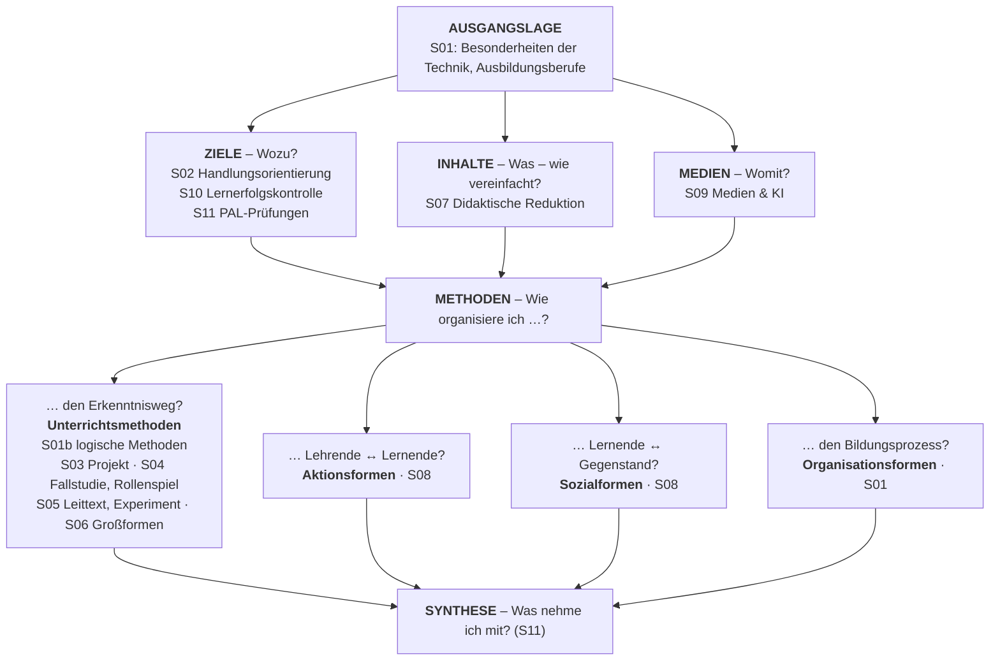

<!--
author:   Hannes Tegelbeckers
email:    hannes.tegelbeckers@ovgu.de
version:  0.3.0
language: de
narrator: Deutsch Female
mode:     Textbook
comment:  Fachdidaktik technischer Allgemeinbildung II – Selbstlerneinheit zu Sitzung S11. Studientext mit Übungen: Entstehung, Prüfungen und Arbeitsweise der PAL, der Weg einer Prüfungsaufgabe, Pro und Contra betrieblicher Auftrag vs. PAL-Prüfung, eine programmierte Aufgabe beurteilen – und das Modul verknüpfen und die mündliche Prüfung vorbereiten.

import:   https://raw.githubusercontent.com/LiaTemplates/mermaid_template/0.1.4/README.md
-->

# S11 – PAL-Prüfungen & Synthese (Selbstlerneinheit)

<!-- didaktik="Selbstlerneinheit S11 · ca. 90 min · Studientext + Übungen · Inhalte der Folien R184–R194 und Zinn (2026), in eigenen Worten erläutert; Vorbereitung auf die mündliche Prüfung" -->
> [!IMPORTANT] 🧭 Leitfrage
> Wie prüft man berufliche Handlungskompetenz – und wie bereite ich mich selbst auf meine mündliche Prüfung vor?

> [!NOTE] 📘 So ist diese Einheit aufgebaut
> Diese Einheit **erklärt die Inhalte der Sitzung S11** in eigenen Worten und mit Beispielen – Sie können sie auch bearbeiten, wenn Sie in der Sitzung nicht dabei waren. Abschnitte 1–3 erläutern die Folien zur PAL, Abschnitte 4–5 verknüpfen das ganze Modul und bereiten die mündliche Prüfung vor. Die Originalfolien finden Sie in der [LiaScript-Sitzung S11](https://liascript.github.io/course/?https://raw.githubusercontent.com/OVGU-VET-TechEd/Fachdidaktik_technischer_Allgemeinbildung_II/main/S11_PAL_Synthese.md).

> [!TIP] ✍️ Übung in Moodle
> Bearbeiten Sie diese Einheit als Übung im Moodle-Kurs – dort wird Ihr Bearbeitungsstand gespeichert: [Übung in Moodle öffnen](https://elearning.ovgu.de/mod/scorm/view.php?id=707273)

**Ablauf (ca. 90 min)**

<!-- data-type="none" -->
| Schritt | Inhalt | Zeit |
| --- | --- | --- |
| 0 | Wo stehen Sie? | 3 min |
| 1 | Die PAL: Entstehung und Prüfungen | 15 min |
| 2 | Wie eine PAL-Aufgabe entsteht | 12 min |
| 3 | Pro und Contra: betrieblicher Auftrag oder PAL-Prüfung? | 20 min |
| 4 | Das Modul verknüpfen | 15 min |
| 5 | Die mündliche Prüfung vorbereiten | 20 min |
| 6 | Abschluss und Prüfungsfragen | 15 min |

## Ihr Lernweg in dieser Einheit

    --{{0}}--
Die Einheit führt von der Entstehung der PAL über den Weg einer Prüfungsaufgabe und den Streit um die richtige Prüfungsform zur Synthese des ganzen Moduls – und zur Vorbereitung auf Ihre mündliche Prüfung.

    --{{1}}--
Auf diesem Weg erreichen Sie sechs Ziele.

      {{1}}

<!-- data-type="none" -->
| Wissen | Können | Beurteilen |
|------|--------|-------|
| Entstehung, Ziele und Arbeitsweise der PAL **erläutern** | die Zahlen der Folien als Stand der Originalfolie **einordnen** | betrieblichen Auftrag und PAL-Prüfung anhand der Gütekriterien **abwägen** |
| den Weg einer PAL-Aufgabe vom Auftrag bis zur Verabschiedung **beschreiben** | eine programmierte Prüfungsaufgabe **beurteilen** und eine handlungsorientierte Alternative **entwickeln** | Begriffe aus mehreren Sitzungen **verknüpfen** und Antworten auf Prüfungsfragen **strukturieren** |

    --{{2}}--
Prüfen Sie kurz, ob Sie den Lernweg lesen können.

      {{2}}
****************************************

**Entscheiden:** Was kommt direkt vor der Prüfungsvorbereitung?

<!-- data-hint-button="1" data-solution-button="2" -->
- [(X)] Modul verknüpfen
- [( )] Pro und Contra
- [( )] Die PAL
[[?]] Folgen Sie den Pfeilen von links nach rechts.
***
Richtig: Abschnitt 4 verknüpft das Modul, Abschnitt 5 bereitet die mündliche Prüfung vor.
***

****************************************

## 0 · Wo stehen Sie?

    --{{0}}--
Eine These von der letzten Inhaltsfolie zum Start. Programmiert meint die schriftliche Prüfungsform mit vorgegebenen Antworten aus dem Baum der konventionellen Prüfung in S10. Am Ende der Einheit stimmen Sie noch einmal ab.

> **„Der programmierte Teil der PAL-Prüfungen wird vor dem Hintergrund der Zielstellung ‚Entwicklung einer beruflichen Handlungskompetenz‘ häufig heftig kritisiert.“** (Folie R194)

**Abstimmen (vorher):** Ist die Kritik berechtigt?

[(a)] Ja, die Kritik ist berechtigt
[(b)] Nein, die Kritik ist unberechtigt
[(c)] Teils, teils
[(unentschieden)] Unentschieden

    --{{1}}--
Denken Sie an Ihre eigene Abschlussprüfung.

      {{1}}
****************************************

> [!TIP] 🧠 Ihre Abschlussprüfung · 2 min
> Wer hat Ihre Abschlussprüfung erstellt – Ihre Schule, die Kammer, eine zentrale Stelle? Welches Gütekriterium aus S10 war erfüllt, welches verletzt?

[[___ ___ ___]]

****************************************

    --{{2}}--
Und schätzen Sie sich selbst ein.

      {{2}}
> [!TIP] 📌 Wie sicher fühlen Sie sich? (1–4)
> Notieren Sie je eine Zahl von 1 (gar nicht) bis 4 (sehr sicher): „Ich kann Vor- und Nachteile zentraler Abschlussprüfungen begründet darstellen.“ – „Ich fühle mich auf die mündliche Prüfung vorbereitet.“ Im Rückblick vergleichen Sie.

## 1.1 Warum es die PAL gibt

    --{{0}}--
In S10 haben Sie Lernerfolgskontrollen im Unterricht betrachtet. Diese Einheit schaut auf die Prüfung von außen: die zentralen Zwischen- und Abschlussprüfungen in der dualen Ausbildung, Folie R184, PAL-Prüfungen. Lesen Sie die Folien mit den Gütekriterien aus S10 im Kopf.

Die Industrie- und Handelskammern (IHKs) führen laut Folie R185 seit über 70 Jahren Abschlussprüfungen durch. **1948** nahm die **Prüfungsaufgaben- und Lehrmittel-Entwicklungsstelle (PAL)** ihre Tätigkeit auf – zunächst mit dem **Austausch von Prüfungsaufgaben** zwischen den Kammern.

Den entscheidenden Schub brachte das **Berufsbildungsgesetz (BBiG) von 1969**: Es brachte den zuständigen Stellen fast eine Verdreifachung des Aufwands für die Durchführung von Prüfungen. Daraus ergab sich die Notwendigkeit, das Prüfungswesen umfassend zu **rationalisieren** – und die **Forderung nach einer verstärkten Objektivierung** der Prüfung (R185).

Folie R186 nennt das Ziel: **Transparenz, Objektivität und Vergleichbarkeit** von Prüfungsergebnissen lassen sich durch überregional erstellte Prüfungen bundesweit besser sichern; die Folie verweist dazu auf die PISA-Untersuchung 2002. Zum Stand der Folie entwickelte die PAL Aufgaben für die Zwischen- und Abschlussprüfungen in **115 gewerblich-technischen Ausbildungsberufen**.

    --{{1}}--
Was bedeutet das im Licht von S10?

      {{1}}
> [!NOTE] Kernaussage
> Die PAL ist die Antwort einer ganzen Branche auf die Frage aus S10: Wie wird eine Prüfung objektiv und vergleichbar?

<small>Nach Folien R184–R186; Erläuterungen: eigene Darstellung.</small>

## 1.2 Die gesetzlich vorgesehenen Prüfungen

    --{{0}}--
Jede und jeder Auszubildende legt eine Zwischen- und eine Abschlussprüfung ab, jeweils mit einem praktischen und einem theoretischen Teil; für beide bietet die PAL Prüfungen an.

- **Praktisch** wird in gewerblich-technischen Berufen ein **Prüfungsstück** oder eine **Arbeitsprobe** abgegeben.
- Die **schriftliche** Prüfung besteht laut Folie aus vier Teilen: **Technologie**, **technische Mathematik**, **Arbeitsplanung** bzw. **Schaltungs- und Funktionsanalyse** und **Wirtschafts- und Sozialkunde**.
- Grundlage sind die **Prüfungsanforderungen**, der **Ausbildungsrahmenplan** (für den betrieblichen Teil der Ausbildung) und der **Rahmenlehrplan der KMK** (für die Berufsschule, gegliedert in Lernfelder).

    --{{1}}--
Was folgt daraus?

      {{1}}
> [!NOTE] Kernaussage
> Die Prüfung stützt sich auf **beide Lernorte** – Betrieb und Berufsschule.

<small>Nach Folie R187; Erläuterung von Ausbildungsrahmenplan und Rahmenlehrplan ergänzt.</small>

## 1.3 Wer die Aufgaben entwickelt

    --{{0}}--
Die Aufgaben entwickeln laut Folie R188 alle an der Ausbildung Beteiligten gemeinsam, in Zusammenarbeit zwischen PAL und Deutschem Gewerkschaftsbund, kurz DGB.

- Der **Hauptausschuss** besteht aus Vertretern der IHKs und der Gewerkschaften.
- Ein **Fachausschuss** hat in der Regel **9 Mitglieder** – zu gleichen Teilen Beauftragte der **Arbeitgeber**, der **Arbeitnehmer** und **Lehrkräfte berufsbildender Schulen**.
- Sie arbeiten ehrenamtlich, werden von der PAL für fünf Jahre berufen und tagen in der Regel zweimal jährlich bei der PAL in Stuttgart.

    --{{1}}--
Für Sie als künftige Lehrkraft an einer berufsbildenden Schule heißt das:

      {{1}}
> [!NOTE] Kernaussage
> Ein Drittel jedes Fachausschusses sind Lehrkräfte wie Sie.

<small>Nach Folie R188.</small>

## [NEU] Und im allgemeinbildenden Unterricht?

    --{{0}}--
Eine Ergänzung aus Zinn, als NEU markiert. PISA ist ein zyklisches Bildungsmonitoring der OECD – daher der PISA-Bezug auf R186: Es geht um Vergleichbarkeit.

<!-- neu="Zinn 2026, S. 48, 53, 72" -->
- **PISA** ist ein zyklisches Bildungsmonitoring der OECD, das alltags- und berufsrelevante Kenntnisse 15-Jähriger international vergleicht – daher der PISA-Bezug auf R186: Es geht um **Vergleichbarkeit**.
- **Bildungsstandards** legen fest, welche Kompetenzen Schülerinnen und Schüler erwerben sollen (Output-Orientierung).

    --{{1}}--
Und für das Gymnasium?

      {{1}}
> [!NOTE] Kernaussage
> Was für die Ausbildung die bundeseinheitliche PAL-Prüfung ist, leisten für das Abitur im Fach Technik die **Einheitlichen Prüfungsanforderungen (EPA Technik)** mit ihren Anforderungsbereichen (vgl. S10).

<small>[NEU] Ergänzung, keine Originalfolie: Zinn (2026), S. 48, 53, 72.</small>

## 2 · Wie eine PAL-Aufgabe entsteht

    --{{0}}--
Die Fachausschüsse haben laut Folie R189 fünf Hauptaufgaben.

1. Prüfungsaufgaben für die schriftlichen und praktischen Prüfungen **auswählen, entwickeln und entwerfen**
2. **Umfang und Tiefe** der Prüfungen festlegen
3. Entwürfe **kritisch durchsehen**
4. Prüfungen **erproben bzw. nachbauen**, um ihre Durchführbarkeit zu gewährleisten (**Qualitätssicherung**), und sie verabschieden
5. statistische Prüfungsergebnisse **auswerten**, um künftige Prüfungen zu verbessern (**Qualitätsoptimierung**)

    --{{1}}--
Zwei Begriffe sind auf der Folie hervorgehoben.

      {{1}}
> [!NOTE] Kernaussage
> **Qualitätssicherung** durch Erprobung und Nachbau, **Qualitätsoptimierung** durch Statistik – so sichert man Gütekriterien im Großen.

<small>Nach Folie R189.</small>

## 2.1 Der Weg einer Aufgabe

    --{{0}}--
Der Weg einer Aufgabe hat nach Folie R190 sechs Schritte.

    --{{1}}--
Zuerst der Auftrag.

      {{1}}
1. **Auftrag:** Die Mitglieder der Fachausschüsse erhalten den **Auftrag**, neue Aufgaben zu entwickeln.

    --{{2}}--
Dann die Sichtung.

      {{2}}
2. **Sichtung:** Die Aufgaben werden im Fachausschuss **gesichtet und vorläufig genehmigt**.

    --{{3}}--
Dann die Form.

      {{3}}
3. **Prüfungsgerechte Form:** PAL-Projektmanagement und CAD-Team bringen die Entwürfe in eine **prüfungs- und normgerechte Form**.

    --{{4}}--
Dann die Kontrolle durch die Mitglieder.

      {{4}}
4. **Kontrolle und Vortest:** Die Mitglieder erhalten die Unterlagen zur **Kontrolle, zum Vortest bzw. Nachbau und zur Stellungnahme**.

    --{{5}}--
Dann die Vorlage.

      {{5}}
5. **Vorlage:** Anhand der Stellungnahmen bereitet die PAL **Vorlagen** für die nächste Ausschusssitzung vor.

    --{{6}}--
Und schließlich die Verabschiedung.

      {{6}}
6. **Verabschiedung:** Dort werden die Aufgaben **endgültig verabschiedet**.

<small>Nach Folie R190; Kurzbezeichnungen der Schritte ergänzt.</small>

## Übung 1a: Der Weg einer PAL-Aufgabe

    --{{0}}--
Bringen Sie die sechs Schritte in die richtige Reihenfolge.

**Ordnen:** Ziehen Sie jede Karte in die richtige Lücke.

<!-- data-randomize data-show-partial-solution data-solution-button="2" -->
Schritt 1: [->[ Auftrag ]] → Schritt 2: [->[ Sichtung ]] → Schritt 3: [->[ Prüfungsgerechte Form ]] → Schritt 4: [->[ Kontrolle und Vortest ]] → Schritt 5: [->[ Vorlage ]] → Schritt 6: [->[ Verabschiedung ]]

## 2.2 Größenordnung und Aufgaben der PAL

    --{{0}}--
Die Folien R191 und R192 zeigen die Größenordnung: Aufgaben für 147 Berufe und Fachrichtungen, rund 144.000 Aufgabensätze für Zwischen- und 266.000 für Abschlussprüfungen pro Jahr, bundeseinheitliche Aufgabensätze für die 81 IHKs, dazu Lehrmittel und Informationsmaterial.

- Aufgaben für **147 Berufe/Fachrichtungen**; pro Jahr ca. **144.000** Aufgabensätze für Zwischen- und **266.000** für Abschlussprüfungen (R191)
- bundeseinheitliche Aufgabensätze für die **81 IHKs**, Lehrmittel und Informationsmaterial (R192)
- Weiterentwicklung des Prüfungssystems: Aufgabenanalyse, Statistik, neue Prüfungs- und Auswertungsverfahren (R191)
- Berücksichtigung von Erkenntnissen aus **Testtheorie und Pädagogik** ebenso wie Erfahrungen aus der Praxis (R192)

    --{{1}}--
Vorsicht mit den Zahlen.

      {{1}}
> [!NOTE] Kernaussage
> ⚠️ Die Folien nennen 115 Berufe (R186) und 147 Berufe/Fachrichtungen (R191), 81 IHKs und Aufgabensatz-Zahlen – ohne Jahr und Quelle. In der Prüfung gilt: Zahlen als **Stand der Originalfolie** kennzeichnen und das **Prinzip** erklären (Rationalisierung, Objektivierung, Vergleichbarkeit), nicht die Zahl.

<small>Nach Folien R186, R191–R192.</small>

## Übung 1b: PAL verstehen

    --{{0}}--
Ergänzen Sie den Text. Wählen, tippen oder ziehen Sie die fehlenden Wörter.

**Ergänzen:**

<!-- data-hint-button="1" data-solution-button="2" data-show-partial-solution -->
Die PAL nahm ihre Tätigkeit im Jahr [[ (1948) | 1969 | 2002 ]] auf. Ein Fachausschuss hat in der Regel so viele Mitglieder: [[9]]. Gleiche Aufgaben für alle Prüflinge sichern vor allem die [->[ (Objektivität) | Validität ]].
[[?]] Folien R185 und R188 – und die Gütekriterien aus S10.

    --{{1}}--
Entscheiden Sie jetzt: richtig oder falsch?

      {{1}}
****************************************

**Entscheiden:** Richtig oder falsch?

<!-- data-hint-button="1" data-solution-button="2" data-show-partial-solution -->
[(richtig) (falsch)]
[  (X)    ( )  ] Die PAL nahm 1948 ihre Tätigkeit mit dem Austausch von Prüfungsaufgaben auf.
[  ( )    (X)  ] Die PAL-Fachausschüsse bestehen nur aus Vertretern der Arbeitgeber.
[  (X)    ( )  ] Aufgabenentwürfe werden vor der Verabschiedung im Vortest bzw. Nachbau erprobt.
[  ( )    (X)  ] Die PAL bewertet die Prüfungen der einzelnen Auszubildenden selbst.
[[?]] Wer sitzt in den Fachausschüssen – und was beschreiben die Folien: Aufgabenentwicklung oder Bewertung?
***
Fachausschüsse: je gleich viele Beauftragte der Arbeitgeber, Arbeitnehmer und Lehrkräfte berufsbildender Schulen (R188). Die PAL entwickelt Aufgabensätze für die IHKs; durchgeführt und bewertet werden die Prüfungen bei den zuständigen Stellen – die Folien beschreiben die Aufgabenentwicklung, nicht die Bewertung einzelner Prüflinge.
***

****************************************

## Übung 1c: Welches Gütekriterium sichert das?

    --{{0}}--
Wenden Sie die Gütekriterien aus S10 auf die PAL an.

**1 · Eine Antwort:** Bundeseinheitliche Aufgabensätze: Alle Prüflinge bekommen die gleichen Anforderungen. Welches Gütekriterium sichert das vor allem?

<!-- data-hint-button="1" data-solution-button="2" -->
- [( )] Reliabilität
- [(X)] Objektivität
- [( )] Validität
[[?]] Gleiche Bedingungen für alle …
***
Gleiche Aufgaben sichern vor allem die Durchführungs- und Auswertungsobjektivität (R176–R177).
***

    --{{1}}--
Jetzt können mehrere Antworten richtig sein.

      {{1}}
****************************************

**2 · Alle zutreffenden:** Welche Merkmale der PAL-Prüfung dienen vor allem der Objektivität?

<!-- data-hint-button="1" data-solution-button="2" -->
- [[X]] Bundeseinheitliche Aufgabensätze für alle Prüflinge
- [[ ]] Grundlage der Aufgaben sind Prüfungsanforderungen, Ausbildungsrahmenplan und KMK-Rahmenplan.
- [[X]] Prüfungs- und normgerechte Form durch PAL-Projektmanagement und CAD-Team
- [[ ]] Statistische Auswertung der Prüfungsergebnisse zur Optimierung künftiger Prüfungen
[[?]] Objektivität: unabhängig davon, wer durchführt und auswertet.
***
Gleiche Aufgaben und eine einheitliche Form sichern vor allem Durchführungs- und Auswertungsobjektivität. Die statistische Auswertung dient der Qualität der Messung – als Reliabilität zuzuordnen; vertretbar ist auch Validität, wenn Aufgaben verbessert werden, die nicht das Richtige messen.
***

****************************************

    --{{2}}--
Zum Schluss ein Begriff.

      {{2}}
****************************************

**3 · Eintippen:** Grundlage der Aufgaben sind Prüfungsanforderungen, Ausbildungsrahmenplan und KMK-Rahmenplan. Welches Gütekriterium soll das vor allem sichern? (ein Wort)

<!-- data-hint-button="1" data-solution-button="2" -->
[[Validität]]
[[?]] Wird geprüft, was gelernt werden soll?

***
Die Orientierung an Prüfungsanforderungen und Rahmenplänen soll sichern, dass geprüft wird, was gelernt werden soll – Validität (R174).
***

****************************************

## 3 · Pro und Contra: betrieblicher Auftrag oder PAL-Prüfung?

    --{{0}}--
Die Folien schließen mit einem Streit: Soll mit einem betrieblichen Auftrag geprüft werden – einer realen Aufgabe aus dem Ausbildungsbetrieb – oder mit der bundeseinheitlichen PAL-Prüfung? Beide Seiten haben Stärken und Schwächen.

<!-- data-type="none" -->
| Betrieblicher Auftrag | PAL-Prüfung |
| --- | --- |
| höhere Motivation aus Selbstständigkeit | Qualitätssicherung der Prüfung durch Standardisierung |
| Fachausbilder wählen die Prüfungsaufgabe – die berufliche Relevanz ist sichergestellt | orientiert sich vornehmlich an Unternehmen der IHK |
| Unternehmen profitiert möglicherweise wirtschaftlich | bundeseinheitlich, nicht nur betriebsintern → Ergebnisse sind vergleichbar (in der Allgemeinbildung schon lange gefordert, siehe PISA) |
| „Trainingslager“ vor der Prüfung schwer realisierbar | an alle Prüflinge werden die gleichen Anforderungen gestellt |
| möglicherweise subjektive Einflüsse auf die Prüfung | |
| kann unter Umständen kostengünstiger realisiert werden | |
| Ausbilder und Prüfer müssen die Aufgaben fachlich einwandfrei ausführen und bewerten können | der **programmierte Teil** wird vor dem Ziel „Entwicklung einer beruflichen Handlungskompetenz“ häufig heftig kritisiert |

    --{{1}}--
Mit den Gütekriterien aus S10 lässt sich der Streit ordnen. Die PAL-Prüfung ist stark bei der Objektivität und Vergleichbarkeit. Der betriebliche Auftrag ist stark bei der Validität für berufliche Handlungskompetenz, weil eine echte Aufgabe geprüft wird – aber schwächer bei der Objektivität, weil Aufgaben und Prüfer von Betrieb zu Betrieb verschieden sind.

      {{1}}
> [!NOTE] Kernaussage
> Welche Seite Sie überzeugt, hängt davon ab, welches Gütekriterium Sie für wichtiger halten.

<small>Nach Folien R193–R194; beide Spalten enthalten Vor- und Nachteile. Einordnung nach Gütekriterien: eigene Darstellung.</small>

## Übung 2: Eine programmierte Aufgabe

    --{{0}}--
Ein Übungsbeispiel im Stil einer schriftlichen Abschlussprüfung – keine echte PAL-Aufgabe. Lesen Sie es und beurteilen Sie es auf der nächsten Seite.

> In einem Netzteil folgt auf den Brückengleichrichter ein Kondensator. Welche Aufgabe hat er?
>
> (a) Er erhöht die Frequenz. (b) Er glättet die pulsierende Gleichspannung. (c) Er begrenzt den Strom. (d) Er wandelt Gleich- in Wechselspannung.

<small>Übungsbeispiel für diese Einheit, keine echte PAL-Aufgabe.</small>

## Übung 2a: Die Aufgabe beurteilen

    --{{0}}--
Beurteilen Sie die programmierte Aufgabe zum Netzteil.

**1 · Eine Antwort:** Welchen Anforderungsbereich prüft die Aufgabe vor allem?

<!-- data-hint-button="1" data-solution-button="2" -->
- [( )] AFB III – Bewertung und Problemlösung
- [(X)] AFB I–II – Wissen bzw. Verstehen
- [( )] psychomotorische Fertigkeiten
[[?]] Was müssen die Prüflinge tun, um die Lösung zu finden?
***
Die Aufgabe prüft vor allem Wissen bzw. Verstehen – aufbauen, messen oder Fehler suchen müssen die Prüflinge nicht.
***

    --{{1}}--
Jetzt können mehrere Antworten richtig sein.

      {{1}}
****************************************

**2 · Alle zutreffenden:** Welche Aussagen treffen auf die Aufgabe zu?

<!-- data-hint-button="1" data-solution-button="2" -->
- [[X]] Hohe Auswertungsobjektivität – die Lösung ist eindeutig.
- [[ ]] Sie prüft, ob jemand ein Netzteil fachgerecht aufbauen und Fehler finden kann.
- [[X]] Eine richtige Antwort kann auch geraten sein.
- [[ ]] Ihre Auswertung hängt stark davon ab, wer korrigiert.
[[?]] Denken Sie an Lösungsschlüssel und Ratewahrscheinlichkeit.
***
Programmierte Aufgaben sind objektiv und ökonomisch auszuwerten – genau das war das Ziel der PAL (Objektivierung, Vergleichbarkeit). Sie prüfen aber nur einen Ausschnitt beruflicher Handlungskompetenz.
***

****************************************

    --{{2}}--
Zum Schluss ein Begriff.

      {{2}}
****************************************

**3 · Eintippen:** Welches Gütekriterium ist bei dieser Aufgabe für berufliche Handlungskompetenz begrenzt? (ein Wort)

<!-- data-hint-button="1" data-solution-button="2" -->
[[Validität]]
[[?]] Misst die Aufgabe, was die Ausbildung erreichen soll?

***
Validität: Für Handlungskompetenz misst die Aufgabe nur einen Ausschnitt – das ist der Kern der Kritik auf R194.
***

****************************************

## Übung 2b: Weiterentwickeln

    --{{0}}--
Entwickeln Sie zum selben Inhalt eine handlungsorientierte Aufgabe.

Formulieren Sie zum selben Inhalt eine **handlungsorientierte** Aufgabe (vgl. S02, S06 Diagnoseaufgabe, S10 AFB III) – mit Erwartungshorizont. Welches Gütekriterium wird dadurch schwerer zu sichern, und wie sichern Sie es trotzdem?

[[___ ___ ___ ___]]

💡 Hinweis

Binden Sie die Aufgabe an einen realen Prüfplatz: messen, Ursache bestimmen, Maßnahme begründen.

✅ Lösung

*„Am Netzteil auf Ihrem Prüfplatz brummt der angeschlossene Verstärker. Messen Sie die Ausgangsspannung mit dem Oszilloskop, bestimmen Sie die Ursache und begründen Sie Ihre Maßnahme.“* Erwartungshorizont: Messung fachgerecht (2), Welligkeit erkannt (2), Ursache Glättungskondensator defekt oder zu klein benannt (2), Maßnahme begründet (2). Gefährdet ist vor allem die **Durchführungsobjektivität** (gleiche Prüfplätze, gleiche Fehler) und die **Auswertungsobjektivität** (Begründungen). Sichern lässt sich das mit standardisierten Prüfplätzen, einem detaillierten Erwartungshorizont und einem Protokoll – wie es die Folien von der PAL beschreiben (Vortest, Nachbau, prüfungsgerechte Form).

## Ihr Urteil: betrieblicher Auftrag oder PAL-Prüfung?

    --{{0}}--
Fällen Sie jetzt Ihr Urteil.

**Abstimmen (nachher):** Welche Seite überzeugt Sie mehr?

[(a)] Betrieblicher Auftrag
[(b)] PAL-Prüfung
[(c)] Beide gleich
[(unentschieden)] Unentschieden

    --{{1}}--
Begründen Sie mit einem Gütekriterium.

      {{1}}
****************************************

**Nachdenken:** Welches Gütekriterium legen Sie als Maßstab an – und warum überzeugt Sie damit die gewählte Seite? Begründen Sie in drei Sätzen.

[[___ ___]]

****************************************

    --{{2}}--
Eine Einordnung:

      {{2}}
> [!NOTE] Kernaussage
> Wer Objektivität und Vergleichbarkeit vorn sieht, spricht für die PAL-Prüfung; wer die Validität für berufliche Handlungskompetenz vorn sieht, für den betrieblichen Auftrag. Beide Urteile sind vertretbar – entscheidend ist die Begründung.

## Die Kurskarte des ganzen Moduls

    --{{0}}--
Zum Abschluss noch einmal die Kurskarte aus S01 – jetzt sind alle Felder gefüllt. Lesen Sie sie als Folge von Planungsentscheidungen: Ausgangslage, Ziele, Inhalte und Medien bestimmen, welche Methode passt. Für die mündliche Prüfung ist sie Ihr Gerüst: Zu jedem Feld sollten Sie Begriffe, ein Modell und ein Beispiel nennen können.

    --{{1}}--
Die Felder oben beantworten die Planungsfragen.

      {{1}}
**① Planungsfragen:** Ausgangslage (S01), Ziele und Kontrolle (S02, S10, S11), Inhalte (S07), Medien (S09)

    --{{2}}--
Die Methoden beantworten vier Leitfragen.

      {{2}}
**② Methoden:** Erkenntnisweg (S01b, S03–S06), Aktions- und Sozialformen (S08), Organisationsformen (S01)

    --{{3}}--
Und die Querverbindungen machen eine gute Prüfungsantwort aus.

      {{3}}
**③ Querverbindungen:** z. B. vollständige Handlung (S02) als Gerüst von Projekt, Leittext, Experiment und Großform (S03–S06)

    --{{4}}--
Nutzen Sie die Karte beim Lernen.

      {{4}}
> [!NOTE] Kernaussage
> Wer die Kurskarte erklären kann, kann jede Prüfungsfrage einordnen – und eine Brücke zu einer zweiten Sitzung schlagen.

<small>Kurskarte als Lesehilfe (wie in S01 und im Kursüberblick), keine Originalfolie.</small>

## 4 · Das Modul verknüpfen: die Kurskarte

    --{{0}}--
Mündliche Prüfungen belohnen Verbindungen zwischen Sitzungen. Die Kurskarte aus S01 ordnet das Modul nach Planungsfragen: Ausgangslage, Ziele, Inhalte, Methoden – Erkenntnisweg sowie Sozial- und Aktionsformen – und Medien.

**1 · Eine Antwort:** Zu welchem Feld der Kurskarte gehört die Didaktische Reduktion?

<!-- data-hint-button="1" data-solution-button="2" -->
- [( )] Methoden – Erkenntnisweg
- [(X)] Inhalte
- [( )] Medien
[[?]] Was – und wie vereinfacht?
***
Inhalte: S07 Didaktische Reduktion.
***

    --{{1}}--
Jetzt können mehrere Antworten richtig sein.

      {{1}}
****************************************

**2 · Alle zutreffenden:** Welche Themen gehören zum Feld „Methoden – Erkenntnisweg“?

<!-- data-hint-button="1" data-solution-button="2" -->
- [[X]] Projektmethode
- [[ ]] Sozialformen und Aktionsformen
- [[X]] Leittext und Experiment
- [[ ]] Lernerfolgskontrolle
[[?]] Sozial- und Aktionsformen haben ein eigenes Methodenfeld.
***
Methoden – Erkenntnisweg: Logische Methoden, Projektmethode, Fallstudie und Rollenspiel, Leittext und Experiment, Methodische Großformen (S01b, S03–S06). Sozial- und Aktionsformen (S08) bilden das zweite Methodenfeld; Lernerfolgskontrolle gehört zu Ziele und Kontrolle (S02, S10, S11).
***

****************************************

    --{{2}}--
Zum Schluss ein Feld.

      {{2}}
****************************************

**3 · Eintippen:** Zu welchem Feld der Kurskarte gehören Simulation und KI? (ein Wort)

<!-- data-hint-button="1" data-solution-button="2" -->
[[Medien]]
[[?]] Womit?

***
Medien: S09 Medien und Wirklichkeitserfahrung, Simulation und KI.
***

****************************************

## Welche Sitzungen verbindet der Begriff?

    --{{0}}--
Viele Begriffe kommen in mehreren Sitzungen vor.

**1 · Eine Antwort:** In welcher Sitzung wurde das Experiment als induktiver Erkenntnisweg behandelt – neben S01b mit dem Zugversuch?

<!-- data-hint-button="1" data-solution-button="2" -->
- [( )] S07
- [(X)] S05
- [( )] S09
[[?]] Leittext und …
***
Induktiv: S01b (HOOKE aus Messwerten), S05 (Experiment als induktiver Erkenntnisweg).
***

    --{{1}}--
Jetzt können mehrere Antworten richtig sein.

      {{1}}
****************************************

**2 · Alle zutreffenden:** In welchen Sitzungen spielt die vollständige Handlung eine Rolle?

<!-- data-hint-button="1" data-solution-button="2" -->
- [[X]] S02 – Handlungsorientierung (Hacker)
- [[ ]] S07 – Didaktische Reduktion
- [[X]] S05 – Leittextmethode
- [[ ]] S09 – Medien und KI
[[?]] Informieren, planen, entscheiden, ausführen, kontrollieren, bewerten …
***
Vollständige Handlung: S02 (Hacker), S03 (Projekte), S05 (Leittextmethode), S06 (Gerüst der Großformen).
***

****************************************

    --{{2}}--
Zum Schluss eine Sitzung.

      {{2}}
****************************************

**3 · Eintippen:** Bewertung und Gütekriterien: S04 (Soll-Ist-Vergleich), S10 (Gütekriterien) – und welche Sitzung noch? (z. B. S03)

<!-- data-hint-button="1" data-solution-button="2" -->
[[S11]]
[[?]] Prüfung von außen …

***
Bewertung: S04 (Soll-Ist-Vergleich), S10 (Gütekriterien), S11 (PAL).
***

****************************************

## Ihre eigene Verbindung

    --{{0}}--
Jetzt stellen Sie selbst eine Verbindung her.

Wählen Sie einen Begriff (z. B. *Selbstständigkeit*, *Richtigkeit und Zweckmäßigkeit*, *Soll-Ist-Vergleich*, *Medien*) und erklären Sie in **fünf Sätzen**, wie er in mindestens drei Sitzungen vorkommt.

[[___ ___ ___ ___]]

💡 Hinweis

Gehen Sie die Kurskarte Feld für Feld durch und fragen Sie: Wo taucht der Begriff auf – und in welcher Bedeutung?

✅ Lösung

Beispiel *Kontrolle und Bewertung*: Kontrollieren und Bewerten sind Phasen der vollständigen Handlung (S02). In Projekten wird mit einem Soll-Ist-Vergleich kontrolliert und bewertet (S04). Auch die Leittextmethode endet mit Kontrollieren und Bewerten (S05). S10 zeigt, woran eine gute Kontrolle zu erkennen ist: Validität, Reliabilität, Objektivität. S11 überträgt das auf die zentralen Abschlussprüfungen der PAL.

## 5 · Die mündliche Prüfung vorbereiten

    --{{0}}--
Die Prüfungsleistung des Moduls ist ausschließlich eine mündliche Prüfung. Die Prüfungsfragen zum Üben sind experimentell – es ist nicht garantiert, dass Fragen in dieser Form gestellt werden. Eine gute mündliche Antwort hat eine erkennbare Struktur. Ein Muster in vier Schritten:

<!-- data-type="none" -->
| Schritt | Was Sie sagen | Beispiel: „Was ist didaktische Reduktion?“ |
| --- | --- | --- |
| 1 Begriff | Definition, möglichst mit Autor | widerspruchsfreier Übergang zu einer vereinfachten Aussage, die unter Nennung der Einschränkungen korrekt bleibt (Grüner) |
| 2 Erläutern | Unterscheidungen, Struktur | vertikal (Gültigkeitsumfang reduziert) – horizontal (bleibt erhalten) |
| 3 Beispiel | aus Ihrer Fachrichtung | Hebelgesetz für den gewichtslosen Hebel |
| 4 Bewerten oder verbinden | Grenze, Bezug zu anderer Sitzung | Bezug zu S01: Richtigkeit als Kriterium technischer Aussagen |

    --{{1}}--
Das Wichtigste zur Vorbereitung:

      {{1}}
> [!NOTE] Kernaussage
> Üben Sie das **Argumentieren**, nicht das Auswendiglernen von Antworten.

<small>Antwortmuster: eigene Darstellung; Beispiel nach S07 und S01.</small>

## Übung 3: Eine Prüfungsfrage nach dem Muster beantworten

    --{{0}}--
Üben Sie das Muster an einer echten Prüfungsfrage.

Beantworten Sie eine Prüfungsfrage aus einer Sitzung Ihrer Wahl nach dem Muster **Begriff – Erläutern – Beispiel – Bewerten oder verbinden** – schriftlich in Stichpunkten, danach **laut** in höchstens drei Minuten.

[[___ ___ ___ ___]]

💡 Hinweis

Jede Sitzung endet mit fünf Prüfungsfragen zum Üben – beginnen Sie mit einer, die Ihnen schwerfällt.

✅ Lösung

Frage aus S10: „Erläutern Sie den Zusammenhang zwischen Lernziel und Lernkontrolle.“ **1 Begriff:** Ein Lernziel besteht aus Inhalt und Verhalten (R170). **2 Erläutern:** Im Verhalten gibt es Stufen – Wissen, Verstehen, Anwenden, Problemlösen; geprüft werden darf nur auf der Stufe, auf der gelehrt wurde. **3 Beispiel:** Wurde das Ohm'sche Gesetz nur genannt, ist eine Fehlersuche in einer unbekannten Schaltung als Prüfung nicht zulässig. **4 Verbinden:** Das ist Constructive Alignment (S01) – und der Kern der Kritik am programmierten Teil der PAL-Prüfung (S11).

## Ihr Lernplan

    --{{0}}--
Planen Sie die Zeit bis zur Prüfung.

Welche **drei Sitzungen** sind für Sie noch am unsichersten? Planen Sie bis zur Prüfung je einen Termin, an dem Sie deren Selbstlerneinheit wiederholen.

[[___ ___ ___ ___]]

💡 Hinweis

Nutzen Sie Ihre Einschätzungen aus den Rückblicken der Selbstlerneinheiten.

✅ Lösung

Beispiel: S06 Großformen (Mo., 18.01.) · S07 Didaktische Reduktion (Do., 21.01.) · S10 Lernerfolgskontrolle (Mo., 25.01.) – jeweils Selbstlerneinheit wiederholen, dann die fünf Prüfungsfragen laut beantworten, am besten zu zweit.

## 6 · Noch einmal: Ist die Kritik berechtigt?

    --{{0}}--
Zum Schluss noch einmal die These vom Anfang.

**Abstimmen (nachher):** Ist die Kritik am programmierten Teil der PAL-Prüfungen berechtigt?

[(a)] Ja, die Kritik ist berechtigt
[(b)] Nein, die Kritik ist unberechtigt
[(c)] Teils, teils
[(unentschieden)] Unentschieden

    --{{1}}--
Was ist Ihnen im ganzen Modul am unklarsten geblieben?

      {{1}}
****************************************

**Nachdenken:** Muddiest point: Was ist Ihnen im ganzen Modul am unklarsten geblieben?

[[___ ___]]

****************************************

    --{{2}}--
Eine Einordnung:

      {{2}}
> [!NOTE] Kernaussage
> Beide Antworten lassen sich mit den Gütekriterien begründen. Programmierte Aufgaben sichern Objektivität und Vergleichbarkeit – das war das Ziel der PAL (R185–R186). Für berufliche Handlungskompetenz sind sie aber nur begrenzt valide, weil sie vor allem Wissen und Verstehen prüfen (R194; S02, S10). Deshalb gibt es neben dem schriftlichen auch den praktischen Prüfungsteil (R187).

## Das Wichtigste aus S11

    --{{0}}--
Fassen wir zusammen.

    --{{1}}--
Erstens: warum es die PAL gibt.

      {{1}}
- Die PAL entstand aus Rationalisierung und der Forderung nach Objektivierung: Transparenz, Objektivität, Vergleichbarkeit (R185–R186).

    --{{2}}--
Zweitens: wie Aufgaben entstehen.

      {{2}}
- Fachausschüsse – zu einem Drittel BBS-Lehrkräfte – entwickeln Aufgaben in sechs Schritten mit Vortest und Statistik (R188–R190).

    --{{3}}--
Drittens: der Streit.

      {{3}}
- Betrieblicher Auftrag oder PAL-Prüfung: Validität für Handlungskompetenz gegen Objektivität und Vergleichbarkeit (R193–R194).

    --{{4}}--
Und viertens: die Prüfung.

      {{4}}
****************************************

- Gute mündliche Antworten verbinden: Begriff, Erläuterung, Beispiel aus der Fachrichtung, Bezug zu einer anderen Sitzung.

> [!NOTE] Zum Merken
> Jede Prüfungsform hat Stärken bei einem Gütekriterium – begründen Sie Ihre Wahl.

****************************************

    --{{5}}--
Eine letzte Frage.

      {{5}}
****************************************

**Wiederholen:** Was nennt Folie R185 als Anlass für die Rationalisierung des Prüfungswesens?

<!-- data-hint-button="1" data-solution-button="2" -->
- [( )] die PISA-Untersuchung 2002
- [( )] der Wunsch der Betriebe nach eigenen Prüfungsaufgaben
- [(X)] fast eine Verdreifachung des Prüfungsaufwands durch das BBiG 1969
[[?]] Ein Gesetz von 1969 …
***
Richtig: Das BBiG 1969 brachte den zuständigen Stellen fast eine Verdreifachung des Aufwands – daraus folgten Rationalisierung und die Forderung nach Objektivierung (R185). PISA nennt R186 als Bestätigung.
***

****************************************

    --{{6}}--
Und jetzt: die Vorbereitung auf die mündliche Prüfung.

      {{6}}
**➡️ Als Nächstes:** 🧩 Optional für die Selbstlernsitzung am 11.01.2027: Ein ausgearbeiteter Unterrichtsentwurf liefert Ihnen Beispiele für die Prüfung – führen Sie dort Ihre Bausteine 1–11 zusammen.

## Prüfungsfragen zum Üben

    --{{0}}--
Die Prüfungsleistung des Moduls ist eine mündliche Prüfung. Mit diesen fünf Fragen üben Sie, die Inhalte dieser Einheit frei, strukturiert und mit Beispielen zu erklären.

> [!TIP] 🎙️ So üben Sie
> Lesen Sie eine Frage und antworten Sie **laut** in höchstens drei Minuten – nach dem Muster **Begriff – Erläutern – Beispiel – Verbinden**. Öffnen Sie erst danach die Antwortskizze und vergleichen Sie: Was fehlte, was war ungenau? Noch besser: Lassen Sie sich von einer Kommilitonin oder einem Kommilitonen abfragen.

**Frage 1 · Gründung und Ziele der PAL:** Warum wurde die PAL gegründet, und welche Ziele verfolgt sie?

✅ Antwortskizze 1

- **1 Begriff:** Die **Prüfungsaufgaben- und Lehrmittel-Entwicklungsstelle (PAL)** nahm 1948 ihre Tätigkeit auf, zunächst mit dem Austausch von Prüfungsaufgaben zwischen den IHKs (R185).
- **2 Erläutern:** Das **BBiG von 1969** brachte fast eine Verdreifachung des Prüfungsaufwands – daraus folgten die Notwendigkeit zu **rationalisieren** und die Forderung nach **Objektivierung**. Ziel: **Transparenz, Objektivität und Vergleichbarkeit** der Prüfungsergebnisse durch überregional erstellte Prüfungen (R186). Gesetzlich vorgesehen sind Zwischen- und Abschlussprüfung mit praktischem und schriftlichem Teil (R187).
- **3 Beispiel:** Zum Stand der Folie entwickelte die PAL Aufgaben für 115 gewerblich-technische Ausbildungsberufe; die schriftliche Prüfung umfasst Technologie, technische Mathematik, Arbeitsplanung bzw. Schaltungs- und Funktionsanalyse sowie Wirtschafts- und Sozialkunde.
- **4 Verbinden:** Die PAL ist die Antwort auf die Frage aus S10: Wie wird eine Prüfung objektiv und vergleichbar?

**Frage 2 · Weg einer Aufgabe:** Beschreiben Sie den Weg einer PAL-Aufgabe vom Auftrag bis zur Verabschiedung.

✅ Antwortskizze 2

- **1 Begriff:** PAL-Aufgaben entstehen in **Fachausschüssen** mit in der Regel neun Mitgliedern – zu gleichen Teilen Beauftragte der Arbeitgeber, der Arbeitnehmer und Lehrkräfte berufsbildender Schulen (R188, R190).
- **2 Erläutern:** Sechs Schritte (R190): **Auftrag** an die Ausschussmitglieder – **Sichtung** und vorläufige Genehmigung im Fachausschuss – **prüfungs- und normgerechte Form** durch Projektmanagement und CAD-Team – **Kontrolle, Vortest bzw. Nachbau und Stellungnahme** – **Vorlagen** für die nächste Sitzung – **Verabschiedung**.
- **3 Beispiel:** Eine praktische Aufgabe für Industriemechaniker wird vor der Verabschiedung von Ausschussmitgliedern nachgebaut, um Machbarkeit und Zeitbedarf zu prüfen.
- **4 Verbinden:** Jeder Schritt dient einem Gütekriterium aus S10: Vortest und Nachbau sichern Reliabilität und Validität, die einheitliche Form die Durchführungs- und Auswertungsobjektivität.

**Frage 3 · Betrieblicher Auftrag oder PAL:** Wägen Sie betrieblichen Auftrag und PAL-Prüfung anhand der Gütekriterien gegeneinander ab.

✅ Antwortskizze 3

- **1 Begriff:** Zwei Wege, berufliche Handlungskompetenz zu prüfen: eine reale Aufgabe aus dem Ausbildungsbetrieb oder die bundeseinheitliche PAL-Prüfung (R193–R194).
- **2 Erläutern:** **Betrieblicher Auftrag:** höhere Motivation, berufliche Relevanz sichergestellt, ggf. kostengünstiger; aber subjektive Einflüsse möglich, Ausbilder müssen fachlich einwandfrei bewerten können. **PAL:** Qualitätssicherung durch Standardisierung, bundeseinheitlich und vergleichbar, gleiche Anforderungen für alle; aber vornehmlich an IHK-Unternehmen orientiert, der programmierte Teil wird kritisiert.
- **3 Beispiel:** Ordnung nach S10: Die PAL ist stark bei **Objektivität** und Vergleichbarkeit; der betriebliche Auftrag bei der **Validität** für berufliche Handlungskompetenz, weil eine echte Aufgabe geprüft wird – schwächer bei der Objektivität.
- **4 Verbinden:** Welche Seite überzeugt, hängt davon ab, welches Gütekriterium man für wichtiger hält – entscheidend ist die **Begründung**.

**Frage 4 · Programmierter Teil und HoU:** „Der programmierte Teil der PAL-Prüfung passt nicht zur Handlungskompetenz.“ – Nehmen Sie Stellung (vgl. S02).

✅ Antwortskizze 4

- **1 Begriff:** Programmierte Aufgaben geben Antworten vor (z. B. Mehrfachwahl); **berufliche Handlungskompetenz** umfasst fachliche, methodische und soziale Komponenten (S02, Hortsch).
- **2 Erläutern:** Pro Kritik: Programmierte Aufgaben prüfen oft nur Wissen (AFB I), nicht Planen, Entscheiden und Kontrollieren – die vollständige Handlung (S02). Contra: Sie sind sehr objektiv und reliabel, decken viele Inhalte ab und können mit guten Distraktoren auch Verstehen und Anwenden prüfen.
- **3 Beispiel:** Eine Mehrfachwahlfrage zum Kernlochdurchmesser prüft Tabellenwissen; eine Situationsaufgabe mit Störungsbeschreibung und begründeter Auswahl prüft Diagnose und Entscheidung.
- **4 Verbinden:** Constructive Alignment (S10): Prüfung muss zum Ziel passen. Weiterentwicklung: programmierte Teile mit handlungsorientierten Situationsaufgaben kombinieren – die Kritik ist also berechtigt, aber kein Grund, Standardisierung aufzugeben.

**Frage 5 · Kurskarte:** Ordnen Sie die Themen des Moduls den Planungsfragen der Kurskarte zu und begründen Sie eine Zuordnung.

✅ Antwortskizze 5

- **1 Begriff:** Die **Kurskarte** ordnet das Modul nach Planungsfragen: Ausgangslage, Ziele, Inhalte, Medien, Methoden – die Methoden nach vier Leitfragen „Wie organisiere ich …?“ (S01).
- **2 Erläutern:** Ausgangslage: S01 (Technik, Ausbildungsberufe). Ziele und Kontrolle: S02 Handlungsorientierung, S10 Lernerfolgskontrolle, S11 PAL. Inhalte: S07 Didaktische Reduktion. Medien: S09. Methoden – Erkenntnisweg: S01b, S03 Projekt, S04 Fallstudie/Rollenspiel, S05 Leittext/Experiment, S06 Großformen; Sozial- und Aktionsformen: S08; Organisationsformen: S01.
- **3 Beispiel:** Didaktische Reduktion gehört zu **Inhalte**, weil sie beantwortet, *was* und *wie vereinfacht* gelehrt wird – nicht, wie der Unterricht organisiert wird.
- **4 Verbinden:** Querverbindung als Bonus: Die vollständige Handlung (S02) ist das Gerüst von Projekt (S03), Leittext und Experiment (S05) und Großformen (S06).

    --{{1}}--
Schätzen Sie zum Schluss ein, wie sicher Sie sind. Wiederholen Sie die unsicheren Fragen in einigen Tagen – und üben Sie fächerübergreifend mit dem Prüfungstrainer.

      {{1}}
****************************************

**Einschätzen:** Wie sicher beantworten Sie die Fragen frei und in ganzen Sätzen?

[(sicher)(teilweise)(noch unsicher)]
[                                    ] Frage 1 · Gründung und Ziele der PAL
[                                    ] Frage 2 · Weg einer Aufgabe
[                                    ] Frage 3 · Betrieblicher Auftrag oder PAL
[                                    ] Frage 4 · Programmierter Teil und HoU
[                                    ] Frage 5 · Kurskarte

<small>Die Prüfungsfragen sind experimentell: Sie dienen der Vorbereitung, es ist nicht garantiert, dass Fragen in dieser Form gestellt werden. Die Antwortskizzen zeigen eine mögliche Antwort – üben Sie das Argumentieren, nicht das Auswendiglernen. Über alle Sitzungen hinweg üben Sie mit dem [Prüfungstrainer](https://liascript.github.io/course/?https://raw.githubusercontent.com/OVGU-VET-TechEd/Fachdidaktik_technischer_Allgemeinbildung_II/main/Selflearn/Pruefungstrainer.md).</small>

****************************************

## Rückblick

    --{{0}}--
Nehmen Sie sich zwei Minuten für einen Rückblick und vergleichen Sie mit Ihrer Einschätzung aus Abschnitt 0. 🤖 Prüfungssimulation mit KI: Bitten Sie ein KI-Werkzeug: Du bist Prüfer in einer mündlichen Prüfung zur Fachdidaktik technischer Fachrichtungen. Stelle mir eine Frage zu einem Thema, warte auf meine Antwort und stelle dann eine Nachfrage, die nach einem Beispiel oder einer Begründung fragt. Gib mir am Ende Rückmeldung zu Struktur und Fachbegriffen – nicht zu Inhalten, die nicht im Kurs vorkommen. Maßstab für die Inhalte bleiben die Sitzungen und Folien des Kurses.

**Nachdenken:** Was ist das Wichtigste, das Sie gelernt haben – und was ist noch unklar?

[[___ ___ ___]]

    --{{1}}--
Haken Sie ab, was Sie jetzt können.

      {{1}}
****************************************

**Abhaken:** Was können Sie jetzt?

- [ ] Ich kann Vor- und Nachteile zentraler Abschlussprüfungen begründet darstellen.
- [ ] Ich kann Begriffe aus mehreren Sitzungen verknüpfen.
- [ ] Ich fühle mich auf die mündliche Prüfung vorbereitet.

****************************************

    --{{2}}--
Und zum Schluss: Wie hat die Einheit für Sie funktioniert?

      {{2}}
****************************************

**Feedback:** Wie hat diese Einheit für Sie funktioniert?

[(1 stimme zu)(2 eher ja)(3 teils)(4 eher nein)(5 stimme nicht zu)]
[                                                                   ] Das Tempo war angemessen.
[                                                                   ] Die Erklärungen waren verständlich.
[                                                                   ] Die Beispiele haben mir beim Verstehen geholfen.
[                                                                   ] Die Übungen waren nützlich.

****************************************

## Vorbereitung auf die Modulprüfung

    --{{0}}--
Die Prüfungsleistung ist ausschließlich eine mündliche Prüfung. Arbeiten Sie die Prüfungsfragen zum Üben aller zwölf Sitzungen durch – am besten laut und zu zweit.

<!-- style="max-width:100%;width:60%;display:block;margin:0 auto;" -->

> [!IMPORTANT] Zum Nachdenken bis zum nächsten Mal
> Welche drei Prüfungsfragen des Moduls fallen Ihnen am schwersten? Beantworten Sie sie laut nach dem Muster aus Abschnitt 5.

*Optionale Selbstlernsitzung · Montag, 11.01.2027 · danach: mündliche Modulprüfung*

## Literatur

    --{{0}}--
Hier finden Sie die Quellen dieser Einheit.

- Angaben zur PAL (Zahlen, Gremien) – zitiert nach S11, Folien R185–R192; auf den Originalfolien ohne Quelle und Stand.
- Berufsbildungsgesetz (BBiG) 1969 – zitiert nach S11, Folie R185.
- Zinn, B. (2026). *Didaktik des naturwissenschaftlichen, informatischen und technikwissenschaftlichen Unterrichts.* Springer Spektrum, S. 48, 53, 72–73; Abschn. 8.2, S. 217–219. https://doi.org/10.1007/978-3-662-72499-6

<small>Erläuterungen und Beispiele in dieser Einheit: eigene Darstellung auf Grundlage der Folien. Gesamtverzeichnis: 00_Literatur.md</small>
