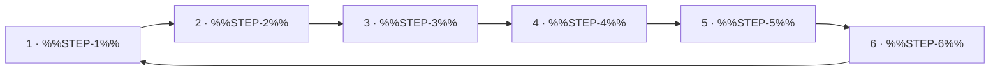

<!--
author:   %%AUTHOR%%
email:    %%EMAIL%%
version:  0.2.0
language: en
narrator: US English Female
mode:     Presentation
comment:  A cycle with 6 steps as a Mermaid loop, narrated step by step, with an ordering task.

import:   https://raw.githubusercontent.com/LiaTemplates/mermaid_template/0.1.4/README.md
-->

# Template `Cycle_Template_6`

- **Purpose:** Explain a cycle with exactly 6 steps whose last step leads back to the first (control loop, learning or work cycle), then let learners put the steps in order.
- **Pairs with:** `Original_Slide_Template_2`, `Figure_Template_1`, `Interactive_Exercise_Template_2`
- **Variants:** Change LR to TD in the chart for the other direction. The arrow from the last step back to step 1 closes the cycle. Generate other step counts with `make_process_templates.py`.

<!-- data-type="none" -->
| Placeholder | Meaning | Limit | Example |
|---|---|---|---|
| `%%SLIDE-TITLE%%` | Name of the process | max 8 words | The Work Process |
| `%%NARRATION-0%%` | Spoken overview | 1–2 sentences | The work process has 6 steps. |
| `%%STEP-1%%` … `%%STEP-6%%` | Step name, no quotes | max 5 words | Analyse ; Plan ; Decide ; Prepare ; Carry out ; Check |
| `%%NARRATION-1%%` … `%%NARRATION-6%%` | Spoken explanation per step | 1–3 sentences | Step 1 is about analyse. ; Step 2 is about plan. ; Step 3 is about decide. ; Step 4 is about prepare. ; Step 5 is about carry out. ; Step 6 is about check. |
| `%%STEP-TEXT-1%%` … `%%STEP-TEXT-6%%` | Short explanation per step | max 15 words | Understand the problem and the goal. ; Plan the steps and the material. ; Choose one of the options. ; Prepare tools and workplace. ; Do the work as planned. ; Compare the result with the goal. |
| `%%SOURCE%%` | Source of the process, shown small at the bottom | 1 line | Quelle: Folie R080 |
| `%%ORDER-TITLE%%` | Title of the ordering slide | max 5 words | Put It in Order |
| `%%NARRATION-ORDER-0%%` | Spoken intro to the task | 1 sentence | Drag the steps into the right order. |

<!-- TEMPLATE:BEGIN -->

## %%SLIDE-TITLE%%

    --{{0}}--
%%NARRATION-0%%

    --{{1}}--
%%NARRATION-1%%

      {{1}}
1. **%%STEP-1%%:** %%STEP-TEXT-1%%

    --{{2}}--
%%NARRATION-2%%

      {{2}}
2. **%%STEP-2%%:** %%STEP-TEXT-2%%

    --{{3}}--
%%NARRATION-3%%

      {{3}}
3. **%%STEP-3%%:** %%STEP-TEXT-3%%

    --{{4}}--
%%NARRATION-4%%

      {{4}}
4. **%%STEP-4%%:** %%STEP-TEXT-4%%

    --{{5}}--
%%NARRATION-5%%

      {{5}}
5. **%%STEP-5%%:** %%STEP-TEXT-5%%

    --{{6}}--
%%NARRATION-6%%

      {{6}}
6. **%%STEP-6%%:** %%STEP-TEXT-6%%

<small>%%SOURCE%%</small>

## %%ORDER-TITLE%%

    --{{0}}--
%%NARRATION-ORDER-0%%

**Order:** Drag each card into the right gap.

<!-- data-randomize data-show-partial-solution data-solution-button="2" -->
Step 1: [->[ %%STEP-1%% ]] → Step 2: [->[ %%STEP-2%% ]] → Step 3: [->[ %%STEP-3%% ]] → Step 4: [->[ %%STEP-4%% ]] → Step 5: [->[ %%STEP-5%% ]] → Step 6: [->[ %%STEP-6%% ]]

<!-- TEMPLATE:END -->
